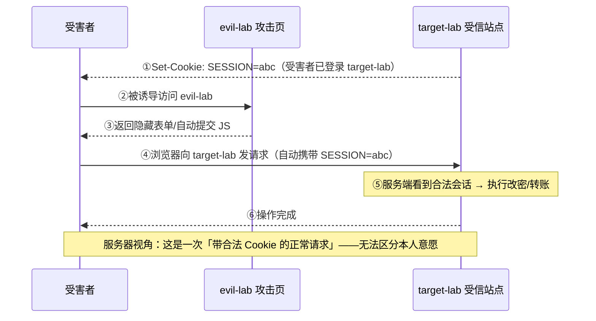
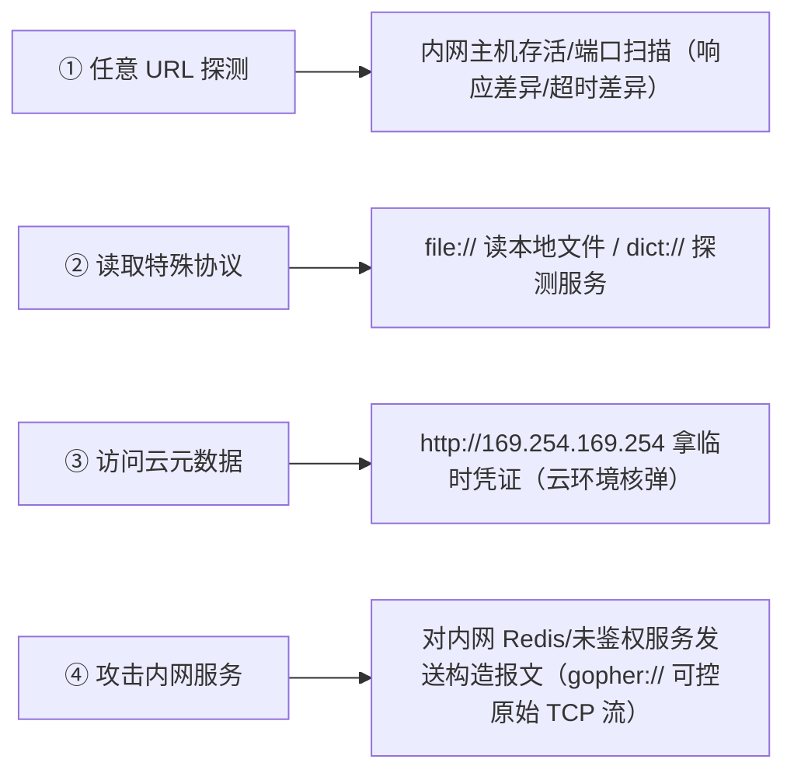
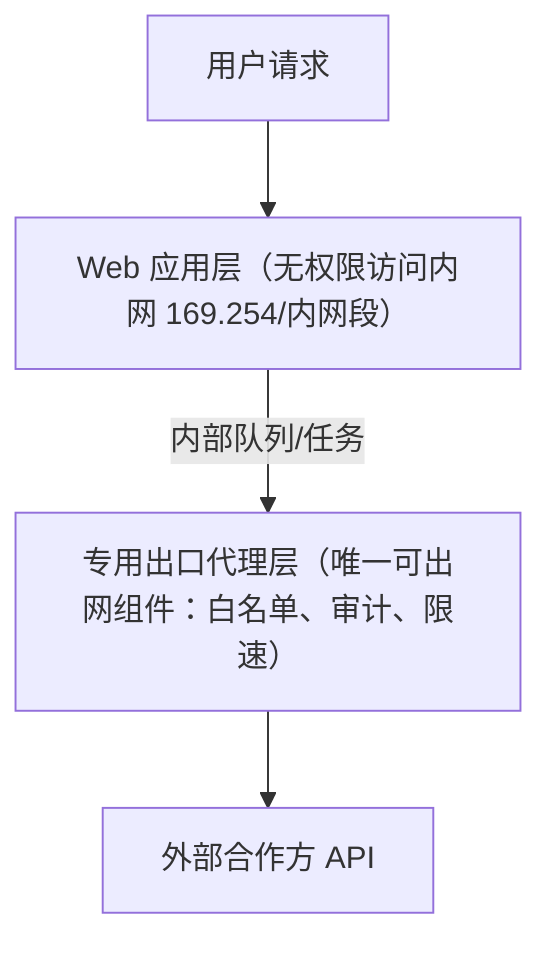

# CSRF 跨站请求伪造 与 SSRF 服务端请求伪造

> 日期：2026-11-04
> 所属大纲阶段：3. Web 安全
> 参考资料：
> - OWASP《Cross-Site Request Forgery Prevention Cheat Sheet》
> - PortSwigger Web Security Academy — CSRF、CORS、SSRF 专题
> - MDN Web Docs — HTTP access control (CORS)、Set-Cookie SameSite
> - RFC 6454 — The Web Origin Concept；RFC 6265bis（Cookie SameSite）
> - AWS 文档 — EC2 Instance Metadata and User Data（IMDSv2）
> - Capital One 2019 数据泄露公开司法文件与复盘报告

---

## 0. 阅读前提与安全红线

- 读者画像：有开发背景，理解浏览器同源策略与 Cookie 基本行为。
- **本文所有 PoC 与利用流程仅限本地靶场（DVWA、自建授权服务）使用**。对真实第三方系统构造 CSRF 攻击页面或探测其内网，均属未授权行为。
- 环境：Docker 部署的 DVWA v1.9（CSRF 模块）；本机 `python3 -m http.server` 充当攻击页宿主；涉及云元数据的演示仅描述流程原理，应在自建云账号中验证。

---

## 1. CSRF：跨站请求伪造原理

**跨站请求伪造（Cross-Site Request Forgery, CSRF）**：攻击者诱导**已登录**的受害者浏览器，向其受信站点发出**非本人意愿**的请求。它利用的不是网站漏洞，而是 **Web 的两个默认设计**：

1. **Cookie 自动携带机制**：浏览器对目标域的请求，只要该域 Cookie 存在且策略允许（域、路径、SameSite），**无论请求由哪个页面的代码发起**，都会自动附上。
2. HTML/JS 天然允许**跨站发起请求**（表单提交、图片加载、fetch 等——能否读响应受同源策略限制，但**发出**不受限）。

### 1.1 攻击时序图



关键认知：CSRF **不偷 Cookie、不需要知道 Cookie 值**，只「借用」浏览器自动带 Cookie 的能力；攻击者通常也**读不到响应**（同源策略限制），因此 CSRF 适合「改变状态」的请求（改密、转账、关注），不适合「读数据」（读数据靠 XSS 或 CORS 配置错误）。

### 1.2 CSRF 与 XSS 的区别对比表

| 维度 | XSS | CSRF |
|------|-----|------|
| 利用漏洞 | 输出编码缺失（注入执行 JS） | 无漏洞也成立（借浏览器机制） |
| 攻击者能否读响应/数据 | 能（脚本在同源运行） | 通常不能（SOP 限制） |
| 是否需要注入脚本 | 是 | 否（纯 HTML 即可） |
| 主要危害 | 窃取、代替用户任意操作 | 代替用户执行特定状态变更 |
| CSRF token 是否有效 | 无效（XSS 可读 token） | 有效（跨站表单拿不到 token） |
| 核心防御 | 输出编码/CSP | token/SameSite/Origin 校验 |
| 关系 | XSS 是 CSRF 的超集能力（可绕过 token） | XSS + CSRF 组合是经典组合拳 |

> 记忆：**XSS 是「在你的页面里执行我的代码」，CSRF 是「借你的身份发我的请求」**。

---

## 2. CSRF PoC 构造（仅限靶场）

### 2.1 GET 型：一张图片就够了

若目标的状态变更操作用 GET（`/api/password?new=xxx`），攻击页只需：

```html
<!-- 仅限本地靶场：evil-lab/csrf_get.html -->
<!-- DVWA CSRF Low 模块即 GET 改密 /vulnerabilities/csrf/?password_new=..&password_conf=..&Change=Change -->

<!-- img 的 src 请求同样自动携带 target-lab 的 Cookie；受害者加载页面即完成改密 -->
```

顺带一句：GET 做状态变更本身就违反 HTTP 语义（GET 应安全/幂等），还容易被预加载器、代理、爬虫误触发。

### 2.2 POST 型：表单自动提交

```html
<!-- 仅限本地靶场：evil-lab/csrf_post.html -->
<form id="f" action="http://target-lab:8080/vulnerabilities/csrf/" method="POST">
  <input type="hidden" name="password_new" value="pwned">
  <input type="hidden" name="password_conf" value="pwned">
  <input type="hidden" name="Change" value="Change">
</form>
<script>document.getElementById('f').submit();</script>
```

要点：

- 跨站表单提交**不受同源策略限制**（SOP 管读不管发）；
- 攻击页宿主任意（本机 http.server、邮件内嵌 HTML 效果有限因 CSP/sandbox，靶场用浏览器直开即可）；
- 若接口要求 JSON/自定义头，纯表单难以直接构造 → 这类「预检需求」事实上构成部分 CSRF 缓解（见 §8 CORS）。

### 2.3 危害场景清单

| 场景 | 后果 |
|------|------|
| 改绑邮箱/手机 | 账号被接管（配合「忘记密码」流程） |
| 改密 | 直接接管（DVWA 演示场景） |
| 转账/下单/支付确认 | 资金损失 |
| 添加管理员/修改权限 | 提权（低频高危） |
| 关注/点赞/发帖 | 蠕虫式传播（社交平台 CSRF 蠕虫） |
| 退出登录/注销 | 可用性攻击 |

---

## 3. SameSite Cookie 详解

`SameSite` 是现代浏览器对 CSRF 最有效的**平台级缓解**：限制 Cookie 是否随**跨站请求**发送。

### 3.1 三档取值

```http
Set-Cookie: SESSION=abc; SameSite=Strict
Set-Cookie: SESSION=abc; SameSite=Lax
Set-Cookie: SESSION=abc; SameSite=None; Secure    # None 必须配 Secure（现代浏览器强制）
```

| 取值 | 行为 | 体验代价 |
|------|------|---------|
| **Strict** | 任何跨站请求都不带（包括点链接跳转过来的首个 GET） | 从外部链接点进站点会「掉登录态」 |
| **Lax** | 顶级导航的安全 GET（`<a>` 跳转、地址栏）携带；跨站 POST/iframe/图片/XHR **不带** | 体验基本无损（默认推荐） |
| **None** | 全部跨站携带 | 必须配 `Secure`；等于放弃该 Cookie 的 CSRF 防护，用于确有跨站需求的场景（如第三方支付回跳） |

### 3.2 默认值演进与兼容性

- Chrome 80（2020-02）起：未声明 SameSite 的 Cookie 默认按 **Lax** 处理（曾有约 2 个月的 `Lax+POST` 宽限策略以平滑兼容）；
- Firefox、Edge 相继跟进类似默认；老浏览器/老 WebView **不认识 SameSite 属性 → 视为 None**；
- 工程结论：**显式声明**所有 Cookie 的 SameSite；核心会话 Cookie 用 `Lax`（或 `Strict`）；确需跨站的（支付/SSO 域）单独 `None; Secure` 并收敛其余面。

### 3.3 SameSite 不是完整 CSRF 防御

- 同站（Same-Site）≠ 同源：子域之间的请求算同站——若攻击可落在同站子域（用户内容域），SameSite 不拦截；
- `SameSite=None` 的站点仍完全暴露；老浏览器回退为 None；
- 因此 SameSite 定位是「深度缓解层」，与 token 防御**叠加部署**。

---

## 4. CSRF Token 防御

**Synchronizer Token Pattern**：服务端向会话绑定一个随机不可预测值，表单携带，提交时校验。跨站攻击者**拿不到**该值（SOP 限制其读取目标站页面）。

### 4.1 生成与校验要点

```python
# 伪代码：生成（每次会话）
if "csrf" not in session:
    session["csrf"] = secrets.token_hex(32)     # CSPRNG，不可预测

# 校验（每次状态变更请求）
def verify(request):
    ok = secrets.compare_digest(        # 恒时比较，防时序侧信道
        session.get("csrf", ""), request.form.get("csrf", ""))
    if not ok:
        abort(403)
```

### 4.2 设计清单

| 要点 | 说明 |
|------|------|
| 不可预测 | CSPRNG 生成（`secrets`/`SecureRandom`），不用时间戳/user_id 派生 |
| **会话绑定** | token 存 session，与会话一一对应；不能是全局常量 |
| 一次性（可选） | 用后轮换，防重放；与「多标签页」体验需权衡 |
| 覆盖面 | 所有状态变更端点（POST/PUT/DELETE），一个都不能漏 |
| 请求位置 | 表单隐藏域或自定义头（`X-CSRF-Token`） |
| 失败处理 | 直接 403，不「静默重试」 |
| 登出后 | 作废全部 token/session |

### 4.3 Token 泄露途径：XSS 联动

CSRF token 防御的假设是「跨站读不到」，但**一旦目标站存在 XSS，攻击者脚本在同源内即可读取 token 并随后任意使用**——这就是 XSS 与 CSRF 的联动：**XSS 使所有 token 防御失效**。因此 XSS 修复（笔记 12）是 CSRF 防御的前置条件。

其他泄露面：token 出现在 URL（Referer 泄露）、日志、浏览器历史；token 可被 GET 接口返回且宽松 CORS 允许跨站读。

---

## 5. Referer / Origin 校验（辅助防御）

检查请求来源头：`Origin`（跨站请求/POST 时存在）与 `Referer`（可能被策略抑制）。

```http
POST /change-password HTTP/1.1
Host: target-lab
Origin: http://target-lab:8080
Referer: http://target-lab:8080/account
```

### 5.1 正确与错误写法（校验逻辑漏洞）

| 写法 | 问题 |
|------|------|
| `referer.startsWith("http://target-lab")` | `http://target-lab.evil.io/` 前缀匹配通过（**前缀匹配漏洞**） |
| `referer.contains("target-lab")` | `http://evil.io/x?u=target-lab`、`https://target-lab.evil.io` 全通过（**包含匹配漏洞**） |
| 正则 `/target-lab\.com$/` 未转义点号之外的锚定 | `evil-target-lab.com` 通过 |
| 只校验 Referer 且缺失即拒绝 | 功能受损（隐私策略/HTTPS→HTTP 不发送） |
| 只校验 Referer 且缺失即放行 | 攻击者用 `Referrer-Policy: no-referrer` 页面或 `data:` URL 绕过 |

正确姿势：

```python
# 伪代码：解析 Origin（优先）或 Referer，取 host 做严格等值比较
def same_origin(header_value):
    if not header_value:
        return False                       # 缺失默认拒绝（敏感操作）
    u = urlparse(header_value)
    return (u.scheme, u.hostname, u.port) == EXPECTED_TRIPLE
# 用等值（==），不用子串/前缀/正则包含；允许的 host 列表精确枚举
```

定位：作为纵深（低成本），不作为唯一手段（头可被某些环境缺失，历史代理会剥离）。

---

## 6. 框架内置 CSRF 防护

成熟框架已内置，优先启用而不是自造轮子：

| 框架 | 机制 | 要点 |
|------|------|------|
| **Django** | `CsrfViewMiddleware`（默认开启） | 模板 ``；`X-CSRFToken` 头支持 AJAX；豁免需显式 `@csrf_exempt`（审计点）；密钥轮换 `rotate_token`（登录时） |
| **Spring Security** | `CsrfFilter`（默认启用） | `_csrf` 参数或 `X-CSRF-Token` 头；TokenRepository（HttpSession/Cookie）；SPA 场景用 CookieCsrfTokenRepository `withHttpOnlyFalse()` |
| **Laravel** | `VerifyCsrfToken` 中间件 | 表单 `@csrf` 指令生成隐藏域；`X-CSRF-TOKEN` 头；`$except` 数组是审计点 |
| Rails | `protect_from_forgery` | `authenticity_token`；`per_form_csrf_tokens` 每表单 token |
| Go（无框架惯例） | gorilla/csrf 等 | 自己装配：token + 中间件 |

审计清单：搜所有豁免装饰器/例外数组（`csrf_exempt`、`$except`、`ignoringAntMatchers`）——**每个豁免都应有一段书面理由**。

---

## 7. 登录 CSRF（Login CSRF）

CSRF 的特例：攻击的不是登录后的操作，而是**登录动作本身**——诱导受害者的浏览器用**攻击者的账号**登录目标站。

危害：受害者随后在「自己」的账号里操作（如绑定支付方式、搜索记录、同步浏览历史），攻击者登录同一账号即可读取；或用于操纵受害者的后续行为（如展示给受害者的通知/消息）。

防御：登录表单同样带 CSRF token；登录成功后**轮换会话与 token**（同时防会话固定攻击 Session Fixation）。

---

## 8. CORS 详解（CSRF 的近亲概念）

### 8.1 同源策略（Same-Origin Policy, SOP）

**同源** = 协议（scheme）+ 主机（host）+ 端口（port） 三者完全一致。

```text
http://a.com/page  与  http://a.com/other        同源（路径无关）
http://a.com       与  https://a.com             不同源（协议不同）
http://a.com       与  http://a.com:8080         不同源（端口不同）
http://a.com       与  http://www.a.com          不同源（主机不同，子域≠同源）
```

SOP 限制**读取**跨源响应；但表单提交、图片、script/img 标签加载、fetch **发送**本身不被 SOP 禁止——这正是 CSRF 能成立而「读数据」需要 CORS 的原因。

### 8.2 简单请求 vs 预检请求（Preflight）

**跨源资源共享（Cross-Origin Resource Sharing, CORS）** 是服务端通过响应头「显式授权」跨源读取的机制。

简单请求（不触发预检）需同时满足：

- 方法是 `GET` / `HEAD` / `POST`；
- 请求头仅限 CORS 安全列表：`Accept`、`Accept-Language`、`Content-Language`、`Content-Type`（且仅 `application/x-www-form-urlencoded` / `multipart/form-data` / `text/plain`）；
- 无 `ReadableStream`，未注册 upload 事件监听等。

不满足任一条件（如 `Content-Type: application/json`、自定义头 `Authorization`/`X-Api-Key`、方法 `PUT/DELETE/PATCH`）→ 浏览器先发**预检请求（Preflight）**：

```http
OPTIONS /api/transfer HTTP/1.1
Host: api.target-lab
Origin: http://evil-lab
Access-Control-Request-Method: POST
Access-Control-Request-Headers: content-type, x-csrf-token
```

服务端以 `Access-Control-Allow-*` 头授权，浏览器缓存（`Access-Control-Max-Age`）。

### 8.3 核心响应头

| 响应头 | 含义 |
|--------|------|
| `Access-Control-Allow-Origin` | 允许读取的源（单个具体 origin 或 `*`） |
| `Access-Control-Allow-Credentials: true` | 允许携带 Cookie/凭据的跨源请求读取响应 |
| `Access-Control-Allow-Methods` / `-Headers` | 预检授权的方法/头 |
| `Access-Control-Expose-Headers` | 允许 JS 读的响应头 |
| `Access-Control-Max-Age` | 预检缓存秒数 |
| `Vary: Origin` | 缓存正确性（按 Origin 区分响应） |

**硬性规则**：`Allow-Origin: *` 与 `Allow-Credentials: true` **不能同时成立**（浏览器直接拒绝）——这条规则逼出了下述所有「动态反射」类错误配置。

### 8.4 常见错误配置（高频漏洞）

```http
# 1) Origin 反射：把请求的 Origin 原样写回 Allow-Origin，并允许凭据
#    任何站点（含 evil-lab）都能带 Cookie 读取响应 → 等于向全互联网放开
Access-Control-Allow-Origin: http://evil-lab
Access-Control-Allow-Credentials: true

# 2) 信任 null origin：允许 Origin: null（沙盒 iframe、file:// 页面、跨源重定向）
Access-Control-Allow-Origin: null
#    攻击者用 <iframe sandbox="allow-scripts"> 内嵌页面，其 Origin 即为 null

# 3) 信任过多/前缀校验：
#    白名单用字符串前缀 evil-abc.target-lab.com 通过 "target-lab.com" 校验
#    或正则 \.target-lab\.com$ 未锚定开头 → target-lab.com.evil.io 通过

# 4) 子域信任扩大化：允许 *.target-lab.com，而某个子域是用户内容/可接管
#    → 攻击者在该子域放脚本，即可带凭据读取主域接口
```

### 8.5 CORS 与 CSRF 的关系澄清（易混点）

| 问题 | 答案 |
|------|------|
| CORS 配置错误能导致 CSRF 吗？ | 不能直接导致。CSRF 只需要「发出」请求，本来就不需要 CORS 授权 |
| CORS 配置错误的危害是什么？ | 让跨站**读取响应**成为可能（数据泄露），是「读」，不是「写」 |
| CORS 正确配置能防 CSRF 吗？ | 不能。CSRF 防御靠 token/SameSite（见 §3、§4） |
| 为什么要求 JSON/自定义头的接口「顺便」抗 CSRF？ | 因为会触发预检，纯跨站表单发不出自定义头（属于缓解而非保证，仍要 token） |
| 反射型错误配置 + 凭据 → 危害类比 | 相当于「把接口变成公开读接口+受害人身份」：比 XSS 弱、比 CSRF 强的读数据通道 |

---

## 9. SSRF：服务端请求伪造

**服务端请求伪造（Server-Side Request Forgery, SSRF）**：攻击者控制**服务器**向任意地址发起请求。与 CSRF 相反：CSRF 借的是浏览器的身份，SSRF 借的是**服务器的网络位置**（内网可达、云凭证可取）。

OWASP Top 10:2021 归入 A10 Server-Side Request Forgery（新增条目）。

### 9.1 典型易受攻击功能

凡是「用户提供 URL、服务端去访问」的功能：

- URL 预览/链接卡片生成（发推文自动抓取 OG 标题）
- Webhook 回调地址配置
- 远程图片/文件导入（「从 URL 导入头像」）
- PDF 生成器（渲染时抓取引用资源）
- 在线翻译/代理抓取类工具
- 文档解析（SVG/XML 中的外部实体，与 XXE 联动）

### 9.2 危害分层



### 9.3 云元数据服务（流程说明）

主流云的实例内部都有一个链路本地地址（Link-Local）`169.254.169.254` 提供元数据服务，以 AWS IMDSv1 为例（仅授权自建账号环境验证）：

```text
SSRF 流程（说明性，请在自己的实验实例上验证）：
1. SSRF 请求 http://169.254.169.254/latest/meta-data/
   → 返回可枚举的元数据目录（ami-id, hostname, iam/ ...）
2. 继续 http://169.254.169.254/latest/meta-data/iam/security-credentials/<角色名>
   → 返回该实例 IAM 角色的临时 AccessKey/SecretKey/Token
3. 攻击者拿到凭证后离线调用云 API（枚举 S3、读存储桶……）
```

这就是 Capital One 2019 事件的核心链路（见 §12）。防御见 IMDSv2（§11.5）。

### 9.4 内网服务攻击（概念）

内网常有「默认不设防」的服务：Redis（未授权 6379）、内网 admin 面板、Kubernetes API。SSRF 让攻击者「以服务器为跳板」访问它们；普通 HTTP SSRF 只能发 GET/固定格式请求，`gopher://` 协议可构造**任意字节流的 TCP 请求**——一句话预告：gopher 是 SSRF 的武器化协议，后续在内网渗透阶段专章展开。

### 9.5 SSRF 绕过技巧（黑名单 IP 为什么不够）

若应用只做了「黑名单内网 IP」校验，绕过面极广：

| 技巧 | 示例 |
|------|------|
| URL 用户信息混淆（解析差异） | `http://expected.com@127.0.0.1/` —— `@` 前是userinfo，实际主机是 127.0.0.1 |
| 进制/省略写法 | `http://0x7f000001/`、`http://2130706433/`、`http://017700000001/`、`http://127.1/` |
| 特殊地址 | `http://[::1]/`（IPv6 回环）、`http://0.0.0.0/`、`127。0。0。1`（部分解析器） |
| **302 跳转** | 白名单校验 `http://evil-lab/a` 通过 → 服务器跟随 302 跳到 `http://169.254.169.254/` |
| DNS Rebinding | 第一次解析返回白名单 IP（过校验），第二次解析返回 127.0.0.1（实际请求）；校验与连接之间 TOCTOU |
| 短链接 | 本质是 302 跳转的包装 |
| DNS 名称指向内网 | `localtest.me` 等解析到 127.0.0.1 的公共域名 |

结论：**「先校验字符串再直接请求」的模式在原理上防不住**，必须「解析后校验 + 连接时锁定」（见 §11.2）。

---

## 10. CSRF / CORS / SSRF 三者辨析总表

| 维度 | CSRF | CORS 错误配置 | SSRF |
|------|------|--------------|------|
| 请求发起方 | 受害者浏览器 | 攻击者页面（浏览器） | 目标服务器 |
| 利用基础 | Cookie 自动携带 | 服务端授权配置错误 | 服务端网络位置 |
| 主要危害 | 代替用户改状态 | 跨站读数据 | 内网穿透/云凭证/文件读取 |
| 是否需要用户在线 | 是（受害者会话） | 是（带凭据读取） | 否 |
| 核心防御 | Token + SameSite | 精确白名单/不反射 Origin | 解析后校验 + 网络隔离 |

---

## 11. 防御专章（重点）

### 11.1 CSRF 防御组合拳

```text
第一层  CSRF Token（会话绑定、覆盖全部状态变更端点）   ← 主力
第二层  SameSite=Lax 会话 Cookie                       ← 平台级缓解
第三层  Origin/Referer 严格等值校验                    ← 低价纵深
第四层  重要操作二次验证（密码/验证码）、操作日志        ← 损失限制
前置    修复 XSS（否则 token 层被穿透，见 §4.3）
工程    用框架内置（Django/Spring/Laravel），审计豁免列表
```

附加：把状态变更操作设计成 POST/PUT/DELETE（语义正确 + 触发预检的接口设计天然多一层门槛）；敏感操作校验 `Content-Type` 拒绝表单默认类型（缓解，非根治）。

### 11.2 SSRF 防御：URL 白名单 + 解析后校验

```python
# 伪代码：SSRF 安全请求封装（核心：解析后校验 + 锁定 IP + 禁跳转）
import socket, ipaddress, requests
from urllib.parse import urlparse

ALLOWED_HOSTS = {"api.partner-lab.com", "cdn.partner-lab.com"}

def safe_fetch(url: str, timeout=5, max_bytes=1_000_000):
    u = urlparse(url)
    if u.scheme not in ("http", "https"):        # 1) 协议白名单（拒绝 file/gopher/dict/ftp）
        raise ValueError("scheme")
    if u.hostname not in ALLOWED_HOSTS:           # 2) 主机白名单（业务确需外链时改为黑名单+IP校验）
        raise ValueError("host")

    # 3) 解析后校验：把域名解析成 IP，检查是否内网/环回/链路本地
    infos = socket.getaddrinfo(u.hostname, u.port or 443)
    ips = {info[4][0] for info in infos}
    for ip in ips:
        a = ipaddress.ip_address(ip)
        if a.is_private or a.is_loopback or a.is_link_local or a.is_reserved:
            raise ValueError("internal ip")

    # 4) 请求：禁重定向（或每跳重新走一遍本校验）；限时限长；不回传原始响应体
    r = requests.get(url, timeout=timeout, stream=True,
                     allow_redirects=False)
    content = r.raw.read(max_bytes + 1)
    if len(content) > max_bytes:
        raise ValueError("too large")
    return r.status_code, content
```

要点展开：

- **禁止重定向**，或「每跳都完整重跑上述校验」（跳转是绕过主力）；
- **解析后校验 + 发起请求时锁定解析出的 IP**（避免 DNS Rebinding 的 TOCTOU：校验用第一次解析、连接用第二次解析）；自建封装库时可直接连接 IP 并设置 `Host` 头；
- IPv6 同样检查（`[::1]`、`fc00::/7`、`fe80::/10`）。

### 11.3 架构层：分离内网出口



- 需要访问外网的模块独立部署在受限网段；应用层默认**无出网权限**（安全组/网络策略拒绝所有出站）；
- 出口代理上做白名单 + 全量日志，SSRF 面从「所有应用服务器」收敛到「一个专职组件」。

### 11.4 超时、大小与响应控制

- 连接/读取超时（防端口扫描的时间侧信道滥用：短超时让「开/关」差异更难被测量，同时自保）；
- 响应体大小上限（防被当代理拉大文件）；
- **错误信息不回传内部细节**（超时 vs 拒绝 vs 404 的差异就是扫描信号）；
- 对「URL 预览」类功能，只返回规范化摘要而不是原始响应。

### 11.5 云元数据加固：IMDSv2

- AWS 实例强制 **IMDSv2**：元数据请求需先 `PUT` 获取会话令牌（带 `X-aws-ec2-metadata-token`），且默认 `hop limit=1`——**容器/应用层发起的 SSRF 由于网络跳数限制与 PUT 预检，多数无法再直接拿到凭证**；
- 同时收紧 IAM 角色**最小权限**（即使凭证泄露，影响受限）；
- 其他云同类：GCP 需要 `Metadata-Flavor: Google` 头（自定义头即预检门槛）；Azure 限制元数据服务访问面——核心思想一致：**把「GET 一下就出凭证」变成「多一步难以伪造的仪式」**。

### 11.6 CSRF/SSRF 防御检查清单

- [ ] 所有状态变更端点有 CSRF token（框架默认或显式），豁免列表逐一确认
- [ ] 会话 Cookie：`HttpOnly; Secure; SameSite=Lax`（显式声明）
- [ ] 登录成功后轮换 session id 与 token（防登录 CSRF/会话固定）
- [ ] CORS 白名单精确到 origin 等值比较；绝不反射 Origin、不信任 null
- [ ] SSRF 面：所有「服务端取 URL」功能接入统一 safe_fetch（协议白名单+解析后校验+锁定 IP+禁跳转）
- [ ] 应用层默认无出网权限；出网走专职代理并记录日志
- [ ] 云实例启用 IMDSv2/元数据防护，IAM 角色最小权限
- [ ] 监控：对内网段的异常请求、对 169.254.169.254 的非预期访问告警

---

## 12. 真实案例：Capital One 2019（SSRF → 元数据 → S3）

公开司法文件与复盘披露的链路（此处仅作防御学习）：

```text
① 边界：WAF（ModSecurity）规则配置错误，放行了本应拦截的请求
② SSRF：攻击者通过暴露的应用发起点，访问 AWS EC2 元数据服务（IMDSv1，GET 即得）
③ 凭证：获取实例 IAM 角色临时凭证（该角色对相关 S3 有过高权限）
④ 横向：用凭证列举并下载 S3 存储桶中约 1 亿条客户记录
⑤ 结果：1.06 亿人信息泄露；8000 万美元和解金；刑事定罪
```

防御复盘映射（每一步都有对应拦截机会）：

| 链路环节 | 事发状态 | 本篇对应防御 |
|---------|---------|-------------|
| WAF 边界 | 规则配置错误 | 配置管理/规则回归测试（§11.3 工程面） |
| SSRF | 应用可请求任意 URL | 解析后校验 + 无出网权限（§11.2/§11.3） |
| 元数据 | IMDSv1 GET 直取凭证 | 强制 IMDSv2（§11.5） |
| IAM | 角色权限过宽 | 最小权限（§11.5） |
| 检测 | S3 异常列举未被及时发现 | 云审计日志告警（CloudTrail 类） |

教训浓缩：**SSRF 的爆炸半径 = 应用出网能力 × 元数据防护 × IAM 权限宽度**，三个因子都要压。

---

## 13. 检测与应急

### 13.1 日志特征

```text
CSRF 告警面（应用/WAF 日志）：
  - 状态变更请求缺失 CSRF token / token 校验失败（应产生明确告警事件而非静默 403 吞掉）
  - Origin/Referer 为外部域的写操作（自定义规则）
  - 同一会话短时间从多 UA/异地发起写操作（会话异常联动）

SSRF 告警面（应用日志 + 出网流量 + 主机层）：
  - 应用日志中出现 http://127.0.0.1、10.x、172.16-31.x、192.168.x、169.254.169.254 的出站请求
  - 出网代理日志：非常规目标端口（6379/22/3306 等非 80/443）
  - 大量「同一接口 + 目标 IP 递增」的请求（内网扫描指纹）
  - URL 参数中出现 file://、gopher://、0x7f000001、@127.0.0.1 等形态（WAF 规则）
  - 云环境：元数据服务的异常访问（云平台侧审计）
```

### 13.2 应急流程

```text
CSRF 爆出（如被外部报告可构造）：
1. 复现确认 → 评估影响端点（是否资金/账号类）
2. 紧急补 token/SameSite（框架开关级改动优先）
3. 审计是否有已发生的异常写操作（受影响会话的操作记录）

SSRF 疑似利用：
1. 封堵：网络层立即限制应用出网（安全组收敛到白名单）
2. 云环境【最高优先级】：轮换该实例 IAM 临时凭证/角色、启用 IMDSv2、
   审计凭证被调用的历史（云审计日志反查）
3. 取证：出网流量、DNS 日志（rebinding 迹象）、应用日志
4. 修复接入 safe_fetch 统一封装；评估内网横向是否发生（联动后续内网渗透笔记）
```

---

## 14. 常见误区

| 误区 | 事实 |
|------|------|
| 「接口是 POST，不会被 CSRF」 | 表单自动提交即可打 POST |
| 「有验证码/二次密码就绝对安全」 | 是有效缓解，但社工/重放场景仍需 token 兜底 |
| 「SameSite=Lax 全解了」 | None 场景、老浏览器、同站子域仍暴露 |
| 「Referer 校验了就 OK」 | 前缀/包含匹配写法本身就是漏洞（§5.1） |
| 「CORS 错误配置 = 能 CSRF」 | CORS 管读不管写；两者是不同问题（§8.5） |
| 「`Access-Control-Allow-Origin: *` 很方便」 | 带凭据场景浏览器禁止；且等于全公开读 |
| 「SSRF 黑名单封了 127.0.0.1 和 10.x」 | 进制写法、302、rebinding 全线绕过（§9.5） |
| 「内网的东西不怕 SSRF」 | 元数据/Redis/未鉴权面板恰是内网最脆的目标 |
| 「登录页不需要 CSRF token」 | 登录 CSRF 是真实威胁（§7） |

---

## 15. 自测问题

1. 画出 CSRF 攻击时序图，指出浏览器「自动带 Cookie」发生在哪一步、同源策略在哪一步不设限。
2. 为什么说「XSS 是 CSRF 防御的天敌」？token 防御的哪个假设被 XSS 打破？
3. SameSite 三档的行为差异？为什么现代默认是 Lax 而不是 Strict？
4. Referer 校验中「前缀匹配」「包含匹配」分别怎么被绕过？写出严格校验伪代码。
5. 简单请求与预检请求的判定条件？为什么「接口要求 JSON + 自定义头」对 CSRF 有缓解作用？
6. `Allow-Origin: *` 与 `Allow-Credentials: true` 为什么不能并存？浏览器行为是什么？
7. CORS 错误配置的危害为什么是「读」而不是「写」？它和 SSRF 的危害方向有何不同？
8. SSRF 的 `@` 绕过、302 绕过、DNS Rebinding 原理各是什么？为什么「字符串黑名单」原理上防不住？
9. safe_fetch 封装里「解析后校验 IP」与「锁定解析出的 IP 发起连接」分别防什么？
10. IMDSv2 相比 IMDSv1 增加了什么门槛？hop limit 为什么能限制容器内 SSRF？
11. 用 Capital One 案例，指出 4 个本可拦截的环节及对应防御措施。
12. 上机任务：在 DVWA CSRF 模块 Low 级完成 GET 型 PoC，再对照 Impossible 级源码列出全部防御点（token + Anti-CSRF + PDO 等）。

---

## 16. 小结

- CSRF 借**浏览器自动凭据**，防在 token + SameSite + Origin 校验；XSS 是其前置天敌。
- CORS 管「跨站读」不管「跨站写」；白名单等值比较，反射/null/前缀校验全是洞。
- SSRF 借**服务器网络位置**，爆炸半径 = 出网能力 × 元数据防护 × IAM 权限。
- SSRF 根修 = 协议白名单 + **解析后校验 + 连接锁定** + 禁跳转 + 架构性无出网。
- 框架内置防御优先启用；审计豁免列表、显式声明 Cookie 属性、云侧 IMDSv2 是三条低成本高回报动作。

---

## 附：ASCII 图 → Mermaid 替换清单

| 原 ASCII 图（小节 · 内容） | 替换后类型 |
| --- | --- |
| 「1.1 攻击时序图」节 · 受害者/evil-lab/target-lab 三方 CSRF 时序 | sequenceDiagram |
| 「11.3 架构层：分离内网出口」节 · SSRF 出口分离拓扑 | flowchart TD |
| 「9.2 危害分层」节 · SSRF 能力梯度图 | flowchart LR |
