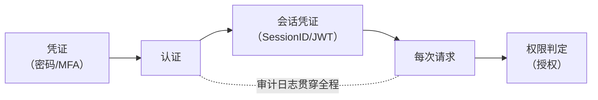
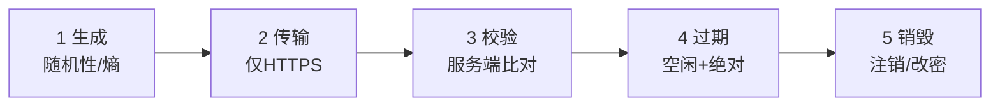
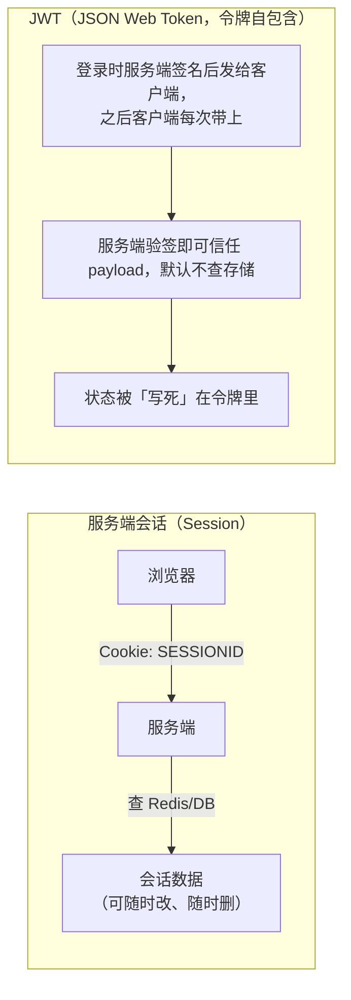
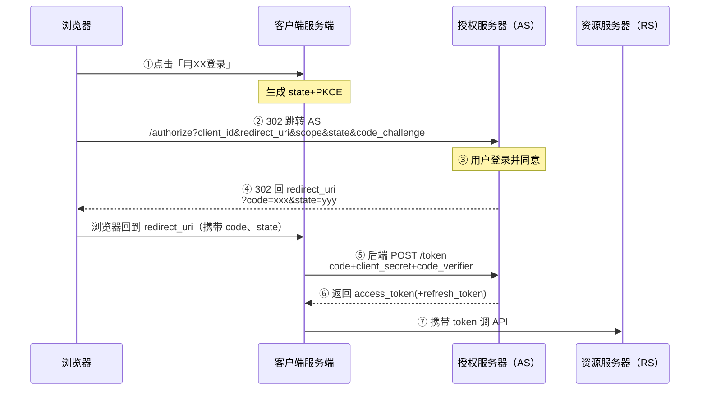
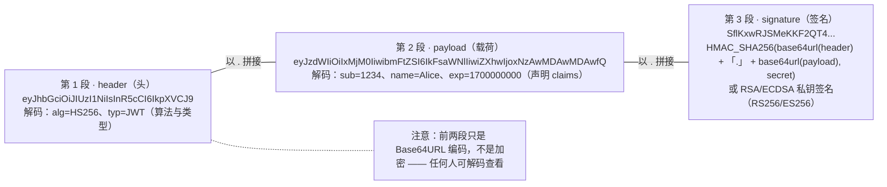

# 16. 认证与会话管理（Authentication & Session Management）

> 日期：2026-11-04
> 所属大纲阶段：3. Web 安全
> 参考资料：
> - OWASP — Authentication Cheat Sheet / Session Management Cheat Sheet / Password Storage Cheat Sheet
> - NIST SP 800-63B — *Digital Identity Guidelines: Authentication and Lifecycle Management*（2017，修订版）
> - RFC 6749 — The OAuth 2.0 Authorization Framework；RFC 7636 — PKCE；OAuth 2.1 草案（废除 implicit 与 ROPC）
> - RFC 6238 — TOTP；FIDO Alliance — WebAuthn / Passkeys 规范
> - RFC 7519 — JSON Web Token (JWT)
> - PortSwigger Web Security Academy — Authentication / OAuth 2.0 authentication vulnerabilities 学习模块

---

## 0. 阅读前提与本文目标

- **前提**：了解 HTTP（无状态）、Cookie 属性、至少写过一次登录功能。
- **目标**：
  1. 区分**认证（Authentication）**、**授权（Authorization）**与**审计（Auditing）**；
  2. 掌握会话从生成到销毁的全生命周期安全要求；
  3. 理解现代密码策略（NIST 800-63B）与密码存储工程实践；
  4. 吃透 OAuth 2.0 / OIDC / JWT 的原理与高频漏洞；
  5. 建立一份可以直接用于上线评审的**防御检查清单**。
- **合规声明**：涉及攻击验证的步骤（枚举、爆破、token 伪造）**仅限本地靶场 / CTF 环境使用**，配合 Burp Suite 演示见本仓库《Burp Suite 使用指南》。

---

## 1. 认证 vs 授权 vs 审计（AAA 三件套）

| 概念 | 回答的问题 | 典型实现 | 典型漏洞 |
|---|---|---|---|
| **认证（Authentication，AuthN）** | 你是谁？ | 密码、MFA、Passkey、SSO 登录 | 弱口令、爆破、会话固定、账号枚举 |
| **授权（Authorization，AuthZ）** | 你能做什么？ | RBAC/ABAC、ACL、scope | 越权（IDOR/水平垂直越权）——**与认证独立** |
| **审计（Auditing / Accounting）** | 你做过什么？ | 登录日志、操作日志、trace | 日志缺失导致无法追溯/定责 |

三者经常被混为一谈，导致两类经典错误：

1. 「登录做得很严，但接口没做授权校验」——攻击者拿到任意普通账号就能越权（本文第 2、3 章管会话，越权细节在访问控制笔记展开）；
2. 「只记访问日志，不记认证事件」——失陷后无法回答「哪个账号在何时被爆破成功」。

**信任链模型**：



认证是一次性的「发牌」，会话管理是之后的「凭牌上车」。**会话凭证一旦签发，就等价于密码**——后面所有章节都围绕这句话。

---

## 2. 会话管理全生命周期

### 2.1 生命周期总览



### 2.2 生成：随机性是底线

- 会话 ID 必须**密码学随机**：≥64 bit 熵（OWASP 建议 ≥64 bit 长度、128 bit 更佳）。用系统级 CSPRNG（`secrets.token_urlsafe(32)`、`SecureRandom`），**不要**用 `rand()`、时间戳、用户 ID 哈希、MD5(用户名+时间) 之类「看起来随机」的构造——它们可预测，会导致**会话预测/劫持**。
- 格式上推荐不透明字符串（opaque token），含义只存在于服务端存储里。
- **在登录成功、权限提升（提权、改绑 MFA）等时刻必须重新生成会话 ID**（原因见 10.1 节会话固定）。

### 2.3 传输：别让会话 ID 裸奔

- 只在 HTTPS 下发送；Cookie 设置 `Secure`（禁 HTTP 泄露）、`HttpOnly`（禁 JS 读取，缓解 XSS 窃取）、`SameSite=Lax/Strict`（缓解 CSRF 与跨站携带）。
- 会话 ID 放 **Cookie** 而不是 URL 参数（URL 会进访问日志、Referer、浏览器历史、被分享出去）。
- 检查 `Set-Cookie` 响应头是代码评审的固定动作：

```http
Set-Cookie: SESSIONID=abc...; Path=/; Secure; HttpOnly; SameSite=Lax
```

### 2.4 校验：服务端说了算

- 每次请求把会话 ID 与服务端存储（Redis/DB）中的记录比对：存在、未过期、未注销、绑定信息（IP/UA 变化是否要求重认证视风控而定）。
- **不要信任来自客户端的任何身份声明**：`user_id`、`role`、`is_admin` 出现在 Cookie/JWT payload 里，都必须以服务端可验证的方式（签名 + 服务端校验）对待。

### 2.5 过期：双时钟

- **空闲超时（idle timeout）**：一段时间无操作即失效（如 30 分钟～数小时，视数据敏感度）；
- **绝对超时（absolute timeout）**：无论多活跃，到达上限必须重新登录（如 12/24 小时）——防止空闲超时被「保活脚本」绕过。
- 「记住我」应是一份**独立的、低权限的长期凭证**（单独 Cookie、可单独撤销、到期滚动），绝不能等于主会话 ID。

### 2.6 销毁：注销是真的销毁

- 登出时必须：**服务端**删除/失效会话记录 + 客户端过期 Cookie。只删客户端等于没注销；
- 改密、解绑 MFA、检测到异常登录时：**失效该用户全部会话**（全局踢下线）；
- JWT 的注销难题见 3.2 与第 9 章。

---

## 3. Session vs JWT

### 3.1 机制对比



### 3.2 对比表

| 维度 | 服务端 Session | JWT |
|---|---|---|
| 状态 | 有状态（服务端存储） | 无状态（签名即真） |
| 撤销 | 天然支持（删存储即可） | **难**：需黑名单/短时效+refresh token，等于又引入状态 |
| 存储 | 服务端内存/Redis | 客户端（localStorage 有 XSS 风险；HttpOnly Cookie 更佳） |
| 跨服务 | 需共享会话存储或粘滞 | 各服务只需公钥/密钥即可本地验证，天然适合网关/微服务 |
| 体积 | Cookie 几十字节 | 数百字节～KB，每个请求都带 |
| 权限变更即时生效 | 是 | 否（令牌内 claims 到期才更新） |
| 适用 | 传统 Web、单体、后台 | API 网关、服务间认证、短时效访问令牌 |

**选型经验**：传统 Web 应用优先 Session（可撤销性是安全刚需）；分布式场景用 JWT 时，**access token 短时效（5–15 分钟）+ refresh token（服务端可撤销）** 的组合，不要把长命 JWT 当会话用。localStorage 存 JWT 一旦有 XSS 就等于送 token，优先 HttpOnly Cookie + CSRF 防护。

---

## 4. 密码策略演进（NIST SP 800-63B）

### 4.1 新旧范式对比

| 项目 | 旧观念（2003 Interim） | NIST 800-63B（2017+，现行） | 理由 |
|---|---|---|---|
| 最小长度 | 6–8 位 | **≥8 位，建议允许 64+** | 长度是熵的主要来源 |
| 复杂度规则 | 强制大小写+数字+符号 | **不强制组合规则** | 用户行为可预测（`P@ssw0rd1!`），规则反而缩小空间 |
| 定期更换 | 90 天强制改 | **不推荐无证据的定期更换** | 用户只在末尾加数字；被迫降级为弱口令 |
| 密码黑名单 | 无 | **必须**比对已知泄露口令字典 | 撞库与字典攻击的现实威胁 |
| 提示/知识验证 | 母亲姓氏、出生地 | **禁止**用此类「个人背景问题」做认证 | 答案可被社工/搜索得到 |
| 粘贴/密码管理器 | 禁粘贴 | **必须允许粘贴**、鼓励密码管理器 | 禁粘贴惩罚的是管理器用户 |
| 短信 OTP | 鼓励 | 降级为「受限使用」（SIM swap 风险） | 见第 6 章 |

### 4.2 落地建议

- **长度优先**：最低 8（打分场景 10–12 更好），上限放开到 64+ 以支持 **passphrase（口令短语）**，如 `purple-tiger-eats-42-bagels`——长而易记，熵远超 `P@ss9!`；
- 注册/改密时调用泄露口令库（HIBP 的 k-anonymity API 或本地 `top-10000` 字典）做**服务端校验**；
- 展示实时强度指示器（zxcvbn 类），但**别把强度算法当服务端防线**；
- 换密码仅在**有泄露证据**时强制（提示语说明原因），日常用泄露检测代替死周期。

---

## 5. 密码存储（Password Storage）

### 5.1 算法选型与参数（OWASP Password Storage Cheat Sheet 摘要）

| 算法 | 用途 | 参数建议（2024 视角） |
|---|---|---|
| **Argon2id** | 首选 | 内存 ≥19 MiB（19456 KiB）、迭代 ≥2、并行度 1；或 m=12MiB,t=3 |
| **bcrypt** | 可接受 | cost ≥10（每年可视算力上调）｜截断于 72 字节（长 passphrase 注意） |
| **scrypt** | 可接受 | N≥2^17，r=8，p=1 |
| **PBKDF2-HMAC-SHA256** | FIPS 场景兜底 | 迭代 ≥600,000（OWASP 2023+）；SHA1 版迭代 ≥1,300,000 但不建议新用 |
| **MD5 / SHA1 / SHA256(裸)** | **禁止** | 通用哈希太快，GPU 每秒千亿次 |

要点：

- **加盐（Salt）**：每用户随机 ≥16 字节，与哈希同存；盐防的是彩虹表，**不**防 GPU 暴力。
- ** pepper（服务级密钥）**：哈希前混入 HSM/环境变量中的密钥，数据库拖库后离线破解依然不可行（除非 pepper 同时泄露）。
- 哈希算法版本要**写进存储格式**，为将来升级留路：`$argon2id$v=19$m=19456,t=2,p=1$<salt>$<hash>`（PHC 字符串格式）。

```python
# 环境：Python 3.10+，pip install argon2-cffi
from argon2 import PasswordHasher
ph = PasswordHasher(time_cost=2, memory_cost=19456, parallelism=1)  # OWASP 最低档
h = ph.hash("correct horse battery staple")   # 每次结果不同（含随机盐）
print(ph.verify(h, "correct horse battery staple"))  # 校验
```

### 5.2 迁移策略：旧 MD5 哈希如何安全升级

存量系统不能「一键重哈希」（拿不到明文），标准做法是**登录时惰性升级 + 哈希套娃**：

```text
旧存量：stored = MD5(password)
第 1 步（立即，全量）：stored2 = Argon2id(MD5(password))    ← 一次性把旧哈希当"明文"再哈希
第 2 步（每次登录）：验证通过后，用本次拿到的明文 password
                     重算 stored3 = Argon2id(password)      ← 摘掉 MD5 一层
                     覆盖存储；同时重置会话
监控项：统计"仍处于第 1 步格式"的账号数；长期不登录账号到期强制重置
```

- 套娃格式虽不理想（MD5 层仍在），但把离线破解成本从「每秒数十亿次」拉到 Argon2id 档位，是零停机的最优过渡；
- 新注册一律直接 Argon2id。**绝不要**「为了兼容」继续写入 MD5。

---

## 6. 多因素认证（MFA）

### 6.1 因素分类

| 因素 | 定义 | 例子 | 可被窃取的方式 |
|---|---|---|---|
| **知识因素（Something you know）** | 你知道 | 密码、PIN | 钓鱼、撞库、键盘记录 |
| **持有因素（Something you have）** | 你拥有 | TOTP 认证器、FIDO2 密钥、智能卡 | 偷手机、SIM swap、恶意代理转发 OTP |
| **生物因素（Something you are）** | 你本身 | 指纹、人脸 | 生物特征**不可更换**，模板泄露即永久；司法采集 |
| （第四类）**位置/行为因素** | 你在哪/习惯 | 常用设备/GeoIP/打字节奏 | VPN、模仿 |

**MFA 的价值**：单因素失守不等于账号失守。**注意**：同一部手机上的「短信验证码 + 手机 App 内密码」仍是同一持有物上的两因素，安全增益有限。

### 6.2 TOTP 原理（RFC 6238）与 Python demo

**TOTP（Time-based One-Time Password，基于时间的一次性密码）**：双方共享种子密钥 K，令牌 = 截断( HMAC(K, ⌊当前Unix时间/30⌋) ) 取 6 位。服务端不「发送」验证码，只比对同一公式算出的值（±1 个时间窗容错）。

```python
# 环境：Python 3.10+，pip install pyotp；仅演示原理，仅靶场/本地使用
import pyotp, time

secret = pyotp.random_base32()          # 种子：等价于扫码时二维码里的 otpauth:// secret
print("请把它录入认证器 App:", secret)

totp = pyotp.TOTP(secret)
now = totp.now()
print("当前 6 位验证码:", now, "（30 秒内有效）")

# —— 服务端校验逻辑 ——
ok = totp.verify(now, valid_window=1)   # 容忍前后各 1 个时间窗（时钟漂移）
print("verify:", ok)

# Google Authenticator 录入 URI（注册页「扫码绑定」背后就是它）：
print(pyotp.totp.TOTP(secret).provisioning_uri(name="alice@example.com", issuer_name="MyLab"))
```

**工程要点**：

- 种子只在绑定时展示一次；登录时**不回传种子**；
- 校验失败次数限速（否则 6 位数字在线爆破 10^6 空间可行）；
- **重放防护**：同一验证码用过即在窗口内作废；
- 时间窗容错别开太大（≤1），否则反向扩大爆破面。

### 6.3 短信 OTP 与 SIM swap

- 攻击路径：攻击者社工运营商（或收买代理网点）把受害者号码**补换到自己的 SIM**，此后所有短信 OTP 流向攻击者——这在针对高管/币圈用户的攻击中是成熟产业链。
- NIST 已把 SMS 列为「受限使用」；短信 OTP 仍可作为**低敏感场景的兜底第二因素**，但不要当唯一可选项，且要防**短信轰炸**（见第 11 章）。

### 6.4 WebAuthn / FIDO2：无密码化趋势

- **FIDO2/WebAuthn（W3C 标准）**：设备本地（平台认证器/安全密钥）生成非对称密钥对，公钥注册到服务端；登录时服务端下发挑战（challenge），设备用私钥签名，**私钥永不出设备**。
- 关键安全性质：**源绑定（origin binding）**——签名包含网站域名，钓鱼域名即使骗到用户点击，也拿不到合法签名，**结构性防钓鱼**（TOTP 做不到，钓鱼代理可实时转发 OTP）。
- **Passkey（通行密钥）**= WebAuthn 凭证 + 云同步（iCloud 钥匙串/Google 密码管理器），解决「换手机丢凭证」的采用障碍。
- 落地建议：MFA 优先级 **FIDO2 > TOTP > 推送确认（防疲劳轰炸） > 短信**；逐步为高权限账号启用 Passkey。

---

## 7. OAuth 2.0 详解

### 7.1 角色与思想

OAuth 2.0（RFC 6749）是**授权委托框架**：资源所有者（用户）让客户端（第三方应用）有限度地访问自己在资源服务器上的数据，而**不交出密码**。四个角色：资源所有者（RO）、客户端（Client）、授权服务器（AS）、资源服务器（RS）。

### 7.2 四种授权流程（Grant Types）

#### （1）授权码（Authorization Code）——标准 Web 应用首选



要点：`code` 经过浏览器但**换 token 在后端**（client_secret 不暴露）；`state` 防 CSRF；`redirect_uri` 必须严格校验。

#### （2）隐式（Implicit）——已弃用

token 直接从 `/authorize` 的 URL fragment 返回给浏览器，跳过 code 交换。历史原因是老浏览器限制 JS 跨域 POST；代价是 token 落在 URL/浏览器历史、无刷新机制、无法安全验证客户端。**OAuth 2.1 草案已删除 implicit**，一律改「授权码 + PKCE」。

#### （3）密码模式（Resource Owner Password Credentials，ROPC）——仅遗留

用户把**密码直接交给客户端**，客户端拿去换 token。违背 OAuth 初衷（第三方不应见密码），禁用 MFA 场景；仅限第一方遗留 App 过渡，2.1 亦删除。

#### （4）客户端凭证（Client Credentials）——机器对机器

无用户参与，客户端用自己的 `client_id/secret`（或 mTLS/私钥 JWT）直接换 token。适合服务间调用。

### 7.3 PKCE（Proof Key for Code Exchanges，RFC 7636）

**是什么**：客户端先随机生成 `code_verifier`，算 `code_challenge = BASE64URL(SHA256(verifier))` 随授权请求发出；换 token 时出示 `verifier`，AS 校验哈希匹配。

**为什么现在推荐（甚至强制）**：

- 防授权码拦截：即使恶意 App/浏览器插件截获了 `code`，没有 `verifier` 也换不到 token；
- 最初为无 client_secret 的公开客户端（SPA/移动端）设计，现在**所有客户端类型都建议启用**（OAuth 2.1 要求）；
- 配合 `state`：PKCE 防 code 拦截，state 防 CSRF，两者都要。

### 7.4 redirect_uri 校验与开放重定向

- **精确匹配**白名单（协议+域名+路径+大小写），禁止子串/前缀匹配，禁止通配符放水（除非有明确多租户设计并限制 scheme/host 后缀语义）；
- 未校验的 `redirect_uri` 是 OAuth 最经典的洞：攻击者改成自己页面截获 `code`/`token`；再叠加**开放重定向（Open Redirect）**——即使白名单校验了 `redirect_uri`，若同站存在 `?next=` 跳转漏洞，code 仍可被「接力」带出。
- `state` 缺失/不校验 → 登录 CSRF（受害者被静默绑上攻击者账号，下单/改地址）。

### 7.5 scope 最小化与 token 泄露

- **scope（授权范围）**按最小必要申请，展示给用户时要可读；AS 应允许用户撤销部分授权；
- token 泄露途径速查：URL fragment/查询参数、浏览器历史、Referer 头、日志、localStorage（XSS）、恶意回调站、中间代理。访问令牌走 `Authorization: Bearer` 头，不放 URL；
- refresh token 存服务端可撤销的位置；轮换（rotation）机制：旧 refresh token 用过即失效，被盗时双方竞争触发告警。

---

## 8. OpenID Connect（OIDC）与 OAuth 的关系

- **OAuth 2.0 解决「授权」**（能不能读我的资料）；**OIDC 在其上加一层「认证」**（我是谁）——它是 OAuth 2.0 之上的身份层协议。
- 核心增量：授权流程（授权码+PKCE）中额外申请 `openid` scope，AS 额外返回 **ID Token**——一个签名 JWT，含 `iss/sub/aud/exp/iat/nonce` 等声明，客户端**验签+校验 aud/nonce** 后即得到已认证的用户身份。
- 常见坑：把 access_token 当身份凭证直接解 base64 读邮箱（access token 的 payload 不可信）；不做 nonce 校验导致重放。标准端点：`/.well-known/openid-configuration` 发现文档。

---

## 9. JWT 详解

### 9.1 结构逐段



### 9.2 签名算法与常见漏洞

| 漏洞 | 原理 | 防御 |
|---|---|---|
| **`alg=none`** | 早期库允许无算法令牌，攻击者改 payload 且删签名直接通过 | 库端禁用 none；服务端固定期望算法，**不读 header 里的 alg 决定验签方式** |
| **算法混淆 RS256→HS256** | 服务端公钥公开；攻击者把 alg 改成 HS256，用**公钥字符串当 HMAC 密钥**伪造签名，服务端误用同一把「钥」做 HMAC 校验 | 验签时显式指定算法白名单；库新版本已按 alg 类型绑定密钥 |
| **弱 HMAC 密钥爆破** | HS256 密钥是弱口令（`secret`/`key`/公司名）→ 字典/掩码爆破（jwt_tools、hashcat mode 16500） | 密钥 ≥256 bit 随机；RS256 时私钥入 KMS |
| **kid 注入** | header 的 `kid`（密钥 id）被拼进 SQL/LDAP/命令或文件路径（`kid: ../../dev/null`） | kid 仅作白名单索引，禁止拼表达式/路径 |
| **exp/nbf/iat 缺失或忽略** | 令牌永久有效；或服务端只验签不验时间 | 强制校验 exp/nbf；框架级开启时间声明校验 |
| **敏感信息进 payload** | payload 明文可读（手机号、权限） | payload 只放最小声明；敏感数据放服务端按需取 |
| **信任客户端可控 claims** | 把 payload 里的 `role`/`user_id` 直接当授权依据 | 关键 claims 由服务端签发时写入并在资源侧再校验 |

> 靶场实践：PortSwigger Academy「JWT」模块把上述每一类都做成了实验（**仅限靶场**）；工具侧 `jwt_tool`（jwt_tools）可一键尝试 none/混淆/爆破。

### 9.3 工程守则

- 验签时**显式**声明允许的算法集合（如 `["RS256"]`），不要让令牌自述；
- access token 短时效 + refresh token 可撤销；退出登录走 refresh token 注销 + 服务端短黑名单兜底；
- 不要把 JWT 存 localStorage（XSS 直取）；放 HttpOnly Cookie 并做 CSRF 防护，或短期内存持有。

---

## 10. 会话攻击面

### 10.1 会话固定（Session Fixation）

攻击者先设法让受害者**带着攻击者已知的会话 ID** 访问（URL 传参 `?sid=ATTACKER`、子域写 Cookie、会议 Wi-Fi 注入），受害者登录后若**不更换会话 ID**，攻击者用同一个 ID 即可直接进入已登录状态——**无需窃取任何东西**。

防御（两行讲完）：

1. **登录成功瞬间重新生成会话 ID**（Spring Security `changeSessionId`、Django `cycle_key()`、PHP `session_regenerate_id(true)`）；
2. 不接受 URL/表单传递会话 ID，只接受 Cookie。

### 10.2 会话不注销

- 登出按钮只清了前端；服务端会话仍有效 → 共享电脑场景直接回退可用；
- 只注销当前设备，其他设备仍在线：改密/被盗号时必须「全部下线」；
- SSO 场景注意单点登出（OIDC RP-Initiated Logout / Front-Channel Logout），否则 IdP 登出了业务应用还挂着。

### 10.3 并发会话

- 是否允许多端同时在线是业务决策，但**高权限后台应限制并发会话数**并支持「查看在线设备/踢出」；
- 新登录触发异地/新设备告警（邮件/App 推送），是廉价有效的劫持发现手段。

---

## 11. 密码重置流程漏洞

重置流程是「不需要密码的登录入口」，漏洞密度常高于登录本身：

| 漏洞 | 表现 | 防御 |
|---|---|---|
| **可预测 token** | token = MD5(用户名/时间戳/自增 id) | CSPRNG 生成 ≥128 bit，一次性、10–30 分钟过期、用后即焚 |
| **重置邮箱回显** | 输入任意用户名返回绑定的邮箱（`a***@qq.com` 泄露首尾） | 不回显或统一「若存在则已发送」 |
| **Host 头注入** | 服务器用请求的 `Host`/`X-Forwarded-Host` 拼链接 → 链接指向攻击者站（密码毒化） | 信任的配置基准域名拼链接；忽略请求头里的 Host |
| **短信/邮件轰炸** | 无限触发发送，骚扰用户/耗尽配额 | 图形/行为验证码 + 同账号同 IP 限速 + 每日上限 |
| **响应差异枚举** | 「用户不存在」vs「已发送」 | 统一文案、统一耗时（防时间侧信道） |
| **token 可重放** | 重置成功后链接仍可再打开 | 一次性消费；重置成功作废所有会话 |

**Host 头注入毒链示意**：

```text
攻击者请求:  POST /forgot-password  Host: evil.example
服务端生成邮件: "重置密码请访问 http://evil.example/reset?token=SECRET"
受害者点击 → token 被发到攻击者域名 → 攻击者用 token 重置受害者密码
```

---

## 12. 登录爆破与撞库防护

**撞库（Credential Stuffing）**：用别处泄露的「账号密码对」批量尝试——密码正确率天然不为零，单纯密码策略防不住，必须靠**行为层**。

分层防护（按请求路径叠加）：

1. **限速（Rate Limiting）**：按 账号 + IP + 设备 多键维度；渐进延迟/锁定（账号级临时锁定要防「锁死受害者」滥用：用验证解锁而非永久封禁）；
2. **验证码选型**：传统图形码已被打码平台廉价绕过；推荐**行为验证（hCaptcha、Cloudflare Turnstile、reCAPTCHA v3）**，在「连续失败 N 次」后升级出现，避免首访即拦；验证码要有服务端校验与一次性消费；
3. **设备指纹**：UA/Canvas/行为特征 + cookie 画像，用于识别分布式撞库的复用特征，而非当唯一凭证；
4. **延迟与统一错误信息**：
   - 失败时统一返回「用户名或密码错误」（防账号枚举）；
   - 加**恒定小延迟**或模拟不存在用户的哈希计算（防时间侧信道：存在的用户要走完整 Argon2id，不存在的用户秒回）；
   - 随机化「假哈希」校验：用户不存在时也执行一次 Argon2id 校验，拉平耗时；
5. **情报与风控**：泄露密码库比对登录（HIBP），IP 信誉库，异地新设备二次验证；
6. **可观测**：失败率突增告警、单账号多 IP 失败、单 IP 多账号失败两条规则必配。

> 靶场练习（仅限本地）：用 Burp Intruder 对 DVWA Brute Force（Low/High）做对比实验，体验限速/token 对爆破成本的影响，见《Burp Suite 使用指南》与《靶场实操指南》。

---

## 13. 账号枚举（Account Enumeration）防护

枚举发生在一切「响应因账号存在与否而不同」的地方：登录、注册（邮箱已注册）、找回密码、MFA 提示（「已向 138**** 发送验证码」泄露绑定号段）。

- **文案统一**：注册/找回密码一律「若该邮箱可用/存在，我们已发送邮件」；
- **耗时拉平**：见第 12 章假哈希；
- **注册接口防批量**：行为验证码 + 注册频控（否则统一文案也能靠响应时间差+字典批量确认存活账号）；
- **权衡**：登录页「忘记密码」的可用性与枚举防护冲突时，优先防枚举（用户多一次跳转可接受）。MFA 场景的「残留信息」要在产品层专门评审（绑定的手机尾号至少在登录前置阶段不展示）。

---

## 14. 防御检查清单（Checklist）

上线前逐项打勾，可直接复制进代码评审模板。

**认证**
- [ ] 密码最低 8 位、允许 64+、无强制复杂度、无强制周期更换
- [ ] 注册/改密比对泄露口令黑名单
- [ ] 存储用 Argon2id/bcrypt（达标参数），无 MD5/SHA1；存量有迁移方案
- [ ] 登录失败统一文案 + 恒定耗时（假哈希）
- [ ] 按账号+IP+设备多维度限速；连续失败升级验证码/二次验证
- [ ] 高权限账号强制 MFA；MFA 选项优先 FIDO2/TOTP
- [ ] TOTP 校验限速 + 窗口容错 ≤1 + 一次性消费

**会话**
- [ ] 会话 ID 由 CSPRNG 生成（≥64 bit 熵），仅经 Cookie 传递
- [ ] Cookie 具备 `Secure; HttpOnly; SameSite`
- [ ] 登录成功、权限提升时**重新生成**会话 ID
- [ ] 空闲 + 绝对双超时；「记住我」独立低权限凭证
- [ ] 登出：服务端失效 + 客户端过期；改密/异常触发全端下线
- [ ] 会话记录含创建 IP/UA，支持审计

**JWT / 令牌**
- [ ] 验签显式指定算法白名单；禁止 none；RS256/HS256 密钥分离
- [ ] 强制校验 exp/nbf/iss/aud/nonce；payload 无敏感信息
- [ ] access 短时效 + refresh 可撤销可轮换；不存 localStorage

**OAuth/OIDC**
- [ ] 授权码 + PKCE；不使用 implicit/ROPC
- [ ] redirect_uri 精确白名单；state 生成并校验
- [ ] scope 最小化；token 不出现在 URL/日志
- [ ] ID Token 验签 + nonce；使用标准发现文档

**密码重置/注册**
- [ ] token CSPRNG ≥128bit、一次性、短过期
- [ ] 邮件链接域名取自服务端配置，不用请求 Host
- [ ] 发送类接口有验证码 + 频控（防轰炸）
- [ ] 重置成功后作废全部会话

---

## 15. 常见误区

1. **「上了 HTTPS 就不用管会话劫持」**——XSS 偷 Cookie、日志泄露、共享设备、服务端注入都拿得到会话；HTTPS 只防链路窃听。
2. **「JWT 更安全因为是签名的」**——签名提供完整性不提供机密性；不可撤销性反而放大泄露后果。Session/JWT 是架构取舍，不是安全等级差异。
3. **「90 天强制改密=安全合规」**——NIST 已明确反对；用户改为 `Password2/3/4` 的实证多于其收益。
4. **「验证码挡住爆破」**——打码平台/无头浏览器成本极低；限速+风控+统一错误才是主力，验证码只是摩擦层。
5. **「登录页防好了就行」**——重置流程、MFA 校验、OAuth 回调、旧 API 端点（`/api/v1/login` 忘记下线）都是登录面。
6. **「短信验证码=强 MFA」**——SIM swap 后形同虚设；它只是「比没有强」。
7. **「登录后换 session id 影响体验」**——现代框架是服务端换 ID 保状态，用户无感；不做才会引入会话固定。
8. **「MD5 存储先欠着以后再说」**——拖库后每天百万级破解，迁移应排进最近迭代（惰性升级方案见 5.2，成本可控）。

---

## 16. 自测问题

1. 认证与授权的区别？各举一个对方失效而自身完好时的漏洞场景。
2. 会话 ID 的生成、传输、过期、销毁四个环节各列一条硬性要求，并说明对应攻击。
3. JWT 的撤销难题有哪几种工程解法？各自代价？
4. NIST 800-63B 为什么取消强制复杂度与定期更换？拿什么替代？
5. Argon2id 的三个主要参数是什么、各自防什么（GPU/ASIC/侧信道）？
6. 画出授权码 + PKCE 的完整时序，标出 state、code_challenge、code_verifier 各自防什么攻击。
7. 隐式流程为什么被 OAuth 2.1 删除？
8. RS256→HS256 混淆攻击的完整步骤是什么？服务端代码怎么写才能免疫？
9. 会话固定攻击的三个注入途径？两行代码的防御是什么？
10. 密码重置邮件里的链接域名应该从哪里来？Host 头注入的利用链画一遍。
11. 为什么「统一错误文案」还不够，要做假哈希？时间侧信道原理。
12. 你的系统存量 MD5 密码，写出一版零停机迁移的三步方案与监控指标。
13. TOTP 为什么不能防实时钓鱼？哪种因素可以、原理是什么？
14. 检查你手头任一项目的登录接口，对照第 14 章清单找出至少 3 个未达标项并给出修复 PR 描述。

---

## 附：本文实验清单（与 labs/ 目录对应）

| 实验 | 环境 | 章节 |
|---|---|---|
| Argon2id 哈希与校验 | Python 3.10+ + argon2-cffi（本地 venv） | 5.1 |
| MD5 存量惰性升级模拟 | 同上 + SQLite 内存表 | 5.2 |
| TOTP 生成/校验/绑定 URI | Python 3.10+ + pyotp | 6.2 |
| JWT 漏洞靶场 | PortSwigger Academy JWT 模块 / jwt_tool（仅靶场） | 9.2 |
| OAuth 流程抓包观察 | 本地起 Keycloak/Dex，Burp 观察每一步请求 | 7 |
| 登录限速与枚举验证 | DVWA Brute Force + Burp Intruder（仅靶场） | 12 |

---

## 附：ASCII 图 → Mermaid 替换清单

| 原 ASCII 图（小节 · 内容） | 替换后类型 |
| --- | --- |
| 「1. 认证 vs 授权 vs 审计（AAA 三件套）」节 · 信任链模型图（凭证 → 认证 → 会话凭证 → 每次请求 → 授权，审计日志贯穿） | flowchart LR |
| 「2.1 生命周期总览」节 · 会话生命周期五阶段图 | flowchart LR |
| 「3.1 机制对比」节 · Session 与 JWT 机制对照图 | flowchart LR（双 subgraph 对照） |
| 「7.2 四种授权流程」之「（1）授权码」节 · OAuth 2.0 授权码四方时序图（①-⑦） | sequenceDiagram |
| 「9.1 结构逐段」节 · JWT 三段解剖图（含解码内容与注意点） | flowchart LR |
