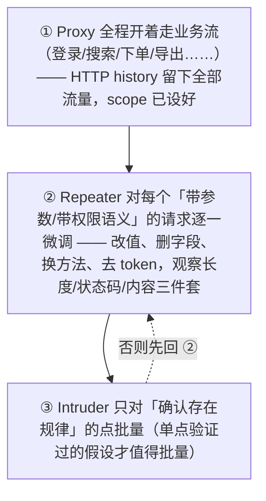

# 17. Burp Suite 使用指南（Web 安全测试工作台）

> 日期：2026-11-04
> 所属大纲阶段：3. Web 安全（工具篇）
> 参考资料：
> - PortSwigger 官方文档 — Burp Suite Documentation（`https://portswigger.net/burp/documentation`）
> - PortSwigger Web Security Academy — Burp Suite 入门系列实验室
> - OWASP WSTG — Web Security Testing Guide（用 Burp 执行的手工测试方法论）
> - OWASP ZAP 官方文档；mitmproxy 官方文档（开源替代对照）
> - DVWA / upload-labs 本地靶场（见《18-靶场实操指南》）

---

## 0. 阅读前提与本文目标

- **前提**：了解 HTTP 请求/响应结构（方法、头部、Cookie、正文）；已在本地跑起至少一个靶场（DVWA 等）。
- **目标**：
  1. 独立完成 Burp 的安装、代理、HTTPS 证书配置；
  2. 熟练使用 Proxy / Target / Repeater / Intruder / Decoder / Comparer 核心模块（历史版本另含 Sequencer，2022 年起已从 Burp Suite 移除，见第 7 章版本注记）；
  3. 理解宏与 Session Handling Rules 的自动化场景；
  4. 建立「Proxy 抓包 → Repeater 微调 → Intruder 批量」的手工测试节奏。
- **合规声明**：Burp 是**测试工具**，所有扫描、爆破、攻击实验**仅限本地靶场 / 授权渗透测试环境**。对未授权目标开启代理或扫描即违法。

---

## 1. Burp Suite 定位与版本对比

### 1.1 定位

Burp Suite 是 Web 安全测试的**集成工作台（Intercepting Proxy + 工具集）**：它以「中间人代理」为枢纽，把抓到的每个请求送入各模块做改包、重放、批量、比对、解码、扫描。它不替你思考，但把重复劳动全部接管——**手工测试仍是主体，Burp 是放大器**。

### 1.2 社区版（Community/Free）vs 专业版（Pro）功能表

| 功能 | Community | Pro |
|---|---|---|
| 代理抓包 / HTTP history / Intercept | ✅ | ✅ |
| Repeater / Intruder（**社区版 Intruder 限速，无并发**） | ✅（受限） | ✅（完整并发与资源池） |
| Target / Decoder / Comparer（Sequencer 仅 2022 年前旧版可用，现行版本已移除） | ✅ | ✅ |
| **Scanner（主动/被动扫描）** | ❌ | ✅ |
| Burp CLI / Headless 扫描、CI 集成 | ❌ | ✅ |
| 内置浏览器（Chromium） | ✅ | ✅ |
| BApp 插件商店加载 | ✅（部分插件要 Pro 才有意义） | ✅ |
| 项目文件保存/团队协作 | 受限 | ✅ |
| 价格 | 免费 | 订阅制（企业/个人） |

选型建议：**学习阶段社区版完全够用**（本文 95% 内容社区版可完成）；需要常态化扫描/CI 时再考虑 Pro。预算为零的等价替代见第 14 章。

---

## 2. 安装与代理配置（含 HTTPS 证书）

### 2.1 安装与启动

1. 官网下载安装包（或 `brew install --cask burp-suite-community-edition`）；
2. 启动后选择 Temporary project（临时工程）→ Start Burp；
3. 默认监听 `127.0.0.1:8080`（Proxy → Options → Proxy Listeners 可查看/修改）。

> **界面路径版本说明**：本文「Proxy → Options」「Extender」「Project options」等界面名对应 2020.5+～2022 旧版的顶部 Tab + 各模块 Options 面板命名；2023+ 版本已把各模块配置集中进 Settings 对话框（Burp → Settings，如 Proxy Listeners 在 Settings → Tools → Proxy），Extender 也更名为 Extensions——功能对应不变，按版本对号入座即可。

### 2.2 浏览器代理设置

**推荐方式：用 Burp 内置浏览器（第 12 章）——零配置、证书自动信任、与系统代理隔离。** 需要用自己浏览器时按下面手动配置：

**Firefox（推荐，代理设置独立于系统，最省心）**：

1. 设置 → 常规 → 网络设置 → 手动代理配置：HTTP 代理 `127.0.0.1`，端口 `8080`，勾选「也将此代理用于 HTTPS」；
2. 浏览器访问 `http://burp`，点右上角 CA Certificate 下载 `cacert.der`；
3. 设置 → 隐私与安全 → 证书 → 导入 → 勾选「信任此 CA 以标识网站」→ 确定；
4. 访问任意 HTTPS 站点，证书告警消失即成功。

**Chrome / Edge（代理跟随系统，需改系统代理，注意副作用）**：

1. 系统设置 → 网络 → 代理 → Web 代理（HTTP）：`127.0.0.1:8080`（macOS 在「网络-高级-代理」；Windows 在「设置-网络-代理」）；
2. 证书：下载 `cacert.der` 后导入**系统钥匙串/证书存储**，并设为「始终信任」（macOS 双击证书 → 信任 → 始终信任；Windows 用 certmgr 导入到「受信任的根证书颁发机构」）；
3. 用完记得**关掉系统代理**，否则 Burp 退出后全系统断网——这是最常见的「Burp 害我断网」事故。
4. 更干净的做法：用命令行参数起独立实例（不动系统代理）：
   ```bash
   # macOS Chrome 独立实例，专用于测试，配置独立
   /Applications/Google\ Chrome.app/Contents/MacOS/Google\ Chrome \
     --user-data-dir=/tmp/chrome-burp \
     --proxy-server=127.0.0.1:8080 --ignore-certificate-errors &
   ```
   注意：`--ignore-certificate-errors` 只建议在**只挂 Burp 的测试实例**上用，日常浏览器别开。

### 2.3 验证与排错

- 浏览器访问 `http://burp` 出现欢迎页 = 代理通；
- HTTPS 页面仍报警 = CA 未信任（按 2.2 第 3 步重做）；
- 完全打不开 = 监听地址/端口不符，或防火墙拦 127.0.0.1:8080；
- 手机测试（仅靶场内网）：Proxy Listener 切到 `0.0.0.0:8080`，手机 Wi-Fi 代理指向本机 IP，手机浏览器装 CA（**监听 0.0.0.0 意味着同网段可连，务必只在隔离靶场网络这么做**）。

---

## 3. Proxy 模块（代理）

### 3.1 Intercept（拦截）

- `Intercept is on`：请求被挂起，可在拦截窗里**手工编辑**（改参数、加头、改正文）再 Forward（放行）/Drop（丢弃）；
- `Intercept is off`：只记录不拦截（**日常保持 off**，在 HTTP history 里回看与右键分发，避免每个请求都要手动放行）；
- 拦截响应：Options → Intercept Response based on rules（如 `Content-Type: text/html` 时拦下改响应，用于测试前端逻辑/绕过客户端校验）；
- Action → Do intercept → Response to this request：只拦**这一次请求的响应**，更精准。

### 3.2 HTTP History（历史）与过滤器技巧

历史里每一行是完整请求/响应。点 Filter（过滤条）常用姿势：

| 场景 | 过滤设置 |
|---|---|
| 只看靶站 | Filter → Hostname contains `dvwa` |
| 排除静态资源噪音 | Mime type 只勾 script/html/json，或 Scope 模式（见 Target 章） |
| 只看带参数请求 | URL contains `\?`（正则模式） |
| 找认证相关 | 仅显示 `Cookie: session` 存在的请求 |
| 快速定位接口 | 按 URL/正文关键字搜索（顶部搜索框支持正则） |

技巧：列（状态码/方法/URL/长度）可排序；「长度」列是发现差异的利器（同一接口不同参数长度突变常意味着行为分支）。

### 3.3 Match and Replace（匹配替换）

Options → Match and Replace：对**流经的**请求/响应做自动正则替换。

- 用途举例：
  - 请求头改 `User-Agent`（测试 UA 探测）；
  - 自动加 `X-Forwarded-For: 1.2.3.4`（测试 IP 白名单逻辑）；
  - 响应里把 `admin=0` 替换成 `admin=1`（测试客户端权限渲染）；
- 注意：规则全局生效会污染所有流量，**用完即关**；复杂场景用插件（如「SuperRepeater」类）或在 Repeater 里手工改。

### 3.4 请求拦截修改的典型玩法（仅靶场）

- 改 GET 为 POST/改 `Content-Type` 测试同一路由不同方法；
- 删除/篡改 Cookie 中的角色字段，观察服务端是否回退默认权限（认证 vs 授权之鉴）；
- 在多步骤流程中把上一步的值（如订单金额、折扣码）改成越界值，观察服务端是否重算。

---

## 4. Target 模块（目标）

### 4.1 Site map（站点地图）

- 左树按 host/路径组织被动浏览到的所有请求，可右键「Engagement tools → Analyze target」（Pro）统计参数分布；
- 未发出的请求（你手工构造的）可拖到站点地图留档。

### 4.2 Scope（范围）：为什么建议先定 scope

**第一步永远是划 scope**：Target → Scope → Include in scope 添加靶站（如 `http://127.0.0.1:8080` 或域名）。

三大理由：

1. **防误伤**：后续 Intruder/Scanner 若引用 scope，永远不会打到范围外资产（浏览器自动加载的第三方 JS、统计脚本都在范围内会被误扫，属真实世界的高危操作事故）；
2. **降噪**：HTTP History 勾选「Show only in-scope items」，页面瞬间干净；
3. **合规边界**：授权书写的测试范围应与 scope 一致，这是工程化的「红线落地」。

规则支持精确/前缀/正则；正则写在 `Site map` 过滤与 Scope 面板均可，但注意转义。

---

## 5. Repeater 模块（重发器）

### 5.1 核心工作流

1. HTTP History 里选中请求 → `Ctrl+R`（发送到 Repeater）；
2. Repeater 里编辑请求（Inspector 面板可视化改 query/Cookie/JSON 字段，不用手工拼）；
3. `Send`（`Ctrl+R` 在 Repeater 内无效，注意用 Send 按钮/`Ctrl+Enter`）→ 右侧看响应；
4. 反复微调参数 → Send → 观察，直到确认行为规律。

**这是渗透测试中占用时间最多的模块**：90% 的洞是「改一个字节重发」发现的。

### 5.2 标签管理与请求历史

- 每个请求一个标签页，右键重命名（按「反射点/接口名」命名，如 `search-xss`）；
- 每个标签内保留完整发送历史（左侧小列表），可点击回看每次请求/响应；
- 关闭项目前把关键请求**右键 → Save item**（保存为独立文件）留档，写入实验报告。

### 5.3 diff 与对比

- 同一标签的历史两条响应，选中后可用 Comparer 对比（见第 7 章）；或用「Show response in browser」在浏览器中渲染对比；
- 实战套路：`id=1023`（存在）vs `id=9999`（不存在）的响应长度/时间差 → 判断依据（IDOR 枚举的基线）。

---

## 6. Intruder 模块详解（入侵者）

> 攻击模式示例均**仅限本地靶场 / CTF 环境使用**。

### 6.1 定位与标记

Intruder 是「带 payload 的批量重放器」。使用：请求右键 → `Ctrl+I` 发送到 Intruder → 在 Positions 面板：

- `Clear §` 清除自动猜测的标记，`Add §` 手工选中要 fuzz 的值；
- 模板（preset list）：Sniper/Battering ram/Pitchfork/Cluster bomb 由当前标记数与 payload 组数决定。

```
POST /login HTTP/1.1
...
username=§admin§&password=§123456§
        ▲               ▲
     标记1           标记2
```

### 6.2 四种攻击模式

| 模式 | payload 组数 | 行为 | 适用场景 |
|---|---|---|---|
| **Sniper（狙击枪）** | 1 组 | 逐个标记、逐个值替换（其余标记保持原值） | 单参数 fuzz：一个不确定参数逐字典测 |
| **Battering ram（攻城锤）** | 1 组 | **所有标记同时填同一个值** | 用户名=密码场景；双字段同源测试 |
| **Pitchfork（俯冲叉）** | 每标记各 1 组，**并行取**第 i 行 | 第 1 组第 i 行配第 2 组第 i 行，短的那组结束即止 | 已知「用户名↔安全答案」配对表；固定用户名换密码 |
| **Cluster bomb（集束炸弹）** | 每标记各 1 组，**笛卡尔积** | 全组合 | 用户名×密码双字典爆破；参数组合 fuzz |

组合数：Cluster bomb 请求数 = ∏(各组长度)，**先小字典试水再放量**，避免几百万请求把靶机打死。

### 6.3 Payload 类型清单（常用项）

| 类型 | 作用 |
|---|---|
| Simple list | 手输/粘贴字典 |
| Runtime file | 载入字典文件（SecLists 等） |
| Numbers / Dates | 数字/日期序列（ID 枚举、订单号） |
| Username / Password mutations | 内置常见账号；密码变体（加 `1`/`!`/年份） |
| Character substitution / Case substitution | 大小写与字符替换（绕过黑名单 `sElEcT`） |
| Null payloads | 全部发同一值（测限速/重放，如无限发同一验证码） |
| Recursive grep | **从响应里正则取值作为下一轮 payload**（CSRF token 每次刷新时配合 pitchfork/单独用） |
| Custom iterator | 多位置拼装（如 `admin`+分隔符+`1..999`） |
| ECB block shuffler / Bit flipper | 密码学角度的位翻转测试（CBC 翻转字节实验） |

编码/哈希处理：Payload processing 规则链（URL 编码、Base64、前后缀、哈希）——先「Add raw」再在 processing 里统一编码，避免手工重复劳动。

**Payload processing 示例：构造「先 Base64 再 URL 编码」的密码爆破流**（仅靶场，某些接口收 `Authorization: Basic base64(user:pass)`）：

```text
Payload set: Simple list = [admin123, password1, ...]
Payload processing 规则（按顺序）:
  1. Add prefix      "admin:"           → admin:admin123
  2. Encode          Base64             → YWRtaW46YWRtaW4xMjM=
  3. Add prefix      "Basic "           → Basic YWRtaW46...
  4. Add header      Authorization: <payload>（在 Intruder 的请求模板里给标打在头值上）
```

这个例子体现了规则链的通用思路：**字典永远存明文，编码在 processing 里组合**——换一种编码只需改规则，不用重做字典。

### 6.4 结果分析与过滤

- 结果表关键列：Status（状态码）、Length（响应长度）、Time（耗时）——**三者任一与基线偏离即候选**；
- Filter/Flag：给请求打 flag、按状态码过滤、grep match（正则标注响应中出现 `error|success|incorrect`）与 grep extract（把响应中正则捕获组拉成新列，如「余额」列）；
- 排序 + 肉眼复核：Intruder 结果只做**候选发现**，确认一律送 Repeater 复现并记录证据。

### 6.5 并发与限速

- 资源池（Resource pool，Pro 完整可用）：限制并发数（如 `5`）、请求间隔（throttle，如 1000ms）、重试与超时——本地 Docker 靶机请降低并发防打挂；
- 社区版 Intruder 被限速，大量请求建议改用 **Turbo Intruder 插件**（第 11 章）或脚本（ffuf/hydra 类按需）；
- 「单包攻击（single packet attack）」等新型竞态技术用于绕过限速逻辑，进阶时在 Turbo Intruder 中实践。

### 6.6 实例：DVWA 爆破 Low vs High（仅靶场）

**场景 A：Brute Force Low（无防护）**

1. 抓 `POST /vulnerabilities/brute/` 的请求 → Ctrl+I；
2. Positions：清标记后手动给 `username`、`password` 打标；Cluster bomb；
3. Payloads：组 1 = `admin`（或小用户名表），组 2 = 密码字典（如 SecLists 的 `10-million-password-list-top-100.txt`）；
4. Start attack；结果按 Length 排序，成功与失败页面长度明显不同 → 找到密码；grep match 加 `Password incorrect` 可直接反向过滤。

**场景 B：High（带 CSRF token，每次请求刷新）**

- 难点：请求里多了一个 `user_token`，每次都变且一次性，重放旧值直接 302 失败；
- 思路（经典三段式）：
  1. 确认 token 在**响应页面的隐藏 input** 里（grep extract 取值即可验证）；
  2. 让每次攻击请求**先取页面再登录**：社区版可用 **Recursive grep** payload（正则抓 `user_token' value='(.*?)'` 填给标记）+ 设置 Intruder 的重定向跟随；或在 Turbo Intruder 中写「请求1 GET 取 token → 请求2 POST 登录」的流水线；
  3. 更工程化的做法：**宏（Macro）**（第 10 章）自动取 token 注入参数，Intruder 直接引用宏结果；
- 学习点：这类「一次性令牌」**只能放慢攻击（每请求多一跳），不能阻止**——所以服务端限速/锁定才是防御主体（呼应《16-认证与会话管理》第 12 章）。

---

## 7. Decoder / Comparer / Sequencer

| 模块 | 用途 | 典型场景 |
|---|---|---|
| **Decoder** | 编解码/哈希：Base64、URL、HTML、Hex、gzip；MD5/SHA 系列 | 快速解开 Cookie 里的 Base64；把 payload 各形态互转；智能解码（Smart decode）层层剥 |
| **Comparer** | 两段文本/两请求/两响应的差异对比（字节级） | Intruder 候选 vs 基线响应；改包前后 diff；序列化数据比对 |
| **Sequencer**（仅 2022 年前旧版） | 对 token 做随机性统计（字符级/转移分析、熵估计） | 评估 SessionID/CSRF token/验证码的随机性；结论参照 OWASP ≥64 bit 熵标准 |

> **版本注记**：PortSwigger 已于 2022 年的版本中移除 Sequencer 模块，现行 Burp Suite 无此模块；下述用法仅适用于 2022 年前的旧版本，现行版本可用其他熵分析工具/脚本替代。

Sequencer 用法（仅 2022 年前旧版）：抓一个「每次响应都返回新 token」的请求（如登录页含 session 的响应）→ Send to Sequencer → 选 token 的起止范围 → Start live capture（建议 ≥500 样本）→ 看结果里「有效熵」是否达标；不达标即提交安全报告（会话预测风险）。

### 7.1 Collaborator（带外检测 / OAST）

**Burp Collaborator** 是 Burp 提供的外部交互服务器（`*.oastify.com` 等域名）：你把一个随机子域注入请求，**如果目标服务器主动回连**（DNS 解析、HTTP 请求），就证明了一段「无回显」代码被执行。这类技术统称 **OAST（Out-of-band Application Security Testing，带外应用安全测试）**。

- 为什么需要：盲注类漏洞（Blind XXE、SSRF、命令注入回显被吞、邮件头注入、反序列化探测）在响应里**看不到任何异常**——只有带外回连能坐实；
- 用法：Burp 菜单 Collaborator → Copy to clipboard 得到唯一子域（如 `a1b2c3.oastify.com`）→ 注入到可疑参数（如 `?url=http://a1b2c3.oastify.com/`）→ 回到面板点 Poll now，看到 DNS/HTTP 交互记录即存在；
- 社区版可用 Collaborator 但有频控；自建等价物可用 interactsh（ProjectDiscovery 开源，其公共服务域名即 `interact.sh`）；
- **合规提醒**：带外检测意味着「让目标服务器向第三方发起请求」，只能在授权环境使用；靶场里优先用 interactsh 自建实例。

```text
无回显场景示例（仅靶场）：
  POST /import
  <?xml version="1.0"?>
  <!DOCTYPE rss [ <!ENTITY xxe SYSTEM "http://a1b2c3.oastify.com/"> ]>
  <rss>&xxe;</rss>
  （实体必须在 DOCTYPE 内部子集中声明，并在文档体里以 &xxe; 引用——写进 CDATA 不会被当作实体解析）
  响应 200 一切正常 → 但 Collaborator 面板出现 DNS+HTTP 记录 → 盲 XXE 坐实
```

### 7.2 WebSocket / HTTP2 消息处理

- Proxy 面板的 **WebSockets history**：单独记录 WS 帧历史，可拦截/修改帧（Repeater 也支持 WS 重放）——现代站点的实时功能（聊天、通知、协作）常藏漏洞；
- HTTP/2：Burp 支持 h2 请求的显示与改写，Repeater 里可切换 HTTP/1.1 ↔ HTTP/2 测试降级差异（请求走私类实验基础）。

---

## 8. 项目选项与配置基线（Project Options）

开工前值得过一遍的全局配置（Project options）：

| 配置页 | 建议基线 | 理由 |
|---|---|---|
| Connections → Timeouts | 合理超时（如 10s） | 避免挂死靶机拖慢 Intruder |
| TLS → SNI/协议 | 默认；靶场自签证书时勾选信任 | 内网靶机常见自签 HTTPS |
| HTTP → 流量拦截 | SSL Pass-through 把无关域名（更新源、统计）直通 | 减少噪音与证书污染 |
| Sessions → 会话处理规则 | 按第 10 章配置宏 | 维持登录态 |
| Misc → 性能/内存 | 大流量时增大 history 上限或定期清理 | 防卡顿丢请求 |
| Upstream Proxy | 公司网络需经内网代理时配置 | 链式代理访问内网授权目标 |

团队协作时（Pro）：项目文件（project file）承载全部流量与注解，交接时给同事的是 project file 而非聊天截图；注解（右键 → Annotate）写清「已确认/误报/待复测」。

---

## 9. Scanner（Pro 专属，扫描器）

- 两种模式：**Passive（被动）**——只分析流经代理的流量，零额外请求；**Active（主动）**——对范围内请求做受控变异探测（反射、注入类）；
- Scan configuration 可细化：爬虫深度、注入 payload 集（SQL/XSS/命令）、登录处理（用宏保持会话）、资源限制（并发/限速）、报告主题；
- **正确心态**：扫描器是「漏报机器不是免检牌」——业务逻辑、越权、竞态等核心风险必须手工；扫描结果也要人工确认（去误报）再写报告；
- 与 DevSecOps 集成：Burp CLI（Enterprise/Pro）+ CI 流水线对预发环境做日扫，是团队化用法。

---

## 10. 宏（Macro）与 Session Handling Rules（会话处理规则）

### 10.1 宏（Macro）

宏 = 录制的一组**请求序列**，可被其他模块在特定时机执行。

典型场景「自动刷新过期的 access token」：

1. Project options → Sessions → Macros → Add；
2. 从历史里选中「获取 token 的请求」（如 `POST /oauth/token`，refresh_token 换 access）；
3. 配置宏参数（token 从响应提取）；
4. 之后在 Session Handling Rules（见 10.2）里指定：**当检测到 401/特定字符串时，先跑宏，再用宏响应里的新 token 更新后续请求头**。

### 10.2 Session Handling Rules（会话处理规则）

规则 = 触发条件（作用于哪些工具/URL/响应特征）+ 动作（跑宏 / 更新 Cookie / 调用插件 / 脚本）。

- 场景一：Intruder 爆破时每 N 次请求自动重登录（token 一次性）；
- 场景二：Scanner 扫描全程保持已登录态（否则扫的全是登录页）；
- 场景三：被测站每次响应都 `Set-Cookie` 轮换 session 时自动跟随。

配置位置：Project options → Sessions → Session Handling Rules → Add → Scope（作用工具选 Repeater/Intruder/Scanner）→ Details（触发时机、跑宏、参数提取绑定到 Cookie/头）。

> 学习建议：先在 DVWA「登录后过期」实验里手工走一遍流程，再录宏复现，对比效率——这是从「点工具」到「工程化测试」的分水岭。

---

## 11. 插件生态（BApp Store）

安装：Extender → BApp Store → 搜索安装（Java/Python/Jython、Ruby 依赖按提示装）。

| 插件 | 用途 | 使用要点 |
|---|---|---|
| **Autorize** | 越权检测：用低权限 Cookie 自动重放高权限请求，比对响应差异 | 先配好「高/低」两套 Cookie；只看 Replaced/Unauthorized 状态列；适合后台功能盘点 |
| **Turbo Intruder** | 高性能攻击引擎（HTTP pipelining/竞态/大规模字典） | 用 Python 写攻击脚本；单包攻击（race）标配 |
| **HaE（Highlighter and Extractor）** | 按正则高亮/提取响应中的敏感信息（手机号、身份证、key、token） | 规则库自带中文场景；大流量回看时效率倍增 |
| **JSON Beautifier / J2X** | JSON 美化、转 XML | REST 接口 diff 阅读 |
| **Logger++** | 增强版全局日志：多请求过滤、保存、批量导出 | 复杂正则过滤、团队留档 |
| ActiveScan++ / Backslash Powered Scanner | 扩展 Pro 扫描器深度（Pro） | 提升注入类检出 |
| JWT Editor | JWT 查看/改签/攻击（none、混淆） | 配合《16》JWT 章实验 |

管理习惯：插件越少越稳；每次大版本更新后检查 Jython/依赖兼容性。

---

## 12. Burp 内置浏览器

- Proxy → Intercept 面板的「Open Browser」按钮：启动内置 Chromium，**预配置代理与 CA 信任**，与系统代理完全隔离；
- 适用：快速起测、不影响日常浏览器；
- 局限：插件生态不如真实 Chrome（无密码管理器等）；复杂调试仍建议独立测试实例（2.2 的命令行方案）。

---

## 13. 与 Chromium 无头模式联动的自动化思路

- Burp 支持 Headless Chromium 做爬取覆盖（Pro 的 Scan crawler / Live tasks），提升对 SPA 路由的抓取率；
- 手工时代的替代：用真实浏览器 + Burp 代理跑业务流（登录→下单→退款），全程被动收录站点地图，再对收集到的参数逐个 Repeater——**「先录流量，后做测试」**是对抗 SPA 动态路由的有效节奏。

---

## 14. 开源替代（各一段定位）

- **OWASP ZAP**：功能上最接近 Burp 的开源全家桶（代理、扫描、Fuzzer、脚本、API）。适合：预算为零、需要开源合规、CI 里做基线扫描（ZAP baseline/full scan）。交互体验与插件生态弱于 Burp，但「主动扫描+脚本」免费可用，学习期完全能替代社区版。
- **mitmproxy**：命令行优先的中间人代理（Python 可编程）。适合：写自定义拦截/改写脚本、批量流量分析、管道化处理（`mitmdump -s script.py`）、协议级研究。没有 GUI 模块化工具集，定位是「可编程的 Burp Proxy 部分」。

---

## 15. 高效使用方法论

### 15.1 手工测试节奏（三段式）



### 15.2 日志与留档习惯

- 每个 target 一个 project 文件（Pro）或固定实验目录（社区版 Save item 导出请求）；
- 实验记录表字段（与《18-靶场实操指南》复盘模板一致）：环境、漏洞类、利用步骤、根因、修复建议；
- 截图命名规范：`NN-接口-动作-结果.png`，写报告时直接引用。

### 15.3 新手第一天 30 分钟启动清单

```text
[ ] 起 DVWA（127.0.0.1:4280，见《18-靶场实操指南》）
[ ] 启动 Burp → 临时工程 → 确认监听 127.0.0.1:8080
[ ] Target → Scope 添加 http://127.0.0.1:4280
[ ] 打开内置浏览器（或 Firefox 按第 2 章配代理 + 证书）
[ ] 用 admin/password 登录 DVWA → HTTP history 找到 POST /login.php
[ ] Ctrl+R 进 Repeater，改 username 重发 → 观察响应差异
[ ] Ctrl+I 进 Intruder，给 password 打标 → Simple list 挂 top-100 字典 → Start attack
[ ] 按 Length 排序找成功项 → 回 Repeater 复现确认
[ ] 成功请求 Save item 存档，写下复盘表第一行（见《18》五要素模板）
```

完成清单即走通「抓包→改包→批量→留档」完整闭环，后续只是向每一环里加深。

### 15.4 证据与报告标准

测试产出最终要变成**别人能看懂的证据**，Burp 侧最小标准：

1. **可复现**：请求完整（含头），脱敏后同事在靶场仍能重放成功；
2. **有对照**：漏洞请求旁放一个正常请求（成对存放），差异一目了然；
3. **影响明确**：不写「存在 XSS」而写「可窃取会话 Cookie（HttpOnly 未开启）」；
4. **时间与环境**：截图带 Burp 界面（隐含时间戳），记录靶场版本。

导出姿势：单请求右键 Save item；批量用 Logger++ 过滤导出；报告配图统一「请求—响应—高亮」三段式。

### 15.5 常用快捷键与技巧清单

| 快捷键 | 作用 |
|---|---|
| `Ctrl+R` | 发送到 Repeater |
| `Ctrl+I` | 发送到 Intruder |
| `Ctrl+Shift+B` | 切换 Intercept on/off（macOS 亦同） |
| `Ctrl+F` / 面板搜索 | 历史中正则搜索 |
| `Ctrl+Enter`（Repeater 内） | Send |
| 右键 → Engagement tools | 「Find comments / Discover content」快速挖隐藏路径（Pro） |
| 右键 → Change request method | GET↔POST 快捷互转 |
| Inspector 面板 | 属性/参数/Cookie 可视化编辑，免去手工 URL 编码 |

小技巧合集：

- 想看 HTML 响应渲染效果：右键 → Show response in browser；
- 流量太吵：先把静态资源 MIME 过滤掉再干活；
- 「长度列 + 排序」是万能初筛；配合 grep match 加标注列更稳；
- Burp 挂久了内存涨：定期重开或清 history；
- 改包失败先检查 `Content-Length` 是否被 Burp 自动更新（默认自动，手动改头时留意）。

---

## 16. 常见误区

1. **「装了 Burp 就开始扫公网站点」**——未授权测试即违法；工具默认对 scope 外流量也会代理，牢记第 4.2 节。
2. **「Intercept 常开」**——新手常卡在「浏览器怎么卡住了」；日常 off，需要时再开。
3. **「Intruder 直接上大字典」**——先小字典验证行为差异（成功/失败响应可分），再放量；注意靶机承载。
4. **「扫描器没报就是安全」**——业务逻辑/越权/竞态是扫描盲区；把 Autorize 之类的手工半自动流程用起来。
5. **「系统代理忘了关」**——Burp 退出后全系统断网；用独立浏览器实例或内置浏览器规避。
6. **「把 Burp CA 装进日常浏览器/系统后不管」**——测试 CA 只应存在于**专用测试环境**；若已导入系统，实验结束务必删除。
7. **「Match and Replace 全局规则满天飞」**——规则互相叠加难排查，按需开关节点化。

---

## 17. 自测问题

1. Burp 默认监听地址端口是？手机连同一 Wi-Fi 测试时 Listener 应怎么改、有什么风险？
2. Firefox 与 Chrome 配置代理的本质差异是什么？为什么推荐 Firefox/内置浏览器？
3. Scope 的三个作用？请复述「为什么先定 scope」的理由。
4. 四种 Intruder 模式分别适合什么场景？「用户名密码双字典爆破」用哪个？
5. DVWA High 的 CSRF token 给爆破带来什么困难？给出至少两种可行方案（提示：Recursive grep / Turbo Intruder / 宏）。
6. Intruder 结果分析三件套是哪三列？grep extract 能用来做什么？
7. Sequencer（2022 年前旧版功能）评估的是 token 的什么性质？达标标准参照什么？
8. 宏与 Session Handling Rules 的分工是什么？描述「token 过期自动续期」的配置流程。
9. Autorize 判断越权的原理是什么？它为什么不能替代手工越权测试？
10. 场景题：登录接口有图形验证码，Intruder 怎么调整策略？（提示：验证码是否可复用/OCR 是否可行/限速影响/结论应指向「服务端限速才是根治」）
11. 用 Comparer 能发现 IDOR 的依据是什么？请设计一个完整验证流程（基线请求→候选→diff 判据→复现留档）。
12. Burp Collaborator（OAST）解决的是哪类问题？举两个「响应里完全看不出异常」却能用它坐实的漏洞；为什么说它必须只在授权环境使用？
13. 你在测试中误把 Burp 开在系统代理并访问了公司内网系统，应该立即做的三件事是什么？

---

## 附：本文实验环境清单（与 labs/ 目录对应）

| 实验 | 环境 | 章节 |
|---|---|---|
| 代理与 HTTPS 抓包 | Burp Community + 本地 DVWA（127.0.0.1） | 2 |
| 四模式对比 | DVWA Brute Force Low（仅靶场） | 6.2/6.6 |
| CSRF token 爆破 | DVWA Brute Force High + Recursive grep/Turbo Intruder（仅靶场） | 6.6 |
| Token 随机性评估 | DVWA/自写登录页 SessionID + Sequencer（仅 2022 年前旧版 Burp，现行版本用替代工具/脚本） | 7 |
| 越权半自动检测 | Autorize + 自写两角色 Demo（仅靶场） | 11 |
| 带外盲注检测 | Collaborator / 自建 interactsh + DVWA 类无回显场景 | 7.1 |

---

## 附：ASCII 图 → Mermaid 替换清单

| 原 ASCII 图（小节 · 内容） | 替换后类型 |
| --- | --- |
| 「15.1 手工测试节奏（三段式）」节 · Proxy/Repeater/Intruder 三段流程（含回 ② 回环） | flowchart TD |
