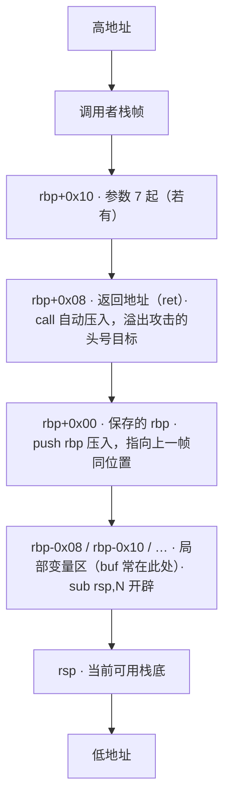
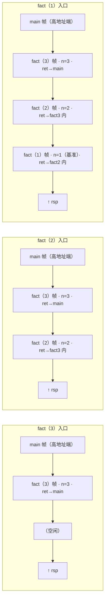

# 19. x86-64 汇编基础

> 日期：2026-11-04
> 所属大纲阶段：4. 系统与二进制安全
> 参考资料：
> - Randal E. Bryant & David R. O'Hallaron,《深入理解计算机系统（CSAPP）》第 3 章「程序的机器级表示」
> - System V AMD64 ABI（x86-64 psABI 规范，由 x86-psABIs 工作组（H. J. Lu 等）维护 /_sysv_abi_；Agner Fog 的优化手册是另一份独立的性能优化参考资料，并非 ABI 维护者）
> - Intel® 64 and IA-32 Architectures Software Developer's Manual, Volume 1/2
> - 《CTF 权威指南：Pwn》第 1-2 章
> - x86-64 Assembly Language Programming with Ubuntu（Ed Jorgensen, GNU 自由文档）
> - gdb 官方文档（sourceware.org/gdb/current/onlinedocs/gdb）

---

本篇是二进制安全的「字母表」。之后所有内容——栈溢出、ROP、格式化字符串、堆利用——都以本篇的**寄存器、调用约定、栈帧结构**为基础。读者已具备 C 语言背景，因此笔记以「C 结构 ↔ 汇编对应物」的方式讲解。

---

## 1. 为什么安全研究要学汇编

1. **漏洞发生在机器层**。C 源码里一句 `read(0, buf, 0x200)` 看不出问题，编译成汇编后，你能直观看到缓冲区在栈上的位置（`[rbp-0x40]`）、返回地址在哪（`rbp+0x8`），溢出距离一目了然。
2. **逆向没有源码**。CTF 的 Pwn/Reverse 题目通常只给二进制，只有汇编可读；真实漏洞分析（如应急响应中定位恶意样本行为）同样如此。
3. **利用构造就是汇编构造**。shellcode 本身就是一段汇编；ROP 链是若干以 `ret` 结尾的指令片段的拼接；SROP 要求手工伪造 `rt_sigframe` 结构。
4. **调试器的语言是汇编**。gdb 的 `ni/si`、断点、寄存器查看，读的都是汇编层面的状态。
5. **防御机制在汇编层可见**。Canary 是序言里一条 `mov rax, fs:0x28`；CET 的 `endbr64` 指令就出现在每个函数入口。

一句话：**C 语言是写给编译器的，汇编是 CPU 真正执行的，漏洞与利用都活在这层。**

---

## 2. x86-64 速览

- **x86-64**（也叫 AMD64 / x64，因 AMD 先于 Intel 发布 64 位扩展规范得名）：寄存器与地址总线加宽到 64 位，通用寄存器 16 个，兼容 32/16 位代码。
- Linux 下常见两种 ABI：
  - **System V AMD64 ABI**（Linux/macOS 默认，本篇主线）；
  - Microsoft x64 ABI（Windows，前 4 参数走 RCX/RDX/R8/R9，本篇不展开）。
- 代码可以在 64 位模式（长模式）或兼容模式运行；我们只关心长模式下的 64 位程序。

---

## 3. 寄存器大全

### 3.1 16 个通用寄存器（General-Purpose Registers, GPR）

x86-64 共 16 个 64 位通用寄存器。历史命名沿用自 8086 的 AX/BX/CX/DX（8 位）→ 80386 扩展为 32 位 EAX…→ AMD64 再扩展为 64 位 RAX…。

| 64 位 | 32 位 | 16 位 | 8 位低 | 8 位高（仅前 4 个） | 常见用途（约定俗成） |
|--------|--------|--------|--------|------------------|--------------------|
| rax | eax | ax | al | ah | 返回值；乘除、syscall 号 |
| rbx | ebx | bx | bl | bh | 被调用方保存；GOT/PIE 里常见 |
| rcx | ecx | cx | cl | ch | 第 4 整数参数；移位/循环移位计数必须用 cl；syscall 指令用 rcx 保存返回地址 |
| rdx | edx | dx | dl | dh | 第 3 参数；乘除高位；I/O 端口 |
| rsi | esi | si | sil | — | 第 2 参数；字符串操作源索引（source index） |
| rdi | edi | di | dil | — | 第 1 参数；字符串操作目的索引（destination index） |
| rbp | ebp | bp | bpl | — | 栈帧指针（frame pointer，编译选项可省略） |
| rsp | esp | sp | spl | — | 栈顶指针（stack pointer），**永远指向栈顶** |
| r8 ~ r15 | r8d ~ r15d | r8w ~ r15w | r8b ~ r15b | — | r8/r9 为第 5/6 参数；r10 用于 syscall 第 4 参数；r11 被 syscall 指令用来保存执行前的 rflags；r12~r15 被调用方保存 |

要点：

- **改写低 32 位会自动清零高 32 位**：`mov eax, 1` 执行后 `rax == 0x0000000000000001`。这是 mov 到 32 位寄存器与 `mov rax, 1` 的隐式差异，shellcode 里 `xor eax, eax` 代替 `xor rax, rax` 一样有效且更短。
- 子寄存器示意图（以 rax 为例）：

```text
 63          32 31           16 15     8 7        0
+--------------+--------------+--------+--------+
|              |     eax      |   ax   |   al   |
|              |              +--- ah --+--------+
+--------------+--------------+--------+--------+
 \____________ rax（64 位）____________/
```

> 注：此图保留 ASCII 原样 —— Mermaid 无位域/寄存器分段类图表，转换会丢失比特偏移（63/32/31/16/15/8/7/0）与 ah/al 子寄存器的对齐对照信息。

### 3.2 三个「特殊角色」寄存器

| 寄存器 | 角色 | 说明 |
|--------|------|------|
| **rsp** | 栈顶指针 | push/pop/call/ret 都会自动增减它；指向**最后一个已使用**的栈字节 |
| **rbp** | 帧指针 | 指向当前栈帧底部，便于用 `[rbp-0x10]`、`[rbp+0x8]` 稳定引用局部变量与返回地址 |
| **rip** | 指令指针（Instruction Pointer） | 永远指向**下一条**要执行的指令；不可直接 `mov rip, ...`，只能被 call/ret/jmp 改变。**漏洞利用的本质就是控制 rip（或让它跳到我们安排的代码）** |

另外两个利用中常打交道的：

- **fs 段寄存器**：指向 TLS（Thread Local Storage，线程局部存储）。`mov rax, qword ptr fs:[0x28]` 读取 **Canary** 值——栈保护机制就在这里。
- **mxcsr / x87 控制寄存器**：知道即可，异常场景（如 `movaps` 对齐问题）会间接遇到。

### 3.3 RFLAGS 标志位寄存器

算术/逻辑指令会设置标志位，条件跳转据此决策。常用的位：

| 标志 | 全称 | 含义 | 典型置位指令 |
|------|------|------|--------------|
| CF | Carry Flag | 无符号溢出（最高位进位/借位） | add/sub/shl |
| ZF | Zero Flag | 结果为 0 | cmp/test/add |
| SF | Sign Flag | 结果符号位为 1 | 算术运算 |
| OF | Overflow Flag | 有符号溢出 | add/sub/imul |
| PF | Parity Flag | 低 8 位中 1 的个数为偶数 | 逻辑运算 |
| AF | Auxiliary Flag | BCD 辅助进位（第 3→4 位进位） | 很少手工使用 |
| DF | Direction Flag | 字符串指令方向（std/cld 设置） | movsb 等串操作 |
| IF | Interrupt Flag | 是否响应可屏蔽中断 | 内核态相关 |

比较指令按 Intel 语义 `cmp a, b` 等价于**不写回的 `sub a, b`**（计算 a−b 只置标志；AT&T 操作数方向相反，要写成 `cmp b, a` 才是同一个 a−b，与 §10 的结论一致）；`test a, b` 等价于 `and` 只改标志。例如 `test rax, rax; je .zero` 即「rax 为 0 则跳转」。

### 3.4 SIMD 一句话

xmm0~xmm15、ymm0~ymm15（SSE/AVX）是向量寄存器，用于浮点与并行计算。安全研究只需知道两件事：① System V ABI 中**浮点参数走 xmm0~xmm7**；② 变参函数（如 printf）调用时 **al 必须置为使用的向量寄存器个数**（纯整数传参时 `mov eax, 0`），这就是你总在 main 反汇编里看到 `mov eax, 0` 的原因。此外 `movaps` 这类**要求 16 字节对齐**的 SSE 指令是 ROP 栈对齐崩溃的主角（见笔记 22）。

---

## 4. AT&T 与 Intel 语法对比

Linux 工具链有两套语法：gcc/objdump 默认 **AT&T 语法**（gcc -S 出来就是），Intel 语法则用于 Windows/IDA/多数教程。**做 Pwn 必须两套都会读**。

| 对比项 | AT&T（gcc/objdump 默认） | Intel（gdb 可切换/IDA 默认） |
|--------|--------------------------|------------------------------|
| 操作数方向 | **源在左，目的在右**：`mov %eax, %ebx`（ebx ← eax） | **目的在左**：`mov ebx, eax`（ebx ← eax） |
| 寄存器前缀 | `%`：`%rax` | 无前缀：`rax` |
| 立即数前缀 | `$`：`$0x40` | 直接写：`0x40` |
| 内存寻址 | `disp(base, index, scale)`：`-0x10(%rbp)`、`0x10(%rbx,%rcx,8)` | `[base + index*scale + disp]`：`[rbp-0x10]`、`[rbx+rcx*8+0x10]` |
| 数据大小后缀 | 指令带后缀：`movq/movl/movw/movb`（64/32/16/8 位） | 无后缀，靠寄存器名推断：`mov rax/...`，内存操作需 `qword ptr [...]` |
| 跳转/调用符号 | `call *%rax`（间接调用带 `*`） | `call rax` |

记忆口诀：AT&T「**从左到右流动**（源→目的）」，Intel「**像赋值语句**（目的=源）」。

切换方法：

```bash
# objdump 用 Intel 语法反汇编（本笔记默认用这种）
objdump -d -M intel ./sum

# gdb 永久切换 Intel 语法
echo "set disassembly-flavor intel" >> ~/.gdbinit
# 或会话内临时
(gdb) set disassembly-flavor intel
```

---

## 5. 常用指令分类清单

### 5.1 数据传送

| 指令 | 示例 | 说明 |
|------|------|------|
| mov | `mov rax, rbx` | 寄存器/内存间复制（内存到内存不行） |
| movzx | `movzx eax, bl` | 零扩展传送（8/16 位 → 更宽） |
| movsx / movsxd | `movsx eax, bx` / `movsxd rax, ebx` | 符号扩展传送；movsxd 专用于 32→64 |
| lea | `lea rax, [rbp-0x10]` | **取地址**不取值：rax = rbp-0x10。也常被编译器用来做乘加（`lea eax, [rax+rax*2]` 即 ×3） |
| xchg | `xchg rax, rbx` | 交换两个操作数 |
| cmovcc | `cmovz eax, ebx` | 条件传送（无分支 if 的底层实现） |

### 5.2 算术

| 指令 | 说明 |
|------|------|
| add / sub | 加/减，置标志位 |
| inc / dec | 自增/自减（**不影响 CF**，逆向时注意） |
| imul / mul | 有符号/无符号乘法；单操作数形式结果放在 rdx:rax |
| idiv / div | 有符号/无符号除法：被除数在 rdx:rax，商 → rax，余数 → rdx |
| neg | 取补（0 - 操作数） |
| adc / sbb | 带进位加/借位减（多精度运算） |
| cmp | 比较（减法只置标志），jcc 的最佳搭档 |

### 5.3 逻辑与移位

| 指令 | 说明 |
|------|------|
| and / or / xor / not | 位运算；`xor eax, eax` 是最快的清零 |
| test | 按位与只置标志；`test rax, rax` 常用于判空/判负 |
| shl / sal | 左移（shl 与 sal 等价） |
| shr / sar | 逻辑右移（补 0）/ 算术右移（补符号位） |
| rol / ror | 循环左/右移 |
| 移位数 | 8086 遗产：只能用 **cl** 或立即数 1（现代 CPU 支持立即数 1~63） |

### 5.4 控制转移

| 指令 | 说明 |
|------|------|
| jmp | 无条件跳转 |
| jcc | 条件跳转家族：je/jz（零）、jne/jnz、jg/jge/jl/jle（有符号）、ja/jae/jb/jbe（无符号）、js/jns（符号）、jo（溢出） |
| call / ret | 调用（push 返回地址 + jmp）/ 返回（pop 到 rip） |
| leave | 等价 `mov rsp, rbp; pop rbp`，与 ret 组成函数尾声；ROP 栈迁移的核心 |
| loop | 循环（rcx 计数），现代编译器很少生成 |
| syscall | 64 位系统调用入口（见 §11） |
| int 0x80 | **32 位**旧式系统调用，CTF 32 位题仍常见 |
| endbr64 | CET（Control-flow Enforcement Technology）的合法间接跳转标记，目前仅作「函数入口」路标 |

### 5.5 栈操作

| 指令 | 等价操作 | 说明 |
|------|----------|------|
| push rax | `sub rsp,8; mov [rsp],rax` | 入栈 |
| pop rax | `mov rax,[rsp]; add rsp,8` | 出栈 |
| pushfq / popfq | — | 标志寄存器出入栈 |
| pusha/popa | — | 16/32 位全部寄存器出入栈，**64 位已删除** |

---

## 6. 寻址方式

x86-64 通用内存寻址公式：**`[基址 + 变址×比例因子 + 位移]`**，比例因子只能是 1/2/4/8（对应元素大小），这正是 C 数组 `a[i]`（元素大小 8 时）的高效实现。

| 寻址方式 | Intel 示例 | AT&T 示例 | 对应 C 语义 |
|----------|------------|-----------|-------------|
| 立即数（Immediate） | `mov eax, 0x64` | `movl $0x64, %eax` | `x = 100;` |
| 寄存器（Register） | `mov eax, ebx` | `movl %ebx, %eax` | `x = y;` |
| 直接寻址（Direct/Absolute） | `mov eax, [0x404000]` | `movl 0x404000, %eax` | `x = *(int*)0x404000;`（全局变量） |
| 寄存器间接（Indirect） | `mov eax, [rbx]` | `movl (%rbx), %eax` | `x = *p;` |
| 基址+位移 | `mov eax, [rbp-0x10]` | `movl -0x10(%rbp), %eax` | `x = p->field;` / 局部变量 |
| 基址+变址 | `mov eax, [rbx+rcx]` | `movl (%rbx,%rcx), %eax` | `x = p[i];`（元素 1 字节） |
| 完整形式 | `mov rax, [rbx+rcx*8+0x10]` | `movq 0x10(%rbx,%rcx,8), %rax` | `x = ((long*)((char*)p+0x10))[i];` |

RIP 相对寻址（RIP-Relative）：PIC/PIE 代码取全局变量的标准方式，`lea rdi, [rip+0xee3]` = 「下一条指令地址 + 0xee3」。这也是为什么 PIE 二进制里几乎没有绝对地址。

---

## 7. System V AMD64 调用约定（Calling Convention）

**调用约定**规定参数怎么传、返回值放哪、哪些寄存器跨函数调用可靠。Linux 上必须背下这一节。

### 7.1 参数与返回值

- 前 6 个**整数/指针**参数依次放入：**rdi, rsi, rdx, rcx, r8, r9**（记忆：Di Si Dx Cx 8 9）。
- 第 7 个起放栈上：调用方从右往左压栈，被调方用 `[rbp+0x10]`、`[rbp+0x18]`… 访问（0x10 起步是因为栈顶是返回地址 0x8 + 保存的 rbp 0x8）。
- 返回值：**rax**（≤64 位）；128 位结果 rax 存低 64、rdx 存高 64。
- 浮点参数走 xmm0~xmm7，超过 6 个整参 + 8 个浮参后走栈（Pwn 题几乎全是整数参数，记住整型即可）。
- 变参函数：**al = 使用的向量寄存器个数**（0~8），纯整数参数置 0。

一元/多元速记表：

| 参数序号 | 寄存器 | 示例：foo(1,2,3,4,5,6) |
|----------|--------|------------------------|
| 1 | rdi | edi=1 |
| 2 | rsi | esi=2 |
| 3 | rdx | edx=3 |
| 4 | rcx | ecx=4 |
| 5 | r8 | r8d=5 |
| 6 | r9 | r9d=6 |

利用时的直接推论：**想调 system("/bin/sh")，就要让 rdi = "/bin/sh" 字符串地址、rip = system 地址**——ROP 链找 `pop rdi; ret` 的原因就在这（笔记 22）。

### 7.2 调用方保存 vs 被调用方保存

| 类别 | 寄存器 | 规则 |
|------|--------|------|
| 调用方保存（caller-saved / volatile） | rax, rcx, rdx, rsi, rdi, r8~r11 | 调用别人后**不保证还在**，要用需自己先压栈 |
| 被调用方保存（callee-saved） | rbx, rbp, r12~r15 | 函数若使用必须**先保存、返回前恢复**，调用方可以放心持有 |
| 特殊 | rsp（永远有效）、rip | — |

逆向意义：看到函数序言里 `push rbx; push r12; push r13`，说明它后面要用这些 callee-saved 寄存器（常用来缓存全局指针/循环变量）；ROP 中改写 r12~r15 之类的 gadget（如 `pop r12; ret`）单独用处不大，但**滑链**很好用。

### 7.3 栈对齐：16 字节

ABI 规定：**执行 call 指令的那一刻 rsp 必须是 16 的倍数**。于是：

- call 把 8 字节返回地址压栈 → **函数入口处 rsp % 16 == 8**；
- 标准 `push rbp` 序言：push 之后 rsp 已回到 16 对齐，后续 `sub rsp, N` 取 16 的倍数即可保持到 call 前仍对齐；
- -O2 无帧指针序言（省掉 push rbp）：入口 rsp%16==8 无人纠正，函数要调用他人（用到 SSE 指令如 printf）时，序言常见 `sub rsp, 0x28` 把栈拉回 16 对齐（8 + 0x28 = 0x30 是 16 的倍数；0x28 = 返回地址 8 + 局部区 0x20），保证 call 前 rsp%16==0；`and rsp, -0x10` 则是硬性 16 对齐的兜底写法。

这是 ROP 最经典的坑：glibc 的 `system` 内部某处 `movaps [rsp], xmm0` 要求 rsp 16 对齐，不对齐直接 SIGSEGV，解法是链上多垫一个裸 `ret`（笔记 22 详述）。

---

## 8. 函数序言与尾声（Prologue / Epilogue）

-O0 编译的典型函数骨架：

```asm
; ---- 序言 prologue：建立栈帧 ----
push rbp            ; 保存调用者的帧指针
mov  rbp, rsp       ; 当前栈顶成为新帧基址（rbp 固定，rsp 继续下移）
sub  rsp, 0x20      ; 为局部变量开辟空间（编译期定长）
; ---- 函数体 ----
; ---- 尾声 epilogue：拆除栈帧 ----
leave               ; mov rsp, rbp; pop rbp  —— 回收局部区并恢复旧 rbp
ret                 ; pop rip —— 回到调用者
```

栈帧结构图（64 位，地址向上增长）：



几个立得住的结论：

- 局部变量引用一律 `[rbp-xxx]`，参数（>6 个）一律 `[rbp+0x10]` 起；
- **缓冲区越界写**沿低地址向高地址推进：先吃局部区，再吃 **saved rbp**，最后吃**返回地址**——覆盖返回地址 = 劫持控制流（笔记 21 的全部前提）；
- 带 `-fomit-frame-pointer`（-O2 默认）时 rbp 被当普通寄存器用，改用 rsp+偏移引用局部变量，帧图需按 rsp 画。

---

## 9. 递归的栈变化图

用经典的递归阶乘观察「每次 call 都压一个新帧」：

```c
// fact.c
long fact(long n) {
    if (n <= 1) return 1;
    return n * fact(n - 1);
}
int main(void) { fact(3); return 0; }
```

三个时刻的栈（省略局部细节，每帧含「保存的 rbp / 返回地址 / 参数 n」）：



- 每次 `call fact`：rsp 下移 8 压返回地址，被调方再压 rbp……帧层层向下（低地址）生长；
- 每层返回 `ret`：rsp 回升，帧被「逻辑销毁」（数据还在，只是不再被引用）；
- 若递归无出口，rsp 一路下探撞上栈保护页（guard page）→ **栈溢出崩溃 Stack Overflow 的本义**，段错误报告常见 `SIGSEGV` 于 7fff… 区；
- 栈溢出攻击（smash the stack）就是**反向**利用：不收敛而是用超长输入把帧底下的返回地址改写。

---

## 10. 条件码与跳转（jcc 家族）

if/for/while/switch 的机器级形态全部落在 `cmp/test` + `jcc` 上：

| C 语义 | Intel 汇编 | 说明 |
|--------|------------|------|
| if (a == b) | `cmp rax, rbx` / `je L1` | ZF=1（相减为零） |
| if (a != b) | `cmp` / `jne` | ZF=0 |
| if (a < b)（有符号） | `cmp rax, rbx` / `jl` | SF≠OF |
| if (a >= b)（有符号） | `cmp` / `jge` | SF=OF |
| if (a < b)（无符号） | `cmp` / `jb`（=jc） | CF=1 |
| if (a > b)（无符号） | `cmp` / `ja` | CF=0 且 ZF=0 |
| if (!p) | `test rax, rax` / `jz` | 自身与为零 |
| if (n & 1) | `test eax, 1` / `jne` | 位测试 |

命名规律：**e**=equal、**n**=not、**g/l**=greater/less（有符号）、**a/b**=above/below（无符号）。逆向读条件跳转时先判断比较双方是谁（Intel 语法 `cmp a, b` 即计算 a-b）。

---

## 11. 系统调用（syscall）约定

用户态程序请求内核服务的唯一正规入口。64 位 Linux 约定：

| 角色 | 寄存器 |
|------|--------|
| 系统调用号 | **rax** |
| 参数 1~6 | **rdi, rsi, rdx, r10, r8, r9**（注意第 4 个是 **r10** 不是 rcx——因为 syscall 指令用 rcx 存返回地址、r11 存 rflags） |
| 返回值 | rax（错误时 -1~-4095，对应 errno） |
| 触发指令 | `syscall` |

常用系统调用号（`cat /usr/include/x86_64-linux-gnu/asm/unistd_64.h` 可查全部）：

| 调用 | rax | 原型 |
|------|-----|------|
| read | 0 | `ssize_t read(int fd, void *buf, size_t count)` |
| write | 1 | `ssize_t write(int fd, const void *buf, size_t count)` |
| open | 2 | `int open(const char *pathname, int flags, ...)` |
| mprotect | 10 | `int mprotect(void *addr, size_t len, int prot)`（改内存权限，ret2shellcode 的朋友） |
| rt_sigreturn | 15 | SROP 的核心（笔记 22） |
| execve | 59 | `int execve(const char *path, char *argv[], char *envp[])`——getshell 的终点 |
| exit | 60 | `void exit(int status)` |

### 11.1 纯汇编写 hello（syscall 三连：write + exit）

```asm
; hello.asm —— 仅限本地学习环境
; 构建：nasm -felf64 hello.asm && ld hello.o -o hello
section .data
    msg db "hello, pwn", 10      ; 10 是 '\n'
    len equ $ - msg              ; $ 为当前地址，减去 msg 即长度

section .text
global _start
_start:
    ; write(1, msg, len)
    mov rax, 1                   ; sys_write
    mov rdi, 1                   ; fd = stdout
    mov rsi, msg                 ; 缓冲区地址
    mov rdx, len                 ; 长度
    syscall
    ; exit(0)
    mov rax, 60                  ; sys_exit
    xor rdi, rdi                 ; status = 0
    syscall
```

逐行对照 C：这就是 `write(1, msg, len); exit(0);`，只是不再经过 libc 封装。**shellcode 的本质 = 这样一段位置无关、无 \x00 字节、以 execve("/bin/sh") 收尾的 syscall 序列**（笔记 21/22 展开）。

gdb 里观察系统调用：`catch syscall write` 可在进入内核前断下。

---

## 12. 实操：从 C 到反汇编到调试

环境声明：以下全部在 **Ubuntu 22.04 LTS（x86-64）、gcc 11.4.0、gdb 12.1** 下运行（Ubuntu 20.04 / gcc 9.4 输出基本一致，仅地址与个别伪指令略有差别）。

### 12.1 实验代码

```c
// sum.c —— 仅限本地学习环境
#include <stdio.h>

int sum(int a, int b) {
    int c = a + b;
    return c;
}

int main(void) {
    int result = sum(1, 2);
    printf("%d\n", result);
    return 0;
}
```

```bash
# -O0 禁优化（保持与源码的对应关系）
# -no-pie 固定加载地址 0x400000 附近，便于教学观察
# -g 带调试符号
gcc -O0 -g -no-pie sum.c -o sum
```

### 12.2 gcc -S 查看 AT&T 汇编

```bash
gcc -S -O0 -no-pie sum.c    # 生成 sum.s
```

节选（AT&T 语法，注释为本笔记所加）：

```asm
sum:
        endbr64                     # CET 入口标记，无功能影响
        pushq   %rbp                # 序言：保存调用者 rbp
        movq    %rsp, %rbp          # 建立 sum 的帧
        movl    %edi, -20(%rbp)     # 参数 a 存到局部槽 [rbp-20]
        movl    %esi, -24(%rbp)     # 参数 b 存到局部槽 [rbp-24]
        movl    -20(%rbp), %edx     # edx = a
        movl    -24(%rbp), %eax     # eax = b
        addl    %edx, %eax          # eax = a + b
        movl    %eax, -4(%rbp)      # c = eax
        movl    -4(%rbp), %eax      # 返回值放 eax（rax 低 32 位）
        popq    %rbp                # 尾声：恢复 rbp
        ret                         # 返回调用者

main:
        endbr64
        pushq   %rbp
        movq    %rsp, %rbp
        subq    $16, %rsp           # 开 16 字节局部区（result + 对齐）
        movl    $2, %esi            # 第 2 参 b=2 → esi
        movl    $1, %edi            # 第 1 参 a=1 → edi
        call    sum                 # 压返回地址并跳转
        movl    %eax, -4(%rbp)      # result = 返回值
        movl    -4(%rbp), %eax
        movl    %eax, %esi          # printf 第 2 参 → esi
        leaq    .LC0(%rip), %rdi    # printf 第 1 参：格式串地址 → rdi
        movl    $0, %eax            # 变参约定：al=0（未用向量寄存器）
        call    printf@PLT          # 动态链接库函数，经 PLT 跳转
        movl    $0, %eax            # main 返回 0
        leave                       # 拆帧
        ret
```

注意三点：①`-O0` 下参数先落到栈槽再读回，效率很低但结构清晰；②传参顺序编译器自定（先 esi 后 edi），无需与源码顺序对应；③`printf@PLT` 说明它来自动态链接库（笔记 20 详解 PLT）。

### 12.3 objdump -d -M intel 逐行注释

```bash
objdump -d -M intel --no-show-raw-insn sum | sed -n '/<sum>:/,/^$/p'
```

Intel 语法反汇编（截取核心两函数，机器码列已省略，地址因链接而异）：

```asm
0000000000401136 <sum>:
  401136:  endbr64
  40113a:  push   rbp                    # 序言①：保存旧 rbp
  40113b:  mov    rbp,rsp                # 序言②：rbp = 当前栈顶
  40113e:  mov    DWORD PTR [rbp-0x14],edi   # [rbp-0x14] = a（edi 为参数 1）
  401141:  mov    DWORD PTR [rbp-0x18],esi   # [rbp-0x18] = b（esi 为参数 2）
  401144:  mov    edx,DWORD PTR [rbp-0x14]   # edx = a
  401147:  mov    eax,DWORD PTR [rbp-0x18]   # eax = b
  40114a:  add    eax,edx                    # eax = a + b
  40114c:  mov    DWORD PTR [rbp-0x4],eax    # c（[rbp-0x4]）= 和
  40114f:  mov    eax,DWORD PTR [rbp-0x4]    # 返回值 → eax
  401152:  pop    rbp                        # 尾声：恢复旧 rbp
  401153:  ret                               # 弹返回地址 → rip，回到 main

0000000000401154 <main>:
  401154:  endbr64
  401158:  push   rbp
  401159:  mov    rbp,rsp
  40115c:  sub    rsp,0x10                    # 局部区 16 字节
  401160:  mov    esi,0x2                     # 参数 b = 2
  401165:  mov    edi,0x1                     # 参数 a = 1
  40116a:  call   401136 <sum>                # 压 0x40116f 并跳 sum
  40116f:  mov    DWORD PTR [rbp-0x4],eax     # result = 3
  401172:  mov    eax,DWORD PTR [rbp-0x4]
  401175:  mov    esi,eax                     # printf 参数 2
  401177:  lea    rdi,[rip+0xee8]             # printf 参数 1：.rodata 里 "%d\n"
  40117e:  mov    eax,0x0                     # al=0：变参约定
  401183:  call   401040 <printf@plt>         # 经 PLT 调动态库
  401188:  mov    eax,0x0                     # return 0
  40118d:  leave
  40118e:  ret
```

对照阅读训练（建议照做一遍）：在纸上标出 `[rbp-0x14]` 是 a、`[rbp-0x4]` 是 c，然后只用反汇编不看源码，还原出 sum 的 C 原型。能完成这一步，逆向就入门了。

常用 objdump 附加参数：

```bash
objdump -d -M intel -S sum        # 混合显示源码行（需 -g 编译）
objdump -d -M intel -j .plt sum   # 只看 .plt 节
objdump -T sum                    # 动态符号表（导入了哪些库函数）
```

### 12.4 gdb 调试基础

gdb 默认**关闭 ASLR**，地址可复现，适合学习。以下是一次完整会话记录风格示例（地址因编译环境而异）：

```text
$ gdb ./sum
GNU gdb (Ubuntu 12.1-0ubuntu1~22.04) 12.1
...

(gdb) set disassembly-flavor intel          # 切 Intel 语法
(gdb) break sum                             # 在 sum 入口下断点（也可 b *0x401136）
Breakpoint 1 at 0x40113a: file sum.c, line 4.
(gdb) run
Starting program: /home/user/asm-lab/sum
Breakpoint 1, sum (a=1, b=2) at sum.c:4     # 停在序言之后

(gdb) info registers rdi rsi rsp rbp rip    # 看关键寄存器
rdi            0x1                 1         # 参数 a
rsi            0x2                 2         # 参数 b
rsp            0x7fffffffe2c8      0x7fffffffe2c8
rbp            0x7fffffffe2e0      0x7fffffffe2e0
rip            0x40113a            0x40113a <sum+4>   # 下一条待执行指令

(gdb) disassemble                            # 反汇编当前函数
Dump of assembler code for function sum:
   0x401136 <+0>:     endbr64
   0x40113a <+4>:     push   rbp              ← 当前停在这
   ...
End of assembler dump.

(gdb) x/6gx $rsp                             # 从栈顶向下看 6 个 8 字节（giant word）
0x7fffffffe2c8:     0x000000000040116f       0x00007fffffffe3c0
0x7fffffffe2d8:     0x0000000000000000       0x0000000000000000
                   ↑ 这就是 sum 的返回地址 0x40116f（call 的下一句）

(gdb) ni                                     # 单步一条（不进入函数）
(gdb) si                                     # 单步一条（遇到 call 会进入）
(gdb) finish                                 # 执行到当前函数返回
(gdb) c                                      # 继续运行
[Inferior 1 (process 12345) exited normally] # 程序跑完：3 已被 printf 输出
```

命令速查（本篇必会版，完整版见笔记 24）：

| 类别 | 命令 | 作用 |
|------|------|------|
| 断点 | `b main` / `b *0x401136` / `tbreak` / `delete` | 下断/临时断/删断 |
| 执行 | `r` `c` `ni`（汇编单步不进入）`si`（进入）`finish` | 全流程控制 |
| 查看 | `info reg` `i r rax` `disassemble` `x/6gx $rsp` `p $rdi` | 寄存器/反汇编/内存 |
| 内存 x 语法 | `x/N F U addr`：N 个数 + 格式 x(hex)/d/t(binary)/s(string)/i(指令) + 单位 b/h/w/g(1/2/4/8 字节) | 例：`x/8bx $rdi` 按字节看字符串 |
| 修改 | `set $rax=0x1a` `set *(long*)$rsp=0x40116f` | 改寄存器/内存，调试利用链必备 |

---

## 13. 常见坑

1. **AT&T 读反方向**：`mov %eax, %ebx` 是 ebx←eax。看 AT&T 汇编算错数据流向是新手第一大坑，不确定就 `objdump -d -M intel` 重看。
2. **mov 到 32 位寄存器会清零高位**：`mov edx, 1` 后 rdx 高 32 位是 0；但 `mov dl, 1` 不影响其余位。构造 gadget 级别的 payload 时这种细节决定成败。
3. **syscall 第 4 参数是 r10 不是 rcx**：手册写 rcx 的是 C 库层封装；汇编层 rcx 已被 syscall 指令占用（存返回地址）。
4. **-O2 之后汇编面目全非**：学习对照请用 -O0；分析实际题目常只有 -O2 产物，函数边界、变量槽都需动态确认，别拿 -O0 心智模型硬套。
5. **栈对齐不是可选项**：在 gdb 里「差一点就能跑」的 ROP 链，命令行下崩在 movaps，九成是 16 字节对齐问题（详见笔记 22 §10）。
6. **inc/dec 不影响 CF**：逆向带进位的多精度运算时容易误判标志位。
7. **`lea` 不访问内存**：`lea rax, [rbx]` 只是 rbx 赋给 rax，不会去读 [rbx]；把 lea 当 mov 用读不到内存值。
8. **rbp 未必是帧指针**：-O2 下 rbp 可能装着任意数据，靠它推栈帧会翻车，应改看 rsp 相对偏移或 DWARF 信息（`info frame`）。

---

## 14. 自测问题

1. 默写 System V AMD64 的 6 个整数参数寄存器与返回值寄存器；第 7 个参数在哪里？
2. 说明 caller-saved 与 callee-saved 的区别，并各列举 4 个寄存器。
3. `call` 与 `jmp` 的本质区别是什么？ret 又做了什么？
4. 画出 sum 函数执行 `push rbp` 之前那一刻、以 rsp 为基准的栈布局（标出返回地址的位置）。
5. 把 `mov rax, [rbx+rcx*8+0x20]` 改写成等价 C 表达式（自定类型），并给出 AT&T 语法形式。
6. `cmp rax, 5; jle target` 对应什么 C 条件？若把 jle 换成 jbe，有符号/无符号语义有何变化？
7. 用纯汇编（syscall）写出 `read(0, buf, 16)` 的寄存器装载序列（buf 地址设为 0x404000）。
8. 为什么 printf 调用前常见 `mov eax, 0`？这个 0 代表什么？
9. 在 gdb 中如何：只执行一条汇编并进入 call 的目标函数？如何以十六进制查看 rdi 指向的 32 字节？如何临时改写一个栈上 quadword？
10. 递归 fact(4) 时栈上最多同时存在几个 fact 帧（含正在执行的那个）？分别是什么参数？

---

（完。下一篇：`20-程序内存布局.md`——把汇编放进内存地图：ELF、栈、堆、PLT/GOT。）

---

## 附：ASCII 图 → Mermaid 替换清单

| 原 ASCII 图（小节 · 内容） | 替换后类型 |
| --- | --- |
| 「3.1 16 个通用寄存器（General-Purpose Registers, GPR）」节 · rax/eax/ax/al 寄存器位域图 | 保留 ASCII（附注说明） |
| 「8. 函数序言与尾声（Prologue / Epilogue）」节 · 函数调用栈布局图 | flowchart TD |
| 「9. 递归的栈变化图」节 · fact(3)/fact(2)/fact(1) 递归三栈对照图 | flowchart LR |
