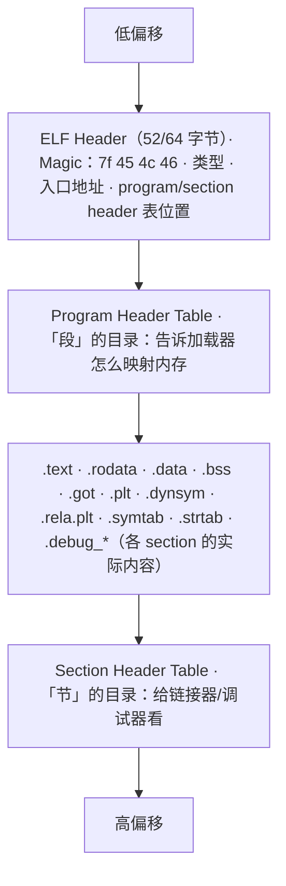
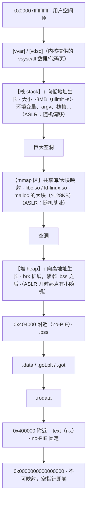
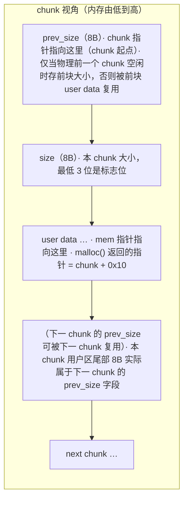
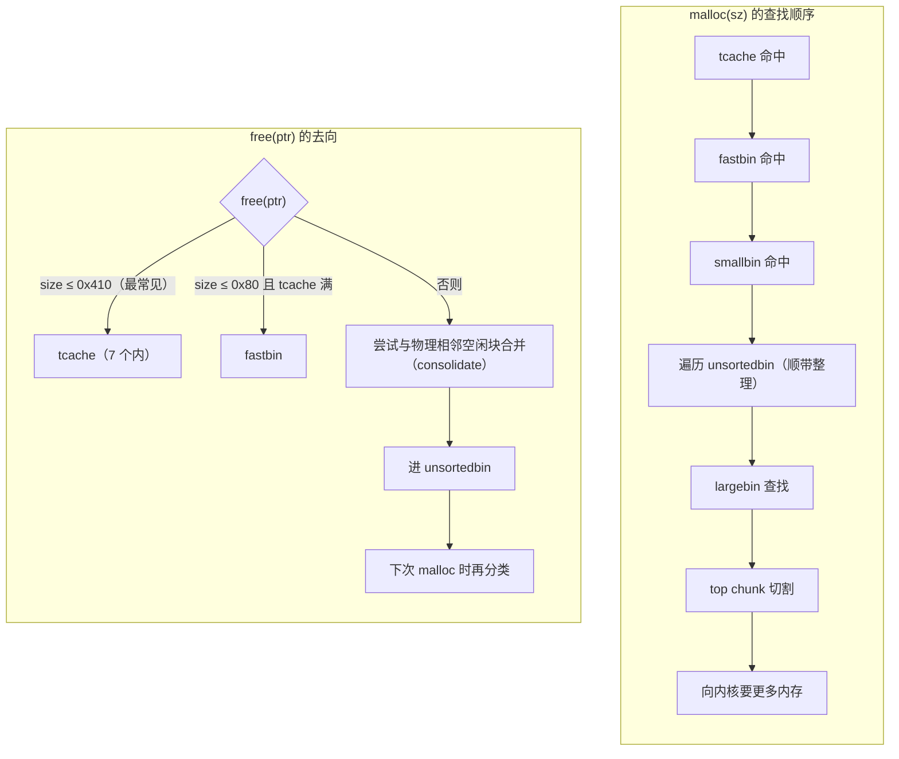
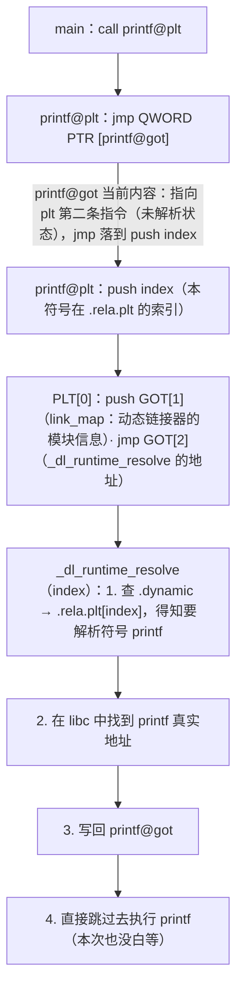

# 20. 程序内存布局：ELF、栈、堆与动态链接

> 日期：2026-11-04
> 所属大纲阶段：4. 系统与二进制安全
> 参考资料：
> - Randal E. Bryant & David R. O'Hallaron,《深入理解计算机系统（CSAPP）》第 7 章「链接」、第 9 章「虚拟内存」
> - 《CTF 权威指南：Pwn》第 2-3 章
> - glibc 源码 `malloc.c`（GNU Libc 官方仓库）
> - ELF Specification (System V ABI, Tool Interface Standard) 与 `man elf`
> - Linux Documentation: `/proc/[pid]/maps`（proc(5) 手册）

---

上一篇解决了「CPU 怎么执行」，本篇解决「数据放在哪」。要理解栈溢出为什么能覆盖返回地址、堆利用为什么改 size/next 指针、GOT 改写为什么能劫持控制流，都必须先有一张完整的**进程虚拟地址空间地图**。本篇所有操作基于 **Ubuntu 20.04 / 22.04 x86-64、glibc 2.31（20.04 为 2.31、22.04 为 2.35）**，差异处单独标注。

---

## 1. 从源码到进程

### 1.1 四个阶段


| 阶段 | 输入→输出 | 做什么 | CTF 相关 |
|------|-----------|--------|----------|
| 预处理（Preprocess） | .c → .i | 处理 `#include/#define/#if` | 恶意宏、隐藏宏后门 |
| 编译（Compile） | .i → .s | 优化 + 生成汇编 | 源码级漏洞在此成形 |
| 汇编（Assemble） | .s → .o | 生成**可重定位（relocatable）**机器码，外部符号留空 | objdump 看 .o 可定位每个函数 |
| 链接（Link） | .o + 库 → 可执行 | 符号解析（谁定义谁）、重定位（填地址） | 静态/动态链接决定反编译难度 |

验证：`gcc -save-temps sum.c -o sum` 会把 .i/.s/.o 全部留在当前目录。

### 1.2 静态链接 vs 动态链接

| | 静态链接（static linking） | 动态链接（dynamic linking） |
|---|---------------------------|----------------------------|
| 产物 | `gcc -static`，库代码全部拷进可执行文件（数 MB） | 默认方式，运行时加载 libc.so 等（几十 KB~） |
| 符号 | 基本自包含，`strings` 里能搜到大量 libc 文本 | 依赖 ld-linux 加载器 + `.so` |
| 地址 | 无 PLT/GOT 中转，直接 call | 外部函数经 PLT/GOT（见 §6） |
| CTF 意义 | 无法 ret2libc（没有动态 libc 可泄），但 gadget 巨多，ret2syscall 常用 | 泄露 libc 基址是几乎所有 64 位题的必经步骤 |

查看依赖：`ldd ./sum`（静态链接则显示 "not a dynamic executable"）。

---

## 2. ELF 文件结构

**ELF（Executable and Linkable Format，可执行可链接格式）**是 Linux 的可执行文件/目标文件/共享库的统一容器。

### 2.1 整体结构



**节（section）vs 段（segment）**——同一个文件的两套视角：

- **节**：链接视角的最小单位，给 ld、objdump、调试器看；
- **段（Program Header / PT_LOAD）**：运行视角，加载器（ld-linux/内核）按段把文件映射到内存，一段可打包多个节；
- 一句话：**链接看节，加载看段**。`readelf -S` 看节，`readelf -l` 看段。

### 2.2 常见 section 清单

| section | 内容 | 内存属性 | 安全相关性 |
|---------|------|----------|-----------|
| `.text` | 机器码 | r-x | ret2text 的落点；NX 时代唯一可执行 |
| `.rodata` | 只读数据：字符串常量、const 数组 | r-- | `"/bin/sh"` 字符串常在这找 |
| `.data` | 已初始化全局/静态变量 | rw- | 可写且地址固定（无 PIE），经典跳板 |
| `.bss` | 未初始化全局/静态（加载时清零，不占文件体积） | rw- | 栈迁移常去的空旷地带 |
| `.got` | 全局偏移表（Global Offset Table） | 依 RELRO | 改 GOT 劫持控制流的目标 |
| `.got.plt` | PLT 专用 GOT 区（含 GOT[0..3]） | Partial RELRO 下可写 | 同上，`%n` 写 GOT 的主战场 |
| `.plt` | 过程链接表（Procedure Linkage Table），动态函数跳板 | r-x | `call printf@plt` 的目标 |
| `.init` / `.fini` | main 前后执行的构造/析构代码 | r-x | `_start` → `__libc_csu_init` 路径（注：`__libc_csu_init` 属 glibc < 2.34 工具链产物，Ubuntu 22.04 起默认编译已移除该符号） |
| `.init_array` / `.fini_array` | 构造/析构**函数指针数组** | rw-（Partial） | 覆盖函数指针劫持启动流程 |
| `.dynamic` | 动态链接信息表（依赖库、重定位表位置） | r--/rw- | RELRO 相关 |
| `.dynsym` / `.dynstr` | 动态符号表与符号名 | r-- | 解析符号时查 |
| `.rela.plt` / `.rela.dyn` | 重定位表（哪个 GOT 项对应哪个符号） | r-- | 延迟绑定的索引来源 |
| `.symtab` / `.strtab` | 完整符号表（strip 后消失） | 不加载 | 有无符号直接决定逆向难度 |

验证：

```bash
gcc -O0 -no-pie -g hello.c -o hello
readelf -S hello          # 列出全部节与地址
objdump -s -j .rodata hello   # 直接看 .rodata 的字符串字节
```

### 2.3 ELF Header 逐项解读（readelf -h）

```text
$ readelf -h hello
Magic:   7f 45 4c 46 02 01 01 00 ...     # 7f 'E' 'L' 'F'；02=64 位；01=小端
Class:                             ELF64
Data:                              2's complement, little-endian
Type:                              EXEC (EXEC 文件类型)   ← 关键！
                                    #   EXEC=固定地址加载（no-PIE）
                                    #   DYN=可重定位加载（PIE 或共享库）
Machine:                           Advanced Micro Devices X86-64
Entry point address:               0x401060             ← rip 起点(_start)
Number of program headers:         13
Number of section headers:         31
```

**checksec 判断 PIE 就看 Type 是否为 DYN**——这也是为什么 PIE 下地址每次都变：DYN 类文件由 ld-linux 挑一个随机基址再重定位。

---

## 3. 进程虚拟地址空间布局（x86-64 Linux）

用户空间 128TB（0x0000_0000_0000_0000 ~ 0x0000_7fff_ffff_ffff），完整地图：



要点：

- **no-PIE**：可执行文件部分固定映射在 **0x400000** 起（历史遗留的最低加载地址），题目里看到 `0x40xxxx` 地址即可确定 no-PIE；
- **PIE**：可执行文件像共享库一样被 mmap 到随机基址（常见 `0x55xxxxxxx000` 或 `0x56...`），每次运行都变；
- **ASLR（Address Space Layout Randomization，地址空间布局随机化）**：栈、mmap 区（含 libc）、堆（开启 heap ASLR 时）的基址每次运行随机化；`/proc/sys/kernel/randomize_va_space`：0=关 / 1=mmap+栈+vdso / 2=再+堆（默认）；
- gdb 默认关闭随机化（`set disable-randomization on`），所以调试时 libc 地址恒为 0x7ffff7xxxxxx 一类，**与真实运行不同，写 exp 时不能照抄**。

---

## 4. 栈（Stack）详解

- **生长方向**：x86-64 栈向**低地址**生长（push 使 rsp 减小）；
- 上限由 `ulimit -s`（默认 8MB）控制，撞顶触发 SIGSEGV；
- 栈底（高地址端）依次是：环境变量字符串、argv 字符串、`envp[]/argv[]` 指针数组、`auxv`（辅助向量，含 AT_RANDOM——canary 种子等）。
- **帧结构**（复习笔记 19）：每帧 = [返回地址][saved rbp][局部变量]，rbp 串联成链，`bt` 回溯就是沿这条链走。
- **红区（Red Zone）**：一句话——叶子函数（不再调用别人的函数）可以在 rsp 下方 128 字节内直接使用而不调整 rsp，信号处理需注意，平时分析知道即可。

栈的「防御性格局」：栈默认 **rw-，不可执行**（NX），所以往栈上写 shellcode 跳过去执行在默认配置下必死（见笔记 21 的 execstack 特例）。

---

## 5. 堆（Heap）详解

### 5.1 从系统调用看堆的来源

glibc 的 malloc 向内核要内存只有两条路：

| 途径 | 系统调用 | 用途 |
|------|----------|------|
| brk/sbrk | `brk(2)` | 主线程 arena：伸缩 `.bss` 之后的 [heap] 区，小块分配 |
| mmap | `mmap(2)` | 大块（默认阈值 128KB，动态调整）、线程 arena、共享库加载 |

```bash
cat /proc/<pid>/maps | grep heap      # 观察主堆区
strace -e brk,mmap ./a.out 2>&1 | tail   # 直观看到 malloc 何时向内核要页
```

### 5.2 chunk：堆的基本单位

malloc 把堆切成一个个 **chunk（块）**，用户拿到的是 chunk 内部「用户区」指针。64 位下结构：



**size 字段低 3 位标志**：

| 位 | 名称 | 含义 |
|----|------|------|
| 0x1 | P = PREV_INUSE | 物理前一个 chunk **在使用**（因此其 prev_size 无效/被复用） |
| 0x2 | M = IS_MMAPPED | 本 chunk 由 mmap 独立分配（free 时走 munmap） |
| 0x4 | A = NON_MAIN_ARENA | 属于非主线程 arena |

换算：真实 chunk 大小 = `size & ~0x7`，且**按 0x10 对齐**（最小 0x20）。所以 `malloc(0x18)` 实际 chunk 是 0x20（0x18 用户数据 + 0x10 头 - 0x8 复用 = 0x20，向上对齐）；`malloc(0x40)` 的 chunk 恰好 0x50：0x40 + 0x8（size 字段有效部分）→ 对齐到 0x50。**「用户请求大小 → chunk 大小」的心算**是堆题基本功。

### 5.3 bin 家族：空闲块的管理层级

被 free 的 chunk 按 size 进入不同容器（bin）：

| bin | 结构/范围（64 位） | 特点 |
|-----|--------------------|------|
| **tcache**（thread cache，glibc 2.26+） | 每线程；覆盖请求 ≤ 0x408（chunk ≤ 0x410）；每种尺寸 7 个 | **单链表 LIFO**、无锁最快路径、free/malloc 第一站 |
| **fastbin** | chunk ≤ 0x80（默认 global_max_fast） | 单链表 LIFO；链表头有 double-free 检测；free 时不合并（标记仍 inuse） |
| **smallbin** | chunk < 0x400 | 双向链表，每尺寸一条，FIFO |
| **largebin** | chunk ≥ 0x400 | 双向链表 + 尺寸分段索引，查找按范围 |
| **unsortedbin** | 通用暂存 | free 的非 fastbin 块先进这里；下次 malloc 时统一整理，合适则直接复用，否则归类进 small/large；链表首尾连着 main_arena（泄露 libc 的经典来源） |

层级关系（优先级从高到低）：



### 5.4 tcache 结构（重点，glibc 2.26+）

tcache 是现代堆利用的主战场：

```c
// glibc 源码简化（key 字段 2.29 起引入；counts 用 uint16_t 是 2.30 起，2.29 为 char）
typedef struct tcache_entry {
    struct tcache_entry *next;   // 同尺寸链表：指向下一个空闲 chunk 的 mem
                                 // glibc 2.32+ 该指针被 Safe-Linking 混淆：
                                 // 存储值 = (chunk地址 >> 12) ^ 下一地址
    struct tcache_entry *key;    // 2.29+ 加入：填 tcache_perthread_struct 指针
                                 // free 时若 key 相等 → 疑似 double free，遍历检测
} tcache_entry;

typedef struct tcache_perthread_struct {
    uint16_t counts[64];         // 每尺寸当前计数（≤7；uint16_t 为 2.30 起，2.29 为 char）
    tcache_entry *entries[64];   // 每尺寸链表头
} tcache_perthread_struct;       // 首次 malloc 时分配在堆开头
```

tcache 三个利用面（详见笔记 21）：

1. **tcache poisoning**：溢出改空闲块的 `next` → malloc 返回任意地址（2.32 前无任何指针保护）；
2. **tcache dup（double free）**：2.26~2.28 无 key 检测，同块连 free 两次即可链上出现两次；
3. **tcache stashing unlink** 等进阶技巧（了解即可）。

### 5.5 free 后 chunk 内容变化（观察实验）

```c
// heaplab.c —— 仅限本地学习环境
#include <stdio.h>
#include <stdlib.h>
int main(void) {
    unsigned long *p = malloc(0x40);
    *p = 0x4141414141414141;
    printf("free 前: p[0]=%#lx p[1]=%#lx\n", p[0], p[1]);
    free(p);
    printf("free 后: p[0]=%#lx(next) p[1]=%#lx(key)\n", p[0], p[1]);
    return 0;
}
```

Ubuntu 20.04（glibc 2.31）典型输出：free 后 `p[0]`=0（next 为空）、`p[1]`=tcache 结构体地址（key）。**free 只改写头部元数据与头 16 字节用户区，其余数据原样残留**——这就是 UAF 能读到旧数据的原因。

gdb（pwndbg）观察：

```text
pwndbg> heap                        # 列出堆上所有 chunk
pwndbg> vis_heap_chunks             # 可视化 chunk 链（含 next/key 标注）
pwndbg> bins                        # 各 bin 当前状态
pwndbg> p main_arena                 # 主 arena（含 top、bins[]）
pwndbg> p &main_arena                # unsortedbin 泄 libc 的原理：bin 链表节点在 libc 数据段
```

### 5.6 vis_heap_chunks 实战：看懂一次 free 的全貌

对 §5.5 程序稍作扩展（三个 malloc(0x40)，free 中间那个）：

```c
// heapvis.c —— 仅限本地学习环境
#include <stdio.h>
#include <stdlib.h>
#include <string.h>
int main(void) {
    void *a = malloc(0x40), *b = malloc(0x40), *c = malloc(0x40);
    memset(a, 0x41, 0x40);            // a 填 'A'，便于辨认
    free(b);                          // b 进 tcache
    puts("break here"); getchar();    // 断点停在这里观察
    return 0;
}
```

在 `getchar()` 处断下后（注释为本笔记所加，地址以 gdb 实际为准）：

```text
pwndbg> vis_heap_chunks
0x555555559250   0x0000000000000000        0x0000000000000291  ← chunk#0：tcache_perthread_struct
                                                                       （首次 malloc 自动创建，0x291）
0x555555559260   0x0000000000000000        0x0000000000000000    ← counts[] / entries[] 所在
              ...（tcache 结构体内部，略）...
0x5555555594e0   0x0000000000000000        0x0000000000000051  ← chunk a：size=0x50|P
0x5555555594f0   0x4141414141414141        0x4141414141414141    ← a 的 user 区（'A' 可见）
              ...（a user 区其余部分）...
0x555555559530   0x0000000000000000        0x0000000000000051  ← chunk b：prev_size=0（P=1 时无效）、size=0x50|P
0x555555559540   0x0000000000000000        0x0000555555559260  ← b free 后：next=0（空链）
                                                                       key=tcache 结构体地址
0x555555559580   0x0000000000000000        0x0000000000000051  ← chunk c：仍 inuse（prev_size=0：前块 b 在 tcache 中仍标 inuse）
0x555555559590   ...                     ...
0x5555555595d0   [top]（剩余空间，size 巨大）
```

这张图能读出四件事：① tcache 结构体本身就是堆上第一个 chunk；② chunk 间距 0x50 = 我们心算的尺寸；③ b 的 next/key 已被 free 写入（头 16 字节被覆盖）；④ b/c 的 prev_size 均为 0——P=1（前块 inuse）时该字段无效，物理上正是前块 user 区尾部可复用的空间。堆题 90% 的现场分析就是盯这张图找异常值（被改的 size、错位的链表指针）。

---

## 6. 动态链接与 PLT/GOT

### 6.1 为什么需要 GOT/PLT

动态库函数地址在**运行时**才能确定（ASLR + 共享库可被任意版本替换），但 `.text` 又不能每次都改写（共享、只读）。方案：**代码不写死地址，统一查表跳转**。

- **GOT（Global Offset Table，全局偏移表）**：`.got.plt` 里每个外部函数一项，存**运行时解析出的真实地址**；
- **PLT（Procedure Linkage Table，过程链接表）**：`.text` 侧的 16 字节跳板代码，`call printf` 实际 call 到 `printf@plt`。

### 6.2 延迟绑定（Lazy Binding）完整流程

**第一次调用 printf：**



**第二次及以后：**

```text
printf@plt:
  jmp QWORD PTR [printf@got]   # GOT 项已被解析为 libc 真实地址
        │                        # 一步直达，代价只剩一次间接跳转
        ▼
     libc printf
```

GOT 表头部特殊项（`.got.plt` 前三项）：

| 项 | 内容 |
|----|------|
| GOT[0] | `.dynamic` 节地址 |
| GOT[1] | link_map 结构地址（动态链接器用） |
| GOT[2] | `_dl_runtime_resolve` 地址 |
| GOT[3+] | 各外部函数项（初始指向各自 PLT 第二条指令） |

**攻击面直觉**：Full RELRO 之前，`printf@got` 是**可写的函数指针**——格式化字符串 `%n`（笔记 23）或堆溢出改写它，就把「下一次调用 printf」变成「调用任意函数」。

### 6.3 RELRO 两种模式

RELRO（Relocation Read-Only，重定位只读）：

| 模式 | 编译选项 | 效果 | 攻击面 |
|------|----------|------|--------|
| **Partial RELRO**（常见默认） | `-Wl,-z,relro` | GOT 只读化到 GOT[.]：`.got`（数据引用）只读，但 **`.got.plt` 仍可写**（延迟绑定需要） | 改函数 GOT 劫持仍可行 |
| **Full RELRO** | `-Wl,-z,relro,-z,now` | **放弃延迟绑定**：启动时一次性解析全部符号，之后整个 GOT 只读 | GOT 改写路线被封死，转而打 hook/返回地址/函数指针 |

`-z now` 的含义：加载时立即（NOW）解析。检查：`checksec` 输出 `RELRO: Partial RELRO / Full RELRO / No RELRO`；也可 `readelf -d` 看 `BIND_NOW` 标志与 `readelf -l` 看 `GNU_RELRO` 段范围。

---

## 7. 实操：/proc/pid/maps 逐段解读

实验程序（把 19/20 两篇的「各存储区」全部造出来）：

```c
// memmap.c —— 仅限本地学习环境
#include <stdio.h>
#include <stdlib.h>
#include <unistd.h>

int g_init = 0x1234;          // .data
int g_uninit;                  // .bss
const char *g_str = "hello";   // 指针在 .data，字符串本体在 .rodata

int main(void) {
    static int s_var = 5;      // 静态局部变量同样进 .data
    int stack_v = 1;           // 栈
    char *heap_p = malloc(0x30);   // 堆
    char *big_p = malloc(0x100000); // 大块 → mmap

    printf("pid=%d，回车退出\n", getpid());
    printf("g_init  .data : %p\n", (void*)&g_init);
    printf("g_uninit .bss : %p\n", (void*)&g_uninit);
    printf("g_str 指针 .data: %p，字符串 .rodata: %p\n", (void*)&g_str, (void*)g_str);
    printf("heap          : %p\n", heap_p);
    printf("big(mmap)     : %p\n", big_p);
    printf("stack         : %p\n", (void*)&stack_v);
    getchar();
    return 0;
}
```

```bash
gcc -O0 -g -no-pie memmap.c -o memmap && ./memmap
# 另开终端：
cat /proc/$(pgrep memmap)/maps
```

典型输出（地址每次可能不同，注释为本笔记所加）：

```text
00400000-00401000 r--p 00000000 08:01 ...  /home/user/memmap   # ELF 头+.rodata 等只读
00401000-00402000 r-xp 00001000 08:01 ...  /home/user/memmap   # .text 可执行
00402000-00403000 r--p 00002000 08:01 ...  /home/user/memmap   # .rodata/.eh_frame
00403000-00404000 r--p 00003000 08:01 ...  /home/user/memmap   # .got（RELRO 只读区）
00404000-00405000 rw-p 00003000 08:01 ...  /home/user/memmap   # .data .bss .got.plt
013e5000-01406000 rw-p 00000000 00:00 0      [heap]            # brk 堆（起始有随机）
7f2f9dc00000-7f2f9dc21000 rw-p 00000000 00:00 0                # 0x100000 大块 → mmap
7f2f9dd55000-7f2f9dd7b000 r--p 00000000 08:01 ...  libc.so.6   # libc 只读数据
7f2f9dd7b000-7f2f9decf000 r-xp 00026000 08:01 ...  libc.so.6   # libc 代码
...（libc 的 r--/rw- 段）
7f2f9df3c000-7f2f9df3e000 rw-p ...             # ld.so 数据等
7ffd0c9e8000-7ffd0ca09000 rw-p 00000000 00:00 0  [stack]      # 栈（高地址）
7ffd0caf6000-7ffd0cafa000 r--p ...               [vvar]
7ffd0cafa000-7ffd0cafc000 r-xp ...               [vdso]
ffffffffff600000-ffffffffff601000 --xp ...       [vsyscall]   # 固定地址遗留区
```

逐条验证：

- `.data`/`.bss` 地址（printf 打印的 0x404xxx）落在 `rw-p 00404000` 行；
- `[heap]` 紧跟程序映像之后、且 `heap_p` 指向其中；
- `big_p`（0x100000 字节）落在独立的 `rw-p` mmap 区——印证「≥128KB 走 mmap」；
- 栈地址 0x7ffd… 是最高的用户映射；
- 程序的**可执行段只有 r-xp 那一行**——NX 的直观体现；
- **重跑一次再 cat**：PIE 程序/栈/heap/库基址全变，no-PIE 的 00400000 行不变——ASLR 作用范围一目了然。

---

## 8. 三大缓解机制在内存层面的体现

| 机制 | 内存层面证据 | 绕过/对抗思路（后续笔记展开） |
|------|--------------|------------------------------|
| **Canary**（栈保护，`-fstack-protector`） | 函数序言 `mov rax, fs:0x28` 取随机值放在 **rbp-0x8**（局部区与 saved rbp 之间），尾声校验不符则 `__stack_chk_fail` | 泄露 canary；一次只覆盖局部不碰 canary 的 off-by-one；格式化串读 fs:0x28 |
| **NX**（No-eXecute，DEP） | vmmap 中 **没有任何一页同时 rw+rx**；栈页 rw- | ret2libc/ROP（不再注入代码，复用现有代码） |
| **PIE**（Position Independent Executable） | ELF Type=DYN，映像基址随机 | 先泄露程序基址再算 gadget |
| ASLR（系统级） | 每次运行 maps 地址变化 | 泄露任一已知符号地址 → 反推基址 |

它们与本篇地图的对应：Canary 是「栈帧里的哨兵」；NX 是「页表权限」；PIE/ASLR 是「基址随机化」。四者共同把「固定地址 + 注入代码」的老时代利用逼进了「必须先泄露信息、再用 ROP 复用代码」的新时代。

---

## 9. 常见坑

1. **gdb 里的地址 ≠ 真实运行地址**：gdb 默认关 ASLR，调试时算出的 libc 基址到 shell 里执行必错。exp 永远以「运行时泄露」为准。
2. **`malloc(0x40)` 的 chunk 是 0x50 不是 0x40**：忘算 0x10 头部与对齐，堆题偏移全错。心算公式：`(req + 8 + 0xf) & ~0xf`，最小 0x20。
3. **tcache 只到 chunk 0x410**：超过这个尺寸的 free 直接走 unsortedbin，行为完全不同（会触发合并），别拿 tcache 思路硬套大块。
4. **`[heap]` 不是 malloc 的全部**：大于 mmap threshold（默认 128KB，且动态自适应）的分配根本不在 [heap] 区；分析题目时先 `vmmap` 确认地址落在哪个映射。
5. **no-PIE ≠ 没有 ASLR**：no-PIE 只是程序本体固定在 0x400000，**栈、堆、libc 仍然随机**；不要以为 no-PIE 就能直接写死 system 地址。
6. **GOT 改写前先看 RELRO**：Full RELRO 下 GOT 只读，`%n` 写 GOT 会直接段错误；Partial RELRO 时 `.got.plt` 才可写。
7. **bss 不占文件体积**：`objdump -s` 看不到 .bss 内容，别怀疑工具坏了；运行时它在 maps 的 rw- 段里。
8. **不同 glibc 行为差异巨大**：tcache（2.26+）、key 检测（2.29+）、Safe-Linking（2.32+）、hook 移除（2.34）。做题前先确认 `ldd --version` 与题目 libc 版本一致。

---

## 10. 自测问题

1. 画出 x86-64 Linux 进程地址空间从 0x400000 到栈顶的完整布局图，并标出每个区的生长方向。
2. section 与 segment 的区别是什么？分别用什么工具查看？
3. `.data` 与 `.bss` 的区别？`const char *p = "x"` 中指针与字符串各在哪个节？
4. 手算：`malloc(0x28)`、`malloc(0x38)`、`malloc(0x88)` 对应的 chunk 大小各是多少？后两个分别 free 后进哪个 bin（glibc 2.31）？
5. 描述 chunk 头 size 字段的三个标志位含义。为什么 P=1 时前一块的 prev_size 可以被复用？
6. 写出 tcache_entry 的两个字段及其作用；glibc 2.32 的 Safe-Linking 对第一个字段做了什么？
7. 完整描述第一次与第二次调用 `puts` 时，PLT/GOT 各自的执行路径差异。
8. GOT[0]、GOT[1]、GOT[2] 分别存什么？谁在什么时候使用它们？
9. Partial RELRO 与 Full RELRO 在 maps/readelf 上分别怎么区分？对 GOT 改写攻击各意味着什么？
10. 在你的机器上运行 memmap.c，解释 maps 输出中每一行与源码变量的对应关系；如果改成 PIE 编译，哪些行会变化？
11. Canary 在栈帧中的具体位置？为什么它能拦住「线性上溢」却拦不住格式化字符串读？
12. `strace` 观察：连续 `malloc(0x100)` 十次与 `malloc(0x200000)` 一次，分别触发了哪些系统调用？为什么？

---

（完。下一篇：`21-栈溢出与堆溢出.md`——拿着这张地图，开始第一次真正的控制流劫持。）

---

## 附：ASCII 图 → Mermaid 替换清单

| 原 ASCII 图（小节 · 内容） | 替换后类型 |
| --- | --- |
| 「1.1 四个阶段」节 · sum.c 编译管线图 | flowchart LR |
| 「2.1 整体结构」节 · ELF 文件段布局图 | flowchart TD |
| 「3. 进程虚拟地址空间布局（x86-64 Linux）」节 · 虚拟地址空间全图 | flowchart TD |
| 「5.2 chunk：堆的基本单位」节 · chunk 布局图 | flowchart LR |
| 「6.2 延迟绑定（Lazy Binding）完整流程」节 · PLT/GOT 延迟绑定流程图 | flowchart TD |
| 「4.x 堆管理器」节 · malloc 查找顺序 / free 去向图 | flowchart TD |
