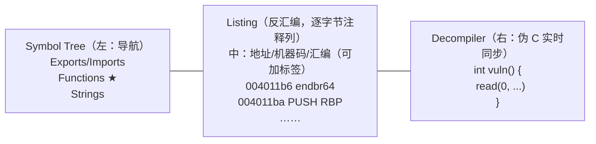
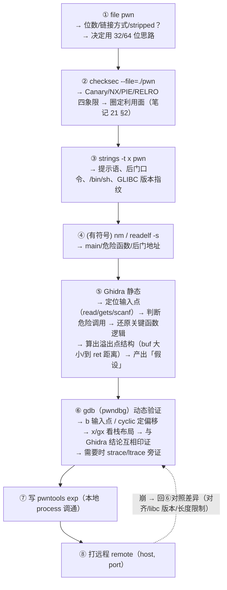

# 24. 二进制分析工具：gdb / pwndbg / Ghidra / objdump

> 日期：2026-11-04
> 所属大纲阶段：4. 系统与二进制安全
> 参考资料：
> - gdb 官方文档（sourceware.org/gdb/onlinedocs/gdb）
> - pwndbg / GEF / PEDA 各自 GitHub README
> - Ghidra 官方帮助（help.ghidra-sre.org）与《The Ghidra Book》
> - man 手册：objdump(1)、readelf(1)、nm(1)、strings(1)、file(1)、strace(1)、ltrace(1)
> - pwntools 文档（docs.pwntools.com）
> - radare2 book（book.rada.re）/ rizin 书

---

本篇是阶段 4 的收官：把前四篇（汇编、内存布局、溢出、ROP/格式化串）用到的工具**系统地**装进工具箱。目标读完本篇后，拿到一个陌生二进制，能独立走完「识别 → 静态 → 动态 → 写 exp」的完整动线。

---

## 1. 工具全景图

| 维度 | 工具 | 一句话定位 |
|------|------|-----------|
| 静态·文件识别 | `file`、`checksec` | 是什么、开了什么防御 |
| 静态·字符串 | `strings` | 不反汇编先「听它自己说」 |
| 静态·反汇编 | `objdump`、`radare2/rizin` | 命令行轻量看汇编 |
| 静态·反编译 | **Ghidra**、IDA Free、`retdec` | 汇编 → 伪 C，逆向主力 |
| 静态·结构解析 | `readelf`、`nm`、`patchelf` | ELF 头/节/段/符号/重定位 |
| 动态·调试 | **gdb**（+ pwndbg/GEF/PEDA） | 断点、寄存器、内存、堆 |
| 动态·跟踪 | `strace`（系统调用）、`ltrace`（库函数） | 不下断点看「它对外做了什么」 |
| 利用框架 | **pwntools** | exp 的标准库 |

选型心法：**静态定位「程序逻辑」，动态验证「运行时真相」，两者永远交叉印证。** 单看反编译想当然，是初学者最大错误源。

---

## 2. gdb 深度使用

### 2.1 命令分类速查表

```text
── 断点/观察点 ──────────────────────────────────────────
b main / b *0x401139      按符号/地址下断点
b *0x401139 if $rdi==0    条件断点
tbreak vuln                临时断点（命中一次即消失）
watch *0x404060            数据断点：该地址内容变化即断（gdb 按表达式类型定宽度，int 型 4 字节）
watch *(long long*)0x404060  同上，强转 long long* 即按 8 字节宽度观察
rwatch / awatch            读断点 / 读写断点
info breakpoints (i b)     列出全部断点
delete 2 / disable 1       删除断点 2 / 暂停断点 1
clear                      清除当前函数的断点

── 执行控制 ──────────────────────────────────────────
run (r) [args]             从头运行（可带参数/重定向）
continue (c)               继续到下一断点
nexti (ni)                 单步一条汇编指令（不进入 call）
stepi (si)                 单步一条汇编指令（进入 call）
next (n) / step (s)        源码级单步（需 -g）
finish (fin)               跑到当前函数返回
until 40                   跑到当前栈帧第 40 行
signal SIGINT              给被调试进程发信号
attach <pid>               附加已运行进程

── 查看 ──────────────────────────────────────────
info registers (i r)              全部寄存器
i r rax rdi rsp                   指定寄存器
p $rdi                            打印寄存器（表达 C 表达式）
p/x *(long*)$rsp                  按指针解引用打印
x/<N><F><U> addr                  检查内存（见 2.2）
disassemble / disas               反汇编当前函数
disas 0x401139,0x401180           反汇编地址区间
bt / bt full                      调用栈回溯（含局部变量）
info frame                        当前帧详情（rbp 链、参数）
info proc mappings                等价 /proc/pid/maps
info functions                    列符号函数
list / l                          源码列表（需 -g）

── 修改 ──────────────────────────────────────────
set $rax = 0x1a                   改寄存器
set *(long*)$rsp = 0x404060       改内存
set var x=5                       改源码变量（需 -g）
set {char[8]} 0x601060 = "AAAA"   改字符串
set args A B                      设定 main 参数

── 其他 ──────────────────────────────────────────
define/...                        自定义命令（见 2.4）
shell ls                          在 gdb 内执行 shell
set disassembly-flavor intel      AT&T → Intel 语法
set follow-fork-mode child        跟随 fork 子进程
set disable-randomization off     恢复 ASLR（默认 gdb 关闭！）
```

### 2.2 x 命令格式语法详解

`x/NFU addr` 三段式——**数量 N + 格式 F + 单位 U**：

| 段 | 取值 | 含义 |
|----|------|------|
| N | 十进制 | 连续显示几个单位 |
| F | `x`(hex) `d`(dec) `u`(无符号) `t`(bin) `o`(oct) `c`(char) `s`(string) `f`(float) `i`(反汇编指令) | 显示格式 |
| U | `b`(1字节) `h`(2字节) `w`(4字节) `g`(8字节) | 每单位字节数 |

示例：**`x/20gx $rsp`** 逐段拆解——`20` 个单位、`g`iant-word（8 字节）、`x` 十六进制 → 「从 rsp 起向上打印 20 个 quadword」。常用组合：

```text
x/20gx $rsp     栈：20 个 8 字节（看返回地址/链）
x/8bx  0x404000 按字节看 8 字节（找 '\x00'、字符）
x/2wx  $rdi     4 字节×2（32 位数据）
x/s    $rdi     把 rdi 当 C 字符串打印
x/5i   $rip     从 rip 反汇编 5 条指令
x/16cb  buf     字符方式看缓冲区
```

### 2.3 p 与 x 的区别

| | `p` | `x` |
|---|-----|-----|
| 对象 | 表达式（寄存器/变量/算式），带类型 | 纯内存地址 |
| 记忆 | 「print 变量」：`p $rax`、`p &main`、`p/x 0x123+0x456` | 「examine 内存」：必须给地址 |
| 指针 | `p *ptr` 解引用一次 | `x/ $rsp` 自动取 rsp 的值当地址 |
| 输出 | 十进制默认（可 /x /s 修饰） | 按 NFU 固定格式 |
| 典型 | `p $rdi`、`p (char*)$rsi` | `x/s $rdi`、`x/4gx $rbp-0x20` |

### 2.4 define 自定义命令与 .gdbinit

```text
(gdb) define hexdump        # 自定义：hexdump 起始地址 长度
  set $addr = $arg0
  set $n = $arg1
  while $n > 0
    printf "%p: ", $addr
    x/4gx $addr
    set $addr = $addr + 32
    set $n = $n - 32
  end
end
(gdb) hexdump $rsp 128
```

把常用配置写进 `~/.gdbinit`（每次启动自动加载）：

```text
# ~/.gdbinit 示例
set disassembly-flavor intel
set print pretty on
set pagination off
set follow-fork-mode child
define bva                 # 快捷：断 vuln 并运行
  break vuln
  run
end
source ~/pwndbg/gdbinit.py   # ← pwndbg 加载行（见 §3；与 peda/gef 互斥）
```

---

## 3. pwndbg 详解

### 3.1 安装

```bash
sudo apt install git python3 python3-pip python3-venv gdb
git clone https://github.com/pwndbg/pwndbg
cd pwndbg
./setup.sh                 # 自动装依赖并写入 ~/.gdbinit
# 验证
gdb -q ./ret2libc
pwndbg> version
```

### 3.2 context：断点停下后的全景面板

每次断下自动显示（`context` 可手动刷新，`ctx-reg/ctx-code/ctx-stack` 分栏单独刷新）：

```text
┌── REGISTERS ──────────────────────────────────────────────┐
 RAX  0x0                 RBX 0x7ffff7ffa...                 │
 RDI  0x7fffffffe2c0      RSI 0x100                           │
 RBP  0x7fffffffe2e0 *    RSP 0x7fffffffe2c8 *                │
 RIP  0x4011b6  ◂— endbr64                                    │
──────────────────────────────────────────────────────────── ┤
 DISASM                                                       │
 ► 0x4011b6 <vuln>     endbr64                                │
   0x4011ba <vuln+4>   push   rbp                             │
 ...
 STACK                                                        │
 00:0000│ rsp 0x7fffffffe2c8 ◂— 0x40117b   ← 返回地址着色提示  │
 01:0008│     0x7fffffffe3c0 ◂— 0x1                            │
 BACKTRACE ...                                                │
└─────────────────────────────────────────────────────────────┘
```

### 3.3 特色命令清单

| 命令 | 作用 |
|------|------|
| `cyclic 200` / `cyclic -l 0x6161616a` | 生成/定位溢出偏移（笔记 21） |
| `vmmap` | 彩色版 maps（一眼看到 libc/heap/stack 与权限） |
| `heap` / `vis_heap_chunks`（别名 `vis`） | 堆 chunk 列表 / 可视化堆布局（含 tcache next/key 标注） |
| `bins` | tcache/fastbin/small/large/unsorted 全景 |
| `find` / `search` | 在内存中搜索字节串/字符串（`search -s /bin/sh`） |
| `telescope $rsp 20`（别名 `tel`） | 「望远镜」级联解引用：把指针链一层层展开打印 |
| `rop` / `rop --grep 关键字` | 列出当前二进制 ROP gadget / grep 式过滤（部分版本内置，未内置则装 ropper 后用） |
| `got` / `plt` | 查看 GOT/PLT 状态（哪些已解析） |
| `tls` | 线程局部存储（找 canary 值 fs:0x28） |
| `context` 相关 | 见 3.2 |
| `pi`/`ipython` | 内嵌 Python，直接 `pi pwnlib` 联动 |

例：栈题断在溢出点后 `telescope $rsp 40` 一眼看到「返回地址 → 下一个有效载荷槽」；堆题 `vis_heap_chunks` 直接看到被改的 size/next（红色异常值）。

### 3.4 pwndbg / peda / gef 对比与共存

| | pwndbg | peda | GEF |
|---|--------|------|-----|
| 定位 | Pwn 深度（堆、ROP、结构化显示） | 老牌入门经典（aslr/pattern） | 功能广（多架构、雷达图、脚本多） |
| 堆支持 | ★ 最强（heap/vis/bins） | 弱 | 中 |
| 维护 | 活跃 | 停滞（历史功勋） | 活跃 |
| 多架构 | 较好 | 弱 | ★ 最强 |

三者都以 gdb 插件形式存在、且**互斥**（都要接管提示符与 context）。共存方案——多 gdbinit 切换：

```bash
# 三个插件分目录安装后：
~/.gdbinit-pwndbg   内容: source ~/pwndbg/gdbinit.py
~/.gdbinit-peda     内容: source ~/peda/peda.py
~/.gdbinit-gef      内容: source ~/gef.py

# ~/.gdbinit 里只留一行指向默认插件；再配 shell 函数切换：
cat >> ~/.zshrc <<'EOF'
gdb-pw()  { gdb -q -ex "source ~/.gdbinit-pwndbg" "$@"; }
gdb-gef() { gdb -q -ex "source ~/.gdbinit-gef"  "$@"; }
EOF
```

（另一路数是 `gdb-multiarch` 与系统 gdb 各挂一个插件；或用各插件自带的启动脚本，如 pwndbg 目录里的 `gdb-init`。）

---

## 4. Ghidra 完整工作流

**Ghidra**：NSA 开源的免费反编译框架（Java 编写），反编译质量接近 IDA，是「零预算逆向」的标准答案。

### 4.1 安装（需 JDK）

```bash
# Ghidra 10.x、11.0–11.1 需 JDK 17；11.2+ 需 JDK 21
sudo apt install openjdk-17-jdk          # Ubuntu 22.04（跑 Ghidra ≤11.1；11.2+ 改装 openjdk-21-jdk）
# 或 macOS: brew install --cask temurin@17
unzip ghidra_11.x_PUBLIC_xxxxx.zip
cd ghidra_11.x_PUBLIC && ./ghidraRun     # 启动 GUI
```

### 4.2 创建工程与首次分析

1. `File → New Project → Non-Shared Project`，选目录建工程；
2. 拖入二进制（File Browser 双击导入），语言/格式自动识别（ELF amd64）；
3. 双击文件 → 提示 **CodeBrowser**（主分析窗口）→ **Auto Analysis** 弹窗；
4. 关键分析选项：
   - `Decompiler Parameter ID`（推断函数参数，**建议勾上**）；
   - `Aggressive Instruction Finder`（对付花指令/跳表，默认关，需要再开）；
   - 其余默认（反汇编、引用、函数识别、DEMangler 等全套勾选）；
5. 分析完成（右下角进度）后开始看代码。

### 4.3 CodeBrowser 界面与操作



高频操作（快捷键）：

| 操作 | 做法 |
|------|------|
| 跳转地址/符号 | `G`，输入 `0x4011b6` 或 `main` |
| 重命名函数/变量 | 光标放名字上按 `L`（或在反编译窗口右键 Rename）——**逆向第一生产力** |
| 改类型 | 右键变量 → `Retype Variable`（把 `int` 改 `char*` 立刻可读） |
| 创建结构体 | `Data Type Manager → New Structure`，再把指针 retype 成该结构 |
| 交叉引用（xref） | 光标放函数/字符串上 `Ctrl+Shift+F`：谁引用它、它引用谁 |
| 书签 | `D`（Bookmark）标记关键地址；Bookmark 窗口统一回访 |
| 注释 | 反汇编行尾 `;` 行注释，反编译窗口右键 Comments |
| 搜索文本 | `Search → For Strings` / `Search Program Text` |
| 搜索指令/常量 | `Search → Program Text`（如搜 `syscall`、`0x3b`） |
| 函数签名修复 | 右键函数 → `Edit Function Signature`（补参数类型，后续调用点同步变清晰） |
| 导出反编译 | File → Export Program → format 选 `C/C++`；或脚本批量导 |

### 4.4 使用技巧：从拿到二进制到定位关键逻辑

1. **找 main**：入口 `_start` 末尾 `__libc_start_main` 的第一个参数（rdi 装载处）就是 main；符号没 strip 时 Symbol Tree 直接双击；
2. **Strings 窗口扫一遍**：菜单 `Window → Defined Strings`——找提示语、错误信息、`/bin/sh`、`flag` 字样；
3. **xref 定位用法**：对可疑字符串（如 "Incorrect password"）查引用，直达比较函数；
4. **优先重命名**：每确认一个函数用途就改名（`FUN_004011b6` → `vuln_read`），伪代码可读性滚雪球；
5. **Ctrl+Shift+F 找到「谁调用了危险函数」**：对 `read/strcpy/system` 的每个引用排查一遍——漏洞挖掘的机械流程；
6. **Headless 一句话**：无 GUI 批量分析/导出脚本用 `analyzeHeadless <工程目录> <工程名> -import <文件> -postScript <脚本.py>`；`analyzeHeadless` 在安装根目录 `support/` 下。

### 4.5 Ghidra 脚本一句

`Window → Script Manager` 内置大量 Python/Java 脚本（找 gadget、批量重命名、导出符号）；自定义脚本放 `~/.config/ghidra/ghidra_11.x_PUBLIC/scripts/`，API 以 `currentProgram` 为入口。

---

## 5. 静态分析命令行三件套：file / strings / objdump+readelf+nm

### 5.1 file

```bash
$ file ./ret2libc
./ret2libc: ELF 64-bit LSB executable, x86-64, version 1 (SYSV),
dynamically linked, interpreter /lib64/ld-linux-x86-64.so.2,
BuildID[sha1]=..., for GNU/Linux 3.2.0, not stripped
```

读点：位数与端序、**dynamically/statically linked**（决定有没有 ret2libc 路线）、**not stripped/stripped**（有无符号，直接决定逆向难度）、架构。

### 5.2 strings

```bash
strings -n 6 ./ret2libc | less        # 至少 6 字节（默认 4）
strings -t x ./ret2libc | grep -iE "flag|bin|sh|pass|secret"
#   -t x：附文件内偏移（16 进制）→ 反查所属节：objdump -h 或 gdb
```

关键字符串识别清单（看到就多看一眼）：

| 字符串类型 | 例 | 意图 |
|-----------|----|------|
| shell 路径 | `/bin/sh`、`/bin/bash` | 后门/one_gadget 锚点 |
| 网络线索 | `tcp://`、IP、域名、`socket` 报错文本 | 远程行为 |
| 凭证类 | `password`、`token`、`key.txt`、`correct/wrong` | 逻辑分支锚点 |
| 使用说明 | `Usage:` | 直接告诉你程序接口 |
| 编译器/GCC 版本、GLIBC_2.xx | 依赖指纹 | 选 libc 版本 |
| `SCTF`/`flag{` 样式 | CTF 出题人签名 | 拿 flag 的位置 |
| 明文 hex/base64 块 | `ZmxhZ3...` | 藏 flag 的惯用手法 |

### 5.3 objdump

```bash
objdump -d -M intel ./vuln            # 反汇编（Intel 语法）——日常主命令
objdump -d -M intel -S ./vuln         # 混排源码行（需 -g）
objdump -d -j .plt -M intel ./vuln    # 只看 PLT
objdump -T ./vuln                     # 动态符号（导入了哪些 libc 函数）
objdump -R ./vuln                     # 重定位表（GOT 各项地址，改 GOT 必用）
objdump -h ./vuln                     # 节表摘要（.text/.data 的文件偏移+大小）
objdump -s -j .rodata ./vuln          # 直接 dump 某节原始字节
```

### 5.4 readelf 逐项解读

```bash
readelf -h file     # ELF 头：Type(EXEC/DYN→PIE?)、Entry、节/段表位置（笔记 20 §2.3）
readelf -S file     # 节表：每个节的地址/大小/属性——定位变量在 .data 还是 .bss
readelf -l file     # 段表（Program Headers）：LOAD 段与权限 + GNU_RELRO 范围
                    #   有 GNU_RELRO 段 → RELRO 开；再看 .got.plt 是否在只读区 → Full?
readelf -r file     # 重定位：JUMP_SLOT(=GOT 项)/GLOB_DAT 列表及符号名
readelf -d file     # .dynamic：NEEDED 依赖库、BIND_NOW 标志（→Full RELRO）、RPATH
readelf -s file     # 符号表（未 strip 时）：函数地址、全局变量地址全在这
```

组合应用：`readelf -d ./vuln | grep -E 'BIND_NOW|FLAGS'` + `readelf -l ./vuln | grep -A1 GNU_RELRO` = 手工判定 RELRO 级别（checksec 背后干的事）。

### 5.5 nm 符号表

```bash
nm ./vuln                 # 符号表：地址 类型 名字
nm -D ./vuln              # 只看动态符号（strip 后仍可用！）
nm -n ./vuln | less       # 按地址排序 → 函数布局一目了然
```

类型字母：`T/t` 代码段符号（函数）、`D/d` 已初始化数据、`B/b` bss、`U` 未定义（外部引用，如 puts）、`W` 弱符号。CTF 用法：`nm ./vuln | grep -iE "backdoor|win|shell|flag"` 一秒找后门。

---

## 6. ltrace / strace：行为跟踪

| | `strace` | `ltrace` |
|---|----------|----------|
| 跟踪层 | **系统调用**（read/write/execve/connect…） | **库函数**（malloc/strcmp/fopen…） |
| 何时用 | 程序「对外」干了什么：读写了什么 fd、起了什么进程、连了什么网络 | 程序「内部」逻辑：比较了什么字符串、分配了多少内存 |
| 速度 | 慢（每系统调用一次 ptrace 停顿） | 更慢（库调用次数远多于 syscall） |

```bash
strace -f ./vuln                 # -f 跟随子进程
strace -e trace=open,read,write,execve ./vuln     # 只看关键调用
strace -e trace=file ./vuln      # 所有文件相关
strace -o trace.log ./vuln       # 落盘慢慢分析
ltrace -e 'malloc+free+strcmp' ./vuln             # 过滤函数
```

典型场景：① 靶机「卡住不动」→ strace 看它阻塞在哪个 read/recv（等输入还是等网络）；② 怀疑有反调试 → 看 ptrace 调用；③ 魔法字符串比对 → ltrace 里直接看到 strcmp 的两个实参。

---

## 7. radare2 / rizin 一段速览

```bash
r2 ./vuln        # 或 rizin 用 rz ./vuln（活跃 fork，命令基本兼容）
[0x00401090]> aaa          # 全量分析
[0x00401090]> afl          # 列函数
[0x00401090]> s main       # seek 到 main
[0x004011b6]> pdf          # 反汇编显示函数
[0x004011b6]> iz           # 字符串
[0x004011b6]> VV           # 可视化控制流图（p 上一页）
[0x004011b6]> / /bin/sh    # 搜索字节串
```

定位：命令行党/远程 SSH 环境的瑞士军刀，脚本化能力极强；GUI 版 radare2-cutter 适合不喜欢纯命令行的场景。本阶段掌握 `aaa/pdf/afl/iz/VV` 六个命令即可应急。

---

## 8. IDA Free 一句话

**IDA** 是行业标杆反汇编/反编译器；免费版 IDA Free（现含云反编译器，无专业版 F5 本地反编译的完整功能）足以完成 CTF 大部分逆向，习惯商业工具流可先用它入门，但**零预算首选仍是 Ghidra**。

---

## 9. 典型工作流总结：从拿题到 exp



这个流程就是前四篇所有实操的「总谱」：每一步工具都在为「假设-验证」循环服务。

---

## 10. pwntools 快速参考

```python
from pwn import *

# ── 连接 ─────────────────────────────
context(arch='amd64', os='linux', log_level='info')
p = process('./pwn')                 # 本地
p = remote('1.2.3.4', 9999)          # 远程
p = process('./pwn', env={'LD_PRELOAD':'./libc.so.6'})
l = listen(9999)                     # 反弹场景

# ── 收发（区别表见下）────────────────
p.send(data);  p.sendline(data)      # 发（后者带 \n）
p.sendafter(b'Name:', data)          # 等提示再发（sendlineafter 同理）
p.recv(n);     p.recvline()          # 收 n 字节 / 一行（含\n）
p.recvuntil(b'input:'); p.recvall(timeout=2)
p.clean()                            # 清缓冲

# ── 数据打包 ─────────────────────────
p32(0xdeadbeef); p64(0x7f...)        # int → bytes（小端）
u32(b'\xef\xbe\xad\xde'); u64(...)   # bytes → int（不足8字节先 ljust）
flat(b'A'*8, 0x404060, b'BB')        # 自动打包拼接
cyclic(200); cyclic_find(0x6161616a) # 偏移定位

# ── ELF / libc ──────────────────────
elf = ELF('./pwn')
elf.symbols['vuln']; elf.plt['puts']; elf.got['puts']
elf.search(b'/bin/sh').__next__()
libc = ELF('./libc-2.31.so')
libc.address = leak - libc.symbols['puts']   # 基址定位

# ── ROP ─────────────────────────────
rop = ROP(elf)
rop.call('puts', [elf.got['puts']])
rop.find_gadget(['pop rdi','ret'])
payload = flat(b'A'*offset, rop.chain())

# ── 格式化串 / 调试 ─────────────────
fmtstr_payload(6, {0x404018: 0x401234})
gdb.debug('./pwn', gdbscript='b vuln\nc')    # 弹出 gdb 窗口联调
gdb.attach(p)                                 # 附加正在跑的进程

# ── shellcode / shell 交互 ──────────
context.arch='amd64'; asm('nop')
shellcraft.amd64.linux.sh()                   # 现成 shellcode 源
p.interactive()
```

send/recv 系列区别表：

| 方法 | 语义 | 何时用 |
|------|------|--------|
| `send / sendline` | 立即发 / 发+\n | 时序明确时 |
| `sendafter / sendlineafter` | 等到串出现再发 | 对齐交互节奏（**默认首选**） |
| `recv / recvline / recvuntil` | 收 N 字节 / 一行 / 到定界符 | 泄露地址类输出 |
| `recvall` | 收到 EOF | 收尾（配 timeout） |
| `clean(t)` | 丢弃缓冲 | 输出噪音大时 |

---

## 11. 环境搭建建议

```bash
# 基础（Ubuntu 20.04/22.04 VM，快照保底）
sudo apt install -y build-essential gdb git python3-pip \
     python3-venv nasm file binutils strace ltrace \
     openjdk-17-jdk
pip3 install pwntools ropper ROPgadget    # pwntools/ropper/ROPgadget 均为 Python 包
sudo gem install one_gadget                # one_gadget 是 Ruby gem（需先装 ruby），不能 pip 安装

# 工具组
git clone https://github.com/pwndbg/pwndbg && cd pwndbg && ./setup.sh
# Ghidra：官网下载 zip + 按版本配 JDK（§4.1：≤11.1 用 17，11.2+ 用 21）
sudo apt install radare2        # 或 rizin
```

### 多版本 glibc 环境：glibc-all-in-one + patchelf

题目自带 libc 时，本地必须用**同版本**跑（笔记 21/22 反复强调的坑）：

```bash
sudo apt install patchelf
git clone https://github.com/matrix1001/glibc-all-in-one.git
cd glibc-all-in-one
./update_list                                  # 拉取可用版本清单
cat list | grep 2.31                           # 找题目的 libc，如 2.31-0ubuntu9.9_amd64
./download 2.31-0ubuntu9.9_amd64               # 下载到 libs/2.31-0ubuntu9.9_amd64/

# 用法 A：题目已给 libc-2.31.so / ld-2.31.so —— patchelf 替换解释器与依赖
mkdir -p ./glibc232 && cp libs/2.31-0ubuntu9.9_amd64/{ld-2.31.so,libc-2.31.so} ./glibc232/
patchelf --set-interpreter $PWD/glibc232/ld-2.31.so \
         --replace-needed libc.so.6 $PWD/glibc232/libc-2.31.so ./pwn
./pwn                                          # 现在以 2.31 运行
ldd ./pwn                                      # 验证指向本地路径

# 用法 B：exp 里直接以指定 ld 启动（不动二进制）
p = process(['./glibc232/ld-2.31.so', './pwn'], env={'LD_LIBRARY_PATH': './glibc232'})

# 核对版本
ldd --version                                  # 系统默认
strings -a ./pwn | grep GLIBC_                 # 二进制要求的最低符号版本
```

建议另建「题目环境清单」习惯：每题记录 `checksec 输出 + libc 版本 + patchelf 命令`，复盘与远程对错时秒查。

---

## 12. 常见坑

1. **gdb 默认关 ASLR**：调试时的地址与真实运行不同；需要在 gdb 里 `set disable-randomization off` 或直接写 exp 泄露（笔记 20 §9）。
2. **三个 GDB 插件同时加载**：pwndbg/peda/gef 共存导致 context 打架甚至崩溃，`~/.gdbinit` 只留一个。
3. **Ghidra 伪代码当真理**：反编译器会猜错类型/参数（尤其 strip 后），关键分支务必回 Listing 看原始汇编、回 gdb 验证。
4. **strip 后的 Ghidra 无 main 符号**：从 `_start`→`__libc_csu_init` 手动跟；或用 Ghidra 的 Function ID/去混淆后再找。
5. **`strings` 看不到不代表没有**：加密/压缩过的字符串 strings 全无——别下「无敏感信息」结论，去动态（strace write/ltrace）里找。
6. **objdump -R 与 readelf -r 输出混用**：前者是「重定位地址+符号」，后者更全；改 GOT 用哪个都要**再 gdb `x/gx` 验证运行时值**。
7. **ltrace 看不到静态编译**：静态链接无动态符号可拦，只有 strace 层可看；反之纯逻辑（无 syscall）处 ltrace 比 strace 有用。
8. **pwntools `remote` 超时当成功**：`recvuntil` 拿不到会抛 EOFError，exp 里捕获并打印已收内容，否则盲猜。
9. **patchelf 改完不核对**：`ldd ./pwn` 必须显示指向你设的路径；相对路径在别的目录跑会静默回退系统 libc。
10. **cyclic 在 64 位看 `$rsp` 不看 rip 崩溃值**：ret 崩溃时 rsp 指向的才是「下一个被弹的 4 字节」，直接看 rip 会得到 `0x6161616a6161616a` 型错位值。

---

## 13. 自测问题

1. `x/12wx $rsp-0x20` 各字段含义？它和 `p $rsp-0x20` 输出有何本质不同？
2. 条件断点 `b *0x4011b6 if $rdi==0` 的用途是什么？举一个 Pwn 场景。
3. pwndbg 的 `vis_heap_chunks` 能看到什么？用它如何一眼发现被溢出破坏的 chunk（提示：size/next 颜色）？
4. 三种 GDB 插件各自的强项是什么？为什么不能同时加载？给出一种共存方案。
5. Ghidra 自动分析里 `Decompiler Parameter ID` 有什么用？不勾会怎样？
6. 描述用 Ghidra 定位「密码比较逻辑」的最短路径（从 Strings 到伪代码）。
7. `readelf -l` 输出里如何判断 RELRO 级别？`readelf -d` 里哪个标志对应 Full RELRO？
8. strace 与 ltrace 的分工？程序疑似在等网络数据，先用哪个、看什么？
9. 拿到题目附带的 `libc-2.27.so`，本地是 Ubuntu 22.04：写出让靶机以 2.27 运行的完整命令序列（两种方式）。
10. 按笔记 §9 工作流，对笔记 21 §3.1 的 vuln.c 产物完整走一遍并记录每步输出（这是阶段 4 的结业实验）。

---

## 14. 阶段 4 小结与下一步

至此完成「系统与二进制安全」主线：


建议的巩固顺序：把笔记 21/22/23 的三道教学题在**不看书**的情况下从零复现一遍；再上 picoCTF 的 Binary Exploitation 分类刷 10 题；之后进入大纲第 5 阶段（网络安全与防御）前，可先在 HackTheBox/TryHackMe 挑 3 台 Easy Pwn 机做横向验证。所有实验继续遵守工作区红线：仅限本地靶场与授权环境。

---

## 附：ASCII 图 → Mermaid 替换清单

| 原 ASCII 图（小节 · 内容） | 替换后类型 |
| --- | --- |
| 「4.3 CodeBrowser 界面与操作」节 · Ghidra 三栏界面布局图 | flowchart LR |
| 「9. 典型工作流总结」节 · 从拿题到 exp 的 ①-⑧ 工作流图 | flowchart TD |
| 「14. 阶段 4 小结」节 · 笔记 19-24 学习路线图 | flowchart LR |
