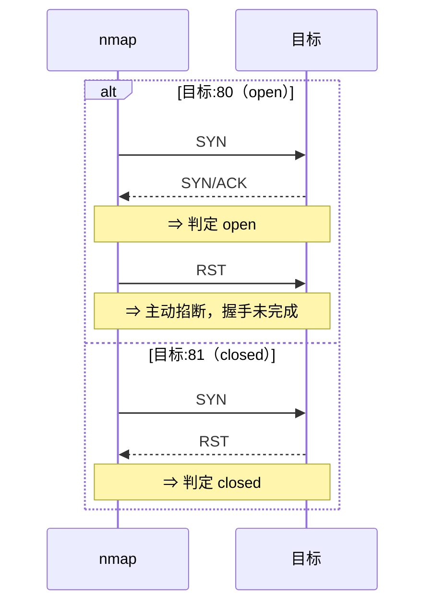

# 25. nmap 网络扫描

> 日期：2026-11-04
> 所属大纲阶段：5. 网络安全与防御
> 参考资料：
> - nmap 官方参考指南（man nmap / `https://nmap.org/book/man.html`）
> - Nmap Network Scanning（Gordon "Fyodor" Lyon，官方书，`https://nmap.org/book/`）
> - Nmap NSE 脚本分类文档（`https://nmap.org/book/nse-usage.html`）
> - NIST SP 800-115《Technical Guide to Information Security Testing and Assessment》
> - RFC 793（TCP）/ RFC 768（UDP）/ RFC 792（ICMP）
> - dvwa 与 Metasploitable 官方仓库说明

---

## 0. 开篇红线：合法使用边界

**nmap 是一把双刃剑**：它既是安全工程师资产盘点、暴露面收敛的第一工具，也是攻击者侦察（Reconnaissance）阶段的首选武器。使用前必须清楚：

- **仅限本地靶场（DVWA、Metasploitable、自己搭建的 VM/容器）或已获得书面授权的环境**。对本笔记中所有命令均适用，后文不再重复。
- 未经授权扫描他人网络，在中国可能违反《网络安全法》《刑法》第 285 条（非法侵入计算机信息系统罪、非法获取计算机信息系统数据罪）；在其他司法辖区同样普遍违法。
- 即使"只想看看端口开没开"，大规模 SYN 扫描也可能触发对方 IDS（Intrusion Detection System，入侵检测系统）告警、被 ISP 限速甚至封号。
- **最佳实践**：把练习靶段限制在 `127.0.0.1`、虚拟机私有网段（如 VirtualBox 的 `10.0.2.0/24`、Docker 的 `172.17.0.0/16`）或家里自己拥有并管理的路由器网段（如 `192.168.1.0/24`，注意家中其他成员设备也属于"他人设备"，扫描前先打招呼）。

本文所有示例假定靶场环境：**Ubuntu 22.04 宿主机 + nmap 7.92（`apt install nmap` 或源码编译），Docker 运行 Metasploitable2 靶机容器，网段 172.17.0.0/16**。macOS 需自行安装 nmap（`brew install nmap`）。

---

## 1. nmap 是什么：定位与能力全景

nmap（Network Mapper）是开源的网络探测与安全审计工具，核心能力：

1. **主机发现（Host Discovery）**：网段里哪些 IP 是活着的？
2. **端口扫描（Port Scanning）**：活着的主机上哪些端口开放/关闭/被过滤？
3. **服务与版本探测（Service/Version Detection）**：开放端口后面跑的是什么软件、什么版本？
4. **操作系统识别（OS Detection）**：目标的 TCP/IP 协议栈指纹像 Linux 还是 Windows？
5. **NSE 脚本引擎（Nmap Scripting Engine）**：用 Lua 脚本做漏洞检测、暴力破解、信息收集等。

**防御视角**：作为防御者，你要用 nmap 回答的问题是——"我的资产对外暴露了什么？"。每一次资产变更（新上服务、新开容器）后跑一次 nmap 自查，是暴露面管理（Attack Surface Management）最朴素的起点。攻击者视角的信息你同样要掌握，才能理解对方会看到什么。

### 一个最小可用示例

环境：Ubuntu 22.04 + nmap 7.92，扫描本机 Docker 网段。

```bash
# 仅限本地靶场。列出本机所有网卡与网段，先搞清楚"自家地盘"
ip -brief addr

# 最简单的扫描：对单个目标做默认扫描（root 下默认等同 -sS；
# 非 root 未显式指定扫描类型时自动退化为 -sT，显式 -sS 则报错退出）
nmap 172.17.0.2
```

输出解读：

```text
Starting Nmap 7.92 ( https://nmap.org )
Nmap scan report for 172.17.0.2
Host is up (0.00012s latency).
Not shown: 977 closed tcp ports (conn-refused)
PORT     STATE SERVICE
21/tcp   open  ftp
22/tcp   open  ssh
23/tcp   open  telnet
25/tcp   open  smtp
80/tcp   open  http
...
Nmap done: 1 IP address (1 host up) scanned in 0.35 seconds
```

逐行解读：
- `Not shown: 977 closed tcp ports`：977 个端口是 closed（收到 RST），nmap 默认只显示 open 类端口以省篇幅。
- `STATE` 列的取值见下文 §3。
- `SERVICE` 列只是**端口号到服务名的静态映射**（来自 `/usr/share/nmap/nmap-services`），不代表真实服务——80 端口上完全可以跑 SSH，要确认需 `-sV`。

---

## 2. 主机发现（Host Discovery）技术详解

### 2.1 为什么要单独讲主机发现

在大型网段里先做端口扫描会浪费大量时间在死 IP 上。nmap 的流程是：**先主机发现，再对存活主机做端口扫描**。默认（无 root 权限）对局域网目标是发 TCP ACK(80)+SYN(443)+ICMP Echo 请求；有 root 时还会发 ICMP Timestamp。理解每个探针（probe）的原理，才能在"防火墙丢包"的现实里正确判断。

### 2.2 核心参数一览

| 参数 | 含义 | 典型场景 |
| --- | --- | --- |
| `-sn` | Ping 扫描，**不做端口扫描**（老写法 `-sP`） | 资产盘点：先数网段里有多少活主机 |
| `-Pn` | **跳过主机发现**，把所有目标当活的直接扫端口 | 目标防火墙丢弃 ping，导致漏报 |
| `-PE / -PP / -PM` | ICMP Echo / Timestamp / Netmask 探测 | 经典 ping 检测 |
| `-PS<端口列表>` | TCP **SYN** Ping（默认 80） | ICMP 被禁的环境（最常用） |
| `-PA<端口列表>` | TCP **ACK** Ping（默认 80） | 与 -PS 配合穿透无状态防火墙 |
| `-PU<端口列表>` | UDP Ping（默认 40125） | 空闲高端口 UDP，绕过只盯 TCP 的过滤 |
| `-PR` | **ARP** Ping（局域网默认自动启用） | 同一二层网段最可靠 |
| `-PO<协议列表>` | IP 协议 Ping | 极少见，特殊环境 |
| `-n` / `-R` | 禁用 / 强制 DNS 反解 | -n 加速，-R 资产盘点时收集主机名 |
| `--traceroute` | 顺便画路由 | 拓扑梳理 |
| `--reason` | 显示判定 open/closed 的**原因** | 学习与排错神器 |

### 2.3 ARP 为什么是局域网首选

同一二层（以太网）内通信必须先 ARP 解析 MAC。只要目标回 ARP 响应，它必然在线——**ARP 无处躲藏**，且比 IP 层探针更轻量。因此 nmap 对"直连网络"目标**自动**使用 ARP Ping，无论你指定了什么其他探针。这带来一个重要结论：**对局域网扫描，主机发现几乎不会漏报**；而跨网段（经路由）时 ARP 不再适用，才轮到 ICMP/TCP 探针。

```bash
# 仅限本地靶场（自家网段）。-sn 只做主机发现
sudo nmap -sn 192.168.1.0/24
```

输出解读：

```text
Nmap scan report for 192.168.1.1
Host is up (0.0021s latency).
MAC Address: AA:BB:CC:DD:EE:01 (TP-LINK)
Nmap scan report for 192.168.1.100
Host is up (0.0004s latency).
MAC Address: AA:BB:CC:DD:EE:02 (Apple)
...
Nmap done: 256 IP addresses (5 hosts up) scanned in 2.05 seconds
```

- 局域网模式下给出 MAC 地址与厂商（OUI 前缀库），这是资产指纹的重要来源。
- `256 IP addresses (5 hosts up)`：/24 有 256 个地址，实际在线 5 台。

### 2.4 跨网段/防火墙场景：组合探针

现实中最常见的问题："我 ping 得通/不通，nmap 却说不存活"。原因是中间设备丢弃 ICMP。解决方法：

```bash
# 仅限本地靶场或已授权环境。ICMP 被禁时用 SYN Ping + 跳过发现
sudo nmap -PS22,80,443 -pn 10.0.2.15

# 极端情况：目标过滤一切入站探针，只能 -Pn 硬扫
sudo nmap -Pn -p 22,80,443,3389 10.0.2.15
```

**-Pn 的代价**：对每个死 IP 都做全端口扫描，扫描时间可能膨胀数倍。所以先用 `-sn` 试探网段存活率，再决定是否 `-Pn`。

**防御视角**：很多"安全加固"建议"禁 ping"（丢弃 ICMP Echo）。看完本节你应明白：这几乎没有防御价值（SYN Ping 照样能发现主机），反而破坏了正常的网络诊断。更有意义的做法是限制谁能扫描到你的资产（边界防火墙 + 安全组白名单）。

### 2.5 探针组合决策表

| 目标网段 | 推荐组合 | 理由 |
| --- | --- | --- |
| 同二层局域网 | 默认（自动 ARP）或 `-sn -PR` | ARP 必达，零误报 |
| 跨网段内网 | `-sn -PS22,80,443 -PE` | TCP 探针穿透只丢 ICMP 的策略 |
| 经防火墙的 DMZ | `-Pn -PS` + 常见端口 | 探针大概率被丢，直接端口扫描定生死 |
| 互联网资产（仅授权） | `-Pn --source-port 53` 之类技巧 | 部分旧防火墙放行源自 53 端口的包 |

---

## 3. 端口扫描技术：原理对比

### 3.1 端口状态语义

nmap 报告六种状态，先定义清楚，后面所有技术都围绕"如何区分它们"：

| 状态 | 含义 |
| --- | --- |
| `open` | 有应用在接受该端口的 TCP 连接 / UDP 报文 |
| `closed` | 端口可达（主机活着）但没有程序监听，TCP 回 RST |
| `filtered` | 探针没到端口或响应没回来——**通常是防火墙丢包**，无法判断 |
| `unfiltered` | 端口可达但 nmap 判断不了开闭（ACK 扫描的产物） |
| `open|filtered` | 开放或被过滤无法区分（**UDP 扫描与 FIN 类扫描的常态**） |
| `closed|filtered` | 少见，IP Idle 扫描等场景 |

### 3.2 TCP 扫描技术对比表

| 扫描方式 | 参数 | 原理一句话 | 优势 | 劣势 |
| --- | --- | --- | --- | --- |
| **TCP SYN（半开）** | `-sS` | 发 SYN，收到 SYN/ACK 记 open 后**直接发 RST 断开**，不完成三次握手 | 快、不写入目标应用日志（连接未建立）、root 可用 | 需要 root/raw socket |
| TCP Connect（全连接） | `-sT` | 调用系统 `connect()` 完整三次握手 | 无需特权、兼容性最好（可穿代理） | 慢、**目标应用日志会记录连接** |
| UDP 扫描 | `-sU` | 发 UDP 包，ICMP 端口不可达→closed；有 UDP 响应→open；无响应→open\|filtered | 唯一能发现 UDP 服务的方式 | 慢（依赖超时），歧义大 |
| FIN / Xmas / Null | `-sF` / `-sX` / `-sN` | 异常标志位组合：RFC 793 要求对 closed 端口回 RST、对 open 端口**丢弃**（无响应） | 可穿透部分仅挡 SYN 的无状态防火墙 | Windows 一律回 RST → 全 closed，几乎失效；open 判定靠"没响应"天然歧义 |
| TCP ACK | `-sA` | 发 ACK（不属于任何连接），看 RST 回不回 | **不判开闭，只判过滤**：映射防火墙规则 | 不直接给 open |
| TCP Window | `-sW` | 利用不同 OS 对 RST 中窗口字段的实现差异 | 辅助 OS 识别 | 不可靠 |
| Idle/Zombie | `-sI` | 借第三方主机 IPID 递增侧写目标，**源 IP 完全匿名** | 极度隐蔽 | 条件苛刻（要找到 IPID 可预测的僵尸机） |
| FTP Bounce | `-b` | 借旧 FTP 服务器的 PORT 指令转发扫描 | 历史 | 现代基本失效 |

### 3.3 SYN 半开扫描原理（重点）

正常 TCP 三次握手：`SYN → SYN/ACK → ACK`。SYN 扫描在第二步就"撕票"：



为什么叫"半开"：连接只建立了半程，目标内核里留下一个**半开连接（SYN_RECV）**直到 RST/超时清理。

优势：
1. **不产生应用层日志**：应用日志只记录"完成的连接"，SYN 扫描在内核层被掐断，`auth.log`、`access.log` 都看不到（但 IDS/防火墙看得到——见 §8）。
2. **快**：不需要等应用层处理，也不占用完整连接资源。

**防御视角**：这也意味着你的 Web `access.log` 看不到 SYN 扫描。要发现侦察行为，必须在网络层部署 IDS（如 Suricata）或启用防火墙日志，参见笔记 27/28。半开连接堆积本身也是 SYN Flood DoS 的原理（见大纲第 3 阶段 Web 安全笔记）。

### 3.4 UDP 扫描为什么难（重点）

UDP（User Datagram Protocol）无连接、无握手。nmap 的判定逻辑：

| 发 UDP 探针后收到 | 判定 |
| --- | --- |
| 对应协议的 UDP 响应 | **open**（如 DNS 查询得到响应、SNMP 得到 community 串） |
| ICMP port unreachable（类型 3 代码 3） | **closed** |
| 其他 ICMP 不可达（如 3/1、3/2、3/9、3/10、3/13） | **filtered** |
| 什么都没收到 | **open\|filtered**（歧义！可能包被丢，也可能服务对空报文不回话） |

难点：
1. **open|filtered 歧义**是常态而非例外。DNS 服务对垃圾 UDP 载荷不回包，就归为 open|filtered。
2. Linux 内核对 ICMP 不可达有**限速**（默认约 1/s），大网段 UDP 扫描会大量"假 filtered"。
3. 必须依赖 NSE 探针（`--script` 对 UDP 服务发正确协议的请求）或版本探测 `-sV` 来消除歧义。

```bash
# 仅限本地靶场。扫常见 UDP 服务端口，配合版本探测消除歧义
sudo nmap -sU -sV --version-intensity 0 -p 53,67,69,111,123,161,500,1900,5353 172.17.0.2
```

`--version-intensity 0`：只用最可能的探针，减少 UDP 扫描时间。

**防御视角**：UDP 是容易被遗忘的暴露面（SNMPv1 社区串 `public`、mDNS、SSDP、旧 TFTP）。自查清单里 `-sU` 必须包含 161/162（SNMP）、1900（SSDP，曾是反射放大 DDoS 主力）、53（DNS 是否可被当作开放解析器滥用）。

### 3.5 FIN/Xmas/Null：利用 RFC 的"怪招"

RFC 793 规定：对**关闭**端口，无论包头多怪，都应回 RST；对**开放**端口若包无 SYN/ACK/FIN 标志（即"无意义"包），应**丢弃**。于是：

- `-sN`（Null：无任何标志）
- `-sF`（FIN：仅 FIN 标志）
- `-sX`（Xmas：FIN+PSH+URG，像圣诞树彩灯）

有响应 RST → closed；无响应 → open|filtered。这套规则**Windows 和许多现代防火墙根本不遵守**（一律回 RST 或一律丢弃），所以这些扫描今天主要用于：
1. 探测目标是否是无状态防火墙（只丢 SYN）；
2. 辅助判断操作系统。

### 3.6 ACK 扫描：画防火墙规则地图

`-sA` 发 ACK 包（模拟"回应包"）。目标无论端口开闭都会回 RST（因为它不属于任何连接）——所以 ACK 扫描**不区分 open/closed**，只区分：

- 收到 RST → **unfiltered**（防火墙没挡这类包）
- 无响应 → **filtered**（防火墙丢包，可能存在有状态过滤）

常与 SYN 扫描结果对照：SYN 扫出 filtered 而 ACK 扫出 unfiltered 的端口，大概率是**有状态防火墙在挡新建连接、放行回程**——这正是 Linux conntrack 的典型行为。

```bash
# 仅限本地靶场。对照实验：SYN 扫描 vs ACK 扫描
sudo nmap -sS -p 22,80,443,8080 172.17.0.2
sudo nmap -sA -p 22,80,443,8080 172.17.0.2
```

---

## 4. 扫描速度与准确度权衡

### 4.1 时序模板 -T0 ~ -T5

| 模板 | 名称 | 特点 | 适用 |
| --- | --- | --- | --- |
| `-T0` | paranoid | 串行、每次探测间隔 5 分钟 | 绝对避开 IDS（几乎不用） |
| `-T1` | sneaky | 15 秒间隔 | 同上，慢速渗透侦察 |
| `-T2` | polite | 0.4 秒间隔，串行 | 带宽敏感的脆弱链路 |
| `-T3` | normal | **默认**，并行+自适应重传 | 绝大多数场景 |
| `-T4` | aggressive | max-scan-delay 10ms；max-rtt-timeout 1250ms | **局域网/靶场推荐** |
| `-T5` | insane | max-rtt-timeout 300ms（0.3 秒）、max-scan-delay 5ms、激进重传 | 极快但**准确度下降**（易误判 filtered） |

经验：内网/靶场用 `-T4`；跨 Internet 的授权扫描用 `-T3` 甚至 `-T2`（对端带宽与限速未知）；`-T5` 演示可以，正式报告别用——丢包重传机制被削弱后 open 可能被误判成 filtered。

### 4.2 精细控制

```bash
--min-rate 500        # 每秒至少发 500 个包（压测/快速扫，牺牲隐蔽）
--max-rate 100        # 限速，避免打挂脆弱目标或触发限流
--host-timeout 60s    # 单主机超时放弃，别让一台防火墙拖死全网扫描
--max-retries 2       # 重传次数，内网可靠可降为 1
--defeat-rst-ratelimit # 目标限速发 RST 时加速 closed 判定（可能误判）
```

**防御视角**：`--min-rate` 大数值本质上就是"扫描压力"。你自查资产时若把生产环境老旧设备扫挂了，属于自伤事故——生产网自查请用 `-T2`-`-T3` 加 `--max-rate`，并避开业务高峰。

---

## 5. 服务与版本探测（-sV）

### 5.1 原理

开放端口 ≠ 知道服务。`-sV` 的工作方式：

1. 先与端口做基础交互（如 TCP 连上后等_banner_）；
2. 匹配 nmap-service-probes 里的**探针**（probe）——总库含 11 个通用探针（NULL 探针即静默等待、TCP NULL、HTTP GET 等）+ 大量协议特定探针（如 DNS 版本查询 `bindversion`、SMTP HELP、SSH 直接给 banner）；
3. 探针响应与**签名库**（正则 `match` 行）匹配，得到 `产品名/版本/细节/CPE/漏洞引用`；
4. 若匹配不唯一或无响应，按 `rarity`（稀有度）从低到高继续发更多探针，直到 `--version-intensity` 允许的上限（默认 7，范围 0-9；`--version-all` 为 9）。

```bash
# 仅限本地靶场。对 Metasploitable2 全端口 SYN 扫描 + 版本探测
sudo nmap -sS -sV -p- -T4 172.17.0.2 -oN ms2-allports.txt
```

输出片段：

```text
PORT     STATE SERVICE VERSION
21/tcp   open  ftp     vsftpd 2.3.4
22/tcp   open  ssh     OpenSSH 4.7p1 Debian 8ubuntu1 (protocol 2.0)
23/tcp   open  telnet  Linux telnetd
139/tcp  open  netbios-ssn Samba smbd 3.X - 4.X (workgroup: WORKGROUP)
445/tcp  open  netbios-ssn Samba smbd 3.0.20-Debian (workgroup: WORKGROUP)
6667/tcp open  irc     UnrealIRCd
```

解读：
- `vsftpd 2.3.4`：著名后门版本（CVE-2011-2523，微笑漏洞）；`UnrealIRCd` 老版本含已知后门。**这就是"版本信息即情报"的含义**。
- `-p-` 表示全部 65535 个端口。默认只扫 1000 个最常用端口，**资产自查必须 -p-**——攻击者一定会找你藏在 54321 端口的管理后台。

### 5.2 强度选择

- `--version-intensity 0`：只发 NULL 等最便宜探针，适合快速过一遍；
- 默认 7：性价比平衡；
- `--version-all`：9，穷举所有探针，极慢，仅在"我知道有服务但认不出"时用。

**坑**：`-sV` 会与目标完成真实交互（建立完整连接、发应用层请求），**应用日志一定会记录**，且高强度探针可能触发应用异常（老设备崩溃）。生产自查用低强度。

---

## 6. 操作系统识别（-O）

一句话原理：不同 OS 的 TCP/IP 协议栈实现细节（初始 TTL、窗口大小、DF 位、IPID 序列、SYN Cookie 行为、对 FIN 探针的响应等）存在可测量差异，nmap 采集十余项**指纹（fingerprint）**与 `nmap-os-db`（数千条）比对，给出候选及置信度。

```bash
sudo nmap -O --osscan-guess 172.17.0.2
```

输出示例：

```text
Device type: general purpose
Running: Linux 2.6.X
OS CPE: cpe:/o:linux:linux_kernel:2.6
OS details: Linux 2.6.9 - 2.6.33 (likely 2.6.17)
```

要点：
- 至少需要 1 个 open **和** 1 个 closed 的 TCP 端口（或 1 个 closed UDP）才能给出最佳结果，条件不满足时加 `--osscan-guess` 强制猜测。
- 容器/虚拟化/NAT 会扭曲指纹（共享内核、代理栈），准确度下降。
- **防御视角**：攻击者用它选择对应 exploit（Windows vs Linux 提权路径完全不同）；防御者可用它做**非受管资产识别**——网段里冒出一个识别不出的嵌入式设备，就该追问它是谁。

---

## 7. NSE 脚本引擎（Nmap Scripting Engine）

### 7.1 机制与用法

NSE 使用 Lua 语言。脚本按**分类（category）**组织，调用方式：

```bash
nmap --script <脚本名|分类|目录> --script-args <参数> 目标
nmap --script-updatedb   # 更新脚本库索引（脚本变更后）
```

### 7.2 脚本分类表

| 分类 | 含义 | 风险 |
| --- | --- | --- |
| `auth` | 绕过或利用目标上的认证（如默认凭据检查） | 中 |
| `broadcast` | 在局域网广播发现主机/服务（如 DHCP、mDNS 枚举） | 低 |
| `brute` | 对服务做暴力破解（字典） | 高（可能锁号） |
| `default` | `nmap -sC` 等效集合，安全且快速的基础收集 | 低 |
| `discovery` | 信息收集：SNMP、SMB 共享、路由信息等 | 低-中 |
| `dos` | 可能造成拒绝服务（如耗尽资源） | **高，靶场专用** |
| `exploit` | 尝试利用已知漏洞 | 高 |
| `intrusive` | 可能崩溃目标或触发告警的一类 | 高 |
| `malware` | 检测后门端口（如 Sobig/MyDoom 残留） | 低 |
| `safe` | 不会使目标变糟（纯查询） | 低 |
| `version` | 扩展版本探测（比 -sV 的库更广） | 低 |
| `vuln` | 检查已知漏洞（无利用，只验证） | 中 |

优先组合：`-sC`（= `--script=default`）起步，按需追加 `safe`、`version`，靶场再上 `vuln`/`exploit`。

### 7.3 重点脚本实操

```bash
# 0) 万能起步：默认脚本 + 版本探测（靶场）
sudo nmap -sC -sV 172.17.0.2

# 1) http-title：抓取 Web 首页标题，快速判断"这是什么站"
sudo nmap --script http-title -p 80,443,8080 172.17.0.2
# 输出示例：80/tcp open http |_http-title: DVWA - Damn Vulnerable Web Application
# 防御视角：资产台账里"未知服务"扫完 -sC 常常直接变成"哦是 Grafana/Jenkins"

# 2) ftp-anon：检查 FTP 匿名登录（经典配置失误）
sudo nmap --script ftp-anon -p 21 172.17.0.2
# |_ftp-anon: Anonymous FTP logins allowed (FTP code 230)  ← 高危配置失误

# 3) smb-vuln 系列：检查 SMB 已知漏洞（永恒之蓝等）
sudo nmap --script "smb-vuln-*" -p 139,445 172.17.0.3
# 输出片段示例：
# | smb-vuln-ms17-010:
# |   VULNERABLE:
# |   Remote Code Execution vulnerability in Microsoft SMBv1 servers (ms17-010)
# |     State: VULNERABLE
# |     Disclosure date: 2017-03-14

# 4) vulscan（第三方库，需自行安装到 /usr/share/nmap/scripts/）：把版本信息
#    与 CVE/Exploit-DB 本地库比对，输出"这个版本对应哪些 CVE"
git clone https://github.com/scipag/vulscan /tmp/vulscan
sudo mkdir -p /usr/share/nmap/scripts/vulscan
sudo cp -r /tmp/vulscan/* /usr/share/nmap/scripts/vulscan/
sudo nmap -sV --script vulscan/vulscan.nse -p 21,22,80 172.17.0.2
```

**坑**：
- `smb-vuln-*` 对老系统有蓝屏风险（属于 intrusive 类），生产自查前确认窗口；
- 脚本参数名各不相同，`--script-args` 用错名字不会报错而是被忽略，注意看脚本文档；
- NSE 结果中 `|_` 开头行表示"脚本输出摘要"，详细内容有时需要 `--script-trace` 排查。

**防御视角**：`vuln` 类脚本就是你"自动化的暴露面体检"。反过来，攻击者拿到这些输出可以直接排利用优先级——所以你自查发现的问题要**在攻击者之前修掉**，同时让 IDS 学习这些脚本的特征（很多 NSE 探针在 Suricata 里有现成规则，见笔记 27）。

---

## 8. 常用组合实战：对本地靶机的完整扫描

目标：Docker 里的 Metasploitable2（172.17.0.2）。**仅限本地靶场。**

### 步骤 1：主机发现确认在线

```bash
sudo nmap -sn 172.17.0.2
```

### 步骤 2：默认 1000 端口 SYN 扫描摸底

```bash
sudo nmap -sS -T4 172.17.0.2
```

### 步骤 3：全端口扫描（耗时主要在这步）

```bash
sudo nmap -sS -p- -T4 --min-rate 2000 172.17.0.2 -oN ms2-ports.txt
```

输出解读要点：
- `-p-` 扫 65535 端口，配合 `--min-rate 2000` 通常几分钟内完成；
- 关注报出的 open 端口里**不在默认 1000 列表中的"冷门"端口**（如 1524、3632、6697、8180……Metasploitable 故意开了一堆）。

### 步骤 4：对开放端口做版本探测 + 默认脚本 + OS 识别

```bash
sudo nmap -sS -sV -sC -O -p 21,22,23,25,80,111,139,445,512,513,514,1099,1524,2049,2121,3306,5432,5900,6000,6667,8009,8180 172.17.0.2 -oN ms2-full.txt
```

逐段解读一份典型输出：

```text
PORT     STATE SERVICE     VERSION
21/tcp   open  ftp         vsftpd 2.3.4
|_ssl-date: 2026-11-04TLS randomness does not represent time
23/tcp   open  telnet      Linux telnetd
80/tcp   open  http        Apache httpd 2.2.8 ((Ubuntu) DAV/2)
|_http-server-header: Apache/2.2.8 (Ubuntu) DAV/2
|_http-title: Metasploitable2 - Linux
139/tcp  open  netbios-ssn Samba smbd 3.X - 4.X
445/tcp  open  netbios-ssn Samba smbd 3.0.20-Debian
3306/tcp open  mysql       MySQL 5.0.51a-3ubuntu5
5432/tcp open  postgresql  PostgreSQL DB 8.3.0 - 8.3.7
5900/tcp open  vnc         VNC (protocol 3.3)
6667/tcp open  irc         UnrealIRCd
MAC Address: 02:42:AC:11:00:02 (Docker)
Device type: general purpose
Running: Linux 2.6.x
```

- `vsftpd 2.3.4` → 已知后门 CVE-2011-2523；
- `Samba 3.0.20` → CVE-2007-2447（username map script 命令注入）；
- `MySQL/PostgreSQL 直接暴露 3306/5432` → 数据库绝不应监听公网/未隔离网段；
- `vnc 5900 protocol 3.3` → 弱认证甚至无认证；
- `_http-title` 告诉你 Web 根是 Metasploitable 默认页，进一步 `http-enum` 可枚举出 /dvwa、/mutillidae 等应用。

### 步骤 5：针对发现的服务深挖

```bash
sudo nmap --script "http-enum,http-title,http-passwords" -p 80 172.17.0.2
sudo nmap --script "smb-vuln-ms17-010,smb-vuln-regsvc-dos" -p 445 172.17.0.2  # 靶场
sudo nmap --script "ftp-anon,ftp-vsftpd-backdoor" -p 21 172.17.0.2
```

### 面向自查的三条组合命令（生产环境模板）

```bash
# 慢速礼貌版：T2、默认端口、不动应用
sudo nmap -sS -sV --version-intensity 5 -T2 --max-rate 50 目标网段

# 快速 UDP 体检
sudo nmap -sU -T3 -p 53,67,69,123,161,500,1900,5353 目标网段

# Web 集中体检
sudo nmap -sV --script "http-title,http-enum,http-methods,http-headers" -p 80,443,8000-8100 目标
```

---

## 9. 输出格式

| 参数 | 格式 | 用途 |
| --- | --- | --- |
| `-oN file` | 标准 nmap 文本 | 人读、grep |
| `-oX file` | XML | 程序解析、导入其他工具 |
| `-oG file` | grepable | 一行一主机，`awk` 快速统计（官方标记不完整支持新特性） |
| `-oS file` | "script kiddie" 装饰格式 | 玩梗，无实用 |
| `-oA basename` | **同时输出 N+X+G 三种** | **推荐习惯**：一次扫描，多种消费 |

```bash
sudo nmap -sS -sV -oA scan/dvwa-20261104 172.17.0.2

# grepable 格式快速统计：提取所有 open 端口（每行可含多个端口，全部提取）
grep -oP '\d+/open' scan/dvwa-20261104.gnmap | grep -oP '^\d+'
# XML 解析（Python）
python3 -c "import xml.etree.ElementTree as ET; t=ET.parse('scan/dvwa-20261104.xml'); print([ (p.get('portid'), s.get('name')) for h in t.iter('host') for p in h.iter('port') for s in p.iter('service')])"
```

**注意**：结果文件包含你的网络信息，按敏感数据处理存放；`--datadir` 可控制数据文件目录。

---

## 10. 隐蔽性与 IDS 检测视角（理解对抗）

> 本节目的**不是教隐蔽攻击**，而是让防御者理解：自己的 IDS 为什么能看到/看不到扫描，从而正确配置检测。

### 10.1 什么样的扫描会触发告警

| 扫描行为 | 网络可见性 | 典型检测特征 |
| --- | --- | --- |
| 默认 SYN 扫描（-sS） | 高 | 短时间大量 SYN 到不同端口、`SYN→RST` 模式（未完成握手） |
| Connect 扫描（-sT） | 中 | 应用日志大量短连接、错误请求；IDS 看到完整握手+立即 FIN |
| `-T5 --min-rate 5000` | 极高 | 单源高速包风暴，阈值类规则秒触发 |
| 慢速 `-T0/-T1` 分散数天 | 低 | 需要长时间窗口聚合与低阈值告警（对应 Snort `portscan`/Suricata 的 threshold + flowbits 聚合） |
| Idle 扫描 | **对目标显示为僵尸机 IP** | 目标侧看不到真实源，需在僵尸机或上游发现 |
| 分布式（masscan + 代理池） | 低（单源速率低） | 需要横向聚合（同一目标+不同源的同构探测） |

### 10.2 防御者的对策清单

1. 边界防火墙默认 DROP 未开放端口（让 SYN 扫描得到的全是 filtered，泄露信息更少）；
2. IDS 启用扫描检测（Suricata `stream_size`/自定义规则：60 秒内同一源 SYN 不同端口 > N）；
3. 对关键资产启用端口敲击（port knocking）或源白名单，使扫描器"看不到"真实服务；
4. 蜜罐端口（对未开放端口的高频访问源直接拉黑告警，见笔记 27 蜜罐一节）。

### 10.3 masscan 一句话

masscan 是"全网互联网 6 分钟扫完"的异步极高速扫描器（可选话题），参数风格刻意模仿 nmap（`--rate`、`-p`）。自查大规模网段时比 nmap 快得多，但没有 NSE/版本探测生态，常作为"第一步找开放端口，第二步 nmap 深挖"的组合拳。同样**仅限授权环境**。

---

## 11. python-nmap 库简介

python-nmap 把 nmap 包装成 Python API，适合把扫描嵌入自动化巡检：

```python
# 环境：pip3 install python-nmap ；nmap 二进制需已安装
# 仅限本地靶场或已授权环境
import nmap

nm = nmap.PortScanner()
nm.scan(hosts='172.17.0.0/24', arguments='-sn')   # 主机发现
for host in nm.all_hosts():
    print(host, nm[host].state())

nm.scan(hosts='172.17.0.2', arguments='-sV -p 80,443')
for proto in nm['172.17.0.2'].all_protocols():
    for port, info in nm['172.17.0.2'][proto].items():
        if info['state'] == 'open':
            print(port, info.get('name'), info.get('product'), info.get('version'))
```

用途设想：每日定时扫描自家网段 → diff 昨日结果 → 新增 open 端口自动告警（最简"暴露面变更监控"）。

---

## 12. zenmap 一句话

zenmap 是 nmap 官方 GUI 前端（Linux/Windows），提供拓扑图（Topology 视图）、Profile 管理与结果 diff。macOS 上已不随 nmap 分发，需单独编译；多数场景命令行 + `-oA` 输出足够。

---

## 13. 常见坑汇总

1. **忘了 sudo**：非 root 下显式 `-sS` 会**报错退出**（提示需 root）；只有未显式指定扫描类型时才会退化为 `-sT`。
2. **默认端口 ≠ 全端口**：自查用 `-p-`，否则漏掉 5985/61616 等冷门服务。
3. **把 SERVICE 列当真相**：那是端口号猜的服务名，真相要 `-sV`。
4. **filtered 误当 closed**：filtered 意味着"有东西挡着"，对资产盘点是重要信号（可能正是防火墙规则没配对）。
5. **UDP 扫描太早放弃**：不配合 `-sV`/`--script` 时 UDP 结果基本全是 open|filtered。
6. **-T5 的假 filtered**：激进时序丢包后重传不足，把 open 误判为 filtered；正式报告用 -T4 以下。
7. **扫描打挂脆弱设备**：打印机、IoT、老工控设备在 SYN 扫描/版本探测下可能重启，生产自查先圈定范围并灰度。
8. **Docker 网段幻觉**：扫 `172.17.0.0/16` 时它其实是宿主机上的虚拟网桥，别忘了从外网视角再扫一次真实出口 IP。
9. **`--script "vuln"` 打错引号**：`--script vuln`（分类）与 `--script vulscan`（具体脚本）不同，注意引号内通配符 `"smb-vuln-*"`。

---

## 14. 自测问题

1. SYN 扫描为什么叫"半开扫描"？它相比 Connect 扫描的两大优势是什么？目标的应用日志为什么看不到它？
2. nmap 报告 `open|filtered`，说明什么？哪种扫描类型最容易产生这个状态，为什么？
3. 同一端口：SYN 扫描显示 filtered，ACK 扫描显示 unfiltered。最可能的网络原因是什么？
4. `-sV` 的 `--version-intensity` 调低到 0 会有什么代价与收益？什么场景你会选 0？
5. 为什么局域网主机发现几乎不漏报，而跨网段经常需要 `-Pn`？
6. 你用 `-sC -sV` 扫自家网段发现一台 161/udp 上运行 SNMPv1 社区串为 public 的设备。从防御视角列出至少 3 条风险与处置动作。
7. 从 IDS 视角描述：一个 `-T5 --min-rate 5000` 的 SYN 全端口扫描在流量上长什么样？慢速 `-T1` 扫描为什么难以用简单阈值检测，应如何检测？
8. 写出你对 `172.17.0.2` 做一次"全端口 + 版本 + 默认脚本 + 三格式输出"的完整命令。
9. 解释 `-Pn` 与 `-sn` 的区别，并说明各自适合的场景。
10. 为什么说"禁 ping"不是有效的防扫描措施？给出更合理的两项替代措施。

---

（完）下一篇：26-Wireshark-流量分析.md

---

## 附：ASCII 图 → Mermaid 替换清单

| 原 ASCII 图（小节 · 内容） | 替换后类型 |
| --- | --- |
| 「3.3 SYN 半开扫描原理（重点）」节 · SYN 扫描时序图（open/closed 两分支） | sequenceDiagram（alt 分支） |
