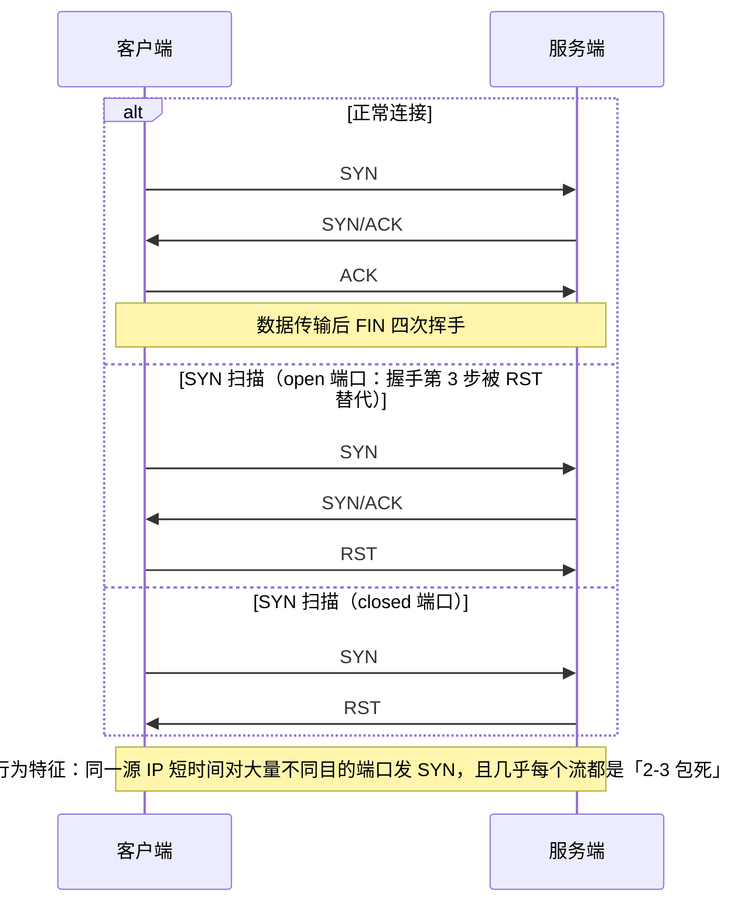

# 26. Wireshark 流量分析

> 日期：2026-11-04
> 所属大纲阶段：5. 网络安全与防御
> 参考资料：
> - Wireshark 官方文档与用户手册（`https://www.wireshark.org/docs/`）
> - Wireshark 显示过滤器参考（`https://www.wireshark.org/docs/dfref/`）
> - 《Wireshark Network Analysis》第二版（Laura Chappell）
> - tcpdump 手册页与 pcap-filter(7)（BPF 语法权威定义）
> - tshark 手册页（`https://www.wireshark.org/docs/man-pages/tshark.html`）
> - CloudShark / Wireshark 官方博客的 TLS 分析案例

---

## 0. 开篇：流量分析在防御中的位置

**入侵检测系统（Intrusion Detection System, IDS）告诉你"可能出了事"，Wireshark 让你亲眼看到"到底发生了什么"。** Wireshark 是图形化的网络协议分析器（Packet Analyzer / Sniffer），能捕获（capture）并逐层解码（dissect）网络数据包，是应急响应、告警验证、协议学习、CTF Misc 的通用底座。

红线提示：抓包本质是**监听网络流量**。在公司网络上未经授权抓包可能违反公司制度甚至法律（可能捕获他人凭据、个人信息）；本笔记所有实操均假定**本地靶场、自己拥有的设备，或已获得书面授权的环境**。

环境约定：
- 抓包/分析主机：macOS（Apple Silicon）+ Wireshark 4.x（`brew install --cask wireshark`）或 Ubuntu 22.04 + Wireshark 4.x（`apt install wireshark tshark`）。
- 靶场：本机 Docker（DVWA 等）或 VM 私有网段。
- 大部分 CLI 示例同时适用于 Linux/macOS，差异处单独注明。

---

## 1. 安装与界面导览

### 1.1 安装

```bash
# macOS
brew install --cask wireshark        # GUI + ChmodBPF 权限组件
brew install wireshark               # 只要 CLI（tshark/text2pcap/capinfos）也可

# Ubuntu 22.04
sudo apt update && sudo apt install -y wireshark tshark tcpdump
sudo usermod -aG wireshark $USER     # 让普通用户可抓包（重新登录生效）
```

### 1.2 界面四大区

打开 Wireshark（Welcome → 选网卡 → 鲨鱼鳍开始捕获）：

1. **捕获工具栏/网卡列表**：列出各接口与实时迷你流量图（sparks）；Linux 上还有 `any`（所有接口聚合）、`bluetooth0` 等。
2. **包列表（Packet List）**：每行一个帧：编号 / 时间 / 源 / 目的 / 协议 / 长度 / Info。
3. **包详情（Packet Details）**：树状逐层解码：Frame → Ethernet → IP → TCP → HTTP…这是学习协议结构最好的教材。
4. **字节区（Packet Bytes）**：原始十六进制，与详情区选中字段**双向高亮联动**——想知道"这个字段在原始报文里的样子"，点它。

常用面板与操作：
- `Statistics` 菜单：Conversations / Endpoints / Protocol Hierarchy / IO Graph（§5 详解）。
- `Telephony` 菜单：VoIP 分析（本笔记不展开）。
- `Analyze → Enabled Protocols`：关闭不需要的协议解码可显著提速大文件。
- 右键包 → `Follow → TCP Stream`（§4 详解）。
- `View → Time Display Format`：默认秒（带小数），看时序攻击建议"自前一包以来的秒数"（Time since previous captured packet）。

### 1.3 捕获选项（Capture → Options, Cmd/Ctrl+K）

| 选项 | 说明 | 安全/性能建议 |
| --- | --- | --- |
| 接口（Input 页） | 选哪个网卡抓 | 有线/无线/VPN 接口行为不同；Linux `any` 会带 16 字节 cooked 头（SLL） |
| **混杂模式（Promiscuous Mode）** | 网卡不再丢弃"目的 MAC 不是我"的帧，可看到同二层其他主机的流量（若交换机不隔离） | 现代交换机默认端口隔离，混杂模式在交换网收益有限；在镜像口/集线器/无线（同一信道共享媒介）才有价值 |
| **捕获过滤器（Capture Filter）** | BPF 表达式，**抓之前**过滤，省磁盘省 CPU | 见 §2 |
| Snaplen（快照长度） | 每包最多抓多少字节，0=全抓 | 排查"只看包头"场景可设 128，容量减一个数量级；但 Follow Stream/还原文件必须全抓 |
| 缓冲区大小（Buffer size） | 内核环形缓冲，写盘不及时丢包 | 高速率环境调大（如 256 MB） |
| 捕获到文件（Output 页） | 按大小/时间**多文件切分**（ring buffer） | 长时间采集必开：如 512 MB × 20 个文件滚动 |
| 自动停止条件 | 包数/文件数/时长 | 自动化采集场景 |
| 解析名字（Name Resolution） | 抓包时反解 DNS/主机名 | **默认关**：反解本身会产生额外 DNS 查询污染流量；需要时在显示层做 |

---

## 2. 捕获过滤器（BPF 语法）

### 2.1 为什么需要两种过滤器

- **捕获过滤器（Capture Filter）**：决定**哪些包进入 pcap 文件**。语法是 BPF（Berkeley Packet Filter）。抓之前不写好，抓完发现 5 GB 里 99% 是噪音。
- **显示过滤器（Display Filter）**：决定**pcap 里哪些包被显示**。语法是 Wireshark 自有语法，功能强大得多，且不影响已捕获数据。

记忆：**Capture Filter 决定"进冰箱"，Display Filter 决定"摆上餐桌"。**

### 2.2 BPF 语法详解

BPF 表达式由**原语（primitive）**通过 `and/or/not`（`&&/||/!`）组合：

```
[协议] [方向] [类型] [值]
```

- 类型：`host`（主机）、`net`（网段）、`port`（端口）、`portrange`；
- 方向：`src` / `dst`；
- 协议限定：`ether` / `ip` / `ip6` / `arp` / `tcp` / `udp` / `icmp` 等。

`gateway` 匹配"源/目的 MAC 是网关但 IP 不是网关"的跨网段流量（少见但可用）。

### 2.3 BPF 常用例子表

| 目的 | 表达式 |
| --- | --- |
| 只抓某主机相关流量 | `host 172.17.0.2` |
| 只抓来自某主机 | `src host 10.0.2.15` |
| 抓整个 /24 网段 | `net 192.168.1.0/24`（或 `net 192.168.1 mask 255.255.255.0`） |
| 抓某个端口（TCP 或 UDP） | `port 80` |
| 只抓目的端口 80 的入站 | `dst port 80` |
| 端口范围 | `portrange 8000-8100` |
| 只抓两主机间流量 | `host 10.0.2.15 and host 172.17.0.2` |
| HTTP 或 DNS | `port 80 or port 53` |
| 排除 SSH 自身干扰（排除 22 与自身 IP） | `not port 22 and not host 192.168.1.50` |
| 只抓 TCP+80 且带 SYN 标志 | `tcp port 80 and tcp[13] & 2 != 0`（tcp[13] 是 Flags 字节，SYN 位是 bit1） |
| 只抓 ICMP | `icmp` |
| 抓 ARP | `arp` |
| 抓跨网关流量 | `gateway 192.168.1.1` |
| 排除 IPv6 干扰 | `ip` |
| 非 TLS 非 SSH 的明文 TCP | `tcp and not port 443 and not port 22` |

**坑**：BPF 里端口没有协议默认值，`port 53` 同时匹配 TCP 与 UDP（DNS over TCP 也存在，保留是合理的）；`tcp port 80` 才限定 TCP。BPF 不支持"包含字符串"这种应用层匹配（那是显示过滤器/tshark 的活）。

---

## 3. 显示过滤器（Display Filter）详解

### 3.1 语法结构

形式：`协议.子协议.字段 比较运算符 值`，可括号组合。

比较运算符：`==` 等于、`!=` 不等于（对多值字段有陷阱，见坑）、`>` `>=` `<` `<=`、`contains`（字节串包含）、`matches`/`~`（正则，PCRE）。

逻辑：`and`/`&&`、`or`/`||`、`not`/`!`。

特殊函数：`ip.addr == 1.2.3.4`（源或目的都算）、`tcp.port == 80`（任一方向端口）、`frame contains "str"`。

### 3.2 常用过滤器速查表（30+ 条）

**入口：Filter 栏；表达式自动补全：输入前几个字母；字段名查询：点 Filter 栏左侧图标打开 Expression 对话框。**

| 场景 | 过滤器 |
| --- | --- |
| 只看 HTTP 请求 | `http.request` |
| HTTP POST（上传/登录表单） | `http.request.method == "POST"` |
| 看某个 URL | `http.request.uri contains "login"` |
| HTTP 响应状态码 | `http.response.code == 500` |
| HTTP 基本认证头 | `http.authorization` |
| HTTP 内容类型 | `http.content_type contains "multipart"` |
| Cookie | `http.cookie` / `http.set_cookie` |
| 明文口令字段（配合 POST） | `http.request.method == "POST" and http contains "password"` |
| TLS ClientHello（握手第一步） | `tls.handshake.type == 1` |
| TLS ServerHello | `tls.handshake.type == 2` |
| TLS 证书报文 | `tls.handshake.type == 11` |
| TLS SNI（明文域名） | `tls.handshake.extensions_server_name` |
| TLS 版本 | `tls.record.version == 0x0303` |
| DNS 查询 | `dns.flags.response == 0` |
| DNS 应答且答案数>0 | `dns.flags.response == 1 and dns.count.answers > 0` |
| 查询特定域名 | `dns.qry.name contains "evil"` |
| DNS 长随机子域（DGA 特征） | `dns.qry.name matches "^[a-z0-9]{16,}\."` |
| TCP 重传 | `tcp.analysis.retransmission` |
| 所有 TCP 异常（重传/乱序/重复 ACK） | `tcp.analysis.flags` |
| TCP SYN（新建连接） | `tcp.flags.syn == 1 and tcp.flags.ack == 0` |
| SYN+ACK | `tcp.flags.syn == 1 and tcp.flags.ack == 1` |
| RST | `tcp.flags.reset == 1` |
| TCP 空窗口/零窗口 | `tcp.window_size == 0` |
| ICMP 目的不可达 | `icmp.type == 3` |
| ARP 应答（检测 ARP 欺骗可用） | `arp.opcode == 2` |
| 限定 IP（任一方向） | `ip.addr == 172.17.0.2` |
| 限定网段 | `ip.addr == 10.0.2.0/24` |
| 限定 TCP 端口（任一方向） | `tcp.port == 8080` |
| 帧内含字符串 | `frame contains "DVWA"` |
| 正则匹配 | `frame matches "(?i)sqlmap"` |
| 时间窗口（相对捕获起点秒） | `frame.time_relative >= 10 and frame.time_relative <= 20` |
| 包长过滤（找大传输） | `frame.len > 1400` |
| 空白排除（只看应用数据包） | `tcp.len > 0` |
| UDP 但非 DNS | `udp and not dns` |
| 排除 SSH/RDP 交互干扰 | `not (tcp.port == 22 or tcp.port == 3389)` |
| 组合示例：找上传 | `http.request.method == "POST" and tcp.len > 1000` |

**坑**：
1. `ip.src != x` 对同时存在 IPv4/IPv6 的环境会意外放行 IPv6 包；正确姿势 `!(ip.src == x)` 或先 `ip` 限定。
2. `tcp.port != 80` 会把"TCP 头都没有"的包也算"不等于"而显示出来，用 `tcp and !(tcp.port == 80)`。
3. 过滤器背景色：**绿色=合法**，红色=语法错误，黄色=合法但可能非预期（如上两条场景）。
4. 字段名以实际捕获的协议栈为准：HTTP/2 与 HTTP/1 的字段不同（`http2.headers.method`）。

---

## 4. 抓包正确姿势：HTTPS 时代抓什么

今天 95%+ 的 Web 流量是 TLS（Transport Layer Security，传输层安全）加密的，抓不到明文。那防御分析还抓什么？**大量高价值信息根本不在加密载荷里。**

| 可见信息 | 位置 | 防御价值 |
| --- | --- | --- |
| **DNS 查询域名** | UDP 53 明文 | 恶意域名/DGA/C2 域名的第一现场 |
| **TLS SNI（Server Name Indication）** | ClientHello 明文 | 即使加密也暴露访问目标域名 |
| **TLS 证书**（服务端证书在握手时明文传输，仅 TLS ≤1.2；1.3 中 Certificate 报文已加密） | Certificate 报文 | 自签名/可疑 CA/过期证书 |
| **目标 IP 与端口** | IP/TCP 头 | 与威胁情报 IOC 比对 |
| **JA3/JA3S 指纹**（TLS 客户端/服务端指纹） | ClientHello/ServerHello 参数哈希 | 识别恶意工具的 TLS 栈特征 |
| **包长与时序** | 各层 | 加密无法掩盖的"行为指纹"（beacon 周期、外传总量） |
| 元数据（谁在何时连了谁多久） | 五元组 | 流量审计 |
| 局域网协议（ARP/ICMP/DHCP/mDNS/NTLM） | 明文 | 横向移动检测 |

明文仍存在的场景（也是抓包最有价值的场景）：内网遗留 HTTP 服务、 telnet/FTP/SMTP、部分 IoT、以及**解密场景**：拥有服务器私钥（RSA 密钥交换时代可直接 `RSA keys list` 解密；现代 ECDHE 需要从客户端导出 `SSLKEYLOGFILE` 会话密钥）。

```bash
# 在测试客户端上导出 TLS 会话密钥（仅用于自己的测试流量）
export SSLKEYLOGFILE=~/tlskeys.log
# Wireshark: Preferences → Protocols → TLS → (Pre)-Master-Secret log filename 选择该文件
# 之后捕获的 TLS 流量即可解密查看明文（靶场/自有应用调试）
```

**红线**：解密他人 TLS 流量（哪怕技术上可行，如企业中间盒）涉及隐私与合规，必须有明确授权与告知。

---

## 5. Follow Stream：还原完整会话

选中任一包 → 右键 **Follow → TCP Stream / UDP Stream / TLS Stream / HTTP/2 Stream**：

- Wireshark 自动把双向数据按序拼接成可读文本（客户端方向一种颜色/序号组，服务端另一方向），并自动应用显示过滤器限定到该流（`tcp.stream eq N`）。
- **Follow TCP Stream**：任意 TCP 协议（明文协议还原、二进制导出）。
- **Follow HTTP Stream**：同上但跳过 TCP 细节按 HTTP 事务拼接。
- **Follow TLS Stream**：在提供密钥日志时可看解密后内容。

### 5.1 实用技巧

- 右下角 `Show data as` 切换 ASCII/Hex/UTF-8；导出原始字节保存文件。
- 流编号 `tcp.stream eq 5` 可直接作为过滤器；`Statistics → Conversations → TCP → Follow Stream` 从会话统计一键进入。
- **还原传输文件**：HTTP 下载的文件，直接 `File → Export Objects → HTTP`，列出捕获中所有可还原文件（图片/压缩包/文本），选中保存即可——应急取证常用。
- `Export Objects → DICOM/SMB/MTP` 等同理。

---

## 6. 统计功能实战

| 功能 | 位置 | 回答的问题 | 示例用法 |
| --- | --- | --- | --- |
| **Conversations（会话统计）** | Statistics → Conversations | 谁和谁说了多少话？ | 按 Packets/Bytes 排序找"话最多的对端"；TCP 页右键 → Apply as filter/Prepare filter 快速限定；**检测外传**：某内网 IP→外网 IP 的出向字节数异常 |
| **Endpoints（端点统计）** | Statistics → Endpoints | 单个 IP/端口维度的流量汇总 | 找被访问最多的端口（暴露面）；找连接数最多的源（扫描器：一个 IP 打了几百个端口） |
| **Protocol Hierarchy（协议层次）** | Statistics → Protocol Hierarchy | 这份 pcap 由什么协议构成（占比） | 快速体检：HTTP 占比异常高说明明文流量；某环境出现 `data`/未知协议占比高需要人工看 |
| **IO Graph（时序图）** | Statistics → IO Graph | 流量随时间变化 | 配置多条曲线（Filter + AVG(*)/COUNT_FRAMES()）；**检测周期性 beacon**：Y 轴选显示过滤器 `dns`，X 轴 1s 间隔，看是否有规律的尖峰 |

**IO Graph 示例：检测固定间隔心跳**

1. `Statistics → IO Graph`；
2. 新建两行：A 行 Display Filter `ip.src == 172.17.0.10`，Style `Impulse`，Interval `1 sec`；B 行全局做对照；
3. A 行出现近似等距脉冲 → 周期性外联（C2 beacon 或合法 agent，需结合目标 IP 判断）。

---

## 7. 深度分析案例（全部可在本地靶场复现）

环境：macOS + Wireshark 4.x，本机 Docker 运行 DVWA（`http://127.0.0.1:8080`），捕获接口用 loopback（macOS 名为 `lo0`，Wireshark 里可能显示 `loopback`/`ap0` 视版本；可用 `ifconfig -l` 确认）。

### 案例 1：HTTP 明文密码还原

```bash
# 终端 1：抓 loopback HTTP（macOS；仅限本地靶场）
sudo tcpdump -i lo0 -w /tmp/http.pcap port 8080

# 终端 2：访问 DVWA 登录页并提交 admin/password
curl -i -X POST http://127.0.0.1:8080/login.php \
  -d "username=admin&password=password&Login=Login"
# 结束后 Ctrl+C 停止抓包
```

分析：
1. 打开 `/tmp/http.pcap`；
2. 显示过滤器 `http.request.method == "POST"`；
3. 右键该包 → Follow → HTTP Stream，看到：

```text
POST /login.php HTTP/1.1
Content-Type: application/x-www-form-urlencoded
...
username=admin&password=password&Login=Login
```

**防御结论**：HTTP 提交表单 = 凭据在网络明文裸奔。任何链路设备（路由器、运营商、咖啡店 Wi-Fi）都可截获。修复：强制 HTTPS + HSTS。这也是为什么 `http.authorization`（Basic 认证 = Base64，**不是加密**）在 pcap 里可直接解码。

### 案例 2：DNS 查询分析——识别 DGA 特征

域名生成算法（DGA, Domain Generation Algorithm）是恶意软件批量生成伪随机域名躲避黑名单的手段。

```bash
# 本地复现：模拟解析随机子域（用 dig 向本机或公共 DNS 发查询）
for i in 1 2 3; do dig +short "xk7fj2m9qlz4v8t.example.com" @1.1.1.1; done
# 同时 tcpdump -i en0 -w /tmp/dns.pcap port 53 抓包（仅本地/自有设备）
```

分析：
1. 显示过滤器 `dns.flags.response == 0`（只看查询）；
2. 观察查询名：`xk7fj2m9qlz4v8t.example.com` —— 长度 15 的高熵字符串；
3. 过滤器速查：`dns.qry.name matches "^[a-z0-9]{12,}\."` 直接筛出可疑长随机子域；
4. Statistics → IO Graph 用 `dns` 过滤器观察查询频率：DGA 恶意软件常表现为**突发批量查询 + 大量 NXDOMAIN**（响应码 `dns.flags.rcode == 3`）。

**防御结论**：内网终端高频 NXDOMAIN + 高熵域名 = DGA 强指标。可在 DNS 出口或 SIEM 中做该规则（见笔记 28）。

### 案例 3：识别端口扫描

用 nmap 对本地靶机扫描（**仅限本地靶场**），同时抓包：

```bash
# 终端 1：在靶机侧或同网段主机抓包（这里是 lo0 复现）
sudo tcpdump -i lo0 -w /tmp/scan.pcap tcp

# 终端 2：SYN 扫描 100 个端口
sudo nmap -sS -p 8000-8100 127.0.0.1
```

分析——SYN 扫描在 Wireshark 中的指纹：

```text
No. Time  Source   Destination Protocol Len Info
1   ...   scanner  target       TCP      60 53214 → 8000 [SYN] Seq=0 Win=1024 Len=0
2   ...   target   scanner      TCP      60 8000 → 53214 [SYN, ACK] Seq=0 Ack=1 Win=65635
3   ...   scanner  target       TCP      60 53214 → 8000 [RST] Seq=1 Win=1024 Len=0   ← 握手中途 RST！
4   ...   scanner  target       TCP      60 53215 → 8001 [SYN] ...
5   ...   target   scanner      TCP      60 8001 → 53215 [RST, ACK]                    ← closed 端口回 RST
...
```

特征图解（序列）：



过滤器组合验证：
- `tcp.flags.reset == 1 and tcp.flags.syn == 0 and ip.src == <扫描器IP>`：直接匹配 SYN 扫描的第三个 RST 包（nmap 发出的；RST 与 SYN 不会同帧置位，故按 reset==1 且排除 SYN 过滤）；
- Statistics → Endpoints 看 scanner IP 触达的端口数；
- Connect 扫描（-sT）的指纹则是大量"完整握手 + 立即 FIN/RST、零数据"的流（`tcp.len == 0` 的短流爆发）。

**防御结论**：把"单源 60 秒内 SYN 触达 >N 个端口"与"SYN 后立即 RST"做成 IDS/防火墙聚合告警（见笔记 27）。

### 案例 4：TLS 握手观察 SNI 与证书

```bash
curl -v https://example.com 2>/dev/null >/dev/null &
sudo tcpdump -i en0 -w /tmp/tls.pcap tcp port 443
```

分析：
1. `tls.handshake.type == 1` 找到 ClientHello；
2. 展开细节：`Transport Layer Security → Handshake Protocol → Extension: server_name` 可见 `server_name: example.com`——**这就是 SNI**（Server Name Indication，客户端用它告诉服务器要访问哪个虚拟域名，明文）。
3. `tls.handshake.type == 11` 找到 Certificate 报文，可展开证书链：签发者、有效期、SAN（Subject Alternative Name）。注意：证书明文可见仅限 TLS ≤1.2；TLS 1.3 中 Certificate 报文已加密，需密钥日志才能解读。
4. 加密流量本体在 Application Data（`tls.record.content_type == 23`）里不可读，但**五元组 + SNI + 证书 + 字节量**已经构成完整元数据画像。

**防御结论**：即使全站 HTTPS，企业出口仍可基于 SNI/DNS 做域名审计与阻断（这也是 ECH/ESNI 等拟议扩展想"修复"的点，防御者需跟踪其对抗演进）。

### 案例 5：Web 上传行为特征（POST multipart 大包）

```bash
# 向 DVWA 上传页提交文件（靶场）
curl -X POST http://127.0.0.1:8080/vulnerabilities/upload/ \
  -F "MAX_FILE_SIZE=100000" -F "uploaded=@./shell.php" -F "Upload=Upload"
# 同步抓包
```

分析：
1. 过滤器 `http.request.method == "POST" and http.content_type contains "multipart"`；
2. 特征：
   - 请求头 `Content-Type: multipart/form-data; boundary=----X`；
   - 请求体出现 `filename="shell.php"` 与 PHP 文件内容（明文 HTTP 下）；
   - **包序列特征**：大量连续满长度（~1400+ 字节）同方向数据包 + TCP 窗口扩大协商，`tcp.len` 分布与 GET 小请求截然不同；
3. `frame.len > 1400 and tcp.len > 1000` 快速找大载荷方向。

**防御结论**：HTTPS 下看不到内容，但"上载字节数/时间/目标"元数据仍可监控——"一台从不传文件的终端深夜向陌生域名上传 200 MB"是数据外泄（Data Exfiltration）强指标。

---

## 8. 攻击流量特征总结表（流量指纹速查）

| 攻击类型 | 流量指纹（Wireshark 可见特征） | 常用过滤器/观察点 |
| --- | --- | --- |
| 端口扫描 | 单源短时大量 SYN 至不同端口；SYN→RST 模式；或 Connect 扫描的零数据短流爆发 | `tcp.flags.syn==1 && tcp.flags.ack==0`；Endpoints 端口发散度 |
| 主机发现（ping sweep） | 大量 ICMP Echo 至同网段不同 IP | `icmp.type==8`；Endpoints 按目的统计 |
| 口令爆破 | 对 22/3389/445 等的**高频率完整连接**，每次失败后固定长度错误响应（SSH banner/auth failure） | `tcp.port==22` 且短周期内流数异常；SSH 协议层 `ssh.message_code` |
| Web 爆破 | 大量同 URL POST + 302/401 响应 | 请求与响应是不同帧，拆两条过滤器再按 `tcp.stream` 关联统计：`http.request.method=="POST"`、`http.response.code in {401,403}` |
| SQL 注入探测 | URL 中含 `'`、`union select`、`sleep(`（URL 编码 `%27`、`%20`） | `http.request.uri matches "(?i)union.*select|%27"` |
| 挖矿（矿池） | **Stratum 协议**明文 JSON：`mining.subscribe`/`mining.authorize`/`mining.notify`；长连接持续流量；常见 3333/4444/5555/7777/14444 端口 | `tcp.port in {3333,4444,5555,7777,14444}`；`frame contains "mining.subscribe"` |
| C2 beacon（心跳） | **周期性**固定/近似固定间隔外联，包长高度一致（ICMP/HTTP/DNS 隧道）；DNS 隧道特征：查询名含大量 base32/hex 编码数据的长 TXT 查询 | IO Graph 时序脉冲；`dns.qry.type == 16`（TXT）且长域名 |
| 数据外泄 | 出向字节量与历史基线背离；大文件上传方向流；TLS 下载方向反转 | Conversations 按 Bytes 出向排序 |
| ARP 欺骗 | 大量 gratuitous ARP 应答（`arp.opcode==2` 且发送方 IP 与本地网关相同但 MAC 不同） | `arp.duplicate-address-detected`（Wireshark 专家信息） |
| 中间人/TLS 降级 | 证书 issuer 突变、TLS 版本异常回退、自签证书 | `tls.handshake.type==11` 逐流看 issuer |
| SYN Flood | 海量 SYN 无后续 ACK，服务端 SYN/ACK 重传堆积 | `tcp.analysis.flags` + 源分布 |

**防御视角总纲**：把表中"指纹"逐条翻译成 IDS 规则（Snort/Suricata，笔记 27）与 SIEM 检测用例（笔记 28），并用本笔记的 Wireshark 流程做告警**验证**——这就是"检测-验证"闭环。

---

## 9. tshark：命令行抓包与分析

tshark 是 Wireshark 的 CLI 版，适合服务器（无 GUI）与自动化。

### 9.1 抓包

```bash
# 基本抓包（等效 tcpdump 用法）
sudo tshark -i eth0 -w /tmp/capture.pcap

# 抓包同时用显示过滤（-f 为 BPF 捕获过滤，-Y 为显示过滤）
sudo tshark -i eth0 -f "tcp port 80" -Y "http.request" 

# 环形缓冲自动轮转：-b 每 100MB 切一个文件、滚动保留 10 个（写满覆盖最旧的）
sudo tshark -i eth0 -b filesize:102400 -b files:10 -w /tmp/rot.pcap
# 区别：-b 是轮转（ring buffer）；-a 是「达到条件即停止抓包」的自动停止条件（如 -a duration:60）

# 只抓前 500 个包
sudo tshark -i eth0 -c 500 -w /tmp/first500.pcap
```

### 9.2 离线分析与字段提取（-T fields 是精髓）

```bash
# 列出 HTTP 请求的：时间 源 目的 方法 URI 主机
tshark -r /tmp/http.pcap -Y "http.request" \
  -T fields -e frame.time -e ip.src -e ip.dst \
  -e http.request.method -e http.request.uri -e http.host

# 提取所有 DNS 查询域名（排重）
tshark -r /tmp/dns.pcap -Y "dns.flags.response==0" -T fields -e dns.qry.name | sort -u

# 提取 TLS SNI 清单（资产/外联审计）
tshark -r /tmp/tls.pcap -Y "tls.handshake.type==1" \
  -T fields -e ip.dst -e tls.handshake.extensions_server_name | sort -u

# 统计 TCP 会话对端 Top10（扫描检测自动化雏形）
tshark -r /tmp/scan.pcap -Y "tcp.flags.syn==1 && tcp.flags.ack==0" \
  -T fields -e ip.src | sort | uniq -c | sort -rn | head

# 输出 JSON / EK（Elastic）给下游系统
tshark -r /tmp/x.pcap -T json > /tmp/x.json
```

**自动化思路**：定时任务用 tshark 抓 DNS/TLS 元数据 → `-T fields` 输出 CSV → 脚本比对威胁情报/DGA 正则 → 命中告警。这就是轻量级 NTA（Network Traffic Analysis）的雏形，零侵入且不触碰加密内容。

---

## 10. tcpdump 基础与配合工作流

tcpdump 是几乎所有 Unix 都预装的抓包器，Wireshark 是它的"重型解码器"。经典工作流：

```text
服务器（无 GUI）tcpdump 抓包 → 拷回 .pcap → 本地 Wireshark 打开分析
```

```bash
# 语法：tcpdump [选项] [BPF 表达式]
sudo tcpdump -i eth0 -nn -s 0 -w /tmp/c.pcap port 443
#           │      │    │     │
#           │      │    │     └─ 写文件（不加则实时打印 ASCII 摘要）
#           │      │    └─ snaplen 0 = 全包（默认 262144，够用，但老版本默认 68！）
#           │      └─ 不做名称/端口反解（-n）×2 = IP+数字端口，输出干净
#           └─ 指定接口（-D 列出全部）

# 读回文件
tcpdump -r /tmp/c.pcap
tcpdump -r /tmp/c.pcap -nn 'tcp[tcpflags] & tcp-syn != 0'   # 读时再过滤

# 实时看 ASCII（快速调试明文协议）
sudo tcpdump -i lo0 -A port 8080

# 只打印每包摘要行（不进 Wireshark 时的肉眼模式）
sudo tcpdump -i eth0 -nn 'tcp port 22'
```

**tcpdump vs tshark 怎么选**：
- 服务器应急、最小依赖、管道文本处理 → tcpdump；
- 需要协议深度解码、字段提取、多格式输出 → tshark；
- 两者 BPF 捕获过滤语法一致，学一份用两处。

---

## 11. macOS 抓包注意事项

1. **权限**：首次运行 Wireshark 需要授权抓包。`brew install --cask wireshark` 会附带 **ChmodBPF** 启动项，把 `/dev/bpf*` 授予 `access_bpf` 组；若手动安装，抓不到包、网卡列表为空，先检查该组件是否运行（系统设置 → 登录项）。
2. **网卡名**：macOS 接口名：`en0`（Wi-Fi 或有线）、`en5`+（USB/转接网卡）、**`lo0`（loopback，本地容器/本地 Web 调试必用）**、`awdl0`（AirDrop 接口）、`utun0-9`（VPN/ICloud 私有中继）。在 Wireshark 里 loopback 可能叫 `Loopback: lo0`。
3. **抓 Wi-Fi 空口帧**（802.11 monitor 模式）：macOS 支持有限（新系统几乎砍光），需要空口分析建议用 Linux + 支持监听的网卡，或在 Wireshark 捕获选项中勾选该接口的 802.11 监听（部分机型可用）。
4. **系统完整性保护（SIP）**：抓其他进程的流量不受影响（走 BPF），但注入/代理方式调试需注意权限。
5. **iCloud 私有中继/VPN** 会改变路由与可见性（流量走 utun），分析"真实外联"时注意关闭干扰项。

---

## 12. CTF 流量题套路预告

Misc 流量题的高频套路（对应大纲第 7 阶段，届时展开）：
- `Export Objects → HTTP/SMB` 直接捞文件（图片隐写、压缩包）；
- Follow TCP Stream 找 base64/hex 编码 flag；
- USB 键盘流量（`usb.capdata`/`usbhid.data` 逐包还原击键）；
- ICMP/DNS 隧道解码（数据藏于查询名）；
- **CVE-2014-0160 Heartbleed** 流量特征（心跳请求长度与响应不等）；
- TLS 解密题（题目给 keylog 文件）；
- 蓝牙/FTP/telnet 明文凭据直接读。

---

## 13. 性能与隐私注意

**大 pcap 处理技巧**：
1. 先 `capinfos big.pcap` 看概要（时长、包数、速率）再决定策略；
2. 用 `editcap` 切片：`editcap -c 100000 big.pcap part_` （每 10 万包一个文件）、`editcap -A "2026-11-04 10:00:00" -B "2026-11-04 10:05:00"` 时间截取；
3. `mergecap` 合并多接口/多时段文件；
4. Wireshark 里 `Analyze → Display Filter Macros`、关闭无关协议解码（`Analyze → Enabled Protocols`）；
5. 大文件先用 tshark `-T fields` 提取目标字段成 CSV，再入 Python/pandas 分析——别在 GUI 里全量渲染。

**隐私红线**：pcap 里含同事的浏览、凭据、个人信息。处置原则：**最小范围捕获**（BPF 收窄）、**最小保留**（阅后即焚/加密存盘）、**最小知情扩散**（只给处置必需人员）；企业环境按数据分类制度管理 pcap 存档。

---

## 14. 常见坑汇总

1. **在交换网抓不到别人的包**：交换机隔离；要全网流量需交换机镜像口（SPAN）/TAP，或 ARP 欺骗（仅限授权实验）。
2. **混杂模式开关没用**：见上，混杂只对共享媒介/镜像口有意义。
3. **Snaplen 太小**：`Follow Stream` 内容被截断、Export Objects 失败；全抓设 0。
4. **抓包机器自身流量干扰**：DNS 反解、软件更新、iCloud；用 `-n` 与排除自身 IP 的 BPF。
5. **时间显示误区**：默认绝对时间不易看时序；改"自前一包"与"自捕获起点"两种模式配合。
6. **BPF 与显示过滤器混用语法**：`host x` 填进显示过滤器栏必报错，反之亦然；记住"捕获=BPF，显示=Wireshark 语法"。
7. **TLS 会话密钥只对采集时导出的会话有效**：事后拿不到密钥，抓包前先设 `SSLKEYLOGFILE`。
8. **Lo0 与 Docker**：macOS 上 Docker Desktop 流量在 VM 内部，宿主机 lo0 只能看到端口映射后的流量；Linux 上 docker0/br-xxx 接口才能抓容器间真实流量。
9. **Wireshark 版本字段名差异**：旧教程的 `ssl.*` 新版本是 `tls.*`；`http.request.uri` 与 `http.file_data` 用法易混。
10. **磁盘写满**：长时间抓包必须 ring buffer，否则服务器磁盘被 pcap 吃光引发更大故障（自伤事故）。

---

## 15. 自测问题

1. 捕获过滤器与显示过滤器的语法体系分别是什么？各自在哪个阶段生效？为什么需要两套？
2. 写出 BPF：只抓"来自 10.0.2.15 且目的端口 80 或 443"的流量。
3. 写出显示过滤器：找出所有 TLS ClientHello 且 SNI 含 `cdn` 的包。
4. HTTPS 时代抓包还能看到哪些高价值信息？至少列 5 项并说明防御用途。
5. SYN 扫描在 Wireshark 中的包序列特征是什么？用哪个显示过滤器能直接定位扫描器发出的第三个 RST 包？
6. Stratum 挖矿流量有什么指纹？端口与协议内容各是什么特征？
7. 如何用 IO Graph 判断周期性 C2 beacon？描述完整操作步骤。
8. `Export Objects → HTTP` 能做什么？举一个应急取证场景。
9. 描述 tcpdump + Wireshark 的经典配合工作流，以及 `-nn`、`-s 0`、`-w` 三个参数的作用。
10. 为什么在企业网抓包要关注隐私合规？给出 3 条操作层面的缓解措施。

---

（完）下一篇：27-防火墙与-IDS-IPS.md

---

## 附：ASCII 图 → Mermaid 替换清单

| 原 ASCII 图（小节 · 内容） | 替换后类型 |
| --- | --- |
| 「3.x SYN 扫描」节 · 正常连接/SYN 扫描特征序列图 | sequenceDiagram |
