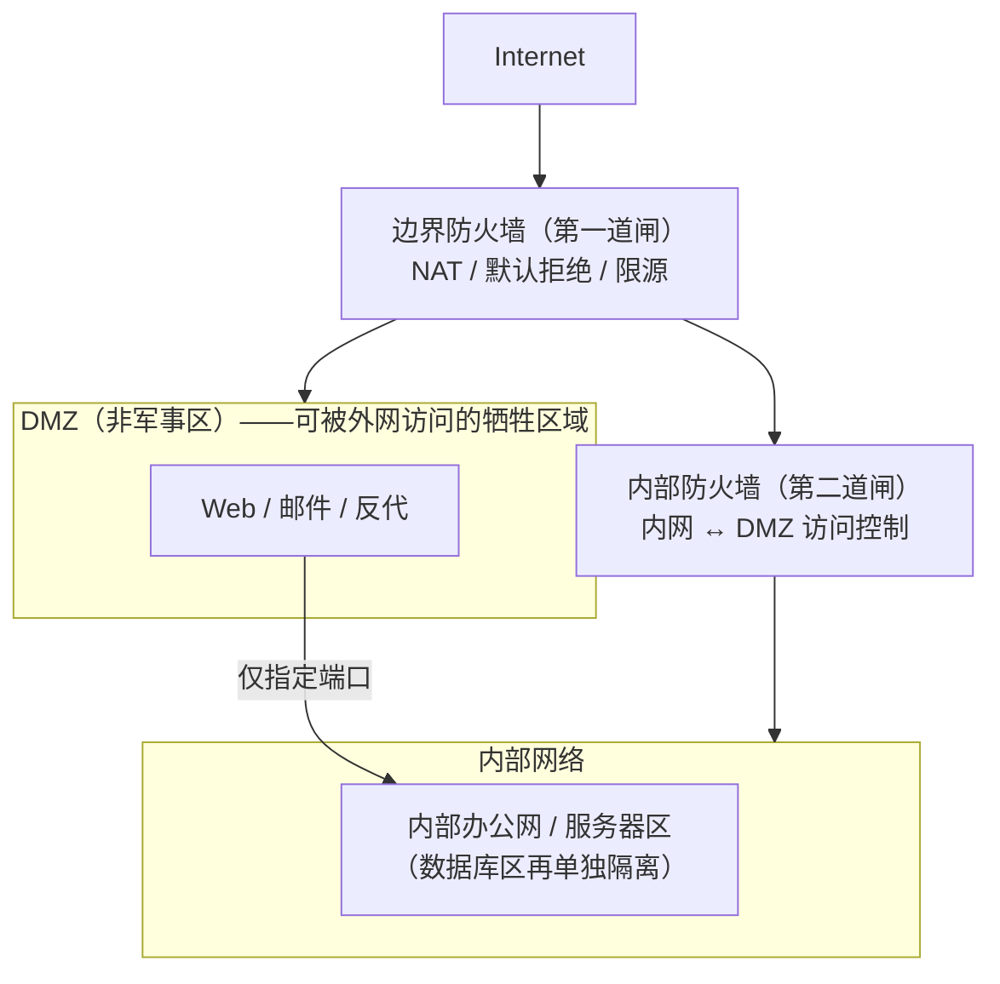
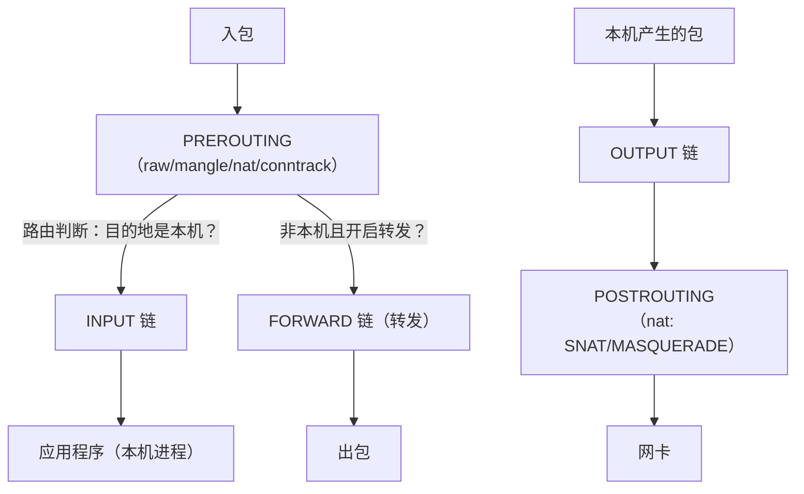
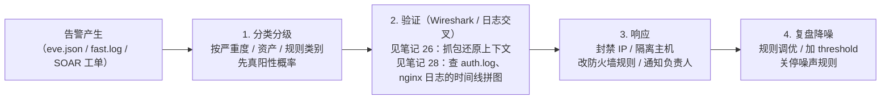
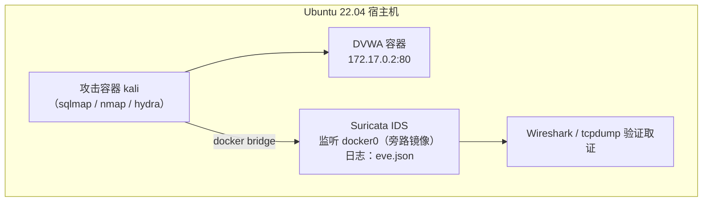

# 27. 防火墙与 IDS/IPS

> 日期：2026-11-04
> 所属大纲阶段：5. 网络安全与防御
> 参考资料：
> - iptables 官方手册（man iptables / man iptables-extensions）
> - nftables 官方 Wiki（`https://wiki.nftables.org/`）
> - Suricata 官方文档（`https://suricata.readthedocs.io/`）
> - Snort 3 官方手册与规则文档（`https://www.snort.org/documents`）
> - OWASP ModSecurity Core Rule Set 文档（`https://coreruleset.org/docs/`）
> - Netfilter conntrack 文档与 nf_conntrack 内核文档

---

## 0. 开篇：纵深防御中的两道闸门

防火墙（Firewall）与入侵检测/防御系统（IDS/IPS）是网络纵深防御（Defense in Depth）的中枢：**防火墙决定"谁能进来"，IDS 告诉你"谁在撬门"，IPS 直接把撬门的踢出去**。本篇以 Linux 生态为主线（iptables/nftables + Suricata），讲透原理与实操，最后落到"检测-验证-响应"闭环。

红线：所有阻断/检测实验在本地靶场 VM 或 Docker 中进行；对企业生产设备做任何规则变更需走变更流程。

环境约定：Ubuntu 22.04 LTS（5.x 内核），iptables 1.8（nf_tables 后端），Suricata 6/7.x。靶场：同网段 Docker 容器（DVWA/Metasploitable）。

---

## 1. 防火墙的演进

### 1.1 四代防火墙

| 代际 | 名称 | 工作层次与逻辑 | 局限 |
| --- | --- | --- | --- |
| 第一代 | **包过滤（Packet Filtering）** | 逐包独立检查 IP/端口/协议，无状态、按 ACL 放行或丢弃 | 无法区分"新建连接"与"回程包"；容易被分片/伪造绕过 |
| 第二代 | **状态检测（Stateful Inspection）** | 维护**连接跟踪表（connection tracking, conntrack）**，识别会话状态，默认"出站发起、回程放行" | 不看应用内容；可被藏进合法协议的攻击绕过 |
| 第三代 | **应用层防火墙 / 下一代防火墙（NGFW, Next-Generation Firewall）** | 深度包检测（DPI）+ 应用识别 + 用户/身份 + 威胁情报 + IPS 融合 | 性能开销大、商业产品贵 |
| Web 专项 | **WAF（Web Application Firewall，Web 应用防火墙）** | HTTP/HTTPS 语义层过滤（SQL 注入/XSS 特征等），保护 Web 应用 | 仅覆盖 Web 协议，与网络防火墙互补而非替代 |

### 1.2 状态检测与 conntrack：一句话原理

**conntrack** 是 Linux Netfilter 的连接跟踪模块：内核为每条经过的连接（TCP/UDP/ICMP"连接"）维护一条记录（五元组、状态、超时、NAT 映射），防火墙规则里的 `ESTABLISHED` 判断全部依赖它。**没有 conntrack，"放行回程包"这条最经典的规则就无从谈起。**

TCP 相关的 conntrack 状态：`NEW`（第一个 SYN）、`SYN_SENT/SYN_RECV`、`ESTABLISHED`（完成握手）、`FIN_WAIT/CLOSE_WAIT/...`、`TIME_WAIT`。UDP 则是"源触发的伪流 + 空闲超时"。

### 1.3 部署位置：分区与 DMZ

网络分区的思想：**不同信任级别的区域之间放防火墙，默认拒绝跨区流量**。



要点：
- **DMZ（Demilitarized Zone，非军事区）**：放"必须对互联网开放"的服务。DMZ 主机被攻破后，攻击者仍隔着"内部防火墙"才能进内网——为纵深争取时间。
- 内部再按业务分安全域（办公网/服务器区/数据库区/运维管理区），**东西向流量**同样要控——现代攻击大量发生在内网横向移动阶段。

---

## 2. iptables 详解

### 2.1 表与链

iptables 的规则按**表（table）**和**链（chain）**组织。四张表（按查看到的优先级）：`raw` → `mangle` → `nat` → `filter`。

| 表 | 用途 | 常用链 |
| --- | --- | --- |
| **raw** | 连接跟踪豁免（NOTRACK） | PREROUTING, OUTPUT |
| **mangle** | 修改包元数据（TOS/TTL/mark） | 全部链 |
| **nat** | 地址/端口转换 | PREROUTING（DNAT）、POSTROUTING（SNAT）、OUTPUT |
| **filter** | **过滤（放行/丢弃）——日常 90% 的规则在这** | INPUT、OUTPUT、FORWARD |

五条链对应的处理时机：



**入站路径**：PREROUTING（DNAT 在此）→ 路由判断：目的地是本机？→ INPUT；不是本机且开启转发？→ FORWARD。
**出站路径**：本机进程发包 → OUTPUT → POSTROUTING（SNAT 在此）→ 出网卡。

### 2.2 规则语法逐段解析

一条典型规则：

```bash
iptables -A INPUT -p tcp --dport 22 -s 10.0.2.0/24 -m conntrack --ctstate NEW,ESTABLISHED -j ACCEPT
```

逐段拆解：

| 片段 | 含义 |
| --- | --- |
| `-A INPUT` | **A**ppend 到 INPUT 链末尾（`-I` 是 insert 到头部，`-D` 删除，`-R` 替换；规则**按序匹配，命中即停**） |
| `-p tcp` | 协议：tcp/udp/icmp/all |
| `--dport 22` | 目的端口（需 `-p` 已指定协议）；`--sport` 源端口；`--dport 22:25` 端口段 |
| `-s 10.0.2.0/24` | 源地址（`-s`/`--source`）；`-d` 目的地址 |
| `-m conntrack` | 加载 **conntrack 扩展模块**（老写法 `-m state` 是其别名） |
| `--ctstate NEW,ESTABLISHED` | 匹配连接跟踪状态：NEW/ESTABLISHED/RELATED/INVALID/UNTRACKED |
| `-j ACCEPT` | 动作（jump target）：ACCEPT 放行 / DROP 静默丢弃 / REJECT 拒绝并回 ICMP / LOG 记日志 / 自定义链 |

**状态语义（重点）**：
- `NEW`：连接的首包（TCP 的 SYN）；
- `ESTABLISHED`：conntrack 表里已存在的连接的后续包（含回程方向）；
- `RELATED`：与已有连接**相关**的新连接——典型是 FTP 数据连接、ICMP 错误报文（需配合连接跟踪 helper）；
- `INVALID`：无法识别归属的包（如无握手的 ACK）——一般应丢弃；
- `UNTRACKED`：被 raw 表 NOTRACK 豁免的包。

**DROP vs REJECT**：DROP 静默（扫描器视角是 filtered，对方要等超时）；REJECT 回 `icmp-port-unreachable`（友好但暴露设备存在）。对外暴露面收敛用 DROP；对内排障可用 REJECT。

### 2.3 默认策略与完整规则集示例

> 环境：Ubuntu 22.04，作为一台内网服务器的防火墙。目标：回程放行、SSH 限源、Web 对内开放、其余入站默认 DROP。
> **警告：远程操作时先 `iptables-apply` 或计划任务回滚，防止把自己锁在外面（经典事故）。**

```bash
#!/usr/bin/env bash
# /root/fw-init.sh —— 最小可用主机防火墙（环境：Ubuntu 22.04，iptables 1.8）
set -euo pipefail
IPT=iptables

# 0) 清空旧规则与自定义链（仅测试环境；生产应先备份 iptables-save > backup）
$IPT -F
$IPT -X
$IPT -t nat -F

# 1) 默认策略：入站丢弃、转发丢弃、出站放行
$IPT -P INPUT   DROP
$IPT -P FORWARD DROP
$IPT -P OUTPUT  ACCEPT

# 2) 本地回环放行（无数本地服务依赖 lo）
$IPT -A INPUT -i lo -j ACCEPT

# 3) 连接跟踪：放行已建立连接与相关连接的回程 —— 状态检测的核心
$IPT -A INPUT -m conntrack --ctstate ESTABLISHED,RELATED -j ACCEPT

# 4) 丢弃无效包（扫描噪音、伪造包）
$IPT -A INPUT -m conntrack --ctstate INVALID -j DROP

# 5) ICMP：放行 echo/不可达等基本控制消息（完全禁 ping 得不偿失）
$IPT -A INPUT -p icmp --icmp-type echo-request -m limit --limit 10/s -j ACCEPT
$IPT -A INPUT -p icmp --icmp-type destination-unreachable -j ACCEPT

# 6) SSH 仅允许运维网段，并对新建连接限速（每 IP 6 次/分钟突发 3，防爆破）
$IPT -A INPUT -p tcp --dport 22 -s 10.0.2.0/24 \
      -m conntrack --ctstate NEW \
      -m hashlimit --hashlimit-name ssh --hashlimit-above 6/minute --hashlimit-burst 3 \
      --hashlimit-mode srcip -j DROP
$IPT -A INPUT -p tcp --dport 22 -s 10.0.2.0/24 -m conntrack --ctstate NEW -j ACCEPT

# 7) Web 仅对内网开放
$IPT -A INPUT -p tcp --dport 80  -s 10.0.0.0/8  -m conntrack --ctstate NEW -j ACCEPT
$IPT -A INPUT -p tcp --dport 443 -s 10.0.0.0/8  -m conntrack --ctstate NEW -j ACCEPT

# 8) 记录并丢弃其余入站（记录放在 DROP 前，加限速防日志洪泛）
$IPT -A INPUT -m limit --limit 5/min -j LOG --log-prefix "IPTABLES-DROP: "
# 兜底：默认策略 DROP 生效，无需显式 -j DROP

# 9) 持久化（Ubuntu）
mkdir -p /etc/iptables
iptables-save > /etc/iptables/rules.v4
echo "已保存规则，netfilter-persistent enable 会在开机自动恢复"
```

配套启用（Ubuntu 22.04）：

```bash
sudo apt install -y iptables-persistent
sudo netfilter-persistent save     # 写 /etc/iptables/rules.v4
sudo netfilter-persistent reload
```

**规则顺序验证清单**：规则自上而下匹配，`ESTABLISHED` 必须在最前（否则每个回程包都要白跑一堆规则）；限速 DROP 必须在 ACCEPT 之前；LOG 兜底在最后。

### 2.4 NAT：SNAT / DNAT 端口发布

```bash
# 场景 A：内网主机共享上网（SNAT 的动态版：MASQUERADE，出口 IP 不固定时用）
iptables -t nat -A POSTROUTING -s 192.168.100.0/24 -o eth0 -j MASQUERADE
# 固定出口 IP 用显式 SNAT，性能更好：
iptables -t nat -A POSTROUTING -s 192.168.100.0/24 -o eth0 -j SNAT --to-source 203.0.113.10

# 场景 B：端口发布（DNAT）——把公网 8080 映射到内网 DVWA 容器 80
iptables -t nat -A PREROUTING -d 203.0.113.10 -p tcp --dport 8080 -j DNAT --to-destination 192.168.100.20:80
# DNAT 只改目的地址，filter 表 FORWARD 链还要放行（新手最常见"NAT 配了不通"原因）
iptables -A FORWARD -d 192.168.100.20 -p tcp --dport 80 -m conntrack --ctstate NEW,ESTABLISHED,RELATED -j ACCEPT
iptables -A FORWARD -s 192.168.100.20 -p tcp --sport 80 -m conntrack --ctstate ESTABLISHED -j ACCEPT
```

NAT 发生在 PREROUTING（DNAT，先于路由判断）与 POSTROUTING（SNAT，路由之后）；conntrack 自动维护正反向映射，所以回程无需手写规则。

### 2.5 conntrack 表查看

```bash
sudo conntrack -L                 # 需 apt install conntrack；或 cat /proc/net/nf_conntrack
sudo conntrack -L -p tcp --dport 22        # 只看 22 端口连接
sudo conntrack -D -s 10.0.2.15    # 删除某源 IP 的所有跟踪项（踢会话）

# 关键内核参数（/etc/sysctl.d/）
# net.netfilter.nf_conntrack_max = 262144        # 表上限，打满会丢新建连接（表现为"随机连不上"）
# net.netfilter.nf_conntrack_tcp_timeout_established = 86400
sudo sysctl -a | grep conntrack  # 查看当前值
```

**排障**：服务器"高负载时新连接随机失败"，先看 `dmesg | grep conntrack` 是否有 `nf_conntrack: table full, dropping packet`——这是自伤型事故经典来源。

### 2.6 nftables 与 iptables 的关系

- nftables 是 Netfilter 的新一代框架（内核 3.13+），取代 iptables/ip6tables/arptables/ebtables 的"多工具并存"；
- 语法差异：nftables 用**集合（set）、字典（map）、链族（inet 同时管 v4/v6）**，规则可原子加载，性能更好；
- Ubuntu 22.04 里 `iptables` 命令默认是 **iptables-nft**（翻译层，把 iptables 语法转成 nft 规则），两者不要混用同一张表；
- 新部署建议直接 nftables / firewalld（RHEL 系默认）；学 iptables 不过时——概念（表/链/hook/conntrack）完全平移。

```bash
# nftables 等价示例：限源 SSH + 默认丢弃
sudo nft add table inet filter
sudo nft add chain inet filter input '{ type filter hook input priority 0 ; policy drop ; }'
sudo nft add rule inet filter input ct state established,related accept
sudo nft add rule inet filter input iif lo accept
sudo nft add rule inet filter input ip saddr 10.0.2.0/24 tcp dport 22 ct state new accept
sudo nft list ruleset
```

---

## 3. WAF 概念（一段式）

**WAF（Web Application Firewall）**部署在 Web 服务前，理解 HTTP 语义（方法、头、参数、编码），按规则拦截 Web 专项攻击（SQL 注入、XSS、路径穿越、文件上传等），典型如开源 **ModSecurity**：它的 SecRule 规则语言思想是"变量（ARGS/HEADERS/URI 等）+ 运算符（正则/库检测）+ 动作（拦截/放行/记录）+ 链式条件"；官方规则集 **OWASP CRS（Core Rule Set）** 提供数千条通则，覆盖 OWASP Top 10，开箱可用。部署模式：**反向代理**（流量先到 WAF 再转后端，最常见）或**透明桥接**；另有嵌入应用进程的"内嵌模式"（nginx modsecurity 模块即近似此形态）。WAF 与网络防火墙互补：前者懂 HTTP，后者懂 IP/TCP。注意 WAF 是"减缓"而非根治——代码修复才是根本（见大纲第 6 阶段安全工程）。

---

## 4. IDS vs IPS

| 维度 | IDS（入侵检测系统，旁路） | IPS（入侵防御系统，串联） |
| --- | --- | --- |
| 部署方式 | **旁路（out-of-band）**：镜像口/SPAN 流量复制，不在线路上 | **串联（in-line）**：流量必经它 |
| 能否阻断 | 不能（只告警，联动防火墙间接阻断） | 能：丢包、重置连接（RST）、改流量 |
| 对可用性影响 | **零**：坏了不断网 | 是新单点：坏了/误拦即断网，需 bypass |
| 检测视野 | 可看到全网镜像 | 只看到流经自己的链路 |
| 误报代价 | 低（人工甄别） | 高（误拦合法业务） |
| 攻击者视角 | 发现不了它（不在线路上） | 时序/指纹可探测其存在 |
| 典型部署点 | 核心交换机镜像口、DMZ 汇聚、云 VPC 流量镜像 | 边界出口、Web 服务前端、内网关键路径 |
| 典型选择 | 检测为主、告警接入 SIEM | 自动化阻断明确特征攻击（蠕虫、爆破） |

实践共识：**先旁路 IDS 跑规则、观察误报，成熟后对高置信规则逐步转 IPS**——"IDS 转 IPS"是流程而非开关。

---

## 5. Snort / Suricata 规则语法逐字段详解

两者规则语法同源（Snort 规则格式），Suricata 是现代多线程实现（Snort 3 也已重写）。规则分**规则头**与**规则选项**两段：

```text
alert tcp $EXTERNAL_NET any -> $HOME_NET 80 (msg:"..."; content:"..."; sid:1000001; rev:1;)
└─┬─┘ └┬┘ └────┬────┘ └─┬─┘   └─┬─┘ └──┬──┘     └────────────┬────────────┘
 动作  协议   源地址  源端口  方向  目的 目的端口                规则选项（分号分隔）
```
> 注：此图保留 ASCII 原样 —— 动作/协议/源地址等字段注解逐列对齐在 Snort 规则原文行上，转成节点图会丢失规则原文与注解行的逐位对照。

### 5.1 规则头字段

| 字段 | 取值与含义 |
| --- | --- |
| 动作 | Snort: `alert`（告警）/ `log` / `pass` / `activate`/`dynamic`（Snort 2 inline 模式另有 `drop`）；Suricata: `alert` / `pass` / `drop`（IPS 丢弃）/ `reject` / `rejectsrc` / `rejectdst` / `rejectboth`（reject 系列为阻断并回 RST，区别在朝哪个方向重置） |
| 协议 | `tcp` / `udp` / `icmp` / `ip`（Snort 3 还支持 `http`/`tls` 等应用层协议直写） |
| 源/目的地址 | CIDR、`[10.0.0.0/8,!10.1.1.1]` 列表、规则变量 `$EXTERNAL_NET`、`$HOME_NET`（Snort 定义在 snort.conf 的 var 段，Suricata 定义在 suricata.yaml 的 vars 段；threshold.config 只管告警阈值，不定义变量） |
| 端口 | 数字、`any`、范围 `1:1024`、`!80` 取反 |
| 方向 | `->` 单向；`<>` 双向 |

### 5.2 规则选项（常用）

| 关键字 | 作用 | 示例 |
| --- | --- | --- |
| `msg` | 告警文本 | `msg:"ET WEB_CLIENT SQL Injection Attempt";` |
| `content` | **载荷字节串匹配**（核心），可多条依次匹配 | `content:"union"; content:"select"; distance:0; within:32;`（第二条在第一条后 0-32 字节内） |
| `nocase` | 大小写不敏感（修饰前一个 content） | `content:"or 1=1"; nocase;` |
| `http_uri` / `http_header` / `http_client_body` / `http_method` | **粘性缓冲区**：限定 content 匹配的 HTTP 部位 | `content:"'"; http_uri;`（只匹配 URI） |
| `pcre` | PCRE 正则（带修饰符 HiU 等：H 缓存、i 忽略大小写、U 是 uri 缓冲） | `pcre:"/union\s+select/Ui";` |
| `depth`/`offset`/`distance`/`within` | 匹配位置约束（性能优化利器） | `depth:4;` 只查前 4 字节 |
| `sid` | **规则唯一 ID**：1–999,999 为 Snort/VRT 官方规则保留；ET 规则集多在 2,000,000–2,999,999；本地自定义常取 1,000,000+/9,000,000+ 段避免冲突 | `sid:1000001;` |
| `rev` | 规则版本号，改动递增 | `rev:2;` |
| `metadata` | 结构化元数据（影响分类、性能分层） | `metadata:created_at 2026_11_04, former_category WEB_SQLI;` |
| `reference` | 外部参考（CVE/Bugtraq） | `reference:cve,2014-0160;` |
| `classtype` | 分类（映射 classification.config） | `classtype:web-application-attack;` |
| `threshold` | 告警阈值（限频） | `threshold:type both, track by_src, count 5, seconds 60;` |
| `flow` | 流方向/状态 | `flow:established,to_server;`（只查已建立连接上行） |
| `fast_pattern` | 指定多模式匹配的锚点串（性能） | |
| `tag` | 命中后继续记录该流 N 个包 | |

### 5.3 三条实战示例规则（写入 local.rules）

```bash
# 规则 1：检测 SQL 注入特征 ' OR 1=1（与变体）
# 思路：HTTP URI 或请求体中出现 "' " + or + 1=1 经典恒真式；URL 编码 ' 为 %27
alert http $EXTERNAL_NET any -> $HOME_NET any (msg:"LOCAL-WEB SQLi classic OR 1=1 in URI"; \
  flow:established,to_server; \
  content:"%27"; http_uri; nocase; \
  content:"or"; http_uri; nocase; distance:0; within:16; \
  content:"1=1"; http_uri; nocase; distance:0; within:16; \
  classtype:web-application-attack; sid:1000001; rev:1; \
  metadata:created_at 2026_11_04;)
# 解读：三段 content 用 distance/within 约束在 URI 内邻近出现，避免三词相距甚远的误报；
# nocase 绕过 Or/OR 混排大小写混淆；URL 编码 %27 是 ' 的常见编码形态。

# 规则 2：检测已知攻击工具 UA（sqlmap）
alert http any any -> $HOME_NET any (msg:"LOCAL-WEB Attack tool UA sqlmap detected"; \
  flow:established,to_server; \
  content:"sqlmap"; http_user_agent; nocase; \
  reference:url,sqlmap.org; sid:1000002; rev:1;)

# 规则 3：检测对 DVWA 的暴力登录（大量 POST /login.php）
alert http any any -> $HOME_NET any (msg:"LOCAL-WEB Possible brute force on DVWA login"; \
  flow:established,to_server; \
  http.method; content:"POST"; \
  http.uri; content:"/login.php"; \
  classtype:attempted-admin; \
  threshold:type both, track by_src, count 10, seconds 60; \
  sid:1000003; rev:1;)
# 解读：threshold 聚合——同一源 60 秒内命中 10 次才告一次警，把"每次请求都报"降噪成"行为级告警"。
```

---

## 6. Suricata 安装与运行（实操）

> 环境：Ubuntu 22.04，Suricata 6.x/7.x（`apt install suricata` 或 OISF 官方 PPA 装新版）。

```bash
sudo apt update && sudo apt install -y suricata

# 关键配置 /etc/suricata/suricata.yaml：
#   HOME_NET: "[172.17.0.0/16,192.168.100.0/24]"   ← 自家网段
#   EXTERNAL_NET: "!$HOME_NET"
#   default-rule-path 与 rule-files 指向规则集

# 自定义规则直接追加到 /etc/suricata/rules/local.rules
sudo vim /etc/suricata/rules/local.rules     # 写入 §5.3 三条规则
# 在 suricata.yaml 的 rule-files 段确保包含 - local.rules

# 规则与配置校验（改完必做）
sudo suricata -T -c /etc/suricata/suricata.yaml -v

# IDS 模式：监听 eth0（旁路镜像或本机网口）
sudo suricata -c /etc/suricata/suricata.yaml -i eth0

# 规则更新（suricata-update 默认拉 ET Open 规则集）
sudo apt install -y suricata-update
sudo suricata-update && sudo suricata-update --reload  # 或 systemctl reload suricata

# 日志位置
tail -f /var/log/suricata/fast.log     # 快速人读告警
tail -f /var/log/suricata/eve.json     # 机器可读全量事件（JSON）
```

### 6.1 eve.json 输出解读

`eve.json` 每行一个 JSON 事件，是接入 SIEM（笔记 28）的标准通道。一条告警示例（已缩排）：

```json
{
  "timestamp": "2026-11-04T12:33:45.123456+0000",
  "flow_id": 1234567890123456,
  "in_iface": "eth0",
  "event_type": "alert",
  "src_ip": "172.17.0.5", "src_port": 53214,
  "dest_ip": "172.17.0.2", "dest_port": 80,
  "proto": "TCP",
  "alert": {
    "action": "allowed",
    "gid": 1, "signature_id": 1000002,
    "rev": 1,
    "signature": "LOCAL-WEB Attack tool UA sqlmap detected",
    "category": "Attempted Administrator Activity",
    "severity": 1
  },
  "http": { "hostname": "172.17.0.2", "url": "/vulnerabilities/sqli/", "http_user_agent": "sqlmap/1.8", "http_method": "GET", "protocol": "HTTP/1.1", "status": 200 }
}
```

关键字段逐行解读（保持 eve.json 为合法 JSON，注释放代码块外）：

- `event_type`：事件类型——`alert` / `flow` / `http` / `dns` / `tls` / `fileinfo` 等；
- `alert.action`：IDS 模式下为 `"allowed"`；IPS 模式命中 `drop`/`reject` 规则时为 `"blocked"`；
- `alert.signature_id`：对应规则的 `sid`（此处 1000002 即 §5.3 规则 2）；
- `alert.severity`：1 最高（共 1/2/3 三档）。

要点：
- `event_type` 还包括 `flow`（流结束统计：字节数/包数/时长——外传分析金矿）、`dns`（查询与应答）、`tls`（SNI/指纹/证书）、`fileinfo`、`stats`（周期性能指标）；
- `flow_id` 把同一连接的所有事件串起来；
- 用 `jq` 快速分析：`jq 'select(.event_type=="alert") | .alert.signature' /var/log/suricata/eve.json | sort | uniq -c | sort -rn`。

### 6.2 IPS 模式（一句话）

IPS 模式即 Suricata 串联部署：NFQUEUE（`-q 0/1`）方式从 iptables/nftables 队列取包、检测后放行或丢弃（规则动作 `drop`/`reject` 生效），需要 `--queue-bypass` 防止 Suricata 挂掉时全网断流；先在 IDS 模式验证规则误报率后再切换。

---

## 7. 告警处置流程



1. **分类**：这条告警属于扫描/爆破/Web 攻击/恶意软件/C2？严重度多少？命中资产是否关键？
2. **验证**（去噪核心）：单条告警 ≠ 事实。用 Wireshark 复核流量现场、用日志交叉验证（同源 IP 是否在 auth.log 有失败登录、nginx 是否 401 爆发），确认是"探测噪声"还是"成功入侵"。
3. **响应**：确认攻击→阻断源（防火墙/安全组封禁）、必要时隔离主机、取证留存（pcap+日志快照）、按应急响应流程上报（大纲第 6 阶段）。
4. **复盘**：误报→调整规则（加 threshold、改 content、收窄端口）；漏报（事后发现）→补规则进回归测试集。

### 7.1 误报处理方法论

1. **统计优先**：`jq` 聚合 Top 规则/Top 源，先处理量最大的噪声；
2. **归因**：误报原因通常三类——特征过宽（`content:"select"` 单独成规则必误伤正常业务）、正常业务行为酷似攻击（监控探活被当爆破）、规则过期（软件升级后指纹失效）；
3. **修复手段**：加 `threshold` 降频、content 加上下文（邻近串、http_uri 限定）、`pass` 规则白名单已确认的合法场景（pass 放在规则最前）；
4. **禁止**一上来就删规则/全局静音——先把误报当作"规则与现实的偏差"记录进知识库。

---

## 8. 蜜罐概念（一段式）

**蜜罐（Honeypot）**是"故意暴露、专门等人来打"的诱捕系统：没有业务用途，因此**任何对它的访问都是可疑的**，告警信噪比极高。低交互蜜罐如 honeyport（一个监听高端口、一被连接就防火墙拉黑源 IP 的小脚本）、kippo（模拟 SSH 服务记录爆破字典与攻击者会话）；高交互蜜罐用真实系统换取更真实的行为情报。部署价值：**极早预警**（扫描/爆破进入内网的第一跳就踩雷）+ **攻击者 TTP 情报**（工具、字典、利用链）。部署红线：蜜罐必须严格隔离且做好"被攻破后不被当跳板"的限制，且仅用于自有授权网络。

---

## 9. 全链路综合实验（设计）

目标：在一台 Ubuntu 上串联本阶段知识，完成"攻击→检测→验证→响应"闭环。**仅限本地环境。**



步骤：
1. `docker run -d -p 8080:80 vulnerables/web-dvwa` 启动靶机；`docker network inspect bridge` 确认网段；
2. 让 Suricata 监听 docker0：`sudo suricata -i docker0`（规则含 §5.3 三条 local.rules + ET Open）；
3. 攻击容器执行（靶场）：`nmap -sS -p- 172.17.0.2`、`sqlmap -u "http://172.17.0.2/vulnerabilities/sqli/?id=1&Submit=Submit" --batch --dbs`、`hydra -l admin -P rockyou.txt 172.17.0.2 http-get-form ...`；
4. 观察 `fast.log`/`eve.json`：哪些攻击触发了规则？哪些没触发（例如 URL 全编码绕过）？
5. `sudo tcpdump -i docker0 -w evidence.pcap` 全程取证，用笔记 26 方法逐条告警复核；
6. 响应演练：把确认的攻击源 `iptables -A INPUT -s <攻击容器IP> -j DROP`，验证阻断生效；
7. 复盘：为"漏报的变体"补写规则（_sid 递增，rev 记录变更），形成自己的规则库与实验报告（写入 `labs/`）。

---

## 10. 常见坑汇总

1. **远程改防火墙把自己锁死**：永远先开第二个 SSH 会话验证、用 `iptables-apply`（有确认回滚）或 `at` 定时回滚。
2. **DNAT 配好仍不通**：忘放行 FORWARD 链；或没开 `net.ipv4.ip_forward=1`。
3. **`-m state` 与 `--ctstate` 写混**：`state` 模块参数是 `--state`，`conntrack` 模块是 `--ctstate`，写错直接报错。
4. **规则顺序错**：限速 DROP 放到 ACCEPT 后面等于没放；`ESTABLISHED` 不放最前导致规则包数暴涨。
5. **conntrack 表满**：高并发场景必须调 `nf_conntrack_max` 并监控丢弃计数。
6. **Suricata 规则改了不生效**：忘记 `-T` 校验失败、`rule-files` 没引用 local.rules、没 reload。
7. **HOME_NET 没改**：默认 `192.168.0.0/16` 等不对口，告警方向（内外网判定）全乱。
8. **IPS 裸上生产**：误拦业务；先 IDS 观察至少一个业务周期。
9. **ping 全禁**：连 traceroute/路径 MTU 发现一起破坏（ICMP 不可达被丢导致黑洞），只限速 echo-request 即可。
10. **日志没配轮转**：`fast.log`/`IPTABLES-DROP` 日志写满磁盘。

---

## 11. 自测问题

1. 包过滤与状态检测防火墙的本质区别是什么？conntrack 表在"放行回程"这条规则里扮演什么角色？
2. 画出 iptables 四表五链的入站/转发/出站路径，并说明 DNAT 与 SNAT 分别发生在哪个环节。
3. 解释 `-m conntrack --ctstate ESTABLISHED,RELATED` 中 RELATED 的典型例子。
4. DROP 与 REJECT 的区别？对外暴露面收敛应选哪个，为什么？
5. 写一条 iptables 规则：仅允许 10.0.2.0/24 访问本机 22 端口的新建连接。
6. IDS 与 IPS 在部署方式、可用性风险、误报代价上的三大差异？
7. 逐字段解释这条 Suricata 规则的每个部分：`alert tcp any any -> $HOME_NET 21 (msg:"FTP USER root"; content:"USER"; nocase; content:"root"; distance:1; sid:1000004; rev:1;)`
8. `threshold:type both, track by_src, count 10, seconds 60` 的作用是什么？为什么爆破类规则几乎都要配它？
9. eve.json 里 `event_type=flow` 的事件有什么检测价值？举一个外泄分析场景。
10. 描述"告警→验证→响应→复盘"闭环中每一步的输入与产出，并说明 Wireshark 在哪一步发挥作用。
11. 蜜罐为什么天然高信噪比？部署蜜罐的两条安全前提是什么？

---

（完）下一篇：28-日志分析与-SIEM.md


---

## 附：ASCII 图 → Mermaid 替换清单

| 原 ASCII 图（小节 · 内容） | 替换后类型 |
| --- | --- |
| 「1.3 部署位置：分区与 DMZ」节 · 互联网 / DMZ / 内网分区拓扑图 | flowchart TD |
| 「2.1 表与链」节 · iptables 五链处理路径图 | flowchart TD |
| 「5. Snort / Suricata 规则语法逐字段详解」节 · Snort 规则字段注解图 | 保留 ASCII 原样（附注） |
| 「7. 告警处置流程」节 · 告警处置四步流水线 | flowchart LR |
| 「9. 全链路综合实验（设计）」节 · 宿主机容器拓扑图 | flowchart TD |
