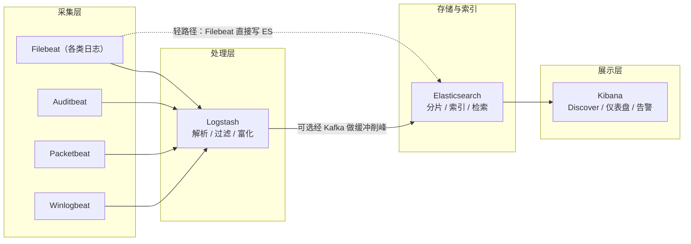

# 28. 日志分析与 SIEM

> 日期：2026-11-04
> 所属大纲阶段：5. 网络安全与防御
> 参考资料：
> - systemd journalctl 手册（man journalctl）
> - rsyslog 官方文档（`https://www.rsyslog.com/doc/`）
> - nginx Logging 官方文档（`http://nginx.org/en/docs/http/ngx_http_log_module.html`）
> - Elastic Stack 文档（`https://www.elastic.co/guide/index.html`）
> - Sigma 规则规范（`https://github.com/SigmaHQ/sigma/wiki`）
> - Microsoft Windows 安全事件文档（Learn → Windows Security Auditing，事件 ID 4624/4625/4720/7045）
> - NIST SP 800-92《Guide to Computer Security Log Management》

---

## 0. 开篇：为什么日志是防御的眼睛

网络防御有一条残酷的规律：**攻击者只需要成功一次，而你需要每次都发现**。入侵杀伤链（Kill Chain）的每一环——侦察、初始访问、执行、持久化、横向移动、外传——都必然在某个系统上留下**痕迹（trace）**，而痕迹的主要载体就是日志。没有日志，检测（Detection）与响应（Response）都是空谈；有日志但没人看、看不过来，等于没有。本篇解决三件事：**日志从哪来（来源与格式）、怎么到手（采集与集中化）、怎么变成检测能力（命令行实战 + 用例设计 + SIEM）**。

红线：日志包含用户名、IP、访问行为等敏感信息。**分析自有的本地靶场或已授权环境**；日志访问权限按最小必要原则分配。

环境约定：Ubuntu 22.04（rsyslog/systemd-journal/nginx/DVWA 容器）+ Windows 事件部分基于 Windows 10/Server 2019 说明。

---

## 1. 日志来源全景表

| 来源 | 典型文件/接口 | 防御价值 |
| --- | --- | --- |
| Linux 认证日志 | `/var/log/auth.log`（Debian/Ubuntu）、`/var/log/secure`（RHEL） | SSH 爆破、提权、sudo 滥用 |
| Linux 系统日志 | `/var/log/syslog`、`/var/log/kern.log`、`/var/log/dmesg` | 服务异常、内核/防火墙丢包 |
| systemd 日志 | `journalctl`（二进制 journal，`/var/log/journal/`） | 以上全部 + 结构化字段 |
| Web 服务器 | nginx `access.log`/`error.log`；Apache `access_log`/`error_log` | Web 攻击、扫描、webshell |
| 数据库 | MySQL 慢日志/审计插件、PostgreSQL `log_statement` | 拖库、异常大查询 |
| Windows 事件 | 事件查看器 `Security.evtx` 等 | 登录、建号、服务安装 |
| IDS/WAF | Suricata `eve.json`、ModSecurity audit log | 攻击告警（笔记 27） |
| 云平台审计 | 阿里云 ActionTrail、AWS CloudTrail、GCP Audit Logs | API 级操作审计（控制台与 SDK 行为），密钥泄露/越权操作排查 |

### 1.1 syslog：facility 与 severity

传统 syslog（RFC 3164/5424）用 **facility（设施，日志来源类别）+ severity（严重度）** 编码优先级：

- **facility**（0-23）：0 kernel、1 user、2 mail、3 daemon、4 auth（安全/认证）、5 syslog、7 news、8 uucp、9 cron、10 authpriv、16-23 local0-local7（自定义，如 `local0` 常留给网络设备）。
- **severity**（0-7）：0 Emergency、1 Alert、2 Critical、3 Error、4 Warning、5 Notice、6 Informational、7 Debug。
- 书写形式 `facility.severity`，如 `auth.info`、`*.err`；rsyslog 规则动作如 `auth,authpriv.* /var/log/auth.log`。

### 1.2 /var/log/auth.log：SSH 成功/失败特征行

Ubuntu 22.04 示例（已手工排版，实际一行一条）：

```text
# 失败：用户名不存在（invalid user 前缀是爆破扫描的强特征）
Nov  4 09:12:31 web01 sshd[11223]: Failed password for invalid user admin from 203.0.113.66 port 53214 ssh2
# 失败：用户名存在但密码错误
Nov  4 09:12:35 web01 sshd[11225]: Failed password for root from 203.0.113.66 port 53216 ssh2
# 成功登录
Nov  4 09:12:59 web01 sshd[11240]: Accepted password for deploy from 203.0.113.66 port 53240 ssh2
# 会话开启
Nov  4 09:13:00 web01 sshd[11240]: pam_unix(sshd:session): session opened for user deploy(uid=1001) by (uid=0)
# sudo 提权
Nov  4 09:15:12 web01 sudo:  deploy : TTY=pts/0 ; PWD=/home/deploy ; USER=root ; COMMAND=/usr/bin/cat /etc/shadow
# 断开
Nov  4 09:20:01 web01 sshd[11240]: pam_unix(sshd:session): session closed for user deploy
```

**检测视角的关键差异**：`Failed password`（失败）与 `Accepted password/publickey`（成功）是两个世界——"同一 IP 失败 100 次后 Accepted" 是最高优先级事件（§5 用例 1）。`invalid user` 说明用户名都是猜的。密钥认证失败是 `Failed publickey`。

### 1.3 systemd journal

```bash
journalctl -u ssh --since "2026-11-04 09:00" --until "2026-11-04 10:00"  # 按服务+时间
journalctl _COMM=sshd -n 100            # 最近 100 条 sshd 日志
journalctl -p err -S today              # 今天的 error 及以上
journalctl --disk-usage                 # journal 占用
sudo journalctl --vacuum-time=30d       # 保留策略（或 /etc/systemd/journald.conf 持久化配置）
```

journal 的优势：结构化字段（`_COMM`、`_PID`、`_UID`、`MESSAGE_ID`）、二进制防篡改门槛、按单元/时间/优先级切片，是 rsyslog 之外的第二入口。

### 1.4 nginx access.log：combined 格式逐字段解析

```text
log_format combined '$remote_addr - $remote_user [$time_local] '
                    '"$request" $status $body_bytes_sent '
                    '"$http_referer" "$http_user_agent"';
```

一条示例与逐字段解读：

```text
203.0.113.66 - - [04/Nov/2026:09:30:01 +0800] "GET /vulnerabilities/sqli/?id=1%27+union+select+1,2,3 HTTP/1.1" 200 1284 "-" "sqlmap/1.8.2#stable (https://sqlmap.org)"
└────┬────┘ └┬┘ └──────┬─────────────┘ └──────────────────────┬─────────────────┘ └┬─┘ └──┬──┘ └┬┘ └──────────────────┬─────────────────┘
  源 IP     远端用户      本地时间(RFC)              请求行(方法 URI 协议)            状态  响应字节  Referer          User-Agent
```
> 注：此图保留 ASCII 原样 —— 源 IP/时间/请求行等字段名注解逐列对齐在原始日志行下方，转成节点图会丢失日志原文与字段的对照。

| 字段 | 变量 | 检测意义 |
| --- | --- | --- |
| `$remote_addr` | 客户端 IP（有代理时是上一跳，需 `X-Forwarded-For` 配合） | 攻击源聚合 |
| `$remote_user` | Basic 认证用户名（通常 `-`） | |
| `$time_local` | 本地时间 | 时间线重建；**时区/时间不同步是日志分析天敌** |
| `$request` | 请求行 | 注入/扫描特征都在 URI 里 |
| `$status` | 状态码 | 401/403 爆发=爆破；200+异常 URI=可能成功 |
| `$body_bytes_sent` | 响应体字节 | 大量 200 + 大字节 = 数据被拉走 |
| `$http_referer` | 来源页 | CSRF/钓鱼链路 |
| `$http_user_agent` | 客户端标识 | 工具指纹（sqlmap/nikto/python-requests） |

**自定义建议**（在标准格式后追加）：`$request_time`（服务耗时，找注入盲注的时间盲打）、`$upstream_response_time`、`$http_x_forwarded_for`（还原真实客户端 IP）、`$request_id`（全链路追踪）。error.log 记录的是服务端视角错误（连接重置、限流触发），与 access.log 互补。

### 1.5 数据库日志（一段式）

MySQL/MariaDB：慢查询日志（`long_query_time`）可发现攻击者拖库产生的大查询；审计插件（`MariaDB Audit Plugin`、MySQL Enterprise Audit）记录连接与语句。PostgreSQL：`log_statement='all'` 或 `log_min_duration_statement`。原则：**生产全量 SQL 日志体量与性能代价大，通常按"连接审计必开、语句审计分级"取舍**。

### 1.6 Windows 事件日志与关键事件 ID 表

日志路径：`C:\Windows\System32\winevt\Logs\`（Security.evtx / System.evtx / Application.evtx），查看工具：事件查看器（eventvwr.msc）、`wevtutil`、PowerShell `Get-WinEvent`。

| 事件 ID | 含义 | 检测意义 |
| --- | --- | --- |
| **4624** | 登录成功。关注 `LogonType`：2=交互（本地）、**3=网络（远程共享/RPC/WinRM）**、4=批处理、5=服务、8=NetworkCleartext（明文协议）、9=新凭据（runas）、10=远程交互（RDP） | 横向移动核心指标 |
| **4625** | 登录失败 | 爆破（配合 4776/4771） |
| **4672** | 特权登录（Administrators 组成员登录，附特权列表） | 高危账户活动 |
| **4720** | 创建用户账户 | 攻击者建号持久化 |
| **4726** | 删除用户账户 | 痕迹清理 |
| **7045**（System 日志） | 安装新服务 | 持久化经典手法（服务名+二进制路径） |
| 4688 | 进程创建（需启用审核策略） | 命令执行链还原 |
| 4698 | 计划任务创建 | 持久化 |
| 1102 | 审计日志被清除 | 强对抗信号 |

```powershell
# PowerShell 检索示例（自有主机）
Get-WinEvent -FilterHashtable @{LogName='Security';Id=4625} -MaxEvents 20
Get-WinEvent -FilterHashtable @{LogName='Security';Id=4720} | Format-List TimeCreated, Message
```

---

## 2. 日志采集与传输

### 2.1 rsyslog 远程转发

```bash
# —— 发送端（web01，把 auth 与 nginx 转发到日志服务器 192.168.100.10）——
# /etc/rsyslog.d/90-forward.conf
*.* action(type="omfwd" target="192.168.100.10" port="514" protocol="tcp"
       action.resumeRetryCount="-1"
       queue.type="linkedList" queue.size="10000" queue.filename="fwdq"
       queue.saveOnShutdown="on")
systemctl restart rsyslog

# —— 接收端（logsrv）——
# /etc/rsyslog.d/30-receive.conf：加载 TCP 模块并按来源主机分文件
module(load="imtcp")
input(type="imtcp" port="514")
$template RemoteHost,"/var/log/remote/%HOSTNAME%/%$YEAR%-%$MONTH%-%$DAY%.log"
*.* ?RemoteHost
```

要点：**用 TCP 而非 UDP**（514/udp 不保证送达；TLS 可进一步加密，rsyslog 支持 `omfwd` 的 TLS 参数）；接收端按 `%HOSTNAME%` 分目录天然多租户；远端转发同时是**防篡改手段**（见 §7）。

### 2.2 Filebeat / Fluentd（一段式）

rsyslog 适合 syslog 类文本流；现代方案用**轻量采集器**：Filebeat（Elastic 系，监听文件尾随变化，自带 nginx/redis 等模块化采集与解析）或 Fluentd/Fluent-bit（CNCF 系，插件生态广，Kubernetes 环境事实标准）。它们解决"格式各异的应用日志如何可靠送达集中管道"：断点续传、背压、解析（multiline 合并堆栈）、打标签后送 Logstash/Kafka。

### 2.3 时间同步：NTP

所有日志分析的地基是**时间线可比**。所有服务器统一 NTP/chrony，时区策略统一（推荐全部 UTC 或全部 CST，日志内带时区偏移）。事故复盘时"为什么两条日志差 8 小时"是最常见的时间浪费。chrony 示例：`timedatectl status`、`chronyc tracking` 验证。

---

## 3. 集中分析：ELK 体系

### 3.1 架构与组件职责



- **Beats**：各场景轻代理（Filebeat 文件、Winlogbeat Windows 事件、Auditbeat 审计、Packetbeat 流量元数据）；
- **Logstash**：管道处理器——`input → filter（grok 正则解析、mutate 改字段、geoip 富化）→ output`，把非结构化文本变成结构化 JSON；
- **Elasticsearch**：分布式检索引擎，按索引（通常按天滚动 `logs-2026.11.04`）存储，全文检索毫秒级；
- **Kibana**：Discover 交互查询、Dashboard 可视化、告警（Alerting：条件命中 → 邮件/webhook）。

Logstash grok 解析 nginx combined 示例（节选）：

```ruby
filter {
  grok {
    match => { "message" => '%{IPORHOST:client_ip} - %{DATA:remote_user} \[%{HTTPDATE:time_local}\] "%{WORD:method} %{DATA:uri} HTTP/%{NUMBER:http_version}" %{NUMBER:status:int} %{NUMBER:bytes:int} "%{DATA:referer}" "%{DATA:user_agent}"' }
  }
  date { match => ["time_local", "dd/MMM/yyyy:HH:mm:ss Z"] }
}
```

### 3.2 Kibana 使用要点与部署建议

- **Discover**：KQL/DSL 查询（`event.dataset:"nginx.access" and url.original:*union*`），直方图+明细联动，是"grep 的图形化超集"；
- **Dashboard**：把 §5 的检测用例做成仪表盘（失败登录 Top IP、UA Top、4xx/5xx 比例）；
- **告警**：对保存的查询设阈值告警（如"5 分钟内 4625 > 20"→ 通知 IM）。

部署建议与资源需求（粗略经验值）：日均 10 GB 日志的中小环境，3 节点 ES 集群（每节点 8C/32G/1-2TB SSD，多副本跨机）、Logstash 2-4C、Kibana 2C；**内存是 ES 的命门**（JVM 堆 ≤ 32GB，一半留给文件系统缓存）；日志按天滚动 + ILM 生命周期策略（热→温→删除/归档），避免磁盘被吃光。

---

## 4. 命令行分析实战（grep/awk 挖 auth.log 与 nginx 日志）

> 环境：Ubuntu 22.04，日志为标准格式。**仅分析自有靶场/授权主机日志。**

### 4.1 SSH 爆破统计：失败 IP Top10（逐段解释）

```bash
grep "Failed password" /var/log/auth.log \
  | grep -oE "from ([0-9]{1,3}\.){3}[0-9]{1,3}" \
  | awk '{print $2}' \
  | sort | uniq -c | sort -rn | head -10
```

逐段拆解：
1. `grep "Failed password"`：筛出所有失败认证行（含 `invalid user`）；
2. `grep -oE "from IP"`：**-o 只输出匹配部分**，正则匹配 `from 1.2.3.4`（ERE 的 `{1,3}` 限 IP 段长度）；
3. `awk '{print $2}'`：按空白分列取第二列（即纯 IP）；
4. `sort | uniq -c`：先排序使相同行相邻，uniq 去重并**计数**（-c）；
5. `sort -rn | head -10`：按数值（-n）倒序（-r）取前 10。

输出示例：

```text
   1243 203.0.113.66
     87 198.51.100.9
      ...
```

`203.0.113.66` 一天 1243 次失败——爆破源实锤（下一步：该 IP 有没有成功过？见 §5 用例 1）。

### 4.2 找异常时段的成功登录

```bash
# 全部成功登录 + 来源 IP 汇总
grep "Accepted " /var/log/auth.log | awk '{print $1, $2, $3, $9, $11}' | head
# 假设业务值守时间 9:00-19:00：列出深夜（00-05 点）的成功登录
grep "Accepted " /var/log/auth.log \
  | awk '$3 ~ /^0[0-5]:/ {print $1,$2,$3,$9,$11}'
# 按用户聚合成功登录来源（发现"同一账户来自多个陌生 IP"）
grep "Accepted " /var/log/auth.log | awk '{print $9, $11}' | sort | uniq -c | sort -rn
```

`$3 ~ /^0[0-5]:/`：第三列（HH:MM:SS）正则匹配 00-05 点。夜间成功登录 + 非运维来源 IP = 高优先级人工复核。

### 4.3 nginx 日志找 SQL 注入尝试

```bash
# 特征一：经典 SQL 关键字（URL 编码形态：%27=' %20=空格）
grep -iE "union(%20|\+|%2b)select|select.*from|%27--|or%201=1|'--" /var/log/nginx/access.log
# 特征二：裸引号/注释符（未做编码的）
grep -E "%27|'" /var/log/nginx/access.log | grep -iE "select|insert|update|drop|sleep\(" 
# 特征三：时间盲注利器 sleep/benchmark
grep -iE "sleep\(|benchmark\(|waitfor\s+delay" /var/log/nginx/access.log
# 命中且返回 200 的（可能成功落地）：
grep -iE "union.*select|%27" /var/log/nginx/access.log | awk '$9==200 {print}' | head
```

> 注意 awk 中 `$9` 是 combined 格式的 status 列——如果自定义过日志格式，列号要相应调整（**先 head -1 看一眼真实格式再写列号**，头号坑）。

### 4.4 找扫描器 UA

```bash
# 已知工具 UA
grep -iE "sqlmap|nikto|nmap|masscan|dirbuster|gobuster|python-requests|curl|wpscan|zgrab" \
  /var/log/nginx/access.log | awk '{print $1}' | sort | uniq -c | sort -rn
# 空 UA / 异常短 UA（工具常不带 UA）：空 UA 在 combined 格式里记为 "-"，直接匹配 "-"
grep '"-"' /var/log/nginx/access.log | head
```

`python-requests/curl` 出现在业务 API 之外的页面路径上通常是脚本探测（也可能是合法监控，需结合路径判断）。

### 4.5 一条"日志→时间线"组合拳

```bash
# 事故调查模板：围绕一个可疑 IP 重建时间线（跨 auth.log 与 nginx）
SUS=203.0.113.66
grep "$SUS" /var/log/auth.log                       # 认证行为
grep "$SUS" /var/log/nginx/access.log | head -50    # Web 行为
zgrep "$SUS" /var/log/auth.log.*.gz                 # 翻历史（zgrep 直接读 gzip）
```

`zgrep`/`zcat` 处理 logrotate 压缩的历史日志，别忘了——**只看当前文件会漏掉 90% 的历史**。

---

## 5. 检测用例设计（思路 + 示例查询）

### 用例 1：SSH 爆破成功（大量失败后同 IP 成功）

- **思路**：单看"失败多"只是背景噪声；**同一源 IP 在失败 N 次之后出现 `Accepted`** 才是"爆破成功"强信号。实现 = 失败计数 + 成功存在性 的关联。
- **命令行验证**：

```bash
for ip in $(grep "Failed password" /var/log/auth.log | grep -oE "([0-9]{1,3}\.){3}[0-9]{1,3}" | sort -u); do
  fail=$(grep "Failed password.*from $ip " /var/log/auth.log | wc -l)
  succ=$(grep "Accepted .*from $ip " /var/log/auth.log | wc -l)
  [ "$fail" -gt 20 ] && [ "$succ" -gt 0 ] && echo "!! $ip 失败${fail}次 且 有${succ}次成功"
done
```

- **KQL（ELK）示例**：`event.dataset:"auth" and auth.action:"Accepted" and source.ip:(IP in top_fail_list)`——实践中用两个查询聚合关联（告警规则引用失败 Top 聚合结果）。
- **响应**：立即封禁源 IP、审计该账户后续会话（`session opened` 之后同 PID 的 COMMAND）、强制改密+检查 authorized_keys。

### 用例 2：webshell 访问（低频 POST 特征路径 + 响应 200）

- **思路**：攻击者上传 webshell（如 `shell.php`）后使用模式是——**对非常规路径的 POST，频率低、来源 IP 固定、几乎全部 200**，且 UA 常为空或工具。单一特征都会误报，组合特征置信度高。
- **示例查询（KQL）：`http.request.method:"POST" and url.path:(*.php) and not url.path:(/api/* /login*) and http.response.status_code:200`**，再按 `url.path` 聚合取低频（count<10/天）且非白名单路径。
- **命令行**：

```bash
# 找可疑低频 POST PHP 路径
grep '"POST' /var/log/nginx/access.log | awk '$7 ~ /\.php/ && $9==200 {print $7}' \
  | sort | uniq -c | sort -n | head          # 计数最小的（低频）优先人工看
# 同路径是否伴随不同参数长度（命令执行传参特征：POST 体长度变化大）
```

- **响应**：落盘比对文件（webshell 取证）、查上传入口漏洞（回到笔记 25/27 的 DVWA 实验）、清除+复查持久化。

### 用例 3：横向移动迹象（4624 LogonType 3 爆发）

- **思路**：Windows 内网正常也有 4624/3（共享、域认证），但**一台工作站短时间内对大量不同主机发起 4624/3**（尤其伴随 4625 与管理员账户）是蠕虫/勒索与红队横向的典型形态。基线 + 偏离检测。
- **示例查询**：`event.code:4624 and winlog.event_data.LogonType:3 and subject/user.name:<普通工作站账户>`，按 `source.ip × target.host` 聚合，阈值如"10 分钟内触达主机数 > 5"。
- **相关联指标**：4688 进程链（wmiexec/psexec 特征）、7045 新服务、SMB 流量突增（Suricata flow 事件佐证）。
- **响应**：隔离源主机、抓取内存/日志取证、按笔记 27 流程封禁与复盘。

---

## 6. 日志自身的安全（防篡改/保留/合规）

1. **防篡改**：
   - **实时远程转发**（§2.1）：攻击者清空本机日志也删不掉远端副本——这是成本最低、收益最大的措施；
   - **只追加（append-only）**：`chattr +a /var/log/auth.log`（谨慎：影响 logrotate，需配合脚本先 `-a` 再轮转）；更强的是 WORM 存储/对象锁；
   - **哈希链**：如 rsyslog 的 `omhashfwd` 或外部 `logstash` 插件按序对日志做链式摘要，事后可验证顺序完整性；Windows 可开启审计 1102（清除日志本身告警）。
2. **保留策略**：热（在线检索 30-90 天）→ 温（压缩 180 天-1 年）→ 冷（归档多年，满足合规）；Linux `logrotate` 的 `rotate N`/`dateext`；ES 用 ILM 自动迁移。
3. **脱敏与合规**：**个人信息不落日志**——密码、token、身份证、手机号在写日志前就该打码（应用层责任，如 nginx 记 query 时注意敏感参数）；日志访问权限最小化、操作留痕；境内适用《个人信息保护法（PIPL）》《网络安全法》的留存要求（网络安全法要求留存网络日志不少于 6 个月）。

---

## 7. SIEM 概念与选型一句话

**SIEM（Security Information and Event Management，安全信息与事件管理）** = 海量日志集中采集 + 规范化关联 + 检测规则/告警 + 调查可视化 + 合规报表的一体化平台。选型一句话：预算充足要开箱检测内容选 **Splunk**（按量订阅）；开源自建主流是 **ELK/OpenSearch**（灵活、运维重）；**Wazuh**（OSSEC 系，主机侧检测内容开箱即用，自带 agent，常与 ELK 组合）适合以主机/合规检测起步的团队。

### 7.1 Sigma 规则

**Sigma** 是开放的、 vendor-neutral 的 SIEM 检测规则描述格式（YAML），一次编写可转换成 Splunk SPL、 Elastic DSL、SQL 等后端查询——**与 SIEM 解耦，避免规则被平台锁定**，社区维护了数千条公开检测。

示例（对应用例 3 的精神，检测可疑服务安装——NT 弱凭据建服务持久化）：

```yaml
title: Suspicious Service Installation with Weak Credentials Pattern
id: 7a3f3f3a-xxxx-xxxx-xxxx-000000000001
status: experimental
logsource:
    product: windows
    service: security
detection:
    selection_service:
        EventID: 7045
    selection_susp:
        ServiceFileName|contains:
            - 'cmd.exe /c'
            - 'powershell'
            - "\\\\127.0.0.1\\"
    condition: selection_service and selection_susp
level: high
description: 7045 新服务且二进制路径含命令解释器/本地管理共享特征，常见持久化手法
```

用 `sigconverter`/`sigma-cli` 一键转成你的 SIEM 查询语言。学习路径：读懂结构（logsource/detection/condition/level）→ 改造社区规则适配自有日志字段 → 用 §5 方法论自写规则回馈团队知识库。

---

## 8. 常见坑汇总

1. **只分析当前日志文件**：logrotate 已把历史 gzip；用 `zgrep`/`zcat` 把 `.gz` 全量纳入。
2. **awk 列号写死**：自定义日志格式后列序变化，先 `head -1` 验证再写脚本。
3. **时间不同步/时区混用**：跨主机时间线错乱；统一 NTP+明确时区。
4. **把代理 IP 当真实 IP**：LB/CDN 后 `$remote_addr` 全是代理，必须解析 `X-Forwarded-For`（并防伪造，见 nginx `real_ip` 模块与可信代理配置）。
5. **grep 关键字太宽**：`grep select` 会命中正常业务词汇（"select your plan"）；注入检测必须组合结构特征（引号+SQL 语法+编码）。
6. **4624 LogonType 不看类型**：Type 3 爆发才是横向指标，不区分类型会海量误报。
7. **告警阈值拍脑袋**：不建基线直接设"失败>10"，结果每天都炸；先统计正常分布（p99）再定阈值。
8. **ELK 磁盘无 ILM**：日志无限增长把集群写满，全部索引变只读——新事故现场最先死的是你的检索能力。
9. **日志本身无防护**：本机 root 可删；没有远端转发 = 取证时"日志恰好没了"。
10. **隐私与合规缺位**：开发调试把用户密码打进日志，事故时变成二次泄露。

---

## 9. 自测问题

1. syslog 的 facility 与 severity 各表达什么？`auth.info` 与 `*.err` 分别匹配什么？
2. `/var/log/auth.log` 中 `Failed password for invalid user admin` 与 `Failed password for root` 的区别是什么？哪类更像自动化爆破？
3. 写出 nginx combined 格式全部 8 个字段的含义，并给出两个建议追加的自定义字段及理由。
4. Windows 事件 4624 的 LogonType=3 代表什么？为什么"一台主机短时间大量 4624/3"是横向移动指标？
5. 逐段解释命令 `grep "Failed password" auth.log | grep -oE "from ([0-9]{1,3}\.){3}[0-9]{1,3}" | awk '{print $2}' | sort | uniq -c | sort -rn | head` 中每个管道的作用。
6. 检测"爆破成功"为什么不能只看失败次数？给出关联条件的准确表述。
7. webshell 访问在 access.log 中的组合特征是什么？为什么单看"POST + 200"不够？
8. 画出 Beat → Logstash → Elasticsearch → Kibana 架构并说明每个组件职责。
9. 日志防篡改的三种手段是什么？哪一种性价比最高、应最先落地？
10. Sigma 规则解决什么问题？detection 段的 selection/condition 如何协作？
11. 你接手一台怀疑被入侵的 Ubuntu 服务器，只能用命令行，列出前 10 条你会执行的日志分析命令及目的。

---

（完）下一篇：29-渗透测试方法论-PTES-OWASP-WSTG.md


---

## 附：ASCII 图 → Mermaid 替换清单

| 原 ASCII 图（小节 · 内容） | 替换后类型 |
| --- | --- |
| 「1.4 nginx access.log：combined 格式逐字段解析」节 · 日志样例字段注解图 | 保留 ASCII 原样（附注） |
| 「3.1 架构与组件职责」节 · ELK 采集 / 处理 / 存储 / 展示管道图 | flowchart LR |
