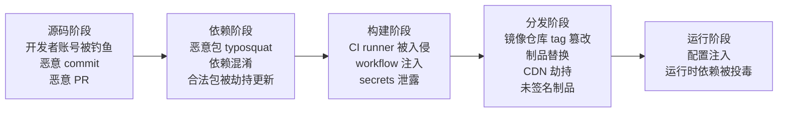

# 依赖与供应链安全

> 日期：2026-11-04
> 所属大纲阶段：6. 安全工程
> 参考资料：
> - OWASP Dependency-Check 文档（`https://owasp.org/www-project-dependency-check/`）
> - OWASP Software Component Verification Standard (SCVS)（`https://owasp.org/www-project-software-component-verification-standard/`）
> - CNCF Supply Chain Security White Paper / SLSA v1.0 框架（`https://slsa.dev/`）
> - OpenSSF OSV 与 OSV-Scanner 文档（`https://google.github.io/osv-scanner/`）
> - CycloneDX Specification（`https://cyclonedx.org/`）
> - NIST SP 800-161 Rev.1（供应链风险管理）
> - GitHub Security Lab：保持 GitHub Actions 与工作流安全（`https://docs.github.com/en/actions/security-for-github-actions/security-guides`）

---

## 1. 软件供应链定义与攻击面

**软件供应链（Software Supply Chain）**指一行代码从被写下到最终在生产环境运行所经过的全部环节：源码编写 → 依赖引入 → CI 构建 → 制品分发 → 运行时。现代应用 70%–90% 的代码来自第三方组件（开源库、基础镜像、Action、CLI 工具），你的安全边界早已超出自己的仓库。

### 1.1 攻击面全景图



防御思路：**锁定（pin）+ 验证（verify）+ 可观测（SBOM）**。锁定让每个环节输入可复现；验证保证制品没被调包；SBOM 让出事时能回答"我们哪里用到了"。

---

## 2. 重大事件案例库

每个案例一段，**教训**加粗标出。

### 2.1 XcodeGhost（2015）

非官方渠道下载的 Xcode（被注入恶意代码的"XcodeGhost"）编译出的 App 带后门，波及微信、网易云音乐等数千款 iOS 应用，影响上亿用户。开发者为了下载快走了非官方镜像。**教训：工具链本身就是供应链输入，开发工具必须校验官方哈希/签名后使用。**

### 2.2 event-stream（2018）

npm 上周下载千万次的 `event-stream` 作者维护倦怠，将维护权交给陌生人；新维护者植入针对性恶意子依赖 `flatmap-stream`，目标是 Copay 比特币钱包，窃取钱包凭据。**教训：维护权交接=供应链事件高危点；小众子依赖被注入最难发现，SBOM+SCA 要下沉到传递依赖。**

### 2.3 left-pad（2016）

开发者因商标争议删除了自己 11 行代码的 `left-pad` 包，导致 Babel、React 等主流工具链当日构建大面积崩溃。这不是攻击，但**教训：微依赖文化的脆弱性——我们的构建随时可能被一个陌生人的情绪击穿；引入依赖前评估"这 11 行代码值得吗"。**

### 2.4 Codecov Bash Uploader（2021）

Codecov 的 CI 上传脚本所在 Docker 镜像凭据泄露，攻击者篡改脚本，把 CI 环境中的环境变量（含各客户的密钥）偷偷外传，波及多家上市公司。**教训：CI 里跑的第三方脚本可以看到所有 secrets；secrets 最小化 + 第三方组件固定版本。**

### 2.5 SolarWinds SUNBURST（2020）

攻击者入侵 SolarWinds 构建系统，在 Orion 产品的构建流程中注入后门，签名分发给 1.8 万客户，多个美国联邦机构中招。恶意代码只在构建环节存在，源码仓库干净——**教训：只审计源码不够，必须保护构建系统本身并签名验证制品（这正是 SLSA 框架的出发点）。**

### 2.6 Log4Shell（CVE-2021-44228，2021）

Apache Log4j2 的 JNDI Lookup 功能允许 `${jndi:ldap://...}` 触发远程类加载（RCE）。Log4j 无处不在：Steam、iCloud、无数企业内网，全球瞬时暴露。**教训：①再"无害"的基础库也能致命；②漏洞响应速度=资产清单速度，没有 SBOM 的公司连"哪里用了 log4j"都答不出来；③可达性评估能力（配置、暴露面）决定修复优先级。**

### 2.7 PyPI/npm typosquatting 与抢注

PyPI 上 `request`（requests 的 typosquat，2025 年被证实在特定环境下可劫持导入）、`colour`、`python-dateutil` 变体；npm 上 `crossenv`（cross-env 的 typosquat）窃取 npm token 与环境变量。攻击者批量注册拼写相近、同名不同生态（如 npm 上注册 Python 库同名包）的包。**教训：依赖名抄写要粘贴不要手打；私服代理 + allowlist 是系统性解法。**

### 2.8 ua-parser-js / node-ipc / coa（2021–2022）

npm 包 `ua-parser-js`（周下载千万级）作者账号被钓鱼，发布了含挖矿/后门的"更新"；`node-ipc` 作者出于政治动机发布 `peacenotwar` 破坏性代码；`coa`/`rc` 同期被劫持。**教训：维护者账号=单点故障；2FA、发布审批、锁定版本都能压缩暴露面。**

### 2.9 国内 npm 投毒案例（2022 借 DBeaver 供应链攻击等）

2022 年攻击者通过钓鱼 GitHub issue 冒充 DBeaver 官方，诱导开发者安装恶意 npm 包窃取浏览器凭据与 npm token；此外多起国内 npm 包（如伪装成工具库的包）被植入窃取微信/浏览器数据的脚本。**教训：社交工程直接打到开发者；issue/邮件里的安装命令要核对官方文档；终端里的"下载量"可以刷。**

---

## 3. 攻击向量分类表

| 攻击向量 | 原理 | 典型案例 | 防范 |
|---------|------|---------|------|
| 源码投毒 | 恶意 commit/PR/维护者直接提交后门 | event-stream | 评审、维护者 2FA、签名 commit |
| 构建系统入侵 | 攻击 CI/构建机，产物带毒而源码干净 | SolarWinds、Codecov | 构建隔离、制品签名（SLSA） |
| 依赖混淆（Dependency Confusion） | 内部包名（如 `@corp/utils`）在公网注册同包，构建工具按序解析时优先拉了公网的恶意版本 | 2021 白帽 Alex Birsan 打穿 Microsoft/Apple 等 35 家 | 内部包名在公网**防御性注册**；私服配置"内部 scope 只走内部源"；registry 优先级正确 |
| Typosquatting | 注册拼写相近的包名 | `crossenv` | 粘贴安装、私服 allowlist |
| 账号劫持 | 钓鱼/撞库拿到维护者发布权 | ua-parser-js | npm/pypi 强制 2FA、发布通知监控 |
| 缓存/镜像投毒 | 篡改镜像源或内部缓存 | 公共镜像源投毒事件 | 私服走 HTTPS、镜像内容签名校验（in-toto/Sigstore） |

**依赖混淆原理展开**（最容易被忽视的一条）：npm 的 scope 机制（`@corp/utils`）和 pip/npm 的多源配置里，若公网源排在内部源之前（或某工具回退到公网），攻击者在公网发布同名更高版本包即可让"内部包"被拉成恶意包。防范三件套：①内部命名空间在公网预先占位（发布空的占位包）；②私服路由规则"内部 scope 永不回源公网"；③构建机只允许访问私服单一出口。

---

## 4. 依赖锁定的正确姿势

### 4.1 Lockfile 提交

| 生态 | lockfile | 是否提交到 git |
|-----|----------|--------------|
| npm/pnpm | package-lock.json / pnpm-lock.yaml | **是**（应用仓库） |
| Python (pip) | requirements.txt（含==）或 uv/poetry.lock | 是 |
| Go | go.sum | 是（必须） |
| Rust | Cargo.lock | 二进制项目是；库项目惯例不提交 |
| Java (Maven) | 无原生 lockfile | 用 `maven-enforcer-plugin` 或生成 flattened 锁定版本 |

注意区分两类仓库：**应用（部署制品）必须锁定**；**对外发布的库**一般声明范围（`^1.2.0`），把解析权留给应用方。团队内部库建议同时锁定传递依赖。

### 4.2 精确版本 vs 范围

- 生产应用：manifest 写范围可以，但 **lockfile 决定一切**，CI 用 `npm ci`（而不是 `npm install`）严格按 lockfile 安装；
- `npm install` 会重新解析并可能升级 lockfile 之外的传递依赖——CI 里出现说明 lockfile 与 manifest 不同步，应当失败。

### 4.3 自动升级：Dependabot 配置全文

```yaml
# .github/dependabot.yml —— 仓库根目录
version: 2
updates:
  # npm 依赖：每周检查，安全更新实时
  - package-ecosystem: "npm"
    directory: "/"
    schedule:
      interval: "weekly"
      day: "monday"
      time: "09:00"
      timezone: "Asia/Shanghai"
    open-pull-requests-limit: 10
    # 按组聚合 PR，减少噪音（把 dev 依赖合并成一个 PR）
    groups:
      dev-dependencies:
        dependency-type: "development"
    # 忽略大版本升级（人工评估），只接受补丁级
    ignore:
      - dependency-name: "express"
        update-types: ["version-update:semver-major"]
    reviewers:
      - "your-team/backend"
    labels:
      - "dependencies"

  # GitHub Actions 版本
  - package-ecosystem: "github-actions"
    directory: "/"
    schedule:
      interval: "weekly"

  # Docker 基础镜像
  - package-ecosystem: "docker"
    directory: "/"
    schedule:
      interval: "weekly"

  # pip (requirements.txt)
  - package-ecosystem: "pip"
    directory: "/backend"
    schedule:
      interval: "weekly"
```

**Renovate**（`renovatebot`）是更强大的替代品：支持 lockfile 维护、自动 merge 满足条件的 PR（`automerge` + 测试通过）、`preset:security` 只提安全更新。配置在 `renovate.json`。选型：小团队 Dependabot 零配置够用；多仓库需要策略集中管理选 Renovate。

---

## 5. SBOM 详解

**软件物料清单（Software Bill of Materials, SBOM）**：一份机器可读的"配料表"，列出制品包含的全部组件（直接+传递依赖）、版本与许可证。最小字段集（NTIA 定义）：组件名、版本、供应商、依赖关系、SBOM 作者、生成时间。

### 5.1 SPDX vs CycloneDX 对比

| 维度 | SPDX | CycloneDX |
|-----|------|-----------|
| 出身 | Linux 基金会，许可证合规起步 | OWASP，安全应用场景 |
| 格式 | tag-value / JSON / YAML / RDF（最全） | JSON / XML（简洁） |
| 侧重点 | 许可证与法律合规 | 漏洞关联、组件分析 |
| 文件大小 | 较大 | 紧凑 |
| 推荐场景 | 开源合规、法务 | 安全扫描、漏洞响应 |

实践建议：**内部漏洞响应用 CycloneDX（扫描器生态支持好），对外交付按客户要求**（美国行政令 EO 14028 语境下 SPDX/CycloneDX 均可）。

### 5.2 用 syft 生成 SBOM（实操）

```bash
# 环境：macOS（brew）/ Linux。安装：
brew install syft
# 或 curl -sSfL https://raw.githubusercontent.com/anchore/syft/main/install.sh | sh -s -- -b /usr/local/bin

# 扫描目录（源码 + lockfile）：
syft dir:/path/to/app -o cyclonedx-json > sbom.cdx.json
# 扫描容器镜像：
syft myapp:1.4.2 -o spdx-json > sbom.spdx.json

# 输出解读（cyclonedx-json 关键字段）：
# "components": 每个组件含 name / version / purl（package URL，全局唯一定位符，
#   如 pkg:npm/express@4.18.2）/ licenses / hashes
# "dependencies": 组件间依赖图（谁引入了谁），排查时用于回溯引入路径
```

### 5.3 SBOM 的核心用途：漏洞响应时快速定位受影响资产

Log4shell 场景：凌晨 CVE 发布 → 拿 `log4j-core` 的 purl 对全量 SBOM 做查询 → 10 分钟内得到"命中服务清单" → 按可达性与暴露面排序修复。没有 SBOM 的团队此刻还在翻 wiki 和问各团队。SBOM 应**随制品存档**（OCI 镜像 annotation 或制品库附加文件），并保证与部署环境（哪个集群跑的哪个版本）可关联。

---

## 6. SCA 工具

**软件成分分析（Software Composition Analysis, SCA）**：对照漏洞数据库（NVD/OSV/GHSA）检查依赖已知漏洞，并给出许可证风险。

### 6.1 OWASP Dependency-Check（安装运行）

```bash
# 环境：需要 Java 17+
brew install dependency-check
# Java 项目（Maven）：
dependency-check --project "myapp" --out ./reports --scan ./ --format HTML
# 首次运行会下载 NVD 数据库（慢，建议配置 NVD_API_KEY）
# 报告解读：
#   每个依赖关联的 CVE 列表，CVSS 分数、CWE、是否有官方修复版本
#   误报来源：依赖名匹配但 vendor/版本判定过宽 -> 用 suppression.xml 抑制并写明理由
```

### 6.2 Snyk（一段定位）

Snyk 是商业 SCA 的事实标准之一：IDE/CLI/CI 全覆盖，除已知漏洞外还提供**可达性分析（可达路径才告警，降噪明显）**、容器与 IaC 扫描、自动升级 PR。开源替代组合：OSV-Scanner（漏洞）+ syft（SBOM）+ trivy（镜像）。

### 6.3 OSV-Scanner 实操

```bash
# 安装：
brew install osv-scanner
# v1 语法（仅 v1 老版本适用）：
osv-scanner --lockfile=./package-lock.json    # 扫描 lockfile / manifest（自动识别多生态）
osv-scanner -r ./                             # 递归扫描目录下所有锁文件与 SBOM
osv-scanner --docker image_name:tag           # 扫描镜像
# v2（2024 起）改为子命令式，新装版本请用：
osv-scanner scan --lockfile=./package-lock.json
osv-scanner scan --recursive ./               # 等价于 v1 的 -r
osv-scanner scan image image_name:tag         # 扫描镜像

# 输出解读（节选样式）：
# Scanned /path/package-lock.json and found 3 packages
#  ✗ CVE-2023-XXXX  GHSA-xxxx  7.5 pkg:npm/semver@5.7.1
#    Fixed in: 5.7.2（有修复版本的直接升级；无 fixed 则看是否有 workaround）
# 退出码：发现漏洞返回 1，可直接作为 CI 门禁（--fail-on 后可按严重度分级）
```

**OSV 数据库 API 一句话**：`https://api.osv.dev/v1/query` POST 一个 `{"package":{"name":"...","ecosystem":"npm"},"version":"..."}` 即可查询该组件版本的全部已知漏洞，是自建告警机器人最简单的数据源。

---

## 7. 私服与代理

### 7.1 为什么需要私服

1. **防外泄**：内部包只存在于私服，不经过公网；私服审计所有下载；
2. **防投毒**：外部包必须经私服代理进入，私服上配置 allowlist/黑名单、漏洞拦截（Nexus/iqs、Artifactory + Xray、Verdaccio 插件）；
3. **可复现**：缓存所有历史版本，上游删除（left-pad 式）不影响构建；
4. **出口收敛**：构建机网络出口统一收口到私服，配合防火墙"构建网段禁止直连公网 registry"。

### 7.2 配置示例

```ini
# npm —— .npmrc（项目级）指向内部 Verdaccio/Nexus
registry=https://nexus.corp.local/repository/npm-proxy/
# 内部 scope 强制走内部 registry（防依赖混淆的关键行）：
@corp:registry=https://nexus.corp.local/repository/npm-internal/
always-auth=true
```

```ini
# pip —— pip.conf（Linux: ~/.pip/pip.conf；构建镜像内固化）
[global]
index-url = https://nexus.corp.local/repository/pypi-proxy/simple
extra-index-url = https://nexus.corp.local/repository/pypi-internal/simple
# 注意：pip 合并所有 index 的候选并统一选最高版本，无来源优先级——
# 正因如此公网同名更高版本的恶意包会胜出（依赖混淆根因）。
# 内部包名务必公网占位，或用 devpi（支持合并索引且可做主从优先级）规避依赖混淆
```

---

## 8. 构建与 CI/CD 安全

### 8.1 GitHub Actions 高危点

**`pull_request_target` 危险**：该事件以**基线分支的 workflow 定义 + 仓库 secrets**运行，而 checkout 的代码可以来自 fork PR。若 workflow 里先 `actions/checkout@vX`（ref 默认 PR head）再执行构建/测试脚本，攻击者的 PR 代码就能读到你的 secrets 并外传。规则：`pull_request_target` 内**绝不** checkout PR 代码后执行其构建脚本；确需处理 PR 时用 `pull_request`（无 secrets 访问权）。

```yaml
# 反面示例（真实事故模板）：
on: pull_request_target
jobs:
  build:
    runs-on: ubuntu-latest
    steps:
      - uses: actions/checkout@v4        # 默认 ref 是 PR head！
      - run: npm install && npm test     # 恶意包的 postinstall 已拿到 secrets 环境
        env:
          TOKEN: ${{ secrets.NPM_TOKEN }}
```

### 8.2 第三方 Action 固定 SHA

```yaml
# 危险：tag 可被作者移动（@v4 是可变引用）
- uses: actions/checkout@v4
# 正确：固定到 commit SHA，同时注释版本便于升级评审（升级时重新核对 SHA）
- uses: actions/checkout@8f4b7f84864484a7bf31766abe9204da3cbe65b3 # v4.1.1
```

### 8.3 Secrets 最小化与 OIDC

- 环境级 secrets（environment protection）优于仓库级；CI job 只注入所需变量；
- fork PR 永不接触 secrets；`pull_request` 事件天然隔离；
- **OIDC vs 长期密钥一句话**：向云上传凭据时用 OIDC 联邦身份按次换取临时凭据，取代写在 secrets 里的长期 AK/SK（泄露窗口从"永久"缩到"本次构建"）。

```yaml
permissions:
  id-token: write   # 允许请求 OIDC token
  contents: read
steps:
  - uses: aws-actions/configure-aws-credentials@v4
    with:
      role-to-assume: arn:aws:iam::123456789012:role/gha-deploy
      aws-region: ap-northeast-1
```

### 8.4 制品签名：Sigstore / cosign 演示

```bash
# 安装（macOS）：
brew install cosign
# 密钥对模式签名镜像（keyless 模式用 OIDC 身份签名，更适合公共项目）：
cosign generate-key-pair                 # 生成 cosign.key / cosign.pub，私钥进密钥管理系统
cosign sign --key cosign.key registry.corp.local/myapp:1.4.2
# 验证（部署准入时执行，验证失败拒绝上线）：
cosign verify --key cosign.pub registry.corp.local/myapp:1.4.2
# 输出：Verification for ... -- The digital signature is valid
# Kubernetes 准入：policy-controller / Kyverno 强制"无有效签名不拉取"
```

---

## 9. 容器供应链

### 9.1 最小基础镜像

| 基础镜像 | 大小 | 特点 |
|---------|------|------|
| `scratch` | 0 | 空镜像，仅静态二进制可用（Go 静态编译） |
| `gcr.io/distroless/static` | ~2MB | 无 shell、无包管理器，攻击者拿到 RCE 也无工具可用 |
| `alpine` | ~5MB | 有 shell/busybox，需注意 musl libc 兼容性 |
| `debian-slim` | ~70MB | 兼容性好，体积适中 |

### 9.2 多阶段构建示例

```dockerfile
# 环境：Go 1.22
FROM golang:1.22 AS build
WORKDIR /src
COPY go.mod go.sum ./
RUN go mod download                 # 依赖层缓存，lockfile 未变则跳过
COPY . .
RUN CGO_ENABLED=0 go build -trimpath -ldflags="-s -w" -o /out/app ./cmd/server

FROM gcr.io/distroless/static-debian12:nonroot
COPY --from=build /out/app /app
USER nonroot
ENTRYPOINT ["/app"]
# 好处：最终镜像不含编译器/源码/git 历史，攻击面最小化
```

### 9.3 trivy 镜像扫描实操

```bash
brew install trivy
trivy image myapp:1.4.2
# 输出解读：
# myapp:1.4.2 (debian 12.x)
# Total: 3 (HIGH: 2, CRITICAL: 1)
# ┌───────────────┬───────────────┬──────┬────────┬────────────────┐
# │   Library     │ Vulnerability │ Sev. │ Status │ Installed/Fixed│
# │ curl 7.88     │ CVE-2023-XXXX │ HIGH │ fixed  │ 7.88 / 7.88.1  │
# └───────────────┴───────────────┴──────┴────────┴────────────────┘
# "Installed/Fixed" 列给出修复版本；OS 包升级基础镜像即可；
# CI 门禁：trivy image --exit-code 1 --severity HIGH,CRITICAL myapp:1.4.2
```

---

## 10. 依赖引入流程规范：新增依赖评审清单（10 项）

| # | 评审项 |
|---|-------|
| 1 | 必要性：是否有标准库/已有依赖可实现？行数收益 vs 依赖成本（left-pad 教训） |
| 2 | 健康度：维护活跃（近 6 月 commit/release）、issue 响应、贡献者数量 |
| 3 | 流行度与下载量交叉验证（下载量可刷，看 GitHub star 增长与 dependents） |
| 4 | 已知漏洞：SCA 扫描当前版本无 HIGH/CRITICAL |
| 5 | 许可证：传染性许可证（GPL 系）需法务确认（SCVS 许可证策略） |
| 6 | 传递依赖规模：`npm ls` / `go mod graph` 检查是否拖进上百个包 |
| 7 | 发布者身份：官方 org、发布历史稳定、无近期维护权转移 |
| 8 | 是否维护 2FA（npm 维护者可查）、发布流程（CI 发布优于本地） |
| 9 | 锁定精确版本并进入 lockfile；安全补丁通道（Dependabot 已覆盖该生态） |
| 10 | 登记到内部组件台账：用途、负责人、升级策略（为 SBOM 治理打底） |

---

## 11. 应急：新 CVE 爆发时的响应流程

以"凌晨推送：某基础库 RCE，CVSS 10"为例：

```
1. 查 SBOM：syft/grype 或制品库查询 -> 命中组件的服务清单与环境（prod/staging）
2. 评估可达性：
   - 是否调用了漏洞代码路径？（Log4Shell 看 JNDI lookup 是否可触发：入口是否解析用户输入进日志）
   - 暴露面：公网可达？认证前置？配置缓解是否可用（如删除 JndiLookup class 的临时缓解）？
3. 升级/缓解：
   - 有修复版：Dependabot 或手动升级 -> CI 全量测试 -> 灰度发布
   - 无修复版：官方临时缓解（配置/移除类）+ WAF 规则 + 监控告警加密
4. 复盘：
   - 为什么组件台账/sbom 更新滞后？
   - 升级为什么慢？（测试覆盖不足/版本锁定过死）
   - 沉淀：把该组件列入"重点监控清单"，改进项进跟踪表（见 33-安全-SDLC.md 度量）
```

时间目标参考（成熟团队）：定位 < 30 分钟，缓解 < 4 小时，修复按 P1 事件 SLA。

---

## 12. 常见误区

1. **"lockfile 提交了就安全"**——锁定防漂移，不防已知漏洞，仍需自动升级流；
2. **"依赖混淆离我很远"**——只要你有一个 `@corp/` 前缀包且构建可能回退公网，就成立；
3. **"SCA 告警全修"**——不看可达性会被 500 条告警淹没，门禁形同虚设；分级处理；
4. **"用了 alpine 就够了"**——最小镜像减小攻击面，基础镜像自身的 CVE 仍需持续升级；
5. **"CI 是内网信任区"**——fork PR、第三方 Action、缓存投毒都能从外部进入 CI；
6. **"npm audit 有 vuln 但没 exploit，忽略"**——要记录"评估过 + 理由"，不要靠沉默。

---

## 13. 自测问题

1. 软件供应链五个环节各有哪些典型攻击向量？SolarWinds 打破了"审计源码就够"的哪个假设？
2. 依赖混淆的触发条件是什么？说出至少两种工程化防范手段。
3. 为什么 CI 要用 `npm ci` 而不是 `npm install`？两者的失败语义有何不同？
4. SBOM 的最小必要字段有哪些？purl 的作用是什么？漏洞响应时 SBOM 如何缩短"定位受影响资产"的时间？
5. SPDX 与 CycloneDX 各自适合什么场景？你会为本团队选哪个，为什么？
6. `pull_request_target` 的危险组合是什么？如何正确处理需要 secrets 又要构建 fork 代码的场景？
7. 第三方 Action 为什么固定 SHA 而不是 tag？OIDC 相比长期密钥的本质改善是什么？
8. 写出 trivy 在 CI 中"HIGH 及以上阻断发布"的命令。
9. 新增一个 npm 依赖前你会检查哪 10 项？哪两项最容易在真实世界踩坑？
10. 描述 CVE 爆发夜里你的前 30 分钟：用什么命令、看什么系统、产出什么结论？

---

（完 · 上一篇：`30-安全编码规范.md` ｜ 下一篇：`32-密钥管理.md`）


---

## 附：ASCII 图 → Mermaid 替换清单

| 原 ASCII 图（小节 · 内容） | 替换后类型 |
| --- | --- |
| 「1.1 攻击面全景图」节 · 供应链五环攻击面链图 | flowchart LR |
