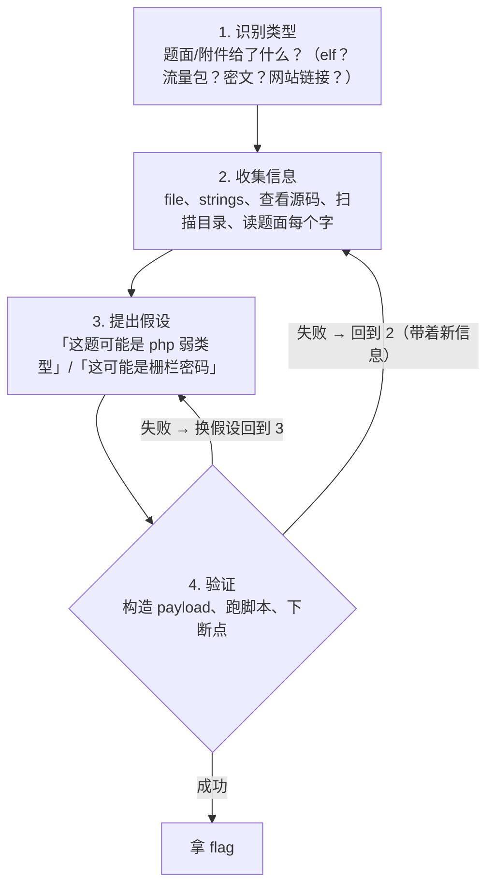

# 35 - CTF 入门指南：从零到第一场比赛

> 日期：2026-11-04
> 所属大纲阶段：7. CTF 实战
> 参考资料：
> - CTF Wiki（ctf-wiki.org）：中文 CTF 知识体系最全面的 wiki
> - picoCTF 官方文档（picoctf.org）与 Carnegie Mellon University 官方教程
> - CTFtime（ctftime.org）：全球 CTF 赛事日历与战队排名
> - OverTheWire（overthewire.org）：Bandit/Natas 命令行 wargames 官方说明
> - 《从0到1：CTFer成长之路》（Nu1L 战队）
> - HackTheBox 官方文档（hackthebox.com）、TryHackMe 学习路径文档（tryhackme.com）

---

## 目录

1. [CTF 是什么](#1-ctf-是什么)
2. [比赛形式：解题赛 / AWD / King of the Hill](#2-比赛形式解题赛--awd--king-of-the-hill)
3. [积分与 flag 形式](#3-积分与-flag-形式)
4. [五大方向总览](#4-五大方向总览)
5. [平台大全](#5-平台大全)
6. [参赛形式与组队分工](#6-参赛形式与组队分工)
7. [本地环境搭建](#7-本地环境搭建)
8. [Python 环境管理](#8-python-环境管理)
9. [拿到题的通用解题方法论](#9-拿到题的通用解题方法论)
10. [Writeup 文化与复盘](#10-writeup-文化与复盘)
11. [刷题路线规划](#11-刷题路线规划)
12. [心态与习惯](#12-心态与习惯)
13. [常见新手误区与比赛日清单](#13-常见新手误区与比赛日清单)
14. [自测问题](#14-自测问题)

---

## 1. CTF 是什么

**夺旗赛（Capture The Flag, CTF）** 是一种信息安全竞赛形式：主办方在题目环境中藏入一个特定格式的字符串——**flag（旗帜）**，选手通过逆向、漏洞利用、密码分析等手段拿到 flag 并提交得分。所有技术操作都发生在**专门搭建的靶场环境**中，是合法、安全的攻防演练。

对已修完前六个阶段的你来说，CTF 的意义是：

- **验证学习成果**：网络、操作系统、Web 漏洞、二进制、密码学、安全工程的知识点在题目里全部会用到；
- **倒逼补短板**：题目暴露的知识盲区比看书精准得多；
- **建立肌肉记忆**：工具链、调试流程、脚本编写在高压比赛中迅速熟练；
- **社区与求职**：CTF 战绩是安全岗位简历上有说服力的证明（国内大厂安全实验室普遍认可）。

### CTF 与渗透测试的区别

| 维度 | CTF | 渗透测试（Penetration Testing） |
| ---- | ---- | ---- |
| 目标 | 拿到指定 flag，题目边界清晰 | 模拟真实攻击者，评估整体风险 |
| 环境 | 靶场，允许打挂 | 客户生产环境，需授权与谨慎操作 |
| 时间 | 几小时到几天 | 数天到数周，含报告 |
| 产出 | flag 与 writeup | 漏洞报告与修复建议 |

方法论上二者相通（都是「信息收集→假设→验证」循环），见 [第 9 节](#9-拿到题的通用解题方法论)。

---

## 2. 比赛形式：解题赛 / AWD / King of the Hill

### 2.1 解题赛（Jeopardy）

最常见的形式。题目按方向（Web/Pwn/Crypto/Reverse/Misc）和难度分值排成题板，解题得分解锁更高分值题。特点：

- **无对抗**：各队独立解题，互不干扰；
- **节奏自由**：先易后难，自己分配时间；
- **入门首选**：picoCTF、国内绝大部分新生赛都是这个形式。

### 2.2 攻防赛（Attack with Defense, AWD）

每队拿到一套**完全相同的服务环境**（通常是 Web + Pwn 服务），既要攻击别队拿 flag，又要防守自己的服务不被打：

- **攻击分**：利用漏洞拿到别队私有 flag（每队 flag 定期轮换）；
- **防守分**：己方服务存活、不被植入后门；被 patch 掉的漏洞攻不进来；
- **核心矛盾**：修漏洞（patch）可能改坏服务被判宕机，不修就一直掉分；
- 详细攻防策略见 [36 篇 AWD 专题](36-CTF-Web-方向.md#11-awd-攻防专题)。

### 2.3 King of the Hill（抢占山头 / KOH）

所有队伍攻击**同一台（组）公开靶机**，拿到机器控制权后植入自己的队伍标识（如写 `team_xxx` 文件）持续占点计分，同时要清掉其他队伍的后门。兼具解题与对抗，国内称「抢占山头赛」。

> 提示：三种形式都以**靶场环境**为边界。任何时候都不要把比赛中练出的技术用于未授权系统——这是本工作区的红线。

---

## 3. 积分与 flag 形式

### 3.1 常见 flag 格式

| 格式 | 示例 | 常见来源 |
| ---- | ---- | ---- |
| `flag{...}` | `flag{w3lc0me_t0_ctf}` | 国内赛事通用 |
| `ctf{...}` / `CTF{...}` | `ctf{5bd8f}` | 一些国际赛 |
| 平台前缀 | `picoCTF{...}` | picoCTF |
| 赛事前缀 | `hgame{...}`、`SUSCTF{...}` | 各赛事自定义 |
| 特殊格式 | `FLAG-xxxx-xxxx` | 少数比赛 |

**动态 flag（dynamic flag）**：每队、每次重新部署题目环境生成的 flag 都不同（如 `flag{uuid4}`），防止队间分享 flag。提交前仔细看题目页的 flag 格式说明，避免拿到 flag 却填错格式。

### 3.2 积分机制

- **静态分值**：题目标定分数，先解出者同分；
- **动态计分（dynamic scoring）**：解出队伍越多分值越低（常见公式如 `100 + 500 / (1 + solves)^0.5` 一类的衰减），鼓励啃硬骨头；
- **一血/二血/三血（First/Second/Third Blood）**：前三个解出的队伍额外加分；
- **罚时**：部分比赛提交错误 flag 有惩罚或冷却时间。

---

## 4. 五大方向总览

| 方向 | 考什么 | 核心能力 | 对应前六章笔记 |
| ---- | ---- | ---- | ---- |
| **Web** | SQL 注入、XSS、文件包含、SSRF、反序列化、SSTI、PHP/Node/Python 语言特性漏洞 | HTTP 协议、代码审计、工具链 | 阶段 3（Web 安全）全部；阶段 1 网络基础 |
| **Pwn（二进制漏洞利用）** | 栈/堆溢出、ROP、格式化字符串、内核入门 | 汇编、调试、对内存布局的理解 | 阶段 4（系统与二进制安全）；阶段 2 操作系统 |
| **Crypto（密码学）** | 古典密码、RSA 各种攻击、对称密码实现缺陷、哈希攻击 | 数论、Python 计算能力 | 阶段 2 密码学基础 |
| **Reverse（逆向工程）** | 静态/动态分析、算法还原、反调试绕过、脱壳 | 读汇编/伪代码、耐心 | 阶段 4 工具部分（ghidra/objdump） |
| **Misc（杂项）** | 隐写、取证、流量分析、编码、编程题、新方向试验田 | 知识广度、脚本能力 | 阶段 5（网络与防御：Wireshark、日志）；阶段 1 Linux 命令行 |

每个方向的详细笔记：

- Web → [36-CTF-Web-方向.md](36-CTF-Web-方向.md)
- Pwn → [37-CTF-Pwn-方向.md](37-CTF-Pwn-方向.md)
- Crypto → [38-CTF-Crypto-方向.md](38-CTF-Crypto-方向.md)
- Reverse → [39-CTF-Reverse-方向.md](39-CTF-Reverse-方向.md)
- Misc → [40-CTF-Misc-方向.md](40-CTF-Misc-方向.md)

**如何选主方向**：有 Web 开发经验→Web；写过 C/C++、对内存好奇→Pwn/Reverse；数学好、Python 熟→Crypto；都喜欢、动手能力强→Misc。前期建议**广度优先**（各方向都做出简单题），中期再聚焦 1-2 个主方向。

---

## 5. 平台大全

### 5.1 picoCTF —— 入门首选

- 主办：卡内基梅隆大学（Carnegie Mellon University, CMU）旗下的 picoCTF 团队，常年开放练习模式；
- 特点：题目梯度极其友好（从「看网页源码」到基础 RSA），每题有提示（hint）系统，题目环境稳定；
- 建议：**第一站全刷**，尤其 Web/General/Crypto/Forensics 分类，建立正反馈。

### 5.2 CTFtime —— 赛事日历与排名

- 全球 CTF 赛事聚合站，功能：**日历**（按重量级 weight 排序的比赛时间表）、**战队排名**（按各赛事成绩加权积分）、**writeup 归档**（每场比赛后各队公开题解）；
- 找比赛：按「weight（权重，满分 100）」筛选，新手选 weight 30-70 的比赛；关注格式（Jeopardy 为主）与是否线上；
- 排名机制简述：每个赛事有官方权重，参赛成绩换算成积分累加到战队，年度排名是国际战队实力的事实标准；
- 赛后必做：去该赛事页面读高分队的 writeup。

### 5.3 BUUCTF —— 国内刷题库

- 收录大量历年国内赛事真题（含 BUUOJ 自办赛复现环境），按方向分类、难度友好标注；
- 特点：**题目环境长期在线**，适合按方向专项突破（如 BUUCTF Pwn 专区是公认的入门题库）；每题评论区有大量讨论；
- 注意：部分题目环境有排队/限流，热门题可能要重试。

### 5.4 攻防世界（XCTF 攻防世界，adworld.xctf.org.cn）

- XCTF 联赛官方练习平台，按「新手区→进阶区→高手区」组织，分类细（Web/Reverse/Pwn/Crypto/Misc/Mobile）；
- 特点：新手区引导性好，适合与 BUUCTF 互补刷。

### 5.5 HackTheBox（HTB）—— 机器制

- 形式：单台「机器（Machine）」（Linux/Windows）从信息收集打到 root，取 user/root 两个 flag；另有 Sherlocks（取证）、Challenges（传统 CTF 题）；
- **与 CTF 的差异**：更接近真实渗透测试场景（没有明确题面，需要自己找攻击面），单机耗时长（1-6 小时），知识点偏「红队」而非「竞赛技巧」；
- 建议：学完阶段 5 渗透方法论后再来，从 Starting Point 系列开始。

### 5.6 TryHackMe —— 学习路径制

- 形式：房间（Room）串成学习路径（Pre-Security → Cyber Security 101 → Junior Penetration Tester 等），交互式引导、即时反馈；
- 特点：**教学性最强**，几乎每步都有说明，适合补基础与英文安全术语；对抗性与竞赛性弱；
- 建议：作为「带教老师」用于补短板，而非刷题主力。

### 5.7 CTFHub —— 技能树

- 国内平台，按「技能树」组织（Web/Parse/Proto/Misc/Reverse/Pwn/Crypto），覆盖很多冷门考点（如 SWPU 出题风格、协议类），环境按需启动；
- 适合：学完基础后针对性补「技能点」。

### 5.8 OverTheWire —— 命令行 wargames

- 形式：SSH 登录关卡式 wargames，纯命令行，不涉及浏览器；
- **推荐路线**：
  1. **Bandit**（0→34 关）：Linux 命令行、文件查找、编码、网络工具，练完 Linux 基本功扎实；
  2. **Natas**（Web 关卡）：每关一个纯 Web 漏洞（源码泄露、SQL 注入、目录遍历……），是 Web 方向最好的热身；
  3. 之后可选 **Leviathan**（逻辑/提权）、**Narnia**（二进制入门）、**Krypton**（密码学）；
- 登录方式（仅靶场环境）：`ssh bandit0@bandit.labs.overthewire.org -p 2220`，密码在官网各关说明页。

---

## 6. 参赛形式与组队分工

### 6.1 组队

线上赛常见 1-6 人队。典型分工：

| 角色 | 职责 |
| ---- | ---- |
| 队长 | 盯全局：题板进度、时间分配、临场决策（放弃/死磕）、报名与平台事务 |
| Web 手 | Web 题主力 + AWD 模式的 patch 与防守 |
| Pwn 手 | 二进制题 + AWD 的服务端漏洞修复 |
| Crypto/Reverse 手 | 密码学与逆向题 |
| Misc 手 | 隐写/取证/编程题，兼「自由人」支援各方向 |

新手队常见问题：所有人都挤在最热门的题上。**开赛后 10 分钟内应把所有题浏览一遍并认领**，避免重复劳动。

### 6.2 比赛策略

- **先易后难**：按「预估解出人数」排序，先清低分题建立信心与动态分优势；
- **一血优先级**：中低难度题抢一血收益高，简单题速度是关键；
- **协作工具**：
  - 题目进度看板（共享文档/Notion 表格：题号、认领人、状态、思路草稿）；
  - 实时沟通（微信群/Discord/语音）；
  - **共享环境**：一个人搭好的 docker 靶场/下载的附件放共享网盘，避免重复下载；
- **卡壳交接**：一道题卡住 30 分钟以上，把已有进展写进看板换人接手（参考 [第 12 节 30 分钟原则](#12-心态与习惯)）；
- **比赛尾声**：留 30 分钟检查——有没有算出 flag 却没提交的、有没有别人提示的错误格式。

---

## 7. 本地环境搭建

### 7.1 虚拟机方案选型

| 宿主 | 推荐方案 | 说明 |
| ---- | ---- | ---- |
| Windows / Intel Mac | VMware Workstation（个人版免费）或 VirtualBox | x86_64 镜像随便用 |
| **Apple Silicon（M 系列芯片）** | **UTM**（基于 QEMU）或 VMware Fusion（免费） | 注意：**arm64 镜像**原生流畅；x86 镜像走 Rosetta/QEMU 模拟，慢但能用于跑 x86-only 工具（如部分 Pwn 调试场景、Windows x86 程序） |

> **Apple Silicon 要点**：优先装 **arm64 版 Ubuntu**（24.04+），日常工具链（pwntools、ghidra、Burp）全有 arm64 原生版；需要 x86 环境时再建一个 x86_64 模拟虚拟机专用于少数题目；Docker 在 Mac 上可用 `--platform linux/amd64` 跑 x86 容器（Rosetta 加速）。

### 7.2 Ubuntu 虚拟机基础清单

```bash
# 仅在你的 CTF 虚拟机内执行
sudo apt update && sudo apt upgrade -y
# 基础工具
sudo apt install -y git curl wget vim tmux unzip zip build-essential \
    python3 python3-pip python3-venv \
    net-tools nmap tcpdump
# 建议分配：4 核 / 8GB 内存 / 60GB 磁盘起步
```

### 7.3 必备工具总装清单

| 类别 | 工具 | 安装/说明 |
| ---- | ---- | ---- |
| Python | python3 + **pwntools** | `pip install pwntools`（Pwn 必备） |
| 容器 | **Docker** | 跑题目环境、隔离风险文件（`curl -fsSL https://get.docker.com \| sh`） |
| Web | **dirsearch** / ffuf | 目录扫描：`pip install dirsearch` |
| 编码 | **CyberChef** | 浏览器端「编码瑞士军刀」，本地 `git clone` 后开 `cyberchef.html` 即可离线用 |
| 流量 | **Wireshark** | `sudo apt install wireshark` |
| 代理 | **Burp Suite** | 官网社区版，Java 环境 |
| 逆向 | **Ghidra** | NSA 开源，解压即用（需 JDK 17+） |
| 编辑器 | **VS Code** | 远程开发（Remote-SSH 到虚拟机）体验极佳 |
| 调试 | gdb + pwndbg | 见 [37 篇环境搭建](37-CTF-Pwn-方向.md#2-环境搭建详解) |
| 隐写/取证 | binwalk、exiftool、stegsolve、volatility | 见 [40 篇工具大礼包](40-CTF-Misc-方向.md) |

### 7.4 快照习惯（重要）

- 虚拟机装好后**立刻打快照**，命名如 `clean-ubuntu-24.04-base`；
- 每次比赛前快照、装完新工具快照、做危险实验前快照；
- CTF 附件一律先在**隔离虚拟机**中打开（题目文件按「不可信数据」对待），有条件的用一次性 docker 容器分析。

---

## 8. Python 环境管理

不同题目常依赖互相冲突的 Python 库版本（老题目要老依赖、pwntools 升级破坏旧脚本等），**不要污染系统 Python**：

```bash
# venv 方案（轻量，够用）
python3 -m venv ~/.venvs/ctf
source ~/.venvs/ctf/bin/activate
pip install pwntools gmpy2 pycryptodome
deactivate  # 退出

# conda 方案（适合需要多 Python 版本，如反编译老 pyc 要 py2/py3.8）
# miniconda 安装后：
conda create -n ctf python=3.11 -y
conda activate ctf
```

实践建议：

- 建一个 `~/ctf-tools` 目录，每个工具（如 RsaCtfTool、hashpumpy）单独一个 venv；
- exp 脚本开头注明依赖：`# 依赖: pwntools>=4.9, gmpy2`。

---

## 9. 拿到题的通用解题方法论

无论哪个方向，CTF 解题都是同一个循环：**识别类型 → 收集信息 → 提出假设 → 验证 → 循环**。



关键意识：

- **题面每个字都是信息**：标题、描述、出题人 id、附件文件名，常藏提示（如题名 `easy_xor` 直接剧透解法）；
- **信息不足时先扩大收集**而不是空想：Web 没思路先扫目录、看响应头；二进制没思路先 `strings`、跑一遍看输入输出；
- **假设要可证伪**：构造一个「如果假设成立就必然出现某结果」的实验；
- **记录中间产物**：每次实验的命令与输出贴进笔记，复盘与交接都靠它。

---

## 10. Writeup 文化与复盘

### 10.1 什么是 Writeup（WP）

**题解（Writeup, WP）** 是解题全过程的记录。CTF 社区的独特文化：**比赛结束后各队主动公开 WP**，ctftime 每场比赛页都有 writeups 入口，国内有先知社区、XCTF 命题营、各队博客/仓库。

### 10.2 为什么必读、必写

- **赛后必读**：没解出的题看 WP 是最高效的学习（比自己再死磕三天值）；解出的题看别人的更优雅解法，补齐思维差异；
- **写自己的 WP**：写的过程会暴露「其实没完全懂」的环节；积累成个人题解库（本工作区 `notes/` 的复盘部分），求职与复习时是硬资产；
- **不复制粘贴**：照抄别人 WP 的 payload 而不理解，下次换壳必挂。WP 用来学**思路**，工具与命令要自己敲一遍。

### 10.3 复盘模板（五要素）

每道题（尤其没做出来的）赛后按此格式记录进各方向笔记：

```markdown
### [平台-题号] 题目名
- **题目信息**：方向/分值/题面/附件（一句话概括题型）
- **考点**：核心知识点 + 涉及的前置笔记编号（如 → 23-格式化字符串）
- **卡点**：我在哪一步卡住、卡了多久、为什么卡（知识缺失/工具不熟/思路窄）
- **新学知识**：本次学到的新攻击面/新工具/新命令，含关键代码
- **同类题迁移**：这类题的通用识别特征（看到 X 就想到 Y）、下次的标准动作清单
```

---

## 11. 刷题路线规划

| 阶段 | 目标 | 量 | 平台/内容 |
| ---- | ---- | ---- | ---- |
| 第 1 步 | 熟悉平台与基本操作 | picoCTF 全部练习题（按年度刷最近一届即可，约 60-80 题） | picoCTF |
| 第 2 步 | Linux/Web 基本功 | Bandit 0→34；Natas 0→15 | OverTheWire |
| 第 3 步 | 分方向突破（按方向笔记的题单） | BUUCTF 各方向 50 题（Web/Pwn/Crypto/Reverse/Misc 至少两个方向 50+） | BUUCTF、攻防世界新手区 |
| 第 4 步 | 补技能点/进阶题库 | 攻防世界进阶区、CTFHub 技能树 | 按薄弱点选 |
| 第 5 步 | 实战参赛 | 国内**新生赛**（每年 3-6 月、9-12 月密集）打满 3-5 场 | CTFtime 日历找 |
| 第 6 步 | 专项深化 | HTB 机器（学渗透方法论）、CryptoHack（密码学专项）、pwnable.kr/tw | 见各方向笔记 |

时间投入参考（业余学习）：第 1-2 步约 2-4 周；第 3 步 2-3 个月；之后边比赛边补。**宁可少而透，不要多而快**——每题按五要素复盘比多刷 10 题有用。

---

## 12. 心态与习惯

- **30 分钟原则**：一道题卡住 30 分钟无任何进展（连新信息都没有），就换题或看 hint；第二天再看常会「秒了」——这是真实的记忆巩固现象；
- **善用官方提示**：正规比赛的 hint 花一点分数换方向提示，性价比通常很高；队内没人有思路时果断开 hint；
- **题解不复制粘贴**：看完 WP 关掉，凭理解重做一遍；两天后能独立复现才算学会；
- **附件是敌不是友**：永远在隔离环境打开题目附件；
- **记录一切**：比赛时的思路碎片、报错信息随手贴进临时笔记，赛时省时间、赛后是复盘素材；
- **接受零解**：国际强赛一题不解很正常，比赛的目标是**暴露差距**而不是场场拿奖；
- **健康**：48 小时比赛注意睡觉排班，疲劳作战错误率飙升（本地环境配错、payload 打错端口这类低级失误多是疲劳导致）。

---

## 13. 常见新手误区与比赛日清单

### 13.1 新手误区清单

| 误区 | 纠正 |
| ---- | ---- |
| 只看视频/wp 不动手 | 工具必须自己敲一遍；wp 关掉后独立复现才算学会 |
| 盲目追新题不复盘 | 一道题吃透（五要素复盘）> 十道题浅尝辄止 |
| 环境临时现搭 | 比赛开始才装工具/配代理是最大的时间黑洞；赛前按清单演练一遍 |
| 直接在宿主机分析附件 | 附件是敌：一律隔离虚拟机 + 快照回滚 |
| 死磕一道高难题一整天 | 30 分钟原则；比赛按「分值/预计耗时」性价比排序 |
| 只刷单一方向 | 前期广度优先：Misc/Web 的签到题人人能拿，放弃等于白送分 |
| 忽视题面细节 | 标题、描述、附件名、出题人 hint 常直接剧透考点 |
| 报复性熬夜比赛 | 48h 赛排班睡觉；疲劳期的低级失误（打错端口、忘开监听）最亏 |

### 13.2 比赛日 Checklist（赛前 24 小时）

```markdown
- [ ] 报名信息：队伍注册、平台账号、VPN/连接方式测试
- [ ] 环境就绪：CTF 虚拟机快照回滚到干净状态；工具总装清单逐项可用
- [ ] 网络与代理：Burp 证书、代理链（部分赛需走赛事 VPN/代理）
- [ ] 协作就绪：共享文档（题板）建好模板；语音频道测试
- [ ] 字典与工具：SecLists/rockyou 就位；常用脚本库（解码、批量请求）路径确认
- [ ] 身体：睡觉、饮食、水
```

赛中习惯：开赛先全员过一遍题板认领；每拿下一个 payload/中间结论立刻同步共享文档；每 2 小时队长盘点一次全局进度。

---

## 14. 自测问题

回答不出来就回到对应小节复习：

1. 解题赛、AWD、KOH 三种赛制的核心区别是什么？AWD 的得分由哪几部分构成？
2. flag 常见格式有哪些？什么是动态 flag，它防什么？
3. 五大方向各自的核心考点是什么？分别对应本工作区前六章的哪些笔记？
4. picoCTF、CTFtime、BUUCTF、HackTheBox、TryHackMe、OverTheWire 各自的形式与定位差异？
5. CTFtime 的战队排名机制大致如何计算？如何用它找适合新手的比赛？
6. Apple Silicon 上选虚拟机镜像要注意什么？为什么还需要 x86 环境？
7. 为什么 CTF 附件要在隔离虚拟机打开？你的快照策略是什么？
8. 用你自己的话描述「识别类型→收集信息→假设→验证」循环，并举一道做过的题套入。
9. 复盘模板的五要素是什么？「卡点」要素为什么比「考点」更有复习价值？
10. 30 分钟原则的具体含义与例外情况是什么？
11. 写自己的 writeup 有什么价值？「题解不复制粘贴」的实操标准是什么？
12. 你的个人刷题路线是什么？当前处于第几步、下一步的目标题量是多少？

---

> 下一篇：[36-CTF-Web-方向.md](36-CTF-Web-方向.md) —— Web 方向题型体系、PHP 特性专题、SSTI、完整例题与 AWD 攻防。

---

## 附：ASCII 图 → Mermaid 替换清单

| 原 ASCII 图（小节 · 内容） | 替换后类型 |
| --- | --- |
| 「拿到题的通用解题方法论」节 · CTF 通用解题流程图（识别类型 → 收集信息 → 提出假设 → 验证 → 拿 flag） | flowchart TD |
