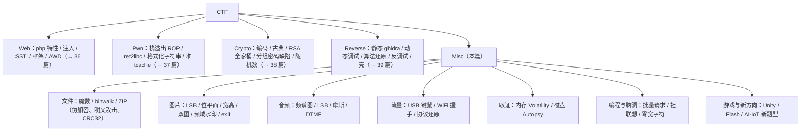

# 40 - CTF Misc 方向：隐写、取证、流量与杂项大全

> 日期：2026-11-04
> 所属大纲阶段：7. CTF 实战（Misc 方向）
> 参考资料：
> - CTF Wiki Misc 章节（ctf-wiki.org）
> - Volatility 官方文档（volatilityfoundation.org / volatility3）
> - binwalk / foremost / exiftool 各自官方 README
> - Autopsy 官方文档（autopsy.com）
> - 《从0到1：CTFer成长之路》取证与隐写章节
> - Wireshark 官方文档（wireshark.org）与本工作区阶段 5 流量分析笔记

> **合规声明**：本文全部技术仅限 **CTF 靶场环境**，分析对象均为比赛附件。

---

## 目录

1. [Misc 的定位](#1-misc-的定位)
2. [文件类型识别与分离](#2-文件类型识别与分离)
3. [ZIP 压缩包专题](#3-zip-压缩包专题)
4. [图片隐写大全](#4-图片隐写大全)
5. [音频隐写](#5-音频隐写)
6. [流量分析专题](#6-流量分析专题)
7. [内存取证](#7-内存取证)
8. [磁盘取证](#8-磁盘取证)
9. [编码脑洞与编程题](#9-编码脑洞与编程题)
10. [游戏题](#10-游戏题)
11. [六方向总结与思维导图](#11-六方向总结与思维导图文字版)
12. [完整例题 Walkthrough](#12-完整例题-walkthrough)
13. [工具大礼包安装清单](#13-工具大礼包安装清单)
14. [复盘模板](#14-复盘模板)
15. [自测问题](#15-自测问题)

---

## 1. Misc 的定位

**Misc（杂项）** 是 CTF 的「试验田」：凡不好归入 Web/Pwn/Crypto/Reverse 的题都在这里——隐写术（Steganography）、数字取证（Digital Forensics）、流量分析、编码脑洞、编程题、游戏题，也是**新技术最先出现的地方**：近年安全新趋势（IoT 固件、AI 提示注入、大模型越狱、区块链合约）往往先做成 Misc 题。

Misc 对知识广度要求最高、对工具链依赖最重，是「动手能力」方向；新手得分主力（大量签到题在 Misc），高手对决也常在这里（冷门取证/脑洞）。

---

## 2. 文件类型识别与分离

### 2.1 file 命令与魔数

`file xxx` 按**魔数（Magic Number，文件头特征字节）**判断真实类型（不看扩展名——Misc 题最爱改扩展名）。

常见魔数表（十六进制文件头）：

| 类型 | 魔数（hex） | ASCII 特征 |
| ---- | ---- | ---- |
| PNG | `89 50 4E 47 0D 0A 1A 0A` | `‰PNG` |
| JPG | `FF D8 FF` | — |
| GIF | `47 49 46 38 39 61` | `GIF89a` |
| ZIP | `50 4B 03 04`（空包 `50 4B 05 06`） | `PK` |
| RAR | `52 61 72 21 1A 07` | `Rar!` |
| 7z | `37 7A BC AF 27 1C` | `7z¼¯'` |
| ELF | `7F 45 4C 46` | `.ELF` |
| PDF | `25 50 44 46` | `%PDF` |
| BMP | `42 4D` | `BM` |

十六进制查看：`xxd file | head`。

### 2.2 binwalk 详解

**binwalk**：按签名库扫描文件内嵌的其他文件（固件分析出身，Misc 神器）。

```bash
binwalk photo.png                # 只扫描，列出偏移与签名
binwalk -e photo.png             # 自动提取（extract）：按签名切出所有内嵌文件到 _photo.png.extracted/
binwalk -e --run-as=root firmware.bin   # 固件整包
# 手动分离（binwalk 识别但提取失败/损坏时）：
binwalk photo.png                # 假设输出 "12345  Zip archive"
dd if=photo.png of=hidden.zip bs=1 skip=12345    # 从偏移 12345 切到文件尾
foremost photo.png -o out_dir/   # foremost：另一个按头部恢复的工具（备选）
```

注意：自动分离出的文件同样按不可信数据处理（隔离目录中打开）。

---

## 3. ZIP 压缩包专题

### 3.1 伪加密

**原理**：ZIP 结构里每个文件有「本地文件头（Local File Header）」与「中央目录（Central Directory）」两处**通用标志位（General Purpose Bit Flag）**。加密位是其中第 0 位：标志字节为 `09 00`（bit0=1 且有数据描述符）表示加密，`00 00` 表示未加密。**伪加密 = 只把标志位改成加密、数据实际没加密**，解压软件却弹密码框。

判断与修复：

1. unzip 报 `need PK compat` / 提示密码，但 010 Editor/xxd 里看**数据区（Local Header）与目录区标志不一致**，或两处都 `09 00` 但流内容明显无加密痕迹；
2. 修复：把两处标志改回 `00 00`（010 Editor 的 ZIP 模板直接改 `flag` 字段；或脚本替换）；工具：ZipCenOp.jar（`java -jar ZipCenOp.jar r xx.zip`）；
3. **真加密判断**：数据区确有加密流（Content 变化）、Hex 里 Header 与 Directory 一致且 CRC 正常——那就走爆破/明文攻击路线。

### 3.2 已知明文攻击

条件：拥有压缩包内**任一已知文件的原版**（如题目附带的 README.txt，且压缩软件/算法一致 deflate）。原理：由明文文件与密文 deflate 流推出密钥流，解出其余文件。

工具与流程：**pkcrack**（或 ARCHPR 的「已知明文攻击」功能）：

```bash
# 仅限 CTF 靶场环境
# 1) 用相同算法（zip 默认 deflate）把已知文件压成 plain.zip
zip -0 plain.zip readme.txt        # -0 仅存储（store），zip 默认 deflate；明文须以 store 方式打包
# 2) pkcrack 明文攻击
pkcrack -C hidden.zip -c readme.txt -P plain.zip -p readme.txt -d out.zip -a
#    -C 目标密文zip  -c 其中的已知文件名
#    -P 明文zip      -p 明文文件名
#    -d 解出结果      -a 尝试所有偏移
```

### 3.3 爆破工具表

| 工具 | 用法 | 场景 |
| ---- | ---- | ---- |
| **fcrackzip** | `fcrackzip -u -D -p rockwordlist.txt x.zip`（字典）/ `-b -c aA1 -l 4-6`（纯暴力） | Linux 命令行快用 |
| **john zip2john** | `zip2john x.zip > hash` → `john hash --wordlist=rockyou.txt` | 接入 john 生态/规则变形 |
| **hashcat** | 模式 17200（zip2）/13600（WinZip）｜`hashcat -m 17200 hash rockyou.txt` | 显卡快 |
| ARCHPR（Windows） | 图形界面：掩码/字典/明文攻击一体 | 新手友好 |

### 3.4 CRC32 爆破（小文件）

**原理**：CRC32 是校验和非加密——**内容变 CRC 必变**；文件很小时（≤4 字节）可暴力枚举所有内容撞 CRC（zip 头里就写着每个文件的 CRC32）。

```python
# 仅限 CTF 靶场环境：撞 4 字节内文件的 CRC
import itertools, zlib, struct
target = 0x1A2B3C4D                      # unzip -v 可看 CRC32
for n in range(1, 5):
    for tup in itertools.product(range(256), repeat=n):
        data = bytes(tup)
        if zlib.crc32(data) == target:
            print(data)                   # 得到隐藏的 4 字节内容（常是 flag 片段）
```

### 3.5 其他套路

- **嵌套压缩**：zip 套 zip 几十层——写循环脚本解；**增量压缩**：每层只比上层多一字符，比对各层文件差异即逐字还原 flag；
- **压缩包注释**：`unzip -z x.zip` 或 010 看注释字段（藏密码/flag 片段）；
- rar 伪加密（头 flags 0x74 处位）与 7z 类似，思路一致。

---

## 4. 图片隐写大全

### 4.1 LSB 原理详解（最低有效位）

**LSB（Least Significant Bit，最低有效位）隐写**：图像每个像素每通道 8 bit，改最后 1 bit 对视觉几乎无影响（256 级亮度动 1 级）。把秘密信息的比特流逐位写进各像素的 LSB，肉眼不可见，统计/工具可提取。

- 检测：stegsolve 里看各通道位平面（bit plane）——LSB 有数据时**位平面图呈噪点或异常纹理**（正常照片 LSB 平滑）；
- 提取（自动）：`zsteg`（PNG/BMP）；`stegsolve → Analyse → Data Extract`（选通道/位序）；
- 提取（手写）：Python PIL（只对未压缩格式 BMP/PNG 有效；JPG 有损压缩不适用 LSB）：

```python
# 仅限 CTF 靶场环境：提取 PNG 各通道 LSB 拼比特
from PIL import Image
img = Image.open('steg.png').convert('RGB')
w, h = img.size
bits = ''
for y in range(h):
    for x in range(w):
        r, g, b = img.getpixel((x, y))
        bits += str(r & 1) + str(g & 1) + str(b & 1)     # RGB 三通道 LSB
        if len(bits) > 4096: break                        # 取前几 KB 即可
    else: continue
    break
# 每 8 bit 拼 ASCII
chars = [chr(int(bits[i:i+8], 2)) for i in range(0, len(bits), 8)]
print(''.join(chars)[:300])       # 常见输出形如 "flag{...}" 或文件头 PK..
```

### 4.2 zsteg（PNG/BMP）

```bash
gem install zsteg          # ruby 工具
zsteg steg.png             # 自动尝试各种通道/位序组合并报告可疑输出
zsteg steg.png -b 1 -o rgb # 指定 1 bit、rgb 顺序
# 输出形如：b1,rgb,lsb,xy .. text: "flag{...}"  ← 直接给答案
```

### 4.3 stegsolve 逐菜单说明

Java 工具（jar 直接跑），CTF 图片题第一打开的东西：

| 菜单 | 功能 |
| ---- | ---- |
| Analyse → **Data Extract** | LSB/位平面提取（选通道 R/G/B/Alpha、位序 MSB/LSB、按行/列扫描） |
| Analyse → **Frame Browser** | GIF 逐帧看 |
| Analyse → **Image Combiner** | **双图合成**（两张同尺寸图 XOR/ADD/SUB，盲水印类题） |
| Analyse → **Stereogram Solver** | 立体视觉偏移图 |
| Analyse → File Format | 查看图片实际格式信息 |
| 底部按钮 `< >` | 快速切换 R/G/B/Alpha 通道与各 bit 平面（肉眼找「藏在位平面里的图」） |

### 4.4 文件尾追加与 exif

- **文件尾追加数据**：PNG 结束块 `IEND` 之后、JPG `FF D9` 之后可挂任意数据不被渲染：`binwalk`、`strings`、`xxd` 看尾部（常直接是 zip：切出来按压缩包流程走）；
- **exif 信息**：`exiftool photo.jpg` 详解——**地理位置（GPS）**、Artist、注释（Comment）字段藏 flag/密码；`Image Maker/Software` 字段提示工具；图片马：exif 的 Comment 藏 php 一句话（配合文件上传包含）。

### 4.5 高度修改（PNG IHDR 宽高篡改）

PNG 的 IHDR 块存宽高，故意改小高度把 flag 藏在图片下半部分（打开只见上半截）。**CRC 校验会坏**——修复思路反过来用：**校验失败的 IHDR = 高度被改**。

```python
# 仅限 CTF 靶场环境：爆破 PNG 高度使 CRC 匹配
import zlib, struct
data = open('cut.png', 'rb').read()
w = struct.unpack('>I', data[16:20])[0]
for hh in range(w * 2):                        # 枚举高度
    # CRC 覆盖「块类型 IHDR + 宽 4 + 高 4 + 位深/颜色/压缩/滤波/隔行 5 字节」，
    # 即 data[12:16] + data[16:20] + 新高度 + data[24:29]，漏掉后 5 字节则永不匹配
    chunk = data[12:16] + data[16:20] + struct.pack('>I', hh) + data[24:29]
    crc = zlib.crc32(chunk)
    if crc == struct.unpack('>I', data[29:33])[0]:
        print('real height =', hh)
        open('fixed.png', 'wb').write(data[:20] + struct.pack('>I', hh) + data[24:])
        break
```

宽高藏内容套路同理（宽度改小把 flag 藏右侧）。

### 4.6 GIF 与双图

- **GIF 帧分离**：`identify frame.gif`（看帧列表）、`convert frame.gif frame_%d.png`（或 `ffmpeg -i in.gif out_%d.png`）逐帧肉眼翻（某几帧里藏字符）；
- **双图合成/盲水印**：两张同尺寸图 Image Combiner 各种运算（XOR 最常见）；频域盲水印用 **BlindWatermark**：

```bash
# 仅限 CTF 靶场环境
pip install blind-watermark
bwm decode original.png watermarked.png output.png   # 原图+带水印图 → 还原水印图
```

### 4.7 图片内容本身

- 打码还原：**马赛克不可逆**（信息已损失）是常态；「可行场景」= 低强度像素化（有损但可暴力枚举原块，配合字典/约束，如 depix 类工具对等宽字体文字打码）；
- 分享一张「看图说话」：图片里拍的二维码残片/纸上线索，用 GIMP 拼合再扫码。

### 4.8 隐写工具箱汇总表

| 工具 | 适用格式 | 典型场景 |
| ---- | ---- | ---- |
| stegsolve | PNG/JPG/GIF 通用查看分析 | 位平面/合成/逐帧 |
| zsteg | PNG/BMP | 自动 LSB 扫描 |
| **steghide** | JPG/BMP/WAV（**需要密码**） | `steghide extract -sf x.jpg`；密码常来自题目其他线索 |
| outguess | JPG | `outguess -r x.jpg out.txt`（老题） |
| wbStego | BMP/PDF/HTML | 图形界面老工具 |
| F5-steganography | JPG | `java Extract x.jpg`（F5 算法专用，pw 从题目找） |
| BlindWatermark | PNG | 频域盲水印还原 |
| exiftool | 所有 | 元信息 |

---

## 5. 音频隐写

- **频谱图（Spectrogram）**：把音频的时频图当画布藏字。工具：**Audacity**（导入 → 左侧下拉菜单「频谱图 Spectrogram」）或 **Sonic Visualiser**（Pane → Add Spectrogram）。频谱图里直接「画出」flag 字样是最常见套路；
- **摩斯电码音频**：听是长短音 → Audacity 看波形长度转 `.-` 手翻（或听写后在线解码）；
- **WAV LSB**：PCM 数据最低位藏信息（**SilentWave** 等工具，或自写 Python：`wave` 模块读采样、取 `&1` 拼比特——思路同图片 LSB）；
- **MP3 steghide 类**：MP3Stego（`encode -E hidden.txt -P pass in.wav out.mp3`，输入载体是 WAV 波形文件，输出才是 MP3）；解码用同包的 `decode -X -P pass out.mp3`；
- **dtmf 音频**：电话拨号音，识别双音频 → 数字串（在线 DTMF 解码器或 Python `dtmf` 库/Goertzel 算法）；
- **DeepSound**：wav/FLAC 载体带密码的文件隐写（工具直接打开输密码）；
- **逆序播放/变速**：Audacity `Effect → Reverse`；慢放 0.5x 听语音；`file xxx.wav` 报 "ISO Media" 说明扩展名伪装。

---

## 6. 流量分析专题

Wireshark 基础（过滤器、追踪流、协议解析）见**阶段 5 流量分析笔记**。此处讲 CTF 特有套路。

### 6.1 USB 流量（键盘流量还原）

USB HID 键盘每个按键是 8 字节中断传输（第 1 字节修饰键、第 3 字节键码）。流程：

```bash
# 1) 过滤 USB 中断数据：usb.capdata 或 usbhid.data（新版 wireshark）
#    tshark 导出：
tshark -r usb.pcap -T fields -e usb.capdata > data.txt
# 2) 每行形如 00:00:04:00:00:00:00:00 → 第 3 字节 04 = 'a'
```

键位映射表（HID Usage ID，第三字节）节选：`04-1d` → a-z（04=a，05=b，…），`1e-27` → 1-9,0，`28` Enter，`2a` Backspace，`2c` 空格，`e0` 前缀是（左 Ctrl 等修饰不计）——按 `chr(i - 0x04 + ord('a'))` 转字母（i=0x04 → 'a'），数字按 `str((i - 0x1e + 1) % 10)`（0x1e → '1'、0x27 → '0'）。完整表查 HID Usage Tables。

```python
# 仅限 CTF 靶场环境：还原按键序列
lines = open('data.txt').read().splitlines()
table = {i + 0x04: chr(ord('a') + i) for i in range(26)}
table.update({i + 0x1e: str((i + 1) % 10) for i in range(10)})
table[0x28] = '\n'; table[0x2c] = ' '
out = ''
for l in lines:
    b = [int(x, 16) for x in l.split(':')]
    key = b[2]
    if key in table:
        c = table[key]
        out += c.upper() if b[0] & 0x22 else c    # 粗略 shift 处理
print(out)     # → 形如 "flag{usb_keyboard_stream}"
```

（精确还原需处理 shift 完整映射与断码，思路一致。）

### 6.2 鼠标流量轨迹还原

USB 鼠标数据第 1 字节是按键、第 2/3 字节是 x/y **相对位移**（有符号）。脚本累加位移为坐标点，用 matplotlib 画散点图，图上即是「手写的」flag：

```python
# 思路：解析每包 dx, dy = int8(b[1]), int8(b[2])；x+=dx; y-=dy; points.append((x,y))
# plt.scatter([p[0] for p in points], [p[1] for p in points]); plt.show()
```

### 6.3 其他流量套路

- **TLS 加密但有 http2/http 明文**：先别慌，`http2` 过滤器看明文头/数据帧；或流量里藏着**未加密的其他协议**（ftp、smtp、dns 隧道）；
- **WiFi 握手包破解**（aircrack-ng + 字典，一句话流程）：`aircrack-ng -w rockyou.txt capture.cap`（抓包里含 EAPOL 四次握手即可离线撞字典得 WiFi 密码，密码常即 flag）；
- **蓝牙/定位题**：蓝牙 BLE 流量（nRF 连接事件）；WiFi 定位（根据 SSID/信号）；
- 常规：http 导出对象（File → Export Objects）、`ftp-data` 传文件还原、icmp 长包 data 藏信息、MQTT/IoT 协议（新趋势）。

---

## 7. 内存取证

**内存取证（Memory Forensics）**：分析内存镜像（raw/dump/lime 格式）还原进程、命令行历史、未落盘文件、密码。工具 **Volatility**（v2 经典；v3 更快，插件名微调）。

```bash
# 安装（v3）
pip install volatility3
# 版本识别（v2 用 imageinfo，v3 用 info / banners；v2 流程如下）
vol.py -f mem.raw imageinfo     # 建议 Profile：Win7SP1x64  ← 系统版本识别
vol.py -f mem.raw --profile=Win7SP1x64 pslist
```

常用插件表：

| 插件 | 用途 |
| ---- | ---- |
| `pslist` / `pstree` | 进程列表/树（找 notepad、cmd、可疑进程） |
| `cmdline` | 每进程完整命令行（常见直接看到密码参数） |
| `filescan` | 扫描内存中的文件对象（找 flag.txt、zip、png） |
| `dumpfiles -Q <偏移>` / `--dumpdir out` | 把文件对象 dump 出来再 strings/文件识别 |
| `hashdump` | 导出系统用户哈希（配合 john 爆破） |
| `consoles` / `cmdscan` / `console` | 控制台输入历史（敲过的命令） |
| `screenshot` | 重建桌面截图（GDI 窗口） |
| `procdump -p <pid>` | dump 指定进程可执行体 |
| `memmap -p <pid>` / `dump` | 进程内存布局/转储 |

**典型题完整流程**：`imageinfo`（定版本）→ `pslist`（看到 notepad.exe）→ `filescan | grep -i flag`（发现 `flag.txt` 或 `Flag.docx`）→ `dumpfiles` 导出 → `file`/`strings`/foremost 继续分析（文件可能是图片/压缩包，回到第 2-4 节套路）→ 拿 flag。变体：`cmdscan` 直接看到 `type flag.txt` 的下一行就是 flag。

---

## 8. 磁盘取证

- **Autopsy**（图形化，基于 The Sleuth Kit）：打开磁盘镜像（E01/raw）→ 看文件树、**已删除文件（红色标记）**、关键词搜索（直接搜 `flag{`）、最近访问时间线；
- **FAT/NTFS 删除文件恢复原理一句话**：删除只把目录项/位图标记为可用，数据簇仍在盘上——恢复 = 扫描未分配簇里的残留（Autopsy/PhotoRec 自动做）；
- **Ext4 一句话**：extents 与 inode 日志让恢复更难，取证侧重 journal 与 carved 文件（tsk/recoverjpeg）；
- 题目变体：VMDK/VHD 虚拟磁盘挂载、磁盘里藏的分区（`fdisk -l image` 看多分区）。

---

## 9. 编码脑洞与编程题

### 9.1 脑洞清单（见到即联想）

- **与社会工程结合**：题目给 QQ 号/手机号/生日线索 → 拼密码字典；
- **键盘图案**：给一串按键序列（如 `1qaz2wsx`）→ 画在键盘上是字母/数字形状；
- **字符串倒序/隔位取**、手机九宫格输入法（T9）、文段藏头诗（每行首字）、零宽字符隐写（不可见字符 U+200B 系列，复制进 CyberChef Zero-Width 解码）、和汉字相关（当铺密码：字形出头数；与佛论禅）；
- **pdf/word 藏字**：白色文字、藏在图层下；docx 改 zip 解开看 document.xml。

### 9.2 编程题

- **水题三连**：模拟题（算日期/数学）、**批量请求**（脚本循环 POST 拿每次返回一片 flag）、**爬虫拿 flag**（页面渲染 JS 或分页数据）；
- 注意题：浮点精度、大数、并发超时（requests + 线程池）、编码坑；
- 常配「30 秒内提交」类反手打：先抓包看协议，写脚本自动化而不是手点。

---

## 10. 游戏题

| 类型 | 套路 |
| ---- | ---- |
| **Unity 游戏** | 解包（AssetStudio/UnityPy）看资源；核心逻辑在 `Assembly-CSharp.dll` → **dnSpy** 打开改数值（金币/坐标）或找 key 校验函数 |
| **Flash 游戏** | JPEXS FFDec 打开 swf → ActionScript 层改数值（生命=99999）或直接看通关条件代码 |
| **JS 小游戏** | 浏览器 devtools：改内存（断点后改变量）、console 直接调用内部 win 函数、看源码找 key |
| **pygame/exe 小游戏** | 逆向（Reverse 套路）：CE（Cheat Engine）搜内存数值改，或 ghidra 看逻辑 |

---

## 11. 六方向总结与思维导图（文字版）



---

## 12. 完整例题 Walkthrough

> **仅限 CTF 靶场环境**（教学题：PNG LSB + ZIP 伪加密组合，自编附件 `misc_game.png`）。

### 第一步：观察附件

```bash
file misc_game.png
# misc_game.png: PNG image data, 800 x 480, 8-bit/color RGB, non-interlaced
strings -n 6 misc_game.png | tail -5
#（无明文）binwalk 扫一下：
binwalk misc_game.png
# DECIMAL       HEX         DESCRIPTION
# 0             0x0         PNG image
# 1153433       0x119999    Zip archive data
# → PNG 尾部藏了 zip！
```

### 第二步：分离 ZIP 并诊断加密

```bash
binwalk -e misc_game.png && cd _misc_game.png.extracted
unzip -v 119999.zip        # 列出 flag.txt，CRC32 = 96B4EF32
unzip 119999.zip           # → 提示需要密码
xxd 119999.zip | head -4
# 00000000: 504b 0304 1409 0000 0000 ... ← 数据区标志位 09 00（bit0=1）
```

用 010 Editor 检查**本地文件头与中央目录两处标志**：两处都 `09 00`，但对照数据流（CRC 与数据规律）判断是**伪加密**。用 ZipCenOp 修复：

```bash
java -jar ZipCenOp.jar r 119999.zip   # 或直接把两处 09 00 改 00 00
unzip 119999.zip                       # 解出 flag.txt：内容 "final_key=1sB_lsb_"
# ← 只有一半 flag！
```

### 第三步：回 PNG 找另一半（LSB）

```bash
zsteg misc_game.png
# b1,rgb,lsb,xy         .. text: "flag{lsb_and_f4k3_z1p"   ← 另一半在前半
```

zsteg 直接给出 LSB 前缀 `flag{lsb_and_f4k3_z1p`。合并两段：

```
flag{lsb_and_f4k3_z1p_1sB_lsb_}   ← 需按题意拼装（教学示意，拼装规则看题目描述）
```

用 4.1 的手写 PIL 脚本复核 LSB 提取（教学验证 zsteg 结论）。

### 第四步：复盘

- 考点链：文件尾追加（binwalk 分离）→ ZIP 伪加密（标志位判断与修复）→ PNG LSB（zsteg）；
- 识别特征：**图片题先跑 file/binwalk/strings/exiftool/zsteg 五连**，一题多考点是 Misc 常态；
- 迁移：见到「解压一半 flag」的题，条件反射另一半藏在载体图里。

---

## 13. 工具大礼包安装清单

```bash
# 仅在你的 CTF 虚拟机内执行（Ubuntu/Debian 系）
sudo apt update
# 文件与取证
sudo apt install -y binwalk foremost exiftool sleuthkit testdisk
# 图片
sudo apt install -y imagemagick                          # convert/identify
pip install pillow blind-watermark
# stegsolve: 官网下载 StegSolve.jar（需 Java: sudo apt install default-jre）
# 音频
sudo apt install -y audacity sox ffmpeg
# 流量
sudo apt install -y wireshark tshark
# 内存取证
pip install volatility3
# 压缩包
sudo apt install -y fcrackzip john hashcat
# 常用字典
# git clone https://github.com/danielmiessler/SecLists（rockyou 可 apt install wordlists）
# zsteg / one_gadget 等 ruby 工具：
sudo gem install zsteg
# macOS 宿主机（brew）备选：
# brew install binwalk exiftool wireshark sox john-jumbo volatility3
```

装完按 [35 篇 7.4](35-CTF-入门指南.md) 打快照。

---

## 14. 复盘模板

```markdown
### [平台-题号] 题目名（方向：Misc）
- **题目信息**：附件类型与表象（png？流量包？内存镜像？）
- **考点**：如 ZIP 伪加密 + PNG LSB（→ 本笔记 3.1 / 4.1）
- **卡点**：如「不知道 09 00 标志含义，误判为真加密走了爆破死路 2 小时」
- **新学知识**：新工具命令/新魔数/新套路（附最小复现）
- **同类题迁移**：识别特征 → 标准动作（图片题五连 / 流量题先统计协议分布）
```

---

## 15. 自测问题

1. PNG 与 ZIP 的魔数分别是什么？`file` 判断的依据是什么？
2. binwalk `-e` 做了什么？提取失败时你的手动方案（dd 命令）怎么写？
3. ZIP 伪加密的原理（哪个标志、哪个字段）？如何判断真伪加密？两种修复方法？
4. 已知明文攻击需要什么条件？pkcrack 五个关键参数各是什么？
5. CRC32 爆破为什么只对 4 字节内文件可行？
6. LSB 隐写的原理是什么？为什么 JPG 不适合而 PNG/BMP 适合？
7. zsteg 和 stegsolve 的 Data Extract 分别适用什么场景？
8. steghide 与 F5 的适用格式分别是什么？密码从哪来？
9. PNG 高度被改的题目，为什么 CRC32 反而帮你定位正确高度？
10. USB 键盘流量还原的完整流程？第三个字节的含义？
11. Volatility 做题的标准五步（版本识别→拿 flag）是什么？dumpfiles 之后文件怎么继续处理？
12. aircrack-ng 破解 WiFi 握手包的前提与命令？
13. Unity 游戏题的核心文件是什么？用什么工具改？
14. 拿到一张 png 图片题，你的「前五分钟标准动作」是什么？

---

> 上一篇：[39-CTF-Reverse-方向.md](39-CTF-Reverse-方向.md)　返回：[35-CTF-入门指南.md](35-CTF-入门指南.md)

---

## 附：ASCII 图 → Mermaid 替换清单

| 原 ASCII 图（小节 · 内容） | 替换后类型 |
| --- | --- |
| 「六方向总结与思维导图（文字版）」节 · CTF 六方向知识树（Web/Pwn/Crypto/Reverse/Misc 细分） | flowchart TD |
