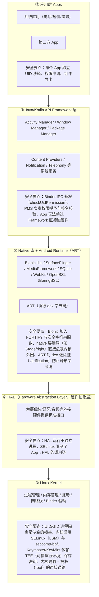
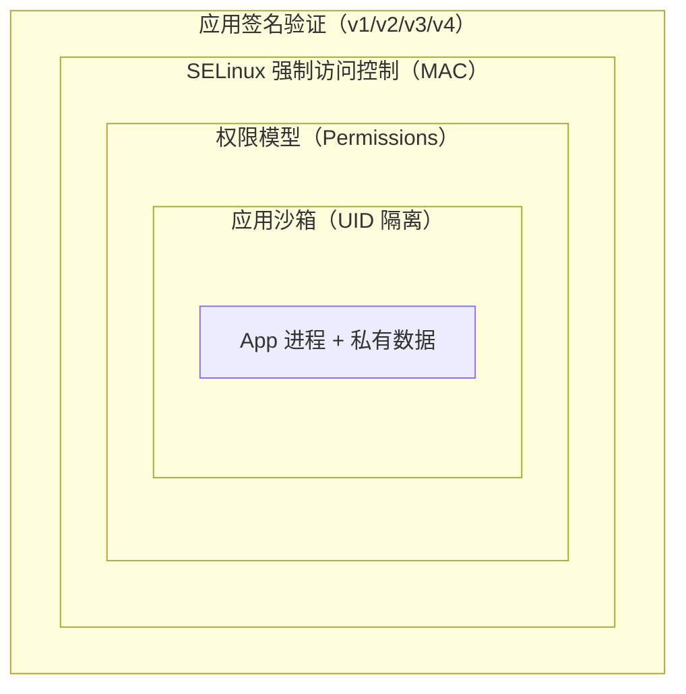
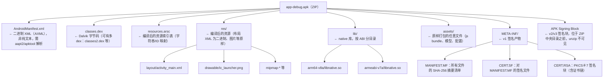
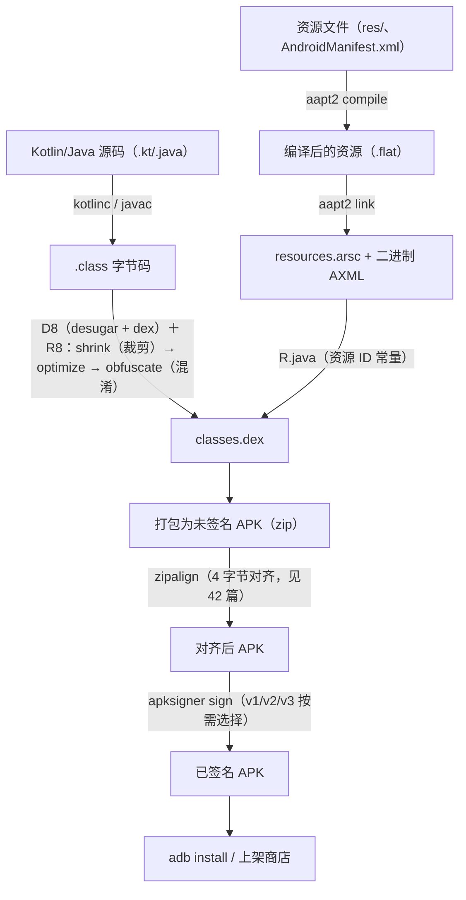

# 41. Android 安全基础与开发入门

> 日期：2026-11-04
> 所属大纲阶段：8. 移动安全（Android）
> 参考资料：
> - Android Developers 官方文档 — <https://developer.android.com/>（架构、权限、签名、adb 章节）
> - Android Open Source Project 安全概览 — <https://source.android.com/docs/security>
> - OWASP MASTG（Mobile Application Security Testing Guide）— <https://mas.owasp.org/MASTG/>
> - OWASP MASVS（Mobile Application Security Verification Standard）
> - Android Security Bulletin — <https://source.android.com/docs/security/bulletin>
> - 《Android 软件安全权威指南》（丰生强）第 1-3 章

移动安全的第一课不是「怎么逆向 APK」，而是**把 Android 当作一个操作系统来理解**：它的进程模型、权限体系、签名机制决定了后面所有攻击面与防御面。本篇目标：建立 Android 系统与安全模型的完整认知，搭好开发/测试环境，熟练使用 **adb（Android Debug Bridge，Android 调试桥）** 与 **aapt2（Android Asset Packaging Tool 2）** 这两个安全审计中使用频率最高的工具，并交叉引用前 7 个阶段的概念（如 `notes/03-操作系统基础-进程内存与权限.md` 的进程隔离、`notes/09-密码学基础-对称与非对称.md` 的非对称签名）。

---

## 1. Android 系统架构分层

Android 本质上是「在 Linux 内核上构建的一套应用运行框架」。自底向上分为五层：



逐层说明（只挑安全相关的）：

- **① Linux Kernel**：Android 没有使用 glibc 而是自己的 **Bionic libc**。内核里的 **Binder 驱动**（`/dev/binder`）是所有进程间通信（Inter-Process Communication, IPC）的底座。我们学过的 `notes/21-栈溢出与堆溢出.md` 知识在这里直接适用：内核与 native 库的内存破坏漏洞是提权的核心通路。
- **② HAL**：Android 8.0 起要求 HAL 跑在独立进程（Project Treble），配合 SELinux 域隔离，减少一个 HAL 漏洞拖垮整个系统的可能。
- **③ ART（Android Runtime）**：取代早期的 Dalvik VM，负责执行 `classes.dex` 字节码。逆向分析时，**Java 层代码跑在 ART 里，而 so 层跑在 native 世界**，这决定了工具链的选择（见第 10 节与本系列 42、45 篇）。
- **④ Framework 层**：系统服务（System Server 进程）实现权限检查。App 调用敏感 API 时，实际是跨进程请求系统服务，由系统服务按 UID 查权限表决定放行与否——**权限检查不在 App 进程里，所以 App 自己改代码绕不过权限**。
- **⑤ 应用层**：即我们要审计的对象。所有 App 都由 **Zygote** 进程 fork 而来（因此共享 Framework 代码页），fork 后 setuid 到各自的应用 UID。

---

## 2. Android 安全模型详解

Android 安全是一个**纵深防御（Defense in Depth）**体系：进程沙箱在最内圈，外面逐层包裹权限、SELinux、签名与验证机制。



### 2.1 应用沙箱（App Sandbox）与 UID 隔离

核心思想：**App 之间以及 App 与系统之间默认完全隔离，隔离由 Linux 内核的 UID 机制实现**，而非某个上层软件。

- 安装 App 时，**包管理器（Package Manager Service, PMS）** 为其分配一个应用 UID（Linux user ID）。普通应用 UID 从 **10000（0x2710）** 开始，例如 `u0_a88` 表示 UID 10088。`appId = UID - 10000`。
- 每个 App 的私有数据目录 `/data/data/<包名>/`（以及外部存储私有目录 `/sdcard/Android/data/<包名>/`）属主即该 UID，权限 `700` 或 `771`（不同组件），**其他 App 以自身 UID 无法读取**。
- 进程间要交换数据，只能走 Binder IPC（如系统服务、ContentProvider），从而把「谁能访问什么」的决策收口到有权限检查的边界上。

```bash
# 环境：已 root 的模拟器或 adb shell（未 root 只能看到自己的）
adb shell ps -A | grep u0_a        # 观察：每个 App 一行，user 列形如 u0_a123
adb shell dumpsys package com.android.chrome | grep userId=
# 输出示例: userId=10122
```

**共享 UID（sharedUserId）及其风险**：清单中声明 `android:sharedUserId="xxx"` 的多个 App 可共用同一 UID，从而互相读取私有数据、合并权限。风险：

1. 一旦某个共享成员被攻破，整个共享组的数据全部暴露（权限串联）；
2. 共享组内 App 必须使用**相同签名**，密钥泄露即全面沦陷；
3. 卸载行为、数据归属变得不可预测。

因此 Google 已在 API 29（Android 10）将其标记为 **deprecated（弃用）**，新应用不应使用，未来版本将移除。**审计清单**：发现清单里出现 `sharedUserId` 应视为历史遗留风险项。

### 2.2 权限模型（Permission Model）

App 要使用敏感能力（相机、定位、通讯录）必须在 `AndroidManifest.xml` 中声明 `<uses-permission>`，由系统决定是否授予。按 **保护等级（protectionLevel）** 分四级：

| protectionLevel | 授予时机 | 用户可见性 | 典型权限 | 风险/审计视角 |
|---|---|---|---|---|
| **normal** | 安装时自动授予 | 用户在安装页可见 | `INTERNET`、`VIBRATE`、`ACCESS_NETWORK_STATE` | 风险低，但 `INTERNET` 几乎人人都有 → 数据外传通道常开 |
| **dangerous** | 运行时弹窗请求（Android 6.0+） | 明确弹窗，可随时撤销 | `READ_CONTACTS`、`ACCESS_FINE_LOCATION`、`CAMERA`、`READ_EXTERNAL_STORAGE` | 重点审计：**申请了却不使用的权限**（过度申请）、权限申请时机欺骗 |
| **signature** | 仅当申请方与权限定义方**签名相同**才授予 | 无弹窗 | 系统内部权限居多，自定义 signature 权限用于自家 App 间通信 | 若厂商误用平台密钥签名第三方 App，即提权漏洞 |
| **signatureOrSystem**（现称 privileged） | 签名相同**或**位于系统分区 `/system/priv-app/` | 无弹窗 | `WRITE_SECURE_SETTINGS` 等 | 只应给系统组件；预装应用滥用即「后门」级风险 |

补充要点：

- **运行时权限（Runtime Permissions）**：Android 6.0（API 23）起，dangerous 权限需在代码中动态请求（`ActivityCompat.requestPermissions`），并按**权限组（permission group）**粒度提示。用户授予 `READ_CONTACTS` 后同组的 `WRITE_CONTACTS` 无需再弹窗。
- **特殊权限（special permissions）**：如 `SYSTEM_ALERT_WINDOW`（悬浮窗）、`WRITE_SETTINGS`、`REQUEST_INSTALL_PACKAGES`，不走常规弹窗，需要跳转系统设置页单独授权，滥用是流氓软件重灾区。
- 权限的**运行时检查**由系统服务依据 UID 完成（`checkPermission`），App 侧的判断只是 UI 逻辑。

```bash
# adb 操作权限（审计利器）
adb shell pm list permissions -g -d          # 列出危险权限及分组
adb shell pm grant com.example.app android.permission.CAMERA   # 直接授予（危险权限）
adb shell pm revoke com.example.app android.permission.CAMERA  # 撤销
adb shell dumpsys package com.example.app | grep -A 40 "runtime permissions"
adb shell appops get com.example.app         # AppOps：比权限更细的操作级开关
```

### 2.3 SELinux 强制访问控制

一句话原理：**SELinux（Security-Enhanced Linux）给系统里的每个主体（进程域）和客体（文件/套接字等资源类型）打标签，默认拒绝一切访问，只有策略中明确 `allow` 的组合才放行**——它是独立于传统 UID/rwx 自主访问控制（DAC）之外的强制访问控制（MAC）层，即使进程拥有 root（UID 0），策略不允许也访问不了。

- Android 4.3 引入（默认 permissive），**Android 5.0 起对所有应用强制 enforcing**。
- 每个 App 被划分到 SELinux 域（如 `untrusted_app`），连系统服务也各自成域，防止「拿下一个服务就横着走」。
- 模式：`permissive` 只记录违规日志不拦截（用于策略调试），`enforcing` 记录并拦截。

```bash
adb shell getenforce          # 查看当前模式：Enforcing
adb shell setenforce 0        # 临时切到 permissive（需要 root，仅调试用，重启失效）
adb shell dmesg | grep avc    # 查看 SELinux 拒绝日志（avc: denied）
```

### 2.4 seccomp-bpf

一句话：**seccomp-bpf 用 BPF 规则为进程安装一个系统调用过滤器，App 进程只能调用白名单内的 syscall**，从内核入口上直接砍掉攻击面。Android 8.0 起对所有应用启用（策略定义在 AOSP 的 `bionic/libc/seccomp`），即使内核存在某个冷门 syscall 的漏洞，App 也无法触达。

### 2.5 应用签名体系（v1 → v4）

Android 要求**所有 APK 必须签名**后才能安装。签名解决两件事：完整性校验（APK 未被篡改）与身份认证（升级包必须与已装版本同签名）。结合 `notes/09-密码学基础-对称与非对称.md`：签名 = 开发者用私钥对摘要签名，系统用内置公钥（证书）验证。

| 方案 | 引入版本 | 保护范围 | 解决的问题 | 残留问题 |
|---|---|---|---|---|
| **v1（JAR 签名）** | Android 1.0 | `META-INF/` 内逐个 ZIP 条目的摘要（MANIFEST.MF、CERT.SF、CERT.RSA） | 提供最基本的完整性校验 | **只校验文件内容，不覆盖 ZIP 元数据/条目顺序** → 著名的 Janus 漏洞（CVE-2017-13156）可在 APK 头部注入 DEX 字节而不破坏 v1 校验；校验慢 |
| **v2（APK Signature Scheme v2）** | Android 7.0 (API 24) | 在 ZIP 中插入 **APK Signing Block**（位于中央目录之前），对**整个文件**分块哈希后签名 | 全文件完整性，防 ZIP 结构层面篡改；验证更快 | 无密钥轮换能力 |
| **v3** | Android 9 (API 28) | 同 v2 结构，增加 **Proof-of-Rotation（轮换证明）** 链 | 允许**更换签名密钥**且新旧版本仍视为同一身份 | 老设备不认新链 |
| **v4** | Android 11 (API 30) | 基于 **fs-verity** 的 Merkle 树签名文件（`.idsig`），与 APK 分离 | 支持**流式/增量安装**（边下边装） | 不替代 v2/v3，须共存 |

**签名校验时机**（审计时需理解的三道关卡）：

1. **安装时**：PMS 调用 `ApkSignatureVerifier` 校验；校验失败直接拒绝安装。
2. **升级时**：新版本签名必须与设备上已装版本**完全一致**，否则报 `INSTALL_FAILED_UPDATE_INCOMPATIBLE`——这是「重打包」攻击绕不开的门槛（见 42 篇重签名一节）。
3. **运行时**：平台签名（platform key）授予的系统权限在 PMS 授权时验证；部分安全检测 SDK（如 Google Play Integrity）在服务端再次校验。

> 防御视角：开发者应使用 Google Play **App Signing**（密钥托管 + 自动升级 v3 轮换），并避免将签名密钥放进 CI 日志或仓库（呼应 `notes/32-密钥管理.md`）。

---

## 3. 四大组件与 Intent 机制

**四大组件（Four Major Components）** 是 App 与系统、App 与 App 交互的全部入口，也是 Android 攻击面的核心。本节先建立职责地图，具体漏洞与利用在 **43 篇**展开。

| 组件 | 职责（一句话） | 安全关注点（43 篇详解） |
|---|---|---|
| **Activity** | 一个可视化用户界面容器 | `exported` 导出 → 伪装钓鱼界面、Intent 重定向、任务（Task）劫持 |
| **Service** | 无界面的后台长时任务 | 导出的 Service 被恶意 App 随意 `startService` 调用，执行未授权逻辑/DoS |
| **BroadcastReceiver** | 接收并响应系统或应用广播 | 导出接收器被伪造广播触发（如伪造短信到达）、动态注册泄漏敏感数据 |
| **ContentProvider** | 跨 App 的结构化数据共享接口 | SQL 注入、路径遍历（`../../`）、未授权读取敏感数据 |

**Intent 机制**：组件间通信的消息载体。

- **显式 Intent（Explicit Intent）**：直接指名目标组件（`setClassName` / `setComponent` / `Intent(Context, Class)`），目标确定，无歧义。
- **隐式 Intent（Implicit Intent）**：只声明 `action` / `category` / `data`（URI），由系统在所有匹配的 **Intent 过滤器（intent-filter）** 中挑选目标。安全影响：隐式 Intent 可能被第三方 App 恶意抢占（拦截含敏感数据的 Intent），或诱导用户选择钓鱼组件。

```kotlin
// 显式：明确启动自己 App 的 Activity
startActivity(Intent(this, SecretActivity::class.java))
// 隐式：任何声明了 VIEW + https 的浏览器都可响应
startActivity(Intent(Intent.ACTION_VIEW, Uri.parse("https://example.com")))
```

组件默认不可导出（API 31 起强制显式声明 `android:exported`），但声明了 `intent-filter` 且未写 `exported` 在旧版本上默认导出——这是清单审计的第一检查点（见第 9 节）。

---

## 4. APK 文件结构详解

**应用程序包（Android Application Package, APK）** 本质是一个 **ZIP 压缩包**，其中关键文件被编译为 Android 专有格式。



逐项说明：

- **AndroidManifest.xml（清单）**：App 的「身份证 + 配置中心」：包名、版本、组件声明、权限声明、硬件特征。构建时被 **aapt2** 编译为二进制 XML 以省空间省解析时间，直接 `cat` 是乱码。
- **classes.dex**：Kotlin/Java 编译产物。方法数上限 65536（64K），超限后拆分为 `classes2.dex` 等（multidex），逆向时注意搜全。
- **resources.arsc**：资源 ID（`R.string.app_name` = `0x7f0f001c` 之类）到具体资源与配置（语言/屏幕密度）的映射表。加固/资源混淆会破坏它，是 apktool 回编译报错的常见来源（42 篇）。
- **res/ 与 assets/**：前者经 aapt2 处理有资源 ID；后者原样保留，用 `AssetsManager` 按文件名访问——审计时 `assets/` 里常有惊喜（配置文件、内置证书、甚至测试后门）。
- **lib/\<ABI\>/**：so 层所在，ABI 常见 `arm64-v8a`（现代 64 位 ARM）、`armeabi-v7a`（32 位）、`x86_64`（模拟器）。加固厂商特征 so 也在这里（42 篇第 9 节）。
- **META-INF/**：仅 v1 签名使用；使用 v2-only 签名的 APK 可能没有这些文件。

**实测：解包一个自建 APK**（环境：macOS + 本地构建的 Hello World，构建方法见第 11 节）：

```bash
$ unzip -l app-debug.apk
Archive:  app-debug.apk
  Length      Date    Name
---------  ---------- -----
     2844  11-04 09:12   AndroidManifest.xml
   524288  11-04 09:12   classes.dex
    69832  11-04 09:12   resources.arsc
     1388  11-04 09:12   res/layout/activity_main.xml
    34690  11-04 09:12   res/mipmap-xxxhdpi/ic_launcher.png
      ...（其余 mipmap/drawable 资源）
      996  11-04 09:12   META-INF/MANIFEST.MF
      876  11-04 09:12   META-INF/CERT.SF
     1474  11-04 09:12   META-INF/CERT.RSA
      106  11-04 09:12   META-INF/com/android/build/gradle/app-metadata.properties
---------                     -------
   ...                       24 个文件
```

观察要点：dex 占大头；`META-INF/` 三件套齐备（debug 构建默认带 v1+v2）；**v2 签名块不在列表里**——它是 ZIP 结构缝隙中的数据，`unzip` 的文件视图看不到，这是「肉眼完整性检查」不可靠的原因之一。

---

## 5. APK 构建流程（含混淆）

理解构建链，才能知道手上拿到的 APK 里每一部分是怎么来的，以及在哪里注入混淆。



- **D8/R8**：D8 把 JVM `.class` 转为 Dalvik dex；**R8 是 D8 的超集**，同时完成代码裁剪（shrink）、优化（optimize）与**混淆（obfuscate）**——R8 混淆就是把类/方法/字段重命名为 `a`、`b`、`c`（对逆向的影响与对抗见 42 篇第 8 节）。
- 顺序固定：**先 zipalign 后 apksigner**（apksigner 会验证对齐且 v2 签名覆盖全文件；若用旧 jarsigner 则顺序相反）。

---

## 6. 开发与测试环境搭建

环境：**macOS（Apple Silicon）+ Android Studio**。本工作区所有 Android 实验都基于此。

### 6.1 安装 Android Studio

1. 官网 <https://developer.android.com/studio> 下载 **Mac with Apple chip** 版（arm64 .dmg）；国内可走 <https://developer.android.google.cn/studio> 镜像。
2. 拖入 Applications，首次启动按向导安装 SDK。默认路径：
   - SDK：`~/Library/Android/sdk`
   - 工具：`~/Library/Android/sdk/platform-tools/`（adb）、`cmdline-tools/`、`build-tools/<ver>/`（aapt2、apksigner、zipalign、d8）
3. 配置环境变量（`~/.zshrc`）：

```bash
export ANDROID_HOME="$HOME/Library/Android/sdk"
export PATH="$PATH:$ANDROID_HOME/platform-tools"     # adb, fastboot
export PATH="$PATH:$ANDROID_HOME/build-tools/34.0.0" # aapt2, apksigner, zipalign
export PATH="$PATH:$ANDROID_HOME/cmdline-tools/latest/bin"  # sdkmanager, avdmanager
```

```bash
source ~/.zshrc
sdkmanager --list | grep "system-images;android-34"   # 查看可用系统镜像
sdkmanager --licenses                                # 接受许可（新装必做）
```

### 6.2 创建 AVD 模拟器

**AVD（Android Virtual Device，Android 虚拟设备）** 是官方模拟器，基于 QEMU。

```bash
# 列出已装镜像与可创建设备
sdkmanager "system-images;android-34;google_apis;arm64-v8a"
avdmanager list device | grep -A2 "pixel"            # 查设备定义
avdmanager create avd -n api34 -k "system-images;android-34;google_apis;arm64-v8a" -d pixel_8
emulator -list-avds        # 查看 AVD
emulator -avd api34        # 启动（也可从 Android Studio Device Manager 图形化创建）
```

**Apple Silicon 关键注意点**：

- 必须选 **`arm64-v8a` 镜像**。x86/x86_64 镜像在 Apple Silicon 上无法原生运行（Android 11 之前 Google 根本不发布 arm64 桌面镜像，当时只能靠 x86 镜像 + Rosetta 模拟，非常慢；API 30+ 的 arm64 镜像已原生流畅）。
- 需要 Google Play 服务的实验请选 `google_apis`（可 root，即 `adb root` 可用）而非 `google_play` 变体——**后者禁止 root，且 `/system` 只读，做安全实验极不方便**。带 Google Play 的镜像还装不了 frida-server 到系统位置。
- 模拟器默认允许 `adb root`（google_apis 镜像），这是我们在 45 篇做 hook 实验的基础设施。

### 6.3 真机调试

1. **开发者模式**：设置 → 关于手机 → 连续点击「版本号」7 次 → 返回出现「开发者选项」。
2. **USB 调试**：开发者选项 → 打开「USB 调试」，插入数据线后在手机上确认指纹弹窗（**拒绝「一律允许」更安全**）。
3. **无线调试（Android 11+）**：开发者选项 → 无线调试 → 「使用配对码配对设备」，然后：

```bash
adb pair <手机IP>:<配对端口>      # 输入屏幕上的 6 位配对码
adb connect <手机IP>:<连接端口>   # 配对一次后可直接 connect
adb devices                       # wireless 一栏出现即成功
```

> **无线调试安全风险提示**（防御视角）：
> 1. 无线调试端口监听在局域网，**同一 Wi-Fi 内其他设备可能尝试连接**；配对码机制（基于 SPAKE2，采用 BoringSSL 的 P-256 实现）挡住了陌生人，但已配对过的电脑永久可信——公用网络环境务必关闭。
> 2. USB 调试在公共充电桩/被植入了 adb 攻击机的场景是经典渗透入口（对应 `notes/29-渗透测试方法论-PTES-OWASP-WSTG.md` 中的物理接入面）。
> 3. `adb` 授权的本质是手机信任了电脑上的 `~/.android/adbkey` 公钥；借别人的电脑调试 = 交出长期控制权，应事后在手机上「撤销 USB 调试授权」。

---

## 7. adb 命令速查表（重点）

**adb（Android Debug Bridge）** 是「PC ↔ 设备」的三件套：客户端（命令行）、服务端（本机 daemon，默认端口 5037）、设备端 adbd。以下命令全部在 macOS 终端执行，设备为 AVD Pixel 8 / API 34。

### 7.1 设备与会话管理

| 命令 | 作用 |
|---|---|
| `adb devices -l` | 列出设备（`-l` 显示型号/传输详细信息） |
| `adb kill-server` / `adb start-server` | 重启本机 adb 服务（设备失联时先试这个） |
| `adb -s <serial> <cmd>` | 多设备时指定目标（serial 来自 `adb devices`） |
| `adb -d <cmd>` / `adb -e <cmd>` | 只对 USB 设备 / 只对模拟器执行 |

### 7.2 安装与卸载

| 命令 | 作用 | 备注 |
|---|---|---|
| `adb install app.apk` | 安装 | 签名不一致报 `INSTALL_FAILED_UPDATE_INCOMPATIBLE`，先卸载旧版 |
| `adb install -r app.apk` | 覆盖安装（**r**eplace） | 保留数据；签名必须一致 |
| `adb install -t app.apk` | 允许 test-only APK | debug 构建常需要 |
| `adb install -d app.apk` | 允许**版本降级** | 对比自己编译的旧版本做验证时很有用 |
| `adb install -g app.apk` | 自动授予所有运行时权限 | 自动化测试必备 |
| `adb install-multiple a.apk b.apk` | 分包安装（AAB 拆出的 split） | |
| `adb uninstall com.example.app` | 卸载 | `-k` 保留数据与缓存目录（残留数据是取证线索） |
| `adb shell pm path com.example.app` | 查 APK 在设备上的安装路径 | 一般在 `/data/app/*/base.apk` |

### 7.3 shell：进入设备执行命令

```bash
adb shell                    # 交互式进入（模拟器上是普通 shell 用户 u0_a... 或 root）
adb shell <command>          # 单条执行
```

**pm（Package Manager，包管理）**：

```bash
pm list packages             # 全部包名
pm list packages -3          # 只看第三方应用
pm list packages -f          # 显示每个包对应的 APK 路径（审计时先看装了什么）
pm list packages -f | grep example
pm dump com.example.app      # 包的完整信息（组件/权限/签名摘要）
pm clear com.example.app     # 清空应用数据（复位实验状态）
pm grant / pm revoke <pkg> <perm>   # 运行时权限直接授予/撤销（绕过弹窗）
pm install / pm uninstall    # shell 内版本的安装卸载（可配合管道）
```

**am（Activity Manager，活动管理）**：

```bash
# 启动一个 Activity（-n: 显式组件，格式 包名/完整类名）
adb shell am start -n com.example.webviewapp/.MainActivity
# 隐式方式打开 deeplink（审计 scheme 劫持/路由时用）
adb shell am start -a android.intent.action.VIEW -d "myapp://secret?token=123"
# 启动 Service / 发送广播（测试导出组件，见 43 篇）
adb shell am startservice -n com.example.app/.MyService
adb shell am broadcast -a com.example.CUSTOM_ACTION --es extra "value"
# 强制停止与崩溃模拟
adb shell am force-stop com.example.app
adb shell am crash com.example.app
```

**dumpsys（系统服务转储）**：

```bash
dumpsys package com.example.app          # 权限授予状态、组件、第一个安装时间等
dumpsys package com.example.app | grep -A 30 "requested permissions:"
dumpsys activity top                     # 当前栈顶 Activity（找当前界面类名）
dumpsys activity services com.example.app
```

### 7.4 文件传输

```bash
adb pull /sdcard/DCIM/screenshot.png ./            # 设备 → 电脑（拉取证据/dump）
adb pull $(adb shell pm path com.example.app | sed 's/package://' | head -1) ./base.apk
                                                   # 把已装应用的 APK 拉下来（自装/自研应用审计）
adb push frida-server /data/local/tmp/             # 电脑 → 设备（45 篇推送工具）
adb shell "chmod 755 /data/local/tmp/frida-server"
```

### 7.5 adb logcat 日志（审计敏感信息利器）

```bash
adb logcat                     # 持续输出全部日志（Ctrl-C 停止）
adb logcat -d                  # dump 后退出（-d = dump）
adb logcat -s MyTag            # 静默其他，只看指定 tag
adb logcat MyTag:E *:S         # 同上，tag:级别 过滤，*:S 屏蔽其余（S=silent）
adb logcat --pid=$(adb shell pidof -s com.example.app)   # 只看某进程
adb logcat | grep -iE "password|token|secret|apikey"     # 敏感信息泄露快查
adb logcat *:E                 # 只看 Error 以上
adb logcat -b crash -d         # 只看 crash 缓冲区
adb logcat -c                  # 清空缓冲区（实验前先清，避免旧日志干扰）
```

**审计视角**：生产 App 在 logcat 打印 token、手机号、身份证号是高频低级漏洞（OWASP MASTG-LOGGING 类）。评估一个 App 时，登录/支付操作后立刻 `adb logcat -d | grep -i <关键词>` 是标准动作。

### 7.6 端口转发与抓包联动（forward / reverse）

```bash
# forward：电脑端口 → 设备端口（访问设备上监听的服务）
adb forward tcp:8080 tcp:8080
# 例：设备上跑了个 http 服务，浏览器访问 http://127.0.0.1:8080 即设备上的 8080

# reverse：设备端口 → 电脑端口（设备上的流量回电脑）
adb reverse tcp:8000 tcp:8000
# 例：设备 App 请求 http://127.0.0.1:8000 实际打到电脑的 8000 —— 常用于让模拟器
#     访问电脑上用 Python 起的 mock API
```

与 Burp Suite（呼应 `notes/17-Burp-Suite-使用指南.md`）联动的两种方式：

1. **代理方式**：Burp 监听 `0.0.0.0:8080`，模拟器里设置 Wi-Fi 代理指向 `10.0.2.2:8080`（`10.0.2.2` 是模拟器访问宿主机的专用别名），再安装 Burp CA 证书。
2. **reverse 方式**：`adb reverse tcp:8080 tcp:8080`，App 内代理指向 `127.0.0.1:8080`，避免局域网暴露 Burp。

---

## 8. AndroidManifest.xml 分析（aapt2 实操）

清单是安全审计的「地图」。用 **build-tools** 里的 aapt2 读取（清单是二进制 AXML，文本编辑器打不开）：

```bash
# ① 概览（badging）：包名/版本/入口 Activity/权限/特征，一行一事实
$ aapt2 dump badging app-debug.apk | head -20
package: name='com.example.webviewapp' versionCode='1' versionName='1.0' platformBuildVersionName='14'
sdkVersion:'24'
targetSdkVersion:'34'
uses-permission: name='android.permission.INTERNET'
application-label:'WebViewApp'
application-icon-160:'res/mipmap-mdpi/ic_launcher.png'
launchable-activity: name='com.example.webviewapp.MainActivity'  label='WebViewApp'
...

# ② 完整清单树（xmltree）：审计主要靠它
$ aapt2 dump xmltree app-debug.apk --file AndroidManifest.xml | head -40
E: manifest (line=2)
  A: http://schemas.android.com/apk/res/android:versionCode(0x0101021b)=(type 0x10)0x1
  A: http://schemas.android.com/apk/res/android:versionName(0x0101021c)="1.0"
  E: uses-permission (line=7)
    A: http://schemas.android.com/apk/res/android:name(0x01010003)="android.permission.INTERNET"
  E: application (line=9)
    A: http://schemas.android.com/apk/res/android:label(0x01010001)="WebViewApp"
    A: http://schemas.android.com/apk/res/android:debuggable(0x0101000f)=(type 0x12)0xffffffff (true)
    E: activity (line=12)
      A: http://schemas.android.com/apk/res/android:name(0x01010003)=".MainActivity"
      A: http://schemas.android.com/apk/res/android:exported(0x01010010)=(type 0x12)0xffffffff (true)
      E: intent-filter (line=13)
        E: action ...
```

（`E:` = Element，`A:` = Attribute，十六进制 `(0x01010010)` 是该属性的**资源 ID 常量**——记住 `exported=0x01010010` 这类高频 ID，在只有二进制清单可看时也能直接定位。）

### 安全审计字段清单（拿到任何 APK 先过这张表）

| 字段 | 危险值 | 风险说明 |
|---|---|---|
| `android:exported`（组件级） | `true` 且组件含敏感逻辑 | 第三方 App 可直接启动该组件（43 篇核心主题）；含 intent-filter 未显式写 exported（targetSdk<31）等同 true |
| `android:debuggable` | `true`（release 出现即事故） | 任意 adb 可调试、备份注入、run-any 代码执行 |
| `android:allowBackup` | `true` | `adb backup`/本地提取出应用私有数据（新版 adb 已弃用 backup，但第三方备份/换机仍会走它） |
| `android:networkSecurityConfig` | 未配置且 targetSdk<28 | 默认允许明文 HTTP（HTTP 明文传输，cleartext traffic）；应配置 `cleartextTrafficPermitted="false"` 与证书钉扎（pinning，见 44 篇） |
| `android:usesCleartextTraffic` | `true` | 同上，允许明文流量 |
| `<uses-permission>` 集合 | 过度申请 | 申请与功能无关的 dangerous 权限（如 flashlight 申请通讯录）→ 过度收集，应用商店下架项 |
| `android:sharedUserId` | 出现即警觉 | 见 2.1 节，权限串联风险 |
| deeplink `<data android:scheme>` | 自定义 scheme 导出 | scheme 劫持、未校验参数的 WebView 跳转（43/44 篇） |
| `<provider android:grantUriPermissions>` / `exported` | `true` | 未授权数据访问、SQL 注入面 |
| `android:name`（application 级）指向非常规 Application 类 | 加固/SDK 注入特征 | 常为加固厂商入口（42 篇第 9 节识别加固的第一线索） |

---

## 9. 辅助分析工具：AndroGuard 与 apkanalyzer

**AndroGuard**：基于 Python 的 APK 静态分析框架（`pip install androguard`），提供权限/组件/证书提取、DEX 解析、控制流图、甚至风险规则脚本化扫描的能力，适合把审计流水线写成代码（官方也提供 `androguard apkid`、`androguard analyze` 等 CLI 子命令）。相比 jadx 它不适合人读代码，但**适合机器批量分析**——例如「扫描应用商店包里所有 exported 且带 deeplink 的组件」。

```bash
python3 -m pip install androguard
androguard apkid app-debug.apk          # 查看包名/版本/证书指纹
androguard analyze app-debug.apk        # 进入交互式 IPython 分析会话
```

**apkanalyzer**：Android SDK 自带（cmdline-tools），命令行快速查看 APK 维度信息：`apkanalyzer manifest print app.apk`（输出可读 XML 清单）、`apkanalyzer dex packages app.apk`（类/方法统计，快速判断代码规模与是否加固——加固后 dex 往往只剩壳代码几个类）、`apkanalyzer files list app.apk`。定位是「轻量只读检查」，配合 aapt2 覆盖大部分日常查询。

---

## 10. 实操：从零创建 WebView 应用并审计

目标：走完「创建 → 构建 → aapt2 审计 → 安装运行」全流程，产出一个后续 42/44 篇要反复使用的自研样本。环境：macOS + Android Studio（Koala 及以上）+ AVD Pixel 8 API 34。

1. **创建工程**：Android Studio → New Project → **Empty Views Activity** → Name `WebViewApp`、Package `com.example.webviewapp`、Language **Kotlin**、Minimum SDK **API 24**。
2. **修改 `app/src/main/AndroidManifest.xml`**（application 内核对 WebView）：

```xml
<manifest xmlns:android="http://schemas.android.com/apk/res/android">
    <uses-permission android:name="android.permission.INTERNET" />
    <application
        android:label="WebViewApp"
        android:usesCleartextTraffic="true">   <!-- 故意留的审计点：允许明文流量 -->
        <activity android:name=".MainActivity" android:exported="true">
            <intent-filter>
                <action android:name="android.intent.action.MAIN" />
                <category android:name="android.intent.category.LAUNCHER" />
            </intent-filter>
        </activity>
    </application>
</manifest>
```

3. **修改 `app/src/main/java/.../MainActivity.kt`**：

```kotlin
package com.example.webviewapp

import android.os.Bundle
import android.webkit.WebView
import androidx.activity.ComponentActivity

class MainActivity : ComponentActivity() {
    override fun onCreate(savedInstanceState: Bundle?) {
        super.onCreate(savedInstanceState)
        val webView = WebView(this)
        // 注意：以下两个设置是第 44 篇要重点分析的"危险开关"，这里故意打开做样本
        webView.settings.javaScriptEnabled = true
        webView.settings.allowFileAccess = true
        setContentView(webView)
        webView.loadUrl("https://example.com")
    }
}
```

4. **构建 debug APK**：菜单 **Build → Build App Bundle(s)/APK(s) → Build APK(s)**，产物位于：

```bash
ls -l app/build/outputs/apk/debug/app-debug.apk
```

   或命令行：`./gradlew assembleDebug`（Gradle wrapper 首次运行会下载依赖）。

5. **审计**（运用第 8 节清单）：

```bash
aapt2 dump badging app-debug.apk | grep -E "package|launchable|permission"
aapt2 dump xmltree app-debug.apk --file AndroidManifest.xml | grep -E "debuggable|exported|Cleartext"
# 预期发现：debuggable=true（debug 构建正常）、exported=true（launcher 必须导出）、
# usesCleartextTraffic=true（我们故意留的坏味道）
```

6. **安装运行**：

```bash
adb install -r -t app-debug.apk
adb shell am start -n com.example.webviewapp/.MainActivity
adb shell dumpsys activity top | grep ACTIVITY      # 确认栈顶是 MainActivity
adb logcat --pid=$(adb shell pidof -s com.example.webviewapp) -d | tail -5
```

至此，「写代码 → 出 APK → 静态审计 → 动态验证」的最小闭环打通。此 APK 请保留，42 篇逆向实操的第一个对象就是它。

---

## 11. 常见坑与排错

| 症状 | 原因 | 解决 |
|---|---|---|
| Apple Silicon 上模拟器极慢/起不来 | 装了 x86_64 镜像 | 删掉重建，选 `arm64-v8a` 镜像（6.2 节） |
| `adb devices` 显示 `unauthorized` | 手机未确认调试授权弹窗/adb 公钥不匹配 | 重新插拔确认弹窗；手机端「撤销 USB 调试授权」后重来；`adb kill-server && adb start-server` |
| `error: device offline` | adb 服务状态混乱 | `adb kill-server` 后重插；换数据线（很多线是纯充电线） |
| 安装报 `INSTALL_FAILED_UPDATE_INCOMPATIBLE` | 已装版本签名与当前 APK 不一致 | `adb uninstall <pkg>` 后再装（这正是 2.5 节签名一致性的体现） |
| 安装报 `INSTALL_PARSE_FAILED_NO_CERTIFICATES` | APK 未签名/签名方案与 minSdk 不匹配 | 走 42 篇完整重签名流程 |
| `aapt2: command not found` | PATH 未含 build-tools | 见 6.1 节环境变量；或用 `$ANDROID_HOME/build-tools/<ver>/aapt2` 全路径 |
| 真机无线调试连不上 | 端口每次重连会变/不同网段 | 以「无线调试」页当前显示端口为准；确保手机与电脑同一 Wi-Fi |
| 模拟器访问不了电脑上的服务 | 用了 `localhost` | 模拟器内宿主机别名是 `10.0.2.2`，或用 `adb reverse` |

**API Level 与 Android 版本对照（节选，审计报告里写清楚 targetSdk 很重要）**：

| API Level | Android 版本 | 安全相关里程碑 |
|---|---|---|
| 23 | 6.0 | 运行时权限上线 |
| 24 | 7.0 | v2 签名引入 |
| 28 | 9 | v3 密钥轮换；默认禁明文流量（targetSdk≥28） |
| 29 | 10 | 分区存储（Scoped Storage）开始；sharedUserId 废弃 |
| 30 | 11 | v4 签名；一次性权限；无线调试 |
| 31 | 12 | exported 必须显式声明； PendingIntent 必须 IMMUTABLE |
| 33 | 13 | 运行时通知权限（POST_NOTIFICATIONS） |
| 34 | 14 | 前台服务类型强制声明 |

---

## 12. 防御视角小结

- 最小权限是双向的：**开发者**只申请必需权限（商店政策与合规检查会盯），**用户**定期用 `appops` / 设置页复查已授予的权限。
- release 构建逐项核对第 8 节审计清单：`debuggable=false`、`allowBackup=false`、`usesCleartextTraffic=false`、组件按需 `exported`。
- 信任边界默认在进程边界上：不要用 `sharedUserId` 走捷径，跨 App 共享数据用签名级自定义权限 + ContentProvider。
- logcat 不打敏感信息，构建时用 ProGuard/R8 移除日志（`assumenosideeffects`）。

---

## 13. 自测问题

1. 为什么说 Android 应用沙箱的根基是 Linux 内核而非 Framework 层？请用「安装时发生了什么」来串讲 UID 分配、数据目录权限与进程隔离。
2. `sharedUserId` 为什么被废弃？如果你在审计中遇到一个声明了 `sharedUserId` 的 App，你会额外检查什么？
3. 列出 protectionLevel 四个等级的授予条件，并各举一个权限。`signatureOrSystem` 权限如果被滥用，后果是什么？
4. v1 JAR 签名的具体缺陷是什么？Janus 漏洞（CVE-2017-13156）利用了它的哪个特性？v2 签名块在 ZIP 结构的什么位置？
5. 用户授予了 `READ_CONTACTS` 后，同组的 `WRITE_CONTACTS` 为什么通常不需要再弹窗？这种设计的利与弊？
6. SELinux 的 enforcing 与 permissive 有何区别？为什么把系统从 permissive 切到 enforcing 会用到 `avc: denied` 日志？
7. 一个 APK 中 `classes2.dex` 是怎么来的？逆向分析时忽略它可能漏掉什么？
8. `adb forward` 与 `adb reverse` 方向有什么区别？各举一个与 Burp Suite 或 mock server 联动的场景。
9. 拿到一个未知 APK，仅用 aapt2 的两个子命令，你会提取哪些字段形成第一份审计备忘？
10. 为什么带 Google Play 的 AVD 镜像不适合本工作区的安全实验？
11. 安装时出现 `INSTALL_FAILED_UPDATE_INCOMPATIBLE`，说明签名体系在哪个环节起了作用？这与「重打包攻击」有什么关系（可先凭直觉答，42 篇验证）？
12. debug 构建的 APK 出现 `debuggable=true` 为什么在生产环境是高危？攻击者能借此做什么（提示：任意代码执行/数据备份）？

---

**下一篇**：`notes/42-APK-逆向分析.md` —— 把本篇的 APK 拆开：DEX 格式、jadx/apktool/smali、重签名与 CrackMe 实战。

---

## 附：ASCII 图 → Mermaid 替换清单

| 原 ASCII 图（小节 · 内容） | 替换后类型 |
| --- | --- |
| 「Android 系统架构分层」节 · 平台五层架构图（⑤应用层 → ①内核，组件入层内） | flowchart TD（每层 subgraph） |
| 「Android 安全模型详解」节 · 纵深防御嵌套框图（签名验证 ⊃ SELinux ⊃ 权限 ⊃ 沙箱） | flowchart TD（嵌套 subgraph） |
| 「APK 文件结构详解」节 · app-debug.apk（ZIP）内部结构树 | flowchart TD |
| 「APK 构建流程（含混淆）」节 · APK 构建管线图（源码/资源双路汇合 → zipalign → apksigner） | flowchart TD |
