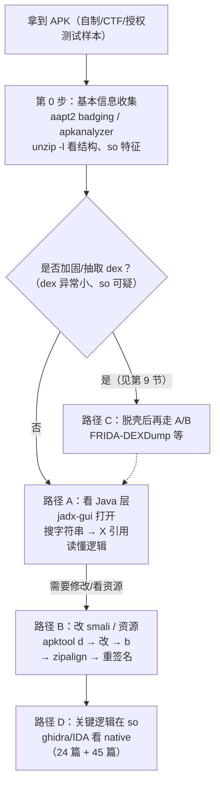
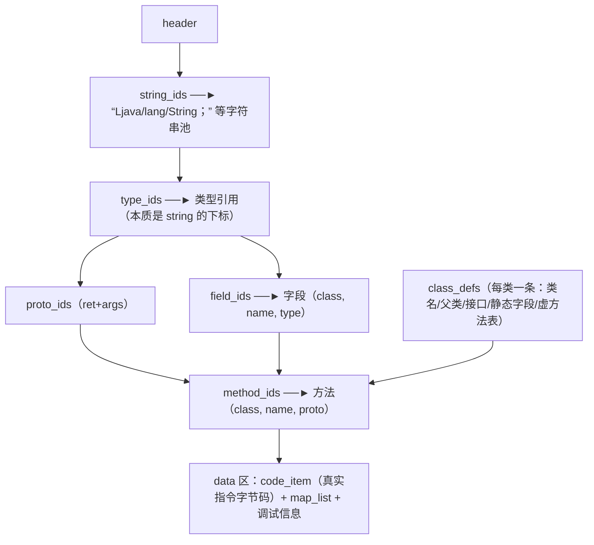
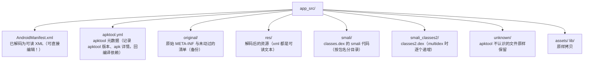
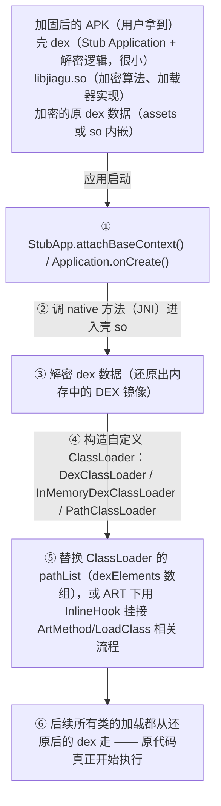

# 42. APK 逆向分析

> 日期：2026-11-04
> 所属大纲阶段：8. 移动安全（Android）
> 参考资料：
> - Android Developers — Dalvik Executable format（<https://source.android.com/docs/core/dalvik/dex-format>）
> - jadx 项目文档与 Wiki — <https://github.com/skylot/jadx>
> - apktool 官方文档 — <https://apktool.org/docs/>
> - OWASP MASTG — Android Reverse Engineering（MAS-RE）
> - Google — App Signing（v1/v2/v3/v4 方案细节）<https://developer.android.com/studio/publish/app-signing>
> - 《Android 软件安全权威指南》（丰生强）：smali 与脱壳章节

上一篇（`notes/41-Android-安全基础与开发入门.md`）我们搭好了环境、读懂了 APK 的宏观结构。本篇把 APK 拆开：**DEX 文件格式 → 反编译工具（jadx/apktool）→ smali 语言 → 回编译重签名 → 混淆与加固对抗 → 一个完整 CrackMe 实战**。这是静态逆向的主干道，动态分析与 hook（frida）留给 45 篇，so 层深入回到 24 篇的 ghidra 方法论。

> **红线重申**：本文所有逆向对象仅限——自制 APK（如 41 篇的 WebViewApp、本篇的 CrackMe）、CTF 题目（如 InsecureBankv2、DIVA、OWASP MASTG 测试应用）。对他人商业 App 的逆向、去签名校验、破解会员等行为不在本工作区讨论范围；「重签名替换已安装应用」的手法理解其原理即可，仅用于安全研究与授权测试。

---

## 1. 逆向流程总览



先总览后分支，是逆向的纪律。第 0 步五分钟的信息收集（包名、targetSdk、so 列表、dex 大小）往往直接决定走哪条路。

---

## 2. DEX 文件格式详解

**DEX（Dalvik Executable）** 是 Android 对 Java 字节码的重新设计。jadx 反编译的一切源头都是它，理解格式才能理解「反编译为什么会失败」「脱壳时在内存里找什么」。

### 2.1 与 JVM class 文件的对比

| 维度 | JVM class | Dalvik DEX |
|---|---|---|
| 指令模型 | 基于操作数栈（stack-based） | **基于寄存器（register-based）**，常见指令可寻址 v0–v255（8 位寄存器号），`invoke` 非范围形式限 v0–v15（4 位）；方法寄存器总数上限 65536（`registers_size` 是 16 位字段） |
| 组织粒度 | 一个类一个文件，各自带常量池 | **多个类合并进一个文件，常量全局去重共享** |
| 内存/体积 | 常量池大量重复 | 索引化设计（string_ids/type_ids/...），重复字符串只存一份，**显著省内存省解析时间**——这是 DEX 更省内存的核心原因（Dalvik 设计时面向 ~64MB RAM 的早期设备） |
| 指令分发 | 1 字节操作码但栈操作多 | 指令直接寻址寄存器，同等逻辑指令条数更少、解释执行更快 |

### 2.2 文件头与索引表

DEX 文件以 0x70 字节（112 字节）的 header 开头，后面挂一串**索引表（ids）**，每个表都是一个按序排好的偏移数组，最终指向 data 区的真实数据：

```text
偏移      字段                          说明
0x00      magic[8]                      "dex\n035\0"（版本号 035/036/037/038/039，
                                         脱壳搜内存就搜这个魔数）
0x08      checksum                      adler32(除 magic 与 checksum 字段外的整个文件内容)
0x0C      signature[20]                 SHA-1(除 magic/checksum/signature 外)，
                                         脱壳修复 dex 时必须重算这两个字段
0x20      file_size / header_size       文件总长 / 头长(0x70)
0x28      endian_tag                    0x12345678 (little-endian)
0x2C      link_size / link_off          静态链接信息（一般为 0）
0x34      map_off                       → map_list 的偏移（类型→偏移+数量的总目录，
                                         修复 dex 与解析尾部全靠它）
0x38      string_ids_size/off   ──┐
0x40      type_ids_size/off      │  每个 string_id 是 4 字节偏移 → MUTF-8 编码字符串
0x48      proto_ids_size/off     │  type = 字符串形式的类型签名(Ljava/lang/String;)
0x50      field_ids_size/off     │  proto = 返回类型 + 参数类型组合（方法原型）
0x58      method_ids_size/off    │  field/method = class + name + proto 三元组
0x60      class_defs_size/off    │  class_defs = 类定义（类名/父类/接口/方法表，见下图）
0x68      data_size/off     ◄────┘
```

> 注：此图保留 ASCII 原样 —— 它本质是 header 字段表（偏移/字段/说明三列对齐）外加跨行指线注解，转成图会丢失表内对齐信息。

**结构关系图**（自上而下的指针链，读 dex 就是在走这张图）：



要点：

- **string_ids → type_ids → proto_ids → field/method_ids → class_defs** 是层层引用的链，任何一层被抽取/破坏（加固的函数抽取壳干的就是破坏 code_item），上层引用完整、下层指令缺失，jadx 表现为「反编译出空方法或报错」。
- 多个类共享常量池 → **改 dex 里任何字符串长度都会牵动其后所有偏移**，所以逆向修改从不在 dex 层硬改，而是走 smali 文本层（apktool 帮你重汇编重排索引）。

### 2.3 ART 下的编译（一句话级）

ART 安装/后台时用 **dex2oat** 把 dex 编译为 **OAT（ELF 格式的本地码）**，辅以 **vdex**（缓存原始 dex + 验证状态）与 odex；运行采用 AOT+JIT+PGO 混合策略。**对逆向的意义**：安装后设备上往往能直接拿到原始 dex（vdex/dex 缓存目录），是脱壳与取证时的额外来源。

---

## 3. 工具矩阵

| 工具 | 定位 | 优点 | 缺点 | 安装 |
|---|---|---|---|---|
| **jadx / jadx-gui** | dex → Java 首选反编译器 | 输出质量最高、开源、GUI 好用、支持搜索/重命名/注释/保存工程 | 大型 APK 卡顿；混淆代码偶发反编译失败 | `brew install jadx` |
| **apktool** | 资源解码 + smali 汇编/反汇编，**可回编译** | 资源还原最完整（AXML/arsc→可编辑文本）；改包必备 | 不输出 Java；老版本对高版本资源 aapt 报错 | `brew install apktool` |
| **JEB**（商业） | 一体化 Android 反编译平台 | dex/so/反混淆能力强，脚本 API 可写自动化分析 | 收费 | 官网 |
| **Ghidra** | native so 静态分析 | 免费、开源、反编译器强（见 24 篇） | 不解析 dex，只看 so | `brew install --cask ghidra` |
| **IDA Pro**（商业） | so 逆向旗舰 | 插件生态、调试器、F5 反编译最佳 | 收费，且对 dex 支持有限（主要看 so） | 官网 |
| **Bytecode Viewer** | 多反编译器聚合 GUI（内嵌多个 dex→java 后端） | 一个工具切换对比多引擎输出 | 更新一般，资源能力弱 | GitHub release |
| **GDA** | 快速 dex 分析器 | 启动快、体积小 | Windows 体验最佳，跨平台一般 | 官网 |

组合拳：**jadx 读逻辑（90% 时间）+ apktool 改包（要 patch 时）+ ghidra 看 so（Java 层找不到逻辑时）**。

---

## 4. jadx 详解（重点）

### 4.1 安装与 CLI

```bash
brew install jadx          # 或官网下载 release 包（含 jadx 与 jadx-gui 两个可执行）
jadx --version
```

常用 CLI 参数（完整列表 `jadx --help`）：

```bash
jadx -d out_dir app.apk           # 反编译整个 APK 到目录（默认含资源+java源码）
jadx --no-res -d out_dir app.apk  # 跳过资源解码（只要代码，速度大幅提升）
jadx --deobf -d out_dir app.apk   # 启用反混淆：把 a.b.c 这类名字自动重命名为
                                  #    C0123a 之类，重命名基于用法启发式，可控可复现
jadx --deobf-min 3 ...            # 名字长度小于 3 的才改名（过滤短名，减少误伤）
jadx --show-bad-code -d out app.apk  # 反编译失败的方法也输出错误占位代码而不是跳过
jadx -j 4 --no-res -d out big.apk    # 限制线程数：大型 APK 卡顿时减线程反而更稳
jadx --log-level ERROR app.apk    # 降噪
```

> 提示：`--deobf` 输出的名字（`deobf` 映射保存在与工程同名的 `.jobf` 文件里，如 `app.jobf`）便于阅读，但**写报告引用真实类名时注意两套名字的对应关系**，避免误导他人。

### 4.2 jadx-gui 使用技巧

- **打开方式**：`jadx-gui app.apk`（或直接拖 APK 进窗口）。
- **搜索**（快捷键 `Cmd/Ctrl+F` 全文，`Cmd/Ctrl+Shift+F` 或 Navigation → 全局搜索）：
  - 搜**类名**：`MainActivity`、`Lcom/example/`（dex 类型签名形式也能搜）；
  - 搜**字符串**：`注册失败`、`http://`、`api_key`（硬编码密钥第一搜法）；
  - 搜**代码片段**：`MessageDigest`、`Cipher.getInstance("AES`（找加密点）。
- **交叉引用（X 键）**：光标停在类/方法/字段上按 **X**，列出所有引用处——「从字符串找到显示处，再跳到判断逻辑」的标准路径就是 `搜索 → 源码 → X → 调用者`。
- **重命名与注释**：选中标识符按 **N** 重命名，行号处右键加注释；然后 **File → Save all / Save project as…** 保存为 **jadx 工程文件（.jadx）**，下次打开工程，你的所有重命名/注释都在——长逆向任务的存档机制。
- **反编译失败降级**：某方法报 `// jadx: failed to decompile` 或代码明显不完整时，切到该方法的 **smali 视图**（GUI 中选择方法后底部/右侧 Smali 面板，或 View 设置切换），直接读字节码对照。jadx 的 Java 是「尽力还原」，smali 才是事实。
- **导出 Gradle 工程**：File → **Save as Gradle Project**，把反编译源码变成可用 Android Studio 打开的工程（便于加断点理解、或对自制样本做二次实验）。混淆严重的 APK 导出后通常编译不过，只适合浏览。

---

## 5. apktool 详解

apktool 的核心价值有两个：①把**二进制资源**（AXML、resources.arsc）解码成可编辑文本；②smali ↔ dex 的**双向转换**（回编译）。

### 5.1 解包 d / 打包 b

```bash
apktool d app.apk -o app_src          # 解包（decode）
apktool d -f app.apk -o app_src       # -f 强制覆盖已存在目录
apktool d --no-src app.apk -o out     # 只要资源，不反汇编 dex（大包提速）
apktool d -r app.apk -o out           # --no-res：不解析资源（资源损坏时抢救 smali）

apktool b app_src -o app_rebuilt.apk  # 回编译（build）：smali→dex，资源→AXML/arsc，重新打包
```

解包目录结构：



### 5.2 回编译报错排查

| 报错特征 | 原因 | 处理 |
|---|---|---|
| `error: No resource identifier found for attribute ...` | 目标 SDK 的资源 ID 表与 apktool 内置 framework 不匹配 | `apktool if framework-res.apk` 安装对应版本框架（从设备 `/system/framework/framework-res.apk` pull 出来），或升级 apktool |
| `aapt2` 相关崩溃 / 资源 id 冲突 | 加固或资源混淆（AndResGuard）破坏了 public.xml 的 ID 对齐 | 尝试去掉资源混淆样本；或 `apktool b --use-aapt2`；只 patch smali 时改用 `--no-res` 流程 |
| 回编译成功但安装闪退 | 你改的 smali 破坏了寄存器约定（如 `.locals` 数量不够） | 回读该方法的 `.locals/.registers` 声明，新增寄存器要同步加数 |
| 找不到 apktool.yml | 目录被手工重组过 | 保持 apktool 生成的目录原样，改动最小化 |

原则：**apktool 的目录结构是它的私有格式，别手工增删目录**；改什么补什么。

---

## 6. smali 语法基础（重点，教程式）

**smali/Baksmali** 是 dex 的汇编层文本表示（smali = dalvik 汇编的冰岛语直译，" assembler "）。会读 smali = 逆向下限。

### 6.1 寄存器模型

- 每个方法有自己的寄存器窗口，两种命名并存：
  - **v 命名**：`v0, v1, ...` 从 0 数到底（`.registers N` 声明总数）；
  - **p 命名**：`p0, p1, ...` 表示**参数**寄存器，其中**非静态方法的 `p0` 恒为 `this`**；`.locals N` 声明本地寄存器数（参数紧随其后编号）。
  - 换算：`.registers 5` 的实例方法、含 1 个 int 参数 → 参数区占 2 格（`this` + int 各 1 格），本地寄存器 locals = 5 − 2 = 3（`v0,v1,v2`），`p0 = this → v3`、`p1 = int 参数 → v4`——参数寄存器固定占据窗口最高位，`registers = locals + 参数格数` 必须自洽。
- 寄存器 32 位一格：`J`（long）与 `D`（double）占**两格**（用 `wide` 系列指令）。

### 6.2 类型签名表

| 签名 | 类型 | 备注 |
|---|---|---|
| `V` | void | |
| `Z` | boolean | 不是 B，是 Z |
| `B` | byte | |
| `C` | char | |
| `S` | short | |
| `I` | int | |
| `J` | long | 占两寄存器 |
| `F` | float | |
| `D` | double | 占两寄存器 |
| `Ljava/lang/String;` | 对象类型 | `L` 开头 `;` 结尾，点换斜杠 |
| `[I` / `[Ljava/lang/String;` | int 数组 / 字符串数组 | `[` 前缀可叠加：`[[I` 二维数组 |

**方法签名**：`方法名(参数类型依次拼接)返回类型`。例子：

```text
onClick(Landroid/view/View;)V                    void onClick(View v)
checkPassword(Ljava/lang/String;)Z               boolean checkPassword(String)
append([BI)Ljava/lang/String;                    String append(byte[] b, int len)
<init>(Ljava/lang/String;)V                      构造方法
main([Ljava/lang/String;)V                       void main(String[] args)
valueOf(I)Ljava/lang/Integer;                    Integer valueOf(int)
```

### 6.3 常见指令分类表

| 分类 | 指令 | 说明 |
|---|---|---|
| 调用 | `invoke-virtual` | 调虚方法（普通实例方法，运行期分派） |
| | `invoke-direct` | 调构造方法/private/`<init>`（不经过虚分派） |
| | `invoke-static` | 静态方法 |
| | `invoke-super` | 调父类方法 |
| | `invoke-interface` | 接口方法 |
| | `invoke-*/range` | 参数多于 5 个时的区间寄存器版 |
| 常量 | `const/4 v0, 0x1` | 4 位有符号常量（-8～+7），最快 |
| | `const/16`、`const`、`const-wide` | 更大常量 / 64 位 |
| | `const-string v0, "xxx"` | 字符串常量（指向 string_ids） |
| | `const-class v0, Ljava/lang/String;` | 类对象 |
| 传送 | `move v0, v1` / `move-object` / `move-wide` | 寄存器间搬运 |
| | `move-result v0` | 取回上一条 invoke 的返回值（必须紧跟） |
| | `move-exception v0` | 进 catch 块时取异常对象 |
| 字段 | `iget/iput` | 实例字段读/写（`iget v0, p0, Lcom/A;->cnt:I`） |
| | `sget/sput` | 静态字段读/写 |
| 对象 | `new-instance v0, Lcom/A;` | 分配对象（后接 invoke-direct 构造） |
| | `new-array` / `filled-new-array` | 建数组 |
| | `instance-of` / `check-cast` | 类型判断 / 强转 |
| 跳转 | `goto`、`goto/16` | 无条件 |
| | `if-eqz v0, :label` / `if-nez` | v0 与 0 比较（对象 null 判断也用它） |
| | `if-eq / if-ne / if-lt / if-ge ...`（双寄存器比较） | |
| | `packed-switch` / `sparse-switch` | switch 结构 |
| 返回 | `return-void` / `return v0` / `return-object v0` | |
| 异常 | `.try_start_*` / `:catch` | try/catch 块标记 |

### 6.4 Java ↔ smali 对照（逐行注释）

Java 源码：

```java
public boolean checkPassword(String input) {
    String key = "CTF2026";
    if (input != null && input.length() == key.length()) {
        int sum = 0;
        for (int i = 0; i < key.length(); i++) {
            sum += (input.charAt(i) ^ key.charAt(i));
        }
        return sum == 0;               // 全部字符异或后为 0，即输入 == key
    }
    return false;
}
```

对应 smali（apktool 反汇编产物，略去自动生成的 `.line` 调试信息）：

```smali
.method public checkPassword(Ljava/lang/String;)Z
    .registers 5                       # 共 5 个寄存器: v0..v4

    # if (input == null) return false;   —— 先做 null 判断
    if-nez p1, :cond_0                 # p1 = 参数 input，非 null 则跳到 cond_0
    const/4 v0, 0x0                    # v0 = false
    return v0                          # return false

    :cond_0
    const-string v0, "CTF2026"         # v0 = key
    # if (input.length() != key.length()) return false;
    invoke-virtual {p1}, Ljava/lang/String;->length()I   # input.length()
    move-result v1                     # v1 = input.length()
    invoke-virtual {v0}, Ljava/lang/String;->length()I   # key.length()
    move-result v2                     # v2 = key.length()
    if-eq v1, v2, :cond_1              # 相等 → 继续（cond_1）
    const/4 v0, 0x0
    return v0

    :cond_1
    const/4 v1, 0x0                    # v1 = sum = 0
    const/4 v2, 0x0                    # v2 = i = 0

    :goto_loop                         # ---- for 循环体 ----
    # if (i >= key.length()) 跳出
    invoke-virtual {v0}, Ljava/lang/String;->length()I
    move-result v3
    if-ge v2, v3, :cond_done           # i >= len → cond_done
    # sum += input.charAt(i) ^ key.charAt(i)
    invoke-virtual {p1, v2}, Ljava/lang/String;->charAt(I)C   # input.charAt(i)
    move-result v3                     # v3 = input.charAt(i)
    invoke-virtual {v0, v2}, Ljava/lang/String;->charAt(I)C   # key.charAt(i)
    move-result v4                     # 暂存……注意：这里 v4 越界了！
```

> 上面故意停在这里说明一个问题：真实反汇编里 `.registers` 会给足空间（这个方法实际是 `.registers 6`，即 v0–v5，p1 位于 v5），**手写示例为了排版简洁做了裁剪**。真实代码请以 apktool 输出为准，`XOR` 结果留在 v4、`add-int/2addr v1, v4` 累加，循环 `add-int/lit8 v2, v2, 0x1` 后 `goto :goto_loop`，最终：

```smali
    :cond_done
    if-nez v1, :cond_fail              # sum != 0 → 失败
    const/4 v0, 0x1                    # v0 = true
    return v0
    :cond_fail
    const/4 v0, 0x0
    return v0
.end method
```

读 smali 的套路总结：**从 `.method` 签名认出参数类型 → 标出 p 寄存器含义 → 找 `const-string` 认常量 → 沿 `if-*` 与 label 走分支 → `move-result` 追每个调用的返回值**。配合 19 篇汇编阅读经验，半小时就能上手。

---

## 7. 回编译与重签名完整流程（实操）

改完 smali 后，APK 必须重新打包、对齐、签名才能安装。这也是理解 41 篇签名体系的动手环节。

### 7.1 生成自签名密钥（keytool）

```bash
# 参数说明（勿放在续行符 "\" 行尾，否则 shell 会把注释连同命令截断）：
#   -keystore  密钥库文件（包含私钥，妥善保管！）
#   -alias     密钥条目别名
#   -keyalg RSA -keysize 2048   RSA 2048 位密钥对
#   -validity  证书有效期（天）
keytool -genkeypair -v \
    -keystore my-release.keystore \
    -alias key0 \
    -keyalg RSA -keysize 2048 \
    -validity 10000 \
    -storepass ChangeMe123 -keypass ChangeMe123
# 交互式填写 CN/O/L/ST/C（证书主题信息），可全部回车跳过
keytool -list -v -keystore my-release.keystore     # 查看：SHA-256 指纹即 APK 的身份标识
```

> 密钥管理要求同 `notes/32-密钥管理.md`：密钥库不入库、不进 CI 明文；丢失签名密钥 = 永远无法向用户做覆盖升级。

### 7.2 zipalign：为什么要 4 字节对齐

ZIP 中**未压缩存储**的文件（如 `resources.arsc`、未压缩的 `.so`）若其数据起始偏移不对齐，运行时系统无法用 **mmap 直接映射内存**，只能 read+拷贝，浪费内存并拖慢启动。zipalign 把这些偏移统一到 4 字节边界（含压缩数据的条目 4 字节；`extractNativeLibs=false` 的 so 要求 16KB 页对齐）。**Google Play 强制要求 zipalign**。

### 7.3 apksigner 签名

```bash
# 顺序固定：先 zipalign，再 sign（apksigner 校验并保持对齐）
zipalign -f -p 4 app_rebuilt.apk app_aligned.apk
#   -f 覆盖输出；-p 将未压缩的 so 按内存页（4KB/16KB）对齐；4 字节对齐是默认行为（由参数 4 指定）

# --min/--max-sdk-version 影响启用哪些签名方案（见下），注意别挂在续行符行尾
apksigner sign \
    --ks my-release.keystore --ks-key-alias key0 \
    --ks-pass pass:ChangeMe123 \
    --min-sdk-version 24 --max-sdk-version 34 \
    --out app-signed.apk \
    app_aligned.apk

apksigner verify --print-certs app-signed.apk     # 验证并打印证书
#   Verifies using v1 scheme (true)、v2 (true)、v3 (true)…
#   Signer #1 certificate DN: CN=...
#   Signer #1 certificate SHA-256 digest: xxx
```

**v1/v2/v3 方案选择**：由 APK 的 `minSdkVersion` 与参数决定——`minSdk < 24` 必须带 v1（否则 7.0 以下设备不认）；`minSdk ≥ 24` 可只留 v2；v3 只有 Android 9+ 设备才能验证。**常见坑：targetSdk 很高但 minSdk 很低**，则 v1+v2+v3 全启用（apksigner 自动）；若看到安装失败 `INSTALL_PARSE_FAILED_NO_CERTIFICATES`，多半是签名方案的版本覆盖问题。

### 7.4 一键工具：uber-apk-signer

```bash
java -jar uber-apk-signer.jar --apks app_aligned.apk
# 自动：debug/release 签名（默认给 debug 密钥）、zipalign、verify，一步到位
# 场景：CTF 环境或自研样本快速验证 patch，不必折腾自己的 keystore
```

### 7.5 安装验证与签名不一致错误

```bash
adb install -r app-signed.apk
```

- 若设备上已有同包名但**不同签名**的版本（常见：原先装的是 Android Studio 直装的 debug 签名，现在换成自签），安装报：

```text
INSTALL_PARSE_FAILED_INCONSISTENT_CERTIFICATES
（或新版本报 INSTALL_FAILED_UPDATE_INCOMPATIBLE）
```

  原因即 41 篇 2.5 节的**升级签名一致性校验**：PMS 发现新包证书与既有包记录不符，视为非法替换，直接拒绝。解决：`adb uninstall <pkg>` 后全新安装。
- 这也是「重打包攻击」的天然门槛：攻击者改了 APK 必然要重新签名（没有原作者私钥），重装时用户会因签名变化失去历史数据；但**诱导全新安装（钓鱼分发）场景下无此保护**——所以应用要做**运行时签名自校验**或服务端校验（44/45 篇 hook 篇会看到它如何被绕过，攻防对照理解）。

---

## 8. 混淆与对抗

### 8.1 R8/ProGuard 混淆特征

- 特征：类/方法/字段名变成 `a`、`b`、`a.a.b`，包结构坍缩；反射失效风险使部分类被 keep；控制流被优化合并。
- 影响：jadx 里满屏 `a.c("a", b.a())`，几乎不可读。
- **字符串搜索定位法**：**业务字符串不参与重命名**。UI 文案（「登录失败」）、URL、JSON 字段名、日志 tag、SharedPreferences key 都保留——从可读字符串入手，X 键找引用，向上追到关键方法，再利用**方法签名重命名前后不变**的特性（`checkPassword(Ljava/lang/String;)Z` 参数类型不会因混淆改变）圈定目标。

### 8.2 mapping.txt 反混淆

R8 构建时在 `app/build/outputs/mapping/release/mapping.txt` 生成**原始名 ↔ 混淆名映射表**（每行形如 `com.example.App.checkPassword(java.lang.String) -> a.a.a`）。

- 崩溃堆栈还原：`retrace mapping.txt stacktrace.txt`（R8 包自带 retrace 工具，命令见 build-tools/`retrace.sh` 或 R8 jar）。
- 逆向者拿不到 mapping（这是防御价值）；作为**开发者**必须归档每次 release 的 mapping，否则线上崩溃无法定位（对应 `notes/33-安全-SDLC.md` 的产物管理意识）。

### 8.3 资源混淆与字符串加密

- **AndResGuard**（一句话）：把 `res/drawable/icon_login.png` 这类**资源路径名**混淆成 `r/a/a.png` 并重写 arsc，减小体积兼增加资源分析难度；对逆向的影响是 apktool 解出的资源目录面目全非。
- **字符串加密**：把敏感字符串在编译期加密成 byte 数组，运行时由解密函数还原。逆向思路：先定位**解密函数**（特征：入参 byte[]/String + 返回 String，常伴随查表/异或循环；jadx 里搜 `->decrypt(` 或跟随字符串使用点的 X 引用向上找），然后两条路：
  1. 静态读懂算法，写脚本离线解密；
  2. **hook/主动调用**（frida 调用解密函数直接拿明文）——具体实现留到 45 篇，本篇先建立「找到解密入口」的意识。

---

## 9. 加固与脱壳

### 9.1 主流加固特征识别（so 文件名速查）

「加固」= 把 dex 加密/抽取，运行时由壳代码还原。第一识别信号：**`unzip -l` 里 dex 异常小、方法数与包体积严重不符**，且 lib/ 下出现以下特征 so：

| 厂商 | 特征文件 |
|---|---|
| 360 加固 | `libjiagu.so`、`libjiagu_art.so`、`libjiagu_x86.so` |
| 腾讯乐固（Legu/TX Shell） | `libshell.so`、`libshellx-*.so`、`libtup.so`、`libexec.so` |
| 梆梆安全 | `libDexHelper.so`、`libDexHelper-x86.so`、`libSecShell.so` |
| 爱加密 | `libexecmain.so`、`ijiami.dat` |
| 娜迦（Nagaina） | `libchaosvmp.so`、`libddog.so`、`libfdog.so` |
| 百度 | `libbaiduprotect.so` |
| 网易易盾 | `libnesec.so` |

辅证：`AndroidManifest.xml` 的 application `android:name` 指向壳入口类（如 `com.qihoo.util.StubApp`）、assets 下有可疑加密大文件。

### 9.2 整体壳原理（一代壳）



关键洞察：**原 dex 终究要以合法的 DEX 结构出现在内存/落盘文件中**，否则 ART 无法执行它。这决定了所有脱壳方法论的共性——在「还原完成之后、类被加载使用之时」把 dex dump 出来。

### 9.3 脱壳思路与工具

- **内存 dump 派**：
  - **FRIDA-DEXDump**（<https://github.com/hluwa/FRIDA-DEXDump>）：frida 注入目标进程，遍历内存段搜索 `dex\n035` 魔数，向后按 header 尺寸 dump 出完整 dex，再修复 checksum/signature。免手动定位，适配多数整体壳。
  - `frida_dump`、`FART`（函数级 dump，针对抽取壳）等同类。
- **脱壳点（hook 位置）派**：hook ART/libc 里 dex 诞生的关键函数，参数即 dex 内存区：
  - `dvmDexFileOpenPartial`（Dalvik 时代经典脱壳点）；
  - `art::DexFile::OpenMemory` / `OpenCommon`（ART 时代）；
  - `jni` 层 `DefineClass` 相关路径。
  本篇先记住函数名与语义，实操等 45 篇 frida 基础。
- **BlackDex**（<https://github.com/CodingGay/BlackDex>）：安卓上的**免 root** 脱壳 App。原理：内置 VirtualApp 式的虚拟化框架（应用虚拟化，在同一进程内以插件方式加载目标 APK），在自身进程空间内跑目标代码并 dump 内存中的 dex——不需要 root 与 frida-server。局限：反虚拟化检测的目标 App 会跑不起来，且「免 root」指使用者无 root，目标进程实际由 BlackDex 自己拉起。

### 9.4 各代壳演进（各一句话）

1. **一代·整体加密**：dex 整体加密，运行时解密加载 → 被内存 dump 轻松脱。
2. **二代·函数抽取**：只加密**方法体**（code_item 抽走），加载时类结构在、方法体空，调用到才逐个还原（常借助 `init_array` 时机/native 线程）→ 对抗整体 dump，催生 FART 这类按函数粒度 dump 的方案。
3. **三代·VMP**：把 Java/dex 关键逻辑翻译为自定义**虚拟机指令**，在 native 解释器里执行 → 静态 dex dump 也拿不到原始逻辑，需逆向虚拟机本身。
4. **Java2C/C++ 化**：把 Java 方法转译为 native 代码（JNI 形态）→ 逻辑全部进入 so 层，与 24 篇 native 逆向方法论汇合。

**学习样本红线重申**：以上技术仅用于自制加固样本、公开教学样本（如自带壳的 MASTG 测试应用）与授权测试，不用于规避他人软件保护。

---

## 10. so 层逆向预告

当 Java 层只剩 `native` 声明（如 `public static native boolean check(String s);`）时，逻辑在 `lib/*/libxxx.so`：

- **静态注册**的 JNI 函数符号形如 `Java_com_example_crackme_MainActivity_check`（可直接按名字找到）；**动态注册**（JNI_OnLoad 里 `RegisterNatives`）需先逆向 `JNI_OnLoad` 找函数表。
- 工具与流程完全复用 24 篇：ghidra 打开 → 找导出符号 → 反编译读 C 伪码 → 命名变量理逻辑。ARM64 汇编基础回顾 19 篇。
- 本篇不展开，45 篇（frida hook so 导出函数）将与其衔接。

---

## 11. 完整实战 Walkthrough：自制 CrackMe

**目标**：写一个注册码校验 App → 逆向它 → 三种解法（静态算法还原 / frida 主动调用预告 / smali patch 重打包）→ 安装验证。
**环境**：macOS + Android Studio + AVD Pixel 8 API 34 + jadx-gui + apktool。**仅限自制 CrackMe / CTF 环境操作。**

### 11.1 写样本（完整关键源码）

新建工程 `CrackMe`（包名 `com.example.crackme`，Empty Views Activity），核心文件：

`app/src/main/java/com/example/crackme/MainActivity.kt`：

```kotlin
package com.example.crackme

import android.os.Bundle
import android.util.Base64
import android.widget.Button
import android.widget.EditText
import android.widget.Toast
import androidx.activity.ComponentActivity

class MainActivity : ComponentActivity() {
    override fun onCreate(savedInstanceState: Bundle?) {
        super.onCreate(savedInstanceState)
        val input = EditText(this)
        input.hint = "输入注册码"
        val btn = Button(this)
        btn.text = "注册"
        setContentView(android.widget.LinearLayout(this).apply {
            orientation = android.widget.LinearLayout.VERTICAL
            addView(input); addView(btn)
        })
        btn.setOnClickListener {
            val ok = checkPassword(input.text.toString())
            Toast.makeText(this, if (ok) "注册成功" else "注册失败", Toast.LENGTH_SHORT).show()
        }
    }

    /**
     * 校验逻辑（故意简单，用于教学）：
     * 注册码 = Base64( 每个明文字符 XOR 0x1F )，明文为 "ANDRO42"
     * （用 android.util.Base64；java.util.Base64 需 API 26+，minSdk 24 时不能直接用）
     */
    private fun checkPassword(input: String): Boolean {
        return try {
            val decoded = String(Base64.decode(input, Base64.DEFAULT))
            val expected = "ANDRO42".map { (it.code xor 0x1F).toChar() }
            decoded.length == expected.size &&
                decoded.zip(expected).all { (a, b) -> a == b }
        } catch (e: Exception) {
            false
        }
    }
}
```

构建 release（不混淆，方便教学对照；混淆样本的玩法见第 8 节）：

```bash
./gradlew assembleRelease
# 若无 release 签名配置，可先用 assembleDebug 或直接给 release 加 debug 签名；
# 拿到 app-release-unsigned.apk 后走第 7 节流程签名
```

### 11.2 jadx 定位与算法分析

```bash
jadx-gui app-release-unsigned.apk
```

1. 全局搜索字符串 **`注册失败`** → 命中 `MainActivity$onCreate$...`（Lambda/内部类）。
2. 点开，看到 `Toast ... if (ok) "注册成功" else "注册失败"`，光标放到 `checkPassword` 上按 **X**（交叉引用跳转定义）。
3. 阅读 `checkPassword`：`Base64.decode(input)` → 与 `"ANDRO42".map { it xor 0x1F }` 逐字符比较。算法即：**注册码 = Base64( "ANDRO42" 每字符 XOR 0x1F )**。

### 11.3 解法 A：静态算出注册码

```bash
python3 - <<'EOF'
import base64
plain = "ANDRO42"
enc = bytes(ord(c) ^ 0x1F for c in plain)
print(base64.b64encode(enc).decode())
EOF
# 输出: XlFbTVArLQ==      （= Base64("^Q[MP+-")，即 "ANDRO42" 逐字符 XOR 0x1F 的结果）
```

把输出填进 App 输入框点「注册」→ Toast「注册成功」。逆向完成，无需改包。

### 11.4 解法 B：frida 主动调用（预告）

思路：Java 层 hook/反射拿到 `MainActivity` 实例后直接调用私有方法 `checkPassword`，或 hook `android.util.Base64` 观察输入输出。命令与脚本模板在 **45 篇**，此处仅记录攻击面结论：**只要校验在客户端 Java 层，调用权就在进程内，永远可被主动调用**。

### 11.5 解法 C：smali patch + 重签名（完整命令流）

思路：不管算法，把 `checkPassword` 直接改成 `return true`。

```bash
# ① 解包
apktool d app-release-unsigned.apk -o cm_src

# ② 编辑 smali（macOS 用任意编辑器打开）
vim cm_src/smali/com/example/crackme/MainActivity.smali
```

找到 `.method private checkPassword(Ljava/lang/String;)Z`，整个方法体替换为：

```smali
.method private checkPassword(Ljava/lang/String;)Z
    .registers 2
    const/4 v0, 0x1        # true
    return v0
.end method
```

> 等价的最小改动（对照 6.4 节示例的指令）：不删方法体——把末尾的
> `if-nez v1, :cond_fail`（sum≠0 跳失败分支）一行 nop 掉，流程恒落入
> `const/4 v0, 0x1; return v0`；或把 `:cond_fail` 分支里的
> `const/4 v0, 0x0` 改成 `0x1`，让两条分支都返回 true。两种手法都要点：**寄存器约定别破坏**。

```bash
# ③ 回编译
apktool b cm_src -o cm_patched.apk

# ④ 对齐 + 用自己的密钥签名（第 7 节生成的 my-release.keystore）
zipalign -f -p 4 cm_patched.apk cm_aligned.apk
apksigner sign --ks my-release.keystore --ks-key-alias key0 \
    --ks-pass pass:ChangeMe123 --out cm_signed.apk cm_aligned.apk
apksigner verify --print-certs cm_signed.apk

# ⑤ 安装验证
adb uninstall com.example.crackme     # 若设备上有旧签名版本，先卸载（第 7.5 节）
adb install cm_signed.apk
adb shell am start -n com.example.crackme/.MainActivity
# 输入任意内容点「注册」→ Toast「注册成功」，patch 生效
```

复盘（安全研究视角）：客户端校验被「无条件放行」是重打包攻击的最经典形态。防御层次：业务上服务端复核注册状态（客户端只做 UI 提示）、运行时签名自校验 + 服务端完整性校验、代码加固增加 patch 成本——但根本原则是**客户端的一切校验只能当体验优化，不能当安全边界**（呼应 `notes/29-渗透测试方法论-PTES-OWASP-WSTG.md`：信任边界必须放在自己控制的一侧）。

---

## 12. 常见坑与提醒

| 坑 | 说明 | 处理 |
|---|---|---|
| jadx 打开大 APK 卡死/内存溢出 | 上百 MB dex + 默认 JVM 堆不够 | `jadx-gui` 用 `--no-res` 只开代码；CLI 加 `-j 2` 降线程；改 `jadx-gui` 启动脚本的 `-Xmx` 堆参数 |
| jadx 中文乱码/路径乱码 | 终端编码或 GUI 字体问题 | macOS 下 `export LANG=zh_CN.UTF-8`；GUI 内换字体；导出文件本身是 UTF-8，多数是查看器问题 |
| 反编译代码与原始逻辑不等价 | jadx 是启发式还原：编译器优化（字符串折叠、switch→查表）、Kotlin 语法糖（lambda/空安全）、混淆后控制流扭曲都会让输出「看起来怪但能跑」/「看着对其实错」 | 关键结论必须到 smali 层复核；两个反编译器（jadx + JEB/BCV）交叉验证 |
| apktool 回编译资源报错 | 见 5.2 节表 | 装 framework、升级 apktool、`--use-aapt2` |
| patch 后闪退 | 改 smali 破坏寄存器/`.locals` 数量；或删了还在被引用的代码 | 只做最小改动；新增寄存器记得同步 `.registers`；`adb logcat -b crash -d` 定位 |
| 装不上：签名不一致 | 见 7.5 节 | 先 uninstall |
| dex dump 出来打不开 | 脱壳产物缺 checksum/signature 修复或截断 | 用工具重算头部（FRIDA-DEXDump 自动修；手动可用 dex 修复脚本） |
| 用 jadx 的 `--deobf` 名字写报告误导读者 | 自动重命名与原始映射不一致 | 报告标注使用了 deobf 及映射文件 |

---

## 13. 自测问题

1. 画出 DEX header 中 string_ids → type_ids → proto_ids → method_ids → class_defs 的引用链，并说明为什么这个设计使 DEX 比 class 文件更省内存。
2. `dex\n035` 中的 035 是什么？脱壳时在内存中搜索什么模式？dump 出的 dex 为什么可能需要重算 checksum 和 signature？
3. `invoke-direct` 与 `invoke-virtual` 的区别是什么？`<init>` 方法用哪个？`.registers 6` 的实例方法、含一个 `long` 参数时，p0–p2 各是什么？
4. 读签名 `(Ljava/lang/String;[BI)V`，写出它对应的 Java 方法声明。
5. 什么情况下必须保留 v1 签名？`--min-sdk-version` 如何影响 apksigner 的方案选择？
6. zipalign 解决什么问题？为什么顺序必须是 zipalign → apksigner 而不是反过来？
7. `INSTALL_PARSE_FAILED_INCONSISTENT_CERTIFICATES` 的产生条件是什么？它挡住了重打包攻击的哪种形态、挡不住哪种形态？
8. 面对 R8 混淆的 APK，为什么「字符串搜索定位法」有效？哪四类字符串通常不会被混淆？
9. `mapping.txt` 的作用是什么？为什么开发者必须归档它而攻击者拿不到它对防御有利？
10. 一代整体壳为什么注定能被内存 dump 脱壳？二代函数抽取壳改进了什么、代价是什么？
11. BlackDex 「免 root」的原理是什么？它对哪类目标会失效？
12. 动态注册的 JNI 函数为什么在 so 的导出表里找不到符号名？应该先逆向哪个入口？
13. 自制 CrackMe 实战中，除了把 `checkPassword` 改成恒真，还能做哪处等价修改？两种修改分别要注意什么？
14. 为什么说「客户端校验不是安全边界」？给出至少两层针对 CrackMe 类注册校验的防御设计。

---

**下一篇**：`notes/43-Android-组件安全.md` —— 四大组件导出漏洞（Intent 注入、scheme 劫持、ContentProvider 注入）逐个实战。
**延伸阅读**：`notes/24-二进制分析工具-gdb-pwndbg-ghidra-objdump.md`（so 层方法论）、`notes/39-CTF-Reverse-方向.md`（通用逆向思维）、45 篇（frida 动态分析，规划中）。

---

## 附：ASCII 图 → Mermaid 替换清单

| 原 ASCII 图（小节 · 内容） | 替换后类型 |
| --- | --- |
| 「1. 逆向流程总览」节 · 拿到 APK 后的分支决策图（路径 A/B/C/D） | flowchart TD |
| 「2.2 文件头与索引表」节 · dex header 字段表（偏移/字段/说明 + 指线） | 保留 + 注释（字段表对齐 + 指线注解，转图丢失表内对齐信息） |
| 「2.2 文件头与索引表」节 · dex 索引表指针链结构图 | flowchart TD |
| 「5.1 解包 d / 打包 b」节 · apktool 解包目录树 app_src/ | flowchart TD |
| 「9.2 整体壳原理（一代壳）」节 · 加固 APK 启动 → 脱壳流程 ①-⑥ | flowchart TD |
