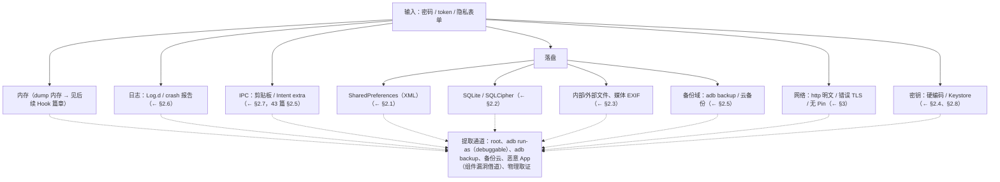
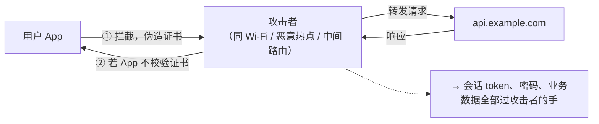

# 44. Android 数据存储与通信安全：落盘、密钥、传输与 MobSF 实操

> 日期：2026-11-04
> 所属大纲阶段：8. 移动安全（Android）—— 第 4 篇
> 前置：`notes/43-Android-组件安全.md`（组件攻防；本篇 WebView SSL 错误处理与其互为参照）、`notes/42-APK-逆向分析.md`（jadx / apktool）、`notes/09-密码学基础-对称与非对称.md`、`notes/10-哈希-消息认证码与-TLS.md`、`notes/32-密钥管理.md`
> 参考资料：
> - Android Developers：[数据存储](https://developer.android.com/training/data-storage)、[Android Keystore 系统](https://developer.android.com/training/articles/keystore)、[网络安全配置](https://developer.android.com/training/articles/security-config)、[EncryptedSharedPreferences](https://developer.android.com/reference/androidx/security/crypto/EncryptedSharedPreferences)
> - OWASP MASTG：「Android Data Storage」「Mobile Network Communications」章节 — <https://mas.owasp.org/MASTG/>
> - OWASP MASVS v2（Mobile Application Security Verification Standard）— <https://mas.owasp.org/MASVS/>
> - MobSF（Mobile Security Framework）文档 — <https://mobsf.github.io/docs/>
> - OWASP Cryptographic Storage Cheat Sheet / Cheat Sheet Series
> - SQLCipher for Android — <https://discuss.zetetic.net/c/sqlcipher-for-android>

**合规红线**：本篇所有提取/扫描/解包操作仅针对**本地模拟器上自制的教学 demo App 与开源靶场（DIVA、InsecureBankv2）**，用于理解漏洞原理与修复方案；文中技术不用于任何未授权目标。

---

## 1. 导读：数据的一生与攻击面地图

一篇笔记装不下「所有存储 API」，但装得下**方法论**：对任何 App，先画出数据生命周期，再在每个落点问三个问题——**明文吗？谁能读？密钥在哪？**



对照你已有的知识：`notes/16-认证与会话管理.md` 讲过「token 存哪里」是 Web 的关键决策；Android 只是把同样的决策搬到了终端——但**攻击者模型里多了一台可以 root 的设备**。

---

## 2. 本地存储安全

### 2.1 SharedPreferences：明文、共享模式与加密

**SharedPreferences（共享偏好）**是键值对存储，落盘为 `/data/data/<pkg>/shared_prefs/*.xml` 明文文件。

**漏洞 demo**（自制 `com.vuln.demo`，环境：Android Studio + API 30 模拟器）：

```java
// ───── 漏洞代码：token/密码明文入库 ─────
SharedPreferences sp = getSharedPreferences("auth", MODE_PRIVATE);
sp.edit().putString("token", "eyJhbGciOi...").putString("pwd", "P@ss").apply();
```

提取路径（三通道对照）：

```bash
# 通道 1：adb run-as —— 仅 debuggable=true 的包可用（教学靶场/自家 debug 构建满足）
adb shell run-as com.vuln.demo ls shared_prefs
adb shell run-as com.vuln.demo cat shared_prefs/auth.xml
# 输出：<string name="token">eyJhbGciOi...</string> ← 明文 token

# 通道 2：root 设备/模拟器直接读
adb shell su -c "cat /data/data/com.vuln.demo/shared_prefs/auth.xml"

# 通道 3：adb backup（allowBackup=true 时无需 root，见 §2.5）
```

**历史遗留：MODE_WORLD_READABLE / MODE_WORLD_WRITABLE**。这两个「世界可读/可写」标志在 API 17 起弃用、**Android 7.0 起直接抛 `SecurityException`**——它允许其他 App 直接读你的偏好文件，等于组件导出漏洞的存储版。审计旧代码（尤其继承自 2015 年前工程）仍要全局搜索这两种模式。

**加密方案：EncryptedSharedPreferences**。原理：**主密钥（Master Key）由 Android Keystore 生成保管（AES-256-GCM，不可导出）**，用它加密「每个键的密钥」与「每个值」；文件被拷走也没有 Keystore 里的主密钥，解不开。

```kotlin
// ───── 安全代码（androidx.security:security-crypto 1.1.0，minSdk 23+）─────
val masterKey = MasterKey.Builder(context)
    .setKeyScheme(MasterKey.KeyScheme.AES256_GCM)   // 主密钥进 Keystore
    .build()

val prefs = EncryptedSharedPreferences.create(
    context,
    "secure_auth",                       // → shared_prefs/secure_auth（内容全密文）
    masterKey,
    EncryptedSharedPreferences.PrefKeyEncryptionScheme.AES256_SIV,   // 键加密
    EncryptedSharedPreferences.PrefValueEncryptionScheme.AES256_GCM  // 值加密
)
prefs.edit().putString("token", jwt).apply()        // 用法与普通 SharedPreferences 相同
```

> 注：官方 2024 年已将 `androidx.security:security-crypto` 置于维护/废弃状态，建议新项目评估直接用 Tink 或 DataStore+Tink；但它仍是理解「Keystore 封装数据密钥」这一模式（§2.4 模式二）的最佳范例。

**还有一类问题加密救不了**：密钥放 Java 侧硬编码 + 手写 AES（§4 审查清单）——加密强度取决于最弱的一环。

### 2.2 SQLite：注入与全库加密

#### 2.2.1 拼接 SQL 注入（对照 11 篇）

本地 SQLite 同样会注入：攻击入口通常是**导出组件**（43 篇 §5）或恶意 deeplink 携带的查询参数。

```java
// ───── 漏洞代码：rawQuery 拼接 ─────
public Cursor searchNotes(String kw) {
    return db.rawQuery(
        "SELECT * FROM notes WHERE title LIKE '%" + kw + "%'", null);
    // 输入  ' OR 1=1 --   → 全表；  ' ; DROP TABLE notes-- （multiStatement 视配置而定）
}

// query() 的 selection 拼接同样致命：
db.query("notes", null, "title = '" + kw + "'", null, null, null, null);
```

```kotlin
// ───── 安全代码：参数化占位符 ─────
fun searchNotes(kw: String): Cursor =
    db.rawQuery("SELECT * FROM notes WHERE title LIKE '%' || ? || '%'", arrayOf(kw))
// 或
db.query("notes", null, "title LIKE '%' || ? || '%'", arrayOf(kw), null, null, null)
```

原理与 `notes/11-SQL-注入.md` 完全一致：**值只能经参数通道进入 SQL，永远不参与语法结构**。差异点：本地库通常没有「跨用户数据」的概念，注入的危害集中在**绕过过滤条件读取同库其他表**（如把私密笔记表读出来）与配合导出 Provider 形成跨 App 数据泄露链。

#### 2.2.2 SQLCipher 全库加密

**SQLCipher** 给 SQLite 加透明加密层（AES-256-CBC，整库文件加密）。对「库文件整体是敏感数据」的场景（聊天记录、离线病历），比逐字段加密省事得多：

```kotlin
// build.gradle: implementation("net.zetetic:sqlcipher-android:4.5.4")
//                implementation("androidx.sqlite:sqlite-ktx:2.4.0")
System.loadLibrary("sqlcipher")

// ① 口令不能硬编码：Keystore 生成随机 32 字节密钥（§2.4 模式三）
val dbKey = KeyStoreManager.getRandomOrGenerate("db_key")   // 存在 Keystore 里
val helperFactory = SupportOpenHelperFactory(dbKey)

val db = Room.databaseBuilder(context, AppDb::class.java, "secret.db")
    .openHelperFactory(helperFactory)     // Room + SQLCipher
    .build()
```

注意：密钥放 Keystore = **密钥与设备绑定**，换机迁移需要专门的数据迁移流程（先解密导出再重新加密导入），产品上要提前设计。

### 2.3 文件存储：内部、外部、Scoped Storage 与 EXIF

| 位置 | API | 其他 App 可读？ | 典型风险 |
|---|---|---|---|
| 内部存储 | `openFileOutput` / `filesDir` / `cacheDir` | 否（沙箱私有） | root/run-as/backup 提取；明文敏感文件 |
| 外部应用目录 | `getExternalFilesDir()` | **Android 10 及以前：可读**（挂载在共享分区）；**Android 11 起其他应用基本无法直接读取其他 App 的 Android/data、Android/obb**（即便持有 MANAGE_EXTERNAL_STORAGE 也不行） | 写到这里的 token 在旧系统等于贴在门上；新系统也别当它私密 |
| 共享存储 | `Environment.getExternalStorageDirectory()`（已弃用）/ `MediaStore` | 是 | 任意 App 扫到 |
| 应用专属外置 | `context.getExternalFilesDirs()` | 视 Android 版本 | 同上 |

**作用域存储（Scoped Storage，Android 10 引入、11 强制）**的演进要点：targetSdk 29+ 起 App 只能直接访问自己的外部目录与经 MediaStore/SAF 访问共享媒体；`MANAGE_EXTERNAL_STORAGE`「所有文件访问」仅面向文件管理器类应用并由商店审核把关。审计旧 App 时重点看 `getExternalStorageDirectory()` 残留调用。

```kotlin
// ❌ 漏洞代码：token 写共享目录
File(Environment.getExternalStorageDirectory(), "token.txt").writeText(jwt)
// 任意 App / 用户拷贝 / 云相册同步全都能拿到

// ✅ 修复：敏感数据只进内部存储；确需导出的用应用专属目录并限期清理
openFileOutput("session.bin", MODE_PRIVATE).use { it.write(encryptedBlob) }
```

**媒体文件敏感信息泄露（EXIF）**：拍照/截图上传到共享媒体目录时，**EXIF（Exchangeable Image File Format，可交换图像文件格式）元数据**携带 GPS 坐标、时间、设备型号——这是隐私合规事故高发点。上传/分享前清洗：

```kotlin
val exif = ExifInterface(file.absolutePath)
exif.setAttribute(ExifInterface.TAG_GPS_LATITUDE, null)
exif.setAttribute(ExifInterface.TAG_GPS_LONGITUDE, null)
exif.setAttribute(ExifInterface.TAG_DATETIME_ORIGINAL, null)
exif.saveAttributes()
```

### 2.4 Android Keystore 详解（重点）

**Android Keystore（密钥库）**是系统提供的密钥保管设施，两大杀手锏：

1. **密钥不可导出**：私钥/对称密钥生成后只在安全环境内使用，`getKey` 拿到的只是句柄；即使系统被 root，密钥材料也不离开硬件（视设备为 **TEE（Trusted Execution Environment，可信执行环境）** 或 **StrongBox（安全芯片，Pixel 3+ 等设备支持）** backed）。
2. **可绑定用户认证**：密钥可声明「必须用户解锁/生物识别后才能用」，把「持有设备」升级为「持有设备 + 活体确认」。

**KeyGenParameterSpec 完整用法**（生成 + 使用 + 生物识别绑定）：

```kotlin
object KeyStoreManager {
    private const val ALIAS = "vuln_demo_key"

    /** 生成 AES-256-GCM 密钥，存入 AndroidKeyStore */
    fun getOrCreateKey(): SecretKey {
        val ks = KeyStore.getInstance("AndroidKeyStore").apply { load(null) }
        (ks.getEntry(ALIAS, null) as? KeyStore.SecretKeyEntry)?.let { return it.secretKey }

        val gen = KeyGenerator.getInstance(KeyProperties.KEY_ALGORITHM_AES, "AndroidKeyStore")
        gen.init(
            KeyGenParameterSpec.Builder(
                ALIAS,
                KeyProperties.PURPOSE_ENCRYPT or KeyProperties.PURPOSE_DECRYPT
            )
            .setBlockModes(KeyProperties.BLOCK_MODE_GCM)
            .setEncryptionPaddings(KeyProperties.ENCRYPTION_PADDING_NONE)
            .setKeySize(256)
            // ↓ 绑定用户认证：锁屏凭据/强生物识别通过后密钥才可用（API 30+ 写法）
            .setUserAuthenticationRequired(true)
            .setUserAuthenticationParameters(
                30,  // 认证有效期 30 秒（0 = 每次都要认证）
                KeyProperties.AUTH_BIOMETRIC_STRONG or KeyProperties.AUTH_DEVICE_CREDENTIAL
            )
            .setInvalidatedByBiometricEnrollment(true) // 新录指纹使旧密钥失效
            .build()
        )
        return gen.generateKey()
    }
}

// 使用：每次加密随机 IV（GCM 12 字节），IV 与密文一起存
fun encrypt(plain: ByteArray): Pair<ByteArray, ByteArray> {
    val cipher = Cipher.getInstance("AES/GCM/NoPadding")
    cipher.init(Cipher.ENCRYPT_MODE, KeyStoreManager.getOrCreateKey())
    return cipher.iv to cipher.doFinal(plain)          // iv 随密文落盘（IV 不需要保密）
}
fun decrypt(iv: ByteArray, blob: ByteArray): ByteArray {
    val cipher = Cipher.getInstance("AES/GCM/NoPadding")
    cipher.init(Cipher.DECRYPT_MODE, KeyStoreManager.getOrCreateKey(), GCMParameterSpec(128, iv))
    return cipher.doFinal(blob)
}
```

**生物识别绑定的完整闭环**（登录后才能解密数据）：`BiometricPrompt.CryptoObject(cipher)` 传入 `authenticate()`，认证通过后回调里拿到的 cipher 才被密钥授权，可执行解密——假界面/脚本没有用户活体，永远走不进回调。

**三种密钥管理模式对比**（审计时先判断目标属于哪种）：

| 模式 | 做法 | 密钥暴露面 | 适用 |
|---|---|---|---|
| 一：硬编码密钥 | 写死在代码/资源里 | 逆向即得（jadx 秒搜），**不可接受** | 仅测试代码 |
| 二：随机密钥 + Keystore 封装 | 数据密钥随机生成，用 Keystore 里的 KEK（Key Encryption Key，密钥加密密钥）加密后与数据同存（EncryptedSharedPreferences 即此类） | 拿到文件拿不到 KEK，密钥不可离机 | 大多数本地加密场景 |
| 三：Keystore 直接生成密钥 | 密钥生成后永不离开 Keystore，加解密经句柄完成 | 最小（硬件绑定） | 设备内闭环加密；配合生物识别 |

**局限**：模式三的密钥无法参与「与服务器共享对称密钥」的协议（密钥出不了设备）——服务端参与的场景要用非对称（Keystore 生成密钥对，公钥上传）或 mTLS（§3.5）。

### 2.5 备份面：allowBackup 与 adb backup

清单里默认 `android:allowBackup="true"`。它意味着：**通过 USB 连接的电脑可以不解锁、不 root 地整体导出应用私有数据**。

```bash
# 提取实操（本地模拟器 + 自制 demo）
adb backup -f vuln.ab -noapk com.vuln.demo
#   → 手机上出现「完整备份」确认框（教学环境直接点允许；真实攻击场景配合社会工程）
# 解包（Android Backup Extractor，abe.jar）：
java -jar abe.jar unpack vuln.ab vuln.tar ""
tar -tf vuln.tar | head        # shared_prefs、databases、files 全在
tar -xf vuln.tar apps/com.vuln.demo/f/shared_prefs/auth.xml -O   # 明文 token 落地
```

**Android 12 起的限制**：`adb backup` 被收紧——默认不再放行（需 `allowBackup=true` 且部分版本还要求 debuggable；Google 一直在弱化该通道）。因此：新系统上该通道退化，但**云备份**仍读取 `allowBackup`：开启后偏好文件/数据库会进 Google 云备份，**敏感字段必须加 `android:fullBackupContent` 排除规则**：

```xml
<!-- AndroidManifest.xml -->
<application android:allowBackup="false" ...>   <!-- 首选：能关就关 -->

<!-- 必须参与云备份时，用规则排除敏感项：backup_rules.xml -->
<full-backup-content>
    <exclude domain="sharedpref" path="secure_auth.xml"/>
    <exclude domain="database" path="secret.db"/>
</full-backup-content>
```

### 2.6 日志泄露

`Log.d("AUTH", "token=" + jwt)` 是最低成本的信息泄露。**logcat（系统日志缓冲）的读取边界**：

- 其他 App：Android 4.1 起无法读取全局日志（`READ_LOGS` 不再授予第三方）——**但同 UID 进程、以及你 App 集成的第三方 SDK 在自己进程内可读自己的日志**；
- `adb logcat`：USB 调试开启时任何连接的电脑可读全部（开发中=方便，发布后被插线=灾难）；
- 崩溃报告（ACRA/Firebase Crashlytics 自定义附加数据）与 bugreport 会把日志带出设备。

**release 构建剥离日志**（R8/ProGuard，构建时用 `minifyEnabled true` 启用）：

```proguard
# proguard-rules.pro：把无副作用的 debug/verbose/info 调用优化为空操作
-assumenosideeffects class android.util.Log {
    public static int v(...);
    public static int d(...);
    public static int i(...);
}
```

代码纪律：**日志只打脱敏后的数据**（token 只打前后 4 位、手机号打码），而不是依赖混淆剥离兜底——两者是两层防御。

### 2.7 剪贴板与 Intent 传递敏感数据

- **剪贴板（ClipboardManager）是全系统单例**：任何获得焦点的前台 App、默认输入法都能读。Android 10+ 限制后台读取、Android 12+ 读取时弹出 Toast 提示，但**前台恶意 App 仍可读**。纪律：密码、验证码、token 不进剪贴板；「复制邀请码」这类功能仅限低敏值并提示时效。
- **Intent extra 不是私密通道**：隐式广播/可变 PendingIntent 会把 extra 送到恶意 App 手里（43 篇 §1.4、§2.5）；显式 Intent 发给第三方 SDK 组件时 extra 同样离开你的控制。规则：**跨信任边界不携带凭据明文**，改传一次性授权码或范围受限的 content URI（`FLAG_GRANT_READ_URI_PERMISSION`）。

### 2.8 硬编码密钥检测方法（静态审计）

配合 `notes/42-APK-逆向分析.md` 的 jadx 工作流，按下面清单系统性排查：

| 检查对象 | jadx 搜索词 / 特征 | 判定线索 |
|---|---|---|
| Java 层常量密钥 | `secret`、`SecretKey`、`api_key`/`apikey`、`AES`、`DES`、`password =`、`token =`、`"BEGIN PRIVATE KEY"`、`salt` | 命中后看是否参与 `SecretKeySpec`/`IvParameterSpec` |
| Base64 长串 | 正则 `[A-Za-z0-9+/]{16,}={0,2}` 过滤资源/代码 | 长度恰为 16/24/32 字节的 Base64 高度可疑（AES 密钥） |
| 资源与 assets | `res/values/strings.xml`、`assets/*.json`、`assets/*.jks/.bks/.p12` | 证书文件/配置里的 client_secret |
| native 层（JNI） | `System.loadLibrary` → lib/*/ *.so | `strings libxxx.so | grep -i key` 粗筛，进阶用 ghidra 反编译看 JNI 函数（42 篇 §native 章）——**藏 so 里只是提高成本，不是加密** |
| 网络层密钥 | 硬编码 `Authorization:`、第三方 SDK AppKey/Secret 对 | 结合泄露平台（如泄露后是否可撞 API 配额）评估危害 |

MobSF 的「Security Findings → Hardcoded Secrets」自动做前两类（§5），但**误报率高**，命中后必须人工回溯密钥的实际用途（见 §5.4 甄别方法）。

---

## 3. 网络通信安全（重点）

### 3.1 威胁模型：移动端 MITM 的特殊性



与 Web 的差异（承接 `notes/02-HTTP-HTTPS-协议详解.md`）：浏览器有统一证书校验，而 **App 的 TLS 校验逻辑由每个开发者自己写**——写错的成本极低（Stack Overflow 上的「忽略证书异常」回答被复制了千万次），因此「HTTPS App 被抓包」长期是移动安全的高频发现。

### 3.2 HTTPS 错误实现大全（漏洞代码 + 修复代码）

**(1) 信任所有证书：空 X509TrustManager**

```java
// ───── 漏洞：经典「信任一切」——任何自签证书都通过 ─────
TrustManager[] tm = new TrustManager[]{ new X509TrustManager() {
    public void checkClientTrusted(X509Certificate[] c, String a) {}
    public void checkServerTrusted(X509Certificate[] c, String a) {}  // ❌ 空
    public X509Certificate[] getAcceptedIssuers() { return new X509Certificate[0]; }
}};
SSLContext ctx = SSLContext.getInstance("TLS");
ctx.init(null, tm, new SecureRandom());
HttpsURLConnection.setDefaultSSLSocketFactory(ctx.getSocketFactory());
```

```kotlin
// ───── 修复：用平台默认（系统 CA + 完整校验链）─────
val factory = SSLContext.getDefault().socketFactory   // 不要自建 TrustManager
// OkHttp 场景：不通过 sslSocketFactory(...) 自定义 SSLSocketFactory，默认即安全
val client = OkHttpClient()   // 默认信任系统 CA + 校验主机名
```

**(2) HostnameVerifier 恒真**

```kotlin
// ───── 漏洞：证书域名不匹配也放行（配合(1)是「双保险全关」）─────
HttpsURLConnection.setDefaultHostnameVerifier { _, _ -> true }  // ❌
// 修复：删除该行；确有内网多域名需求时用白名单：
val allowed = setOf("api.example.com", "cdn.example.com")
HttpsURLConnection.setDefaultHostnameVerifier { h, _ -> h in allowed }
```

**(3) WebView 忽略证书错误**：`onReceivedSslError` 里 `handler.proceed()`——见 `notes/43` §7.6（同一根因的 UI 层面孔）。

**(4) 证书固定写死成「信任任意自签」（把 pin 算错/写死过期值后临时注释掉校验）**——见 §3.4 的 pin 轮换风险管理。

四类错误共同的检测特征（jadx 搜索）：`checkServerTrusted` 空方法体、`return true` 的 HostnameVerifier、`proceed()`、`setHostnameVerifier`、`TrustAllCerts`、`NaiveTrustManager` 这类命名。

### 3.3 网络安全配置 networkSecurityConfig

**网络安全配置（Network Security Configuration）**从 Android 7.0 起统一管理 App 的传输信任策略，清单一行启用：

```xml
<application android:networkSecurityConfig="@xml/network_security_config" ...>
```

```xml
<!-- res/xml/network_security_config.xml：安全基线模板 -->
<network-security-config>
    <!-- 全局禁止明文 http（targetSdk 28+ 默认已禁，显式声明防回退） -->
    <base-config cleartextTrafficPermitted="false">
        <trust-anchors>
            <certificates src="system"/>       <!-- 只信任系统 CA -->
        </trust-anchors>
    </base-config>

    <!-- 例外逐域写明：仅内网测试域允许明文 -->
    <domain-config cleartextTrafficPermitted="true">
        <domain includeSubdomains="true">local.dev.lab</domain>
    </domain-config>

    <!-- 仅 debug 构建信任用户安装的 CA（Burp 抓包的正道，见下） -->
    <debug-overrides>
        <trust-anchors>
            <certificates src="system"/>
            <certificates src="user"/>
        </trust-anchors>
    </debug-overrides>
</network-security-config>
```

**Android 7+ 的抓包难点根源**：targetSdk ≥ 24 的 App **默认不再信任用户安装的 CA 证书**（系统级防中间人设计）。因此在用户层装 Burp 证书抓自家/三方 App 包常常「全部失败」。应对：自家 App 用 `debug-overrides` 或 `<domain-config>` 里 `<certificates src="user"/>` 显式放行；抓**别人家** App 则要重打包改配置或 Frida 绕过——那是动态分析篇（第 45 篇）的主战场，本篇先埋下伏笔。

### 3.4 SSL Pinning（证书锁定）

**证书锁定（Certificate Pinning / SSL Pinning）**：不只验证「证书是可信 CA 签的」，还验证「证书/公钥就是我心目中那一把」，把信任锚从上百个系统 CA 收敛到自己控制的密钥——CA 被入侵、企业代理证书都无法 MITM。

**OkHttp CertificatePinner 实现**：

```kotlin
// ① 生成 pin：在宿主机对目标域名取证书公钥的 SHA-256（SPKI 指纹）
// openssl s_client -connect api.example.com:443 -servername api.example.com </dev/null 2>/dev/null \
//   | openssl x509 -pubkey -noout \
//   | openssl pkey -pubin -outform der \
//   | openssl dgst -sha256 -base64
// → 输出如 "wR3kQm0B..."，前面加 sha256/ 前缀即 pin 值

val pinner = CertificatePinner.Builder()
    .add("api.example.com", "sha256/wR3kQm0Baaaaaaaaaaaaaaaaaaaaaaaaaaaaaaaaaaa=")  // 主 pin
    .add("api.example.com", "sha256/BACKUPkkkkkkkkkkkkkkkkkkkkkkkkkkkkkkkkkkk=")    // 备份 pin
    .build()

val client = OkHttpClient.Builder()
    .certificatePinner(pinner)
    .build()
```

**平台原生方式**（对 App 全部 HTTP 栈生效，含 WebView/第三方库走系统的部分）：

```xml
<domain-config>
    <domain includeSubdomains="true">api.example.com</domain>
    <pin-set expiration="2027-11-04">       <!-- 过期时间：强制团队定期轮换评审 -->
        <pin digest="SHA-256">wR3kQm0Baaaa...=</pin>
        <pin digest="SHA-256">BACKUPkkkk...=</pin>
    </pin-set>
</domain-config>
```

**锁死风险（pin 失效 = App 断网）与备份 pin 策略**：证书轮换（CA 到期、换供应商、事故换钥）后旧 pin 不匹配 → 全量用户无法联网，属于可用性事故。业界做法：**至少两把 pin**——当前证书 + 备用密钥（或 CA 中间证书）的 pin；pin 中间 CA 比逐张叶子证书更耐轮换；`expiration` 属性强制到期重审。

**WebView 的 pin**：WebView 没有原生 pin API。常规做法：H5 业务走 App 原生网络层（OkHttp 统一收口）后本地渲染；或至少给 WebView 配置禁止明文/禁止 file 域（43 篇 §7）降低剩余风险。

### 3.5 双向认证 mTLS 与客户端证书

**双向认证（mutual TLS, mTLS）**：服务端也验证客户端证书。客户端私钥的存放位置决定整套方案的下限：

- 私钥生成在 **Android Keystore**（非对称密钥对，公钥导出注册到服务端）——私钥不可导出，最佳；
- 私钥打进 `.bks/.p12` 文件放 assets——逆向一锅端，仅比明文好一点；
- 私钥硬编码在代码里——形同裸奔。

一句话结论：**mTLS 的安全性 = 客户端私钥的存放安全性**，回到 §2.4 的 Keystore 模式三。

### 3.6 降级攻击与明文流量

- **明文 http 请求**：`usesCleartextTraffic`/`cleartextTrafficPermitted` 默认已禁，但要防「为了一个老接口临时开全局」。检测：MobSF 报告「IP String / URL 发现」里的 `http://` 条目 + Burp 被动侦听（本地测试环境）全局观察 API 是否有明文通道（用法见 `notes/17-Burp-Suite-使用指南.md` 的 Passive Scan）。
- **协议降级**：现代栈 TLS 1.2+ 基本杜绝协议级降级，剩下的是**业务级降级**——https 失败后自动回退 http、或接口 v2 报错就回 v1（v1 无签名）。设计纪律：失败要硬失败，不自动降安全级别。
- WebView 的混合内容 = 站内降级（43 篇 §7.5 的 `MIXED_CONTENT_NEVER_ALLOW`）。

---

## 4. 加密实现审查清单（静态审计视角）

在 jadx 里按模式搜代码，比逐行读快得多。每条给出「搜索特征 → 问题 → 修复」：

| # | 检查项 | jadx 搜索特征 | 为什么错 | 修复 |
|---|---|---|---|---|
| 1 | **ECB 模式** | `"AES/ECB`；`Cipher.getInstance("AES")`（无模式参数时默认即 ECB） | 相同明文块→相同密文块，结构泄露（对照 09 篇的企鹅图） | `AES/GCM/NoPadding` 或 `AES/CBC/PKCS7` + 随机 IV |
| 2 | **固定 IV** | `IvParameterSpec(` 传常量数组；`byte[] iv = {0,...}` | CBC/GCM 下复用 IV 使相同明文可被关联，GCM 下复用 nonce 直接破坏认证加密安全性 | 每次加密 `cipher.iv` 随机生成并随密文存 |
| 3 | **SecureRandom 弱化** | `SecureRandom` 后跟 `setSeed(`（尤其传固定值） | 固定种子使「随机」变确定（2013 年比特币钱包失窃案的根源之一）；Android 4.4 前 PRNG 补种还有全局缺陷 | 删除 setSeed，用系统熵源 |
| 4 | **DES/3DES 遗留** | `"DES`、`"DESede`、`KeyGenerator.getInstance("DES")` | 56 位密钥早已可暴力破解 | AES-256 |
| 5 | **密码哈希未加盐/快哈希** | `MessageDigest.getInstance("MD5"/"SHA-1")` 处理口令；无盐 | 彩虹表 + GPU 暴力（对照 10 篇） | PBKDF2WithHmacSHA256（高迭代）或 Argon2；每用户随机盐 |
| 6 | **密钥硬编码** | 见 §2.8 清单 | 逆向即得 | Keystore 模式二/三（§2.4） |
| 7 | **ECB 的伪装形态** | `SecretKeySpec("AES")` 附近没有 IV 参数 | 与 #1 同根：无 IV 通常意味着 ECB | 同 #1 |
| 8 | **BASE64 当加密** | `Base64.encode` 包着「敏感数据」且无 Cipher | 编码≠加密 | 真加密 |

> 经验法则：**凡是 `Cipher.getInstance` 的 transformation 字符串不是 `AES/GCM/NoPadding`（或同等 AEAD）的，都值得停下来读完整上下文**。

---

## 5. MobSF 静态扫描实操（重点）

### 5.1 部署与扫描流程

**环境**：macOS 宿主机 + Docker。

```bash
# ① 部署（官方镜像）
docker run -it --rm -p 8000:8000 opensecurity/mobile-security-framework-mobsf:latest

# ② 浏览器打开 http://127.0.0.1:8000（首次自动建库）

# ③ 上传目标 APK（界面拖拽，或 API 方式，鉴权头为 X-MOBSF-API-KEY）：
curl -F 'file=@/path/to/demo.apk' http://127.0.0.1:8000/api/v1/upload \
     -H "X-MOBSF-API-KEY: <在 MobSF 设置页生成的 API Key>"
# Static Scan：curl -X POST http://127.0.0.1:8000/api/v1/scan -H "X-MOBSF-API-KEY: <key>" -d "scan_type=apk&file_name=demo.apk&hash=<上传返回的hash>"

# ④ 报告导出：Web UI 右上 PDF/JSON 导出（JSON 便于 CI 集成做门禁）
```

### 5.2 报告逐节解读（以自制 demo App 为例）

| 报告章节 | 内容 | 对应本篇章节 |
|---|---|---|
| App Security Score | 加权总分（低/中/高风险计数） | 总览 |
| Permissions Analysis | 申请的权限列表 + dangerous 权限标注 + 用途推断 | `notes/41` 权限章 |
| Android API Analysis | 敏感 API 调用点（剪贴板、Telephony、Crypto） | §2.7、§4 |
| **Browsable / Exported Activities** | 导出组件汇总（含 deeplink） | 43 篇 §1、§6 |
| **Manifest Analysis** | allowBackup、debuggable、cleartext、自定义权限保护级别 | §2.5、§3.3 |
| **Code Analysis** | 规则命中清单：弱加密、固定 IV、硬编码、WebView 危险开关、SSL 错误实现……每条带源码跳转 | §3.2、§4、43 篇 §7 |
| **Hardcoded Secrets** | 疑似密钥/令牌字符串 | §2.8 |
| File / Binary Analysis | APK 内证书指纹、签名方案、native 库、zip 嵌套（加壳检测线索） | `notes/41` 签名章 |
| Malicious Behaviour / Trackers | 疫情常备：短信发送、设备指纹、第三方 tracker SDK 清单 | — |
| **MASVS / MASTG Mapping** | 发现项映射到 MASVS 控制项 | §6 |
| Dynamic Analysis | 动态模块（需 Android 模拟器环境，Docker 里需额外配置 AVD/ Frida）——本篇只用静态，动态联动见第 46 篇 | 一句话伏笔 |

### 5.3 一次典型扫描的工作流闭环

```text
上传 APK → 看 Score/Findings 总览
  → Manifest Analysis：先砍「系统性」问题（backup/debuggable/cleartext/exported）
  → Code Analysis 逐条点开源码上下文 → 人工确认（下一节）
  → 修复 → 重新构建 → 再扫对比分数（CI 里可做成 merge request 门禁）
```

### 5.4 MobSF 误报甄别思路

MobSF 是「模式匹配 + 启发式」，不是语义理解。常见误报/漏报：

- **「App is debuggable / backup enabled」命中 debug 构建**：确认扫描对象是 release 包再定性；
- **Hardcoded Secrets 命中公开值**：示例 key、测试常量、公开算法的 S 盒——判断标准是「这串值攻击者拿到后能做什么」，回溯引用（jadx Find Usage）确认是否参与真实鉴权/加密；
- **「Exported component」命中带 signature 权限保护的组件**：有签名级权限保护的导出组件通常是设计内的（43 篇 §1.5），降级处理；
- **漏报**：加密调用下沉到 native 层（JNI）、服务端问题、逻辑漏洞（如 Intent 重定向的特定数据流）MobSF 看不见——静态扫描是起点不是终点，动态与人工复核（45/46 篇）补位。

---

## 6. OWASP MASVS：移动安全的「Checklist 之父」

**OWASP MASVS（Mobile Application Security Verification Standard，移动应用安全验证标准）**是移动安全需求的权威基线；**MASTG（Mobile Application Security Testing Guide）**是与之配套的测试指南（本系列 43/44 两篇的测试方法大量对齐 MASTG）。MASVS v2 八大主题：

| 主题 | 覆盖内容 | 本篇对应 |
|---|---|---|
| MASVS-STORAGE | 敏感数据落盘保护 | §2 全部 |
| MASVS-CRYPTO | 加密实现正确性 | §2.4、§4 |
| MASVS-AUTH | 认证与会话 | 引 43 篇 §2.1、16 篇 |
| MASVS-NETWORK | 网络传输安全 | §3 全部 |
| MASVS-PLATFORM | 与平台（组件/IPC/WebView）安全交互 | 43 篇主体 |
| MASVS-CODE | 代码质量、注入、反编译面 | §2.8、42 篇 |
| MASVS-RESILIENCE | 防篡改/反逆向/反调试（R 级） | 45/46 篇伏笔 |
| MASVS-PRIVACY | 隐私数据最小化 | §2.3 EXIF、§2.7 |

验证级别：**L1**（基线，所有 App 应达到）、**L2**（处理高敏数据的 App）、**R（Repackaging/抗篡改，叠加项）**。用法：把 MASVS 条目当作威胁建模（`notes/07-威胁建模.md`）后的验收清单，MobSF 报告的 MASVS Mapping 直接给出差距视图。

---

## 7. 综合演练：五类存储漏洞 demo 的检出与修复

> 环境：本地模拟器（API 30）+ 自制 `com.vuln.demo`（含下列 5 类漏洞）+ 宿主机 MobSF/jadx/adb。完整走一遍「检出 → 定位 → 修复 → 复测」。

| # | 植入漏洞 | 检出命令（工具） | 检出结果 | 修复（对应本篇） |
|---|---|---|---|---|
| 1 | token 明文存 SharedPreferences | `adb shell run-as com.vuln.demo cat shared_prefs/auth.xml` | XML 里直接看到 `eyJ...` | EncryptedSharedPreferences（§2.1） |
| 2 | SQLite 拼接查询 | drozer `run app.provider.query ... --selection "1=1"`（组件导出，43 篇 §5.2） | 返回全表 | 参数化 + provider 收敛（§2.2.1） |
| 3 | token 写外部共享目录 | `adb shell "ls /sdcard/ && cat /sdcard/token.txt"` | 任意可读 | 改内部存储；检查 EXIF 类风险（§2.3） |
| 4 | `Log.d("AUTH", token)` | `adb logcat -d \| grep -i token` | logcat 明文 | 脱敏 + ProGuard 剥离（§2.6） |
| 5 | 代码里硬编码 AES key | MobSF Hardcoded Secrets / jadx 搜 `SecretKeySpec` | 命中 `k = "1234567890abcd..."` | Keystore 模式二/三（§2.4、§2.8） |

**修复后复测**：`run-as` 读出密文、drozer 注入失效、`/sdcard` 无残留、logcat 无 token、MobSF Score 由「High Risk」降档——五项全绿才算闭环。把整个过程（命令 + 截图 + 修复 diff）记录到 `labs/` 目录作为实验档案，正是本工作区 `labs/` 约定的用法。

---

## 8. 防御专章：Checklist（存储 / 日志 / 网络 / 加密，20 条）

**存储类**：

1. 敏感数据一律内部存储（`filesDir`），绝不落共享目录；外部目录只放可公开数据。
2. SharedPreferences 敏感项用 EncryptedSharedPreferences（或 Tink 方案）。
3. 敏感 SQLite 库用 SQLCipher 全库加密，密钥进 Keystore。
4. `android:allowBackup="false"`；必须云备份的敏感项用 `fullBackupContent` 排除。
5. release 构建确认 `debuggable=false`（`aapt dump badging` 复核），杜绝 run-as 通道。
6. 媒体文件分享/上传前清洗 EXIF（GPS、时间）。
7. WebView 存储域隔离：敏感页面数据不进 DOM storage 长期残留，退出时 `clearCache()/clearHistory()` 评估使用。
8. 过期数据及时清理：`cacheDir` 敏感缓存限期删除。

**日志与 IPC 类**：

9. 日志脱敏（token/手机号打码），不依赖单一手段。
10. release 启用 R8 `-assumenosideeffects` 剥离 Log.v/d/i。
11. 崩溃报告附加数据白名单制，禁止整包 SharedPreferences 上传。
12. 剪贴板只进低敏数据；Intent 跨信任边界不携带凭据明文。

**网络类**：

13. 全局 `cleartextTrafficPermitted="false"`，例外逐域声明并评审。
14. 不自建 TrustManager/HostnameVerifier；`checkServerTrusted` 空实现直接打回。
15. `onReceivedSslError` 一律 `cancel()`。
16. 高敏接口启用 SSL Pinning（主 pin + 备份 pin + expiration），密钥轮换流程先行。
17. mTLS 客户端私钥生成于 Android Keystore，禁止 assets 打包 p12/bks。
18. 失败不降级：https/接口签名校验失败要硬失败，禁止回退旧协议。

**加密类**：

19. 对称加密只用 AEAD（AES/GCM），随机 IV 随密文存储；禁 ECB/DES/固定 IV。
20. 密钥三问制度：密钥从哪来（Keystore 生成）、存在哪（Keystore/封装）、怎么轮换（有流程才算合格）——衔接 `notes/32-密钥管理.md` 的全生命周期视角。

---

## 9. 检测特征汇总（红队/审计双视角）

**静态（jadx/MobSF）特征速查**：

- 存储：`getSharedPreferences.*MODE_WORLD`、`getExternalStorageDirectory`、`openFileOutput.*MODE_WORLD_READABLE`、`SharedPreferences` 键名含 token/pwd；
- 加密：§4 表格的 8 类搜索模式；
- 网络：空 `checkServerTrusted`、`HostnameVerifier` 返回 true、`onReceivedSslError` + `proceed`、`usesCleartextTraffic="true"`、无 `networkSecurityConfig`；
- 清单：`allowBackup="true"`、`debuggable="true"`。

**动态（adb/Burp）特征**：

- `adb shell run-as <pkg> ls -R`（debuggable）盘点落盘面；`adb backup` 验证备份面；
- `adb logcat -d | grep -iE "token|pwd|jwt"` 快速验证日志面；
- Burp（本地环境）挂代理观察：明文请求直接可见；https 报证书错误且 App 仍正常通信 → 证书校验被绕（SSL 错误实现实锤）；连不上且证书报错 → 走读代码确认是否有 Pinning。

---

## 10. 常见误区

1. **「数据存在私有目录 = 安全」**——root、run-as（debuggable）、adb backup、云备份、组件漏洞借道，五条通道都在私有目录之外等你。位置是起点不是终点。
2. **「用了加密就够了」**——密钥硬编码 + ECB + 固定 IV 的「加密」比明文只多一层伪装；加密审查要看完整上下文（§4）。
3. **「EncryptedSharedPreferences 万事大吉」**——它保护「文件被拷走」的场景；不防 root 下进程内读取、不防你自己把明文写进日志。
4. **「targetSdk 28+ 默认禁明文，所以没明文流量」**——旧 targetSdk、第三方 SDK 自建 native 网络栈（不走系统配置）、`usesCleartextTraffic` 手动开启都会绕开默认值，要用抓包验证而不是推断。
5. **「Pinning 越多越安全」**——没有备份 pin、没有 expiration、没有轮换预案的 pin 是定时炸弹（证书轮换日 = 全量断网事故）。
6. **「Android 7+ 抓不了包说明 App 很安全」**——那只是系统默认不信任用户 CA；传输安全要按 §3 的实现审查确认，而不是以「抓不到」反推。
7. **「MobSF 高分 = 安全」**——静态扫描有漏报（native 层、服务端、逻辑漏洞）；分数是回归对比工具，不是安全证明。
8. **「密钥藏在 so 里就是加密」**——提高逆向成本 ≠ 密钥保密性；运行时密钥终究要在内存里出现（45 篇 Hook 的主战场）。

---

## 11. 自测问题

1. debuggable 与 run-as 的关系是什么？为什么教学靶场能 `run-as`，正式发布包不能？
2. EncryptedSharedPreferences 的主密钥存在哪里？数据文件与密钥的分离为什么能防「文件被拷走」？防不了什么？
3. 写出 SQLite 参数化查询的安全代码（`query()` 与 `rawQuery()` 各一版），并说明 `%` 通配符拼接为什么危险。
4. Keystore 三种密钥管理模式各适合什么场景？为什么「与服务器共享对称密钥」做不到模式三？
5. `allowBackup=true` 下，攻击者拿到备份文件的完整利用链是什么？`fullBackupContent` 排除规则防的是云备份还是 adb backup？
6. Android 7.0 之后，为什么在用户证书里装 Burp CA 仍然抓不到大多数 App 的包？自家 App 开发期正确的放行方式是什么？
7. 生成 SSL Pin 的 openssl 命令管道里每一步分别在做什么？为什么必须配备份 pin？
8. jadx 中看到 `Cipher.getInstance("AES")`，你的第一判断是什么？补全它的风险推理链。
9. MobSF 报了一个「Hardcoded Secret」，列出你的人工确认步骤。
10. 把 MASVS 八大主题与本篇章节一一对应（闭卷默写），并说明 L1/L2/R 三个验证级别的差异。

**参考答案要点**：1. run-as 仅对 debuggable 包可用，靶场/自家 debug 构建满足；release 关闭后需 root。2. 主密钥在 Android Keystore（不可导出）；密文文件离开设备没有 KEK 解不开；防不了 root 进程内读取与明文日志。3. `db.query("notes",null,"title LIKE '%'||?||'%'",arrayOf(kw),...)` 与 `rawQuery("... LIKE '%'||?||'%'", arrayOf(kw))`；拼接使输入进入 SQL 语法层。4. 见 §2.4 对比表；模式三密钥不可导出，无法与服务端共享。5. adb backup（用户确认）→ abe 解包 → tar 提取明文；fullBackupContent 主要约束云备份/备份引擎，adb backup 通道靠 allowBackup=false 关闭最稳妥。6. targetSdk≥24 默认不信任用户 CA；debug-overrides 或 domain-config 显式放行（仅 debug 构建）。7. 取证书→提取公钥→DER 编码→SHA-256+Base64；防证书轮换导致全量断网。8. 默认 AES/ECB/PKCS5Padding→结构泄露→查 IV 来源确认。9. jadx 找引用→确认参与鉴权/加密→评估泄露后果→定级。10. 见 §6 表；L1 基线 / L2 高敏 / R 抗篡改叠加。

---

**下一篇预告**：第 45 篇将进入**动态分析与抓包对抗**——Frida Hook 原理、绕过 SSL Pinning 的正反向工程、`networkSecurityConfig` 之外的抓包方案。本篇 §3.3 的「Android 7+ 用户 CA」正是那一篇的引子。

---

## 附：ASCII 图 → Mermaid 替换清单

| 原 ASCII 图（小节 · 内容） | 替换后类型 |
| --- | --- |
| 「1. 导读：数据的一生与攻击面地图」节 · 数据生命周期与攻击面分层图（含提取通道） | flowchart TD |
| 「3.1 威胁模型：移动端 MITM 的特殊性」节 · 中间人场景图（攻击者居中截获会话） | flowchart LR |
