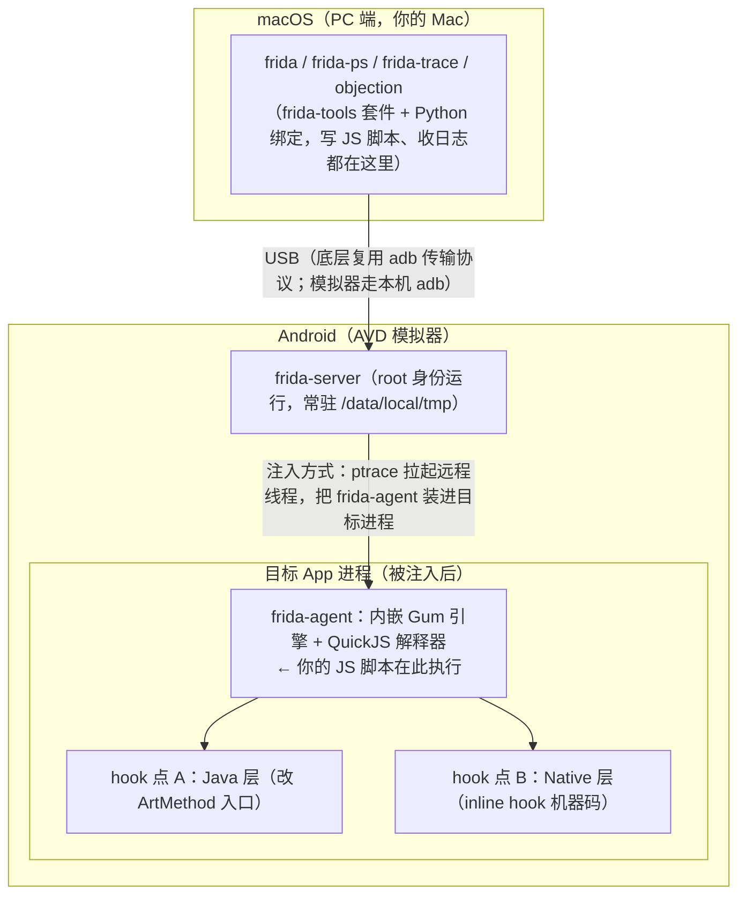
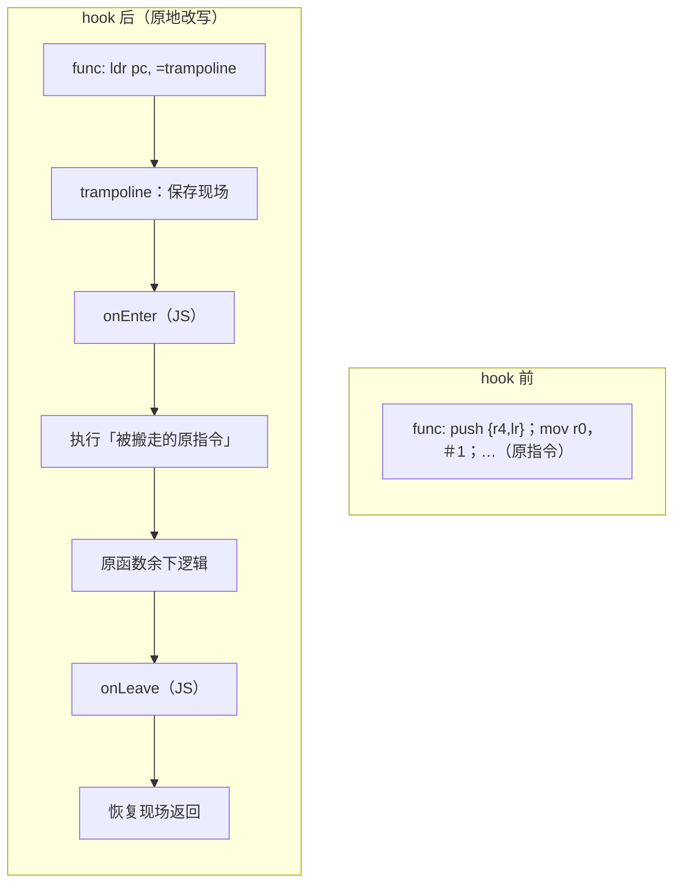
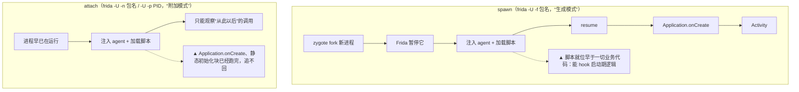
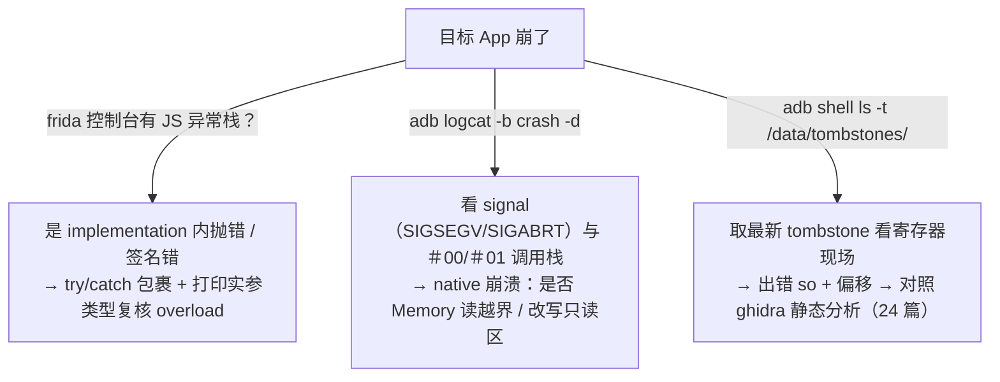

# 45. Frida Hook 与动态分析

> 日期：2026-11-04
> 所属大纲阶段：8. 移动安全（Android）
> 参考资料：
> - Frida 官方文档 — <https://frida.re/docs/home/>（[JS API 文档](https://frida.re/docs/javascript-api/) 是写脚本的字典）
> - frida-tools（CLI 套件）— <https://github.com/frida/frida-tools>
> - OWASP MASTG — 动态分析方法与「Mobile Anti-Reversing Controls」章节 — <https://mas.owasp.org/MASTG/>
> - Objection 文档 — <https://github.com/sensepost/objection/wiki>
> - OWASP UnCrackable Apps（教学 CrackMe）— <https://github.com/OWASP/owasp-mastg/tree/master/Crackmes/Android>
> - Android Developers — [网络安全配置](https://developer.android.com/training/articles/security-config)
> - LSPosed — <https://github.com/LSPosed/LSPosed>
> - 前置：`notes/41-Android-安全基础与开发入门.md`（AVD 环境）、`notes/42-APK-逆向分析.md`（jadx 定位类与方法）、`notes/44-Android-数据存储与通信安全.md`（§3 传输安全与 Pinning）、`notes/17-Burp-Suite-使用指南.md`、`notes/24-二进制分析工具-gdb-pwndbg-ghidra-objdump.md`（so 层静态分析）

**合规红线**：本篇所有 hook、绕过、抓包操作仅限——**本地 AVD 模拟器上自制的教学 APK 与开源教学靶场（DIVA、OWASP UnCrackable）**。动态插桩对目标进程拥有完全控制权，等价于「以开发者身份调试任意逻辑」，因此**绝不能**对他人 App、生产环境、他人设备使用；每个实验前请再次确认目标包名属于你的测试环境。本文视角始终是**防御导向**：我们学习 hook，是为了验证自家 App 的防护是否真的有效。

---

## 1. 为什么需要动态分析：与静态分析的互补

上一篇（`notes/42-APK-逆向分析.md`）的 jadx + smali 是**静态分析（Static Analysis）**：不运行程序、从字节码读逻辑。但静态分析有三类天生啃不动的问题：

| 场景 | 静态分析的困境 | 动态分析的优势 |
|---|---|---|
| 混淆/加固 | 整体壳下 dex 加密，jadx 里只有壳代码（42 篇 §9） | 壳终归要在内存里解密出真 dex，运行时直接观察/脱壳 |
| 运行时取值 | 看得见 `compare(md5(pwd), 常量)`，猜不透线上 token 怎么生成 | 直接打印关键函数的实参与返回值，**证据**而非推断 |
| 多分支/反调试 | 静态要穷举所有路径；反调试代码干扰逆向 | 走到哪 hook 到哪；让检测函数返回假值，路径自然打开 |

一句话分工：**静态分析定位「在哪」，动态分析验证「是什么、为什么」**。实战流程永远是：jadx 找到可疑类/方法 → Frida 挂上观察 → 拿到运行时证据 → 回到代码确认。跳过静态直接乱 hook，等于闭着眼睛调试。

动态分析（Dynamic Analysis）的核心工具就是**动态插桩（Dynamic Instrumentation）**：向运行中的进程注入代码，在函数入口/出口插入观察逻辑——这门技术俗称为 **Hook（钩子）**。Frida 是当前移动安全领域事实标准的插桩框架，同类的还有 Xposed/LSPosed（§10）与 dbg 类调试器（`notes/24-二进制分析工具-gdb-pwndbg-ghidra-objdump.md`）。

---

## 2. Frida 架构与原理

### 2.1 三段式架构：PC 端 ↔ USB ↔ 设备端



职责划分记三点：

- **frida-server**：设备端的「代理人」，root 权限，负责把 agent 注入任意进程；不监听公网，仅通过 USB/adb 与 PC 通信（默认也开 `tcp:27042`，可用 `adb forward tcp:27042 tcp:27042` 后以 `frida -H 127.0.0.1:27042` 连接——`-U` 不灵时的备用通道）。
- **frida-agent**：真正住进目标进程的部分，包含 **Gum 引擎**（GumJS）——一个用 C 写的插桩库，把你的 JS 翻译成对进程内存的修改。
- **PC 端 frida-tools**：交互入口。脚本在 PC 上写，通过 USB 推给 agent 执行，`console.log` 的输出会回传到 PC 终端——**改脚本不用重启 App**，这是 Frida 迭代速度的来源。

### 2.2 Gum 引擎与 inline hook

Gum 提供两层 hook 原语：

- **Java 层**：Android 的 ART 运行时里，每个 Java 方法对应一个 `ArtMethod` 结构，其中有函数入口指针。Frida 把这个入口替换成自己的跳板（trampoline）——调用一进来，先执行你的 JS（`implementation`），再由跳板转回原实现。所以 Java 层 hook 不碰机器码，**开销小、稳定性高**。
- **Native 层（inline hook）**：直接改写目标函数开头的**机器指令**——把前几条指令搬走，原地换成 `跳转 → trampoline`。trampoline 先调你的 `onEnter`，再执行被搬走的原指令继续原函数，返回前再调 `onLeave`。这就是**内联钩子（Inline Hook）**，对 so 导出函数、甚至任意地址（ghidra 里算出的偏移）都适用。



### 2.3 spawn 与 attach：两种挂接时机



选择口诀：**要 hook「启动就执行」的逻辑（壳解密、root 检测、Splash 校验）必须 spawn；进程已跑起来、只想观察交互触发的方法（点击登录）用 attach 即可**。这是新手第一大坑的根源（§11 坑 3）。

### 2.4 frida-gadget：免 root 的注入形态

没有 root（或不想常驻 server）时，可把 **frida-gadget**——一个精简版 agent，编译成 so——直接打进 APK：

1. 从 Frida releases 下载 `frida-gadget-<版本>-android-<abi>.so.xz`，解压改名 `libfrida-gadget.so`；
2. 按重打包流程（`notes/42-APK-逆向分析.md` §7）：apktool 反编译 → so 放入 `lib/<abi>/` → 在 `MainActivity` 的 smali 里（`Application` attach 之后）插入一行 `System.loadLibrary("frida-gadget")` → 回编译 → 签名安装；
3. App 一启动就加载 gadget，`frida-ps -U` 里会出现名为 **Gadget** 的「进程」，用 `frida -U Gadget` 即可连接；
4. 配套文件 `libfrida-gadget.config.so`（JSON 改后缀，才会被压进 lib 目录）可指定默认加载的脚本与交互模式。

代价：重打包破坏原签名，只适用于**自己有权修改的包**（教学 APK、靶场）。Objection 的 `patchapk`（§9.6）就是这条流水线的自动化。

---

## 3. 环境搭建（macOS + AVD 模拟器）

### 3.1 约定

- macOS（Apple Silicon 或 Intel 均可，注意 ABI 差异）；
- AVD 模拟器用 **Google APIs 镜像**（`adb root` 可用；Google Play 镜像是 user 构建，拿不到 root——环境问题见 `notes/41-Android-安全基础与开发入门.md`）；
- 目标：自制教学 APK `com.vulndemo.loginapp`（§6）与 OWASP UnCrackable L1（§8）。

### 3.2 安装 frida-tools 与版本对齐

```bash
# 1) PC 端安装（建议独立 venv，obection 等工具对 frida 版本有钉死，避免互相降级）
python3 -m venv ~/venvs/frida && source ~/venvs/frida/bin/activate
pip3 install frida-tools

# 2) 记下版本号 —— 它决定你要下载哪个 frida-server，必须完全一致
frida --version
# 例如输出 16.5.9（17.x 已为主线——17.0 于 2025-05 发布；本篇示例基于 16.x，以你的输出为准）
```

### 3.3 部署 frida-server

```bash
# 3) 确认模拟器在线、查看设备 ABI（决定下载哪个架构的 server）
adb devices                              # emulator-5554  device
adb shell getprop ro.product.cpu.abi
# Apple Silicon + API 31+ 镜像通常是 arm64-v8a；Intel/老镜像常见 x86_64

# 4) 下载与 PC 端版本一致的 frida-server（版本号、ABI 两处替换）
curl -LO https://github.com/frida/frida/releases/download/16.5.9/frida-server-16.5.9-android-arm64.xz
xz -d frida-server-16.5.9-android-arm64.xz

# 5) 推送并赋权（/data/local/tmp 是 shell 用户可写的传统落点）
adb push frida-server-16.5.9-android-arm64 /data/local/tmp/frida-server
adb shell "chmod 755 /data/local/tmp/frida-server"

# 6) 以 root 启动（先 adb root；Google APIs 镜像可用）
adb root
adb shell "/data/local/tmp/frida-server >/dev/null 2>&1 &"   # 后台拉起
# 更稳的方式：单独留一个终端跑前台，退出实验时 Ctrl-C 即杀掉
#   adb shell
#   emulator:/ # /data/local/tmp/frida-server

# 7) 验证：能列出进程即成功（-U = 走 USB 设备）
frida-ps -U | head -15
```

看到进程列表（PID + 名称）就绪。若报 `unable to connect to remote frida-server`，先查版本是否一致、server 是否在跑（§11 坑 1）。

### 3.4 SELinux 说明

Android 以 **SELinux（Security-Enhanced Linux，强制访问控制）** 限制进程能做的事，策略分为 **Enforcing**（拒绝并记日志）与 **Permissive**（只记日志不拒绝）两档：

```bash
adb shell getenforce          # 通常输出 Enforcing
adb shell getprop ro.build.type   # google_apis 模拟器是 userdebug，可切换
adb shell setenforce 0        # 切到 Permissive（需 root）
adb shell setenforce 1        # 切回 Enforcing
```

- frida-server 注入通常在 userdebug 模拟器上即使 Enforcing 也能跑；当你遇到注入失败/功能异常，且 `adb shell dmesg | grep avc` 或 logcat 里出现 `avc: denied ... frida-server` 字样，再临时 `setenforce 0` 排查。
- **影响要有概念**：Permissive = 内核安全策略整体「只报警不出手」，等于临时拆掉一道系统防线。因此这条命令**只在一次性的学习模拟器上使用**，实验完切回 Enforcing，绝不用于任何真实设备。
- 防御视角：部分金融类 App 会检测 `getenforce` 是否为 Permissive 作为风险信号之一（§8 检测点清单的延伸）。

---

## 4. CLI 与 REPL 速成

```bash
frida-ps -U          # 列出设备上全部进程（等价 ps -A）
frida-ps -Ua         # 只列"正在运行的 Android 应用"（a = applications）——找包名/看 PID 最常用

# spawn：拉起新进程并暂停，注入脚本后再继续 —— 用于 hook 启动期逻辑
frida -U -f com.vulndemo.loginapp
# 较新版本 frida-tools 加载 -l 脚本后会自动 resume；
# 若 REPL 提示进程 paused 且 App 卡在启动页，手动输入：
frida> %resume            # 恢复执行（新版本也可用 --pause 显式要求"保持暂停"）

# attach：附加到已运行的进程 —— 用于 hook 交互触发的方法
frida -U -n com.vulndemo.loginapp  # 按名称附加（-n 可省略：frida -U com.vulndemo.loginapp）
frida -U -p 5412                   # 按 PID 附加（PID 先用 frida-ps -Ua 查）
# 注意：-g 是 objection 指定目标进程的参数用法（§9），frida CLI 选进程用 -n/-p

# 常用组合：脚本 + spawn，一行流
frida -U -f com.vulndemo.loginapp -l hook_login.js

# REPL 内常用魔法命令
frida> %load hook_login.js   # 运行中更换/追加脚本
frida> %help                 # 查看全部 % 命令

# frida-trace：零脚本快速跟踪（自动生成 JS 存根到 ./__handlers__/）
frida-trace -U -f com.vulndemo.loginapp -i "open" -i "strstr"     # native 函数
frida-trace -U -f com.vulndemo.loginapp -j '*LoginActivity*!check*'  # Java 方法
```

写正式脚本用 `-l`，临时摸底用 `frida-trace`——它适合先回答「这个函数到底被调没有」，再决定写精细 hook。

---

## 5. JS API 教程：从观察到主动调用

以下脚本均通过 `frida -U -f <包名> -l <脚本>` 运行（attach 场景去掉 `-f`）。约定：教学 APK 包名 `com.vulndemo.loginapp`。

### 5.1 Java.perform 与 Java.use：第一个 hook

**`Java.perform(fn)`** 保证 fn 在 Java 虚拟机上下文里执行（拿到合法的类加载环境），一切 Java 层操作都要包在里面。**`Java.use('类全名')`** 取得类的代理对象，用于读写字段与替换方法。第一个脚本——观察登录校验函数的参数与返回值：

```javascript
// hook_login.js —— 教学目的：验证逆向结论、定位关键函数
Java.perform(function () {
  var LoginActivity = Java.use('com.vulndemo.loginapp.LoginActivity');
  LoginActivity.checkLogin.implementation = function (user, pwd) {
    var ret = this.checkLogin(user, pwd);   // 调用"原实现"，行为不变
    console.log('[+] checkLogin("' + user + '", "' + pwd + '") -> ' + ret);
    return ret;                              // 原样返回 = 只观察不改结果
  };
});
```

`implementation` 赋值即「替换方法体」。模板里 `this.checkLogin(...)` 会走原实现（Frida 保留了一份原件），所以这个 hook 是**纯观察**。三种典型姿态：

```javascript
// 姿态一：只观察（默认推荐，永远先观察后篡改）
// 姿态二：篡改返回值（教学演示"客户端校验不可信"用）
LoginActivity.checkLogin.implementation = function (user, pwd) {
  return true;                               // 无条件放行
};
// 姿态三：篡改入参（如把比较的另一方换成已知值）
```

### 5.2 overload：多态与签名

Java 方法有重载时，直接 hook 会报错：`Error: check: has 2 overloads`。必须用 **overload(签名...)** 指明参数类型（类型写法：全限定名，基本类型数组用 `[B`=byte[]、`java.lang.String` 等）：

```javascript
Java.perform(function () {
  var md = Java.use('java.security.MessageDigest');
  md.digest.overload().implementation = function () {          // 无参重载
    var out = this.digest();
    console.log('[digest] ' + this.getAlgorithm() + ' -> ' + bytesToHex(out));
    return out;
  };
  // md.digest.overload('[B') 是另一个重载，需要的话分别 hook
});

function bytesToHex(arr) {                    // byte[] → hex 字符串（通用小工具）
  var s = '';
  for (var i = 0; i < arr.length; i++)
    s += ('0' + (arr[i] & 0xFF).toString(16)).slice(-2);
  return s;
}
```

签名怎么写才对？看 jadx 反编译的**参数类型**；分不清时先 `console.log(Java.use('x.Y').m.overloads.length)` 数量，再逐个打印 `overloads[i].argumentTypes`。

### 5.3 构造函数 $init 与内部类 Outer$Inner

- 构造函数用 **`$init`** 表示；用 `$new(...)` 可以**主动 new 一个对象**：

```javascript
Java.perform(function () {
  var Secret = Java.use('com.vulndemo.loginapp.SecretBox');
  Secret.$init.overload('java.lang.String').implementation = function (key) {
    console.log('[SecretBox] 构造，key = ' + key);   // 观察密钥材料从哪来
    return this.$init(key);
  };
});
```

- 内部类在字节码里的名字是 `Outer$Inner`（jadx 里看得到，`notes/42-APK-逆向分析.md` §3）：

```javascript
var callback = Java.use('com.vulndemo.loginapp.LoginActivity$OkClick');
callback.onClick.implementation = function (v) {
  console.log('[内部类] 登录按钮被点击');
  return this.onClick(v);
};
```

### 5.4 Java.choose：拿到堆上的活实例

`Java.use` 给的是"类代理"，没有具体对象；想读**实例字段**（如当前 activity 的状态），用 **`Java.choose`** 在堆上搜该类的存活实例：

```javascript
Java.perform(function () {
  Java.choose('com.vulndemo.loginapp.LoginActivity', {
    onMatch: function (inst) {
      console.log('找到实例: ' + inst);
      console.log('字段 attempt = ' + inst.attempt.value);   // .value 读写字段
    },
    onComplete: function () { console.log('--- 搜索完成 ---'); }
  });
});
```

### 5.5 主动调用：不点按钮，直接调函数

Hook 是被动等调用；Frida 也能**主动调用（invoke）**。静态方法直接用类代理调；实例方法配合 `Java.choose` 拿对象后调：

```javascript
Java.perform(function () {
  // 静态方法：java.util.Base64 演示（返回值会打印在 PC 端终端）
  var JString = Java.use('java.lang.String');
  var Base64 = Java.use('android.util.Base64');
  var b = JString.$new('frida').getBytes();
  console.log(Base64.encodeToString(b, 0));          // -> ZnJpZGE=

  // 实例方法：对教学 App 的私有校验方法发起主动调用（42 篇 CrackMe 解法 B 的落地）
  Java.choose('com.vulndemo.loginapp.LoginActivity', {
    onMatch: function (activity) {
      console.log('主动调用 checkLogin("admin","admin") -> '
        + activity.checkLogin('admin', 'admin'));
    },
    onComplete: function () {}
  });
});
```

**安全含义**：只要校验逻辑在客户端进程里，攻击者（在自有测试设备上）就拥有它的调用权与篡改权——这是「客户端校验不可信」的技术根基（§6 结论）。

### 5.6 Java.enumerateLoadedClasses：类没找到怎么办

报 `ClassNotFoundException` 时，先确认类真的被加载了没有：

```javascript
Java.perform(function () {
  Java.enumerateLoadedClasses({
    onMatch: function (name) {
      if (name.indexOf('vulndemo') !== -1) console.log(name);   // 按关键词过滤
    },
    onComplete: function () { console.log('--- done ---'); }
  });
});
```

输出里没有目标类 → 懒加载还没触发（先操作一下 App），或它躲在**另一个 ClassLoader**（插件化/加固常见）——那就 `Java.enumerateClassLoaders` 遍历并把 `Java.classFactory.loader` 切到对应 loader 再 `Java.use`。输出里有但 hook 不生效 → 检查是不是写错了内部类/混淆名。

### 5.7 Native 层：Interceptor.attach 与内存读取

Java 层到 so 就断层了，换 **`Interceptor.attach`**（§2.2 的 inline hook）。以 `libc.so` 的 `open` 为例：

```javascript
// native_open.js —— 观察 App 打开了哪些文件（教学：定位敏感文件读写）
var addr = Module.findExportByName('libc.so', 'open');   // 按模块+符号名找地址
if (addr) {
  Interceptor.attach(addr, {
    onEnter: function (args) {
      this.path = args[0].readCString();       // char* 参数读成 JS 字符串
      console.log('[open] ' + this.path);
    },
    onLeave: function (retval) {
      console.log('[open] ' + this.path + ' -> fd=' + retval);
      // retval.replace(0xFFFFFFFF);           // 篡改返回值的写法（演示）
    }
  });
}
```

要点：

- **`Module.findExportByName(module, symbol)`**：模块名传 `null` 表示全局搜；返回 `null` 表示符号不存在（动态注册的 JNI 函数没有导出名，要先逆向 `JNI_OnLoad`——42 篇 §9）。
- 目标地址也可以来自 ghidra 静态分析：`Module.findBaseAddress('libxxx.so').add(0x1234)`。
- 二进制数据用 `hexdump(args[1], { length: 64 })`；`Memory` 系列（`readByteArray`/`readCString`，新版也可写 `ptr.readCString()`）负责读内存，**长度别乱给**——越界读会 SIGSEGV 崩进程（§11 坑 6）。
- `Process.enumerateModules()` 列出已加载 so，配合着确认模块名。

### 5.8 观察模板一：hook javax.crypto.Cipher.doFinal

审计自家 App 的数据保护实现（`notes/44-Android-数据存储与通信安全.md` §4）时，看 `Cipher` 的真实输入输出最直接——**密钥是否硬编码、IV 是否固定、加密了什么**，跑一遍全都有证据：

```javascript
// crypto_watch.js —— 打印所有对称加解密的输入输出（教学观察用）
function bytesToHex(arr) {
  var s = '';
  for (var i = 0; i < arr.length; i++)
    s += ('0' + (arr[i] & 0xFF).toString(16)).slice(-2);
  return s;
}
Java.perform(function () {
  var Cipher = Java.use('javax.crypto.Cipher');
  Cipher.doFinal.overload('[B').implementation = function (input) {
    var output = this.doFinal(input);
    console.log('[Cipher] ' + this.getAlgorithm() + '  len=' + input.length);
    console.log('  in : ' + bytesToHex(input));
    console.log('  out: ' + bytesToHex(output));
    return output;
  };
  // 注意：doFinal 有多个重载（[B、[BII、[BII[B 等），本模板只看最常用的
  // doFinal(byte[])；需要全量就按 5.2 的方法逐个补 overload。
});
```

`this.getAlgorithm()` 能区分 `AES/ECB/PKCS5Padding` 与 `AES/GCM/NoPadding`——静态审计（44 篇 §4 的 8 类风险模式）+ 这份动态证据对照，结论就坐实了。

### 5.9 观察模板二：hook okhttp3 打印请求 URL

```javascript
// okhttp_watch.js —— 简版：所有经 okhttp 发出的 URL
Java.perform(function () {
  var Builder = Java.use('okhttp3.Request$Builder');
  Builder.url.overload('java.lang.String').implementation = function (u) {
    console.log('[okhttp] ' + u);
    return this.url(u);
  };
  // 进阶（okhttp 4.x 包名有调整）：hook RealCall.execute 打印"方法+完整URL"
  // var RealCall = Java.use('okhttp3.internal.connection.RealCall');   // 3.x 是 okhttp3.RealCall
  // RealCall.execute.implementation = function () {
  //   var r = this.request();
  //   console.log('[okhttp] ' + r.method() + ' ' + r.url());
  //   return this.execute();
  // };
});
```

版本差异提示：okhttp 3.x/4.x 的内部类位置不同，先 `enumerateLoadedClasses` 确认类名再写——「先逆向定位、再写 hook」的纪律在第三方库上尤其重要。

---

## 6. 教学实验一：观察登录校验（自制 APK）

> 环境：macOS + AVD（Google APIs，API 33，arm64）+ 教学自制 APK `com.vulndemo.loginapp`。仅在自己的模拟器操作。

教学 APK 的核心代码（Android Studio 写入、`adb install` 部署；完整工程见 `labs/` 规划）：

```java
// LoginActivity.java —— 故意不安全的本地口令校验（教学用）
private boolean checkLogin(String user, String pwd) {
    String h = md5(pwd);   // md5 是同文件里的静态工具方法
    return "admin".equals(user) && "21232f297a57a5a743894a0e4a801fc3".equals(h);
}
// md5("admin") = 21232f...1fc3 —— 硬编码摘要，经典反面教材
```

**第 1 步：静态定位（衔接 42 篇）**。jadx 打开 APK → 搜字符串 `21232f`（硬编码值不会被混淆，42 篇 §8 的四类字符串之一）→ X 引用定位到 `LoginActivity.checkLogin`。得到类全名与方法签名，这就是 hook 的坐标。

**第 2 步：观察比较过程**。用 §5.1 的 `hook_login.js`：

```bash
frida -U -f com.vulndemo.loginapp -l hook_login.js
# App 启动后（必要时 %resume），在登录框输入 admin / wrongpass：
#   [+] checkLogin("admin", "wrongpass") -> false
#   [+] checkLogin("admin", "admin") -> true
```

**第 3 步：篡改验证（证明可绕过）**。把 `implementation` 改成 `return true;`（§5.1 姿态二），任意密码都能「登录成功」。再配合 5.5 的主动调用——不碰 UI 也能直接调 `checkLogin`。

**第 4 步：结论与防御**。

- 观察：参数、比较逻辑、硬编码摘要全部暴露在进程内；
- 篡改：返回值可无条件改真；
- 主动调用：校验函数可被随意驱使。
- **为什么客户端校验不可信**：客户端进程对攻击者是「全透明 + 全可控」的（在攻击者自己的设备上）；任何本地比较都挡不住 hook 与重打包（42 篇 CrackMe 三解法是同一结论的三种形态）。
- **正确设计**：口令校验、授权判断、业务规则一律在服务端完成；客户端校验只作为**体验优化**（提前提示格式错误）。服务端发 token，后续请求服务端验 token——客户端被 hook 最多影响那一名用户自己的体验，影响不了业务安全（`notes/29-渗透测试方法论-PTES-OWASP-WSTG.md`：信任边界放在自己控制的一侧）。

---

## 7. 证书锁定与 Burp 配合的通信安全测试

### 7.1 Pinning 的防御价值（先讲清楚为什么要有它）

**证书锁定（Certificate Pinning / SSL Pinning）**（实现细节见 `notes/44-Android-数据存储与通信安全.md` §3.4）：App 内置只信任特定证书/公钥（主 pin + 备份 pin），把信任锚从「上百个系统 CA」收敛到「自己那一把」。防的是中间人（MITM）场景：恶意 Wi-Fi、企业透明代理、甚至「系统里被装了 Burp 用户证书」的调试手机，都会因 pin 不匹配而连接失败。TLS 本身防窃听（`notes/10-哈希-消息认证码与-TLS.md`），Pinning 防「信任链被人从 CA 端打开」。

那安全测试人员为什么要「过 Pinning」？——因为**自家 App 上了 Pinning 之后，你自己的 Burp 也抓不了自己的包**，无法检查 App 是否真的该加密的地方都加密了、有没有把敏感数据明文 POST 出去（44 篇 §3 的传输审计需要明文可见性）。以下方案全部用于**自家 App 的授权测试环境**。

### 7.2 模拟器代理与 CA 基础配置

```bash
# Burp（17 篇）：Proxy → Options → 监听 0.0.0.0:8080
# 模拟器代理：10.0.2.2 是 AVD 里"宿主机"的固定地址
adb shell settings put global http_proxy 10.0.2.2:8080
# 清除代理
adb shell settings put global http_proxy :0

# 安装 Burp CA：模拟器浏览器访问 http://burp → 下载 CA → 安装为"用户证书"
# （或 Burp 导出 DER 后经 设置 → 安全 → 加密与凭据 → 安装证书）
```

**Android 7+ 的信任问题**（44 篇 §3.3 的伏笔回收）：targetSdk ≥ 24 的 App **默认不信任用户安装的 CA**——这是系统级的防 MITM 设计。于是自家 debug 构建用官方的 **`debug-overrides`** 放行：

```xml
<!-- res/xml/network_security_config.xml；42 篇重打包视角之外，这是开发期正道 -->
<network-security-config>
    <debug-overrides>                    <!-- 仅 android:debuggable="true" 的构建生效 -->
        <trust-anchors>
            <certificates src="user" />  <!-- debug 构建信任用户证书（Burp CA） -->
        </trust-anchors>
    </debug-overrides>
</network-security-config>
```

关键安全性质：`debug-overrides` 只对 debug 构建生效，**release 签名构建自动失效**，不会把测试后门带上线。所以它不与 Pinning 冲突——debug 包抓包审计、release 包带 Pinning 上线，两全。

### 7.3 面向自家 App 的 Frida/Objection 辅助

对于不能改构建的场景（如验证某历史版本），可用 Objection 一键解除常见 Pinning 实现（§9 安装）：

```bash
objection -g com.vulndemo.loginapp explore
# 进入交互后：
com.vulndemo.loginapp on (google: ...) [usb] # android sslpinning disable
# 原理：脚本批量 hook OkHttp CertificatePinner、TrustManagerImpl、
# Conscrypt、WebViewClient.onReceivedSslError 等十余处常见实现点，
# 令校验恒过。等价的手工版可用 Frida codeshare 社区脚本
# （frida -U --codeshare ... 搜 unpinning）或自写 §5 风格脚本。
# 注意：它只覆盖"已知模式"；自研 native 层校验需要按 §5.7 自己写。
```

跑完命令后在 App 里重新触发一次请求，Burp 才能看到流量。

### 7.4 三种抓包方案对比

| 方案 | 改动对象 | 前提 | 是否破坏签名 | 适用场景 | 局限 |
|---|---|---|---|---|---|
| A. debug-overrides + 用户证书 | 自家 App 构建 | 有源码/构建权 | 否 | **自家 App 日常安全测试首选** | 只对 debug 构建生效；管不到不走系统网络栈的 native 库 |
| B. Frida/Objection unpinning | 运行时内存 | frida-server + root/调试环境 | 否 | 验证任意（授权）构建的 Pinning 强度；不能改包时 | 覆盖已知实现模式；native 自研校验要手写 hook |
| C. 重打包注入（改 networkSecurityConfig / patchapk 塞 gadget） | APK 文件 | apktool/apksigner | **是** | 离线、无 PC 环境长期测试 | 签名校验 App 会拒绝运行；升级即失效；仅限有权修改的包 |

防御视角收尾：如果方案 B 五秒钟就通，说明 Pinning 实现在 Java 层且属「已知模式」——对真攻击者同样脆弱；加固方向是 pin 校验下沉 native + 多点校验 + 服务端告警（§8.4）。

---

## 8. 防护机制研究（防御视角重写）

上一节把「绕过」当测试手段；本节反过来：**读懂 App 自我防护的编程模式，评估它们挡得住什么、挡不住什么**——这正是「绕过」作为防御研究的那一面。

### 8.1 三类常见自检的实现原理与检测点清单

**（1）root 环境检测（Root Detection）**

| 检测点 | 典型实现 |
|---|---|
| su 文件存在 | 逐个 `new File(p + "su").exists()`，路径含 `/system/bin/`、`/system/xbin/`、`/sbin/`、`/vendor/bin/` 等 |
| 构建标签 | `Build.TAGS.contains("test-keys")`（开发版镜像签名） |
| 包名查询 | `getPackageManager().getPackageInfo("com.chainfire.supersu" / magisk / xposed …, 0)` 探测管理器 |
| 命令探测 | `Runtime.exec("which su")` / `busybox which su` |
| 环境特征 | `Build.FINGERPRINT` 含 `generic/test-keys`；`Build.MODEL` 含 `Emulator`（模拟器检测同源） |

**（2）完整性检测（Integrity Detection）**：取自身签名（`PackageManager.GET_SIGNATURES` → 证书字节 SHA-256）与内置值比较，防重打包（42 篇 §7 的 hook 点正是它）；进阶有 dex CRC 自校验、安装来源检查（`getInstallerPackageName` 应为应用市场）、以及服务端的 **Play Integrity API** 证明。

**（3）调试检测（Anti-Debugging）**：`ApplicationInfo.FLAG_DEBUGGABLE`（release 构建不应为真）、`Debug.isDebuggerConnected()`、读 `/proc/self/status` 的 `TracerPid` 字段非零说明被跟踪。

### 8.2 教学例题：OWASP UnCrackable Level 1

教学题（<https://github.com/OWASP/owasp-mastg/tree/master/Crackmes/Android>）——L1 是入门经典：App 启动检测 root，弹窗「Root detected!」点确定即 `System.exit(0)`；同时藏了一个 XOR 加密的秘密字符串。jadx 观察（类名以你手上版本的实际反编译结果为准）：检测函数集中在 `sg.vantagepoint.uncrackable1.c` 的三个静态方法（test-keys / su 路径 / 包名查询），解密函数在 `sg.vantagepoint.a.a` 的 `a(byte[], byte[])`（XOR）。**以下命令仅用于这道 CTF 教学题**。

**解法一：让检测函数返回"未检出"**——正是 §8.1 清单里那三类检测的统一克星：

```javascript
Java.perform(function () {
  var c = Java.use('sg.vantagepoint.uncrackable1.c');
  c.a.implementation = function () { return false; };  // test-keys 检测
  c.b.implementation = function () { return false; };  // su 路径检测
  c.c.implementation = function () { return false; };  // 管理器包名检测
});
```

**解法二：拦截退出**——检测已触发但让它退不成：

```javascript
Java.perform(function () {
  var Sys = Java.use('java.lang.System');
  Sys.exit.implementation = function (code) {
    console.log('[*] 拦截 System.exit(' + code + ')');
  };   // 不调用原实现 = 不退出
});
```

**解法三：直接观察解密函数输出**（不碰检测，绕过观察本身）：

```javascript
Java.perform(function () {
  var a = Java.use('sg.vantagepoint.a.a');
  a.a.overload('[B', '[B').implementation = function (src, key) {
    var out = this.a(src, key);
    var s = '';
    for (var i = 0; i < out.length; i++) s += String.fromCharCode(out[i] & 0xFF);
    console.log('[秘密] ' + s);      // XOR 结果即答案（flag 留给实验课）
    return out;
  };
});
```

三个解法代表三种思路：**改输入（检测参数）→ 改流程（exit/终止路径）→ 改视角（不绕检测直接看数据）**。CTF 教学语境里它们练的是「快速定位信任点」的手感。

### 8.3 给防御者的结论：检测必须配服务端

三分钟内被 hook 放平——这不是实现不好，是**客户端检测的结构性上限**：检测代码跑在被攻击者控制的进程里，`return false` 永远可行（本篇全篇的论证）。要让上述检测真正产生安全价值：

1. **判定放服务端**：客户端检测结果只是「信号」；敏感操作由服务端下发挑战（nonce/attestation，如 Play Integrity），服务端验证设备证明后才放行——客户端说「我很干净」不算数。
2. **静默上报而非弹窗退出**：解法二证明「弹窗 + exit」只会给攻击者当路标；生产做法是记日志/风控采样上报，用户无感。
3. **多点 + 下沉 + 花活**：Java/native/服务端三处交叉校验，关键校验放 native（成本更高但仍非边界）；不同版本更换检测细节，提高脚本化绕过的维护成本。
4. **兜底是业务安全**：就算检测全被绕过，账户体系要有服务端限流、异常登录检测、可吊销的短期 token（`notes/16-认证与会话管理.md`、`notes/32-密钥管理.md`）——客户端防护争取的是**时间与成本**，从不是安全边界本身。

---

## 9. Objection：把常用 Frida 脚本装进命令行

**Objection** = Frida 之上的一层「脚本武器库 + 交互 shell」，把本篇 §5 的常见操作变成现成命令，适合快速摸底。

```bash
pip3 install objection            # 建议装在 §3.2 的同一 venv（它对 frida 版本有依赖）
objection version

# 连接目标（需 frida-server 已运行；--startup-command 可带初始命令）
objection -g com.vulndemo.loginapp explore
objection -g com.vulndemo.loginapp explore --startup-command "android hooking list classes"
```

常用命令速查（进入 `explore` 交互后执行）：

| 命令 | 作用 |
|---|---|
| `android hooking list classes` | 列出已加载类（≈ 5.6 脚本的封装） |
| `android hooking search classes keyword` | 按关键词搜类名 |
| `android hooking list class_methods com.x.Y` | 列类的方法与签名（写 overload 前 handy） |
| `android hooking watch class com.x.Y` | 盯住类的**所有**方法调用 |
| `android hooking watch class_method com.x.Y.checkLogin --dump-args --dump-return` | 观察（可加 `--dump-backtrace` 看调用栈） |
| `android intent launch_activity com.x.OtherActivity` | 直接拉起组件（衔接 43 篇组件导出测试） |
| `android intent launch_service com.x.Svc` | 拉起 Service |
| `android heap search instances com.x.Y` | 堆上搜实例（≈ 5.4） |
| `memory list modules` / `memory list exports libxxx.so` | so 模块与导出符号枚举（≈ 5.7 的准备步骤） |
| `android sslpinning disable` | 批量解除常见 SSL Pinning（§7.3） |
| `android root disable` | 批量绕过常见 root 检测（§8 的解法一封装版） |
| `android patchapk -s app.apk` | 把 frida-gadget 打进 APK（§2.4 的自动化；`-s` 跳过资源） |
| `env` / `exit` | 查看环境 / 退出 |

`patchapk` 补充：输出 `*-objection.apk`，由 objection 用内置调试证书自动签名（需 Android SDK build-tools 在 PATH）；因签名与原包不同，安装前先卸载原 App（42 篇 §7.5）；产物仅在测试环境使用。

---

## 10. Xposed / LSPosed 生态：持久化 hook 的另一条路

**Xposed**（现代继任者 **LSPosed**，基于 Magisk/Zygisk）是 Android 上老牌的 hook 框架：原理是在 **Zygote**（所有 App 进程的母体）启动时就注入框架，模块以 Java 写成、装在设备上，通过替换 **ART 方法入口（ArtMethod 级）** 实现**方法级持久 hook**——设备重启依然生效、不需要 PC。Frida 与它的定位完全不同：

| 维度 | Frida | Xposed / LSPosed |
|---|---|---|
| 持久化 | 临时注入，进程重启失效 | 永久生效（装模块后重启） |
| 交互性 | REPL 即改即看，秒级迭代 | 改模块要重新编译安装 |
| 开发成本 | JS 脚本，几十行起步 | Java/Kotlin 工程 + 构建 |
| 是否需要 PC | 需要（USB/网络连 server；gadget 除外） | 不需要，全在设备上 |
| 覆盖层级 | Java + Native + 内存读写全栈 | 主要 Java 方法级（native 要另想办法） |
| 典型场景 | 安全测试、快速验证、CTF（本篇主线） | 长期行为修改、自动化、设备定制 |
| 防御者知识 | 检测 frida-server 特征（27042 端口、`gum-js-loop` 线程名等） | 检测 Xposed 安装包/`de.robv.android.xposed` 类、Zygisk 痕迹 |

对本课程而言：**测试验证用 Frida（快），需要长期驻留的行为研究可了解 LSPosed（稳）**；防御侧则要知道两套框架的检测特征都各有公开清单（MASTG「Anti-Reversing Controls」）。

---

## 11. 常见坑与排查

| # | 现象 | 原因 | 解决 |
|---|---|---|---|
| 1 | `unable to connect to remote frida-server` / `the connection is closed` | server 没跑；**版本不匹配**（`frida --version` ≠ server 版本） | 重查 §3.2–3.3；`adb shell "ps -A | grep frida"` 确认进程；按 PC 端版本号重下 server |
| 2 | spawn 后 App 卡启动页、REPL 无输出 | 进程还 paused，没 resume | REPL 输 `%resume`；或命令加 `--no-pause`/确认较新版本自动 resume 行为 |
| 3 | hook 不生效 / `ClassNotFoundException` | attach 时机太晚，类已初始化或还没加载；多 ClassLoader | 改用 spawn；`enumerateLoadedClasses` 确认；必要时切 classFactory 的 loader（§5.6） |
| 4 | `xxx: has N overloads` | 未指定 overload 签名 | `.overload('java.lang.String')` 按 jadx 参数类型逐个写（§5.2） |
| 5 | 注入失败、日志有 `avc: denied` | SELinux Enforcing 拦截 | 学习模拟器上 `setenforce 0`（§3.4，仅限测试环境），完毕切回 1 |
| 6 | 目标进程崩溃（crash） | overload 签名错；`implementation` 内 JS 抛异常破坏原方法；native 读内存越界 | 见下方排查流程；JS 里包 `try/catch`；`hexdump` 长量给保守值 |
| 7 | server 随 adb shell 退出被杀 | 后台任务挂在 shell 会话上 | 独立终端前台跑，或 `nohup ... &`（§3.3 注） |
| 8 | `adb root` 报 `adbd cannot run as root` | 用了 Google Play 镜像（user 构建） | 换 Google APIs 镜像的 AVD（41 篇） |

崩溃排查流程（native 崩溃与 JS 错误分治）：



---

## 12. 自测题（8 道）

1. 分别举出三个「静态分析优于动态」与「必须动态分析」的具体场景（提示：混淆、运行时取值、启动期检测）。
2. spawn 与 attach 的本质区别是什么？要 hook「壳在 `Application.onCreate` 里解密 dex」应选哪种，为什么？
3. `frida-ps -U` 报 `unable to connect`，列出你的排查顺序（至少四步）。
4. 解释观察型 hook 模板里 `var ret = this.checkLogin(...); return ret;` 的含义：为什么大多数时候坚持「调原实现 + 原样返回」？
5. hook `String.valueOf` 时报 `has 9 overloads`，如何确定要写哪几个 `.overload(...)`？签名字符串从哪里查？
6. `Cipher.doFinal` 模板只 hook 了 `('[B')` 重载，什么情况下会漏数据？如何系统性补全？
7. 给自家 App 抓 https 包的三种方案（debug-overrides / unpinning / 重打包注入）各自的适用条件是什么？为什么 `debug-overrides` 不会削弱 release 构建的安全性？
8. UnCrackable L1 的三种解法（改检测返回值 / 拦 `System.exit` / 直接观察解密函数）各属于哪类思路？作为防御者，你从「三分钟被绕过」这一事实中得出的三条工程结论是什么？

**参考答案要点**：1. 静态：全量搜索 API 误用、离线批量审计、无可运行环境；动态：整体壳内存解密、线上 token 生成过程、验证 md5 比较/绕过 root 检测。2. spawn 在业务代码执行前注入并暂停，覆盖启动期；attach 只能观察此后调用；解密在 onCreate → 必须 spawn。3. server 进程在吗 → `frida --version` 与 server 版本一致吗 → adb 设备在线吗 → SELinux/avc 日志。4. 走原实现保证行为不变、纯观察不引入副作用；篡改只在明确实验目的时进行。5. jadx 看参数类型，或打印 `overloads[i].argumentTypes`；类型写法见 §5.2。6. 调用方用了 `doFinal(byte[],int,int)` 等重载时；按 overloads 数组逐个 hook 或按需补。7. 有源码选 A（debug-only，release 自动失效）；不能改包要验证 Pinning 强度选 B；离线长期测试选 C（破坏签名、需有权修改）。`debug-overrides` 只在 debuggable 构建生效，release 构建不信任用户证书。8. 改输入 / 改控制流 / 改观察视角；结论：客户端检测只是信号，判定必须在服务端、静默上报优于弹窗退出、兜底靠服务端风控与可吊销凭据。

---

**复盘**：本篇把「观察 → 篡改 → 主动调用」三种 hook 姿势配齐了，配 42 篇的静态定位构成完整逆向工作流；44 篇埋的「Android 7+ 抓包」伏笔在此回收。下一篇（`notes/46-Android-漏洞复现与CTF实战.md`）：Android 漏洞复现与 CTF 实战——靶场走查、移动 CTF 题型体系与完整例题（so/JNI 层内容已并入其 §3.3「Native 层算法类」与 §4.2「libnative 校验题模板」）。

---

## 附：ASCII 图 → Mermaid 替换清单

| 原 ASCII 图（小节 · 内容） | 替换后类型 |
| --- | --- |
| 「2.1 三段式架构：PC 端 ↔ USB ↔ 设备端」节 · Frida 架构大图（macOS PC 端 / Android 设备 / 目标进程） | flowchart TD（subgraph 分区） |
| 「2.3 spawn 与 attach：两种挂接时机」节 · spawn 与 attach 对照图（含 ▲ 注记） | flowchart TD（双 subgraph 对照） |
| 「11. 常见坑与排查」节 · 崩溃排查流程（JS 异常 / logcat / tombstone 三路） | flowchart TD |
| 「2.2 Gum 引擎与 inline hook」节 · hook 前/后指令流转图 | flowchart TD |
