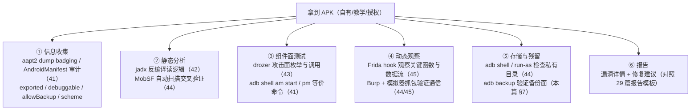
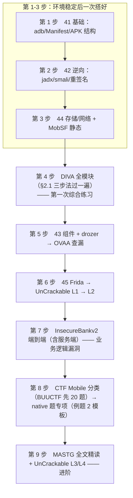

# Android 漏洞复现与 CTF 实战

> 日期：2026-11-04
> 所属大纲阶段：8. 移动安全（Android）
> 参考资料：
> - OWASP MASTG（Mobile Application Security Testing Guide）— https://mas.owasp.org/
> - DIVA Android — https://github.com/payatu/diva-android
> - InsecureBankv2 — https://github.com/dineshshetty/Android-InsecureBankv2
> - OVAA（Oversecured Vulnerable Android App）— https://github.com/oversecured/ovaa
> - CTF Wiki Mobile 章节 — https://ctf-wiki.org/

**合规红线**：本篇所有实验对象仅限**本地模拟器中的开源教学靶场与自制教学 APK**。不对任何第三方商业应用进行测试；如需对他人应用做安全测试，必须获得书面授权。这与 `29-渗透测试方法论-PTES-OWASP-WSTG.md` 的授权原则完全一致。

前置知识：`41-Android-安全基础与开发入门.md`（adb/清单分析）、`42-APK-逆向分析.md`（jadx/smali）、`43-Android-组件安全.md`（drozer/组件导出）、`44-Android-数据存储与通信安全.md`（存储/MobSF）、`45-Frida-hook与动态分析.md`（动态观察）；CTF 侧可对照 `39-CTF-Reverse-方向.md`、`40-CTF-Misc-方向.md`。

---

## 1. 移动安全测试方法论：MASTG 与本仓库笔记的映射

OWASP 移动应用安全测试指南（Mobile Application Security Testing Guide, MASTG）是移动安全的"WSTG"，其验证标准为 MASVS（Mobile Application Security Verification Standard）。MASVS v2 将安全要求划分为八大主题（STORAGE/CRYPTO/AUTH/NETWORK/PLATFORM/CODE/RESILIENCE/CONFIG），每个主题都能在前几篇笔记中找到对应的实操内容：

| MASVS v2 主题 | 核心问题 | 本仓库对应笔记 |
|---|---|---|
| MASVS-STORAGE（数据存储） | 敏感数据是否落盘即泄露 | `44`（SharedPreferences/SQLite/备份/日志） |
| MASVS-CRYPTO（密码学） | 算法、密钥管理是否正确 | `44`（Keystore/加密审查清单）、`09/10`（通用密码学） |
| MASVS-AUTH（认证与会话） | 本地认证能否被绕过、token 管理 | `44`、`16`（Web 端对照） |
| MASVS-NETWORK（网络通信） | 传输加密、证书校验、锁定 | `44`（networkSecurityConfig/Pinning）、`45`（测试方法） |
| MASVS-PLATFORM（平台交互） | 组件导出、IPC、WebView | `43`（全篇）、`41`（Manifest 审计） |
| MASVS-CODE（代码质量与利用缓解，Code Quality & Exploit Mitigation） | 代码质量、注入类漏洞、反编译面 | `42`（反编译/加固识别）、`44`（§2.8 硬编码检测） |
| MASVS-RESILIENCE（抗逆向与防篡改，Resilience） | 混淆、加固、完整性校验、反调试等增加分析成本的手段 | `42`（加固/混淆）、`45`（防护机制研究） |
| MASVS-CONFIG（配置） | 清单与构建配置（debuggable/allowBackup/权限声明/组件导出声明） | `41`（Manifest 审计）、`43`（§1 导出判定）、`44`（§2.5 备份面） |

**移动应用安全测试标准工作流**（把 41-45 篇的工具串成一条线）：



> **方法论口诀**：静态找"哪里可疑"，动态验证"确实如此"，组件面找"谁能碰到"，存储网络看"数据去了哪"。

---

## 2. 移动安全靶场大全（部署 + 学习路线）

### 2.1 DIVA Android（首选入门）

- 项目：https://github.com/payatu/diva-android （提供源码与编译好的 APK）
- 定位：故意设计了漏洞的教学 App，每个功能点对应一类经典漏洞，界面会明确提示"这条挑战的目标"。
- 部署（环境：macOS + AVD API 30+ 模拟器）：

```bash
# 下载 release APK 后安装
adb install diva-beta.apk
# 启动
adb shell am start -n jakhar.aseem.diva/.MainActivity
```

模块清单与考点映射：

| DIVA 模块 | 考点 | 对应笔记 |
|---|---|---|
| Hardcoding Issues | 硬编码密钥/URL | `42`（jadx 搜索定位） |
| Insecure Data Storage 1-3 | SharedPreferences/SQLite/临时文件明文存储 | `44` |
| Input Validation Issues 1-3 | SQL 注入（ContentProvider/SQLite）、路径穿越 | `43`、`44` |
| Access Control Issues 1-2 | 导出 Activity 绕过授权检查 | `43` |
| Hardcoding Issues – Part 2 | WebView 远程加载配置 | `43` |

推荐做法：每关先自己测试 → 用 jadx 找代码层原因 → 写下修复方案（正反代码对照），这一“三步法”就是 MASTG 的迷你版。下面用三个模块完整走一遍（环境：macOS + AVD API 34 模拟器 + DIVA beta，教学自制环境）。

**演示 1：Insecure Data Storage 1（SharedPreferences 明文存储）**

- **第一步·测试动作**：在界面输入框填入测试数据（如 `test@diva.io` / `P@ssw0rd`）点保存，杀掉进程重进——界面提示数据已恢复。用 `44` 篇的 run-as 通道检查落盘内容：

```bash
# DIVA 是 debuggable 教学包，可直接进沙箱读私有目录（44 篇通道 1）
adb shell run-as jakhar.aseem.diva ls shared_prefs/    # 先列目录再定位文件
adb shell run-as jakhar.aseem.diva cat shared_prefs/<上一步列出的 .xml>
# 输出（示意）：<string name="...">test@diva.io:P@ssw0rd</string> —— 密码明文落盘
```

- **第二步·jadx 定位**：搜索 `putString` 或界面文案，定位 `InsecureDataStorage1Activity`，关键逻辑还原（jadx 反编译，简化）：

```java
// 敏感数据未加密直接写入应用级 SharedPreferences
SharedPreferences sp = getSharedPreferences("credentials", MODE_PRIVATE);
sp.edit().putString("creds", user + ":" + password).apply();
```

- **第三步·修复对照**（对应 `44` 篇 §2.3 整改方案）：

```kotlin
// 修复：EncryptedSharedPreferences（主密钥由 Keystore 保管），且只存 token 不存明文密码
val prefs = EncryptedSharedPreferences.create(
    this, "secure_creds", masterKeyAlias,
    PrefKeyEncryptionScheme.AES256_SIV, PrefValueEncryptionScheme.AES256_GCM)
prefs.edit().putString("auth_token", token).apply()
```

**演示 2：Input Validation 1（SQLite 拼接注入）**

- **第一步·测试动作**：查询框输入 `' or '1'='1` 回车，Toast 显示返回了**全表数据**（正常输入只返回一行）；再输入单个 `'` 观察 logcat 里的 SQLiteException——典型 SQL 注入（SQL Injection）特征，判断手法与 `11-SQL-注入.md` 完全同源。
- **第二步·jadx 定位**：`SQLInjectionActivity` 的查询语句是字符串拼接：

```java
// jadx 反编译还原（简化）
Cursor cr = mDB.rawQuery(
    "SELECT * FROM products WHERE name = '" + userInput + "'", null);
```

- **第三步·修复对照**：参数化查询，占位符让输入永远是“数据”而不是“代码”（与 `11` 篇预编译章节同一原则）：

```kotlin
db.rawQuery("SELECT * FROM products WHERE name = ?", arrayOf(userInput))
```

**演示 3（简）：Access Control Issue 1（导出 Activity 绕过授权）**

- **第一步·测试动作**：在 DIVA 界面勾选“不允许查看凭据”后按钮被拦截，但直接拉起凭据页面照样打开：

```bash
adb shell am start -n jakhar.aseem.diva/.APICredentialsActivity
```

- **第二步·jadx 定位**：Manifest 中该 Activity `exported=true` 且无 permission 保护；代码里的授权检查只存在于“正常入口”的点击回调里，凭据 Activity 自身不校验任何身份。
- **第三步·修复对照**：`exported=false` + 把鉴权放进 Activity 自身 `onCreate`（而不是信任调用方）——正是 `43` 篇“信任边界放组件内”原则，也是本篇 §4.3 例题的考点。

> 三步法的价值在于**形成肌肉记忆**：见到功能 → 先黑盒测 → 再白盒解释 → 最后反向写修复。第三步（防御视角）最容易被跳过，却是对工作最有长期价值的一步。

### 2.2 InsecureBankv2（渗透测试向）

- 项目：https://github.com/dineshshetty/Android-InsecureBankv2
- 定位：模拟银行 App 的完整渗透目标，含前后端（需要搭建其配套服务端 AndroLabServer）。
- 功能面清单：登录爆破、密码修改逻辑缺陷（旧密码校验缺失/组件触发）、不安全存储、WebSocket 通信、加固演示。
- 适合阶段：完成 DIVA 后进阶——它更贴近“真实业务逻辑漏洞”而非单点漏洞。
- **部署细节**（环境：macOS 宿主机跑服务端 + AVD 模拟器跑 App，仅本地回环使用）：

```bash
# 服务端 AndroLabServer 是 Django 项目（仓库 AndroLabServer/ 目录）
cd AndroLabServer
python3 -m venv venv && source venv/bin/activate
pip install -r requirements.txt
python manage.py runserver 0.0.0.0:8000     # 监听所有网卡，供模拟器访问
                                              # （仅本地实验网络使用：0.0.0.0 监听勿暴露公网）
```

  改 host 配置要点：
  1. **模拟器访问宿主机必须用保留别名 `10.0.2.2`**（AVD 对宿主环回的固定映射），App 内服务端地址应指向 `http://10.0.2.2:8000`——填 `127.0.0.1` 会连到模拟器自己；
  2. 发行 APK 里内置的服务端地址需要替换：jadx 定位常量 → apktool 改 smali → 回编译 + 重签名（`42` 篇完整流程），或直接 clone 源码改常量后自行构建（推荐，省去签名对抗）；
  3. 要抓 App 与服务端的流量时，模拟器 Wi-Fi 代理指向宿主机上 Burp 的监听地址（`45` 篇 §7），服务端保持 HTTP 即可（教学环境模拟“明文传输”考点）。

### 2.3 OVAA（Oversecured Vulnerable Android App）

- 项目：https://github.com/oversecured/ovaa
- 定位：Oversecured 公司（著名移动安全博客背后的公司）维护，覆盖面广、贴近近年真实漏洞模式。
- 覆盖漏洞类型：WebView/IPC/Deeplink/PendingIntent/存储/密码学/网络等（README 有官方清单）。
- 适合阶段：学完 `43`/`44` 后做"查漏"测试——先自己用 drozer/MobSF 扫，再对照官方答案。

### 2.4 OWASP UnCrackable Apps（防护对抗教学）

- 位置：OWASP MASTG 仓库 `Crackmes/Android` 目录（`https://github.com/OWASP/owasp-mastg/tree/master/Crackmes/Android`）
- 定位：MASTG 官方配套教学题，各级考察点：
  - **Level 1**：root 环境检测 + XOR 加密隐藏 secret（详见 `45-Frida-hook与动态分析.md` §8 三种解法）
  - **Level 2**：root 检测 + 调试检测
  - **Level 3**：多重完整性/篡改检测，native 层参与
  - **Level 4**：native 反调试与多层校验（进阶）
- 适合阶段：配合 `45` 篇学习防护机制时逐级挑战。

### 2.5 CTF 中的 Mobile 题型分布

| 平台 | 移动题目情况 | 建议 |
|---|---|---|
| BUUCTF | Mobile 分类数百题 | 逆向后入门刷题主力 |
| 攻防世界（XCTF） | Mobile/Re 分类 | 国内赛题风格 |
| picoCTF | 偶有逆向类（含 mobile） | 新手友好 |
| 看雪 CTF / 各国内赛事 | 高质量移动题（常结合 native 与对抗） | 进阶后挑战 |

### 2.6 自建教学 APK：单一漏洞 demo 的最小做法

开源靶场的漏洞集是固定的，**自己写漏洞 demo** 才能练习“从威胁建模到修复”的完整闭环（`07-威胁建模.md` 的思路）。原则：一个 demo 只放**一个**漏洞，其余配置全部按安全默认——这样 MobSF 报告里其余条目全绿，修复前后对比一目了然。这也是 `labs/` 目录的标准实验形态（每个实验一个子目录：源码 + 复现记录 + 修复版 diff）。

以「导出 Activity 无鉴权」为例（环境：Android Studio + Kotlin + AVD API 34 模拟器，全程本地）：

1. 新建 Empty Activity 工程（包名如 `com.labs.exportdemo`）；
2. `AndroidManifest.xml` 关键配置：

```xml
<!-- 漏洞点：FlagActivity 导出且无 permission 保护（对照 43 篇组件导出一节） -->
<activity android:name=".FlagActivity" android:exported="true">
    <intent-filter>
        <action android:name="com.labs.exportdemo.VIEW_FLAG"/>
        <category android:name="android.intent.category.DEFAULT"/>
    </intent-filter>
</activity>
```

3. 敏感 Activity 的 Kotlin 骨架：

```kotlin
class FlagActivity : AppCompatActivity() {
    override fun onCreate(savedInstanceState: Bundle?) {
        super.onCreate(savedInstanceState)
        // 漏洞：不校验调用者身份，只信 extra 内容
        if (intent.getStringExtra("code") == "open-sesame") {
            showSecret()          // 展示“敏感”内容（教学占位字符串）
        } else finish()
    }
}
```

4. 构建安装后用 §4.3 的 `am start` 命令复现，再用 drozer 枚举验证攻击面（`43` 篇）；
5. 修复版对照：`exported=false`（或 signature 权限）+ 服务端鉴权，重新构建复测，确认 drozer 无法再拉起——**复现与修复在同一份代码上闭环**。

> 自建 demo 的额外收益：手里有源码当“标准答案”，jadx 反编译结果与源码逐行对照，是熟悉混淆与编译器优化差异的最佳素材（`42` 篇）。

---

## 3. 移动方向 CTF 题型体系

按“入口在哪 → 用什么工具 → 常见变形”组织。先给一张**拿到 APK 的 5 分钟观察清单**——顺序执行，多数题在前 5 分钟就能锁定题型方向：

| # | 观察项 | 命令/方法 | 指向的题型 |
|---|---|---|---|
| 1 | 权限与入口 | `aapt2 dump badging`（uses-permission / launchable-activity） | 无网络权限 → 校验必在本地（3.1/3.3）；有 INTERNET → 可能与服务端交互或加载 Web 内容 |
| 2 | Manifest 组件数 | `aapt2 dump xmltree ... AndroidManifest.xml`，数 exported 组件 | 导出组件多、有非入口 Activity 带 intent-filter → 3.4 组件交互类 |
| 3 | so 存在性 | `unzip -l app.apk \| grep '\.so'` | 有 `lib/arm64-v8a/*.so` → 3.3 Native 类 |
| 4 | assets/res 体积 | `unzip -l app.apk` 按大小排序 | 异常大文件、奇怪后缀、嵌套 zip → 3.2 资源藏匿类 |
| 5 | WebView 痕迹 | jadx 搜 `addJavascriptInterface` / `loadUrl` | 命中 → 3.5 WebView/JS 桥类 |
| 6 | 防护痕迹 | jadx 搜 `su`、`test-keys`、`isDebuggerConnected` | 命中或一启动即闪退 → 3.6 对抗分析类 |

以下各题型小节均附「典型信号」，拿到题先对照信号，再决定投入哪条工具链。

### 3.1 静态字符串 / 逻辑分析类

- **典型信号**：无 INTERNET 权限、无 so 文件；jadx 搜 `Try again`/`wrong`/`flag` 等提示语直接命中比较逻辑；assets 无异常大文件。
- **入口**：APK 反编译后的 Java 层校验逻辑。
- **工具链**：jadx（搜索字符串 → 交叉引用 → 读比较函数）。
- **常见变形**：
  - 明文比较（`etFlag.equals(secret)`）——直接搜 secret；
  - base64 变种（换表，见 `39` 篇换表识别法）；
  - 异或/循环移位校验——读懂后用 Python 复现；
  - 字符串资源藏在 `res/values/strings.xml` 或 `assets/`。
- **提示**：`42-APK-逆向分析.md` 的 CrackMe walkthrough 就是这一类的完整示范。

### 3.2 资源藏匿类

- **典型信号**：jadx 里搜不到任何比较逻辑（代码只有 UI 与资源加载）；`unzip -l` 里 assets/ 出现大文件或非媒体后缀；zip 内还嵌着 zip（留意伪加密）。
- **入口**：解包 APK（zip）后的非代码文件。
- **工具链**：`unzip`/`binwalk`（见 `40-CTF-Misc-方向.md`）、伪加密修复、`strings`。
- **常见变形**：assets 里藏 zip（可能是伪加密）、`res/raw/` 藏音频/图片（配合隐写知识）、META-INF 藏注释、so 文件的隐藏段。

### 3.3 Native 层算法类（重点难点）

- **典型信号**：Java 层校验函数只有 `native` 关键字（`44` 篇 MobSF 也会漏报 native 内的逻辑）；`unzip -l` 可见 `lib/*/libxxx.so`；so 导出表有无 `Java_` 前缀直接决定注册方式（见下）。
- **入口**：Java 层只有 `native` 关键字声明，逻辑在 `lib/arm64-v8a/libxxx.so`。
- **定位方法**：
  1. **静态注册**：导出符号名固定为 `Java_包名_类名_方法名`（`_` 替换 `.`），在导出表直接搜；
  2. **动态注册**：无 `Java_` 前缀符号，注册发生在 `JNI_OnLoad` → `RegisterNatives`，需要读 `JNI_OnLoad` 找到 `RegisterNatives(env, clazz, methods, n)` 的第三个参数（JNINativeMethod 数组：名称/签名/函数指针三元组），或在 Frida 里 hook `RegisterNatives` 打印映射（`45` 篇 Interceptor.attach 模板即可）。
- **分析工具**：ghidra（免费首选，工作流见 `24` 篇）。
- **常见算法识别**（对照 `39` 篇魔数特征表）：TEA 变种（delta 常量 `0x9E3779B9`）、RC4（KSA 256 轮交换结构）、魔改 base64（自定义码表）、自定义异或循环。
- **解法分叉**：算法可逆 → Python 复现；算法繁琐但有现成函数 → Frida **主动调用**（`45` 篇：`Java.use` 拿到类后直接调 native 方法，把要验证的输入喂进去看返回值）。

### 3.4 组件交互类

- **典型信号**：清单里 exported 组件多于表面功能数；存在非 launcher 的 Activity/Receiver 带 intent-filter 或 scheme；题目文案暗示“flag 在你看不到的地方”（§4.3 即此型）。
- **入口**：Manifest 中导出的 Activity/Receiver/Provider（`43` 篇 drozer 枚举）。
- **工具链**：aapt2 看清单 → `adb shell am start` 构造。
- **典型命令**：

```bash
# 启动需要 action + extra 的隐藏 Activity（仅教学靶场）
adb shell am start -n com.example.ctf/.HiddenActivity \
  --es "key" "expected_value" --ez "isAdmin" true
```

- **常见变形**：extra 值需要先逆向得到（与 3.1 结合）；Receiver 需要 `--a` 指定 action；Provider 直接 `content://` 查询。

### 3.5 WebView / JS 桥类

- **典型信号**：有 INTERNET 权限且 jadx 命中 `WebView`/`addJavascriptInterface`；Manifest 注册了自定义 scheme 的 deeplink；`assets/` 里有 HTML/JS 文件。
- **入口**：`addJavascriptInterface` 暴露的 JS API（`43` 篇）。
- **工具链**：jadx 找 `@JavascriptInterface` 注解方法 → 阅读其权限逻辑 → 通过页面/deeplink 调用。
- **常见变形**：JS API 有 token 校验（token 在本地某处生成，可逆向复现）；deeplink 参数注入到 `loadUrl`（URL 白名单缺失，对照 `43` 篇 intent 重定向）。

### 3.6 对抗分析类

- **典型信号**：App 一启动就闪退（logcat 出现 root/调试检测痕迹）；jadx 搜到 `su`、`test-keys`、`isDebuggerConnected`、`ro.build.tags` 等字符串；常与 3.1/3.3 **叠加出题**（先过防护才能碰校验）。
- **入口**：应用带 root/调试/完整性检测，检测失败即退出或返回错误。
- **工具链**：Frida hook 检测函数返回预期值（完整教学：`45` 篇 §8 UnCrackable L1）。
- **常见变形**：多检测点联动、检测函数在 native 层（Interceptor.attach 处理）、字符串加密藏提示。

---

## 4. 完整例题教学记录

> 以下例题 1、2b、3 为自制教学题（附关键源码），例题 2 为 native 类的标准出题模板，全部仅限本地教学环境。

### 4.1 例题 1（静态入门）：checkFlag 教学题

**题目面**：一个 APK，输入框 + 按钮，输入错误提示"Try again"。无网络权限（说明校验必在本地——先看 Manifest 权限是习惯动作）。

**第一步：信息收集**

```bash
aapt2 dump badging challenge1.apk | head -20   # 包名、入口 Activity
aapt2 dump xmltree challenge1.apk AndroidManifest.xml | grep -Ei 'exported|permission'
```

**第二步：jadx 定位**

1. jadx-gui 打开，搜索字符串 `Try again` → 找到引用的校验函数 `MainActivity.checkFlag(String)`；
2. 反编译源码（关键逻辑如下，教学源码还原）：

```java
private boolean checkFlag(String input) {
    if (input.length() != 16) return false;
    int[] map = {9, 2, 7, 4, 11, 6, 1, 8, 3, 10, 5, 12, 15, 13, 0, 14};
    char[] out = new char[16];
    for (int i = 0; i < 16; i++) {
        char c = input.charAt(i);
        out[map[i]] = (char) (c ^ 0x05);   // 先按 map 重排，再异或 0x05
    }
    return new String(out).equals("wp61h6hwquqZZ50}");
}
```

**第三步：静态还原**

- 逻辑：`out[map[i]] = input[i] ^ 5`，目标是 `out` 等于给定密文（16 字符，与 16 元素 map、16 位输入校验自洽）→ 反推 `input[i] = cipher[map[i]] ^ 5`。

```python
cipher = "wp61h6hwquqZZ50}"       # 16 字符密文（由出题方正向加密生成）
map_ = [9,2,7,4,11,6,1,8,3,10,5,12,15,13,0,14]
flag = [''] * 16
for i in range(16):
    flag[i] = chr(ord(cipher[map_[i]]) ^ 0x05)
print("flag{" + ''.join(flag) + "}")
# 实际运行输出：flag{p3rm_mut4t3_x0r5}
```

**第四步：验证**：把 `p3rm_mut4t3_x0r5` 输入到模拟器中的 App，提示成功。

**复盘要点**：定位靠"错误提示字符串"；还原靠把 `out[map[i]] = f(input[i])` 反解为 `input[i] = f⁻¹(out[map[i]])`。**卡点通常是下标方向搞反**——纸上写一个 3 元素小例子验证方向再写脚本。

### 4.2 例题 2（Native 算法）：libnative 校验题模板

**题目面**：Java 层：

```java
public class Checker {
    static { System.loadLibrary("native"); }   // → lib/arm64-v8a/libnative.so
    public static native boolean check(String input);
}
```

**第一步：确定注册方式**：

```bash
# 静态注册则导出表能直接看到
objdump -T libnative.so | grep Java_       # 或 ghidra Symbol Tree → Exports
```

若无 `Java_` 符号 → 动态注册：ghidra 打开 so，定位 `JNI_OnLoad`（entry），跟到 `RegisterNatives` 调用处，读 `JNINativeMethod` 数组（三元组：方法名、签名 `" (Ljava/lang/String;)Z"`、函数指针）。也可用 Frida 直接 hook `RegisterNatives` 打印映射——`45` 篇 `Java.perform` + `Interceptor.attach` 组合在动态注册场景的完整可运行模板：

```javascript
// hook_regnatives.js —— 打印 JNI 动态注册映射（教学通用模板）
// 运行：frida -U -f com.example.ctf -l hook_regnatives.js
// 环境：macOS + AVD 模拟器 + 教学自制 APK（必须 -f spawn 启动，见后文坑）
Java.perform(function () {
  // ① RegisterNatives 住在 ART 运行时（libart.so），zygote 已预加载，必能找到
  var libart = Process.findModuleByName('libart.so');
  var target = null;
  // ② 不同 Android 版本的符号带不同命名空间修饰，按子串模糊匹配最稳
  libart.enumerateSymbols().forEach(function (s) {
    if (s.type === 'function' && s.name.indexOf('RegisterNatives') !== -1 && !target) {
      target = s;
    }
  });
  if (!target) { console.log('[-] 未找到 RegisterNatives 符号'); return; }
  console.log('[+] ' + target.name + ' @ ' + target.address);

  // ③ attach 后读第 3/4 个参数：JNINativeMethod 数组与方法个数
  Interceptor.attach(target.address, {
    onEnter: function (args) {
      var methods = args[2];                 // JNINativeMethod*（name/sig/fnPtr 三元组数组）
      var count = args[3].toInt32();         // 本次注册的方法个数
      var PS = Process.pointerSize;          // 指针宽度（arm64 为 8）
      for (var i = 0; i < count; i++) {
        var m    = methods.add(i * PS * 3);
        var name = Memory.readUtf8String(m.readPointer());
        var sig  = Memory.readUtf8String(m.add(PS).readPointer());
        var fn   = m.add(PS * 2).readPointer();
        // DebugSymbol 直接给出 so 内偏移，拿去 ghidra 按地址跳转即可
        console.log('[*] ' + name + sig + ' -> ' + fn +
                    '  (' + DebugSymbol.fromAddress(fn) + ')');
      }
    }
  });
});
```

输出形如 `check(Ljava/lang/String;)Z -> 0x7b2...4d0 (libnative.so!0x1234)`——`libnative.so!0x1234` 就是 ghidra 里要跳转分析的目标函数。两个常见坑：**必须用 `-f` spawn 启动**（attach 已运行的进程会错过 `JNI_OnLoad`，hook 挂上了但不再触发）；模糊匹配可能同时命中 `art::JNI::RegisterNatives` 与 CheckJNI 变体，同一方法打印两次属正常，任取其一。

**第二步：ghidra 反编译目标函数**，识别算法结构（教学示例——魔改 TEA 的识别特征）：

```c
// ghidra 反编译片段（示意）：出现 delta 0x9E3779B9 + 多轮移位 → TEA/XTEA 家族
delta = 0x9e3779b9;
sum = 0;
for (i = 0; i < 0x20; i++) {          // 32 轮
    sum += delta;
    v0 += ((v1 << 4) + k0) ^ (v1 + sum) ^ ((v1 >> 5) + k1);
    v1 += ((v0 << 4) + k2) ^ (v0 + sum) ^ ((v0 >> 5) + k3);
}
// 魔改点常见于：轮数非 32、delta 不同、密钥 k 从输入派生方式不同
```

**第三步：两条解法**
- **静态复现**：Python 实现解密（TEA 是对称的，逆向轮序即可），密钥从 so 中定位（常量 or 由 input 派生）；
- **动态主动调用**（算法繁琐时首选）：输入空间小则暴力——Frida 脚本循环调 `Checker.check(candidate)` 直到返回 true（`45` 篇主动调用模板 + Java 层 for 循环，仅教学题可用）。

**常见坑**：arm64 与 arm32 的 so 要与设备架构一致；字符串经 `GetStringUTFChars` 进 native，hook 时在 native 侧看到的是 UTF-8 bytes。

### 4.2b 例题 2b（Java 层）：字符串加密的解密函数主动调用

**题目面**：jadx 里搜不到任何明文比较，但发现一个可疑工具类 `S`——所有常量都经 `S.x(String)` 解密后才使用。典型的**字符串加密（string obfuscation）**混淆，常见于免费加固器。反编译还原（简化）：

```java
// jadx 还原（简化）：Base64 + 循环异或的轻量混淆，密钥藏在类里
public class S {
    private static final String K = "l4bs";               // 混淆密钥
    public static String x(String s) {
        byte[] b = Base64.decode(s, 0);
        for (int i = 0; i < b.length; i++)
            b[i] = (byte) (b[i] ^ K.charAt(i % K.length()));
        return new String(b);
    }
}
```

**思路分叉**：
- 逻辑简单（如上）→ 直接 Python 复现，批量解密所有常量；
- 逻辑繁琐（查表多轮、混入 native）→ **Frida 主动调用现成的解密函数**，让 App 自己当“解密机”（`45` 篇 §5.5 主动调用模板的落地）：

```javascript
// reveal_strings.js —— 运行：frida -U -f com.example.ctf -l reveal_strings.js
// 环境：macOS + AVD 模拟器 + 自制教学 APK
Java.perform(function () {
  var S = Java.use('com.example.ctf.S');      // 静态方法：类代理即可直接调，无需实例
  // 密文清单来自 jadx 中 S.x("...") 各调用点的实参收集
  var ciphertexts = ['ClgDFA==', 'HF0M'];
  ciphertexts.forEach(function (c) {
    console.log(c + ' -> ' + S.x(c));
  });
});
// 输出：ClgDFA== -> flag / HF0M -> pin —— 其中之一即 flag 或关键比较值
```

**复盘要点**：主动调用的适用条件是解密函数**无状态、不依赖 Activity 上下文**；若依赖 `Context`（如要读 assets 密钥），改用 `Java.choose` 拿堆上存活实例后再调（`45` 篇 §5.4）。对照 §3.1 的变形清单：字符串加密只是“明文比较”的加强版——**入口不变（仍是字符串比较），解题多一步“还原常量”**。

### 4.3 例题 3（组件交互）：隐藏 Activity 教学题

**题目面**：App 只有一个普通界面，但提示"flag 在你看不到的地方"。

**第一步：清单审计**：

```bash
aapt2 dump xmltree challenge3.apk AndroidManifest.xml | grep -B2 -A6 'activity'
```

发现：

```xml
<activity android:name=".FlagActivity" android:exported="true">
    <intent-filter>
        <action android:name="com.example.ctf.GIVE_FLAG"/>
    </intent-filter>
</activity>
```

**第二步：jadx 读 FlagActivity 逻辑**：`getIntent().getStringExtra("code")` 需等于 `"open-sesame"`（该常量可在反编译代码中直接看到），否则不显示 flag。

**第三步：构造调用**：

```bash
adb shell am start -n com.example.ctf/.FlagActivity \
  -a com.example.ctf.GIVE_FLAG --es code open-sesame
```

界面展示 flag。**用 drozer 等价实现**（`43` 篇）：

```bash
dz> run app.activity.start --component com.example.ctf com.example.ctf.FlagActivity \
      --action com.example.ctf.GIVE_FLAG --extra string code open-sesame
```

**复盘要点**：`exported=true` + 无权限保护 = 任何应用都能拉起该组件并传参。**修复**：组件不导出（去掉 intent-filter 或显式 `exported=false`），敏感操作在服务端校验身份（对照 `43` 篇防御 checklist）。

---

## 5. MobSF 动静结合实战

`44-Android-数据存储与通信安全.md` 已覆盖 MobSF 的 Docker 部署与静态报告解读，这里补全**动态分析联动**：

1. **配置模拟器**：MobSF 动态分析需要一个已连接的设备/模拟器——启动 AVD → 在 MobSF 设置中指定 AVD 名（或用已通过 adb 连接的设备）；
2. **运行动态分析**：上传 APK → Dynamic Analysis → MobSF 自动完成安装、启动、遍历 Activity（`activity tester` 触发各界面）、截屏、抓取流量与 Frida 脚本输出；
3. **产出**：运行时行为记录（文件写入路径、SharedPreferences 内容、网络请求域名清单、导出 API 调用记录）；
4. **与 Burp 联动**：模拟器代理指向 Burp（`45` 篇 §7），MobSF 负责自动遍历界面、Burp 负责精细重放——一自动一手工互补；
5. **局限与心态**：自动化遍历覆盖有限（深藏在交互后的页面到不了），把 MobSF 当“漏斗粗筛”，结论以手工验证为准。
6. **从报告到修复跟踪**（把 MobSF 纳入 `33-安全-SDLC.md` 的门禁/Quality Gate 思路，报告不应停在“PDF 归档”）：
   - **转 checklist**：用 MobSF 自带的 MASVS Mapping 把 Findings 导出，逐条登记 issue：`编号 | 漏洞 | 位置（类/文件） | MASVS 条目 | 严重级 | 状态`——issue 化才能跟踪；
   - **定 bug bar**：参照 `33` 篇“上线前高危必须清零”的门禁标准——硬编码密钥、`allowBackup` + 敏感存储、导出组件无鉴权这类高危不修不发版；中低危走豁免流程（登记-审批-到期复查），而不是静默带病上线；
   - **复测闭环**：修复后**同版本同配置**重新扫描，逐条确认对应 Finding 消失，而不是只看 Score 变化（分数会随代码量波动）——`44` 篇 §6 的“五项全绿才算闭环”就是该流程的单次示范；
   - **防回归**：把 MobSF（Docker + REST API，`44` 篇 §5）挂进 CI 对每个构建扫描，对**差量** Findings 拦截——等价于 `33` 篇 PR 门禁中的 SAST 环节；
   - **误报治理**：确认是误报的条目要记录理由与证据（代码位置/截图），走白名单而不是全局忽略——`33` 篇的教训：误报不治理，门禁三周内就会被“全局豁免”架空。

---

## 6. 公开漏洞知识学习（看懂公告与修复）

> 定位：**理解原理与修复方式**，服务于防御与漏洞管理（对照 `08-漏洞分类-OWASP-Top10-CWE-CVE.md`），而非收集利用。

### 6.1 Janus（CVE-2017-13156）—— 签名校验缺口

- **影响**：Android 5.0-8.0，仅使用 v1 签名（JAR 签名）的 APK。
- **原理**：v1 签名校验的是 zip 内各文件（含 classes.dex）的摘要；而系统加载 dex 时**优先读取 APK 头部之后的原始 dex 数据**。攻击面在于：v2 签名块/文件结构允许在 zip 中心目录之外拼接数据——将一个"攻击 dex"拼接在 APK 文件开头、原 zip 整体后移时，安装器按 v1 校验 zip 内容通过（原 dex 摘要没变），运行时却加载了攻击 dex。示意图：

```
正常 v1 APK:  [ zip: classes.dex(校验通过) | 其他文件 ]
被拼接后:     [ 攻击者dex ] [ zip: classes.dex(摘要未变→v1仍通过) ]
                ↑ 运行时加载这里        ↑ 安装校验看这里
```

- **修复视角**：v2 及以上签名方案对**整个文件**做摘要，天然免疫；开发者迁移到 v2+、系统层 Android 8.1+ 对目标 SDK 高的应用强制校验。**学习价值**：理解"校验对象 ≠ 加载对象"这类逻辑缺口是漏洞的常见来源。

### 6.2 Strandhogg 2.0（CVE-2020-0102）—— 任务仿冒

- **影响**：Android 8.0-9.0。
- **原理**：恶意应用利用 `taskAffinity` 声明与目标应用相同的任务栈亲和性，配合反射将自身界面"垫"在目标应用任务栈上，用户以为在操作正常 App，实则在恶意界面输入凭据（界面钓鱼，无需悬浮窗权限）。
- **修复**：Android 10 对 `taskAffinity` 与任务栈操作施加了限制。**学习价值**：UI 层信任也是攻击面——对应 `43` 篇 Activity/Task 劫持一节。

### 6.3 WebView 域隔离历史问题系列

- `setAllowFileAccessFromFileURLs` / `setAllowUniversalAccessFromFileURLs` 组合下的 file 域同源策略击穿 → 本地文件窃取与 Universal XSS（`43` 篇开关矩阵表）；
- CVE-2014-7224（file 域绕过）等历史案例说明：**WebView 的默认安全配置随版本演进不断收紧，老代码的"当时没问题"不等于"现在没问题"**——升级 targetSdk 时的回归测试必要性。

### 6.4 Android Security Bulletin 的阅读方法

每月 Google 发布安全公告（`https://source.android.com/docs/security/bulletin`）：
- 关注 **CVE 编号 + 受影响组件（Framework/System/Kernel）+ 修复版本**；
- 防御视角阅读法：`漏洞类型 → 根因（哪层校验缺失）→ 利用前提（本地/远程/需物理接触）→ 我们的设备/依赖是否受影响（对照 SBOM 思路，`31` 篇）`；
- 与 `08` 篇的 CVE/CVSS 知识配合，把公告变成“漏洞管理流程”的输入而不是新闻。

### 6.5 剪贴板与无障碍服务的滥用类风险（权限模型类）

- **典型模式**：无障碍服务（Accessibility Service）本是辅助视障用户的系统 API，但能力远超“读屏”——可**监听全局窗口切换、读取任意界面控件内容、代用户执行点击与输入**。恶意 App 诱导用户授予无障碍权限后的常见滥用链：监听银行/支付类 App 的窗口事件 → 读取输入框内容或直接替用户点击转账确认（所谓“无障碍木马”）；或读取通知栏里的短信验证码实施盗号。剪贴板（Clipboard）则是被动面更广的通道：密码管理器、银行 App 历史上会把一次性验证码等敏感内容写入**全局共享**的剪贴板，任何 App 在窗口期内都可能读取。
- **系统为何逐步收紧**：Android 10 起限制后台读取剪贴板（仅前台应用/默认输入法可读）；Android 13 起任何读取剪贴板的行为都会向用户弹提示；无障碍权限的申请门槛持续加码（`isAccessibilityTool` 声明、API 级别限制），应用商店对申请该权限的 App 人工审核。**演进逻辑**：能力过强的系统 API + 用户无法分辨用途 = 滥用温床，平台的应对是“最小化默认能力 + 提高授权可见性”。
- **用户侧防御**：不向陌生 App 授予无障碍权限（定期检查 设置 → 无障碍 的授予列表）；敏感内容不驻留剪贴板（密码管理器用自动填充而非复制粘贴）；系统弹“某应用读取了剪贴板”提示时认真对待。
- **开发侧对照**：自家 App 不用无障碍权限实现常规功能（自动化操作类功能已被应用商店整治下架）；确需写剪贴板时用完即清、绝不写入验证码明文。
- **学习价值**：这一类不对应单一 CVE，而是**权限模型的系统性风险**——对照 `06-CIA-三元组与安全原则.md` 的最小权限原则与 `43` 篇的信任边界，理解“平台为什么这样设计权限”。

### 6.6 第三方库漏洞传导（SDK 出 CVE 时怎么办）

App 的攻击面不止自家代码——第三方 SDK（广告、推送、统计、加固、跨端框架）常占 App 代码量的一半以上，SDK 出 CVE 时风险会“传导”给所有集成方：

- **影响面判断三步**（对照 `31-依赖与供应链安全.md` 的 SBOM 思路，`用到没有 → 可达吗 → 修到哪`）：
  1. **用到没有**：靠 SBOM 回答。Android 侧的“配料表”= Gradle 依赖树（`gradle dependencies` / lockfile）+ 打进 APK 的 aar 与 so + `assets/` 内置的 JS bundle（跨端框架常见）——MobSF 报告的库识别可作为 APK 侧清单的交叉来源；
  2. **可达性**：`31` 篇 Log4shell 的教训“可达性评估决定修复优先级”——CVE 在 SDK 的广告模块而 App 只用其推送功能时，先确认调用路径与触发条件（是否默认开启、是否需服务端配合）；
  3. **修到哪**：优先升级 SDK 版本；**升不动时**（停维护/新版本不兼容）评估替代品或临时缓解（`networkSecurityConfig` 收敛可连域名、R8 shrinker 裁剪未触达代码可缩小暴露面，但都**不能当作等价于升级**）。
- **责任传导**：监管通报里“过度收集/明文传输”的主体常常是 App 集成的第三方 SDK，但处罚与下架风险由**宿主 App 承担**——供应链责任向上传导，与 `31` 篇 event-stream/Log4j 的教训同构。
- **流程建议**：把“SDK 清单 + 版本”纳入 App 资产台账，与 `31` 篇 OSV-Scanner 的订阅告警联动；引入新 SDK 前过一遍 `07-威胁建模.md` 的最小问题集（要什么权限、收集什么数据、能否最小化接入）。

---

## 7. adb backup 与 allowBackup 数据提取演示

`44` 篇讲了 `allowBackup` 的风险面，这里在 DIVA 上完整演示（教学环境）。

`.ab` 备份文件是**文本文件头 + 数据区**的简单结构（不是纯二进制魔数），头部按行组织：

| 字段（按行） | 内容 | 常见值 | 说明 |
|---|---|---|---|
| 第 1 行 | magic | `ANDROID BACKUP` | 固定标识，含行尾 `\n` 共 15 字节 |
| 第 2 行 | version | `5` | 备份格式版本 |
| 第 3 行 | compression | `1` / `0` | 1 = zlib（deflate）压缩；0 = 未压缩的明文 tar |
| 第 4 行 | encryption | `none` / `AES-256` | 不设密码为 `none`；设密码则数据区整体加密 |

> 每行以 `\n` 结束。未加密 + 压缩时头部总长 `15 + 2 + 2 + 5 = 24` 字节——这就是下面脚本 `read(24)` 的由来。设了密码时第 4 行变长（`AES-256`），且数据区被加密，下面的解包脚本不再适用；教学演示统一**不设密码**。

```bash
# 前提：应用 Manifest 中 android:allowBackup="true"（默认值即 true）
# 1. 触发备份（不设密码则数据明文存储在备份文件中）
adb backup -f diva.ab -noapk jakhar.aseem.diva
# 模拟器弹窗点 "Back up my data"

# 2. 解包 .ab：跳过 24 字节文本头，其余按 zlib 解压得到 tar
python3 - <<'EOF'
import zlib
with open('diva.ab', 'rb') as f:
    head = f.read(24)                     # ① 读入 24 字节文件头（见上表，none+压缩的典型长度）
    data = zlib.decompress(f.read())      # ② 剩余数据区整体 zlib 解压 → tar 字节流
with open('diva.tar', 'wb') as f:
    f.write(data)                         # ③ 写出为标准 tar 归档
print(head)                               # ④ 顺手打印头，核对 version/compression 字段
EOF
tar -tf diva.tar                          # 3. 列出归档中的应用私有数据
tar -xf diva.tar apps/jakhar.aseem.diva/  # 4. 只解出目标包目录
# 5. 在解出的 SharedPreferences/SQLite 中寻找敏感数据残留
grep -ri "password" apps/jakhar.aseem.diva/
```

补充：遇到 compression=`0` 的老备份（数据区就是明文 tar），无需 Python，`dd if=diva.ab of=diva.tar bs=24 skip=1` 跳头即得；脚本抛 `zlib.error` 时先按上表检查第 3 行是否为 `0`。

**Android 12 之后的行为变化**：`adb backup` 输出被大幅限制（默认仅少量系统数据），该面在旧设备/旧 targetSdk 上仍需关注；防御侧把 `allowBackup=false`、敏感数据不落盘/加密落盘作为标准动作（`44` 篇 checklist）。

---

## 8. 学习路线图（文字版）



时间预估：第 1-3 步约 1 周（每天 2 小时）；4-7 步每步 2-4 天；8 步起进入刷题循环，长期进行。

---

## 9. 五要素复盘模板

每做完一题/一个靶场模块，按 `35-CTF-入门指南.md` 的模板记录：

```markdown
## 题目/模块：DIVA - Insecure Data Storage 1
- **环境**：AVD API 34 / DIVA 1.1
- **考点**：SharedPreferences 明文存储密码（对应 44 篇 §2.1）
- **过程**：输入密码 → `adb shell run-as <pkg> cat shared_prefs/*.xml` 检查落盘
- **卡点**：一开始不知道 run-as 需要 debuggable 包
- **新知识**：adb shell run-as <pkg> 可进入 debuggable 应用沙箱
- **迁移**：凡见"记住密码"功能先查存储加密（EncryptedSharedPreferences 是否可用）
- **修复方案**：EncryptedSharedPreferences + 不存明文密码只存 token
```

坚持写复盘是把"做过"变成"会了"的唯一路径——这也正是 `labs/` 目录存在的意义（见 `00-总索引.md` 的目录约定）。

---

## 10. 自测题

1. MASTG 的测试领域里，"组件导出"属于哪个领域？本仓库哪篇笔记覆盖它？
2. drozer 的 `app.package.attacksurface` 能给出哪些信息？它与 `aapt2 dump xmltree` 各自的定位差别？
3. JNI 动态注册的函数如何定位？（两种方法）
4. native 题中，什么条件下优先选择"Frida 主动调用"而非"静态还原算法"？
5. Janus 漏洞的根本缺口是什么？为什么 v2 签名免疫？
6. `adb backup` 提取的前提条件有哪些？Android 12 后发生了什么变化？
7. 一道题 flag 拿到了，但复盘模板的"迁移"一栏你写不出东西，说明什么？（提示：知识点没抽象）
8. 把本文 §4.3 例题的修复方案写成 3 条 checklist（对照 `43` 篇防御清单验证你的答案）。

**参考答案要点**：1. 平台交互（Platform）；`43-Android-组件安全.md` 全篇。2. 导出组件/Provider/Receiver 清单、可调试与可备份标志；drozer 是“枚举 + 直接调用”的攻击面视角，`aapt2 dump xmltree` 是原始配置的静态视角。3. 静态：ghidra 读 `JNI_OnLoad` 到 `RegisterNatives` 的 `JNINativeMethod` 数组；动态：Frida attach `RegisterNatives` 打印映射（§4.2 脚本）。4. 算法繁琐但函数可直接调用、输入空间小、解密/校验函数无环境依赖时（§4.2/§4.2b 的主动调用条件）。5. 校验对象（zip 内容）≠ 加载对象（头部拼接的 dex）；v2 对整个文件做摘要，任何拼接都会破坏签名。6. `allowBackup=true` + 物理/adb 授权接触 + 用户点确认；Android 12 起 `adb backup` 默认输出被大幅限制。7. 说明只记住了“这道题”、没抽象出“这类题”——回看 §3 的信号清单，把解法映射回题型与信号。8. exported=false（或 signature 权限）；鉴权移入 Activity 自身 onCreate 不信任调用方；敏感内容改服务端校验后按需下发（对照 `43` 篇 checklist）。

---

**下一篇导航**：本篇为阶段 8 收官。移动方向的综合复习建议回到 `00-总索引.md` 的进度追踪表勾选完成项；想横向扩展时，iOS 逆向（不复举办？——若未来新增阶段 9，可作为对照学习）与 `39-CTF-Reverse-方向.md` 的桌面逆向知识互相印证。

---

## 附：ASCII 图 → Mermaid 替换清单

| 原 ASCII 图（小节 · 内容） | 替换后类型 |
| --- | --- |
| 「移动安全测试方法论：MASTG 与本仓库笔记的映射」节 · 安全测试标准工作流图（拿到 APK → ①-⑥） | flowchart TD |
| 「学习路线图（文字版）」节 · 九步学习路线图（第 1-3 步为「环境稳定后一次搭好」依赖组） | flowchart TD |
