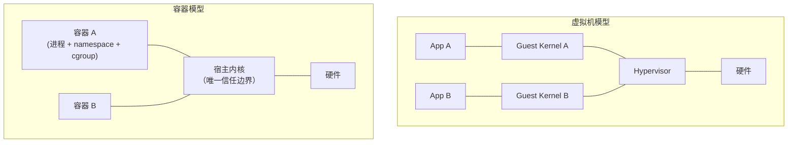
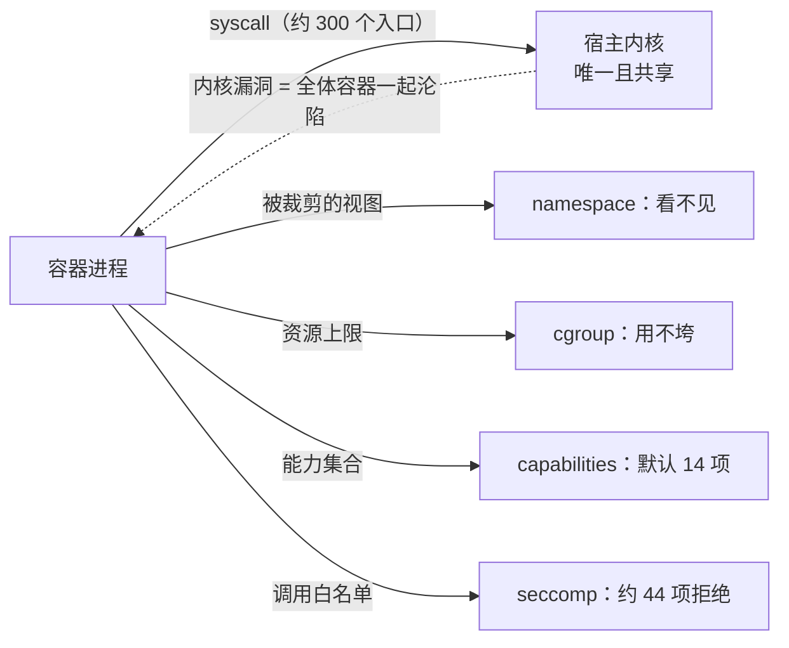

# 49. 容器隔离原理与逃逸

> 日期：2026-11-13
> 所属大纲阶段：9. 云原生安全（扩展）
> 参考资料：
> - Docker 官方文档：seccomp 安全模型（`https://docs.docker.com/engine/security/seccomp/`）、Runtime privilege and Linux capabilities（`https://docs.docker.com/engine/reference/run/`）、Docker Engine 1.10 Security Improvements（`https://www.docker.com/blog/docker-engine-1-10-security/`）
> - NIST SP 800-190 Application Container Security Guide
> - 内核文档：Namespaces overview（`https://man7.org/linux/man-pages/man7/namespaces.7.html`）、capabilities.7、cgroups(7)
> - NVD：CVE-2019-5736、CVE-2016-9962、CVE-2022-0492、CVE-2022-0847、CVE-2022-0185、CVE-2016-5195 官方条目（编号与版本范围均已逐一核对）
> - Container Escape 原始资料：Shocker 逃逸 PoC 仓库（`https://github.com/gabber12/shocker`）、Google Cloud 威胁情报：CVE-2021-22555（`https://cloud.google.com/blog/topics/threat-intelligence`）、Crusaders of Rust：CVE-2022-0185 writeup（`https://www.willsroot.io/2022/01/cve-2022-0185.html`）
> - Falco 官方文档与默认规则集（`https://falco.org/docs/rules/`）、auditd 规则参考
> - 前置：笔记 03（进程/内存/权限）、04（Linux 权限管理）、20/21（内存破坏）

**声明：本篇所有逃逸思路、命令与靶场步骤仅用于本人本机 Docker Desktop / 本地虚拟机中的实验环境，禁止对任何未授权系统使用。「宿主机」一词在本篇中一律指本人本地实验环境的宿主。**

---

## 0. 这篇笔记怎么读

容器安全的第一性问题是：**容器到底隔离了什么、没隔离什么**。本篇按「原理 → 边界 → 逃逸 → 加固 → 检测」展开：

- §1—§5 把容器拆成四层隔离机制（namespace / cgroup / capabilities / seccomp，外加 LSM）逐层讲透；
- §6 回答「为什么容器不是安全边界」；
- §7 把真实逃逸路径按四类归因（配置失误 / 内核漏洞 / 运行时漏洞 / 组件暴露），每条讲清「利用了哪一层的什么缺陷」，**只到机制层面，不提供武器化脚本**；
- §8—§10 给出加固与检测清单。

本篇命令以 Docker（runtime 为 runc 系）为例；Kubernetes 场景的编排层（RBAC、Pod 安全、准入）在笔记 50 展开，镜像与供应链在笔记 51 展开。本篇标注「示意」的命令输出均为形态说明、非实测（本机当时未启动 Docker 守护进程）；标注「实测」的均为本机实际运行结果。

---

## 1. 容器是什么：共享内核的进程隔离

一句话：**容器 = 一个被内核多种机制约束的普通 Linux 进程**。它没有独立的内核，与宿主机上的所有进程共享同一个 `sys_call` 界面、同一份页缓存、同一套设备驱动。



| 对比项 | 虚拟机 | 容器 |
| --- | --- | --- |
| 隔离边界 | 硬件辅助（VT-x/AMD-V），每 VM 独立内核 | 内核 syscall 界面（软件隔离） |
| 攻击面 | Hypervisor（较小、收敛） | 整个内核 syscall 面（巨大、持续新增） |
| 内核漏洞的影响 | 需先逃出 Guest Kernel 再逃 Hypervisor（双重） | **直接命中宿主内核**（一重） |
| 合租建议 | 可承载不同信任级租户 | 仅建议同一信任级（soft multi-tenancy） |

NIST SP 800-190 的立场即由此而来：**不要用普通容器隔离不同信任级别的租户**；强隔离需求用独立内核的虚拟机、或沙箱化容器运行时（§8.6）。

---

## 2. 第一层：Namespace——「看不见」

Namespace（命名空间）让进程拥有**被裁剪的内核视图**：自己的 PID 空间、网络栈、挂载点表等。容器启动（`clone(2)`/`unshare(2)`）时批量创建，运行时通过 `setns(2)` 进入。

| Namespace | 隔离对象 | 安全意义 |
| --- | --- | --- |
| `mnt` | 挂载点表 | 容器看不到宿主文件系统（关键的「视野」隔离） |
| `pid` | 进程 ID 空间 | 容器内 PID 1 只是视图；看不到宿主进程 |
| `net` | 网络栈（接口/路由/iptables/netfilter） | 每容器独立 veth；看不到宿主连接 |
| `ipc` | System V IPC、POSIX 消息队列 | 防跨容器共享内存 |
| `uts` | 主机名与域名 | 仅标识 |
| `user` | UID/GID 映射 | **把容器 root 映射为宿主普通用户**（见 §2.2，Docker 默认不启用） |
| `cgroup` | cgroup 根视图 | 容器看到的 cgroup 树被裁剪 |
| `time` | boottime/monotonic 时钟 | 5.6 引入，隔离意义小 |

排查容器内视图：`lsns`、`readlink /proc/<pid>/ns/*`、`cat /proc/self/status | grep -i ns`。

### 2.1 关键事实：namespace 隔离的是「可见性」，不是「权限」

namespace 只裁剪视图，**不裁剪进程持有的 capability 对宿主内核的作用范围**（user namespace 除外）。容器内 root 持有的 `CAP_SYS_ADMIN` 等能力作用于**初始 namespace**（initial namespace）时，就能操作宿主资源——这正是「配置失误类逃逸」的统一原理（§7.1）。

### 2.2 user namespace：最重要也最特殊的一层

user namespace 建立 UID 映射：容器内的 uid 0 可以映射到宿主的 uid 100000（`userns-remap`/rootless 模式）。**这层一旦生效，容器内 root 的 capabilities 只在新 user namespace 内有效**，对宿主内核基本失效——相当于把上面 §2.1 的口子关掉一大半。

代价与现状：

- Docker **默认不启用** userns-remap / rootless 模式，默认容器 root 即宿主 uid 0；
- 启用后文件属主显示、卷权限需要适配，运维成本是它普及慢的原因；
- 内核侧 unprivileged user namespace（让无特权进程自建 user ns 并在其中当 root）是双刃剑：它是 rootless 容器与沙箱（如浏览器渲染进程）的基础，也让「无特权用户拿到一块可自由支配的内核能力领地」（CVE-2022-0185 一类漏洞的标准入口，§7.2）；发行版对此默认不一——Debian 长期默认关闭（`kernel.unprivileged_userns_clone=0`，较新版本已转向默认开启），Ubuntu 23.10+/24.04 则默认以 AppArmor 沙箱限制其使用；审计具体主机以 `sysctl kernel.unprivileged_userns_clone` 与发行版文档为准。

---

## 3. 第二层：Cgroup——「用不垮」

控制组（control group）限制与统计进程组的资源：CPU、内存、块设备 I/O、PID 数（防 fork bomb）等。它回答「能用多少」，基本不回答「能做什么」——所以 cgroup 本身不是强安全边界，但它的**接口**曾多次成为逃逸入口：

- **cgroup v1 的 `release_agent`**：当 cgroup 内最后一个进程退出时，内核以 root 身势在宿主上执行 `release_agent` 指定的程序。正常用于资源回收守护，但若容器进程能把该文件写成自己的路径，就得到一次「宿主 root 代执行」。写入 `release_agent` 需要 `CAP_SYS_ADMIN`（针对初始 user namespace）——所以它平时只是特权容器逃逸的顺手路径；
- **CVE-2022-0492**（CVSS 7.8，CWE-862，已列入 CISA KEV）：`cgroup_release_agent_write` 的权限检查在**经 cgroup namespace 视图写入**时存在缺口，导致不需要 `CAP_SYS_ADMIN` 也能改写 `release_agent`，实现无特权场景下的容器逃逸。修复版本（上游）5.16.6 / 5.15.20 / 5.10.97 / 5.4.177 / 4.19.229 / 4.14.266 / 4.9.301，修复 commit `24f600856418`。
- **cgroup v2** 移除了 v1 的 `release_agent` 机制（改用 `cgroup.events` 通知 + 用户态守护），上述入口整体消失——**升级 cgroup v2 本身就是一项加固**。查看：`stat -fc %T /sys/fs/cgroup/`（`cgroup2fs` 即 v2）。

---

## 4. 第三层：Capabilities——「能做什么」

Linux 把传统 root 的特权拆成约 40 个细粒度能力（`capabilities(7)`）。Docker 的默认策略：容器 root **保留一份默认集合、丢弃其余**。当前默认集合（14 项，与 Docker 文档/CIS 基准一致）：

```text
AUDIT_WRITE  CHOWN  DAC_OVERRIDE  FOWNER  FSETID  KILL  MKNOD
NET_BIND_SERVICE  NET_RAW  SETFCAP  SETGID  SETPCAP  SETUID  SYS_CHROOT
```

`docker run --cap-add/--cap-drop` 增减；`cat /proc/self/status | grep Cap` 查看实际生效位图（`capsh --decode=<值>` 可翻译）。

**对逃逸最有价值的几个能力**（§7.1 逐一展开）：

| Capability | 危险原语 | 一句话 |
| --- | --- | --- |
| `CAP_SYS_ADMIN` | mount、大量内核子系统配置 | 「半个 root」，拿到它基本等于拿到宿主文件系统（mount 任意 FS / cgroup release_agent） |
| `CAP_SYS_PTRACE` | ptrace 任意（可见）进程 | 配合 hostPID 注入宿主进程代码 |
| `CAP_SYS_MODULE` | 加载内核模块（`init_module(2)`） | 直接在内核里执行代码，等于即刻拥有宿主 |
| `CAP_DAC_READ_SEARCH` | 绕过文件读权限 + `open_by_handle_at(2)` | 2014 年 Shocker 逃逸的核心：绕过 mnt namespace 走底层文件句柄读宿主文件 |
| `CAP_BPF` / `CAP_PERFMON` | 加载 eBPF 程序 | 内核攻击面的现成入口 |
| `CAP_SETPCAP` | 调整自身能力集（受 bounding set 限制） | 权限整合的跳板 |

能力边界细节：bounding set（上限）、inheritable/permitted/effective 三集的关系见 `capabilities(7)`；容器安全审查的实操是**问「业务真正需要哪几个 cap」并把其余 drop 掉**（§8.1）。

---

## 5. 第四层：Seccomp 与 LSM——「不许调用」

### 5.1 seccomp（secure computing mode）

seccomp 用 BPF 过滤器在 syscall 入口做**允许列表**裁决。Docker 自 1.10（2016-02）起对**非特权容器**默认启用默认 profile：约放行 300 个 syscall、拒绝约 44 个高危项（`kexec_load`、`bpf`、`open_by_handle_at`、`ptrace`、`mount`、未过滤的模块加载等——Shocker 与脏牛类利用所需的调用多数在内）。

两个关键事实：

- **`--privileged` 会同时取消 seccomp、授予全部 capabilities、放开设备访问与 `/sys` 可写**——一个开关拆掉三层隔离；
- 拒绝时进程收到 `EPERM`（行为上像权限不足），攻击者在容器内探测「奇怪的被拒绝调用」即可指纹出 seccomp 是否生效。

Kubernetes 侧：`securityContext.seccompProfile: { type: RuntimeDefault }`（1.25 起 Pod 安全标准 restricted 级别要求显式声明，见笔记 50 §7）。

### 5.2 LSM（SELinux / AppArmor）

LSM 在内核对象操作挂钩上再叠一层强制访问控制（Docker 桌面与多数发行版默认给容器配了受限 profile，如 `container_t`/`docker-default`）。它是纵深的一环，能封堵部分 capabilities 滥用（如对宿主文件的访问即便 DAC 允许也被策略拒绝），但常被运维以「排障」为由关闭——`docker info | grep -i -E 'security|selinux|apparmor'` 应纳入基线巡检。

---

## 6. 为什么容器不是安全边界

把 §2—§5 的机制叠起来，得到容器隔离的真实强度：



由此得出四条结论：

1. **共享内核意味着内核漏洞的暴露面对所有容器同时敞开**：宿主内核的内存破坏漏洞（笔记 20/21 的方法学直接适用）原则上可从任意容器内触发，一旦本地提权成功就是逃逸（§7.2）；
2. **页缓存、设备、cgroup 等内核资源并不按 namespace 隔离**：Dirty Pipe（§7.2）能改只读文件，正是因为页缓存是宿主级共享的；
3. **默认配置是「够用的软隔离」**：默认 cap 集合里仍保留 `SETUID/SETGID`（服务进程切用户所必需）、`NET_RAW`（历史遗留）等；Docker 默认不启用 user namespace——root 即宿主 root；
4. **编排层的「privileged Pod」「hostPath 挂载」等开关能瞬间拆光以上所有层**——这就是把 K8s 攻击面单独成篇（笔记 50）的原因。

所以业界共识的表述是：**容器是管理方便捷的「软多租户」隔离，不是硬安全边界**；硬边界要靠 VM、沙箱运行时或强化的最小权限配置逼近。

---

## 7. 逃逸路径分类学（机制层面）

每条路径按固定四段展开：**利用了哪一层的什么缺陷 → 成立条件 → 加固 → 检测**。所有实操仅限本地靶场。

### 7.1 配置失误类（占真实事件的大多数）

#### A. `--privileged` / 特权 Pod

一个开关同时给出：全部 capabilities + 无 seccomp + 可访问宿主全部设备 + `/sys` 可写。逃逸在本地靶场的验证思路（示意，非实测输出）：

```bash
# 本地实验：docker run -it --rm --privileged ubuntu bash
mount /dev/sda1 /mnt        # 直接挂载宿主根分区（示意：成功即读写宿主文件系统）
# 或走 cgroup v1 release_agent（见 §3），在宿主上以 root 执行一句写文件的命令
```

- 加固：业务上几乎不存在真正需要 `--privileged` 的场景（调试器、嵌套 Docker 除外且应白名单化）；K8s 侧用 Pod 安全标准禁止（笔记 50 §7）。
- 检测：`docker inspect` 轮询 `Privileged: true`；K8s audit 里出现 `privileged: true` 的 Pod 创建事件；Falco 规则「容器内执行 mount」。

#### B. 挂载宿主敏感路径（`-v /:/host`、K8s hostPath、docker.sock）

- 挂宿主根/`/etc`：直接读写宿主文件（改 cron、写 SSH `authorized_keys`）；
- 挂 `/var/run/docker.sock`：容器内调 Docker API 创建一个挂宿主根的新容器——**「借守护进程之手」逃逸**：

```bash
# 本地实验（示意）：容器内 curl Docker API 起一个挂载宿主根的容器
curl -s --unix-socket /var/run/docker.sock -X POST \
  -H 'Content-Type: application/json' \
  -d '{"Image":"ubuntu","Cmd":["chroot","/host","sh","-c","id > /pwned"],"Binds":["/:/host"]}' \
  http://localhost/containers/create
```

- 加固：永远不挂 docker.sock 进业务容器（需要 CI 容器时用 rootless 替代方案如 Kaniko）；hostPath 用准入门禁限制到只读且指定子路径。
- 检测：审计 Pod spec 的 volumes/hostPath 字段；Falco「容器内访问 docker.sock」。

#### C. 危险 capability + 共享 namespace

- `--cap-add=SYS_ADMIN`：mount 宿主文件系统 / §3 的 release_agent；
- `--pid=host` + `CAP_SYS_PTRACE`：容器内能看到并注入宿主进程（写入 shellcode 到宿主进程执行）；
- `--cap-add=SYS_MODULE`：`insmod` 一个内核模块，直接在宿主内核层执行代码（CTF 决赛级常客）；
- 历史代表 **Shocker（2014）**：默认 cap 集合时代，利用 `CAP_DAC_READ_SEARCH` + `open_by_handle_at(2)` 绕过 mount namespace 与 DAC 读取宿主任意文件——它是 Docker 默认 seccomp profile 拒绝 `open_by_handle_at` 的直接原因（§5.1）。

加固与检测同 §8.1/§9：cap 白名单；auditd 监控 `init_module`/`finit_module`、mount、`open_by_handle_at`。

### 7.2 内核漏洞类（内存破坏，方法学见笔记 20/21）

| CVE | 一句话机制 | 版本事实（已核对 NVD） |
| --- | --- | --- |
| CVE-2016-5195（Dirty COW） | 竞态写只读映射页 → 无特权提权到宿主 root；容器与宿主共享内核，容器内触发即威胁宿主——容器逃逸的「上古标杆」 | 影响面极广，2016 年修复 |
| CVE-2021-22555 | netfilter 表达式替换 2 字节越界写清零 → double free → 提权；Google 公开 writeup 演示了从 Kubernetes Pod 逃逸（笔记 21 §8 表中同类原语） | 2006 年即引入的老缺陷，2021 年 7 月披露修复 |
| CVE-2022-0185 | fs_context `legacy_parse_param` 整数下溢 → 堆溢出；**入口仅要求在（非特权的）user namespace 中持 CAP_SYS_ADMIN**，是「无特权容器逃逸」的现代代表；Crusaders of Rust 公开 writeup | 修复：5.16.2（及 5.15.16/5.10.93/5.4.173 等回灌）；CVSS 8.4 |
| CVE-2022-0847（Dirty Pipe） | pipe buffer `flags` 未初始化（`copy_page_to_iter_pipe`/`push_pipe`），允许**写页缓存中的只读文件页**——页缓存是宿主级共享、不随 namespace 隔离 | 影响 5.8–5.16.10；修复 5.16.11 / 5.15.25 / 5.10.102；CVSS 7.8 |

Dirty Pipe 与容器的关系需要准确表述：漏洞允许改「能以只读方式打开的文件」的页缓存副本。容器内典型可及的目标是**镜像层里的文件**（如容器自身的 `/usr/bin` 二进制，劫持宿主无感、属于容器内持久化），要直接改到宿主文件，需要该文件以某种方式对容器可见（bind mount / hostPath）。它证明了「namespace 不隔离页缓存」这一类共享内核资源的存在，而非一条普适逃逸链。

防御与检测（本类通用）：

- **宿主内核及时打补丁是唯一根治**——逃逸类 CVE 的 CVSS 也许只有 7.x，但叠加容器场景（攻击者已拿到容器内代码执行）后实际风险极高；
- 缓解面：关闭 unprivileged userns（若业务允许，堵住 CVE-2022-0185 一类入口）、默认 seccomp 挡掉部分触发 syscall、LSM 策略；
- 检测：内核漏洞利用常伴随异常 syscall 模式（大量 `keyctl`、`msgget/msgsnd`——CVE-2021-22555 的痕迹）、crash/oops 日志（`dmesg`、`/var/log/kern.log`）、auditd 的异常模块加载。

### 7.3 运行时漏洞类（runc 家族）

容器运行时（runc，及 LXC 等）本身是宿主上的特权进程，它创建容器进程的瞬间存在「半初始化」窗口，历史上两次被击穿：

- **CVE-2019-5736**（runc ≤ 1.0-rc6；Docker < 18.09.2 修复；CVSS 8.6）：恶意容器把 `/proc/self/exe`（指向宿主上 runc 二进制本身）以写方式打开并覆盖，下一次任何人 `docker exec` 时宿主 root 执行的就是被替换的 runc。利用前提：攻击者已控制容器内 root（恶意镜像或已沦陷容器）+ 之后有人 exec 进来。修复后 runc 以只读 + 匿名 fd 方式打开自身，并催生了「运行时二进制完整性监控」这一检测项；
- **CVE-2016-9962**（Docker 1.11.0–1.12.5，修复 1.12.6；CWE-362）：`runc exec` 启动新进程的初始化窗口内，容器 PID 1 可 ptrace 到这个尚未完成隔离的进程、窃取其 fd（包括宿主侧文件描述符），实现逃逸或篡改 runc 状态。

本类的启示：**运行时是特权软件，其版本与补丁状态属于宿主基线**；`runc --version`、containerd 版本应纳入巡检清单（联动笔记 34 的资产视角）。

### 7.4 组件暴露类（守护进程接口）

- Docker API（2375/2376 端口，TCP 模式）：历史上大量主机把未认证的 dockerd 暴露在公网（2375 明文且默认无认证）——等于「远程 root 的 REST API」（§7.1B 的远程版）。现代默认只听本地 Unix socket，`dockerd -H tcp://0.0.0.0:2375` 属于高危配置；
- 同理的还有 containerd 的 socket、以及 K8s 的 kubelet/etcd（笔记 50 §5/§6 专述）。

检测：资产测绘时把 2375/2376/10250/2379 端口列为容器宿主指纹（联动笔记 25 的合规扫描视角——仅对自有资产）。

---

## 8. 加固清单：把容器从「默认软隔离」推向「准硬边界」

### 8.1 能力最小化（capabilities 层）

```bash
# 默认从严：drop 全部，再按需加回（例如确需绑定 80 端口才加 NET_BIND_SERVICE）
docker run --cap-drop=ALL --cap-add=NET_BIND_SERVICE ...
```

K8s 对应：`securityContext.capabilities: { drop: ["ALL"], add: [...] }`。审查方法：以 `CapEff` 位图取证每个服务的真实需求，写成每服务的 cap 清单入库。

### 8.2 进程与文件系统收紧

- `--read-only`（只读 rootfs）+ `--tmpfs /tmp`：文件写入面收窄，WebShell 落地即失败（联动笔记 14 的思路在容器层的镜像）；
- `--security-opt no-new-privileges:true`：阻断 setuid/setfa 提权链（默认 cap 集合里保留的 SETUID 的危险对冲）；
- 非 root 运行业务进程（`USER appuser`，镜像层约定见笔记 51 §5）；
- `--pids-limit`、内存/CPU 上限：DoS 半径控制（cgroup 层的本职）。

### 8.3 namespace 层强化

- 能落地就启用 **userns-remap / rootless 容器**：容器 root ≠ 宿主 root，§7.1 一整类路径直接失效；
- 禁止 `--pid=host`/`--net=host`/`--ipc=host` 进入生产基线（例外需登记）。

### 8.4 syscall 面

- 保持默认 seccomp profile（Docker 默认 / K8s `RuntimeDefault`）；高价值服务评估自定义 profile 收紧到「业务实际调用集」（以 strace/syscount 采样生成——过程本身就是一次攻击面盘点）。

### 8.5 cgroup 层

- 升级宿主到 **cgroup v2**（`release_agent` 入口消失，CVE-2022-0492 一类失效）；已核对 §3 的机制差异。

### 8.6 需要硬边界时：换隔离模型

| 方案 | 隔离机制 | 适用 |
| --- | --- | --- |
| gVisor（runsc） | 用户态内核拦截 syscall，容器不直接接触宿主内核 | 跑不完全信任代码（SaaS 函数计算、在线执行类产品的事实标准之一） |
| Kata Containers | 轻量 VM + 独立内核，OCI 兼容 | 强多租户、合规要求硬隔离 |
| 独立 VM / 独立集群 | 传统 | 不同信任级租户（NIST 800-190 的默认答案） |

### 8.7 加固检查清单

- [ ] 生产无 `--privileged` / 特权 Pod（准入禁止，例外登记）
- [ ] 全部容器 `--cap-drop=ALL` 起步，cap 需求清单化
- [ ] seccomp=RuntimeDefault；LSM 默认 profile 未被关闭
- [ ] rootfs 只读 + no-new-privileges + 非 root 用户
- [ ] docker.sock / hostPath / 设备挂载白名单
- [ ] 宿主 cgroup v2、内核补丁 SLA、runc/containerd 版本巡检
- [ ] 不可信负载走 gVisor/Kata/独立节点池

---

## 9. 检测：宿主侧与运行时侧

### 9.1 auditd（内核审计，宿主侧）

规则思路（`/etc/audit/rules.d/`，示意）：

```text
# 模块加载（CAP_SYS_MODULE 类逃逸的必经之路）
-w /usr/bin/kmod -p x
-a always,exit -F arch=b64 -S init_module -S finit_module -k CONTAINER_ESCAPE
# mount（SYS_ADMIN 类）
-a always,exit -F arch=b64 -S mount -k CONTAINER_MOUNT
# release_agent 写入（cgroup v1 类）
-w /sys/fs/cgroup/release_agent -p wa -k CGROUP_RELEASE_AGENT
```

难点与对策：宿主上大量合法 mount/模块加载噪音——把「**事件发起者是容器进程**」作为过滤条件（auditd 记录含 pid，可对齐 cgroup inode），这是把规则噪音压到可用的关键技巧。

### 9.2 Falco（运行时行为，CNCF 项目）

Falco 用内核模块/eBPF 驱动把 syscall 流转成规则告警，默认规则集已覆盖典型逃逸形态：

- 容器内执行 `mount`、`nsenter`（跳出 namespace 的信号）；
- 对 `/proc/self/exe` 的写打开（CVE-2019-5736 形态）；
- 容器内 shell 起进程 / 写 `/usr/bin` / 访问 docker.sock；
- release_agent 写入。

规则形态（示意节选自官方默认规则思路，非实测输出）：

```yaml
- rule: Write below binary dir
  condition: open_write and dir in (bin_dirs) and container
- rule: Change thread namespace
  condition: setns and container and not user_known_setns_container
```

### 9.3 指标与日志接入

- 宿主 `dmesg`/oops、auditd、Falco 事件全部外送 SIEM（联动笔记 28：容器宿主是新的「关键日志源」）；
- 告警建议按「**容器内出现主机向动作**」聚合：mount/nsenter/module load/socket 写——四类信号合一即高置信逃逸尝试；
- 应急流程沿用笔记 34：隔离节点（cordon + 驱逐）→ 取证（镜像哈希、容器 diff、audit trail）→ 重建。

---

## 10. 本地靶场练习清单（仅限本人环境）

```text
1. 视图层实验：docker run -it --rm ubuntu bash 后在容器内依次执行
   lsns、cat /proc/self/status | grep Cap、capsh --print，
   对照 §2/§4 的表格逐项确认（默认 14 cap、独立 ns 集合）。
2. 对照实验：--cap-drop=ALL 后重跑上面命令，观察 CapEff 位图归零、
   尝试 bind 80 端口观察 EPERM。
3. 特权危险可视化：--privileged 容器内执行 mount /dev/sda1（本地 VM），
   记录「一步直达宿主文件系统」的全过程，写进自己的实验记录（labs/ 由读者自行记录）。
4. release_agent 机理：cgroup v1 宿主（或旧内核 VM）+ --privileged 容器，
   按 §3 机制写一次 release_agent，观察宿主侧命令执行（仅本地 VM）。
   同时在 cgroup v2 宿主上验证该路径不存在。
5. 检测联动：装 Falco（helm 或宿主直装），重放练习 3/4，
   收集触发告警的规则名，做一次告警噪音评估。
6. 只读实战：对一个自建 Web 服务容器叠加 --read-only + tmpfs + no-new-privileges，
   验证业务可用性与写入失败日志的形态。
```

---

## 11. 常见误区

| 误区 | 事实 |
| --- | --- |
| 「容器就是轻量虚拟机」 | 共享内核的进程隔离；内核漏洞对全体容器一次命中 |
| 「容器内 root 只能干容器内的事」 | 默认无 userns 映射时容器 root 即宿主 uid 0，能力集才是真正的闸门 |
| 「`--privileged` 只是多点权限」 | 同时拆掉 capabilities/seccomp/设备三层隔离，一步直达宿主 |
| 「内核 CVE 分数不高可以先缓缓」 | CVSS 面向「本地低权限」打分；容器场景攻击者已经站在容器里，实际就是逃逸链 |
| 「默认 seccomp 没用」 | 默认 profile 挡掉的恰是历史逃逸高频 syscall（mount/open_by_handle_at/bpf…） |
| 「挂个 docker.sock 方便运维」 | 等于把宿主 root 的 REST API 送进容器 |

---

## 12. 自测问题

1. 容器与虚拟机的隔离边界差异是什么？用这个差异解释「内核漏洞对容器的威胁大于对 VM 的威胁」。
2. 八种 namespace 各隔离什么？哪一种能「裁剪 capabilities 的作用域」，为什么它默认不启用？
3. `release_agent` 为什么能用于逃逸？它需要什么前提？CVE-2022-0492 打破了哪个前提？cgroup v2 为什么天然免疫？
4. Docker 默认给容器 root 的 14 个 capability 里，哪几个与 SETUID 提权、原始套接字相关？`--cap-drop=ALL` 后业务最常见的两个报错场景是什么？
5. `--privileged` 一共拆掉了哪几层隔离（至少四项）？
6. Dirty Pipe 的根因是什么？为什么说它证明了「页缓存不随 namespace 隔离」？在默认 Docker overlay 部署下它对宿主文件的直接可写性受什么限制？
7. CVE-2019-5736 的利用为什么把矛头指向 `/proc/self/exe`？它对「谁」有效（前提条件）？修复思路是什么？
8. 挂载 docker.sock 为什么等价于宿主 root？给出一条不进入容器拿 root 的等效加固。
9. 你要为一个跑用户提交代码的在线执行平台选运行时，gVisor/Kata/普通容器怎么选，理由是什么？
10. 检测题：设计一组 auditd/Falco 规则覆盖 §7.1 的 A/B/C 三类配置失误逃逸，并说明如何压低合法运维带来的误报。

---

## 13. 小结

- 容器隔离 = namespace（看不见）+ cgroup（用不垮）+ capabilities（能做什么）+ seccomp/LSM（不许调用）；四层都是**软件策略**，共享内核是唯一的硬事实。
- 逃逸路径按归因四分类：配置失误（最多）、内核漏洞（最狠）、运行时漏洞（最隐蔽）、组件暴露（最远程）；每一条都对应「某一层的某个具体缺陷」。
- 加固主线：能力最小化 → rootfs/进程收紧 → userns/rootless → 强场景换沙箱运行时。
- 检测主线：盯住「容器内出现主机向动作」（mount/nsenter/module load/写运行时二进制），宿主侧 auditd + 运行时侧 Falco 双保险。

---

（完。编排层的攻击面与防御见笔记 50；镜像与供应链见笔记 51；内核内存破坏的方法学见笔记 20/21；CVE 案例库见笔记 47。）
