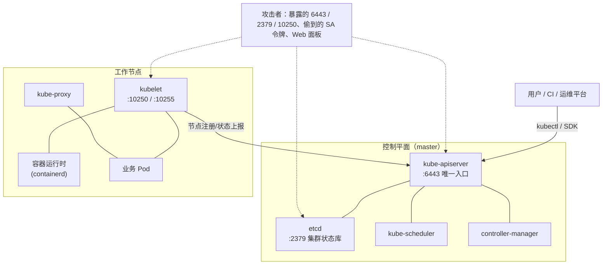

# 50. Kubernetes 攻击面与防御

> 日期：2026-11-13
> 所属大纲阶段：9. 云原生安全（扩展）
> 参考资料：
> - Kubernetes 官方文档：认证（`https://kubernetes.io/docs/reference/access-authn-authz/authentication/`）、鉴权（`https://kubernetes.io/docs/reference/access-authn-authz/authorization/`）、ServiceAccount 管理（`https://kubernetes.io/docs/reference/access-authn-authz/service-accounts-admin/`）、kubelet 认证鉴权（`https://kubernetes.io/docs/reference/access-authn-authz/kubelet-authn-authz/`）、Pod Security Admission（`https://kubernetes.io/docs/concepts/security/pod-security-admission/`）、NetworkPolicies（`https://kubernetes.io/docs/concepts/services-networking/network-policies/`）、Deprecated API Migration Guide（`https://kubernetes.io/docs/reference/using-api/deprecation-guide/`）
> - Kubernetes 博客：Pod Security Admission beta（v1.23，`https://kubernetes.io/blog/2021/12/09/pod-security-admission-beta`）
> - CIS Kubernetes Benchmark + Aqua kube-bench（`https://github.com/aquasecurity/kube-bench`）、kube-hunter、ARMO Kubescape
> - NVD / Kubernetes 官方安全公告：CVE-2020-8558（kube-proxy localhost 边界绕过，`https://github.com/kubernetes/kubernetes/issues/92315`）
> - 前置：笔记 16（认证与会话）、49（容器隔离）、13（SSRF 的内网视角）、28（日志分析）

**声明：本篇所有探测、提权、绕过手法仅用于本人本机的 kind/minikube 练习集群与故意配置错误的靶场；对任何未授权集群执行同等操作属违法行为。kubeadm/kind 默认配置的描述以官方文档为准。**

---

## 0. 这篇笔记怎么读

笔记 49 解决「单个容器为什么会漏」；本篇把镜头拉远到**编排层**：Kubernetes 把几百台机器的 root 权限抽象成一组 API 对象，于是攻击面从「一个容器的配置」变成「**控制面与配置体系的每一处失误**」。现实中的 K8s 入侵事件极少靠 0day，绝大多数走的是：暴露的 API server / kubelet / etcd、过宽的 RBAC、无人看守的 ServiceAccount 令牌、缺席的 Pod 安全准入与网络策略。

读法建议：先 §1 建立攻击面地图；§2—§6 逐个击破控制面组件（认证→RBAC→SA 令牌→kubelet→etcd）；§7—§8 是编排层两道最重要的防线（准入控制与网络隔离）；§9—§11 汇总基线、实操与检测。全部命令面向读者本机的 kind/minikube 集群；标注「示意」的输出非实测。

---

## 1. 架构与攻击面地图



| 攻击面 | 端口/形态 | 被攻陷的后果 | 本篇 |
| --- | --- | --- | --- |
| API server | 6443（HTTPS） | 集群全部对象与操作的入口；认证/授权配置失误 = 集群接管 | §2 |
| RBAC 配置 | 授权模型 | 拿到低权限身份后横向/提权 | §3 |
| ServiceAccount 令牌 | 每个可写 Pod | 从应用层沦陷跳到集群层 | §4 |
| kubelet | 10250（HTTPS）/10255（只读，历史） | 节点级 RCE、信息收集 | §5 |
| etcd | 2379 | **全集群状态与全部 Secret 明文（base64）** | §6 |
| 准入控制 | API 写入路径 | 恶意/不安全 Pod 拦不住 | §7 |
| Pod 间网络 | 默认全通 | 横向移动零阻力 | §8 |

一条主线贯穿全篇：**K8s 的安全 = 「API server 的门卫」（认证+鉴权）+「进门后的规矩」（准入+网络）+「门卫之外的后门封堵」（kubelet/etcd 不直接暴露）**。

---

## 2. API server：认证层

### 2.1 谁能敲 6443 的门

API server 支持的认证器（可叠加，任一通过即得到一个身份）：

| 认证方式 | 形态 | 常见事故 |
| --- | --- | --- |
| x509 客户端证书 | `kubeconfig` 里的 admin 证书（kubeadm 装好后位于 `/etc/kubernetes/admin.conf`） | 证书私钥进了代码仓库/CI 缓存；长有效期不轮换 |
| ServiceAccount 令牌 | JWT Bearer | 令牌从 Pod 里被偷（§4） |
| OIDC/令牌映射 | 对接企业 IdP | IdP 配置失误（受众/claim 校验不严） |
| **匿名认证** | `--anonymous-auth=true`（**默认 true**），匿名请求身份为 `system:anonymous` | 与 §2.3 的匿名授权叠加形成无认证访问 |

### 2.2 历史暗坑：insecure port（已死，但要认识尸体）

早期 kube-apiserver 有个免认证、免鉴权的 HTTP 端口（默认 `127.0.0.1:8080`）。生命周期（已核对官方弃用指南与 changelog）：**v1.20 起该 flag 变为 no-op（不再实际监听），v1.24 彻底移除**。它与另一个历史坑共振出过真实漏洞：**CVE-2020-8558**（修复于 1.18.4/1.17.7/1.16.14）——kube-proxy 的 iptables 规则会把发往 `0.0.0.0` 的流量当成本机流量处理，**相邻主机**借此绕过 localhost 边界、访问节点上只绑定 `127.0.0.1` 的服务（包括这个免认证的 8080）。今天再见到 8080 上的 API server，说明这是一个古老且长期无人维护的集群——本身就是最高危的信号。

### 2.3 认证层加固

- 关闭或收紧匿名：`--anonymous-auth=false`（或保留匿名但确保 RBAC 对 `system:anonymous` 无任何授权）；
- admin 证书私钥按密钥管理（笔记 32）对待：不入库、短有效期、可轮换；CI 用 `TokenRequest` 短期令牌或 OIDC 而不是证书；
- API server 不暴露公网：6443 只对运维网/堡垒网开放，用 VPN/私有终端接入（资产测绘时公网 6443 是重点巡检项——只对自有资产，笔记 25）。

---

## 3. RBAC：授权层与提权路径

### 3.1 模型速览

RBAC 三元组：**Subject（谁）→ Role/ClusterRole（能做什么）→ Binding（把角色绑给谁）**。

```yaml
apiVersion: rbac.authorization.k8s.io/v1
kind: ClusterRole
metadata:
  name: pod-reader
rules:
- apiGroups: [""]
  resources: ["pods", "pods/log"]
  verbs: ["get", "list", "watch"]
---
apiVersion: rbac.authorization.k8s.io/v1
kind: ClusterRoleBinding
metadata:
  name: ci-pod-reader
subjects:
- kind: ServiceAccount
  name: ci
  namespace: build
roleRef:
  kind: ClusterRole
  name: pod-reader
  apiGroup: rbac.authorization.k8s.io
```

### 3.2 高危权限清单（授权即等于给出提权路径）

| 授予的权限 | 为什么危险 |
| --- | --- |
| `pods` 的 `create` | 可创建特权 Pod / hostPath 挂宿主根（逃逸 → 集群接管，联动笔记 49 §7.1） |
| `pods/exec` 的 `create` | 等于「对任何 Pod 拿 shell」，顺走容器内 SA 令牌 |
| `secrets` 的 `get`/`list` | 读全部 ServiceAccount 令牌与其他凭据；`list` 比 `get` 更糟（枚举一切） |
| `roles`/`clusterroles` 的 `escalate` 或 `bind` | **提权动词**：无需拥有目标权限也可给自己绑定更高的角色 |
| `serviceaccounts` 的 `create` + `tokenrequest` 或 `impersonate` | 伪造/冒充任意身份（含 `system:admin`） |
| `nodes/proxy` 的 `create` | 直达 kubelet API，绕开 API server 层面的日志与鉴权 |
| 通配 `resources: ["*"]` / `verbs: ["*"]` | 未来新增的任何资源自动继承全权 |

`escalate` 与 `bind` 是 RBAC 特有的「元权限」：默认只有集群管理员语义持有；出现在普通角色里几乎必然是配置失误。

### 3.3 常见失误模式与自查命令

失误模式 TOP5（审计时按此扫 YAML）：

1. CI/CD 拿 `cluster-admin`（「先跑起来再说」）；
2. 通配符角色（`*` verbs/resources）；
3. `ClusterRoleBinding` 本该用 `RoleBinding`（namespace 级需求拿了集群级权限）；
4. 默认 ServiceAccount 被加 binding；
5. 忘删离职/下线服务的 binding（权限只加不减）。

```bash
# 我（当前 kubeconfig 身份）到底能干什么——第一步永远是这个
kubectl auth can-i --list
kubectl auth can-i create pods -n default
kubectl auth can-i '*' '*' --all-namespaces      # 通配探测

# 模拟任意身份（需要 impersonate 权限，管理员自查用）
kubectl auth can-i --list --as=system:serviceaccount:prod:web

# 谁能干某件事 / 某个 SA 被绑了什么（kubectl 插件或手工）
# kubectl-who-can / kubectl rbac-lookup（krew 安装）：
kubectl who-can create pods -n default
kubectl rbac-lookup --kind serviceaccount
```

输出（示意）：

```text
Resources   Non-Resource URLs  Resource Names  Verbs
pods        []                 []               [get list watch]
secrets     []                 []               [get]        ← 出现这一行就该追问：真的需要吗
```

加固：按「**每服务一个 SA + 最小 Role + namespace 内**」三原则发放；提权动词（escalate/bind/impersonate）出现在 code review 清单里；定期用 `rbac-lookup`/`kubectl-who-can` 做「权限盘存」对照服务清单。

---

## 4. ServiceAccount 令牌：从应用沦陷到集群沦陷的桥

### 4.1 机制与演进时间线（已核对官方文档）

| 版本 | 变化 |
| --- | --- |
| ≤ 1.20 | 每个 SA 自动生成一个**长期有效**的 Secret 型 JWT；Pod 默认自动挂载（`automountServiceAccountToken` 默认 true） |
| 1.21 | `BoundServiceAccountTokenVolume` beta 默认启用：新挂载的是 **projected token**（限时、绑定 Pod 身份，kubelet 定期轮换） |
| 1.24 | `LegacyServiceAccountTokenNoAutoGeneration` GA：**创建 SA 不再自动生成 Secret 令牌**；需要长期令牌须显式创建（`kubectl create token` 出短期令牌，或手工建 Secret） |

理解两条默认行为（事故高发点）：① Pod 默认仍自动挂载其 namespace 默认 SA 的令牌（`/var/run/secrets/kubernetes.io/serviceaccount/token`），哪怕业务根本不调 API；② 默认 SA `default` 在标准安装里**没有**有意义权限——但管理员常常「顺手」给它加权限（§3.3 模式 4）。

### 4.2 令牌被偷后的攻击链（靶场视角）

前提：应用层沦陷（笔记 11—15 任意一条链拿到容器内代码执行）：

```bash
# 1. 在沦陷 Pod 内收集身份材料
cat /var/run/secrets/kubernetes.io/serviceaccount/token   # JWT
cat /var/run/secrets/kubernetes.io/serviceaccount/namespace

# 2. 用令牌问 API server「我能干什么」（注意 URL 用 https://kubernetes.default.svc）
kubectl --token=$TOKEN --server=https://kubernetes.default.svc \
  --certificate-authority=/var/run/secrets/kubernetes.io/serviceaccount/ca.crt \
  auth can-i --list

# 3. 按权限分支走：
#    pods/exec → 进入其他 Pod（含 etcd/管理组件所在 Pod）
#    create pods → 起特权/hostPath Pod 逃逸到节点（笔记 49 §7.1）
#    get secrets → 收割全集群凭据
```

JWT 本体无加密（仅签名防篡改），`base64 -d` 即读出 payload：`aud`（受众）、`exp`（过期，projected token 短时有效）、`iss`、`kubernetes.io` 命名空间/SA 名——这是判定「捡到的令牌有多值钱」的第一步（ forensic 视角同样用）。

### 4.3 防御与检测

防御：

- 业务不需要 API 就 **`automountServiceAccountToken: false`**（Pod spec 或 SA 上）——这一行是「应用沦陷半径」的单点收敛器；
- 需要 API 的服务用专用 SA + 最小 Role；新版本尽量用 projected/短时令牌，杜绝长期 Secret 型令牌散落；
- 令牌轮换与 Secret 管理纳入笔记 32 的密钥生命周期。

检测（联动笔记 28 的 SIEM 视角）：

- audit log 中同一 SA 令牌出现在**非常规源 IP**（Pod 网段之外、节点之外）；
- `auth can-i --list` 形态的密集 SelfSubjectRulesReview 请求（探测指纹）；
- 短时间大量 `get secrets` / `create pods`（分支 3 的行为面）。

---

## 5. kubelet：节点上的第二个 API server

每个节点的 kubelet 在 **10250**（HTTPS）上提供管理 API：读 Pod 清单（`/pods`）、日志、统计，甚至 `POST /run/<namespace>/<pod>/<container>`（body 为命令）执行容器内命令——后者就是 `kubectl exec` 的底层通道之一。

### 5.1 两个默认值构成的历史大坑（已核对官方文档）

- `--anonymous-auth` **默认 true**：无凭据请求以 `system:anonymous` 身份进入；
- `--authorization-mode` **默认 AlwaysAllow**：放行一切请求。

两者叠加 = **10250 对任何能连到它的人完全开放**。kubeadm 装的集群会把 kubelet 授权设为 `Webhook`（回调 API server 鉴权，匿名身份无权通过），但自管/老集群常停留在默认组合。验证（自有集群）：

```bash
# 本机 kind 靶场（示意输出）
$ curl -sk https://127.0.0.1:32769/pods | head -c 200
{"kind":"PodList","apiVersion":"v1", ...        ← 无凭据拿到全部 Pod 规格（含环境变量里的敏感值）

$ curl -sk -X POST https://127.0.0.1:32769/run/default/myapp/myapp -d 'id'
uid=0(root) ...                                  ← 无凭据 RCE
```

只读端口 **10255**（`--read-only-port`）更老：明文、完全无认证，仅提供只读信息（Pod 列表、统计）。新版本默认关闭，但资产巡检时仍常见历史开启——信息泄露足够为 10250 的利用铺路。

工具面：`kubeletctl`（kubelet API 的专用客户端，自动化 pods/run/exec 枚举）与各类云上「未授权 kubelet」扫描器——**只允许用于自有集群与靶场**。

### 5.2 防御

```yaml
# kubelet 配置（kubeadm KubeletConfiguration / kind 补丁同构）
apiVersion: kubelet.config.k8s.io/v1beta1
kind: KubeletConfiguration
authentication:
  anonymous:
    enabled: false
  webhook:
    enabled: true
authorization:
  mode: Webhook
```

外加：10250/10255 不出节点网段（防火墙/安全组）；`--read-only-port=0` 显式关闭；kubelet 版本随集群升级（历史上多个 CVE 出现在 kubelet API 处理路径）。

---

## 6. etcd：拿到它 = 拿到整个集群

etcd 存放集群全部状态。**API server 的鉴权对 etcd 无效**——能直连 2379 的人不需要任何 K8s 权限：

```bash
# 未启用客户端证书校验的 etcd（示意输出）
$ ETCDCTL_API=3 etcdctl --endpoints=https://10.0.0.5:2379 \
    --insecure-skip-tls-verify get / --prefix --keys-only | head
/registry/pods/default/web-5d9f...
/registry/secrets/default/admin-token-...
/registry/serviceaccounts/default/default
```

要点：

- **所有 Secret 以 base64（非加密）存于 etcd**。`get /registry/secrets/... --print-value-only | base64 -d` 即明文凭据（base64 是编码不是加密，笔记 09 的老朋友）；
- 防御一：**传输与身份**双向 TLS + 客户端证书（kubeadm 默认已配）；2379/2380 只在控制平面节点间可达；**绝不出公网**；
- 防御二：**静态加密（encryption at rest）**——`EncryptionConfiguration` 启用 `kms`/`aescbc` 等 provider 加密 Secret 落盘内容，防的是「磁盘/备份/快照泄露」这另一条路（与 §防御一的威胁模型互补）：

```yaml
apiVersion: apiserver.config.k8s.io/v1
kind: EncryptionConfiguration
resources:
- resources: ["secrets"]
  providers:
  - kms:                       # 首选：对接外部 KMS（笔记 32）
      apiVersion: v2
      name: mykms
      endpoint: unix:///kms/kms.sock
  - aescbc:                    # 兜底
      keys: [{ name: k1, secret: <base64-32bytes> }]
```

- 备份同样是密件：etcd 快照里含全部 Secret，备份存储按密钥管理等级保护。

---

## 7. 准入控制与 Pod 安全标准

### 7.1 准入链：进门后的规矩

请求通过认证+鉴权后、落库前依次穿过**变更（mutating）→ 校验（validating）准入 webhook**。安全上这是强制执行「集群规矩」的位置——本篇 §3/§4/笔记 49 的所有加固项都可以在这里从「口头约定」升级为「机器拒绝」。

### 7.2 Pod Security Standards 与 PodSecurityAdmission

历史包袱先记清楚：老方案 **PodSecurityPolicy（PSP）已于 v1.25 移除**（弃用指南原文确认）；继任者 **PodSecurityAdmission（PSA）**：v1.22 alpha → **v1.23 beta 默认启用** → **v1.25 GA**。PSA 按命名空间打标签实施，无需部署任何组件。

三级标准（内容摘要）：

| 级别 | 策略 | 关键差异 |
| --- | --- | --- |
| **Privileged** | 完全开放 | 等于「什么都不拦」（不该用于任何业务 namespace） |
| **Baseline** | 阻止已知越权 | 禁 hostPID/hostIPC/hostNetwork（部分受限）、特权容器、危险 capabilities 追加、hostPath 大部分用法、/proc mount 类型等 |
| **Restricted** | 最小权限 | 进一步强制：runAsNonRoot、drop ALL capabilities、seccompProfile=RuntimeDefault/Localhost、禁止提权等 |

使用：三种模式可组合——`enforce`（拒绝）、`audit`（记事件不拒绝）、`warn`（提示不拒绝）。灰度路径是标配动作：先 `warn+audit` 观察存量负载，再切 `enforce`。

```yaml
apiVersion: v1
kind: Namespace
metadata:
  name: prod
  labels:
    pod-security.kubernetes.io/enforce: restricted
    pod-security.kubernetes.io/enforce-version: latest
    pod-security.kubernetes.io/warn: restricted      # 对不合规提交者告警
```

```bash
# 违规尝试的形态（本机 kind 靶场，示意输出）
$ kubectl -n prod run sneaky --image=ubuntu --privileged --restart=Never
Error from server (Forbidden): pods "sneaky" is forbidden:
violates PodSecurity "restricted:latest": privileged (container "sneaky" must not set securityContext.privileged=true)
```

注意边界：PSA 只管 **Pod 字段**。网络策略（§8）、RBAC（§3）、镜像来源（笔记 51 §7）不在其管辖内——复杂策略用 Kyverno/OPA Gatekeeper 这类通用准入框架补齐（例如「只允许已签名镜像」「必须打 team 标签」）。

---

## 8. 网络策略：默认全通的世界要手动关门

K8s 网络默认行为：**同集群任意 Pod 可达任意 Pod（含跨 namespace）**——「内网零阻力横向移动」的平台化版本。NetworkPolicy 是开关门的 API（**依赖 CNI 实现**：Calico/Cilium 等支持；kind 默认 CNI 不支持，靶场需 `--config` 装支持 NP 的 CNI，minikube 用 `--cni=calico`）。

最小可用模板——先「默认拒绝入站」，再按需放行：

```yaml
apiVersion: networking.k8s.io/v1
kind: NetworkPolicy
metadata:
  name: default-deny-ingress
  namespace: prod
spec:
  podSelector: {}          # 选中 namespace 内全部 Pod
  policyTypes: ["Ingress"]
---
apiVersion: networking.k8s.io/v1
kind: NetworkPolicy
metadata:
  name: allow-web-from-gw
  namespace: prod
spec:
  podSelector: { matchLabels: { app: web } }
  policyTypes: ["Ingress"]
  ingress:
  - from:
    - namespaceSelector: { matchLabels: { name: gateway } }
    ports: [{ protocol: TCP, port: 8080 }]
```

要点与坑：

- `policyTypes` 里出现 `Ingress` 且无 `ingress` 字段 = 全拒该方向；**没有 NetworkPolicy 选中某 Pod = 全通**——审计要以「哪些 Pod 没被任何策略覆盖」为口径；
- 出站（Egress）同理：限制 Pod 只能访问所需服务 + DNS（UDP/TCP 53），把「沦陷 Pod 外联 C2/挖矿」的路掐掉；
- namespace 间默认可达：`prod` 与 `build` 之间没有墙，除非策略建墙——这恰是 §4.2 攻击链里「从业务 Pod 直连 API server」畅通的原因之一（API server 本身也应有网络层准入）。

---

## 9. 集群安全基线与工具箱

| 工具 | 定位 | 用法要点 |
| --- | --- | --- |
| **kube-bench** | CIS Kubernetes Benchmark 合规自检（节点上跑） | 按版本跑对应 CIS 套件，输出 PASS/FAIL 清单——把 §2/§5/§6 的手动检查自动化 |
| **kube-hunter** | 集群「攻击者视角」主动探查 | 只跑在**自有**集群；报告暴露的 kubelet/API/etcd 面 |
| **Kubescape** | 多框架（NSA CISA、CIS）扫描 + RBAC 可视化 | 适合 CI 里对 manifest 做准入前检查 |
| `kubectl auth can-i` | 权限实测（§3.3） | 一切 RBAC 结论以「实际能否」为准，不读 YAML 猜 |
| audit log | 检测的原料（§11） | API server `--audit-policy-file` 必开，落地见笔记 28 |

CIS Benchmark 的价值不在分数，而在于它把「该检查什么」做成了清单——本篇各节与其条目一一对应，可作为自查的 second opinion。

---

## 10. 本地靶场实操：把一条完整攻击链走通（仅限本人 kind 集群）

实验目标：在一个**故意配错**的 kind 集群里，从「应用层沦陷」走到「集群接管」，再逐项修复断链。

```yaml
# kind-lab.yaml —— 故意配置错误的练习集群（kind v0.2x；仅本机使用）
kind: Cluster
apiVersion: kind.x-k8s.io/v1alpha4
nodes:
- role: control-plane
kubeadmConfigPatches:
- |
  kind: KubeletConfiguration
  apiVersion: kubelet.config.k8s.io/v1beta1
  authentication:
    anonymous:
      enabled: true        # 故意配错 ①：kubelet 匿名放行
  authorization:
    mode: AlwaysAllow      # 故意配错 ②：免鉴权
```

```bash
kind create cluster --name sec-lab --config kind-lab.yaml
# 再故意配错 ③：给 default SA 一个过宽角色（§3.2 的 create pods + get secrets）
kubectl create rolebinding sloppy --clusterrole=edit --serviceaccount=default:default -n default
```

实验脚本（形态，输出为示意）：

```text
1. 模拟应用沦陷：kubectl run app --image=nginx ... 后 exec 进 Pod
2. 收集令牌 → auth can-i --list → 确认 create pods / get secrets 可用
3. 提权分支 A：创建 hostPath 挂宿主 / 的 Pod（走 §3.2 pods:create）
   → 节点文件系统可读写（逃逸到节点，笔记 49 §7.1B 的 K8s 版）
4. 提权分支 B：get secrets 收割 default ns 全部凭据
5. 侧面验证 kubelet：宿主上 curl -sk https://127.0.0.1:10250/pods（①②的后果）
6. 断链复盘（逐项修复并重放攻击）：
   a. automountServiceAccountToken: false + 删除 sloppy binding → 步骤 2 失败
   b. namespace 打 enforce=restricted 标签 → 步骤 3 的 Pod 被 PSA 拒绝
   c. kubelet 配置改 Webhook + anonymous=false → 步骤 5 返回 401
   d. （可选）default-deny NetworkPolicy → Pod 连 API server 都不通
```

把每步的「攻击请求在 audit log 里的对应事件」找出来（§11），这是检测侧的原料采集——一次实验同时产出红蓝两侧的素材。

---

## 11. 检测与应急

### 11.1 审计日志是 K8s 检测的地基

`--audit-policy-file` 记录每个 API 请求（who/what/when/allowed）。安全相关的最小策略建议：`Metadata` 级全量 + Secrets 读写、exec/attach、RBAC 变更、token 请求提到 `RequestResponse`。

高频检测场景：

| 场景 | 审计事件特征 |
| --- | --- |
| 令牌滥用（§4） | ServiceAccount 身份的 `SelfSubjectRulesReview`（can-i 的底层调用）突发；`create pods/exec` 源 IP 不在节点网段 |
| RBAC 提权（§3） | 对 `roles/clusterroles/bindings` 的 create/update；动词含 `escalate/bind/impersonate` |
| 特权 Pod 注入（§7） | `create pods` 且 spec 含 `privileged: true` / hostPath / 新 capabilities |
| kubelet 旁路（§5） | kubelet Webhook 鉴权失败的日志；节点防火墙对 10250 的异常访问源 |
| Secret 收割 | 短窗口大量 `get secrets`；`list secrets` 本身就应告警 |

### 11.2 应急流程（套用笔记 34 的框架）

```text
识别：audit log + Falco（节点侧）双源定位身份与操作面
遏制：吊销涉案 SA 令牌（1.24+ 短期令牌自然过期；长期令牌删除 Secret）、
     cordon 节点、必要时收紧 NetworkPolicy 切断横向
根除：修复被滥用的 RBAC/准入缺口；滚动重建受害 Pod（容器内持久化假定存在）
恢复：新令牌/凭据轮换（笔记 32）；PSA enforce 补齐
复盘：把攻击链每一步映射到 §11.1 的事件——哪一步没有告警，就补哪条规则
```

---

## 12. 常见误区

| 误区 | 事实 |
| --- | --- |
| 「K8s 有 RBAC，安全就够了」 | RBAC 只管 API server 这扇门；kubelet/etcd/网络默认全通是另外三扇敞开的门 |
| 「API server 不暴露公网就安全」 | 应用层沦陷 → Pod 内默认令牌 → 集群内直连 6443，攻击不需要公网入口 |
| 「default SA 没权限，挂着无所谓」 | 默认确实近乎无权限；但它被顺手加权限的频率极高，且不挂载可断整条 §4.2 链 |
| 「etcd 有证书，Secret 就安全了」 | 证书管传输；落盘是 base64 明文——静态加密与备份加密是独立的两件事 |
| 「PSP 还能用」 | v1.25 已移除；继任者是 PSA 命名空间标签（§7.2） |
| 「装了 CNI 就有网络隔离」 | NetworkPolicy 是要显式写的 API；没有策略 = 全通，与装没装 CNI 无关 |
| 「privileged Pod 只有平台组件需要」 | 正因如此才要用 PSA baseline/restricted 把「例外」锁死在准入层 |

---

## 13. 自测问题

1. 画出 K8s 攻击面地图（API server / etcd / kubelet / SA 令牌 / 准入 / 网络），各配一句「沦陷后果」。
2. `--anonymous-auth` 与 `--authorization-mode` 的默认值各是什么？kubeadm 与 kubelet 各自如何纠正这对组合？
3. insecure port 的完整生命周期（弃用→no-op→移除）？CVE-2020-8558 利用了它什么特性？
4. RBAC 里为什么 `escalate`/`bind` 被称为元权限？`create pods` 与 `pods/exec` 分别对应哪两条提权路径？
5. SA 令牌机制在 1.21 与 1.24 各发生什么变化？`automountServiceAccountToken: false` 一行能断掉攻击链的哪一步？
6. 令牌 JWT 的 `aud`/`exp` 声明对攻击者与防御者分别意味着什么？
7. etcd 直连为何等于集群接管？「传输加密」与「静态加密」各防什么威胁模型？
8. PSS 三级标准的差异？PSA 的 enforce/audit/warn 三模式如何用于灰度收紧？
9. NetworkPolicy 的「选中即收紧」语义：没有被任何策略选中的 Pod 是什么状态？default-deny 模板为什么 `podSelector: {}`？
10. 实操题：按 §10 搭建靶场，完成攻击链并逐项断链；最后在 audit log 里为每一步写出对应检测规则。

---

## 14. 小结

- K8s 攻击面的骨架：**一个入口（API server）+ 两个旁门（kubelet/etcd）+ 一座桥（SA 令牌）+ 两片空地（准入缺席、网络全通）**。
- 防御对仗：收紧认证与匿名 → RBAC 最小化并盯死元权限 → 关闭自动挂载 → kubelet 走 Webhook 鉴权 → etcd 双向 TLS + 静态加密 → PSA enforce + 通用准入 → NetworkPolicy default-deny。
- 检测对仗：audit log 是地基，令牌滥用、RBAC 变更、特权 Pod、Secret 收割四类事件优先覆盖。
- 所有结论都能在读者本机的 kind 集群里复现与验证——这是本篇实验设计的唯一对象。

---

（完。容器层逃逸原理见笔记 49；镜像与供应链防线见笔记 51；认证与会话通用原理见笔记 16；应急响应框架见笔记 34。）
