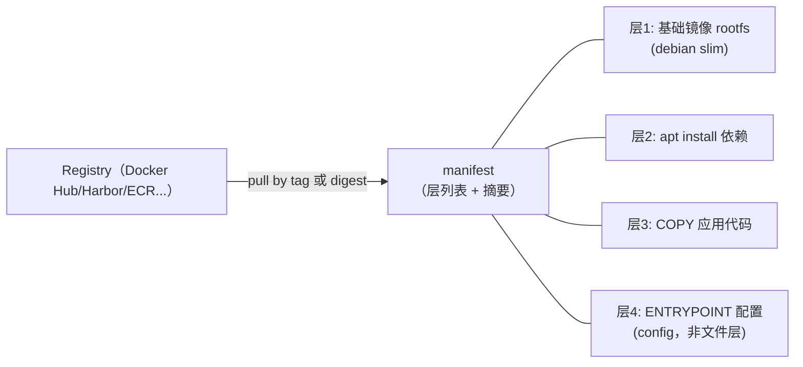
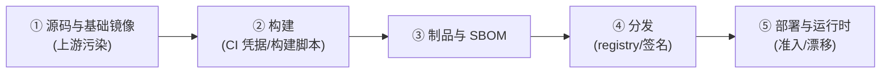

# 51. 容器镜像与供应链安全

> 日期：2026-11-13
> 所属大纲阶段：9. 云原生安全（扩展）
> 参考资料：
> - 与笔记 31（依赖与供应链安全）分工：31 管应用层依赖（npm/PyPI/Maven），本篇管**镜像与容器制品链**；SBOM/SCA 通用方法两篇互引
> - Sigstore / cosign 官方文档（`https://docs.sigstore.dev/`）、SLSA v1.0 框架（`https://slsa.dev/`）、in-toto（`https://in-toto.io/`）
> - GoogleContainerTools/distroless（`https://github.com/GoogleContainerTools/distroless`）
> - Aqua Trivy（`https://github.com/aquasecurity/trivy`）、Anchore Syft/Grype（`https://github.com/anchore/syft`）
> - Kyverno verifyImages（`https://kyverno.io/docs/writing-policies/verify-images/`）
> - NIST SP 800-190（容器安全指南）；CNCF Supply Chain Security White Paper
> - 前置：笔记 31（供应链方法论）、33（安全 SDLC 与 CI 门禁）、49/50（运行时与编排层）

**声明：本篇涉及的工具与命令用于本人项目与本地环境；引用的攻击案例均为公开披露事件的机制描述，不含可复用的攻击载荷。**

---

## 0. 这篇笔记怎么读

镜像是一份「**自带全部依赖的可执行制品**」——它把应用层供应链（笔记 31）的全部问题打包继承，又新增了一层：**镜像本身的来源、构建过程与分发链路**。攻击者不需要碰你的代码，只要在你信任的任何一环（基础镜像、registry、构建机、标签）动手。

本篇按制品的生命周期展开：是什么（§1—§2）→ 威胁在哪（§3）→ 扫描与最小化（§4—§5）→ 固定与签名（§6—§7）→ 运行时兜底与落地清单（§8—§9）。工具类输出均为**示意**（撰写时本机未装 trivy/cosign，未实际运行；命令形态以官方文档为准）。

---

## 1. 镜像解剖：层、清单与 registry

一个镜像 = **层（layer）堆叠 + 一份 manifest + 一份 config**：



三个安全相关的事实：

1. **层只增不改**：任何「删除文件」都只是新层里的白名单遮罩，被删内容仍在下层——曾经 `COPY` 进去的密钥会永远留在历史层里（`docker history`、`dive` 可逐层检视）；
2. **tag 是可变的指针，digest 才是内容**：`nginx:1.27` 这个名字可以被 registry 端重新指向另一个 manifest；`nginx@sha256:<64位十六进制>` 才钉死内容（§6）；
3. **registry 是代码执行的分发点**：pull 到节点上的内容会被解包成 rootfs。谁控制了 registry 响应，谁就控制了节点上运行的文件——它的信任等级等同于源码仓库。

自检工具：`docker history --no-trunc <image>`（看每层构建指令）、`dive <image>`（逐层文件 diff，揪出「本不该在」的文件）。

---

## 2. 与笔记 31 的分工：容器供应链的五个环



| 环 | 笔记 31 已覆盖 | 本篇聚焦 |
| --- | --- | --- |
| ① 上游 | 应用依赖投毒（XZ、依赖混淆的通用原理） | 基础镜像来源、typosquatting、内嵌密钥 |
| ② 构建 | CI 加固、锁文件 | 构建即污染（多阶段、构建参数泄漏） |
| ③ 制品 | SBOM 概念与格式 | 镜像 SBOM 生成与扫描门禁 |
| ④ 分发 | （未展开） | **tag/digest、签名与来源证明、准入验签** |
| ⑤ 运行 | —— | 运行时检测与漂移（联动笔记 49 §9） |

---

## 3. 威胁模型：镜像链上的六类攻击

| # | 威胁 | 机制 | 本篇对策 |
| --- | --- | --- | --- |
| 1 | **恶意/后门镜像** | 公共 registry 上的同名/近似名镜像（typosquatting：`nodee`、`ubumtu` 类）、教程诱导「一键镜像」；公开研究多次发现 Docker Hub 上的挖矿与后门镜像 | 来源白名单 + digest 固定 + 验签（§6/§7） |
| 2 | **基础镜像带毒带洞** | 上游被投毒（XZ 类，见笔记 31/47）或长期不更新累积 CVE | 扫描门禁 + 自动更新基础镜像（§4/§6） |
| 3 | **镜像内嵌密钥** | `COPY .env ./`、构建参数（`ARG` 会进 `docker history`）、`~/.docker/config.json` 被一起打进层 | §5 构建卫生 + secret 扫描（联动笔记 32） |
| 4 | **标签漂移 / latest 陷阱** | `:latest` 或裸 tag 在重建时被不同内容覆盖（registry 允许同名重推），「没有改任何配置却上线了新代码」 | digest 固定（§6） |
| 5 | **registry 与构建链路沦陷** | registry 凭据/CI 凭据（笔记 33 §Job 案例）泄露后攻击者重推同 tag 镜像 | 签名 + 准入验签（§7）——内容对不上就拒收 |
| 6 | **过度膨胀的攻击面** | 旧发行版全家桶 + 编译工具链 + shell 进生产镜像：漏洞数量与落地后工具都多 | 最小化基础镜像（§5） |

案例库补充：具体事件复盘见笔记 31 §2（依赖侧）与笔记 47（CVE 侧），本篇不重复展开。

---

## 4. 镜像扫描：门禁怎么做才不变成噪音源

### 4.1 工具与原理

```bash
# 漏洞扫描（本地/CI；输出为示意形态）
$ trivy image --severity HIGH,CRITICAL myapp:ci-42
myapp:ci-42 (debian 12.5)
=========================
Total: 3 (HIGH: 2, CRITICAL: 1)
┌────────────┬────────────────┬──────────┬───────────────────┐
│  Library   │ Vulnerability  │ Severity │ Installed/Fixed   │
├────────────┼────────────────┼──────────┼───────────────────┤
│ openssl    │ CVE-XXXX-XXXXX │ CRITICAL │ 3.0.11 → 3.0.12   │
...
# SBOM 生成（CycloneDX/SPDX 两格式，标准见笔记 31 §5）
$ syft myapp:ci-42 -o cyclonedx-json=sbom.cdx.json
```

原理：扫描器 = **SBOM 提取**（层里的 dpkg/rpm/apk/npm 数据库）+ **advisory 匹配**（Trivy DB、grype-db 汇聚 NVD/GHSA/发行版安全公告）。理解原理才能处理两类经典误判：

- **发行版回补（backport）**：Debian/Ubuntu 常把上游修复回移到老版本号（版本不变、漏洞已修），只看 NVD 的扫描器会误报；必须用**带发行版安全追踪器**的匹配器（Trivy/Grype 均内置）；
- **不可达漏洞**：组件在镜像里但运行路径用不到。门禁策略不能无限追求零漏洞——追求的是「**已知+可利用+有修复**的及时处理」。

### 4.2 CI 门禁策略（联动笔记 33）

```text
原则：基线是「不引入新问题」，而不是「清零历史问题」
① 增量拦截：对比上一次构建的扫描结果，新出现 CRITICAL 且有 fixed 版本 → 卡
② 全量报告：历史漏洞出报告进 backlog，按运行时暴露面（是否对外）排期
③ 基础镜像更新自动化（Renovate/Dependabot 对 Dockerfile 的 digest/tag 发 PR），
   让「升基础镜像」成为日常小动作而不是年度手术
④ SBOM 存档：每个发布镜像附 SBOM（合规与应急双向用途——新 CVE 爆发时反查暴露面）
```

误报治理是门禁能否活下去的关键：一个每周狼来了的扫描器，三个月后就会被静音。

---

## 5. 最小化镜像：少装就是少漏

### 5.1 基础镜像选型

| 方案 | 体积量级 | 内含 | 取舍 |
| --- | --- | --- | --- |
| `FROM scratch` | ≈ 0 | 无（连 libc 都没有） | 静态编译（Go）专用 |
| **distroless** | 小 | 运行时库（glibc 等）+ TLS 根证书，**无 shell、无包管理器** | 各语言专用变体（`nodejs-*`、`python3-*`、`cc`）；无 shell 同时废掉「拿 shell」一类落地姿势 |
| alpine | 小 | musl libc + apk | 注意 musl 与 glibc 差异（DNS 行为、性能、个别二进制不兼容）；自带包管理器=攻击面比 distroless 大 |
| 完整发行版（debian/ubuntu） | 大 | 全套工具 | 生产应用一般用不上；保留即保留漏洞与工具 |

### 5.2 多阶段构建与构建卫生

```dockerfile
# syntax=docker/dockerfile:1
FROM golang:1.23 AS build                 # ① 构建阶段：工具链齐全没关系
WORKDIR /src
COPY . .
RUN CGO_ENABLED=0 go build -o /app .

FROM gcr.io/distroless/static-debian12    # ② 运行阶段：只带产物
COPY --from=build /app /app
USER nonroot:nonroot                      # ③ 非 root（distroless 自带 nonroot 用户）
ENTRYPOINT ["/app"]
```

卫生清单：

- **多阶段**把编译器/源码/构建凭据留在构建阶段，不进制品；
- `ARG` 传密钥 = 进 `docker history`（`--build-arg TOKEN=...` 是公开反模式）；构建期需要凭据用 BuildKit secrets（`RUN --mount=type=secret`）；
- 合并 `RUN` 并清理包缓存（`rm -rf /var/lib/apt/lists/*`）：减层不只为体积，也减少残留；
- `.dockerignore` 掉 `.git`、`.env`、`tests/`——层是永久的（§1.1），「先打进去再删」没有意义；
- `USER` 非 root + 只读 rootfs（部署侧，联动笔记 49 §8.2）。

效果直觉：一个 distroless 多阶段镜像的 CVE 计数常见从「数百」降到「个位数」，且落地后没有 shell/包管理器可用——攻击成本的结构性抬升。

---

## 6. 固定（Pinning）：tag 不可信，digest 才可信

```dockerfile
# 可变：nginx:1.27 这个名字指向的内容可以被 registry 端改变
FROM nginx:1.27
# 固定：内容寻址，任何字节变化 digest 即变
FROM nginx@sha256:6af79ae5b40...（64 位摘要）
# 工程上两者结合：tag 便于阅读，digest 保证内容
```

配合自动化（Renovate 类工具盯 digest 变化发 PR），得到两个收益：**可复现构建**（任何人任何时间构建产物 digest 一致）与**防漂移**（「没改配置却变了行为」被结构性杜绝）。这与笔记 31 §4 的依赖锁定（lockfile）完全同构——容器世界的 lockfile 就是 digest。

---

## 7. 签名与来源证明：让节点只运行「自家的」镜像

### 7.1 问题：registry 说「这就是你的镜像」，凭什么信

没有签名时，镜像的完整性完全依赖 registry 与传输链路（TLS）——registry 凭据一旦泄露（§3.5），攻击者重推同 tag 镜像即可替换代码，且无任何密码学痕迹可查。签名把信任根从「registry 的账本」搬到「你自己的密钥」。

### 7.2 Sigstore/cosign：签名与验签

```bash
# keyless 签名：以 OIDC 身份（CI 的 GitHub 身份）短期证书签名，无需长期保管私钥
$ cosign sign registry.example.com/myapp@sha256:6af79...
# 验签（集群侧/审计侧）：核对签名者身份与 issuer
$ cosign verify registry.example.com/myapp@sha256:6af79... \
    --certificate-identity-regexp '^https://github.com/myorg/.+/.github/workflows/.+@refs/.+' \
    --certificate-oidc-issuer https://token.actions.githubusercontent.com
Verified true        ←（示意输出）
# 传统密钥对模式：cosign generate-key-pair → sign --key → verify --key cosign.pub
```

### 7.3 准入强制：把验签放进集群入口（联动笔记 50 §7）

Kyverno（或 OPA Gatekeeper/Connaisseur）在准入层拒绝未验签镜像——这是「签名」从审计事实变成强制防线的一步：

```yaml
# Kyverno verifyImages 规则骨架（字段以官方文档为准，示意）
apiVersion: kyverno.io/v1
kind: ClusterPolicy
metadata:
  name: verify-myorg-images
spec:
  validationFailureAction: Enforce
  rules:
  - name: check-signature
    match:
      any: [{ resources: { kinds: [Pod] } }]
    verifyImages:
    - imageReferences: ["registry.example.com/*"]
      attestors:
      - entries:
        - keyless:
            subjectRegExp: "^https://github.com/myorg/.+"
            issuer: "https://token.actions.githubusercontent.com"
```

部署顺序建议：先 `Audit` 模式观察全量镜像合规率 → 补齐存量签名 → 切 `Enforce`。与笔记 50 的 PSA 收紧是同一套灰度方法论。

### 7.4 来源证明（Provenance）与 SLSA

签名回答「这个镜像谁发的」；**provenance attestation** 回答「这个镜像**怎么来的**」——由构建系统签名的一组声明：源码仓库与 commit、构建指令文件（Dockerfile）摘要、构建平台。SLSA v1.0 的等级（Build L1—L3+）就是对这些声明的完整度与构建平台隔离强度的分级。防的是 §3.5 的更隐蔽形态：**合法 CI 凭据被用来从恶意源码构建**——provenance 里「源码仓库不对」在准入层即可拒收。CI 侧落地方案（GitHub Actions OIDC + cosign attest）见笔记 33 §10 的流水线。

历史注脚：Docker Content Trust（Notary v1，`DOCKER_CONTENT_TRUST=1`）是第一代镜像签名方案，基于-tag 模型；生态已转向 Sigstore（keyless、digest 模型）与 Notary v2（`notation`）。老资料里「开启 DCT 即可」的建议不要再照搬。

---

## 8. 运行时兜底：镜像之外的最后一段

准入拦得住「进来的镜像」，拦不住「进来之后的行为」（镜像本身干净但应用被 SQL 注入打了反弹 shell——笔记 11 的世界）。运行时侧与笔记 49 §9 共用一套设施，镜像视角的专项规则：

- **漂移检测**：容器文件系统相对镜像层出现未预期的写（`/tmp` 之外）——WebShell 落地的强信号（Falco 的 `Write below rootfs` 类规则）；
- **镜像外二进制执行**：进程 exe 路径不在镜像层白名单内（内存注入/下载执行的特征）；
- **异常子进程谱系**：node/nginx 起了 `sh`/`curl`/矿池连接——按镜像内「应该有什么」建基线，而不是按通用规则；
- 事件全部汇入 SIEM（笔记 28），与 §9 的准入/签名日志（镜像 provenance）串成一个可追溯链：**「哪个 commit → 哪次构建 → 哪个 digest → 哪个节点在跑 → 现在的行为」**——这是容器时代事件响应的「链路复原」基线。

---

## 9. 落地清单：一条最小可信流水线

```text
源码 PR
  → CI（锁定 runner/OIDC，笔记 33）
      → 构建多阶段 + distroless/最小基础镜像（§5）
      → trivy 扫描 + 增量门禁（§4）
      → syft 生成 SBOM 存档（§4/笔记 31）
      → cosign sign + attest provenance（§7）
  → Registry（私有、强认证、按仓库细粒度凭据）
  → 部署侧
      → Kyverno verifyImages Enforce（§7.3）
      → PSA restricted / cap drop / read-only rootfs（笔记 49/50）
      → NetworkPolicy default-deny（笔记 50 §8）
  → 运行时
      → Falco 漂移/行为规则 + audit log（§8/笔记 49 §9）
```

自查清单：

- [ ] 生产镜像全部 digest 固定，`:latest` 禁用（lint 层拦截）
- [ ] 基础镜像白名单（distroless/alpine/官方 slim 三选一），Renovate 自动升级 PR
- [ ] `docker history` 审计无密钥/构建参数泄漏；BuildKit secrets 已启用
- [ ] CI 扫描门禁为「增量 CRITICAL + 有 fixed 才卡」，误报有治理流程
- [ ] 发布镜像 100% 签名 + provenance；集群准入 Enforce 验签
- [ ] 每镜像 SBOM 归档，能回答「CVE-X 我们暴露吗」在分钟级
- [ ] 运行时规则覆盖 rootfs 写、镜像外执行、异常子进程三类信号

---

## 10. 常见误区

| 误区 | 事实 |
| --- | --- |
| 「镜像扫过描就安全了」 | 扫描只看已知 CVE；恶意镜像/配置问题/密钥泄漏不在其射程 |
| 「基础镜像用 latest 方便升级」 | latest 是漂移入口；升级应是 Renovate 发 PR 的显式动作 |
| 「删掉文件的层就不含该文件了」 | 层只增不改，下层内容永久保留（§1） |
| 「alpine 一定更安全」 | 攻击面更小，但 musl 差异带来兼容与行为坑；distroless 常是更优解 |
| 「签了名就完事」 | 不配准入验签，签名只是一条无人看的审计记录 |
| 「Docker Content Trust 开着就行」 | v1 已是历史方案；生态在 Sigstore/Notary v2 |
| 「SBOM 是合规文书」 | 它是应急时反查暴露面的索引（新 CVE → 分钟级定位受影响服务） |

---

## 11. 自测问题

1. 镜像的 manifest、config、层各承担什么？「层只增不改」带来哪些安全后果？
2. tag 与 digest 的本质区别？为什么说 digest 固定是「容器世界的 lockfile」？
3. 归纳镜像供应链六类威胁，并各配一个对策条目（哪一节）。
4. 什么是发行版回补？它如何造成扫描误报？正确的匹配器应该用什么数据源？
5. CI 扫描门禁为什么基线是「不引入新问题」而不是「清零」？误报治理怎么做？
6. distroless 相比 alpine 少了什么？「无 shell」废掉了攻击者的哪类姿势？
7. `ARG` 传密钥为什么会泄漏？BuildKit secrets 的机制是什么？
8. 签名与 provenance 各回答什么问题？keyless 模式为什么不需要长期私钥？
9. Kyverno verifyImages 部署时为什么要先 Audit 后 Enforce？与 PSA 的灰度方法有何同构性？
10. 设计题：为笔记 33 的示例项目补全 §9 流水线，标注每一步使用的工具与拦截的威胁编号（§3 表）。

---

## 12. 小结

- 镜像供应链的信任链：**来源可信（digest+白名单）→ 内容可信（扫描+SBOM）→ 构建可信（签名+provenance）→ 运行受限（准入+最小权限+运行时检测）**。
- 最小化基础镜像与多阶段构建是性价比最高的两项投入：漏洞数与落地工具一起消失。
- 扫描门禁的敌人是噪音，签名的价值在准入强制，SBOM 的价值在应急索引——三者各司其职，缺一环链路即断。

---

（完。应用层依赖供应链见笔记 31；CI/CD 门禁与 SDLC 见笔记 33；容器运行时隔离与检测见笔记 49；K8s 准入与网络防线见笔记 50。）
