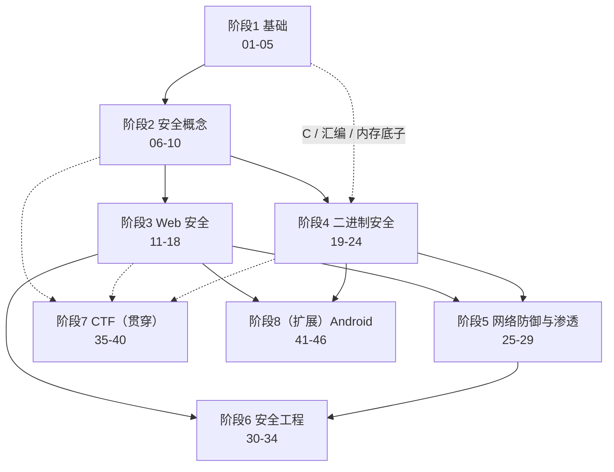

# 总索引：计算机安全学习笔记

> 日期：2026-11-04（阶段 8 于同日扩展新增；2026-11-05 新增横向专题篇，笔记 47—）
> 所属大纲阶段：总览（覆盖阶段 1—7、扩展阶段 8 及横向专题篇）
> 配套资料：[01-书单推荐](./10-resources/01-书单推荐.md)、[02-课程与在线资源](./10-resources/02-课程与在线资源.md)、[03-CTF平台与工具索引](./10-resources/03-CTF平台与工具索引.md)、[04-Android安全资源](./10-resources/04-Android安全资源.md)

## 工作区介绍

本工作区是一名**有开发背景**的学习者的计算机安全学习空间，整体取向为**防御导向**（defensive security）：通过理解攻击原理来构建防御能力，兼顾安全研究与 CTF 竞赛训练。笔记按七个阶段线性推进（另有扩展阶段 8 与横向专题篇），配合靶场实操（`labs/`）与资源索引（站内「资源索引」分类）使用；全站由 Docusaurus 构建，本地 `npm run dev` 预览。编程概念不再从零解释，直接以代码与协议细节为切入点。所有实验严格限制在本地隔离环境或明确授权的靶场内。

> **阶段 8 说明**：原大纲（AGENTS.md）为七个阶段；2026-11-04 应学习需要扩展新增**阶段 8：移动安全（Android）**（笔记 41—46），作为 Web 安全与逆向知识的横向应用方向，可在完成阶段 3、4 之后随时插入学习。
>
> **专题篇说明**：2026-11-05 起增设**横向专题篇**（笔记 47—），收录跨阶段的专题整合内容（如重大 CVE 案例剖析），不占用大纲顺序，可在任意阶段穿插阅读。

## 大纲总览

| 阶段 | 主题 | 笔记编号 | 预估时长（每周 10 小时） | 前置阶段 |
| --- | --- | --- | --- | --- |
| 1 | 基础（网络 / 操作系统 / Linux / 编程） | 01—05 | 8—10 周 | 无 |
| 2 | 安全基础概念（CIA / 威胁建模 / 漏洞分类 / 密码学） | 06—10 | 4—5 周 | 1 |
| 3 | Web 安全 | 11—18 | 8—10 周 | 1、2 |
| 4 | 系统与二进制安全 | 19—24 | 12—16 周 | 1（C/汇编/内存）、2 |
| 5 | 网络安全与防御 | 25—29 | 5—6 周 | 1、2、3 |
| 6 | 安全工程与应急响应 | 30—34 | 5—6 周 | 2、3、5 |
| 7 | CTF 实战 | 35—40 | 贯穿全程（集中刷题另计 8 周+） | 2 之后即可入门，各方向见依赖 |
| 8（扩展） | 移动安全（Android） | 41—46 | 4—6 周 | 3、4（逆向基础）、5 |

> 总计约 50—60 周（每周 10 小时投入，约一年到一年半）。阶段 4 曲线最陡，允许放慢；阶段 7 从阶段 2 结束起即可穿插进行，不必等到最后。

## 完整笔记索引

### 阶段 1：基础（01—05）

| 笔记 | 标题 | 内容摘要 | 前置依赖 |
| --- | --- | --- | --- |
| [01-计算机网络基础-TCP-IP.md](./01-fundamentals/01-计算机网络基础-TCP-IP.md) | 计算机网络基础：TCP/IP | 分层模型、IP 与路由、TCP/UDP、三次握手与拥塞控制，用抓包验证每个概念 | 无 |
| [02-HTTP-HTTPS-协议详解.md](./01-fundamentals/02-HTTP-HTTPS-协议详解.md) | HTTP/HTTPS 协议详解 | 请求/响应结构、状态码、Cookie、HTTP/2 概览、TLS 握手与证书链 | 01 |
| [03-操作系统基础-进程内存与权限.md](./01-fundamentals/03-操作系统基础-进程内存与权限.md) | 操作系统基础：进程、内存与权限 | 进程/线程、虚拟内存、用户态/内核态、UID 与权限模型 | 无 |
| [04-Linux-命令行与权限管理.md](./01-fundamentals/04-Linux-命令行与权限管理.md) | Linux 命令行与权限管理 | 常用命令、文件权限与 SUID、用户/组、sudo、服务与日志位置 | 03（可并行） |
| [05-Python-与-C-安全编程基础.md](./01-fundamentals/05-Python-与-C-安全编程基础.md) | Python 与 C 安全编程基础 | Python 脚本（socket/文件）、C 内存操作与典型错误、gcc 编译流程 | 无（有开发背景可跳读查漏） |

### 阶段 2：安全基础概念（06—10）

| 笔记 | 标题 | 内容摘要 | 前置依赖 |
| --- | --- | --- | --- |
| [06-CIA-三元组与安全原则.md](./02-security-concepts/06-CIA-三元组与安全原则.md) | CIA 三元组与安全原则 | 机密性/完整性/可用性、纵深防御、最小权限、失效安全等经典原则 | 无（建议先完成阶段 1） |
| [07-威胁建模.md](./02-security-concepts/07-威胁建模.md) | 威胁建模（Threat Modeling） | STRIDE、攻击树、数据流图绘制与 Threat Dragon 实操 | 06 |
| [08-漏洞分类-OWASP-Top10-CWE-CVE.md](./02-security-concepts/08-漏洞分类-OWASP-Top10-CWE-CVE.md) | 漏洞分类：OWASP Top 10 / CWE / CVE | 三者关系与各自定位、CVSS 评分、漏洞信息查询与追踪方法 | 06 |
| [09-密码学基础-对称与非对称.md](./02-security-concepts/09-密码学基础-对称与非对称.md) | 密码学基础：对称与非对称 | 分组密码/AES、RSA 与 ECC、混合加密与数字签名 | 无（需基础算术知识） |
| [10-哈希-消息认证码与-TLS.md](./02-security-concepts/10-哈希-消息认证码与-TLS.md) | 哈希、消息认证码与 TLS | 哈希特性与误用、HMAC、长度扩展攻击、TLS 1.2/1.3 握手流程 | 09、02 |

### 阶段 3：Web 安全（11—18）

| 笔记 | 标题 | 内容摘要 | 前置依赖 |
| --- | --- | --- | --- |
| [11-SQL-注入.md](./03-web-security/11-SQL-注入.md) | SQL 注入 | 原理、union/盲注/报错注入、sqlmap、预编译与 ORM 防御 | 02、08 |
| [12-XSS-跨站脚本.md](./03-web-security/12-XSS-跨站脚本.md) | XSS 跨站脚本（Cross-Site Scripting） | 反射/存储/DOM 三型、Cookie 窃取、CSP 与转义防御 | 02、08 |
| [13-CSRF-与-SSRF.md](./03-web-security/13-CSRF-与-SSRF.md) | CSRF 与 SSRF | 跨站请求伪造与服务器端请求伪造的原理、利用场景与防御 | 02、08、12 |
| [14-文件上传漏洞.md](./03-web-security/14-文件上传漏洞.md) | 文件上传漏洞 | 类型校验绕过、解析漏洞、WebShell、安全的上传设计 | 02、08 |
| [15-反序列化漏洞.md](./03-web-security/15-反序列化漏洞.md) | 反序列化（Deserialization）漏洞 | Java/PHP 序列化机制、常见利用链（如 Commons Collections）与防御 | 05、08 |
| [16-认证与会话管理.md](./03-web-security/16-认证与会话管理.md) | 认证与会话管理 | 口令存储、Session/JWT、OAuth 2.0 基础与常见绕过 | 02、09、10 |
| [17-Burp-Suite-使用指南.md](./03-web-security/17-Burp-Suite-使用指南.md) | Burp Suite 使用指南 | 拦截/重放/Intruder/Decoder 与插件工作流 | 02（可与 11—16 并行） |
| [18-靶场实操指南-DVWA-WebGoat.md](./03-web-security/18-靶场实操指南-DVWA-WebGoat.md) | 靶场实操指南：DVWA / WebGoat | 本地 Docker 搭建、系统化刷法、vulhub 复现流程与复盘模板 | 11—17 |

### 阶段 4：系统与二进制安全（19—24）

| 笔记 | 标题 | 内容摘要 | 前置依赖 |
| --- | --- | --- | --- |
| [19-x86-64-汇编基础.md](./04-binary-security/19-x86-64-汇编基础.md) | x86-64 汇编基础 | 寄存器、常用指令、函数调用约定，读懂 gcc 输出 | 03、05 |
| [20-程序内存布局.md](./04-binary-security/20-程序内存布局.md) | 程序内存布局 | 虚拟地址空间、栈/堆/数据段、ELF 与动态链接、ASLR/NX/Canary/RELRO | 03、19 |
| [21-栈溢出与堆溢出.md](./04-binary-security/21-栈溢出与堆溢出.md) | 栈溢出与堆溢出 | 覆盖返回地址、glibc 堆结构（tcache/fastbin）入门利用 | 20 |
| [22-ROP-返回导向编程.md](./04-binary-security/22-ROP-返回导向编程.md) | ROP 返回导向编程（Return-Oriented Programming） | ret2text/ret2libc、ROP 链构造、one_gadget | 21 |
| [23-格式化字符串漏洞.md](./04-binary-security/23-格式化字符串漏洞.md) | 格式化字符串漏洞 | printf 格式符泄漏与任意读写、利用与防御 | 21 |
| [24-二进制分析工具-gdb-pwndbg-ghidra-objdump.md](./04-binary-security/24-二进制分析工具-gdb-pwndbg-ghidra-objdump.md) | 二进制分析工具：gdb/pwndbg/Ghidra/objdump | 动态调试与静态逆向的标准工作流 | 19—21 |

### 阶段 5：网络安全与防御（25—29）

| 笔记 | 标题 | 内容摘要 | 前置依赖 |
| --- | --- | --- | --- |
| [25-nmap-网络扫描.md](./05-network-defense/25-nmap-网络扫描.md) | nmap 网络扫描 | 主机发现、端口/服务/版本探测、NSE 脚本与扫描合规边界 | 01 |
| [26-Wireshark-流量分析.md](./05-network-defense/26-Wireshark-流量分析.md) | Wireshark 流量分析 | 捕获/显示过滤器、HTTP 与 TLS 流量解读、攻击痕迹识别 | 01、02 |
| [27-防火墙与-IDS-IPS.md](./05-network-defense/27-防火墙与-IDS-IPS.md) | 防火墙与 IDS/IPS | 包过滤/状态防火墙、Snort/Suricata 规则、部署位置与 WAF | 01、06 |
| [28-日志分析与-SIEM.md](./05-network-defense/28-日志分析与-SIEM.md) | 日志分析与 SIEM | Linux/Windows/Web 日志结构、检索语法、SIEM 概念与告警思路 | 04、06 |
| [29-渗透测试方法论-PTES-OWASP-WSTG.md](./05-network-defense/29-渗透测试方法论-PTES-OWASP-WSTG.md) | 渗透测试方法论：PTES / OWASP WSTG | 标准流程、报告模板、授权边界与法律红线 | 08、11—16 |

### 阶段 6：安全工程（30—34）

| 笔记 | 标题 | 内容摘要 | 前置依赖 |
| --- | --- | --- | --- |
| [30-安全编码规范.md](./06-security-engineering/30-安全编码规范.md) | 安全编码规范 | 输入校验、输出编码、参数化查询等落地规则（对照 CWE） | 08、11—16 |
| [31-依赖与供应链安全.md](./06-security-engineering/31-依赖与供应链安全.md) | 依赖与供应链安全 | SCA 依赖扫描、锁文件、SBOM、典型投毒事件案例复盘 | 05、30 |
| [32-密钥管理.md](./06-security-engineering/32-密钥管理.md) | 密钥管理 | 硬编码问题、KMS/秘密管理服务、轮换与备份策略 | 09、10 |
| [33-安全-SDLC.md](./06-security-engineering/33-安全-SDLC.md) | 安全 SDLC（Security Software Development Life Cycle） | 需求→设计→编码→测试→发布的门禁活动、DevSecOps 实践 | 07、30 |
| [34-应急响应基础.md](./06-security-engineering/34-应急响应基础.md) | 应急响应基础 | NIST SP 800-61 流程（识别→遏制→根除→恢复→复盘）与取证基础 | 27、28 |

### 阶段 7：CTF 实战（35—40）

| 笔记 | 标题 | 内容摘要 | 前置依赖 |
| --- | --- | --- | --- |
| [35-CTF-入门指南.md](./07-ctf/35-CTF-入门指南.md) | CTF 入门指南 | 比赛形式、组队、平台选择、writeup 写法与复盘习惯 | 阶段 1—2 |
| [36-CTF-Web-方向.md](./07-ctf/36-CTF-Web-方向.md) | CTF Web 方向 | 题型体系与套路、picoGym → BUUCTF 刷题路线 | 11—18、35 |
| [37-CTF-Pwn-方向.md](./07-ctf/37-CTF-Pwn-方向.md) | CTF Pwn 方向 | 从 pwnable.kr 到堆利用的路线、本地调试环境与工具链 | 19—24、35 |
| [38-CTF-Crypto-方向.md](./07-ctf/38-CTF-Crypto-方向.md) | CTF Crypto 方向 | 常见题型（RSA/LCG/格）与 CryptoHack、Cryptopals 路线 | 09、10、35 |
| [39-CTF-Reverse-方向.md](./07-ctf/39-CTF-Reverse-方向.md) | CTF Reverse 方向 | 静态/动态分析、壳与混淆、各语言二进制特征 | 19、24、35 |
| [40-CTF-Misc-方向.md](./07-ctf/40-CTF-Misc-方向.md) | CTF Misc 方向 | 隐写/取证/流量/压缩包等杂项解题套路 | 04、26、35 |

### 阶段 8（扩展）：移动安全 Android（41—46）

| 笔记 | 标题 | 内容摘要 | 前置依赖 |
| --- | --- | --- | --- |
| [41-Android-安全基础与开发入门.md](./08-android-security/41-Android-安全基础与开发入门.md) | Android 安全基础与开发入门 | 系统架构与安全模型（沙箱/权限/签名）、APK 结构、adb 命令速查、Manifest 审计 | 03（权限模型）、04（命令行） |
| [42-APK-逆向分析.md](./08-android-security/42-APK-逆向分析.md) | APK 逆向分析 | DEX 格式、jadx/apktool 详解、smali 语法、重签名流程、混淆与加固识别、CrackMe 实战 | 24（逆向工具）、39 |
| [43-Android-组件安全.md](./08-android-security/43-Android-组件安全.md) | Android 组件安全 | 四大组件导出风险、WebView 安全大全、Deeplink/Intent 重定向、Drozer 实操 | 41、11—13（Web 概念迁移） |
| [44-Android-数据存储与通信安全.md](./08-android-security/44-Android-数据存储与通信安全.md) | Android 数据存储与通信安全 | SharedPreferences/SQLite/Keystore、allowBackup、HTTPS 错误实现、SSL Pinning、MobSF 静态扫描 | 41、11（SQL 注入）、10（TLS） |
| [45-Frida-hook与动态分析.md](./08-android-security/45-Frida-hook与动态分析.md) | Frida hook 与动态分析 | Frida 架构与 JS API 教程、Objection、证书锁定测试、防护机制研究（UnCrackable） | 42、44、17（Burp） |
| [46-Android-漏洞复现与CTF实战.md](./08-android-security/46-Android-漏洞复现与CTF实战.md) | Android 漏洞复现与 CTF 实战 | MASTG 方法论映射、靶场大全（DIVA/InsecureBankv2/OVAA）、六类题型与三道完整例题、Janus 等公开漏洞 | 41—45 |

### 横向专题篇（47—）

| 笔记 | 标题 | 内容摘要 | 前置依赖 |
| --- | --- | --- | --- |
| [47-近年重大CVE漏洞剖析.md](./09-topics/47-近年重大CVE漏洞剖析.md) | 近年重大 CVE 漏洞剖析（2020—2026） | 21 个在野大规模利用 CVE（核心 12 + 近五年补充 9）+ 扩充一句话案例库的触发机制、利用链与开发规避：Log4Shell、ProxyLogon、Follina、F5 BIG-IP、Confluence OGNL、Zerologon、MOVEit、Citrix Bleed ×2、XZ 后门、PAN-OS、TeamCity、ToolShell、React2Shell、PHP2Shell、Oracle EBS 等；含横向规律总结与 SDLC 落地清单 | 08、11—16（Web）、20—21（内存）、31/33（工程） |

## 学习路线建议

### 推荐顺序图



ASCII 版本（不支持 Mermaid 的环境看这里）：

```text
[阶段1 基础] ──► [阶段2 安全概念] ──┬──► [阶段3 Web 安全] ──► [阶段5 网络防御/渗透] ──► [阶段6 安全工程]
        │                            │            │                                        ▲
        │                            └──► [阶段4 二进制安全] ──────────────────────────┘
        └───────（C/汇编/内存底子）──────────► 阶段4
[阶段7 CTF]：阶段2 之后即可切入（先 Web/Misc 方向），阶段4 完成后解锁 Pwn 方向，贯穿始终

[阶段8 Android（扩展）]：在阶段 3 与阶段 4 之后随时插入——它是 Web 安全（43/44）与逆向（42）知识的移动端综合应用
```

### 阶段依赖说明

- **阶段 1 → 一切**：网络协议与 Linux 是所有方向的地基；其中 C 语言、汇编与内存模型（CSAPP 视角）是阶段 4 的直接前置。
- **阶段 2 → 3/4**：安全概念（CIA、漏洞分类、密码学）为攻防学习提供"坐标系"；学攻击时必须同时知道对应 CWE 与防御。
- **阶段 3 与 4 可并行也可二选一深入**：Web 线见效快、周期短；二进制线周期长、天花板高。建议先完整走阶段 3，再全力投入阶段 4。
- **阶段 5 依赖 1—3**：渗透与防御方法论的案例多来自 Web 与网络知识；建议在阶段 3 后开始。
- **阶段 6 依赖 2/3/5**：安全工程是把前面的知识产品化的过程；应急响应（34）需要日志与监控（27、28）打底。
- **阶段 7 贯穿**：阶段 2 结束即可开始刷 picoGym（Web/Misc 入门），阶段 4 结束后解锁 Pwn 进阶；CTF 反哺理论学习的效率极高。
- **阶段 8（扩展）依赖 3、4**：Android 安全是"Web 漏洞思维 + 逆向工具链"的移动端迁移——组件安全需要阶段 3 的注入/XSS 直觉，APK 逆向与 Frida 需要阶段 4 的逆向功底；零 Android 开发经验也可学，41 篇会补齐必要基础。

### 每阶段预估时长（按每周 10 小时估算）

- 阶段 1：8—10 周（其中网络约一半时间，含抓包与 Bandit 实操）
- 阶段 2：4—5 周（概念为主，配《图解密码技术》阅读）
- 阶段 3：8—10 周（一半时间在靶场实操，笔记 11—18 与 DVWA/PortSwigger 交替）
- 阶段 4：12—16 周（最陡的一段，允许放慢；pwnable 三题 → BUUCTF Pwn 区同步练）
- 阶段 5：5—6 周（工具课性质，重在实操产出报告）
- 阶段 6：5—6 周（结合自己真实项目做练习）
- 阶段 7：贯穿全程；集中刷题期另计 8 周以上
- 阶段 8（扩展）：4—6 周（环境搭建约 3 天，其余时间在 DIVA/UnCrackable/CTF 题上）

## 每阶段验收清单

### 阶段 1：基础

- [ ] 能徒手画出 TCP 三次握手/四次挥手并解释每一步的语义
- [ ] 能用 Wireshark/tcpdump 抓包，完整解释一次 HTTPS 访问（DNS → TCP → TLS → HTTP）的过程
- [ ] 能向他人讲清进程/线程、虚拟内存、用户态/内核态、SUID 等概念
- [ ] 熟练使用 20 个以上常用 Linux 命令完成文件、权限、进程、网络相关操作
- [ ] 能用 Python 写出端口扫描与日志解析脚本，能读懂含指针操作的 C 代码
- [ ] 能说清"源代码 → 编译 → 链接 → 装载 → 执行"的完整链路

### 阶段 2：安全基础概念

- [ ] 能用 CIA 三元组 + 认证/授权/审计分析一个具体系统的安全需求
- [ ] 能为一个小型 Web 应用画出数据流图并列出 STRIDE 威胁清单
- [ ] 能说清 CVE、CWE、CVSS、OWASP Top 10 各自的作用，并演示一次漏洞查询
- [ ] 能解释对称与非对称加密为何要组合使用（数字信封），以及数字签名的流程
- [ ] 能说出哈希函数三大特性，并解释彩虹表与长度扩展攻击的成因
- [ ] 能概述 TLS 1.3 握手流程与证书链验证逻辑

### 阶段 3：Web 安全

- [ ] 能在 DVWA/sqli-labs 完成 union 注入与盲注，并写出预编译修复代码
- [ ] 能完成反射/存储/DOM XSS 与 CSRF 的利用，并给出对应防御配置（CSP、SameSite）
- [ ] 能用 Burp 独立完成拦截、重放、Intruder 爆破与会话令牌分析
- [ ] 能解释 Java/PHP 反序列化漏洞成因并复现一个靶场案例
- [ ] 能审计一套登录系统：口令存储、Session/JWT 配置、错误提示是否泄露信息
- [ ] 能用 vulhub 复现至少 3 个真实 CVE 并写出复盘报告

### 阶段 4：系统与二进制安全

- [ ] 能读懂 gcc -O0 输出的 x86-64 汇编，手动跟踪一次函数调用的栈帧变化
- [ ] 能画出进程虚拟地址空间布局，解释 ASLR/NX/Canary/RELRO 各防什么
- [ ] 能独立解出 pwnable.kr 的 fd、collision、bof 三题
- [ ] 能构造 ret2text 与 ret2libc 的完整 payload 并解释每一步
- [ ] 能用格式化字符串漏洞实现信息泄漏与任意地址写
- [ ] 能用 pwndbg 独立调试并解出一道中等难度的栈溢出 CTF 题

### 阶段 5：网络安全与防御

- [ ] 能规范使用 nmap 完成主机发现、服务识别与脚本扫描，并解读输出
- [ ] 能用 Wireshark 过滤器从 pcap 中定位扫描、暴力破解与 WebShell 流量
- [ ] 能解释防火墙、IDS、IPS、WAF 的区别与典型部署位置
- [ ] 能读懂并编写基础 iptables/nftables 规则
- [ ] 能从 SSH/Nginx 日志中定位异常登录与扫描行为并还原时间线
- [ ] 能按 WSTG 流程给一个靶场输出一份结构化测试报告

### 阶段 6：安全工程

- [ ] 能在代码评审中发现 OWASP 常见问题并给出带 CWE 编号的修复意见
- [ ] 能对项目依赖做 SCA 检查，判断一个 CVE 告警的实际影响面
- [ ] 能设计基础密钥管理方案：不硬编码、最小暴露、可轮换
- [ ] 能描述安全 SDLC 各阶段的活动与门禁，并给出一处落地改进
- [ ] 能按 NIST SP 800-61 流程处置一次模拟事件并写出复盘文档
- [ ] 能用 Volatility 3 对内存镜像完成进程与网络连接的基础取证

### 阶段 7：CTF 实战

- [ ] 完成 picoGym 至少 30 题并整理错题复盘
- [ ] 在 BUUCTF/攻防世界累计解题 100+（含至少两个方向）
- [ ] 以队员身份参加至少一场线上新手赛并提交有效 writeup
- [ ] 选定 1 个主攻方向，完成该方向的进阶题（如 pwnable.tw / CryptoHack 全模块）
- [ ] 建立个人 writeup 库（本工作区 `notes/` 或 `labs/`），可被他人读懂
- [ ] 沉淀个人工具链：每个方向 5 个以上常用工具做到闭眼会用

### 阶段 8（扩展）：移动安全 Android

- [ ] 能解释 Android 安全模型四大支柱：沙箱、权限、签名、SELinux
- [ ] 能用 jadx/apktool 完成反编译、smali 修改、回编译与重签名的完整流程
- [ ] 能用 Drozer 对教学靶场完成组件攻击面枚举与测试，并给出修复清单
- [ ] 能用 Frida 完成方法观察、主动调用，并通过 Burp 完成移动端抓包测试
- [ ] 能用 MobSSF 输出静态扫描报告并甄别误报
- [ ] 完成 DIVA 全模块 + OWASP UnCrackable L1/L2 + CTF Mobile 20 题（含复盘）

## labs/ 目录使用约定（回顾）

与 `AGENTS.md` 保持一致：`labs/` 用于动手实验代码与记录，**每个实验独立子目录**（如 `labs/sqli-labs-notes/`），目录内包含环境说明、步骤与复盘。所有实验**仅限本地隔离环境**——虚拟机、Docker 或故意设计漏洞的靶机（DVWA、WebGoat、vulhub 等），绝不触碰真实第三方系统；不生成、不留存用于攻击未授权系统的工具或载荷；示例代码需注明运行环境（OS、依赖、靶场版本）。

## 进度追踪表模板

> 复制以下模板到任意笔记底部或单独文件中使用；笔记完成打勾，里程碑表填日期。

```markdown
### 笔记进度

- [ ] 阶段1：[ ] 01 　[ ] 02 　[ ] 03 　[ ] 04 　[ ] 05
- [ ] 阶段2：[ ] 06 　[ ] 07 　[ ] 08 　[ ] 09 　[ ] 10
- [ ] 阶段3：[ ] 11 　[ ] 12 　[ ] 13 　[ ] 14 　[ ] 15 　[ ] 16 　[ ] 17 　[ ] 18
- [ ] 阶段4：[ ] 19 　[ ] 20 　[ ] 21 　[ ] 22 　[ ] 23 　[ ] 24
- [ ] 阶段5：[ ] 25 　[ ] 26 　[ ] 27 　[ ] 28 　[ ] 29
- [ ] 阶段6：[ ] 30 　[ ] 31 　[ ] 32 　[ ] 33 　[ ] 34
- [ ] 阶段7：[ ] 35 　[ ] 36 　[ ] 37 　[ ] 38 　[ ] 39 　[ ] 40
- [ ] 阶段8（扩展）：[ ] 41 　[ ] 42 　[ ] 43 　[ ] 44 　[ ] 45 　[ ] 46

### 阶段里程碑

| 阶段 | 开始日期 | 完成日期 | 靶场/实操完成情况 | 验收清单通过情况 |
| --- | --- | --- | --- | --- |
| 1 基础 |  |  |  |  |
| 2 安全概念 |  |  |  |  |
| 3 Web 安全 |  |  |  |  |
| 4 二进制 |  |  |  |  |
| 5 网络防御 |  |  |  |  |
| 6 安全工程 |  |  |  |  |
| 7 CTF |  |  |  |  |
| 8 Android（扩展） |  |  |  |  |
```
