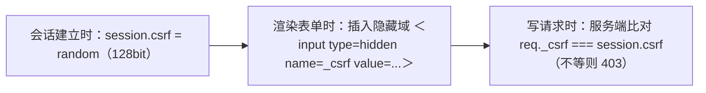

# CSRF 跨站请求伪造详解

- 日期：2026-11-04
- 所属大纲阶段：第 3 阶段 Web 安全
- 参考资料：OWASP CSRF Prevention Cheat Sheet、PortSwigger Web Security Academy（CSRF 模块）、MDN（Set-Cookie / SameSite）、RFC 6265bis
- 前置阅读：[01-Web前端常见漏洞与攻击](01-Web前端常见漏洞与攻击.md)
- 说明：攻击示例仅限本地靶场复现。

---

## 1. 原理深入

### 1.1 浏览器的凭证自动附带机制

RFC 6265 规定：只要 Cookie 的域/路径匹配请求 URL（且未过期、满足 Secure/SameSite 条件），浏览器**无需页面脚本参与**就会附带 Cookie——``、`<form>` 提交、`fetch` 默认 `credentials: same-origin` 之外的场景都可能触发。

这是 Web 的基石设计（无状态会话的实现方式），也是 CSRF 的根源：**服务器收到的请求带着合法凭证，但发起请求的「意图」不是用户本人的**。

### 1.2 攻击者的能力边界（重要）

CSRF 中攻击者：
- ✅ 能让受害者浏览器发出任意 method/路径/参数的跨站请求；
- ✅ 知道并控制请求的**全部内容**（表单字段可以全部预置）；
- ❌ **读不到响应**（同源策略拦截跨源读取，除非目标站 CORS 配置了宽松的带凭证跨域）;
- ❌ 不知道 Cookie 值本身（HttpOnly 与否都不影响 CSRF，攻击者不需要读它）。

因此 CSRF 的目标通常是「盲操作」：转账、改邮箱/密码、加管理员、删数据——不需要看到结果，只需要命令生效。

### 1.3 SameSite 机制详解

| 值 | 行为 | 影响 |
|---|---|---|
| `Strict` | 任何跨站请求都不带 Cookie（包括点链接跳转过来） | 最安全，但用户体验差（从别的站点点入即「未登录」） |
| `Lax`（Chrome 2020 起默认） | 跨站**顶级导航的 GET**（链接、地址栏）会带；子资源、跨站 POST、iframe 一律不带 | 挡住绝大多数经典 CSRF，仍留有 GET 型攻击面 |
| `None` | 全部携带，**必须同时设置 Secure** | 跨站登录态（第三方嵌入）需要时使用，等于放弃 SameSite 防护 |

细节坑：
- **Lax + POST 宽限期**：Chrome 曾对「2 分钟内新设置的 Cookie」放宽为跨站 POST 也携带（缓和社会工程跳转登录场景），后已收紧——说明默认值策略会演化，不能只依赖它。
- **子域可覆盖**：`example.com` 的任何子域可写 `.example.com` 域 Cookie。若子域被 XSS/被接管，可注入 SameSite=None 的会话 Cookie 绕过防护（cookie tossing）。

---

## 2. 攻击方式详解

### 2.1 经典三类载体

```html
<!-- ① GET 型：图片自动加载即触发（要求目标用 GET 做写操作） -->


<!-- ② POST 表单：自动提交，页面完全无感 -->
<form id="f" action="https://target.example/api/transfer" method="POST">
  <input type="hidden" name="account" value="attacker">
  <input type="hidden" name="amount" value="10000">
</form>
<script>document.getElementById('f').submit()</script>

<!-- ③ 无需 JS 的版本：要求用户点一下（诱导按钮） -->
<form action="https://target.example/profile/email" method="POST">
  <input type="hidden" name="email" value="attacker@evil.example">
</form>
<button>点击查看结果</button>  <!-- 按钮其实是 submit -->
```

### 2.2 绕过 JSON / 自定义头接口

后端要求 `Content-Type: application/json` 时，跨站 `fetch` 带 JSON 会触发预检（preflight），攻击者无法伪造带凭证的预检成功请求。但**实现缺陷**常使防御失效：

```js
// 若服务端只检查 body 是不是 JSON 而不校验 Content-Type：
fetch('https://target.example/api/transfer', {
  method: 'POST',
  credentials: 'include',
  headers: { 'Content-Type': 'text/plain' },   // 跨站允许发简单 text/plain
  body: '{"account":"attacker","amount":10000}'
});
```

若服务端要求自定义头（如 `X-Requested-With`）作为 CSRF 防御——预检会拦住跨站伪造，但要确认服务端**真的拒绝**没有该头的请求（很多前端框架自动带头，后端却从不校验）。

### 2.3 CSRF Token 机制的绕过面（审计清单）

| 缺陷 | 场景 |
|---|---|
| Token 未校验 / 空值通过 | 删掉 token 参数或置空，服务端照样通过 |
| Token 与会话未绑定 | 用 A 账号的 token 配 B 账号的会话（Double-Submit 实现错误） |
| Token 可预测 | 时间戳/弱随机（`Math.random()`），可离线推算 |
| 仅校验子串 | 只比对前 N 字节 |
| GET 页面泄露 token | 攻击者页面先 `` 加载含 token 的页面（同站子域被控时）再读 |
| Cookie 注入（cookie tossing） | 子域可控时，伪造双提交 Cookie 的 `csrf` 值 |
| SameSite=Lax + 顶级 GET | 写操作仍走 GET（`<a>` 诱导点击），Lax 默认值不设防 |

### 2.4 登录 CSRF（Login CSRF）

攻击者先拿到目标站的登录表单，用**自己的**账号凭证向受害者浏览器发起自动登录。此后受害者在不知情下用攻击者账号操作（浏览历史、支付信息泄露给攻击者、密码管理器自动填充泄露密码）。防御：登录表单同样需要 CSRF token。

### 2.5 组合拳

CSRF 常作为链路：CSRF 改绑邮箱 → 走「忘记密码」流程重置密码 → 账户接管（ATO, Account Takeover）。审计时把「改邮箱/改手机/关 MFA」视为最高危的 CSRF 目标。

---

## 3. 真实案例

- **YouTube（2008）**：Google 公开承认几乎任何 Action 都可 CSRF，通过加 token 修复（Google Online Security Blog 的经典博文 "Using height=0 width=0 iframe"）。
- **Netflix（2016）**：JSON CSRF 修改用户资料（研究案例，Change.org 类似场景广泛存在）。
- 各类路由器管理界面（无 token、Basic Auth 自动附带）的历史 CSRF——攻击网页可篡改访问者的家庭路由 DNS（驱动型 CSRF，Mass CSRF 研究领域）。

---

## 4. 检测与发现

1. 找到所有**状态改变**端点（POST/PUT/DELETE，以及做写操作的 GET）。
2. 检查请求中是否存在：CSRF token？Origin/Referer 校验？Cookie 的 SameSite 属性？
3. Burp 的 CSRF PoC 生成器（Engagement tools → Generate CSRF PoC）自动生成攻击页；手动验证：剥离 token 重放、替换 Origin。
4. 检查登出、改邮箱、改密码、添加用户等端点——高频遗漏点。

---

## 5. 防御详解

### 5.1 Synchronizer Token Pattern（同步令牌，服务端存储）



要点：每次会话随机、**不放进 URL**（Referer 泄露）、登录成功后重置会话与 token（防会话固定叠加 CSRF）。

### 5.2 Double Submit Cookie（双提交，无服务端状态）

```
Set-Cookie: csrf=随机值; Secure; Path=/
请求头/表单带上同值 token，服务端比对 Cookie 与提交值是否一致
```
前提：攻击者的域写不了目标域的 Cookie。若存在子域可控，改用签名版本（服务端 HMAC(session_id) 作 token）。

### 5.3 Origin/Referer 校验（辅助层）

```python
def csrf_protect():
    origin = request.headers.get('Origin') or request.headers.get('Referer', '')
    if not origin.startswith('https://trusted.example'):
        abort(403)
```
注意：不要用 `startswith` 检查（`https://trusted.example.evil.io` 绕过），解析后比对 host 精确相等。

### 5.4 SameSite Cookie

`Set-Cookie: sid=...; HttpOnly; Secure; SameSite=Lax` —— 现代默认基线；敏感站点可对会话 Cookie 用 `Strict` + 显式跳转中转页。

### 5.5 框架支持（优先用内置）

- Spring Security：`CsrfFilter` 默认开启。
- Django：`CsrfViewMiddleware` + ``。
- Express：`csurf` 已废弃，用 `double-submit-csrf` 或自实现。
- Laravel：`VerifyCsrfToken` 中间件。

### 5.6 完整纵深

token（主）+ SameSite（默认）+ Origin 校验（辅）+ 写操作强制 POST/PUT + 敏感操作二次验证 + 速率限制。任何单层失效时其余层兜底。

---

## 6. 常见误区

- ❌「用了 JSON API 就免疫 CSRF」→ `text/plain` 技巧 + 服务端宽松解析。
- ❌「检查了 X-Requested-With 就够了」→ 前提是服务端真的拒绝缺失该头的请求；且部分代理会剥离该头。
- ❌「SameSite 默认值已经解决 CSRF」→ GET 写操作、SameSite=None 场景、子域 cookie tossing 仍可利用。
- ❌「CSRF token 放 URL 里方便」→ token 经 Referer/浏览器历史泄露。
- ❌「预检（OPTIONS）会挡住一切」→ 预检只针对非简单请求；简单请求（表单、text/plain）根本不触发预检，**请求已经到达服务器**，预检只是拦住攻击者读响应与发复杂头，不拦简单 POST 本身。

---

## 复习自查

- [ ] 能说清 CSRF 攻击者「能做什么/不能做什么」
- [ ] 能写出 GET/POST/JSON 三种载体的 PoC 并说明各自前提
- [ ] 能列出 token 机制的 7 种绕过场景并逐一给出修复
- [ ] 能解释 SameSite 三个值的确切行为与 Chrome 默认策略的边界情况
- [ ] 能用 Burp 为一个写接口生成并验证 CSRF PoC

## 延伸实验（labs 计划）

1. PortSwigger Academy CSRF 模块（含绕过实验：token 未绑定会话、Referer 校验缺陷、SameSite Lax 绕过）。
2. DVWA CSRF 模块 Low→Impossible。
3. 自建 demo：Flask 会话 + 三层防御逐步叠加，每层单独验证绕过。

---

## 附：ASCII 图 → Mermaid 替换清单

| 原 ASCII 图（小节 · 内容） | 替换后类型 |
| --- | --- |
| 归档笔记 · 「5.1 Synchronizer Token Pattern（同步令牌，服务端存储）」节 · csrf token 建立/渲染/校验三步流程 | flowchart LR |
