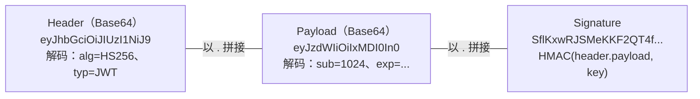

# 访问控制与认证授权详解（IDOR / 越权 / JWT / 会话 / OAuth）

- 日期：2026-11-04
- 所属大纲阶段：第 3 阶段 Web 安全（涉及第 6 阶段安全工程）
- 参考资料：OWASP Access Control Cheat Sheet、OWASP Authorization Testing Guide (WSTG-ATHN/ATHZ)、PortSwigger Academy（Access control / JWT / OAuth 模块）、RFC 7519（JWT）、NIST SP 800-63B（数字身份指南）
- 前置阅读：[02-Web后端常见漏洞与攻击](02-Web后端常见漏洞与攻击.md)
- 说明：示例仅限本地靶场。

---

## 1. 概念框架：Authentication / Authorization / Audit

```
认证（Authentication, AuthN）：你是谁 —— 验证身份（密码、MFA、生物特征）
授权（Authorization, AuthZ）：你能做什么 —— 校验权限（每次请求都要做）
审计（Accounting/Audit）：你做过什么 —— 日志与追责
```

OWASP Top 10 (2021) 中 **A01 Broken Access Control 高居榜首**（数据来自大量真实测试样本）：它不是单一漏洞，而是一类「服务端忘记问/问错了」的实现缺陷，无法靠 WAF/框架自动修复，只能靠逐端点的设计与测试。

### 授权模型速览（工程背景）

| 模型 | 思路 | 例子 |
|---|---|---|
| RBAC（Role-Based） | 角色 → 权限集合 | admin/operator/viewer |
| ABAC（Attribute-Based） | 属性表达式判定 | 「资源.owner == user.id \|\| user.role == admin」 |
| ReBAC（Relationship-Based） | 关系图判定 | Google Zanzibar（「文档的编辑者」） |
| ACL | 资源上的主体列表 | 文件系统权限 |

工程上常见坑：**路由级鉴权（中间件）做了，数据级鉴权（行级过滤）没做**——这正是 IDOR 的温床。

---

## 2. IDOR（Insecure Direct Object Reference）详解

### 2.1 成因

把「知道标识」当成了「拥有权限」。资源寻址使用可猜测/可遍历的标识，且服务端只查「资源存在」不查「归属」：

```python
# 有漏洞
order = db.query(Order).get(request.args["id"])   # 任何登录用户可读任意订单
# 正确：归属条件进查询
order = db.query(Order).filter_by(
    id=request.args["id"], user_id=session.user_id).one_or_none()
```

### 2.2 测试方法论（双账号法——最实用的手工测试流程）

```
准备：账号 A（攻击者）、账号 B（受害者），B 拥有资源 X
1. B 正常访问 X，记录全部请求（Burp）——找出请求中的标识参数
   （URL 路径段、查询参数、JSON 字段、Header、甚至 Cookie）
2. A 登录，把 B 的请求原样重放（Repeater）——标识不变，凭证换成 A 的
3. 响应 200 且返回 B 的数据 → 水平越权实锤
4. 记录全站所有「带标识的端点」批量回归（一个资源一个资源过）
5. 反向验证写操作：A 修改/删除 B 的资源（POST/PUT/DELETE 同理）
```

自动化思路：Burp 的 Autorize / Authz 插件自动做「低权限重放对比」；CI 里写接口测试断言「A 请求 B 的资源必 403/404」。

### 2.3 高频变体

| 变体 | 说明 |
|---|---|
| 数值 ID | `/api/orders/1024` → 1023、1025 遍历（最容易批量拖库） |
| UUID | 不可枚举 ≠ 安全：UUID 会从分享链接、邮箱链接、其他 API 响应、日志、referrer 泄露 |
| GUID 信任链 | 「前后端约定用 UUID 所以不校验」是错误推理：UUID 是寻址手段不是授权手段 |
| GraphQL | 一个查询批量查询大量 id：`{ nodes(ids: [...]) }` 一次性遍历 |
| 导出/报表接口 | `/export?user_id=` 直接换人导出 Excel |
| 隐藏字段 | 前端不显示 ≠ 后端不处理：JSON 里加 `"role":"admin"`、`"price":1`（MASS ASSIGNMENT，见 2.5） |
| 软删除 | 已删除资源仍可按 id 访问（`is_deleted` 未进查询条件） |
| HTTP 方法差异 | GET 有权限校验、PUT/DELETE 忘了校验（同一 handler 不同分支） |
| API 版本 | v1 修复了，v2 重写时又引入（或 v1 忘记下线） |

### 2.4 垂直越权（权限提升）

```
普通用户直接请求管理员端点：
POST /admin/users/delete   （无 session 校验，只靠「前端不给入口」）
→ 后端中间件只挂在 /admin 页面路由上，没挂在 /admin/api 上

隐藏功能：管理页面的「折扣设置」接口，普通用户抓包拿到后直接调用
```
审计要点：**权限校验位置必须在后端路由/数据层，与前端路由隐藏无关**。逐条检查：管理 API、内部 API、调试 API、定时任务触发的接口。

### 2.5 批量赋值（Mass Assignment）——越权的近亲

```python
# 有漏洞：全字段直接灌入模型
user = User(**request.json)          # 请求体里加 "is_admin": true 即提升
# 正确：字段白名单
data = {k: request.json[k] for k in ("nickname", "avatar")}
```
框架特例：Spring 的 setter 绑定（`class User { setRole() }` 全量绑定）、Rails 早期 `attr_accessible` 之前的默认全量、Laravel 的 `$fillable` 未配置。GitHub 2012 年的 mass assignment 事件（用户把自己加进 Rails 维护者）是教科书案例。

### 2.6 防御清单

1. **默认拒绝**（deny by default）：未显式声明权限的端点一律 403（中间件白名单式挂载）。
2. **授权下沉到查询**：所有数据读取带归属条件（行级过滤）；ORM scope 统一封装。
3. 标识与权限解耦：ID 只用于寻址，授权独立判断（`assert can_read(user, obj)`）。
4. 写操作（改邮箱/密码/MFA）额外验证当前密码 + CSRF token。
5. 管理/内部 API 独立部署域 + 网络隔离（mTLS/内网网关）。
6. 日志与告警：越权尝试（403 频次）纳入监控。
7. 测试制度化：双账号自动化回归进 CI（每新增一个资源端点，加一条 403 断言）。

---

## 3. JWT（JSON Web Token）详解

### 3.1 结构与机制


关键认知：
- Header/Payload 仅 Base64，**不是加密**——任何人可解码，别放敏感数据；
- 签名只提供「防篡改」，不提供「防读取」；
- 验签的语义：用**哪把密钥**、按**哪个算法**验，完全由服务端代码决定——大量漏洞出在「算法协商」上。

### 3.2 漏洞全解（每一项都有对应 lab）

| 漏洞 | 原理 | 复现/修复 |
|---|---|---|
| `alg: none` | 实现接受无签名令牌：改 header 为 `{"alg":"none"}`，删签名留尾点 | 永不接受 none；库级别固定算法 |
| HS/RS 算法混淆 | 服务端用 RS256（公钥验签），攻击者把 alg 改 HS256，用**公钥当 HMAC 密钥**签发——公钥是公开的 | 验签时显式绑定算法：`jwt.decode(t, key, algorithms=["RS256"])`；`alg` 只信服务端配置，不读 header |
| 弱 HMAC 密钥 | HS256 密钥是弱口令（`secret`/`key`/公司名）→ hashcat/jwt-tools 离线爆破 | ≥256bit 随机密钥；密钥轮换机制 |
| `kid` 注入 | header 的 `kid`（密钥 id）用于选密钥时拼 SQL（SQLi）或路径（`../../dev/null`）/命令注入 | kid 白名单映射，禁止拼接 |
| `jku`/`jwk`/`x5u` 头注入 | 服务端信任 header 里声明的「去哪拿公钥」，攻击者指向自己的 JWKS | 公钥来源只用本地配置/受信 JWKS |
| 未校验 `exp`/`nbf` | 实现 bug 或「测试时关了」 | 成熟库默认校验；定期用过期 token 回归 |
| 未校验 `iss`/`aud` | 多服务共用密钥，A 服务的 token 能过 B 服务的验证 | 校验签发者与受众 |
| 算法降级/_strip | 接受 ES256 却也放行 HS256 | 白名单唯一算法 |
| 密钥硬编码在前端/APP | 逆向提取 | 密钥只存服务端/KMS |

### 3.3 工程问题（不是漏洞但常被利用）

- **无法吊销**：无状态 token 在 exp 前始终有效——登出、改密、封号都「管不住已签发的 token」。
  方案：短期 access token（5–15 分钟）+ 服务端可吊销的 refresh token（一次性、轮换、绑定设备）；高危操作实时鉴权（token 只证明身份，操作前再查权限库）。
- **存储位置**：localStorage（XSS 可读，但天然无 CSRF）vs HttpOnly Cookie（XSS 读不到，但要配 CSRF 防御）——两者取舍没有银弹，银行类推荐 HttpOnly + SameSite + CSRF token。
- **日志泄露**：token 打进日志 = 会话泄露（日志系统往往权限更松）。

---

## 4. 会话管理详解

### 4.1 生命周期每个环节的攻防

| 环节 | 要求 | 攻击面 |
|---|---|---|
| 生成 | ≥128bit 密码学随机（`secrets.token_urlsafe`），不含任何可推导信息 | 弱随机（时间戳、自增、用户信息哈希）→ 会话预测 |
| 传输 | 仅 HTTPS + Secure 标记；HttpOnly；SameSite | 明文传输、JS 读取（XSS） |
| 存储 | 服务端会话表/Redis 可即时吊销；客户端只放 ID | 「客户端存全部会话数据」的设计（自包含但失去吊销能力） |
| 登录成功 | **必须重新生成会话 ID** | 会话固定（Session Fixation）：攻击者预置 ID（链接/子域 Cookie 注入），受害者登录后沿用 |
| 超时 | 空闲超时（30 分钟）+ 绝对超时（24 小时）；敏感操作后滑动 | 永不过期；仅前端登出不清服务端 |
| 登出/改密 | 服务端销毁会话 + 全端吊销（含其他设备） | 只清前端 Cookie，服务端会话仍活 |
| 并发 | 可选：单设备登录踢出、异常并发地登录告警 | 无感知的异地会话并存 |

### 4.2 密码存储

```
✅ argon2id（现代首选）/ bcrypt（成本因子 ≥10）/ scrypt
✅ 每密码独立盐（argon2/bcrypt 内置自动盐）
❌ MD5 / SHA1 / SHA256(明文) —— 速度快到可被 GPU 暴力枚举
❌ 全局统一盐
NIST 800-63B 要点：长度下限（≥8，推荐更长）> 复杂度规则；
   对比已泄露密码库拒绝常见口令；不强制定期轮换（会催生弱模式如 Winter2024!）
```

### 4.3 MFA 与其绕过面（概览）

- 常见因子：TOTP（Google Authenticator）、短信/邮件、WebAuthn/FIDO2（钓鱼免疫，最强）、推送。
- 绕过面：推送疲劳（MFA Fatigue——2022 Uber 事件的真实入口）、SIM swap（短信因子）、重置流程绕过（重置邮件可劫持则 MFA 形同虚设——**账户恢复流程的安全等级必须 ≥ 登录流程**）、忘记密码的枚举、TOTP 重用（无 nonce 防重放）。
- 工程结论：短信作为唯一二因子已不推荐；WebAuthn 为趋势；MFA 覆盖率要含登录+改密+改绑全流程。

---

## 5. OAuth 2.0 / OIDC 常见漏洞

### 5.1 流程回顾（授权码模式）

```
浏览器 → 授权服务器:  /authorize?client_id&redirect_uri&state&scope
用户同意 → 302 回 redirect_uri?code=xxx&state=yyy
前端/后端 用 code + client_secret 换 access_token
```

### 5.2 漏洞清单

| 漏洞 | 说明 |
|---|---|
| `redirect_uri` 校验不严 | 只查前缀/子串：`https://app.example/callback/../../redirect`、开放重定向中转——授权码被送到攻击者域。**必须全等白名单** |
| 缺 `state` | 无法绑定会话 → CSRF 式登录劫持 / code 拦截 |
| code 拦截 | referrer 泄露（跳转页有外链资源）、浏览器历史、日志 |
| 隐式流（implicit）遗留 | token 直接在 URL 片段——历史方案，新系统一律授权码 + PKCE |
| PKCE 缺失 | 公共客户端（SPA/移动端）可被拦截 code 后利用；现推荐全部客户端上 PKCE |
| scope/令牌混用 | access_token 放进 URL（日志泄露）；refresh_token 存 localStorage |
| OIDC 特有 | `id_token` 的 `nonce` 缺失（重放）、`iss/aud` 未校验 |

### 5.3 真实案例

- **Uber（2022）**：承包商账号被 MFA 疲劳攻击攻破 → VPN 内网 → PowerShell 脚本里的硬编码管理员凭证 → 内网 AD/MFA 系统（Hack the cloud 全过程公开复盘）。链路展示：**认证体系的一个薄弱身份 = 整个内网的入口**。
- **GitHub OAuth 矽谷公司系列（2019 Npm/GitLab 赏金）**：`redirect_uri` 宽松匹配的历史漏洞群。

---

## 6. 复习自查

- [ ] 能默写双账号测试法的 5 步
- [ ] 能为「订单详情接口」写出带归属校验的查询并解释为什么 404 与 403 的选择有讲究（404 防资源存在性枚举）
- [ ] 能完整复述 HS/RS 混淆攻击并写出修复代码行
- [ ] 能列出 JWT 无法吊销的 3 种缓解方案
- [ ] 能说出会话固定攻击的流程与「登录后重置会话」的原因
- [ ] 能审计一个 OAuth 登录链路并列出至少 5 个检查点

## 延伸实验（labs 计划）

1. PortSwigger Academy：Access control 全模块（IDOR/垂直越权/MASS ASSIGNMENT）、JWT 模块（none/混淆/kid 注入/jwk 注入）、OAuth 模块（redirect_uri/state）。
2. 自建 demo：Express + JWT 各埋 4 个漏洞（弱密钥、不校验 exp、alg 混淆、kid 注入），用 jwt-tools 逐个打穿再修复。
3. Burp 插件 Autorize 对 DVWA 越权模块自动化测试。

---

## 附：ASCII 图 → Mermaid 替换清单

| 原 ASCII 图（小节 · 内容） | 替换后类型 |
| --- | --- |
| 归档笔记 ·「3.1 结构与机制」节 · JWT 三段解剖图 | flowchart LR |
