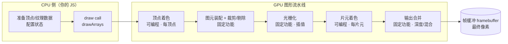

# 渲染管线全局观

> [返回：WebGL 与 3D 框架学习大纲](../WebGL与3D框架学习大纲.md)
> 本文是第一阶段第 1 条"渲染管线全局观"的完整展开，小节编号 1.x 与大纲一致；它是动手写代码前的地图，读完再看 [03-第一个WebGL程序](03-第一个WebGL程序.md) 会顺很多。阶段导览见 [01-导览](01-导览.md)。

## 1.1 CPU 与 GPU 的分工：绘制命令 vs 并行计算

先立一个贯穿全阶段的判据：**CPU 是"指挥"，负责把"画什么、怎么画"说清楚；GPU 是"合唱团"，拿到乐谱后每个声部独立唱自己的那一份**。JS 里写的每一行 WebGL 代码，要么在准备数据，要么在发命令；真正逐顶点、逐像素的计算全部发生在 GPU 上。

两类处理器的设计目标根本不同。CPU 是**延迟导向（latency-oriented）**：核心少（个位数到几十）但每个都极强——乱序执行、分支预测、大缓存，用一切手段让单条指令链尽快走完。GPU 是**吞吐导向（throughput-oriented）**：把成千上万个简化算术单元（ALU，arithmetic logic unit）堆在一起，牺牲单核能力与缓存，换取单位时间处理的数据总量。

| 维度 | CPU | GPU |
|---|---|---|
| 核心规模 | 个位数到几十个强核 | 数千个简化处理单元 |
| 单核能力 | 强：乱序执行、分支预测 | 简单顺序为主 |
| 隐藏内存等待的方式 | 大缓存（让数据贴近计算） | 大量线程切换（等内存时先算别人） |
| 设计目标 | 最小化单任务延迟 | 最大化并行任务吞吐 |
| 擅长 | 复杂控制流、串行依赖逻辑、任务并行 | 同一套计算打海量数据（数据并行） |

落到一次 WebGL 绘制上，分工是：

| 步骤 | 谁执行 | 内容 |
|---|---|---|
| 准备数据 | CPU（你的 JS） | 组织顶点数组、算 MVP 矩阵、解码纹理像素 |
| 上传资源 | CPU 发起 | `bufferData` / `texImage2D` 把数据从内存搬进显存 |
| 配置状态 | CPU 发起 | 绑定缓冲、启用深度测试、传 uniform…… |
| 发出绘制命令 | CPU 发起 | `drawArrays` / `drawElements`，即一次 draw call（绘制调用） |
| 顶点/片元计算 | GPU | 对每个顶点、每个片元独立执行着色器 |
| 光栅化与合并 | GPU 固定功能 | 裁剪、插值、深度测试、混合、写帧缓冲 |

**draw call 贵在 CPU 侧而不是 GPU 侧**：一次 `drawArrays` 要经过浏览器校验、驱动翻译成硬件命令，开销以微秒计。GPU 一次画十万个三角形毫不费力，CPU 每帧发几千次 draw call 却可能先撑不住——这就是第五阶段"合批（batching）"优化的对象。现在只需记住方向：**减少 CPU 的命令数，喂饱 GPU 的并行度**。

### 1.1.1 为什么图形天生适合 GPU

- **独立**：每个顶点、每个像素的计算互不依赖，改一个顶点不需要知道另一个顶点的结果。
- **同构**：百万个顶点跑的是同一份着色器程序，只是输入不同。
- **量大**：1080p 全屏约 200 万像素，随便一个全屏特效就是百万级片元计算。

三个条件同时满足，就是"数据并行"的教科书场景。反过来说，如果你的算法需要"上一个结果才能算下一个"（串行依赖），GPU 就不擅长——后面写引擎时，凡是能在 CPU 算一次的（比如矩阵预乘），就别放进着色器里让 GPU 算百万次。

## 1.2 图形流水线：顶点着色 → 图元装配 → 光栅化 → 片元着色 → 输出合并

渲染管线（rendering pipeline）是一条工厂流水线：顶点数据从一端进，像素从另一端出，中间五个阶段各司其职。



| 阶段 | 谁执行 | 执行频率 | 输入 → 输出 | 可编程 |
|---|---|---|---|---|
| 顶点着色（vertex shading） | 顶点着色器 | 每顶点一次 | 顶点属性 → 裁剪空间坐标 + varying | 是 |
| 图元装配（primitive assembly） | 固定功能 | 每图元一次 | 顶点序列 → 点/线/三角形；随后裁剪、背面剔除 | 否 |
| 光栅化（rasterization） | 固定功能 | 每三角形一次 | 三角形 → 片元集合（含插值） | 否 |
| 片元着色（fragment shading） | 片元着色器 | 每片元一次 | 插值后的 varying → 颜色 | 是 |
| 输出合并（output merging） | 固定功能（状态可配） | 每片元一次 | 候选颜色 → 帧缓冲像素 | 否 |

**顶点着色**：你写的顶点着色器（vertex shader）对每个顶点执行一次，核心职责是算出该顶点在裁剪空间（clip space）里的坐标并写入 `gl_Position`（乘 MVP 矩阵就发生在这里）；顺带可以计算要传给片元的 varying（颜色、UV、法线等）。

**图元装配与裁剪**：按绘制命令声明的图元类型（TRIANGLES / LINES / POINTS……）把顶点组装成图元，在裁剪空间里把视锥外的部分裁掉，并做背面剔除（back-face culling，朝向背离相机的三角形直接丢弃，属于光栅化的前置步骤，第二阶段细讲）。

**光栅化**：把三角形"铺"成片元（fragment）——还没有通过测试的候选像素。这一步同时完成**插值**：三角形三个顶点上的 varying（比如三个颜色）会被插值成每个片元一份；GPU 自动做透视校正插值（perspective-correct interpolation），近处的插值权重大、远处的小，效果比线性插值正确，这部分不用你操心。深度值同样被插值。

**片元着色**：你写的片元着色器（fragment shader）对每个片元执行一次，算出它的颜色，可以采样纹理、可以 `discard` 丢弃该片元。

**输出合并**：片元颜色要过五关才能写进帧缓冲（framebuffer）：裁剪测试、alpha 覆盖、模板测试（stencil test）、深度测试（depth test）、混合（blending）。全是固定功能，但每一关的开关与规则由你在 CPU 侧配置——WebGL 的 API 大半在"配置固定功能 + 喂可编程的两头"。

三个值得现在就记住的观察：

1. **数据流基本单向**，像真正的工厂流水线，这就是"管线"名字的由来。
2. **可编程的只有两头**（顶点与片元），中间是固定功能。WebGL1 如此，WebGL2 也如此（WebGL2 新增的 transform feedback 是把两头间的数据引回缓冲的特殊通道，第二阶段再讲）。
3. **阶段间数据量会放大**：3 个顶点经过光栅化可能变成 50 万个片元。判据：**顶点着色器的成本乘以"顶点数"，片元着色器的成本乘以"覆盖像素数"，通常差两三个数量级——优化和排错时先想清楚自己站在哪一级**。反例也存在：铺满屏幕的两个巨型三角形，片元多顶点少；百万个微型粒子，顶点多片元少。

## 1.3 WebGL 与 OpenGL ES 的关系；WebGL1 vs WebGL2 的取舍

### 1.3.1 谱系：WebGL 是 OpenGL ES 的"浏览器方言"

- OpenGL（1992，桌面图形 API）为适应移动/嵌入式裁减出 **OpenGL ES**（ES = Embedded Systems，2003 起）。
- **WebGL 1.0（2011）≈ OpenGL ES 2.0**：可编程管线（顶点 + 片元着色器），去掉了固定管线时代的兼容包袱，规范由 Khronos Group 维护。
- **WebGL 2.0（2017）≈ OpenGL ES 3.0**：是 ES 2.0 的超集，向下兼容 WebGL1 的用法。
- 浏览器实现：JS 调用 → 浏览器 GPU 进程 → 翻译层（Chrome 的 **ANGLE**，Almost Native Graphics Layer Engine）→ 本机图形 API（Windows D3D11/12、macOS Metal、Android/Linux Vulkan 或 GL）。含义有二：WebGL 的跨平台一致性比直接写原生 GL 更好（各家差异被翻译层抹平了）；代价是每条命令多过几道手，这也是 draw call 开销的一部分。

获取上下文（context）就是获取这套 API 的入口对象：

```javascript
const canvas = document.querySelector('canvas');
const gl = canvas.getContext('webgl2') || canvas.getContext('webgl');
// 返回 WebGL2RenderingContext 或 WebGLRenderingContext；两者 null 则浏览器不支持
```

### 1.3.2 WebGL1 vs WebGL2 对照

| 能力 | WebGL1 | WebGL2 |
|---|---|---|
| GLSL 版本 | ES 1.00 | ES 3.00（同时兼容编译 1.00 着色器） |
| VAO（顶点数组对象） | 需扩展 OES_vertex_array_object | 核心功能 |
| 实例化绘制 instancing | 需扩展 ANGLE_instanced_arrays | 核心功能 |
| 非 2 次幂尺寸纹理（NPOT） | 受限（不能 mipmap / repeat） | 完整支持 |
| 整数顶点属性、整数运算 | 无 | 有 |
| UBO（uniform 块）、transform feedback、MRT 多渲染目标 | 无 | 有 |
| `gl_VertexID` / `gl_InstanceID` 等内置变量 | 无 | 有 |
| 浏览器支持（2026 年现状） | 全部 | 全部主流浏览器（含 iOS 15+） |

### 1.3.3 本仓库的取舍

结论先行：**上下文获取用 `webgl2 || webgl` 双保险；着色器以 GLSL ES 1.00 语法为主线（WebGL2 上下文完全兼容），讲到差异处对照标注 ES 3.00 写法；第二阶段讲 WebGL2 特性时再整体切换到 `#version 300 es`**。理由三条：

1. **学概念要 API 面最小**：WebGL1 的概念集合是"最小完备"的，管线、缓冲、着色器、uniform 一应俱全；WebGL2 的新特性（VAO、instancing……）是效率与能力增强，不是理解管线的先决条件。
2. **代码要两边都能跑**：ES 1.00 着色器在两种上下文里都能编译，示例代码的适用面最大。
3. **生态已经站在 WebGL2**：Three.js 自 r163（2024 年）起移除了 WebGL1 后端，新生态默认 WebGL2；概念学完后，用 WebGL2 特性只是"在熟悉的管线上加装备"。

顺带一句定位 **WebGPU**：它不是 WebGL 的升级版，而是基于现代原生 API（Vulkan / Metal / D3D12）设计的全新 Web 图形接口（计算统一、显式资源管理、更贴近硬件）。本阶段学的管线阶段、着色器思想、坐标数学对 WebGPU 几乎全部可迁移，先学 WebGL 不是绕路。

## 1.4 GPU 并行模型：着色器为什么对每个顶点/片元独立执行

### 1.4.1 SIMT：同一份指令，不同的数据

GPU 的执行模型是 **SIMT**（Single Instruction Multiple Threads，单指令多线程）：一份着色器程序被编译后，同时跑在成千上万个"线程"上；每个线程处理一个顶点或一个片元——**指令相同，数据不同**。硬件把线程按组调度执行：NVIDIA 称 warp（32 线程一组），AMD 称 wavefront；调度、分支、同步的粒度都是"一组"而不是单个线程。

所以"着色器"本质上是一个**对单个顶点/片元求值的纯函数**：输入是它的属性与只读的 uniform，输出是它自己的贡献。它被调用几百万次，每次互相不知道对方存在。

### 1.4.2 一次调用到底执行几次

`drawArrays(gl.TRIANGLES, 0, 3)`：顶点着色器恰好执行 3 次；三角形覆盖约 50 万像素，片元着色器就执行约 50 万次。由此推出三个"不能"：

1. **不能访问别的顶点的计算结果**——顶点 2 的着色器看不到顶点 1 算了什么。
2. **片元之间不能直接通信**——想"知道左边像素的颜色"在同一趟绘制里做不到。
3. **不能在着色器里存状态**——它没有跨调用的记忆，上一帧算的值这一帧读不到（除非你自己写进纹理/缓冲再传回来，那是第二阶段之后的话题）。

数据怎么进着色器，正好对应三种限定符（04 册 3.1 展开）：uniform 对所有线程只读且相同；attribute 每个顶点一份；varying 是片元拿到的插值结果。

还有一个容易忽略的事实：**片元着色器默认在深度测试之前执行**。物体 A 先画、物体 B 后画且被 A 挡住，B 的片元着色器照样白跑一遍（硬件有 early-z 优化，但它只是优化，语义上不能依赖）。这解释了一个经典性能现象："被墙挡住的十万粒子照样费 GPU"。

### 1.4.3 分支发散（divergence）

warp 内 32 个线程走同一条指令流。如果着色器里写了 `if (x > 0.5) {...} else {...}`，而 warp 内一半线程条件真、一半假，硬件没法分道——只能两边都执行，各自丢弃不要的那半结果，**串行化导致变慢**。什么时候不吃亏：分支条件是 uniform（整个 warp 同路）时，硬件可以直接跳过另一边。所以写着色器的风格倾向：小分支用 `step` / `mix` / `clamp` 等算术替代（04 册 3.3 练习），大分支尽量让条件统一。

### 1.4.4 延迟隐藏（latency hiding）

CPU 靠缓存缩短访存等待；GPU 反其道而行：访存要等几百个时钟周期？没关系，切到另一个 warp 先算着，等数据回来再切回来。前提是随时有足够多的就绪线程可切（即占用率，occupancy 足够高）。推论：**GPU 不怕任务多，怕任务少还互相等**——这也是为什么图形工作负载（海量独立小任务）与 GPU 是天作之合。

### 1.4.5 写给着色器的四条工程推论

1. 着色器是纯函数：不存状态、不依赖调用顺序、不依赖邻居。
2. 能在 CPU 算一次的（矩阵预乘、常量折叠）绝不放进着色器每顶点/每片元地算。
3. 片元着色器是优化与排错的主战场——它的执行次数最多。
4. 别把逻辑寄托在执行顺序上（"后画的能看到先画的结果"在同一趟绘制里不成立，跨趟要靠纹理/缓冲中转）。

## 完整代码：10 万个彩点的旋转——亲眼看到 GPU 吞吐

下面这个单文件实验验证 1.1 与 1.4 的结论：**JS 每帧只做两件事（上传一个 `u_time`、发一次 draw call），10 万个顶点的旋转与着色全部在 GPU 顶点着色器里完成**。代码刻意"剧透"03 / 04 册的 API（VBO、attribute、uniform、varying），先跑起来找感觉，每一行都会在后两册逐一展开。保存为 `pipeline-demo.html` 双击运行。

```html
<!DOCTYPE html>
<html lang="zh-CN">
<head>
<meta charset="UTF-8">
<title>管线实验：10 万彩点旋风</title>
<style>
  html, body { margin: 0; height: 100%; background: #0b0d12; overflow: hidden; }
  canvas { display: block; width: 100vw; height: 100vh; }
</style>
</head>
<body>
<canvas id="gl"></canvas>
<script>
'use strict';
const canvas = document.getElementById('gl');
const gl = canvas.getContext('webgl2') || canvas.getContext('webgl');
if (!gl) { document.body.textContent = '当前浏览器不支持 WebGL'; throw new Error('no webgl'); }

// 顶点着色器：每个点独立旋转、独立着色（1.4 的 SIMT 就在这 15 行里）
const VS_SOURCE = `
attribute vec3 a_data;          // xy：初始位置；z：初始极角
uniform float u_time;
varying vec3 v_color;
void main() {
  float t = u_time * 0.6;
  float c = cos(t), s = sin(t);
  vec2 p = vec2(a_data.x * c - a_data.y * s,   // GPU 上跑的 2D 旋转（05 册 4.2 推导）
                a_data.x * s + a_data.y * c);
  gl_Position = vec4(p, 0.0, 1.0);
  gl_PointSize = 2.0;                           // 高分屏上嫌小可改 4.0
  float hue = a_data.z + t * 2.0;               // 色相转得比位置快，产生流动感
  v_color = 0.5 + 0.5 * vec3(cos(hue), cos(hue + 2.1), cos(hue + 4.2));
}
`;
// 片元着色器：把方点削成圆点（gl_PointCoord 见 04 册 3.2）
const FS_SOURCE = `
precision mediump float;
varying vec3 v_color;
void main() {
  vec2 d = gl_PointCoord - vec2(0.5);
  if (dot(d, d) > 0.25) discard;
  gl_FragColor = vec4(v_color, 1.0);
}
`;

function compileShader(type, source) {
  const sh = gl.createShader(type);
  gl.shaderSource(sh, source);
  gl.compileShader(sh);
  if (!gl.getShaderParameter(sh, gl.COMPILE_STATUS)) {
    throw new Error('着色器编译失败：' + gl.getShaderInfoLog(sh));
  }
  return sh;
}
const program = gl.createProgram();
gl.attachShader(program, compileShader(gl.VERTEX_SHADER, VS_SOURCE));
gl.attachShader(program, compileShader(gl.FRAGMENT_SHADER, FS_SOURCE));
gl.linkProgram(program);
if (!gl.getProgramParameter(program, gl.LINK_STATUS)) {
  throw new Error('程序链接失败：' + gl.getProgramInfoLog(program));
}
gl.useProgram(program);

// 生成 10 万个点：随机半径 + 随机极角，打包进一个交错数组
const N = 100000;
const data = new Float32Array(N * 3);
for (let i = 0; i < N; i++) {
  const r = 0.15 + 0.85 * Math.sqrt(Math.random());  // sqrt 让点内疏外密
  const a = Math.random() * Math.PI * 2;
  data[i * 3]     = r * Math.cos(a);
  data[i * 3 + 1] = r * Math.sin(a);
  data[i * 3 + 2] = a;
}
const vbo = gl.createBuffer();
gl.bindBuffer(gl.ARRAY_BUFFER, vbo);
gl.bufferData(gl.ARRAY_BUFFER, data, gl.STATIC_DRAW);

const aData = gl.getAttribLocation(program, 'a_data');
gl.enableVertexAttribArray(aData);
gl.vertexAttribPointer(aData, 3, gl.FLOAT, false, 0, 0);
const uTime = gl.getUniformLocation(program, 'u_time');

function resize() {
  const dpr = window.devicePixelRatio || 1;
  const w = Math.floor(canvas.clientWidth * dpr) || 1;
  const h = Math.floor(canvas.clientHeight * dpr) || 1;
  if (canvas.width !== w || canvas.height !== h) {
    canvas.width = w; canvas.height = h;
    gl.viewport(0, 0, w, h);
  }
}
window.addEventListener('resize', resize);
resize();
gl.clearColor(0.043, 0.05, 0.07, 1);

function frame(now) {
  gl.clear(gl.COLOR_BUFFER_BIT);
  gl.uniform1f(uTime, now / 1000);      // CPU 每帧的全部输入：一个数
  gl.drawArrays(gl.POINTS, 0, N);       // CPU 每帧的全部命令：一次 draw call
  requestAnimationFrame(frame);
}
requestAnimationFrame(frame);
</script>
</body>
</html>
```

跑起来后做三个实验：

1. 把 `N` 改成 `500000`，帧率大概率依然平稳——这就是吞吐型架构（1.1）。
2. 打开浏览器任务管理器看 GPU 占用随 `N` 变化，直观感受"命令少、计算大"。
3. 选做对照实验：把旋转搬到 CPU（每帧用 JS 重算 30 万次 cos/sin 并重新 `bufferData`），感受两边数量级的差距——你就再也不会怀疑 1.1 的分工表。

## 常见坑

1. **以为 `drawArrays` 会等 GPU 画完才返回**。命令是异步的：CPU 把命令塞进队列就返回，GPU 在自己的节奏里执行。CPU/GPU 本来就在并行，这也是"每帧重新创建 buffer / program 反而慢"的根源——CPU 侧的创建与校验才是开销大头。
2. **把片元（fragment）与像素（pixel）划等号**。片元是候选：还没通过深度/模板测试、可能被 `discard`、MSAA 下对应多个采样点；只有写进帧缓冲才成为像素。
3. **WebGL1/WebGL2 混淆**：在 `#version 300 es`（必须是着色器源码第一行）的 ES 3.00 着色器里用 `attribute` / `varying` / `gl_FragColor` 会直接编译失败；反过来 ES 1.00 着色器在 WebGL2 上下文里没问题（1.3 的取舍正是利用了这一点）。
4. **用 WebGPU 的心智理解 WebGL**。WebGL 是同步状态机模型（调用即改状态），WebGPU 是显式的命令编码 + 队列提交模型，两者的资源与同步语义完全不同，学的时候分清楚。
5. **认为"GPU 快所以随便画"**。GPU 吞吐大，但 CPU 侧的 draw call 数量、状态切换、数据上传先会成为瓶颈（第五阶段展开）；方向感从现在建立。
6. **在顶点着色器里干片元的活**（或反之）。忘了 1.2 的"数量级放大"：逐像素的细节放进顶点着色器会糊，逐顶点的准备放进片元着色器会浪费百万倍。

## 本节自测

1. 不看书画出五阶段管线图，标注每个阶段的输入/输出与可编程性；varying 的插值发生在哪个阶段、发生在什么之间？
2. 为什么说片元着色器的执行次数通常比顶点着色器多几个数量级？举一个反过来（片元反而少）的场景。
3. 同一帧先画物体 A 再画物体 B，B 被 A 完全挡住：B 的片元着色器还会执行吗？深度测试发生在管线的哪个阶段？这个事实对性能优化有什么提示？
4. WebGL2 上下文能编译 GLSL ES 1.00 着色器吗？反过来，WebGL1 上下文能编译 `#version 300 es` 着色器吗？
5. warp 内的 `if/else` 为什么可能让着色器变慢？什么条件下不会变慢？给出一个用算术替代小分支的思路。

---

下一篇：[03-第一个WebGL程序](03-第一个WebGL程序.md)——把地图变成路：亲手画第一个三角形。
