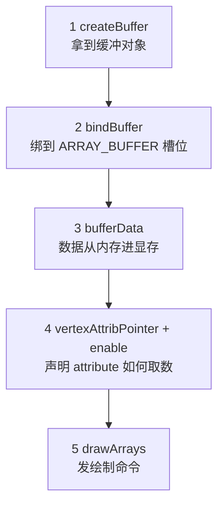
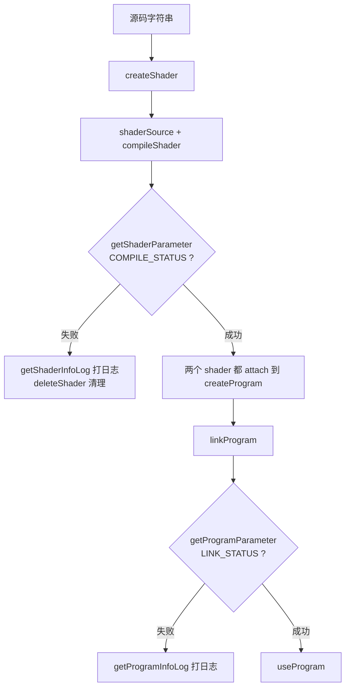

# 第一个 WebGL 程序

> [返回：WebGL 与 3D 框架学习大纲](../WebGL与3D框架学习大纲.md)
> 本文是第一阶段第 2 条"第一个 WebGL 程序"的完整展开，小节编号 2.x 与大纲一致；从清屏到三角形，顺带建立"状态机"心智与着色器排错习惯。前置阅读：[02-渲染管线全局观](02-渲染管线全局观.md)。

## 2.1 canvas、gl 上下文、clearColor / viewport

WebGL 画在 `<canvas>` 上，`getContext` 返回的上下文对象就是全部 API 的入口。动手前先立一个理解所有 GL 调用的钥匙：**WebGL 是一个状态机（state machine）——几乎没有"把参数显式传来传去"的函数，几乎所有调用都在读或写"当前状态"**。后面的 `bindBuffer` + `bufferData`、`useProgram` + `uniform`，全是这个模式。

最小可运行的清屏程序（完整代码 A，保存为 `clear.html` 双击运行）：

```html
<!DOCTYPE html>
<html lang="zh-CN">
<head>
<meta charset="UTF-8">
<title>最小 WebGL 程序：清屏</title>
<style>
  html, body { margin: 0; height: 100%; }
  canvas { display: block; width: 100vw; height: 100vh; }
</style>
</head>
<body>
<canvas id="gl"></canvas>
<script>
'use strict';
const canvas = document.getElementById('gl');
const gl = canvas.getContext('webgl2') || canvas.getContext('webgl');
if (!gl) { document.body.textContent = '当前浏览器不支持 WebGL'; throw new Error('no webgl'); }

gl.clearColor(0.10, 0.14, 0.20, 1.0);   // 设置状态：清屏色（RGBA，分量 0~1）
gl.clear(gl.COLOR_BUFFER_BIT);          // 执行动作：用该状态清空颜色缓冲
</script>
</body>
</html>
```

`clearColor` 只是记录状态，`clear` 才是动作——"先配置、后执行"的配对模式贯穿 WebGL 一生。

两个必懂的细节：

**viewport（视口）**。`gl.viewport(x, y, w, h)` 设定视口变换的参数：NDC 的 `[-1,1]` 映射到画布上的哪个矩形（05 册 4.5 展开）。它在上下文创建时默认等于画布当时的尺寸；**一旦改变 `canvas.width/height`，必须重新调用**，否则画面会被拉伸或只画在一角。

**canvas 尺寸三件事**。`canvas.width/height`（绘图缓冲分辨率）、CSS 显示尺寸（`width:100vw` 之类）、`devicePixelRatio`（高清屏物理像素比）是三个独立的量。只设 CSS 不设 width/height，画布就是默认 300×150，还模糊。标准写法是随窗口同步：

```javascript
function resize() {
  const dpr = window.devicePixelRatio || 1;
  const w = Math.floor(canvas.clientWidth * dpr) || 1;
  const h = Math.floor(canvas.clientHeight * dpr) || 1;
  if (canvas.width !== w || canvas.height !== h) {   // 避免每帧无谓的重置
    canvas.width = w; canvas.height = h;
    gl.viewport(0, 0, w, h);                          // 尺寸变了必须重设视口
  }
}
window.addEventListener('resize', resize);
```

这个 `resize` 函数之后每个 demo 原样复制。

## 2.2 顶点缓冲（VBO）、attribute 传参、drawArrays 画三角形

### 2.2.1 数据先行：一个顶点长什么样

WebGL 不知道什么是"三角形"，它只吃数字数组。我们给每个顶点 6 个 float：位置 xyz + 颜色 rgb，交错（interleaved）排布在一个 `Float32Array` 里：

```text
字节偏移:   0        4        8       12       16       20     |  24 ...
           ┌────────┬────────┬───────┬────────┬────────┬──────┐
顶点 0     │ x = -0.5│ y=-0.4 │ z = 0 │ r = 1  │ g=0.35 │ b=0.35 │  顶点 1 ...
           └────────┴────────┴───────┴────────┴────────┴──────┘
            └────── a_position ──────┘└────── a_color ────────┘
           |<------------- stride = 24 字节 --------------->|
```

交错存储的好处：一次上传、访问局部性好；代价是要算 stride / offset。也可以拆成两个数组两个缓冲，效果等价，这里选交错是为了把参数讲透。

### 2.2.2 五步模板：从数组到三角形



前三步是"上传"，后两步是"接线"，逐步对照：

```javascript
// 1. 创建缓冲（VBO，vertex buffer object，顶点缓冲对象）
const vbo = gl.createBuffer();

// 2. 绑定：把 vbo 设为"当前的 ARRAY_BUFFER"——之后所有针对该槽位的操作都作用于它
gl.bindBuffer(gl.ARRAY_BUFFER, vbo);

// 3. 上传：把 JS 数组搬进显存（STATIC_DRAW 提示"数据基本不变"）
const vertices = new Float32Array([ /* 交错数据，见下文完整代码 */ ]);
gl.bufferData(gl.ARRAY_BUFFER, vertices, gl.STATIC_DRAW);

// 4a. 查出着色器里 attribute 的"插座编号"
const aPosition = gl.getAttribLocation(program, 'a_position');
// 4b. 声明取数方式：从"当前绑定的 ARRAY_BUFFER"里取
gl.vertexAttribPointer(aPosition, 3, gl.FLOAT, false, 24, 0);
gl.enableVertexAttribArray(aPosition);

// 5. 绘制：从顶点 0 开始画 3 个，按 TRIANGLES 组装
gl.drawArrays(gl.TRIANGLES, 0, 3);
```

`vertexAttribPointer` 六个参数是新手第一道坎，逐个说清（第 0 个是插座编号）：

| 参数 | 本例值 | 含义 |
|---|---|---|
| index | aPosition | attribute 的位置编号（`getAttribLocation` 的返回值） |
| size | 3 | 每个顶点取 3 个分量（x, y, z） |
| type | gl.FLOAT | 分量类型是 32 位浮点 |
| normalized | false | 整型才有意义：是否归一化到 0~1 |
| stride | 24 | 两个顶点起点之间的字节数（6 个 float × 4 字节） |
| offset | 0 | 首顶点该属性起始的字节偏移（颜色则填 12） |

两个致命细节：**stride 与 offset 的单位是字节，不是元素个数**；**`vertexAttribPointer` 记录的是"调用那一刻"绑定的 VBO**，之后再绑别的缓冲不影响已设置的 attribute——所以"先 bindBuffer 再 vertexAttribPointer"的顺序不能反。

还有个容易困惑的点：缓冲里每顶点只有 3 个 float，着色器里却写 `attribute vec4`。GL 会自动补齐缺失分量补 `(0, 0, 1)`，即位置补成 `(x, y, z, 1)`，颜色补成 `(r, g, b, 1)`。所以 size=3 配 vec4 是常见搭配。

### 2.2.3 着色器最小对

语法细节 04 册展开，现在先看形状——顶点着色器管"顶点去哪"，片元着色器管"像素什么色"：

```glsl
// 顶点着色器
attribute vec4 a_position;   // 每顶点输入（插座对着上面的 vertexAttribPointer）
attribute vec3 a_color;
varying vec3 v_color;        // 输出给片元（会被光栅化插值）
void main() {
  v_color = a_color;
  gl_Position = a_position;  // 本例直接把 NDC 坐标当结果（还没乘矩阵）
}
```

```glsl
// 片元着色器
precision mediump float;     // 片元着色器必须显式声明 float 精度（04 册 3.3）
varying vec3 v_color;        // 名字与类型必须与顶点着色器一致
void main() {
  gl_FragColor = vec4(v_color, 1.0);   // 输出像素颜色
}
```

坐标系校准一下直觉：`gl_Position` 期望的是裁剪空间坐标，本例 w=1 时它就是 NDC（normalized device coordinates）——x/y/z 都在 `[-1, 1]`，**原点在画布中心，y 轴向上**。这与 DOM/CSS 的"左上原点、y 向下"正好相反，第一次画"倒着的图形"多半是被它坑的。

### 2.2.4 完整代码：hello-triangle.html

保存为 `hello-triangle.html`，双击运行，应看到深蓝底上三个角分别为红、绿、蓝的渐变三角形（颜色是 varying 插值出来的）：

```html
<!DOCTYPE html>
<html lang="zh-CN">
<head>
<meta charset="UTF-8">
<title>第一个 WebGL 程序：三角形</title>
<style>
  html, body { margin: 0; height: 100%; background: #101418; }
  canvas { display: block; width: 100vw; height: 100vh; }
</style>
</head>
<body>
<canvas id="gl"></canvas>
<script>
'use strict';
/* ---------- 0. 上下文与尺寸 ---------- */
const canvas = document.getElementById('gl');
const gl = canvas.getContext('webgl2') || canvas.getContext('webgl');
if (!gl) { document.body.textContent = '当前浏览器不支持 WebGL'; throw new Error('no webgl'); }

function resize() {
  const dpr = window.devicePixelRatio || 1;
  const w = Math.floor(canvas.clientWidth * dpr) || 1;
  const h = Math.floor(canvas.clientHeight * dpr) || 1;
  if (canvas.width !== w || canvas.height !== h) {
    canvas.width = w; canvas.height = h;
    gl.viewport(0, 0, w, h);
  }
}
window.addEventListener('resize', resize);

/* ---------- 1. 着色器源码 ---------- */
const VS_SOURCE = `
attribute vec4 a_position;
attribute vec3 a_color;
varying vec3 v_color;
void main() {
  v_color = a_color;
  gl_Position = a_position;
}
`;
const FS_SOURCE = `
precision mediump float;
varying vec3 v_color;
void main() {
  gl_FragColor = vec4(v_color, 1.0);
}
`;

/* ---------- 2. 编译链接（简化版，2.3 节升级为带日志排查的完整版） ---------- */
function compileShader(type, source) {
  const sh = gl.createShader(type);
  gl.shaderSource(sh, source);
  gl.compileShader(sh);
  if (!gl.getShaderParameter(sh, gl.COMPILE_STATUS)) {
    throw new Error('着色器编译失败：' + gl.getShaderInfoLog(sh));
  }
  return sh;
}
const program = gl.createProgram();
gl.attachShader(program, compileShader(gl.VERTEX_SHADER, VS_SOURCE));
gl.attachShader(program, compileShader(gl.FRAGMENT_SHADER, FS_SOURCE));
gl.linkProgram(program);
if (!gl.getProgramParameter(program, gl.LINK_STATUS)) {
  throw new Error('程序链接失败：' + gl.getProgramInfoLog(program));
}
gl.useProgram(program);          // 状态机：把 program 设为"当前程序"

/* ---------- 3. 顶点数据与 VBO ---------- */
// 交错布局：x y z r g b（NDC 坐标，y 向上）
const vertices = new Float32Array([
  -0.5, -0.4, 0.0,   1.0, 0.35, 0.35,
   0.5, -0.4, 0.0,   0.35, 1.0, 0.35,
   0.0,  0.6, 0.0,   0.35, 0.55, 1.0,
]);
const vbo = gl.createBuffer();
gl.bindBuffer(gl.ARRAY_BUFFER, vbo);
gl.bufferData(gl.ARRAY_BUFFER, vertices, gl.STATIC_DRAW);

/* ---------- 4. 接线：attribute ---------- */
const aPosition = gl.getAttribLocation(program, 'a_position');
const aColor = gl.getAttribLocation(program, 'a_color');
gl.enableVertexAttribArray(aPosition);
gl.vertexAttribPointer(aPosition, 3, gl.FLOAT, false, 24, 0);   // 偏移 0，取 xyz
gl.enableVertexAttribArray(aColor);
gl.vertexAttribPointer(aColor, 3, gl.FLOAT, false, 24, 12);     // 偏移 12，取 rgb

/* ---------- 5. 清屏并绘制 ---------- */
resize();
gl.clearColor(0.063, 0.078, 0.094, 1.0);
gl.clear(gl.COLOR_BUFFER_BIT);
gl.drawArrays(gl.TRIANGLES, 0, 3);
</script>
</body>
</html>
```

跑通后做三个改动实验（都是 01 导览里的任务 1）：

1. 把某顶点 y 改成 `1.5`：超出 NDC 的部分被裁剪（1.2 的"图元装配与裁剪"亲眼可见）。
2. 加三个顶点（拼一个四边形），`drawArrays` 第二个参数改 6：一次命令画两个三角形。
3. 交换两个顶点的颜色值，观察渐变方向变化，验证 varying 插值。

## 2.3 着色器编译链接流程，shader 编译错误怎么排查

### 2.3.1 完整流程图

着色器从字符串到可用要经过编译与链接两级，任何一级失败都不会自动告诉你——**WebGL 的哲学是"不抛异常、静默失败"，必须主动查询状态"**：



### 2.3.2 带错误日志的辅助函数（模板代码）

把上面流程固化为两个函数，之后所有 demo 直接复制（05 / 06 册的完整代码里用的就是它们）：

```javascript
/**
 * 编译单个着色器；失败时打出带源码行号的日志并返回 null。
 * type: gl.VERTEX_SHADER 或 gl.FRAGMENT_SHADER
 */
function compileShader(gl, type, source, name) {
  const shader = gl.createShader(type);
  gl.shaderSource(shader, source);
  gl.compileShader(shader);
  if (!gl.getShaderParameter(shader, gl.COMPILE_STATUS)) {
    const log = gl.getShaderInfoLog(shader);
    console.error(`[${name || 'shader'}] 编译失败:\n${log}`);
    // 附上带行号的源码，控制台里直接对照报错行
    source.split('\n').forEach((line, i) => {
      console.error(`${String(i + 1).padStart(3)} | ${line}`);
    });
    gl.deleteShader(shader);
    return null;
  }
  return shader;
}

/** 编译 + 链接成完整程序；任何一步失败返回 null（日志已打） */
function createProgram(gl, vsSource, fsSource) {
  const vs = compileShader(gl, gl.VERTEX_SHADER, vsSource, 'vertex');
  const fs = compileShader(gl, gl.FRAGMENT_SHADER, fsSource, 'fragment');
  if (!vs || !fs) return null;

  const program = gl.createProgram();
  gl.attachShader(program, vs);
  gl.attachShader(program, fs);
  gl.linkProgram(program);
  if (!gl.getProgramParameter(program, gl.LINK_STATUS)) {
    console.error(`[program] 链接失败:\n${gl.getProgramInfoLog(program)}`);
    gl.deleteProgram(program);
    return null;
  }
  gl.deleteShader(vs);   // 链接完成后 shader 对象可删，program 独立存在
  gl.deleteShader(fs);
  return program;
}
```

用法：把 2.2.4 完整代码的"第 2 段"替换为 `const program = createProgram(gl, VS_SOURCE, FS_SOURCE); if (!program) throw new Error('看控制台');` 即可。

### 2.3.3 报错对照表（背下前四条，80% 的着色器 bug 当场解决）

日志行号格式一般是 `ERROR: 0:行号: ...`，`0` 是着色器编号、行号从 1 计。注意**多数驱动报的行号是"出错行的下一行"**（解析到那里才发现问题），从 1.00 时代就是如此，排查时往上看一行。

| 症状 / 日志关键词 | 原因 | 修法 |
|---|---|---|
| `syntax error` / `expected ';'` | 少分号、括号不配对；行号常指向下一行 | 对照打印出的带行号源码看上一行 |
| `undeclared identifier` | 用了没声明的变量；或 varying 两边名字不一致（链接期也会炸） | 检查声明与拼写 |
| `No precision specified for type 'float'` | 片元着色器缺 `precision mediump float;` | 加在源码第一行（04 册 3.3 讲为什么） |
| `cannot convert` / 类型不匹配 | `float x = 1;`（GLSL 无隐式 int→float）；vec3 与 vec4 直接相加 | 字面量写 `1.0`；显式构造 `vec4(v3, 1.0)` |
| `link error`：varying 数量/名字不匹配 | 顶点与片元的 varying 声明不一致 | 两边同名同类型 |
| 编译链接都过，但黑屏无报错 | `getAttribLocation` 返回 `-1`（attribute 名拼错或没使用被优化掉）→ `enableVertexAttribArray(-1)` 无效，attribute 用常量值，三个顶点挤在原点 | 打印 location 判 `-1`；检查拼写 |
| uniform 改了没反应，无报错 | `getUniformLocation` 返回 `null`（名字拼错/被优化），WebGL 对 null 静默忽略 | 打印 location 判空 |
| 画面半透明发暗 | 默认 canvas 是 alpha 通道开启且预乘，页面背景混进来 | `getContext('webgl', { alpha: false })` |

判据：**WebGL 的"静默失败"比报错更危险——"location 拿到就打日志"的习惯从第一个程序养成**。生产排障再配合 `gl.getError()`（返回最近一次错误码，需要循环调用取完）与抓帧工具 Spector.js（第五阶段）。

## 常见坑

1. **忘 `enableVertexAttribArray`**：attribute 没启用，用的是常量值，典型症状是三个顶点挤在原点、什么都没有、还不报错。
2. **`vertexAttribPointer` 之前没 `bindBuffer`**：它记录的是调用瞬间的"当前 VBO"，之后才 bind 无效——顺序反了等于把插座接到了空气上。
3. **stride / offset 用了"个数"而不是"字节"**：24 与 12 是字节；写 6 与 3 必然花屏或崩溃式花屏。
4. **忘 `useProgram`**：状态机里"当前程序"默认是 null，`drawArrays` 报 `INVALID_OPERATION`（记住查 `getError`）。
5. **`clearColor` 设了但忘 `clear`**，或 `clear` 的 mask 写错：颜色缓冲是 `COLOR_BUFFER_BIT`，深度缓冲是 `DEPTH_BUFFER_BIT`（06 册用得上）。
6. **只给 canvas 设了 CSS 尺寸**：绘图缓冲停在默认 300×150，视口与画布不一致，画面拉伸且模糊（见 2.1 的 resize）。
7. **着色器字符串坑**：模板字符串里 `#version` 前不能有换行或空格；把着色器放 HTML `<script type="x-shader">` 标签时，内容里不能出现 `</script>` 字样。
8. **每帧重建 program / VBO**：能跑但极慢——创建与编译是 CPU 大头，资源初始化一次、循环里只发绘制命令（1.1 的推论落地）。

## 本节自测

1. "WebGL 是状态机"这句话如何解释 `bindBuffer` + `bufferData` 的配合？为什么 `vertexAttribPointer` 不需要传 VBO 参数？
2. 一个顶点交错存放 `x y z r g b` 六个 float，position 与 color 的 stride / offset 各是多少？依据是什么？
3. 着色器编译失败时，`getShaderParameter` 与 `getShaderInfoLog` 各返回什么？为什么还要主动调它们而不是等异常？
4. 程序编译链接都成功，屏幕却黑着且控制台干净——列出至少两种可能原因与对应查法。
5. 缓冲里顶点是 3 个 float，着色器里声明 `attribute vec4`，缺的第 4 分量 GL 自动补成什么？这个默认为什么对位置恰好合适？

---

下一篇：[04-GLSL基础](04-GLSL基础.md)——把着色器当成一门语言来系统学一遍。
