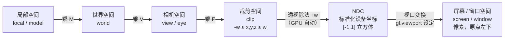

# 图形学数学基础

> [返回：WebGL 与 3D 框架学习大纲](../WebGL与3D框架学习大纲.md)
> 本文是第一阶段第 4 条"图形学数学基础"的完整展开，小节编号 4.x 与大纲一致；点积叉积、三大变换矩阵、MVP 链、lookAt 与透视投影的完整推导，以及六个坐标空间的全链路。前置阅读：[04-GLSL基础](04-GLSL基础.md)。

本册是全阶段最"数学"的一册，但所有推导只需要高中三角函数与矩阵乘法。约定先讲清楚：**本文所有矩阵都按"列向量约定"（column vector convention）书写，即变换写成 `v' = M · v`；存储按"列主序"（column-major）**——这正是 WebGL 与 GLSL 的约定。为什么是这个约定、它与 `uniformMatrix4fv` 的关系，见 4.2.6。

## 4.1 向量：点积叉积的几何意义、归一化

### 4.1.1 向量与点

三维向量 `Vec3` 同时扮演两个角色：**方向**（含长度，如"朝北 5 米/秒"）与**点**（位置，如"世界原点东北 3 米处"）。区分它们的数学手段是 4.2.4 的齐次坐标（w=1 为点、w=0 为方向），先记住直觉：**"点减点得方向，点加方向得点，方向加减仍为方向"**。

### 4.1.2 点积（dot product，内积）：投影与夹角

代数定义与几何定义：

```text
a · b = a.x*b.x + a.y*b.y + a.z*b.z        （代数）
      = |a| |b| cos θ                       （几何，θ 为夹角）
```

两个定义等价，几何意义由第二条读出：

- **夹角**：两边归一化后点积就是 `cos θ`。`> 0` 同侧（夹角小于 90°），`= 0` 垂直，`< 0` 反向。
- **投影**：`a · b̂`（b 先归一化）= a 在 b 方向上的带符号投影长度。
- **长度**：`a · a = |a|²`（05 册点云 demo 的暗角、光照衰减都靠它）。

图形学里的高频应用，本仓库后面全都会遇到：

| 应用 | 用法 | 出处 |
|---|---|---|
| 漫反射光照 | `max(dot(N, L), 0)`（法线与光源方向的余弦） | 第二阶段 |
| 背面剔除判断 | `dot(viewDir, faceNormal)` 的正负 | 第二阶段 |
| 点在平面前/后 | `dot(P - planePoint, planeNormal)` 的正负 | 裁剪、阴影 |
| 射线与球相交 | 展开二次方程时全程点积 | 第四阶段拾取 |

```typescript
export function dot3(a: Vec3, b: Vec3): number {
  return a[0] * b[0] + a[1] * b[1] + a[2] * b[2];
}
```

### 4.1.3 叉积（cross product）：法线与手性

叉积只对三维向量有定义，结果是**一个向量**，方向垂直于 a、b 所在平面，由**右手定则**（right-hand rule，四指从 a 弯向 b，拇指即 a×b）确定；长度是 `|a| |b| sin θ`，恰好等于 a、b 张成的平行四边形面积。

```text
a × b = ( a.y*b.z - a.z*b.y,
          a.z*b.x - a.x*b.z,
          a.x*b.y - a.y*b.x )
```

三条要紧的性质：

1. **反交换**：`a × b = -(b × a)`——顺序错了方向就反，这是叉积第一大 bug 来源。
2. **a × b 垂直于 a、b**——所以三角形两条边的叉积就是它的**法线（normal）**。
3. a、b 共线时叉积为零向量——退化情况（4.4.2 的 lookAt 崩溃正是这个）。

```typescript
export function cross3(a: Vec3, b: Vec3): Vec3 {
  return [
    a[1] * b[2] - a[2] * b[1],
    a[2] * b[0] - a[0] * b[2],
    a[0] * b[1] - a[1] * b[0],
  ];
}
```

应用速查：求三角形/平面法线（两边叉积）、构造正交坐标系（4.4.2 的 lookAt 就是"叉积三连"）、判断三角形顶点绕向（顺/逆时针）、计算面积。

### 4.1.4 归一化（normalize）

归一化 = 除以自身长度，得到同方向的**单位向量**（长度 1）：

```typescript
export function normalize3(v: Vec3): Vec3 {
  const len = Math.hypot(v[0], v[1], v[2]);
  return len > 1e-8 ? [v[0] / len, v[1] / len, v[2] / len] : [0, 0, 0];  // 零向量保护
}
```

为什么处处归一化：判据一句话——**"点积当 cos θ 用"的前提是两边都是单位向量**，否则点积里混入了两个长度因子，符号判断会错、光照会忽明忽暗。零向量保护不是装饰：lookAt 传入平行向量时会在这里救你一命（见 4.4.2）。

## 4.2 矩阵乘法与变换的复合；平移 / 旋转 / 缩放矩阵的推导

### 4.2.1 矩阵是对空间的线性描述

把 4x4 矩阵 M 的每一列 `c0, c1, c2, c3` 看作"基向量被送到了哪里"，那么矩阵作用于任意向量 `v = (x, y, z, w)` 就是按分量重新组合这些基：

```text
M · v = x*c0 + y*c1 + z*c2 + w*c3
```

矩阵乘法由此自然导出，并有一条本文最重要的性质：**`(A·B)·v = A·(B·v)`——矩阵乘法满足结合律但不满足交换律，靠右的矩阵先作用于向量**。所以"矩阵连乘的顺序"不是书写习惯，而是**语义**：`T·R·v` 是"先旋转再平移"，`R·T·v` 是"先平移再旋转"，两者一般不同。

### 4.2.2 缩放矩阵 S 的推导

缩放把 x 方向拉长 sx 倍、y 拉长 sy、z 拉长 sz——每个基向量各自乘上系数即可：

```text
      [ sx  0   0   0 ]        列 0 = (sx, 0, 0)：x 基变成 sx 倍
  S = [ 0   sy  0   0 ]
      [ 0   0   sz  0 ]
      [ 0   0   0   1 ]
```

### 4.2.3 旋转矩阵 R 的推导：从两角和公式开始

推导"绕 z 轴转 θ"。设点 `P = (x, y)` 用极坐标表示为 `x = r cos α, y = r sin α`。旋转后极角变为 `α + θ`，用两角和公式展开：

```text
x' = r cos(α + θ) = r (cos α cos θ - sin α sin θ) = x cos θ - y sin θ
y' = r sin(α + θ) = r (sin α cos θ + cos α sin θ) = x sin θ + y cos θ
z' = z
```

写成矩阵形式（列向量约定）：第 0 列是 x 基向量 `(1,0,0)` 变换后的结果 `(cos θ, sin θ, 0)`，第 1 列是 y 基向量 `(0,1,0)` 变换后的 `(-sin θ, cos θ, 0)`：

```text
         [ cos θ   -sin θ   0   0 ]
  Rz(θ)=[ sin θ    cos θ   0   0 ]
         [ 0        0       1   0 ]
         [ 0        0       0   1 ]
```

绕 x、绕 y 完全同理（每个轴的旋转都是"另外两个轴构成的平面里的 2D 旋转"），直接给结果：

```text
         [ 1   0       0      0 ]           [ cos θ   0   sin θ   0 ]
  Rx(θ)=[ 0   cos θ  sin θ  0 ]    Ry(θ) = [ 0       1   0       0 ]
         [ 0  -sin θ  cos θ  0 ]           [-sin θ   0   cos θ   0 ]
         [ 0   0       0      1 ]           [ 0       0   0       1 ]
```

注意 Ry 里 sin 的位置与 Rx/Rz 不同（绕 y 是 x-z 平面里的 2D 旋转，符号方位随之变化）——抄错符号是旋转矩阵第二大 bug 来源。

选读，**绕任意轴旋转（罗德里格斯旋转公式，Rodrigues' rotation formula）**：绕单位轴 `k` 转 θ，把向量分解成"平行于 k"与"垂直于 k"两部分分别处理后合并：

```text
v' = v cos θ + (k × v) sin θ + k (k · v) (1 - cos θ)
```

第二阶段给地球做"倾斜的地轴"时用得上；实现见本册末尾完整代码的 `mat4AxisAngle`（本阶段实践可以不用它）。

### 4.2.4 平移与齐次坐标（homogeneous coordinates）：为什么是 4x4

平移 `P' = P + t` 不是线性变换——线性变换必须把原点映到原点，而平移把原点搬走了，3x3 矩阵表达不了它。图形学的解法是**升一维**：给向量加第 4 个分量 w，用 4x4 矩阵把平移"吸收"成线性变换：

```text
      [ 1  0  0  tx ]         点：w = 1   →  平移生效
  T = [ 0  1  0  ty ]         方向：w = 0 →  平移不生效（方向没有"位置"）
      [ 0  0  1  tz ]
      [ 0  0  0  1  ]
```

判据：**w=1 当点、w=0 当方向**——法线、方向向量"平移不变"正是由 w=0 保证的。w 还有一份更重要的工作：透视投影里存放"深度倒数"，让除法能表达近大远小（4.4.3）。

### 4.2.5 复合与 TRS：顺序即语义

"把物体缩放 2 倍、绕自身转 30°、再挪到 (3,0,0)"，按"先做的靠右"排列：

```text
M = T · R · S        // 列向量约定：v 先被 S 作用，再 R，再 T
```

为什么必须是这个顺序，两个反例就够：

- `S · T`：先平移后缩放，**平移的距离也被放大**——想挪 3 格结果挪了 6 格，物体"漂走"。
- `T · R` 与 `R · T`：前者绕原点转（先转后挪，转完再放到位），后者绕物体自身转。"绕自身轴自转"必须让 R 靠近向量一侧、T 在左——06 册立方体自转正是靠这个顺序实现的。

### 4.2.6 列主序存储与 uniformMatrix4fv(transpose=false)

三个容易搅在一起的概念，一次分清：

1. **数学约定**：列向量 `v' = M v`（本文与 GLSL 的约定）。
2. **内存布局**：列主序（column-major）指"内存里前 4 个数是矩阵第 0 列"。上面的 `Rz(θ)` 在 Float32Array 里是 `[c, s, 0, 0,  -s, c, 0, 0,  0, 0, 1, 0,  0, 0, 0, 1]`。
3. **上传接口**：`gl.uniformMatrix4fv(loc, transpose, data)` 要求 GLSL 按"前 4 个 = 第 0 列"解读 data，且 **WebGL 强制 transpose 必须为 false**（传 true 直接报 `INVALID_VALUE`，只有桌面 OpenGL 才支持转置上传）。

判据：**"数学按列向量想、存储按列主序写、上传 transpose 恒 false"——三件事对齐，矩阵类 bug 少一半**。如果从行主序教材抄了一个矩阵，最典型的症状是效果"像被转置了"：镜像、旋转方向怪异、物体乱飞。

## 4.3 模型 - 视图 - 投影（MVP）矩阵链

三个矩阵各自负责坐标链路的一跳（完整链路见 4.5）：

| 矩阵 | 名字 | 职责 | 回答的问题 | 变化频率 |
|---|---|---|---|---|
| M | 模型矩阵（model） | 局部空间 → 世界空间 | 物体放在哪、朝向如何、多大 | 每物体每帧 |
| V | 视图矩阵（view） | 世界空间 → 相机空间 | 相机在哪、看向哪 | 每帧一次（或相机变化时） |
| P | 投影矩阵（projection） | 相机空间 → 裁剪空间 | 视锥形状：视野多宽、远近裁剪面 | 尺寸/fov 变化时 |

链式相乘，顶点着色器里那行经典代码：

```glsl
gl_Position = u_mvp * vec4(a_position, 1.0);   // u_mvp = P · V · M
```

右往左读：顶点先乘 M 进世界，再乘 V 进相机，再乘 P 进裁剪空间。工程上**在 CPU 侧预乘成一个矩阵再上传**——每帧每物体一次 4x4 乘法，对比"每个顶点在 GPU 上乘三次矩阵"，这正是 02 册 1.4.5 推论 2（能在 CPU 算一次的别放 shader 里反复算）的落地。

V 的一个心智模型：**视图矩阵是"相机自己的模型矩阵"的逆矩阵**——世界不动，把整个世界反向搬进相机的局部坐标系（4.4.1 推导它）。P 把相机空间的视锥压成裁剪空间的立方体（4.4.3 推导它）。

## 4.4 手写 lookAt 与透视投影矩阵（perspective）

### 4.4.1 view 矩阵的本质：相机世界矩阵的逆

设相机位于 `eye`，看向 `target`。相机自己的"模型矩阵"是 `C = T(eye) · R`（先定向、再平移到 eye）。view 矩阵是它的逆：

```text
V = C⁻¹ = R⁻¹ · T⁻¹
```

求逆看起来吓人，但两步化简后几乎是手算：

- `T⁻¹`：平移取反，即 `T(-eye)`。
- `R⁻¹`：旋转矩阵的基向量是**标准正交基**（两两垂直的单位向量），正交矩阵的逆 = 转置 `Rᵀ`。

### 4.4.2 lookAt 推导：叉积三连 + 转置 + 平移取反

第一步，用叉积构造相机的正交基（记号：f 前向、r 右向、u 上向，全部单位向量）：

```text
f = normalize(target - eye)     // 前向：从眼睛指向目标
r = normalize(cross(f, up))     // 右向：前向叉乘用户给的"大致向上"
u = cross(r, f)                 // 上向：再叉回来，得到与前向真正垂直的上方向
```

三个要点：

- 用户传入的 `up`（如世界 y 轴）只提供"哪边是上"的倾向，**不要求与 f 垂直**——u 由叉积重新算出，天然正交。这允许相机任意俯仰仍传 `(0,1,0)`。
- 若 `up` 与 `f` 平行，`cross(f, up)` 是零向量，`normalize` 除零得 NaN——**黑屏 + 控制台一堆 NaN** 的经典来源（正对物体且 up 朝向视线时触发）。修法：检测后换一个 up，或干脆约束相机不要正对极点。
- GL 约定相机看向 **-z**（右手系），所以 view 矩阵第三行是 `-f`。

第二步，按 4.4.1 的结论拼矩阵：旋转部分取转置（基向量从"列"变"行"），平移部分取反（`-r·eye` 等，把相机搬到原点）：

```text
        [  r.x    r.y    r.z   -r · eye ]
  V = [  u.x    u.y    u.z   -u · eye ]      （按行书写便于阅读）
        [ -f.x   -f.y   -f.z    f · eye ]
        [  0      0      0      1       ]
```

数值自检：`eye=(0,0,5)`、`target=(0,0,0)`、`up=(0,1,0)` 时，`f=(0,0,-1)`、`r=(1,0,0)`、`u=(0,1,0)`；世界原点 `(0,0,0)` 应被映到相机正前方 5 个单位处 `(0,0,-5)`——本文末尾的完整代码里有这条断言。

### 4.4.3 透视投影矩阵推导：四步

输入四个参数：垂直视场角 `fovy`（弧度）、宽高比 `aspect = width/height`、近裁剪面距离 `near`、远裁剪面距离 `far`。目标是把相机空间里视锥内部的点映到裁剪空间 `[-w, w]`，除以 w 后落在 NDC 立方体 `[-1,1]` 内。

**第一步：相似三角形，求投到近裁剪面上的坐标。** 相机看向 -z，点 `(x, y, z)`（z 为负）投到近面 `z = -n` 上：

```text
x_n = x * n / (-z)          y_n = y * n / (-z)
```

**第二步：把近面坐标压到 [-1, 1]。** 近面的半高是 `n · tan(fovy/2)`，半宽是 `n · tan(fovy/2) · aspect`（"半高乘宽高比"），于是：

```text
x_ndc = x / (tan(fovy/2) · aspect · (-z))      记 sy = 1 / tan(fovy/2)，sx = sy / aspect
y_ndc = y / (tan(fovy/2) · (-z))
```

**第三步：把"除以 -z"写进 w。** ndc 是"裁剪坐标除以 w"，对照上式令 `w_clip = -z`，则 `x_clip = sx · x`、`y_clip = sy · y`。这就是透视投影矩阵第三行变成 `(0, 0, -1, 0)` 的原因——**w 里存的是深度的负值，透视除法把"远处的点"自动缩小**，"近大远小"全部秘密在这一行。

**第四步：解出 z 的映射。** z 不能用同样的公式（w 已经是 -z，z_ndc 不能再依赖 z 本身做分母以外的复杂式），设 `z_clip = p·z + q`，要求 `z = -n → z_ndc = -1`、`z = -f → z_ndc = +1`：

```text
(-p·n + q) / n = -1   →   q - p·n = -n
(-p·f + q) / f = +1   →   q - p·f =  f
两式相减：p·(f - n) = -(n + f)   →   p = (n + f) / (n - f)
回代：q = 2·f·n / (n - f)
```

拼成矩阵（行书写，便于阅读）：

```text
        [ sx   0    0                 0        ]
  P = [ 0    sy   0                 0        ]
        [ 0    0    (n+f)/(n-f)   2fn/(n-f)   ]
        [ 0    0    -1                0        ]
```

数值验证（用 n=1, f=10 代入）：`z=-1` 时 `z_clip = (11/-9)(-1) + 20/-9 = -1`，`w = 1`，`z_ndc = -1`；`z=-10` 时 `z_clip = 10`，`w = 10`，`z_ndc = +1`。边界严丝合缝，完整代码里有自动断言。

**为什么 z 的分布是"近密远疏"**：`z_ndc ∝ 1/z` 的形状，远处一大段深度挤在 NDC 里很窄的区间——这是深度缓冲（depth buffer）精度问题（z-fighting，两个面太近分不清先后）的根源。工程口诀：**near 在保证不穿模的前提下尽量大，far 够用就好**（例如 `0.1 / 100` 通常好于 `0.001 / 1000`）。详细展开在第二阶段深度测试一节。

fovy 的直觉：小（如 30°）= 长焦，空间被压扁、透视弱；大（如 90°）= 广角，边缘拉伸、透视强。且 fovy 是**垂直**方向的角度，水平视野 = fovy 乘 aspect 的换算关系藏在 sx 里。

## 4.5 坐标空间全链路：局部 → 世界 → 相机 → 裁剪 → NDC → 屏幕

六个空间串成一条链，箭头上是"跨过这一跳所乘/所做的操作"：



| 空间 | 原点是谁 | 典型范围 | 怎么得到 | 在代码哪里出现 |
|---|---|---|---|---|
| 局部（local） | 物体建模原点 | 任意 | 建模时定死 | Geometry 里的顶点数据 |
| 世界（world） | 场景原点 | 任意 | 乘模型矩阵 M | 光照计算常在这里做（第二阶段） |
| 相机（view/eye） | 相机位置，看向 -z | 任意 | 乘视图矩阵 V | lookAt 的输出 |
| 裁剪（clip） | 视锥中心 | `-w ≤ x,y,z ≤ w` | 乘投影矩阵 P | **gl_Position 的空间** |
| NDC | 立方体中心 | `[-1,1]` | 透视除法 | 03 册三角形直接用它的坐标 |
| 屏幕（screen/window） | 画布左下角 | `0~width, 0~height` 像素 | 视口变换 | **gl_FragCoord 的空间** |

链路上的四个关键节点，逐个点透：

1. **裁剪发生在除法之前**。GPU 拿裁剪空间坐标与 w 比较（不是与 1 比较），这才能正确处理"顶点在相机后面（w 为负）"等退化情况；被裁掉的图元不会进入光栅化。这也是它叫"裁剪空间"的原因。
2. **透视除法（perspective divide）是"近大远小"的发生地**：x、y、z 同时除以 w（透视投影下 w = -z），远处的点（z 绝对值大）整体缩小。它由 GPU 在顶点着色之后自动完成，你的代码里永远看不到这步，所以最容易忘。
3. **视口变换把 NDC 立方体铺到画布矩形**：`x_win = (x_ndc + 1) / 2 · width`，y 同理（原点左下）。这就是 2.1 节"改画布尺寸必须重设 viewport"的原因——viewport 正是这一步的参数。
4. **两套 y 轴方向**：NDC 与窗口坐标 y 向上（GL 传统），DOM/CSS/鼠标事件 y 向下。做拾取（屏幕点反查世界射线）时要翻一次 y，第四阶段会再见。

还有一个跨 API 移植的暗坑：**WebGL 的 NDC 深度范围是 [-1, 1]，Direct3D 是 [0, 1]**——4.4.3 里 z 映射到 [-1,1] 正是 GL 约定；抄 D3D 教材的投影矩阵会得到深度错乱的画面。

## 完整代码：第一阶段数学模块（TypeScript）

下面是本册所有推导的代码化，列主序、列向量约定，06 册实践直接内嵌使用（去类型即普通 JS）。保存为 `minmath-stage1.ts`，用 `npx tsx minmath-stage1.ts` 运行，或去掉类型标注粘进浏览器控制台。末尾三条断言对应 4.4.2、4.4.3 的数值验证与 4.2.5 的顺序验证。

```typescript
// minmath-stage1.ts —— 第一阶段手写数学模块（列向量约定 + 列主序存储，见 4.2.6）
// 运行：npx tsx minmath-stage1.ts

export type Vec3 = [number, number, number];
export type Mat4 = Float32Array;

/* ---------- 向量（4.1） ---------- */
export function sub3(a: Vec3, b: Vec3): Vec3 {
  return [a[0] - b[0], a[1] - b[1], a[2] - b[2]];
}

export function dot3(a: Vec3, b: Vec3): number {
  return a[0] * b[0] + a[1] * b[1] + a[2] * b[2];
}

export function cross3(a: Vec3, b: Vec3): Vec3 {
  return [
    a[1] * b[2] - a[2] * b[1],
    a[2] * b[0] - a[0] * b[2],
    a[0] * b[1] - a[1] * b[0],
  ];
}

export function normalize3(v: Vec3): Vec3 {
  const len = Math.hypot(v[0], v[1], v[2]);
  return len > 1e-8 ? [v[0] / len, v[1] / len, v[2] / len] : [0, 0, 0];
}

/* ---------- 基础矩阵（4.2） ---------- */
export function mat4Identity(): Mat4 {
  return new Float32Array([
    1, 0, 0, 0,
    0, 1, 0, 0,
    0, 0, 1, 0,
    0, 0, 0, 1,
  ]);
}

// out = a · b；列向量约定下 b 先作用于向量（4.2.1/4.2.5）
export function mat4Multiply(a: Mat4, b: Mat4): Mat4 {
  const out = new Float32Array(16);
  for (let c = 0; c < 4; c++) {
    for (let r = 0; r < 4; r++) {
      // out(r,c) = Σ_k a(r,k) · b(k,c)，列主序下 a(r,k)=a[k*4+r]、b(k,c)=b[c*4+k]
      out[c * 4 + r] =
        a[r] * b[c * 4] +
        a[4 + r] * b[c * 4 + 1] +
        a[8 + r] * b[c * 4 + 2] +
        a[12 + r] * b[c * 4 + 3];
    }
  }
  return out;
}

export function mat4Translate(tx: number, ty: number, tz: number): Mat4 {
  const m = mat4Identity();
  m[12] = tx; m[13] = ty; m[14] = tz;   // 第 3 列
  return m;
}

export function mat4Scale(sx: number, sy: number, sz: number): Mat4 {
  const m = mat4Identity();
  m[0] = sx; m[5] = sy; m[10] = sz;     // 对角线
  return m;
}

export function mat4RotateX(rad: number): Mat4 {
  const c = Math.cos(rad), s = Math.sin(rad);
  return new Float32Array([
    1, 0, 0, 0,
    0, c, s, 0,
    0, -s, c, 0,
    0, 0, 0, 1,
  ]);
}

export function mat4RotateY(rad: number): Mat4 {
  const c = Math.cos(rad), s = Math.sin(rad);
  return new Float32Array([
    c, 0, -s, 0,
    0, 1, 0, 0,
    s, 0, c, 0,
    0, 0, 0, 1,
  ]);
}

export function mat4RotateZ(rad: number): Mat4 {
  const c = Math.cos(rad), s = Math.sin(rad);
  return new Float32Array([
    c, s, 0, 0,
    -s, c, 0, 0,
    0, 0, 1, 0,
    0, 0, 0, 1,
  ]);
}

// 选读：绕任意单位轴旋转（罗德里格斯公式，4.2.3）
export function mat4AxisAngle(axis: Vec3, rad: number): Mat4 {
  const [x, y, z] = normalize3(axis);
  const c = Math.cos(rad), s = Math.sin(rad), t = 1 - c;
  return new Float32Array([
    t * x * x + c,     t * x * y + s * z, t * x * z - s * y, 0,
    t * x * y - s * z, t * y * y + c,     t * y * z + s * x, 0,
    t * x * z + s * y, t * y * z - s * x, t * z * z + c,     0,
    0, 0, 0, 1,
  ]);
}

/* ---------- 相机与投影（4.4） ---------- */

// 视图矩阵：世界 → 相机空间（4.4.2 推导）
export function lookAt(eye: Vec3, target: Vec3, up: Vec3): Mat4 {
  const f = normalize3(sub3(target, eye));   // 前向
  const r = normalize3(cross3(f, up));       // 右向（注意叉积顺序）
  const u = cross3(r, f);                    // 正交化后的上向
  const m = new Float32Array(16);
  m[0] = r[0];  m[4] = r[1];  m[8]  = r[2];  m[12] = -dot3(r, eye);
  m[1] = u[0];  m[5] = u[1];  m[9]  = u[2];  m[13] = -dot3(u, eye);
  m[2] = -f[0]; m[6] = -f[1]; m[10] = -f[2]; m[14] = dot3(f, eye);
  m[15] = 1;
  return m;
}

// 透视投影：相机空间 → 裁剪空间（4.4.3 推导）
export function perspective(
  fovyRad: number, aspect: number, near: number, far: number,
): Mat4 {
  const f = 1 / Math.tan(fovyRad / 2);       // sy
  const nf = 1 / (near - far);
  const m = new Float32Array(16);
  m[0] = f / aspect;                          // sx = sy / aspect
  m[5] = f;                                   // sy
  m[10] = (far + near) * nf;                  // (n+f)/(n-f)
  m[11] = -1;                                 // w_clip = -z
  m[14] = 2 * far * near * nf;                // 2fn/(n-f)
  return m;
}

/* ---------- 手工验证用：矩阵作用到 4 维向量 ---------- */
export function applyMat4(
  m: Mat4, v: [number, number, number, number],
): [number, number, number, number] {
  return [
    m[0] * v[0] + m[4] * v[1] + m[8] * v[2] + m[12] * v[3],
    m[1] * v[0] + m[5] * v[1] + m[9] * v[2] + m[13] * v[3],
    m[2] * v[0] + m[6] * v[1] + m[10] * v[2] + m[14] * v[3],
    m[3] * v[0] + m[7] * v[1] + m[11] * v[2] + m[15] * v[3],
  ];
}

/* ---------- 自测断言 ---------- */
// 断言 1（4.4.3）：near/far 平面中心应映到 z_ndc = -1 / +1
const P = perspective(Math.PI / 3, 16 / 9, 0.1, 100);
const nearPoint = applyMat4(P, [0, 0, -0.1, 1]);
const farPoint = applyMat4(P, [0, 0, -100, 1]);
console.assert(Math.abs(nearPoint[2] / nearPoint[3] + 1) < 1e-6, 'near 应映到 z_ndc=-1');
console.assert(Math.abs(farPoint[2] / farPoint[3] - 1) < 1e-6, 'far 应映到 z_ndc=+1');

// 断言 2（4.4.2）：eye=(0,0,5) 看向原点，世界原点应落在相机前 5 个单位 (0,0,-5)
const V = lookAt([0, 0, 5], [0, 0, 0], [0, 1, 0]);
const originInView = applyMat4(V, [0, 0, 0, 1]);
console.assert(
  Math.abs(originInView[0]) < 1e-6 && Math.abs(originInView[1]) < 1e-6 &&
  Math.abs(originInView[2] + 5) < 1e-6,
  '世界原点应映到 (0,0,-5)',
);

// 断言 3（4.2.5）：M = T·R·S 作用到 (1,0,0)：
// 先放大 2 倍 → 绕 z 转 90° → 平移 (1,0,0)，期望 (1,2,0,1)
const TRS = mat4Multiply(
  mat4Multiply(mat4Translate(1, 0, 0), mat4RotateZ(Math.PI / 2)),
  mat4Scale(2, 2, 2),
);
const p = applyMat4(TRS, [1, 0, 0, 1]);
console.assert(
  Math.abs(p[0] - 1) < 1e-6 && Math.abs(p[1] - 2) < 1e-6 && Math.abs(p[3] - 1) < 1e-6,
  'TRS 顺序应为先缩放、再旋转、再平移',
);

console.log('minmath-stage1 全部断言通过');
```

## 常见坑

1. **行列主序混抄**：从行主序教材（多数计算机图形学"数学书"按行向量写）抄来的矩阵直接塞进 Float32Array，效果"像被转置"——镜像、旋转方向诡异。判据：本文矩阵按"列在内存里连续"存放，`mat4Translate` 改的是第 12~14 个元素。
2. **`uniformMatrix4fv` 传 transpose=true**：WebGL 直接 `INVALID_VALUE`；想"边传边转置"在 CPU 侧自己转，或（更正确地）统一约定。
3. **矩阵乘法顺序反了**（写成 M·V·P 或预乘时 b·a 写反）：物体消失、乱飞或挤成一团。判据：靠近量的先作用；预乘 `mat4Multiply(P, mat4Multiply(V, M))` 得到 P·V·M。
4. **度与弧度混用**：`perspective(60, ...)` 忘转弧度，视场角荒谬、画面畸变；全部函数入口统一收弧度，度只在"人类可读参数"层出现（06 册的 `rad()` 辅助）。
5. **near=0 或 near≈far**：除零/深度退化，黑屏或深度闪烁；near 取"不穿模前提下尽量大"（4.4.3）。
6. **lookAt 的 up 与视线平行**：`cross(f, up)` 为零，normalize 出 NaN，画面消失且不报错；要么规避正对极点的姿态，要么在 normalize 里做零向量保护（本文实现已保护）。
7. **缩放矩阵把平移一起缩了**（S·T 顺序错）：物体越缩越"漂"，回到 4.2.5 的反例。
8. **叉积顺序写反**：法线/基向量方向反了，背面剔除反常、光照一面亮一面暗；记住 `r = cross(f, up)` 不是 `cross(up, f)`。

## 本节自测

1. 从两角和公式出发，不看书画出 `Rz(θ)` 的 4x4 形式并说明第一列为什么是 `(cos θ, sin θ, 0, 0)`。
2. 证明 `T·R·S` 与 `S·R·T` 作用到任一点的结果一般不同，并各举一个"必须用某种顺序"的场景。
3. 为什么平移需要 4x4 齐次坐标而缩放旋转 3x3 就够？w=0 的向量经过 `T` 后结果如何，这个性质的图形学用途是什么？
4. 给定 `eye=(0,2,3)`、`target=(0,0,0)`、`up=(0,1,0)`，手算 `f` 的方向；解释为什么 `r = cross(f, up)` 而不是 `cross(up, f)`，两者结果差在哪。
5. 完整说出透视除法发生在哪两个处理步骤之间、除数 w 的值从投影矩阵的哪一行来；一个 `w ≤ 0` 的顶点会发生什么？

---

下一篇：[06-实践-自转公转立方体](06-实践-自转公转立方体.md)——把本册数学与 03 册模板组装成结业项目。
