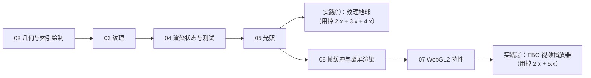

# 第二阶段导览：WebGL 核心渲染技术

> [返回：WebGL 与 3D 框架学习大纲](../WebGL与3D框架学习大纲.md)
> 本文是第二阶段「WebGL 核心渲染技术」的导览页：阶段目标、分册索引、阅读路线、实践任务清单与阶段自测都集中在这里；建议时长 3~4 周。

第一阶段解决了"一个三角形怎么变成屏幕上的像素"——管线、着色器、矩阵全链路。本阶段解决的是"怎么画得对、画得好看、画得快"：几何怎么省、纹理怎么贴、透明怎么排序、光怎么打、离屏怎么渲、WebGL2 省了什么。第三阶段再把这堆裸 API 封装成引擎，所以本阶段所有示例刻意不用任何库——每个 API 的代价都要亲手付一遍，封装时才知道该缓存什么。

## 阶段目标

学完本阶段，你应该能够：

1. 用索引绘制（drawElements）组织中等规模网格，并算得出索引化前后的顶点内存账；
2. 独立完成纹理加载、采样参数配置、mipmap 与多重纹理单元的组合使用，能诊断"黑纹理"与"贴图倒了"；
3. 说清深度测试、模板测试、混合、背面剔除各自在片元管线的哪个位置生效，能复现并缓解 z-fighting，能给透明物体选对排序键；
4. 手推法线矩阵（逆转置）的来历，写出 Phong 与 Blinn-Phong 两版完整 GLSL，理解 Gamma 校正为什么必须在线性空间做光照；
5. 用 FBO 做 render to texture，写出可复用的 createFBO；
6. 用 WebGL2 的 VAO / instancing / UBO / transform feedback / MRT 各写一个最小可跑示例，说清每样东西"省了什么"；
7. 完成两个综合实践：纹理地球（双纹理 + 光照 + 自转）与 FBO 视频播放器（视频纹理 + 泛光雏形）。

## 知识点与分册索引

| 分册 | 对应大纲条目 | 一句话摘要 |
|---|---|---|
| [02-几何与索引绘制](02-几何与索引绘制.md) | 第 1 条 | IBO 与 drawElements、立方体顶点数账（算出来的）、七种图元类型与 STRIP/FAN 图解 |
| [03-纹理](03-纹理.md) | 第 2 条 | 图片加载与 UV、wrap/filter 参数、mipmap、多重纹理单元、UNPACK_FLIP_Y 与预乘 alpha 的坑 |
| [04-渲染状态与测试](04-渲染状态与测试.md) | 第 3 条 | 深度测试与 z-fighting（含精度推导与复现）、混合与透明排序（排序键怎么选）、模板测试、cull face 与绕序 |
| [05-光照](05-光照.md) | 第 4 条 | 法线矩阵推导（数值反例）、平行光/点光/聚光灯模型、Phong 与 Blinn-Phong 完整 GLSL、Gamma 与 sRGB |
| [06-帧缓冲与离屏渲染](06-帧缓冲与离屏渲染.md) | 第 5 条 | FBO 与 renderbuffer 的关系、完整 createFBO（TypeScript）、render to texture 双 pass 示例 |
| [07-WebGL2特性](07-WebGL2特性.md) | 第 6 条 | VAO 省了什么（WebGL1/2 对比）、instancing 完整示例、UBO 与 std140、transform feedback、MRT |
| [08-实践-纹理地球](08-实践-纹理地球.md) | 实践任务① | 自转地球 + 云层双纹理 + Blinn-Phong 光照，含程序化纹理兜底与分步提示 |
| [09-实践-FBO视频播放器](09-实践-FBO视频播放器.md) | 实践任务② | 视频帧纹理 + 亮部提取 + 双向高斯模糊 + 合成，泛光（bloom）雏形 |

每份分册的固定结构：概念讲解 → 原理推导 → 完整代码（关键代码完整可跑，着色器一律给全）→ 常见坑 → 【本节自测】（3~5 题）。分册内小节编号与大纲条目号一致：几何是 1.x、纹理是 2.x、渲染状态是 3.x、光照是 4.x、FBO 是 5.x、WebGL2 是 6.x，跨分册引用"见 4.1"仍然有效。

## 阅读路线



- 主线顺序 02 → 03 → 04 → 05：几何 → 贴图 → 状态 → 光照，每一步都在前一步的画面上叠加一层复杂度；
- 08（实践①）放在 05 之后做，正好把纹理、混合、光照三者串起来；
- 06（FBO）和 07（WebGL2）相对独立，可以先读 06 再做实践②；07 内容多，instancing 与 UBO 建议精读，transform feedback 与 MRT 了解原理即可，第五阶段还会回来；
- 每册末尾自测全部达标再去下一册，实践任务的验收清单在对应分册末尾。

## 代码约定

为保证"复制即跑"，全阶段示例遵守统一约定：

1. **单文件运行骨架**：每个示例是一个 `main.js`，配合下面这个 `index.html` 即可运行（本地静态服务器或直接双击打开均可，无第三方依赖）：

```html
<!DOCTYPE html>
<html lang="zh-CN">
<head>
  <meta charset="utf-8" />
  <title>WebGL 第二阶段示例</title>
  <style>
    html, body { margin: 0; height: 100%; overflow: hidden; background: #222; }
    canvas { width: 100vw; height: 100vh; display: block; }
  </style>
</head>
<body>
  <canvas id="gl"></canvas>
  <script type="module" src="./main.js"></script>
</body>
</html>
```

2. **WebGL1 为基线**：02~06 的示例用 WebGL1 上下文与 GLSL ES 1.00（`attribute` / `varying` / `gl_FragColor`），这些着色器在 WebGL2 上下文里同样合法；07（WebGL2 特性）统一用 `getContext('webgl2')` 与 GLSL ES 3.00（`#version 300 es`、`in` / `out`）。
3. **矩阵函数手写内联**：沿用第一阶段手写的 `m4`（列主序 `perspective` / `lookAt` / `multiply` 等），每份分册按需内联，不引外部库；法线矩阵的 JS 实现在 05-光照 给出。
4. **着色器一律完整**：不写"省略与之前相同"的片段着色器；凡新增 GLSL 语法（精度限定符、`texture()`、layout 限定符等）首次出现时解释。
5. **纹理尽量程序化**：示例纹理默认用 2D canvas 现场生成（免跨域、免素材），需要真实图片处会标注 `crossOrigin` 与尺寸要求。

## 实践任务清单

| 任务 | 分册 | 前置知识 | 验收要点 |
|---|---|---|---|
| ① 纹理地球 | [08-实践-纹理地球](08-实践-纹理地球.md) | 02 索引球体、03 双纹理、04 深度/混合、05 Blinn-Phong | 球体贴图无错位；地球自转、云层以不同速度旋转；晨昏线随光源移动；透明云层正确排序（关深度写入） |
| ② FBO 视频播放器 | [09-实践-FBO视频播放器](09-实践-FBO视频播放器.md) | 03 视频纹理、05 gamma、06 createFBO 与 ping-pong | 视频帧每帧上传纹理；亮部提取 + 双向模糊 + 合成的泛光链路可见；无视频文件时用 canvas 动画源兜底可跑 |

两个实践都提供"分步提示"——建议先只看步骤标题自己写，卡住再看提示，最后对照完整代码。

## 第二阶段自测（综合）

1. 一个 48×24 分段的球体，索引化前后顶点数据各占多少字节？顶点着色器理论执行次数差多少倍？（见 1.1）
2. 同一张 PNG，为什么直接采样边缘发黑、设置 `UNPACK_PREMULTIPLY_ALPHA_WEBGL` 后正常？预乘之后混合函数必须换成哪一组？（见 2.5）
3. 远处两块几乎共面的地面在闪烁，说出至少三种缓解手段，并解释为什么把近平面从 0.1 推到 1.0 能把 50 米处的深度精度提高约 10 倍。（见 3.1）
4. 为什么透明物体必须从远到近画、且关掉深度写入？排序键用"到相机世界坐标的距离"和"视空间深度"各有什么差别？（见 3.2）
5. 非一致缩放 (2, 1, 1) 作用在平面 x + y = 1 上，直接用 model 矩阵变换法线错在哪里？正确的法线是多少？（见 4.1）
6. Blinn-Phong 相比 Phong 改了哪一项计算？为什么同样的指数下两者高光大小不同，换算经验值是多少？（见 4.3）
7. 在 gamma 空间里做光照混合，0.5 + 0.5 的结果和线性空间差多少？写出正确管线的三步。（见 4.4）
8. FBO、纹理、renderbuffer 三者的关系是什么？什么时候必须用 renderbuffer、什么时候必须用纹理？（见 5.1）
9. WebGL1 每次绘制前要重绑一遍顶点属性，VAO 到底把这些状态里的哪几样存了下来、哪几样没存？（见 6.1）
10. 一万个相同小方块，instancing 之前与之后的 draw call 数量和每帧 JS 状态切换次数差在哪？per-instance 属性靠什么机制送进着色器？（见 6.2）

> 全部作答并实践任务验收通过后，回到大纲勾选第二阶段条目，进入第三阶段：自研数学库与引擎雏形。
