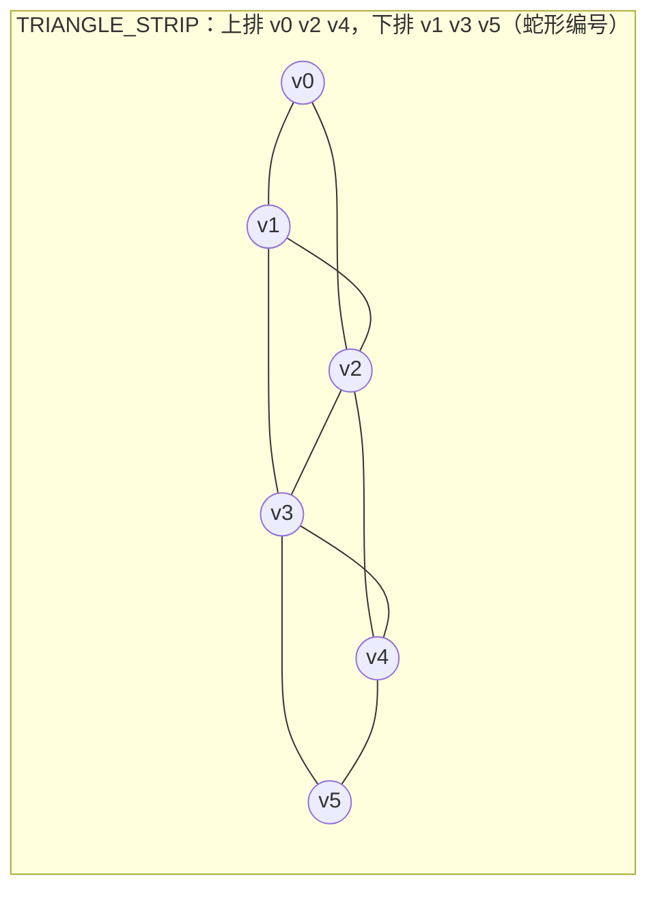
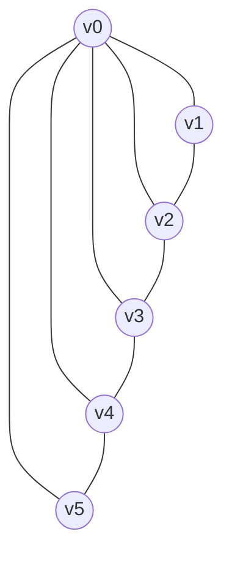

# 几何与索引绘制

> [返回：WebGL 与 3D 框架学习大纲](../WebGL与3D框架学习大纲.md)
> 本文展开大纲第二阶段第 1 条「几何与索引绘制」：索引缓冲与 drawElements、立方体的顶点账、七种图元类型；阶段导览见 [01-导览](01-导览.md)。

第一阶段的立方体是用 `drawArrays` 画的：六个面拆成三十六个顶点逐个喂给 GPU。这样能跑，但浪费——立方体明明只有 8 个角点。本节解决两件事：**怎么用索引让共享顶点只存一份**，以及**除了 TRIANGLES 还有哪些图元组织方式、各自适合什么形状**。

## 1.1 索引缓冲（IBO）与 drawElements

### 概念：三个缓冲各司其职

- 顶点缓冲对象（Vertex Buffer Object，VBO）：装顶点属性（位置、法线、UV……），绑到 `gl.ARRAY_BUFFER`，由 `vertexAttribPointer` 按 stride/offset 切片解读；
- 索引缓冲对象（Index Buffer Object，IBO）：装"第几个顶点"的编号数组，绑到 `gl.ELEMENT_ARRAY_BUFFER`；
- 绘制命令 `drawElements(mode, count, type, offset)`：GPU 按 mode 从 IBO 里取编号，再去 VBO 里取对应顶点，装配图元。

一句话：**VBO 是"数据表"，IBO 是"下标数组"，drawElements 是"按下标查表拼三角形"**。

### 原理推导：立方体的顶点账

立方体 6 个面 × 2 个三角形 × 3 个顶点 = 36 个顶点（`drawArrays` 写法）。但它只有 8 个角点——28 个顶点是纯重复。用索引化：

**情形 A：只算位置（3 个 float）**

| 方案 | 计算 | 字节 |
|---|---|---|
| drawArrays | 36 顶点 × 3 float × 4 B | 432 B |
| 索引（8 顶点） | 8 × 12 B + 36 × 2 B（Uint16 索引） | 96 + 72 = **168 B（约 39%）** |

**情形 B：位置 + 法线 + UV（8 个 float/顶点，光照立方体的真实配置）**

| 方案 | 计算 | 字节 |
|---|---|---|
| drawArrays | 36 × 8 float × 4 B | 1152 B |
| 索引（24 顶点，每面 4 个） | 24 × 32 B + 72 B | 768 + 72 = **840 B（约 73%）** |
| 假设法线可共享（8 顶点） | 8 × 32 B + 72 B | 256 + 72 = **328 B（约 28%）** |

两个关键观察：

1. **为什么是 24 不是 8**：立方体每个角点在三个相邻面上法线不同（朝 +x 的面和朝 +y 的面在同一角点处法线分别是 (1,0,0) 和 (0,1,0)），UV 也不同。顶点 = 位置 + 全部属性的组合，属性不共享，顶点就只能拆开。所以"索引消除所有重复"是误解——**索引的收益取决于属性共享率**。
2. **顶点着色器执行次数也在省**。GPU 有一块变换后顶点缓存（post-transform cache，通常几十个顶点容量），索引命中缓存时顶点着色器直接复用结果。36 个顶点缩成 24 个，最坏情况 VS 也少跑 1/3；对真正大规模共享的网格收益更明显——见下面的球体账。

**球体才是索引化的主场**。48×24 分段的经纬球：

| 方案 | 顶点数 | 顶点数据 | 索引 | 合计 |
|---|---|---|---|---|
| drawArrays | 48×24×6 = 6912 | 6912 × 32 B = 216 KB | 无 | **216 KB** |
| drawElements | 49×25 = 1225 | 1225 × 32 B ≈ 39.2 KB | 6912 × 2 B ≈ 13.8 KB | **约 52 KB（24%）** |

球面上每个网格点的位置和法线就是同一个方向（归一化即位置），UV 在共享点上完全一致，共享率接近 100%：显存省到四分之一，VS 执行次数从 6912 次降到 1225 次（约 5.6 倍，缓存命中的前提下）。实践任务①的地球就用这个生成器（见 [08-实践-纹理地球](08-实践-纹理地球.md)）。

### 完整代码：索引立方体

WebGL1 + GLSL ES 1.00，配合导览页的 `index.html` 直接可跑。24 顶点（每面 4 个，绕序从外部看逆时针，CCW）、36 个索引：

```javascript
// main.js —— 索引立方体（WebGL1）
const canvas = document.querySelector('#gl');
const gl = canvas.getContext('webgl');

const vsSource = `
attribute vec3 aPosition;
attribute vec3 aNormal;
attribute vec2 aUV;
uniform mat4 uMVP;
varying vec3 vNormal;
varying vec2 vUV;
void main() {
  vNormal = aNormal;
  vUV = aUV;
  gl_Position = uMVP * vec4(aPosition, 1.0);
}`;

const fsSource = `
precision mediump float;
varying vec3 vNormal;
varying vec2 vUV;
void main() {
  // 调试着色：法线定明暗 + UV 棋盘格，六个面一眼可辨
  float lambert = 0.5 + 0.5 * dot(normalize(vNormal), normalize(vec3(0.6, 0.8, 0.75)));
  float checker = mod(floor(vUV.x * 8.0) + floor(vUV.y * 8.0), 2.0) * 0.25 + 0.5;
  gl_FragColor = vec4(vec3(0.35, 0.65, 0.90) * lambert * checker, 1.0);
}`;

function createProgram(gl, vsSource, fsSource) {
  const compile = (type, source) => {
    const shader = gl.createShader(type);
    gl.shaderSource(shader, source);
    gl.compileShader(shader);
    if (!gl.getShaderParameter(shader, gl.COMPILE_STATUS)) {
      throw new Error(gl.getShaderInfoLog(shader));
    }
    return shader;
  };
  const program = gl.createProgram();
  gl.attachShader(program, compile(gl.VERTEX_SHADER, vsSource));
  gl.attachShader(program, compile(gl.FRAGMENT_SHADER, fsSource));
  gl.linkProgram(program);
  if (!gl.getProgramParameter(program, gl.LINK_STATUS)) {
    throw new Error(gl.getProgramInfoLog(program));
  }
  return program;
}

// —— 几何数据：24 顶点 = 6 面 × 4 角，每角（位置 3 + 法线 3 + UV 2）共 8 个 float ——
const CUBE_FACE = (normal, corners) => corners.flatMap(c => [...c, ...normal]);
// 每面 4 角按"从外部看逆时针"排列：左下、右下、右上、左上
const faceData = [
  CUBE_FACE([ 1, 0, 0], [[ 1,-1, 1], [ 1,-1,-1], [ 1, 1,-1], [ 1, 1, 1]]), // +x
  CUBE_FACE([-1, 0, 0], [[-1,-1,-1], [-1,-1, 1], [-1, 1, 1], [-1, 1,-1]]), // -x
  CUBE_FACE([ 0, 1, 0], [[-1, 1, 1], [ 1, 1, 1], [ 1, 1,-1], [-1, 1,-1]]), // +y
  CUBE_FACE([ 0,-1, 0], [[-1,-1,-1], [ 1,-1,-1], [ 1,-1, 1], [-1,-1, 1]]), // -y
  CUBE_FACE([ 0, 0, 1], [[-1,-1, 1], [ 1,-1, 1], [ 1, 1, 1], [-1, 1, 1]]), // +z
  CUBE_FACE([ 0, 0,-1], [[ 1,-1,-1], [-1,-1,-1], [-1, 1,-1], [ 1, 1,-1]]), // -z
];
const vertices = [];
const uvs = [[0,0],[1,0],[1,1],[0,1]];
faceData.forEach((face, f) => face.forEach((_, i) => {
  vertices.push(face[i * 8 + 0], face[i * 8 + 1], face[i * 8 + 2],        // 位置
                 face[i * 8 + 3], face[i * 8 + 4], face[i * 8 + 5],       // 法线
                 uvs[i][0], uvs[i][1]);                                    // UV
}));
// 索引：每面两个三角形 (0,1,2) (0,2,3)，基址 = 面号 × 4
const indexArray = [];
for (let f = 0; f < 6; f++) {
  const b = f * 4;
  indexArray.push(b, b + 1, b + 2, b, b + 2, b + 3);
}
const indices = new Uint16Array(indexArray); // 索引类型必须是 Uint16/Uint32，与 draw 的 type 参数成对

// —— 上传：VBO 装顶点，IBO 装索引 ——
const vbo = gl.createBuffer();
gl.bindBuffer(gl.ARRAY_BUFFER, vbo);
gl.bufferData(gl.ARRAY_BUFFER, new Float32Array(vertices), gl.STATIC_DRAW);

const ibo = gl.createBuffer();
gl.bindBuffer(gl.ELEMENT_ARRAY_BUFFER, ibo);   // 注意绑定目标不同
gl.bufferData(gl.ELEMENT_ARRAY_BUFFER, indices, gl.STATIC_DRAW);

const program = createProgram(gl, vsSource, fsSource);
gl.useProgram(program);
const stride = 8 * 4; // 8 float × 4 B
const locPosition = gl.getAttribLocation(program, 'aPosition');
const locNormal = gl.getAttribLocation(program, 'aNormal');
const locUV = gl.getAttribLocation(program, 'aUV');
gl.enableVertexAttribArray(locPosition);
gl.vertexAttribPointer(locPosition, 3, gl.FLOAT, false, stride, 0);
gl.enableVertexAttribArray(locNormal);
gl.vertexAttribPointer(locNormal, 3, gl.FLOAT, false, stride, 3 * 4);
gl.enableVertexAttribArray(locUV);
gl.vertexAttribPointer(locUV, 2, gl.FLOAT, false, stride, 6 * 4);

// —— 第一阶段手写的矩阵函数（列主序）——
const m4 = {
  multiply(a, b) {
    const out = new Float32Array(16);
    for (let c = 0; c < 4; c++) for (let r = 0; r < 4; r++) {
      out[c * 4 + r] = a[r] * b[c * 4] + a[4 + r] * b[c * 4 + 1]
                     + a[8 + r] * b[c * 4 + 2] + a[12 + r] * b[c * 4 + 3];
    }
    return out;
  },
  perspective(fovy, aspect, near, far) {
    const f = 1 / Math.tan(fovy / 2);
    const nf = 1 / (near - far);
    return new Float32Array([
      f / aspect, 0, 0, 0,  0, f, 0, 0,
      0, 0, (far + near) * nf, -1,  0, 0, 2 * far * near * nf, 0,
    ]);
  },
  lookAt(eye, target, up) {
    let zx = eye[0] - target[0], zy = eye[1] - target[1], zz = eye[2] - target[2];
    const zl = Math.hypot(zx, zy, zz); zx /= zl; zy /= zl; zz /= zl;
    let x = [up[1] * zz - up[2] * zy, up[2] * zx - up[0] * zz, up[0] * zy - up[1] * zx];
    const xl = Math.hypot(...x); x = x.map(v => v / xl);
    const y = [zy * x[2] - zz * x[1], zz * x[0] - zx * x[2], zx * x[1] - zy * x[0]];
    return new Float32Array([
      x[0], y[0], zx, 0,  x[1], y[1], zy, 0,  x[2], y[2], zz, 0,
      -(x[0] * eye[0] + x[1] * eye[1] + x[2] * eye[2]),
      -(y[0] * eye[0] + y[1] * eye[1] + y[2] * eye[2]),
      -(zx * eye[0] + zy * eye[1] + zz * eye[2]), 1,
    ]);
  },
  rotationY(a) {
    const c = Math.cos(a), s = Math.sin(a);
    return new Float32Array([c, 0, -s, 0, 0, 1, 0, 0, s, 0, c, 0, 0, 0, 0, 1]);
  },
};

const locMVP = gl.getUniformLocation(program, 'uMVP');
gl.enable(gl.DEPTH_TEST);
gl.clearColor(0.08, 0.09, 0.12, 1);

function frame(time) {
  const dpr = window.devicePixelRatio || 1;
  const w = Math.floor(canvas.clientWidth * dpr), h = Math.floor(canvas.clientHeight * dpr);
  if (canvas.width !== w || canvas.height !== h) { canvas.width = w; canvas.height = h; }
  gl.viewport(0, 0, canvas.width, canvas.height);
  gl.clear(gl.COLOR_BUFFER_BIT | gl.DEPTH_BUFFER_BIT);

  const view = m4.lookAt([3.2, 2.2, 4.2], [0, 0, 0], [0, 1, 0]);
  const proj = m4.perspective(Math.PI / 4, canvas.width / canvas.height, 0.1, 100);
  const mvp = m4.multiply(m4.multiply(proj, view), m4.rotationY(time * 0.0006));
  gl.uniformMatrix4fv(locMVP, false, mvp);

  // 索引绘制：36 个索引、UNSIGNED_SHORT 类型、字节偏移 0
  gl.drawElements(gl.TRIANGLES, 36, gl.UNSIGNED_SHORT, 0);
  requestAnimationFrame(frame);
}
requestAnimationFrame(frame);
```

上传 IBO 时注意**索引数组类型必须与 draw 时的 type 参数严格对应**：`Uint16Array` 配 `gl.UNSIGNED_SHORT`，`Uint32Array` 配 `gl.UNSIGNED_INT`。索引类型选择：

- `gl.UNSIGNED_SHORT`（Uint16Array）：上限 65535 个顶点，WebGL1/2 通用；
- `gl.UNSIGNED_INT`（Uint32Array）：WebGL2 原生支持；WebGL1 需先启用扩展 `OES_element_index_uint`；
- `gl.UNSIGNED_BYTE`（Uint8Array）：上限 255，很少用（stride 对齐别扭）。

## 1.2 图元类型：TRIANGLES / STRIP / FAN / LINES / POINTS

### 概念：七种 mode 一张表

`drawArrays` / `drawElements` 的第一个参数决定顶点怎么拼成图元：

| mode | n 个顶点产出 | 典型场景 |
|---|---|---|
| `TRIANGLES` | n / 3 个独立三角形 | 通用，索引网格的标准形态 |
| `TRIANGLE_STRIP` | n − 2 个三角形 | 条带状网格（地形切片、缎带轨迹） |
| `TRIANGLE_FAN` | n − 2 个三角形 | 扇形（圆盘、锥侧面、光晕） |
| `LINES` | n / 2 条独立线段 | 调试图元、坐标系 |
| `LINE_STRIP` | n − 1 条折线 | 折线图表、路径 |
| `LINE_LOOP` | n 条闭合折线 | 包围框、选择圈 |
| `POINTS` | n 个点 | 点云（注意：点大小由顶点着色器 `gl_PointSize` 设置，且最大值依实现而定，查询 `ALIASED_POINT_SIZE_RANGE`） |

### 原理：STRIP 与 FAN 的顶点复用

**TRIANGLE_STRIP（三角带）**：前 3 个顶点成第一个三角形，之后每来 1 个顶点与最近 2 个顶点组成新三角形。n 个顶点画 n − 2 个三角形，而 TRIANGLES 要 3(n − 2) 个——**每个新三角形只花 1 个顶点的账**。



读法：顶点按"下-上-下-上"蛇形编号（v0、v1、v2……），依次产出三角形 (v0,v1,v2)、(v2,v1,v3)、(v2,v3,v4)、(v4,v3,v5)。注意第 2 个三角形顶点顺序是 (v2,v1,v3) 不是 (v1,v2,v3)——**定义保证相邻三角形朝向一致**，光栅化与背面剔除内部已按此处理，不需要你手动翻转绕序。

**TRIANGLE_FAN（三角扇）**：第一个顶点是公共中心，之后每 2 个相邻顶点与中心组成三角形。适合"一圈顶点绕一个中心"的形状：



读法：中心 v0，依次产出 (v0,v1,v2)、(v0,v2,v3)、(v0,v3,v4)、(v0,v4,v5)。

**现代实践的现状**：STRIP/FAN 是"索引贵"年代的省顶点手段。索引化 + TRIANGLES + 后变换缓存能达到几乎同样的复用率，还不用为拼接多条 strip 硬造退化三角形（把上一条 strip 的末顶点和下一条 strip 的首顶点重复一次，各补 2 个退化顶点缝合）。如今只在顶点真按条带顺序生成的场合（如轨迹缎带）直接用 STRIP。FAN 则适合圆盘、锥面这类天然扇形。

### 代码对比：同一个四边形的三种画法

```javascript
// TRIANGLES：6 个顶点（或 6 个索引），两块数据有 2 个顶点重复
gl.drawArrays(gl.TRIANGLES, 0, 6);      // v0 v1 v2  v0 v2 v3

// TRIANGLE_STRIP：4 个顶点，n − 2 = 2 个三角形
gl.drawArrays(gl.TRIANGLE_STRIP, 0, 4); // (v0,v1,v2) (v2,v1,v3)

// TRIANGLE_FAN：4 个顶点，中心放 v0
gl.drawArrays(gl.TRIANGLE_FAN, 0, 4);   // (v0,v1,v2) (v0,v2,v3)
```

线段调试示例（画一个世界坐标系三轴）：

```javascript
// LINES：每 2 个顶点一条线；顶点着色器里不需要 gl_PointSize
const axisVertices = new Float32Array([
  0, 0, 0,  1, 0, 0,   // X 轴
  0, 0, 0,  0, 1, 0,   // Y 轴
  0, 0, 0,  0, 0, 1,   // Z 轴
]);
gl.drawArrays(gl.LINES, 0, 6);
```

注意 WebGL 的线宽：`gl.lineWidth(n)` 大于 1 的请求在绝大多数实现里被忽略（线宽固定 1 物理像素），要粗线只能用两个三角形拼四边形。

## 常见坑

1. **IBO 绑定是全局状态（WebGL1）**：`bindBuffer(ELEMENT_ARRAY_BUFFER, null)` 之后 `drawElements` 会静默用上一个绑定的 IBO 或者直接报错。WebGL1 里 IBO 绑定不属于任何 VAO；WebGL2 里 IBO 绑定被记进当前 VAO（见 6.1），忘绑 IBO 就切 VAO 是常见事故。
2. **索引数组类型与 type 参数不匹配**：JS 端 `Uint32Array`、draw 时传 `gl.UNSIGNED_SHORT`——高位被截断，画出来的是一堆错乱三角形。必须成对修改。
3. **WebGL1 用 UNSIGNED_INT 不开扩展**：`gl.getExtension('OES_element_index_uint')` 返回 null 的设备上只能退回 Uint16 拆批，或直接用 WebGL2。
4. **索引越界不抛异常**：WebGL 规范规定越界索引产生 `INVALID_OPERATION`、本次绘制不产出图元，但页面不会崩；不上 `gl.getError()` 或看渲染结果很难发现。生成索引后用 `Math.max(...indices) < 顶点数` 自查一次。
5. **offset 不是索引类型大小的整数倍**：`drawElements(gl.TRIANGLES, 3, gl.UNSIGNED_SHORT, 1)` 直接 `INVALID_OPERATION`。offset 是**字节**偏移，Uint16 要对齐 2 B、Uint32 对齐 4 B。这个参数的真正用途是"同一 IBO 里分段画多个 mesh"。
6. **STRIP 拼接忘了退化三角形**：两条 strip 直接首尾相接，接缝处会多出一个横跨两个条带的意外三角形；需要补 2 个重复顶点（退化三角形不产生片元）。
7. **拿 POINTS 当大粒子**：`gl_PointSize` 是屏幕空间尺寸，不随透视缩小，且很多移动实现上限是 1~8 像素。透视正确的粒子要贴四边形（第五阶段的粒子系统走 instancing，见 6.2）。

## 【本节自测】

1. 一个圆柱（侧面 24 分段 + 上下圆面，位置/法线/UV 顶点共 8 float），分别估算 drawArrays 与 drawElements 两种方案的显存占用，索引化比值大约是多少？哪部分的顶点共享率最低？
2. 立方体索引化后为什么是 24 个顶点而不是 8 个？什么条件下才能只用 8 个，代价是什么？
3. 100 个顶点用 `TRIANGLE_STRIP` 最多产出多少个三角形？如果改用 TRIANGLES + 索引要多少个索引？两方案在顶点着色器执行次数上的差异由什么硬件机制决定？
4. `drawElements(gl.TRIANGLES, 6, gl.UNSIGNED_SHORT, 6)` 中最后一个参数 6 的含义是什么？为什么是合法的？
5. 你的网格画出来"部分三角形错乱如乱码"，列出排查顺序（提示：索引类型配对、索引越界、stride/offset、绕序）。

下一篇：[03-纹理](03-纹理.md)——把棋盘格换成真正的图片。
