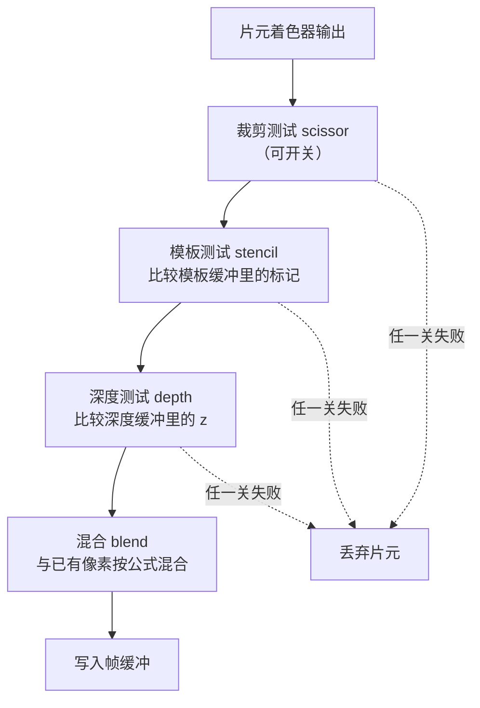

# 渲染状态与测试

> [返回：WebGL 与 3D 框架学习大纲](../WebGL与3D框架学习大纲.md)
> 本文展开大纲第二阶段第 3 条「渲染状态与测试」：深度测试与 z-fighting、混合与透明排序、模板测试、cull face 与绕序；阶段导览见 [01-导览](01-导览.md)。

片元着色器跑完并不意味着像素就写进帧缓冲——它还要闯过一串"关卡"，每道关卡都是可开关、可配置的全局状态。这些状态合称渲染状态（render state），理解它们的执行顺序，是解释"为什么我的透明物体时隐时现"这类问题的钥匙。



## 3.1 深度测试与 z-fighting

### 概念

深度缓冲（depth buffer，也叫 z-buffer）为每个像素存一个"当前最近表面的距离"。深度测试（depth test）让新片元与缓存值比较（默认 `LESS`），只有更近才通过——于是**不透明物体无论以什么顺序绘制，遮挡关系都正确**。三件套：

```javascript
gl.enable(gl.DEPTH_TEST);          // 开关
gl.depthFunc(gl.LEQUAL);           // 比较函数：LESS（默认）/ LEQUAL / GREATER ...
gl.depthMask(true);                // 是否允许写深度（透明物体第二遍要关，见 3.2）
gl.clearDepth(1);                  // 清除值：1 = 最远
gl.clear(gl.DEPTH_BUFFER_BIT);     // 每帧清
```

### 原理推导：深度值怎么分布，为什么 z-fighting 偏爱远处

第一阶段推导透视投影时得到：NDC 的 z 经过视口变换映射到 [0,1]（WebGL 约定，与桌面 GL 的 [-1,1] 不同，`depthRange` 默认 0..1）。把视点距离 d 代入化简：

```
depth(d) = f / (f - n) · (1 - n / d)      n：近平面，f：远平面
```

验证：d = n 时 depth = 0（最近），d = f 时 depth = 1（最远）。关键在它**不是 d 的线性函数**——对 d 求导会发现深度值随距离的增长被 1/d 压缩：近处一小段距离占掉大段深度区间，远处一大段距离挤在 depth≈1 附近的窄缝里。

对上式差分并考虑深度缓冲按 24 位量化（步长 q = 2⁻²⁴），可分辨的最小距离差：

```
δ(d) ≈ q · (f - n) / (f · n) · d²
```

代入数字（n = 0.1，f = 100，24 位深度）：

| 距离 d | δ(d) 可分辨间距 |
|---|---|
| 1 m | 约 0.6 µm |
| 10 m | 约 0.06 mm |
| 50 m | **约 1.5 mm** |
| 90 m | 约 4.8 mm |

当两个表面在相机距离 d 上的间距小于 δ(d) 时，它们的 depth 量化后落到同一个整数上，深度比较就变成"谁后画谁赢"——相机一动，胜负随机翻转，画面上表现为**条纹状闪烁**，这就是 z-fighting（深度冲突）。

把近平面从 0.1 推到 1.0（f 不变）：`δ(50) ≈ 0.15 mm`，**同一距离精度提高约 10 倍**——(f−n)/(f·n) 从 9.99 降到 0.99。这就是"近平面能推多远就推多远"的数学依据。

### z-fighting 的复现与缓解

复现：地面 y = 0 上贴一块 y = 0.0001 的贴片（模拟贴地阴影/标记），相机绕圈看——交叠区域闪烁。

缓解手段（按优先级）：

1. **拉开几何**：没有真正的共面，就没有冲突。建模阶段就该消除"零间距叠面"；
2. **推近平面**：如上，零代码成本，精度按 d² 与 (f−n)/(fn) 双重改善；
3. **polygonOffset**：让某个物体的深度整体加/减一个 bias，专治"贴花、等高线、阴影贴片"这类必须共面的场合：

```javascript
gl.enable(gl.POLYGON_OFFSET_FILL);
gl.polygonOffset(1, 1);   // (factor, units)：factor 按斜率缩放，units 按最小可分辨深度单位平移
// 画贴花……
gl.disable(gl.POLYGON_OFFSET_FILL);
```

4. 深度比较改 `LEQUAL` 配合小 offset，给同面叠加的第二遍留余地。

### 完整代码：z-fighting 与透明排序同场演示

一个场景三组物体：灰色地面 + 红色贴片（演示 z-fighting，按 1 切换间距、按 2 切换 polygonOffset）；四块绕圈旋转的绿色半透明板（演示透明排序，按 3 切换排序）。

```javascript
// main.js —— 深度冲突 + 透明排序（WebGL1）
const canvas = document.querySelector('#gl');
const gl = canvas.getContext('webgl', { antialias: true });

const vsSource = `
attribute vec3 aPosition;
uniform mat4 uMVP;
void main() { gl_Position = uMVP * vec4(aPosition, 1.0); }`;

const fsSource = `
precision mediump float;
uniform vec4 uColor;
void main() { gl_FragColor = uColor; }`;

function createProgram(gl, vs, fs) {
  const compile = (type, src) => {
    const s = gl.createShader(type);
    gl.shaderSource(s, src); gl.compileShader(s);
    if (!gl.getShaderParameter(s, gl.COMPILE_STATUS)) throw new Error(gl.getShaderInfoLog(s));
    return s;
  };
  const p = gl.createProgram();
  gl.attachShader(p, compile(gl.VERTEX_SHADER, vs));
  gl.attachShader(p, compile(gl.FRAGMENT_SHADER, fs));
  gl.linkProgram(p);
  if (!gl.getProgramParameter(p, gl.LINK_STATUS)) throw new Error(gl.getProgramInfoLog(p));
  return p;
}

// —— m4：沿用第一阶段手写（列主序），完整版见 02-几何与索引绘制.md ——
const m4 = {
  multiply(a, b) {
    const out = new Float32Array(16);
    for (let c = 0; c < 4; c++) for (let r = 0; r < 4; r++) {
      out[c * 4 + r] = a[r] * b[c * 4] + a[4 + r] * b[c * 4 + 1]
                     + a[8 + r] * b[c * 4 + 2] + a[12 + r] * b[c * 4 + 3];
    }
    return out;
  },
  perspective(fovy, aspect, near, far) {
    const f = 1 / Math.tan(fovy / 2), nf = 1 / (near - far);
    return new Float32Array([f / aspect, 0, 0, 0, 0, f, 0, 0,
      0, 0, (far + near) * nf, -1, 0, 0, 2 * far * near * nf, 0]);
  },
  lookAt(eye, target, up) {
    let zx = eye[0] - target[0], zy = eye[1] - target[1], zz = eye[2] - target[2];
    const zl = Math.hypot(zx, zy, zz); zx /= zl; zy /= zl; zz /= zl;
    let x = [up[1] * zz - up[2] * zy, up[2] * zx - up[0] * zz, up[0] * zy - up[1] * zx];
    const xl = Math.hypot(...x); x = x.map(v => v / xl);
    const y = [zy * x[2] - zz * x[1], zz * x[0] - zx * x[2], zx * x[1] - zy * x[0]];
    return new Float32Array([
      x[0], y[0], zx, 0, x[1], y[1], zy, 0, x[2], y[2], zz, 0,
      -(x[0] * eye[0] + x[1] * eye[1] + x[2] * eye[2]),
      -(y[0] * eye[0] + y[1] * eye[1] + y[2] * eye[2]),
      -(zx * eye[0] + zy * eye[1] + zz * eye[2]), 1]);
  },
  rotationY(a) {
    const c = Math.cos(a), s = Math.sin(a);
    return new Float32Array([c, 0, -s, 0, 0, 1, 0, 0, s, 0, c, 0, 0, 0, 0, 1]);
  },
  translate(x, y, z) {
    return new Float32Array([1, 0, 0, 0, 0, 1, 0, 0, 0, 0, 1, 0, x, y, z, 1]);
  },
};

const program = createProgram(gl, vsSource, fsSource);
gl.useProgram(program);
const locPos = gl.getAttribLocation(program, 'aPosition');
const locMVP = gl.getUniformLocation(program, 'uMVP');
const locColor = gl.getUniformLocation(program, 'uColor');

// 每个物体一个独立 VBO（quad = XY 平面单位四边形，两个三角形）
function makeQuadVBO(w, h) {
  const x = w / 2, y = h / 2;
  const data = new Float32Array([
    -x, -y, 0,  x, -y, 0,  x, y, 0,
    -x, -y, 0,  x,  y, 0, -x, y, 0,
  ]);
  const vbo = gl.createBuffer();
  gl.bindBuffer(gl.ARRAY_BUFFER, vbo);
  gl.bufferData(gl.ARRAY_BUFFER, data, gl.STATIC_DRAW);
  gl.enableVertexAttribArray(locPos);
  gl.vertexAttribPointer(locPos, 3, gl.FLOAT, false, 12, 0);
  return vbo;
}
const groundVBO = makeQuadVBO(6, 6);
const decalVBO = makeQuadVBO(2, 2);
const panelVBO = makeQuadVBO(0.8, 2.0);

// —— 状态开关（按键切换）——
let decalGap = 0.0001;   // 贴片与地面的间距：按 1 在 0 / 0.0001 之间切换
let useOffset = true;    // polygonOffset：按 2
let useSort = true;      // 透明排序：按 3
window.addEventListener('keydown', (e) => {
  if (e.key === '1') decalGap = decalGap > 0 ? 0 : 0.0001;
  if (e.key === '2') useOffset = !useOffset;
  if (e.key === '3') useSort = !useSort;
});

const view = m4.lookAt([2.6, 1.8, 3.4], [0, 0, 0], [0, 1, 0]);
gl.enable(gl.DEPTH_TEST);
gl.clearColor(0.08, 0.09, 0.12, 1);

function setMVP(model, proj) {
  gl.uniformMatrix4fv(locMVP, false, m4.multiply(proj, m4.multiply(view, model)));
}
function drawVBO(vbo) {
  gl.bindBuffer(gl.ARRAY_BUFFER, vbo);
  gl.vertexAttribPointer(locPos, 3, gl.FLOAT, false, 12, 0);
  gl.drawArrays(gl.TRIANGLES, 0, 6);
}

function frame(time) {
  const dpr = window.devicePixelRatio || 1;
  const w = Math.floor(canvas.clientWidth * dpr), h = Math.floor(canvas.clientHeight * dpr);
  if (canvas.width !== w || canvas.height !== h) { canvas.width = w; canvas.height = h; }
  gl.viewport(0, 0, canvas.width, canvas.height);
  gl.clear(gl.COLOR_BUFFER_BIT | gl.DEPTH_BUFFER_BIT);
  const proj = m4.perspective(Math.PI / 4, canvas.width / canvas.height, 0.5, 100);

  // —— 第一遍：不透明。地面（绕 X 轴 -90 度躺平）+ 贴片 ——
  const rotX90 = new Float32Array([1, 0, 0, 0, 0, 0, 1, 0, 0, -1, 0, 0, 0, 0, 0, 1]);
  gl.disable(gl.BLEND);
  gl.depthMask(true);

  setMVP(m4.multiply(m4.translate(0, -0.5, 0), rotX90), proj);
  gl.uniform4f(locColor, 0.45, 0.47, 0.52, 1);
  drawVBO(groundVBO);

  // 贴片：与地面共面 z-fighting；polygonOffset 把它的深度推远一点点
  if (useOffset) { gl.enable(gl.POLYGON_OFFSET_FILL); gl.polygonOffset(1, 1); }
  setMVP(m4.multiply(m4.translate(0, -0.5 + decalGap, 0), rotX90), proj);
  gl.uniform4f(locColor, 0.85, 0.2, 0.25, 1);
  drawVBO(decalVBO);
  gl.disable(gl.POLYGON_OFFSET_FILL);

  // —— 第二遍：半透明板。四块绕 Y 公转的立板，各自绕自身 Y 转一点 ——
  const panels = [0, 1, 2, 3].map(i => {
    const angle = time * 0.0005 + i * Math.PI / 2;
    return {
      model: m4.multiply(
        m4.translate(Math.cos(angle) * 1.4, 0, Math.sin(angle) * 1.4),
        m4.rotationY(-angle + Math.PI / 2)),
      center: [Math.cos(angle) * 1.4, 0, Math.sin(angle) * 1.4],
      alpha: 0.55,
    };
  });

  if (useSort) {
    // 排序键：视空间深度。view 矩阵把世界坐标变到视空间，z 越小越远
    panels.sort((a, b) => {
      const az = view[2] * a.center[0] + view[6] * a.center[1] + view[10] * a.center[2];
      const bz = view[2] * b.center[0] + view[6] * b.center[1] + view[10] * b.center[2];
      return az - bz;   // 视空间 z 更负（更远）的先画
    });
  }

  gl.enable(gl.BLEND);
  gl.blendFunc(gl.SRC_ALPHA, gl.ONE_MINUS_SRC_ALPHA);
  gl.depthMask(false);            // 透明物体不写深度（否则挡住更远的透明物体）
  for (const p of panels) {
    setMVP(p.model, proj);
    gl.uniform4f(locColor, 0.2, 0.85, 0.45, p.alpha);
    drawVBO(panelVBO);
  }
  gl.depthMask(true);
  requestAnimationFrame(frame);
}
requestAnimationFrame(frame);
```

观察要点：间距为 0 且关闭 offset 时贴片与地面交界处随相机闪烁；关闭排序后半透明板交叠区域颜色随转动跳变。

## 3.2 混合（blend）与透明物体排序

### 概念

混合（blending）让通过测试的片元与帧缓冲里已有像素按公式结合，而不是直接覆盖：

```javascript
gl.enable(gl.BLEND);
gl.blendFunc(gl.SRC_ALPHA, gl.ONE_MINUS_SRC_ALPHA); // 经典 over 运算
gl.blendEquation(gl.FUNC_ADD);                      // 默认，一般不动
```

### 原理：为什么透明必须排序、排序键怎么选

`C' = α·S + (1-α)·D` 不是对称运算——**结果依赖绘制顺序**。数值验证：半透明红板（α = 0.5）在蓝色不透明板之前：

- 先蓝后红（正确，远→近）：`C' = 0.5·(1,0,0) + 0.5·(0,0,1) = (0.5, 0, 0.5)`，红蓝各半；
- 先红后蓝（错误）：红先落在空背景 `(0,0,0,0)` 上得 `(0.5,0,0,0.5)`，蓝 α=1 直接整体覆盖，红**完全消失**。

所以透明绘制的标准流程：**不透明先画满（可任意序）→ 透明按从远到近画 → 透明遍关深度写入**（`depthMask(false)`，否则近处透明片把远处透明片整块深度拒之门外）。这就是第四阶段渲染队列"不透明队列 + 透明队列"的雏形。

排序键的选法：

1. **首选视空间深度**（view 矩阵第三行点积出的 z，即"沿视线方向的距离"）。它与深度测试同一度量，视锥边缘也正确；
2. **次选"到相机位置的世界距离"**（欧氏距离）：实现更直观，但在视野边缘，两物体欧氏距离的远近可能与沿视线的先后不一致，边缘处排序偶尔翻车；
3. 对象粒度用**包围盒中心**代表整体——两块互相穿插的透明板在对象粒度上无解（需要逐三角形排序或更高级的次序无关透明，OIT，超出本阶段）；
4. `Array.prototype.sort` 在 ES2019 起保证稳定，键相同的物体保持传入顺序，避免画面抖动。

## 3.3 模板测试

### 概念

模板缓冲（stencil buffer）给每个像素存一个小整数（通常 8 位），模板测试用它做"像素级遮罩"。需要显式请求：`getContext('webgl', { stencil: true })`。

```javascript
gl.enable(gl.STENCIL_TEST);
gl.stencilFunc(gl.EQUAL, 1, 0xFF);        // (比较函数, 参考值, 掩码)：ref & mask OP stencil & mask
gl.stencilOp(gl.KEEP, gl.KEEP, gl.KEEP);  // (模板失败, 深度失败, 深度通过) 时对模板值做什么
```

`stencilOp` 三个参数分别指定"模板测试失败 / 深度测试失败 / 两者都通过"时对模板缓冲执行的操作（`KEEP` / `REPLACE` / `INCR` / `DECR` / `ZERO` / `INVERT`）。

### 原理：模板是"先画一遍留记号，再画一遍查记号"

典型用法——镜面/窗口效果：第一遍把镜子区域画进模板缓冲（写 1），第二遍画反射场景但只在"模板 = 1"处通过，反射自动被限制在镜子内。平面阴影（第五阶段）同理用模板限制阴影不溢出接收面。核心流程：

```javascript
gl.clearStencil(0);
gl.clear(gl.STENCIL_BUFFER_BIT);

// 第一遍：往模板缓冲打标记（颜色可以不写）
gl.enable(gl.STENCIL_TEST);
gl.stencilFunc(gl.ALWAYS, 1, 0xFF);        // 永远通过
gl.stencilOp(gl.KEEP, gl.KEEP, gl.REPLACE); // 通过深度测试的像素 → 模板置 1
gl.colorMask(false, false, false, false);  // 只写模板不写颜色
drawMirrorQuad();
gl.colorMask(true, true, true, true);

// 第二遍：只在标记过的地方画反射场景
gl.stencilFunc(gl.EQUAL, 1, 0xFF);         // 模板 == 1 才通过
gl.stencilOp(gl.KEEP, gl.KEEP, gl.KEEP);   // 不再改模板
drawReflectedScene();
gl.disable(gl.STENCIL_TEST);
```

模板测试在深度测试**之前**执行（见本节开头的流程图）——所以"深度失败时改模板"（`stencilOp` 第二参数）可以用来做阴影体的正面/背面计数（shadow volume），这是它排在深度之前的真正意义。

## 3.4 正面/背面剔除（cull face）与绕序

### 概念

三角形从相机看有正反两面，由**绕序（winding order）**定义：顶点在屏幕上呈逆时针（Counter-Clockwise，CCW）为正面（默认约定，`gl.frontFace(gl.CCW)`）。背面剔除（back-face culling）把"背对相机的三角形"在光栅化前整块丢掉：

```javascript
gl.enable(gl.CULL_FACE);   // 默认关闭
gl.cullFace(gl.BACK);      // 剔背面（默认）；FRONT / FRONT_AND_BACK
```

### 原理：为什么值得开、什么时候会翻车

封闭网格（立方体、球）的背面永远被正面盖住，剔除它们**白赚接近一半的片元工作量**，还省深度测试带宽。但绕序是"几何数据 + 变换"共同决定的，两件事会翻车：

1. **镜像变换翻转绕序**。model 矩阵行列式为负（比如 x 缩放 -1 做镜像）时，所有三角形绕序从 CCW 变 CW，原来"剔背面"变成了"剔正面"——整个模型显示"内壁"。处理：检测 `det(model 的 3×3 部分) < 0` 时临时 `gl.frontFace(gl.CW)`，或干脆对该网格关剔除；
2. **开放几何（单面四边形、飘带）**没有"背面被盖住"的保证，剔除会让它从背后看直接消失。要么不剔，要么着色器里用 `gl_FrontFacing` 翻转法线双面光照（见 4.3）。

数值例子：镜像缩放 `S = diag(-1, 1, 1)` 作用在 CCW 三角形 (0,0,0) (1,0,0) (0,1,0) 上——顶点变 (0,0,0) (-1,0,0) (0,1,0)，叉积方向从 +z 翻成 -z，绕序反转，det(S) = -1 < 0，判定与现象一致。

## 常见坑

1. **忘开 DEPTH_TEST 或忘清深度缓冲**：表现为"后画的永远盖住先画的"（没开）或"上一帧的残影"（没清）。`DEPTH_TEST` 不在上下文创建参数里，必须显式 enable；
2. **透明物体开了深度写入**：近处一块 55% 透明的板把身后所有透明板全部拒掉。透明遍固定套路 `depthMask(false)`，画完恢复；
3. **stencil 没在 getContext 里请求**：模板缓冲压根不存在，stencilFunc 全部无效（WebGL 会忽略并报 INVALID_OPERATION）。默认上下文没有模板位；
4. **polygonOffset 用在透明遍**：offset 影响的是深度值，配 `LEQUAL` 才稳定；方向（推近/推远）取决于 factor/units 符号，试着把贴花往"远"推（正值）而不是盖到地面"前"；
5. **近平面设 0.0001 求安全感**：精度按 d² 崩坏（见 3.1 推导），0.1 已经很近了，能推到 0.5/1.0 更好；
6. **剔背面开着画地形/飘带**：俯视角一变，地面消失。开放几何要么关剔除要么双面画；
7. **blendFunc 只在画透明时设置**：不透明遍忘 `disable(BLEND)`，输出 alpha < 1 的不透明物体与页面合成时出现"透底"。

## 【本节自测】

1. 推导并回答：near = 0.1、far = 100、24 位深度时 50 米处可分辨的最小间距是多少？near 改为 1.0 后呢？为什么近平面的影响是"平方级"的？
2. 场景里有一面镜子（模板写 1）和镜子里的反射物体（只许画在模板 = 1 处），写出两遍绘制的 `stencilFunc` / `stencilOp` / `colorMask` 配置。
3. 三块半透明玻璃两两相交，对象粒度排序为什么必然有错？业界不精确但常用的替代方案和精确方案分别是什么方向（提示：逐三角形 / OIT）？
4. 一个带 `scale(-1, 1, 1)` 动画的模型开了 cull face 后变成"空壳"，原因是什么？给出两种修法。
5. 不透明物体需要从近到远排序吗？从远到近排序对不透明渲染有收益吗（提示：深度测试的提前剔除，z-buffer 的"前向剔除"特性）？

下一篇：[05-光照](05-光照.md)——给几何和纹理加上光。
