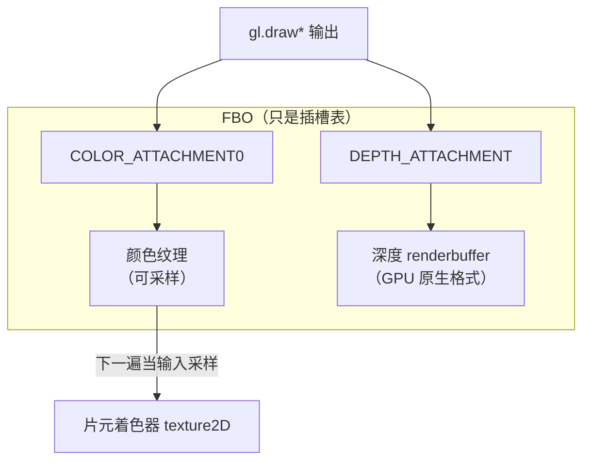

# 帧缓冲与离屏渲染

> [返回：WebGL 与 3D 框架学习大纲](../WebGL与3D框架学习大纲.md)
> 本文展开大纲第二阶段第 5 条「帧缓冲与离屏渲染」：FBO 与 renderbuffer 的关系、完整 createFBO、render to texture 双 pass 示例；阶段导览见 [01-导览](01-导览.md)。

到目前为止，所有绘制都落在 canvas 自带的默认帧缓冲（default framebuffer）上。帧缓冲对象（Frame Buffer Object，FBO）让你可以**先把场景画到一块自己的"离屏画布"上，再作为纹理参与后续绘制**——阴影、反射、后处理、拾取、泛光全都从这里长出来。

## 5.1 FBO 与 renderbuffer 的关系

### 概念：FBO 是"插槽表"，不是显存

最容易误解的一点：**FBO 本身不存像素**。它是一张附件（attachment）插槽表，指明"颜色写到哪、深度写到哪、模板写到哪"；真正的存储由两类对象提供：

| | 纹理（texture） | 渲染缓冲（renderbuffer） |
|---|---|---|
| 能否被着色器采样 | 能 | 不能 |
| 能否作为渲染目标 | 能 | 能 |
| 存储格式 | 图像格式（RGBA8……） | GPU 原生优化格式，可不可采样 |
| 典型用途 | 颜色附件（后续要采样） | 深度/模板附件（一般不采样） |
| MSAA 多重采样 | WebGL1 不支持作为 MSAA 目标 | 支持（`renderbufferStorageMultisample`） |



两个推论：

1. **颜色要"再利用"就挂纹理**——render to texture 的本质；深度/模板若不需要读回，挂 renderbuffer 让驱动选最优布局（tiling、压缩深度），WebGL1 里深度纹理还需要 `WEBGL_depth_texture` 扩展，renderbuffer 的 `DEPTH_COMPONENT16` 开箱即用；
2. **同一 FBO 的所有附件必须同尺寸**（WebGL2 的 MRT 也是），否则 `checkFramebufferStatus` 返回不完整。

### 帧缓冲完整性（framebuffer completeness）

把 FBO 当渲染目标前必须检查，六条高频失败原因：

1. 没挂任何颜色附件（除非 WebGL2 显式 `drawBuffers([NONE])` 或只做深度 pass，如阴影贴图）；
2. 附件尺寸不一致；
3. WebGL1 上：作为附件的纹理是 NPOT 且采样参数带了 mipmap / REPEAT；
4. 纹理附件挂在错误的 mipmap level（默认 0）；
5. 两个颜色插槽挂了同一纹理（镜像附件）；
6. 格式不合法（如 WebGL1 把 `DEPTH_COMPONENT` 纹理同时挂多个槽）。

状态检查标准写法：

```javascript
if (gl.checkFramebufferStatus(gl.FRAMEBUFFER) !== gl.FRAMEBUFFER_COMPLETE) {
  throw new Error('FBO 不完整：' + gl.checkFramebufferStatus(gl.FRAMEBUFFER).toString(16));
}
```

## 5.2 完整 createFBO 函数（TypeScript）

把"创建纹理 + 深度 renderbuffer + 组装 FBO + 完整性检查 + 尺寸重建 + 销毁"封装成可复用的工厂函数，实践②直接用它搭泛光链路：

```typescript
interface FBOOptions {
  width: number;
  height: number;
  depth?: boolean;      // 是否需要深度附件，默认 true
  stencil?: boolean;    // 是否需要模板附件，默认 false
  filter?: number;      // 纹理过滤，默认 LINEAR（后处理常用）
}

interface FBO {
  framebuffer: WebGLFramebuffer;
  texture: WebGLTexture;      // 颜色附件（render to texture 的输出）
  depthBuffer: WebGLRenderbuffer | null;
  width: number;
  height: number;
  /** 窗口尺寸变化时按新尺寸重建存储（FBO 对象本身复用） */
  resize(width: number, height: number): void;
  /** 绑定为渲染目标，并同步 viewport */
  bind(): void;
  dispose(): void;
}

function createFBO(gl: WebGLRenderingContext | WebGL2RenderingContext, options: FBOOptions): FBO {
  const { width, height, depth = true, stencil = false, filter } = options;

  const texture = gl.createTexture()!;
  gl.bindTexture(gl.TEXTURE_2D, texture);
  // 显存分配：RGBA8 颜色。null = 不初始化数据（比传 Uint8Array 快）
  gl.texImage2D(gl.TEXTURE_2D, 0, gl.RGBA, width, height, 0, gl.RGBA, gl.UNSIGNED_BYTE, null);
  gl.texParameteri(gl.TEXTURE_2D, gl.TEXTURE_WRAP_S, gl.CLAMP_TO_EDGE);
  gl.texParameteri(gl.TEXTURE_2D, gl.TEXTURE_WRAP_T, gl.CLAMP_TO_EDGE);
  gl.texParameteri(gl.TEXTURE_2D, gl.TEXTURE_MIN_FILTER, filter ?? gl.LINEAR);
  gl.texParameteri(gl.TEXTURE_2D, gl.TEXTURE_MAG_FILTER, filter ?? gl.LINEAR);

  let depthBuffer: WebGLRenderbuffer | null = null;
  if (depth) {
    depthBuffer = gl.createRenderbuffer()!;
    gl.bindRenderbuffer(gl.RENDERBUFFER, depthBuffer);
    // WebGL1 用 DEPTH_COMPONENT16；WebGL2 上下文里可用 DEPTH_COMPONENT24
    const internal = stencil ? gl.DEPTH_STENCIL
      : (gl instanceof WebGL2RenderingContext ? gl.DEPTH_COMPONENT24 : gl.DEPTH_COMPONENT16);
    gl.renderbufferStorage(gl.RENDERBUFFER, internal, width, height);
  }

  const framebuffer = gl.createFramebuffer()!;
  gl.bindFramebuffer(gl.FRAMEBUFFER, framebuffer);
  gl.framebufferTexture2D(gl.FRAMEBUFFER, gl.COLOR_ATTACHMENT0, gl.TEXTURE_2D, texture, 0);
  if (depthBuffer) {
    const attachment = stencil ? gl.DEPTH_STENCIL_ATTACHMENT : gl.DEPTH_ATTACHMENT;
    gl.framebufferRenderbuffer(gl.FRAMEBUFFER, attachment, gl.RENDERBUFFER, depthBuffer);
  }

  const status = gl.checkFramebufferStatus(gl.FRAMEBUFFER);
  if (status !== gl.FRAMEBUFFER_COMPLETE) {
    // 失败时把资源清掉再抛，避免泄漏
    gl.bindFramebuffer(gl.FRAMEBUFFER, null);
    gl.deleteTexture(texture);
    if (depthBuffer) gl.deleteRenderbuffer(depthBuffer);
    gl.deleteFramebuffer(framebuffer);
    throw new Error(`createFBO: framebuffer 不完整 (0x${status.toString(16)})`);
  }
  gl.bindFramebuffer(gl.FRAMEBUFFER, null);

  const allocate = (w: number, h: number) => {
    gl.bindTexture(gl.TEXTURE_2D, texture);
    gl.texImage2D(gl.TEXTURE_2D, 0, gl.RGBA, w, h, 0, gl.RGBA, gl.UNSIGNED_BYTE, null);
    if (depthBuffer) {
      gl.bindRenderbuffer(gl.RENDERBUFFER, depthBuffer);
      gl.renderbufferStorage(gl.RENDERBUFFER,
        stencil ? gl.DEPTH_STENCIL
          : (gl instanceof WebGL2RenderingContext ? gl.DEPTH_COMPONENT24 : gl.DEPTH_COMPONENT16),
        w, h);
    }
  };

  return {
    framebuffer, texture, depthBuffer, width, height,
    resize(w: number, h: number) {
      if (w === this.width && h === this.height) return;
      this.width = w; this.height = h;
      allocate(w, h);
    },
    bind() {
      gl.bindFramebuffer(gl.FRAMEBUFFER, this.framebuffer);
      gl.viewport(0, 0, this.width, this.height);
    },
    dispose() {
      gl.deleteFramebuffer(framebuffer);
      gl.deleteTexture(texture);
      if (depthBuffer) gl.deleteRenderbuffer(depthBuffer);
    },
  };
}
```

设计取舍说明：颜色附件用纹理（后处理要采样），深度用 renderbuffer（不需要读回）；`texImage2D` 传 `null` 只分配不初始化；`bind()` 顺手设 viewport——viewport 是全局状态、不属于 FBO，忘改是最高频的坑（见文末）。

## 5.3 render to texture：完整双 pass 示例

场景画进 FBO，再把 FBO 纹理贴到一个"画中画"四边形上：pass 1 渲染旋转立方体到纹理，pass 2 全屏绘制该纹理并做一次简单色调处理。这是后处理管线的最小骨架。

```javascript
// main.js —— render to texture 双 pass（WebGL1）
const canvas = document.querySelector('#gl');
const gl = canvas.getContext('webgl');

// —— pass 1：场景着色器（带基础光照的立方体，顶点数据同 05 分册）——
const sceneVS = `
attribute vec3 aPosition;
attribute vec3 aNormal;
uniform mat4 uModel;
uniform mat4 uView;
uniform mat4 uProjection;
uniform mat3 uNormalMatrix;
varying vec3 vNormal;
void main() {
  vNormal = uNormalMatrix * aNormal;
  gl_Position = uProjection * uView * uModel * vec4(aPosition, 1.0);
}`;
const sceneFS = `
precision mediump float;
varying vec3 vNormal;
uniform vec3 uLightDir;
void main() {
  float lambert = max(dot(normalize(vNormal), normalize(uLightDir)), 0.0);
  gl_FragColor = vec4(vec3(0.2, 0.55, 0.9) * (0.25 + 0.75 * lambert), 1.0);
}`;

// —— pass 2：全屏四边形，采样 FBO 纹理 + 色调处理 ——
const blitVS = `
attribute vec2 aPosition;
varying vec2 vUV;
void main() {
  vUV = aPosition * 0.5 + 0.5;      // NDC [-1,1] → UV [0,1]
  gl_Position = vec4(aPosition, 0.0, 1.0);
}`;
const blitFS = `
precision mediump float;
varying vec2 vUV;
uniform sampler2D uScene;
uniform float uTime;
void main() {
  vec2 uv = vUV;
  // 轻微桶形畸变：让"先画进纹理再采样"这件事肉眼可见
  vec2 centered = uv - 0.5;
  uv = 0.5 + centered * (1.0 + 0.15 * dot(centered, centered));
  vec3 color = texture2D(uScene, clamp(uv, 0.0, 1.0)).rgb;
  color *= 0.9 + 0.1 * sin(uTime * 0.002);   // 呼吸明暗，证明纹理每帧更新
  gl_FragColor = vec4(color, 1.0);
}`;

function createProgram(gl, vs, fs) {
  const compile = (type, src) => {
    const s = gl.createShader(type);
    gl.shaderSource(s, src); gl.compileShader(s);
    if (!gl.getShaderParameter(s, gl.COMPILE_STATUS)) throw new Error(gl.getShaderInfoLog(s));
    return s;
  };
  const p = gl.createProgram();
  gl.attachShader(p, compile(gl.VERTEX_SHADER, vs));
  gl.attachShader(p, compile(gl.FRAGMENT_SHADER, fs));
  gl.linkProgram(p);
  if (!gl.getProgramParameter(p, gl.LINK_STATUS)) throw new Error(gl.getProgramInfoLog(p));
  return p;
}

const sceneProgram = createProgram(gl, sceneVS, sceneFS);
const blitProgram = createProgram(gl, blitVS, blitFS);

// —— FBO：512×512 固定尺寸（低于屏幕分辨率，故意让人看出像素感）——
function createFBO(gl, width, height) {
  const texture = gl.createTexture();
  gl.bindTexture(gl.TEXTURE_2D, texture);
  gl.texImage2D(gl.TEXTURE_2D, 0, gl.RGBA, width, height, 0, gl.RGBA, gl.UNSIGNED_BYTE, null);
  gl.texParameteri(gl.TEXTURE_2D, gl.TEXTURE_WRAP_S, gl.CLAMP_TO_EDGE);
  gl.texParameteri(gl.TEXTURE_2D, gl.TEXTURE_WRAP_T, gl.CLAMP_TO_EDGE);
  gl.texParameteri(gl.TEXTURE_2D, gl.TEXTURE_MIN_FILTER, gl.LINEAR);
  gl.texParameteri(gl.TEXTURE_2D, gl.TEXTURE_MAG_FILTER, gl.LINEAR);

  const depth = gl.createRenderbuffer();
  gl.bindRenderbuffer(gl.RENDERBUFFER, depth);
  gl.renderbufferStorage(gl.RENDERBUFFER, gl.DEPTH_COMPONENT16, width, height);

  const framebuffer = gl.createFramebuffer();
  gl.bindFramebuffer(gl.FRAMEBUFFER, framebuffer);
  gl.framebufferTexture2D(gl.FRAMEBUFFER, gl.COLOR_ATTACHMENT0, gl.TEXTURE_2D, texture, 0);
  gl.framebufferRenderbuffer(gl.FRAMEBUFFER, gl.DEPTH_ATTACHMENT, gl.RENDERBUFFER, depth);
  if (gl.checkFramebufferStatus(gl.FRAMEBUFFER) !== gl.FRAMEBUFFER_COMPLETE) {
    throw new Error('FBO 不完整');
  }
  gl.bindFramebuffer(gl.FRAMEBUFFER, null);
  return { framebuffer, texture, width, height };
}
const fbo = createFBO(gl, 512, 512);

// —— 立方体几何（同 05 分册的 24 顶点版本，这里紧凑重写）——
const faceNormal = [[1,0,0],[-1,0,0],[0,1,0],[0,-1,0],[0,0,1],[0,0,-1]];
const faceCorners = [
  [[1,-1,1],[1,-1,-1],[1,1,-1],[1,1,1]], [[-1,-1,-1],[-1,-1,1],[-1,1,1],[-1,1,-1]],
  [[-1,1,1],[1,1,1],[1,1,-1],[-1,1,-1]], [[-1,-1,-1],[1,-1,-1],[1,-1,1],[-1,-1,1]],
  [[-1,-1,1],[1,-1,1],[1,1,1],[-1,1,1]], [[1,-1,-1],[-1,-1,-1],[-1,1,-1],[1,1,-1]],
];
const cubeVerts = [];
for (let f = 0; f < 6; f++) for (let i = 0; i < 4; i++) {
  cubeVerts.push(...faceCorners[f][i], ...faceNormal[f]);
}
const cubeIdx = [];
for (let f = 0; f < 6; f++) { const b = f * 4; cubeIdx.push(b, b+1, b+2, b, b+2, b+3); }

const cubeVAOless = (() => {  // 场景 pass 的缓冲
  const vbo = gl.createBuffer(), ibo = gl.createBuffer();
  gl.bindBuffer(gl.ARRAY_BUFFER, vbo);
  gl.bufferData(gl.ARRAY_BUFFER, new Float32Array(cubeVerts), gl.STATIC_DRAW);
  gl.bindBuffer(gl.ELEMENT_ARRAY_BUFFER, ibo);
  gl.bufferData(gl.ELEMENT_ARRAY_BUFFER, new Uint16Array(cubeIdx), gl.STATIC_DRAW);
  return { vbo, ibo };
})();

const quadVBO = gl.createBuffer();  // 全屏 pass 的缓冲（两个三角形，NDC 坐标）
gl.bindBuffer(gl.ARRAY_BUFFER, quadVBO);
gl.bufferData(gl.ARRAY_BUFFER, new Float32Array([
  -1, -1, 1, -1, 1, 1, -1, -1, 1, 1, -1, 1,
]), gl.STATIC_DRAW);

// —— m4 与 normalFromMat4：第一阶段手写实现（列主序），同 05 分册 ——
const m4 = {
  multiply(a, b) {
    const out = new Float32Array(16);
    for (let c = 0; c < 4; c++) for (let r = 0; r < 4; r++) {
      out[c * 4 + r] = a[r] * b[c * 4] + a[4 + r] * b[c * 4 + 1]
                     + a[8 + r] * b[c * 4 + 2] + a[12 + r] * b[c * 4 + 3];
    }
    return out;
  },
  perspective(fovy, aspect, near, far) {
    const f = 1 / Math.tan(fovy / 2), nf = 1 / (near - far);
    return new Float32Array([f / aspect, 0, 0, 0, 0, f, 0, 0,
      0, 0, (far + near) * nf, -1, 0, 0, 2 * far * near * nf, 0]);
  },
  lookAt(eye, target, up) {
    let zx = eye[0] - target[0], zy = eye[1] - target[1], zz = eye[2] - target[2];
    const zl = Math.hypot(zx, zy, zz); zx /= zl; zy /= zl; zz /= zl;
    let x = [up[1] * zz - up[2] * zy, up[2] * zx - up[0] * zz, up[0] * zy - up[1] * zx];
    const xl = Math.hypot(...x); x = x.map(v => v / xl);
    const y = [zy * x[2] - zz * x[1], zz * x[0] - zx * x[2], zx * x[1] - zy * x[0]];
    return new Float32Array([
      x[0], y[0], zx, 0, x[1], y[1], zy, 0, x[2], y[2], zz, 0,
      -(x[0] * eye[0] + x[1] * eye[1] + x[2] * eye[2]),
      -(y[0] * eye[0] + y[1] * eye[1] + y[2] * eye[2]),
      -(zx * eye[0] + zy * eye[1] + zz * eye[2]), 1]);
  },
  rotationY(a) {
    const c = Math.cos(a), s = Math.sin(a);
    return new Float32Array([c, 0, -s, 0, 0, 1, 0, 0, s, 0, c, 0, 0, 0, 0, 1]);
  },
};
// 世界空间法线矩阵 = transpose(inverse(mat3(model)))，推导见 05 分册 4.1
function normalFromMat4(m) {
  const r00 = m[0], r10 = m[1], r20 = m[2];
  const r01 = m[4], r11 = m[5], r21 = m[6];
  const r02 = m[8], r12 = m[9], r22 = m[10];
  const c00 =  r11 * r22 - r12 * r21, c01 = -(r10 * r22 - r12 * r20), c02 =  r10 * r21 - r11 * r20;
  const c10 = -(r01 * r22 - r02 * r21), c11 =  r00 * r22 - r02 * r20, c12 = -(r00 * r21 - r01 * r20);
  const c20 =  r01 * r12 - r02 * r11, c21 = -(r00 * r12 - r02 * r10), c22 =  r00 * r11 - r01 * r10;
  const d = 1 / (r00 * c00 + r01 * c01 + r02 * c02);
  return new Float32Array([
    c00 * d, c10 * d, c20 * d,  c01 * d, c11 * d, c21 * d,  c02 * d, c12 * d, c22 * d,
  ]);
}

gl.enable(gl.DEPTH_TEST);
gl.clearColor(0.05, 0.06, 0.08, 1);

function frame(time) {
  const dpr = window.devicePixelRatio || 1;
  const w = Math.floor(canvas.clientWidth * dpr), h = Math.floor(canvas.clientHeight * dpr);
  if (canvas.width !== w || canvas.height !== h) { canvas.width = w; canvas.height = h; }

  // ===== pass 1：场景 → FBO 纹理 =====
  gl.bindFramebuffer(gl.FRAMEBUFFER, fbo.framebuffer);
  gl.viewport(0, 0, fbo.width, fbo.height);          // 切目标必切 viewport
  gl.clear(gl.COLOR_BUFFER_BIT | gl.DEPTH_BUFFER_BIT);

  gl.useProgram(sceneProgram);
  const t = time * 0.001;
  const view = m4.lookAt([3, 2, 4], [0, 0, 0], [0, 1, 0]);
  const proj = m4.perspective(Math.PI / 4, fbo.width / fbo.height, 0.1, 50);
  const model = m4.rotationY(t);
  gl.uniformMatrix4fv(gl.getUniformLocation(sceneProgram, 'uView'), false, view);
  gl.uniformMatrix4fv(gl.getUniformLocation(sceneProgram, 'uProjection'), false, proj);
  gl.uniformMatrix4fv(gl.getUniformLocation(sceneProgram, 'uModel'), false, model);
  gl.uniformMatrix3fv(gl.getUniformLocation(sceneProgram, 'uNormalMatrix'),
                      false, normalFromMat4(model));  // 05 分册 4.1 的实现
  gl.uniform3f(gl.getUniformLocation(sceneProgram, 'uLightDir'), 0.5, 0.9, 0.4);
  gl.bindBuffer(gl.ARRAY_BUFFER, cubeVAOless.vbo);
  const sp = gl.getAttribLocation(sceneProgram, 'aPosition');
  const sn = gl.getAttribLocation(sceneProgram, 'aNormal');
  gl.enableVertexAttribArray(sp);
  gl.vertexAttribPointer(sp, 3, gl.FLOAT, false, 24, 0);
  gl.enableVertexAttribArray(sn);
  gl.vertexAttribPointer(sn, 3, gl.FLOAT, false, 24, 12);
  gl.bindBuffer(gl.ELEMENT_ARRAY_BUFFER, cubeVAOless.ibo);
  gl.drawElements(gl.TRIANGLES, 36, gl.UNSIGNED_SHORT, 0);

  // ===== pass 2：FBO 纹理 → 屏幕 =====
  gl.bindFramebuffer(gl.FRAMEBUFFER, null);          // 回默认帧缓冲
  gl.viewport(0, 0, canvas.width, canvas.height);
  gl.clear(gl.COLOR_BUFFER_BIT);

  gl.useProgram(blitProgram);
  gl.activeTexture(gl.TEXTURE0);
  gl.bindTexture(gl.TEXTURE_2D, fbo.texture);        // 上一 pass 的输出现在是输入
  gl.uniform1i(gl.getUniformLocation(blitProgram, 'uScene'), 0);
  gl.uniform1f(gl.getUniformLocation(blitProgram, 'uTime'), time);
  gl.bindBuffer(gl.ARRAY_BUFFER, quadVBO);
  const bp = gl.getAttribLocation(blitProgram, 'aPosition');
  gl.enableVertexAttribArray(bp);
  gl.vertexAttribPointer(bp, 2, gl.FLOAT, false, 8, 0);
  gl.drawArrays(gl.TRIANGLES, 0, 6);                 // 全屏四边形不需要深度测试/矩阵

  requestAnimationFrame(frame);
}
requestAnimationFrame(frame);
```

### 从双 pass 到后处理管线

把 pass 2 的着色器换成"模糊/泛光/FXAA"，就是后处理管线。多个效果串联时用**两个 FBO 交替**（ping-pong）：效果 A 读 FBO1 写 FBO2，效果 B 读 FBO2 写 FBO1……实践②的泛光链路就是这个结构（读 512×512 的亮部图，两个模糊 FBO 横竖各来一遍）。后续阶段的用途清单：shadow map（深度挂纹理）、拾取（ID 写进颜色）、反射（场景再画一遍进纹理）、景深与泛光（颜色进纹理）。

WebGL2 补充一句：真 MSAA 要用 `renderbufferStorageMultisample` 建多重采样 renderbuffer，渲染完 `blitFramebuffer` 解析到纹理——采样格式不能直接当纹理用，这是 renderbuffer 存在感的另一面。

## 常见坑

1. **切了 FBO 忘切 viewport**：viewport 是上下文全局状态、不随 FBO 记录。512 的纹理用 1920 的 viewport 画，结果只画进左下角一块（或直接越界丢弃）。`bind()` 里带上 viewport 就是为了根治这个；
2. **反馈环（feedback loop）**：一张纹理同时是"当前 FBO 的颜色附件"和"当前着色器的采样输入"——WebGL 会检测并把采样值置为未定义（通常整块黑/花屏）。ping-pong 结构里读 A 写 B 就是为了避开它；pass 2 开始前先 `bindFramebuffer(FRAMEBUFFER, null)` 或换绑；
3. **WebGL1 的 NPOT 附件**：FBO 尺寸 800×600 + 默认 `MIN_FILTER = NEAREST_MIPMAP_LINEAR` → 纹理不完整 → FBO 不完整。附件纹理永远显式设 `CLAMP_TO_EDGE + LINEAR`（createFBO 已做）；
4. **深度附件忘建**：场景 pass 画进 FBO 没挂深度，立方体自遮挡乱成一团。默认帧缓冲自带深度，FBO 不会自动送——每样都要显式挂；
5. **`DEPTH_COMPONENT16` vs `DEPTH_COMPONENT24`**：WebGL1 只有 16；WebGL2 想要 24 位深度精度直接用 24（阴影贴图强烈建议）；
6. **每个 pass 都 `getError` 或不检查完整性**：FBO 不完整时 draw 静默失败（INVALID_FRAMEBUFFER_OPERATION 要主动查），画面表现为"pass 1 正常、pass 2 全黑"；
7. **FBO 尺寸死跟 canvas**：窗口 resize 后只重建了 canvas，FBO 仍是旧尺寸，画面拉伸模糊。resize 钩子里同步调 `fbo.resize()`（5.2 已封装）。

## 【本节自测】

1. FBO、纹理、renderbuffer 三者谁是存储、谁是插槽？为什么深度附件通常用 renderbuffer 而 pass 1 的输出必须挂纹理？
2. 附件纹理尺寸 512×512、canvas 是 1920×1080，pass 1 结束后直接画 pass 2，画面出了什么问题？写出需要显式切换的三个全局状态；
3. 什么是反馈环？ping-pong 双 FBO 为什么能避免它？
4. WebGL1 上把一张 640×480 视频帧直接做 FBO 颜色附件，`checkFramebufferStatus` 大概率返回什么？怎么修？
5. 把 5.3 的双 pass 扩成"场景 → 模糊 A → 模糊 B → 屏幕"三 pass，需要几个 FBO？每个 pass 的输入纹理与输出目标分别是什么？

下一篇：[07-WebGL2特性](07-WebGL2特性.md)——把前面所有"每帧重复劳动"的 API 一并清算。
