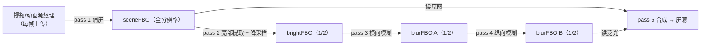

# 实践二：FBO 视频播放器

> [返回：WebGL 与 3D 框架学习大纲](../WebGL与3D框架学习大纲.md)
> 本文是大纲第二阶段实践任务②「FBO 视频播放器：视频帧纹理 + 后期泛光雏形」的完整展开；阶段导览见 [01-导览](01-导览.md)。

第二个综合实践把 2.x（视频纹理）与 5.x（FBO、ping-pong）串成一条真正的**后处理管线**：视频每帧上传为纹理 → 渲进场景 FBO → 亮部提取 → 横向/纵向两趟高斯模糊（ping-pong）→ 与原图合成叠加。这条链就是第五阶段 bloom / FXAA / 色调映射管线的雏形——换掉中间的着色器就是另一个效果，骨架不变。

## 目标与验收标准

1. 视频帧每帧更新为纹理并铺满画布（静音自动播放，被拦截时点击页面恢复）；
2. 亮部提取：亮度超过阈值的区域进入"泛光缓冲"，其余为黑；
3. 双向模糊：亮部图经横向、纵向两趟高斯模糊，产生光晕扩散；
4. 合成：原图 + 泛光叠加，可按键开关对比效果、调节强度与阈值；
5. 手头没有视频文件时，用 canvas 动画源兜底，示例零素材可跑。

## 第 1 步：视频元素与纹理上传

**提示**：

- 视频纹理与图片唯一的区别：**每帧都要重新 `texImage2D`**——纹理只是"指向某一帧的快照"，浏览器不会自动更新它；
- 自动播放策略：`muted + playsInline` 之后多数浏览器允许静音自动播放；仍被拦截就等一次用户手势再 `play()`；
- 视频分辨率几乎必是 NPOT（非 2 次幂）：WebGL1 下老老实实 `CLAMP_TO_EDGE + LINEAR`、不生成 mipmap（2.2 的规则表）；
- `readyState >= 2`（HAVE_CURRENT_DATA）才开始上传，避免上传未解码的帧。

```javascript
const video = document.createElement('video');
video.src = 'demo.mp4';            // 换成任意本地/同源视频
video.loop = true;
video.muted = true;                // 静音是自动播放的前提
video.playsInline = true;          // iOS 内联播放
video.crossOrigin = 'anonymous';   // 跨域视频必须
video.play().catch(() => {         // 被拦截：等用户点击
  window.addEventListener('pointerdown', () => video.play(), { once: true });
});

// 每帧上传（在主循环里）：
if (video.readyState >= 2) {
  gl.bindTexture(gl.TEXTURE_2D, videoTexture);
  gl.pixelStorei(gl.UNPACK_FLIP_Y_WEBGL, true);   // 视频第 0 行在顶部，同图片
  gl.texImage2D(gl.TEXTURE_2D, 0, gl.RGB, gl.RGB, gl.UNSIGNED_BYTE, video);
  gl.pixelStorei(gl.UNPACK_FLIP_Y_WEBGL, false);
}
```

**兜底动画源**（无视频文件时，画面是一个高亮弹球 + 移动色条，足够触发泛光）：一个 2D canvas，每帧画动画后当纹理上传，API 与视频完全一致（`texImage2D` 接受任何 canvas）——这正是纹理上传接口设计的优雅之处。完整代码走这条兜底路径，接视频只差"上传源换成 video 元素"。

## 第 2 步：管线结构

五个 pass、四个 FBO（模糊两趟 ping-pong 交替读写），后三个 FBO 用半分辨率——模糊本来就是低频信息，面积省 3/4，光晕还更柔和：



**提示**：

- 每个 FBO 一次 bind 必配一次 `viewport`（5.3 的坑一，这里把"绑 FBO + 设 viewport"封成一个函数根治）；
- pass 3 写 A 读 B（brightFBO），pass 4 写 B 读 A——**读写永远不是同一个纹理**（反馈环，5.3 的坑二）；
- 全部 pass 都是"全屏四边形 + 一个片元着色器"，没有深度测试、没有矩阵，顶点着色器共用一份。

## 第 3 步：各 pass 着色器

共用的全屏顶点着色器与 5.3 相同。四个片元着色器全部给出：

```glsl
// —— pass 2：亮部提取（threshold 以上保留，平滑过渡防止硬边闪烁）——
precision mediump float;
varying vec2 vUV;
uniform sampler2D uScene;
uniform float uThreshold;            // 0.0~1.0
void main() {
  vec3 c = texture2D(uScene, vUV).rgb;
  float luma = dot(c, vec3(0.2126, 0.7152, 0.0722));   // 感知亮度加权重
  float factor = smoothstep(uThreshold, uThreshold + 0.4, luma);
  gl_FragColor = vec4(c * factor, 1.0);
}
```

```glsl
// —— pass 3/4：可分离高斯模糊（9 抽头，权重和恰为 1）——
precision mediump float;
varying vec2 vUV;
uniform sampler2D uTexture;
uniform vec2 uDirection;             // (1,0) 横向一趟；(0,1) 纵向一趟
uniform vec2 uTexelSize;             // 1/宽、1/高，随当前 FBO 分辨率变
void main() {
  float weights[5];                  // 距离 0..4 的高斯权重，±对称共 9 个采样
  weights[0] = 0.227027;
  weights[1] = 0.1945946;
  weights[2] = 0.1216216;
  weights[3] = 0.054054;
  weights[4] = 0.016216;
  vec2 step = uDirection * uTexelSize;
  vec3 sum = texture2D(uTexture, vUV).rgb * weights[0];
  for (int i = 1; i < 5; i++) {
    sum += texture2D(uTexture, vUV + step * float(i)).rgb * weights[i];
    sum += texture2D(uTexture, vUV - step * float(i)).rgb * weights[i];
  }
  gl_FragColor = vec4(sum, 1.0);
}
```

```glsl
// —— pass 5：合成（原图 + 泛光 × 强度，再轻微整体提亮对比）——
precision mediump float;
varying vec2 vUV;
uniform sampler2D uScene;
uniform sampler2D uBloom;
uniform float uIntensity;            // 泛光强度
void main() {
  vec3 scene = texture2D(uScene, vUV).rgb;
  vec3 bloom = texture2D(uBloom, vUV).rgb;
  vec3 color = scene + bloom * uIntensity;
  color = color / (1.0 + color);     // Reinhard 色调映射雏形：防叠加过曝
  gl_FragColor = vec4(color, 1.0);
}
```

**可分离模糊的原理**：二维高斯核（9×9 = 81 次采样）等价于先横向一维卷积、再纵向一维卷积（9 + 9 = 18 次采样）——两趟便宜 FBO 的 ping-pong 就是为此。**为什么模糊后泛光"扩得更远"要多趟**：单趟 9 抽头光晕半径只有 4 个纹素；要大光晕要么加大核（变贵），要么把结果再模糊一遍（本文扩展挑战里的"级联 mip 链"即此思路的工程化）。

## 第 4 步：完整代码

WebGL1，兜底动画源开箱即跑；`SOURCE` 常量切到 `'video'` 并配好视频 URL 即播放真视频。

```javascript
// main.js —— FBO 视频播放器：视频/canvas 源 + 泛光雏形（WebGL1）
const canvas = document.querySelector('#gl');
const gl = canvas.getContext('webgl', { alpha: false });

// ============ 兜底动画源：2D canvas 画弹球与移动色条 ============
const SOURCE = 'canvas';            // 'canvas' | 'video'
const sourceCanvas = document.createElement('canvas');
sourceCanvas.width = 960; sourceCanvas.height = 540;
const sctx = sourceCanvas.getContext('2d');
let ball = { x: 200, y: 150, vx: 320, vy: 240, r: 46 };
function drawSourceCanvas(dt) {
  const w = sourceCanvas.width, h = sourceCanvas.height;
  // 移动色条背景（亮度中等，不过阈值 → 不发光）
  sctx.fillStyle = '#101318';
  sctx.fillRect(0, 0, w, h);
  const t = performance.now() * 0.0002;
  for (let i = 0; i < 6; i++) {
    const x = ((i / 6 + t) % 1) * w;
    sctx.fillStyle = `hsl(${i * 40}, 45%, 26%)`;
    sctx.fillRect(x, 0, 60, h);
  }
  // 高亮弹球（远超阈值 → 发光主角）
  ball.x += ball.vx * dt; ball.y += ball.vy * dt;
  if (ball.x < ball.r || ball.x > w - ball.r) ball.vx = -ball.vx;
  if (ball.y < ball.r || ball.y > h - ball.r) ball.vy = -ball.vy;
  const g = sctx.createRadialGradient(ball.x, ball.y, 0, ball.x, ball.y, ball.r);
  g.addColorStop(0, '#ffffff');
  g.addColorStop(0.6, '#ffe9b0');
  g.addColorStop(1, 'rgba(255,220,150,0)');
  sctx.fillStyle = g;
  sctx.beginPath(); sctx.arc(ball.x, ball.y, ball.r, 0, Math.PI * 2); sctx.fill();
}

// 视频源（切到 'video' 时启用）
const video = document.createElement('video');
video.src = 'demo.mp4';
video.loop = true; video.muted = true; video.playsInline = true; video.crossOrigin = 'anonymous';
video.play().catch(() => {
  window.addEventListener('pointerdown', () => video.play(), { once: true });
});

// ============ 着色器 ============
const blitVS = `
attribute vec2 aPosition;
varying vec2 vUV;
void main() {
  vUV = aPosition * 0.5 + 0.5;
  gl_Position = vec4(aPosition, 0.0, 1.0);
}`;
const copyFS = `
precision mediump float; varying vec2 vUV; uniform sampler2D uTexture;
void main() { gl_FragColor = vec4(texture2D(uTexture, vUV).rgb, 1.0); }`;
const brightFS = `
precision mediump float; varying vec2 vUV;
uniform sampler2D uScene; uniform float uThreshold;
void main() {
  vec3 c = texture2D(uScene, vUV).rgb;
  float luma = dot(c, vec3(0.2126, 0.7152, 0.0722));
  gl_FragColor = vec4(c * smoothstep(uThreshold, uThreshold + 0.4, luma), 1.0);
}`;
const blurFS = `
precision mediump float; varying vec2 vUV;
uniform sampler2D uTexture; uniform vec2 uDirection; uniform vec2 uTexelSize;
void main() {
  float w0 = 0.227027, w1 = 0.1945946, w2 = 0.1216216, w3 = 0.054054, w4 = 0.016216;
  vec2 step = uDirection * uTexelSize;
  vec3 sum = texture2D(uTexture, vUV).rgb * w0
    + (texture2D(uTexture, vUV + step).rgb + texture2D(uTexture, vUV - step).rgb) * w1
    + (texture2D(uTexture, vUV + step * 2.0).rgb + texture2D(uTexture, vUV - step * 2.0).rgb) * w2
    + (texture2D(uTexture, vUV + step * 3.0).rgb + texture2D(uTexture, vUV - step * 3.0).rgb) * w3
    + (texture2D(uTexture, vUV + step * 4.0).rgb + texture2D(uTexture, vUV - step * 4.0).rgb) * w4;
  gl_FragColor = vec4(sum, 1.0);
}`;
const compositeFS = `
precision mediump float; varying vec2 vUV;
uniform sampler2D uScene; uniform sampler2D uBloom; uniform float uIntensity;
void main() {
  vec3 color = texture2D(uScene, vUV).rgb + texture2D(uBloom, vUV).rgb * uIntensity;
  color = color / (1.0 + color);
  gl_FragColor = vec4(color, 1.0);
}`;

function createProgram(gl, vs, fs) {
  const compile = (type, src) => {
    const s = gl.createShader(type);
    gl.shaderSource(s, src); gl.compileShader(s);
    if (!gl.getShaderParameter(s, gl.COMPILE_STATUS)) throw new Error(gl.getShaderInfoLog(s));
    return s;
  };
  const p = gl.createProgram();
  gl.attachShader(p, compile(gl.VERTEX_SHADER, vs));
  gl.attachShader(p, compile(gl.FRAGMENT_SHADER, fs));
  gl.linkProgram(p);
  if (!gl.getProgramParameter(p, gl.LINK_STATUS)) throw new Error(gl.getProgramInfoLog(p));
  return p;
}
const passPrograms = {
  copy: createProgram(gl, blitVS, copyFS),
  bright: createProgram(gl, blitVS, brightFS),
  blur: createProgram(gl, blitVS, blurFS),
  composite: createProgram(gl, blitVS, compositeFS),
};

// ============ FBO（5.2 的简化版：后处理 pass 不需要深度附件） ============
function createColorFBO(gl, width, height) {
  const texture = gl.createTexture();
  gl.bindTexture(gl.TEXTURE_2D, texture);
  gl.texImage2D(gl.TEXTURE_2D, 0, gl.RGBA, width, height, 0, gl.RGBA, gl.UNSIGNED_BYTE, null);
  gl.texParameteri(gl.TEXTURE_2D, gl.TEXTURE_WRAP_S, gl.CLAMP_TO_EDGE);
  gl.texParameteri(gl.TEXTURE_2D, gl.TEXTURE_WRAP_T, gl.CLAMP_TO_EDGE);
  gl.texParameteri(gl.TEXTURE_2D, gl.TEXTURE_MIN_FILTER, gl.LINEAR);
  gl.texParameteri(gl.TEXTURE_2D, gl.TEXTURE_MAG_FILTER, gl.LINEAR);
  const framebuffer = gl.createFramebuffer();
  gl.bindFramebuffer(gl.FRAMEBUFFER, framebuffer);
  gl.framebufferTexture2D(gl.FRAMEBUFFER, gl.COLOR_ATTACHMENT0, gl.TEXTURE_2D, texture, 0);
  if (gl.checkFramebufferStatus(gl.FRAMEBUFFER) !== gl.FRAMEBUFFER_COMPLETE) {
    throw new Error('FBO 不完整');
  }
  gl.bindFramebuffer(gl.FRAMEBUFFER, null);
  return { framebuffer, texture, width, height };
}
function bindTarget(fbo) {          // 绑 FBO 与 viewport 永远成对出现（5.3 坑一）
  gl.bindFramebuffer(gl.FRAMEBUFFER, fbo ? fbo.framebuffer : null);
  const w = fbo ? fbo.width : canvas.width, h = fbo ? fbo.height : canvas.height;
  gl.viewport(0, 0, w, h);
}

// 全屏四边形（唯一的一块几何）
const quadVBO = gl.createBuffer();
gl.bindBuffer(gl.ARRAY_BUFFER, quadVBO);
gl.bufferData(gl.ARRAY_BUFFER, new Float32Array([
  -1, -1, 1, -1, 1, 1, -1, -1, 1, 1, -1, 1,
]), gl.STATIC_DRAW);

function runPass(programName, targetFBO, inputs, setupUniforms) {
  gl.useProgram(passPrograms[programName]);
  bindTarget(targetFBO);
  inputs.forEach((tex, i) => {       // 依次挂到 0..N-1 号纹理单元
    gl.activeTexture(gl.TEXTURE0 + i);
    gl.bindTexture(gl.TEXTURE_2D, tex);
  });
  gl.bindBuffer(gl.ARRAY_BUFFER, quadVBO);
  const loc = gl.getAttribLocation(passPrograms[programName], 'aPosition');
  gl.enableVertexAttribArray(loc);
  gl.vertexAttribPointer(loc, 2, gl.FLOAT, false, 8, 0);
  if (setupUniforms) setupUniforms(passPrograms[programName]);
  gl.drawArrays(gl.TRIANGLES, 0, 6);
}

// ============ 源纹理 ============
const sourceTexture = gl.createTexture();
gl.bindTexture(gl.TEXTURE_2D, sourceTexture);
gl.texParameteri(gl.TEXTURE_2D, gl.TEXTURE_WRAP_S, gl.CLAMP_TO_EDGE);   // NPOT 三件套
gl.texParameteri(gl.TEXTURE_2D, gl.TEXTURE_WRAP_T, gl.CLAMP_TO_EDGE);
gl.texParameteri(gl.TEXTURE_2D, gl.TEXTURE_MIN_FILTER, gl.LINEAR);
gl.texParameteri(gl.TEXTURE_2D, gl.TEXTURE_MAG_FILTER, gl.LINEAR);

function uploadSource() {
  const source = SOURCE === 'video' ? video : sourceCanvas;
  if (SOURCE === 'video' && video.readyState < 2) return false;   // 帧没就绪
  gl.bindTexture(gl.TEXTURE_2D, sourceTexture);
  gl.pixelStorei(gl.UNPACK_FLIP_Y_WEBGL, true);
  gl.texImage2D(gl.TEXTURE_2D, 0, gl.RGB, gl.RGB, gl.UNSIGNED_BYTE, source);
  gl.pixelStorei(gl.UNPACK_FLIP_Y_WEBGL, false);
  return true;
}

// ============ 交互参数 ============
let bloomOn = true, intensity = 0.9, threshold = 0.55;
window.addEventListener('keydown', (e) => {
  if (e.key === 'b') bloomOn = !bloomOn;
  if (e.key === 'ArrowUp') intensity = Math.min(3, intensity + 0.1);
  if (e.key === 'ArrowDown') intensity = Math.max(0, intensity - 0.1);
  if (e.key === '[') threshold = Math.max(0, threshold - 0.05);
  if (e.key === ']') threshold = Math.min(1, threshold + 0.05);
});

let sceneFBO, brightFBO, blurA, blurB;
function rebuildFBOs() {
  const w = canvas.width, h = canvas.height;
  const old = [sceneFBO, brightFBO, blurA, blurB].filter(Boolean);
  sceneFBO = createColorFBO(gl, w, h);
  brightFBO = createColorFBO(gl, w >> 1, h >> 1);   // 半分辨率：面积 1/4
  blurA = createColorFBO(gl, w >> 1, h >> 1);
  blurB = createColorFBO(gl, w >> 1, h >> 1);
  old.forEach((f) => {                              // 旧 FBO 显存回收
    gl.deleteFramebuffer(f.framebuffer);
    gl.deleteTexture(f.texture);
  });
}
gl.disable(gl.DEPTH_TEST);                          // 全是全屏 pass，不需要深度
gl.clearColor(0, 0, 0, 1);

let last = performance.now();
function frame(now) {
  const dt = Math.min((now - last) / 1000, 0.05);
  last = now;

  const dpr = window.devicePixelRatio || 1;
  const w = Math.floor(canvas.clientWidth * dpr), h = Math.floor(canvas.clientHeight * dpr);
  if (canvas.width !== w || canvas.height !== h) { canvas.width = w; canvas.height = h; rebuildFBOs(); }

  if (SOURCE === 'canvas') drawSourceCanvas(dt);
  if (!uploadSource()) { requestAnimationFrame(frame); return; }   // 源没就绪跳过本帧

  // pass 1：源 → sceneFBO（copy 着色器，以后可换成任意"场景处理"）
  runPass('copy', sceneFBO, [sourceTexture], (p) =>
    gl.uniform1i(gl.getUniformLocation(p, 'uTexture'), 0));

  if (bloomOn) {
    // pass 2：sceneFBO → brightFBO（亮部提取，LINEAR 采样顺带完成降采样）
    runPass('bright', brightFBO, [sceneFBO.texture], (p) => {
      gl.uniform1i(gl.getUniformLocation(p, 'uScene'), 0);
      gl.uniform1f(gl.getUniformLocation(p, 'uThreshold'), threshold);
    });
    // pass 3：brightFBO → blurA（横向）
    runPass('blur', blurA, [brightFBO.texture], (p) => {
      gl.uniform1i(gl.getUniformLocation(p, 'uTexture'), 0);
      gl.uniform2f(gl.getUniformLocation(p, 'uDirection'), 1, 0);
      gl.uniform2f(gl.getUniformLocation(p, 'uTexelSize'), 1 / blurA.width, 1 / blurA.height);
    });
    // pass 4：blurA → blurB（纵向）—— 读写换位 = ping-pong
    runPass('blur', blurB, [blurA.texture], (p) => {
      gl.uniform1i(gl.getUniformLocation(p, 'uTexture'), 0);
      gl.uniform2f(gl.getUniformLocation(p, 'uDirection'), 0, 1);
      gl.uniform2f(gl.getUniformLocation(p, 'uTexelSize'), 1 / blurB.width, 1 / blurB.height);
    });
    // pass 5：scene + bloom → 屏幕
    runPass('composite', null, [sceneFBO.texture, blurB.texture], (p) => {
      gl.uniform1i(gl.getUniformLocation(p, 'uScene'), 0);
      gl.uniform1i(gl.getUniformLocation(p, 'uBloom'), 1);
      gl.uniform1f(gl.getUniformLocation(p, 'uIntensity'), intensity);
    });
  } else {
    runPass('copy', null, [sceneFBO.texture], (p) =>
      gl.uniform1i(gl.getUniformLocation(p, 'uTexture'), 0));
  }
  requestAnimationFrame(frame);
}
requestAnimationFrame(frame);
```

## 常见坑

1. **视频不播**：没静音（`muted` 必须在调用 `play()` 前设好）、iOS 没 `playsInline`、或自动播放策略直接拦截——保留"点击后重试"的兜底路径；
2. **画面定格不动**：`texImage2D` 只在初始化时调用了一次。视频纹理没有任何"自动更新"机制，主循环里每帧上传；
3. **视频帧上传抛跨域错误**：视频服务器没回 CORS 头，`crossOrigin='anonymous'` 反而会让加载失败——同源部署或换支持 CORS 的源；
4. **黑屏且无报错**：九成是 FBO 不完整。逐个 `checkFramebufferStatus`；WebGL1 下 NPOT + 非 CLAMP_TO_EDGE 是重灾区（视频尺寸 1280×720 就是 NPOT）；
5. **泛光"一半糊一半锐"或错位**：`uTexelSize` 传了全分辨率的纹素尺寸给半分辨率 FBO 的模糊 pass——每趟 pass 的纹素尺寸跟它的**输入纹理**分辨率走；
6. **窗口 resize 后画面比例错**：`rebuildFBOs` 没跟着 canvas 尺寸重建（本例已挂在尺寸变化分支里），或半分辨率用 `(w/2)|0` 与 FBO 创建时的取整不一致（本文统一用 `w >> 1`）；
7. **反馈环**：贪方便把 pass 3 写回 `brightFBO`（同一个纹理既当输入又当附件）——采样值变未定义，典型症状是闪烁或全黑；ping-pong 的 A/B 必须是不同对象；
8. **页面发暗/发灰**：上下文开 `alpha: true` 且片元输出 alpha=1、页面底色黑色时多半没事，但合成器预乘约定（2.5）配错会出现边缘发灰——后处理场景直接 `alpha: false`。

## 验收与扩展挑战

验收清单：

- [ ] 弹球（或视频高光区域）周围有明显柔和光晕，背景色条不发光；
- [ ] 按 B 对比开关泛光，按上下方向键调强度，方括号调阈值，画面实时响应；
- [ ] 窗口缩放后管线不报错、画面比例正确；
- [ ] （接真视频时）拖动不同亮度的视频段，泛光跟随画面内容变化。

扩展挑战：

1. **两轮模糊**：blur 链再串一组 A→B 的横纵 pass，光晕半径翻倍；
2. **下采样金字塔**：1/2、1/4、1/8 三级各做一对横纵模糊，合成时三张泛光图加权相加——这就是标准 bloom 的做法；
3. **把 copy pass 换成真正的"场景"**：用实践①的地球替换源纹理，做成"泛光渲染的地球场景"；
4. **加 FXAA**：在合成 pass 之后再来一个边缘检测 + 双向模糊的 pass，消掉弹球边缘锯齿；
5. **性能剖面**：用 Chrome DevTools Performance 面板对比全分辨率模糊与半分辨率模糊的帧耗时差异，验证"面积 1/4"的说法。

> 第二阶段到此收官。回到 [大纲](../WebGL与3D框架学习大纲.md) 勾选实践任务条目，进入第三阶段：自研数学库与引擎雏形——把这九篇里的裸 API 封装成迷你框架。
