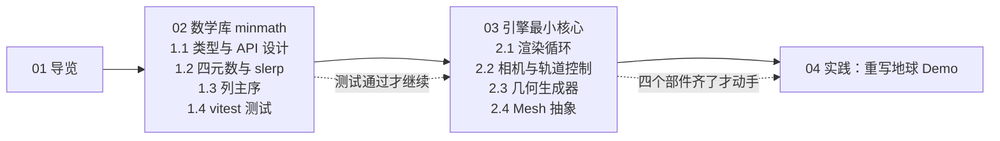

# 第三阶段导览：自研数学库与引擎雏形

> [返回：WebGL 与 3D 框架学习大纲](../WebGL与3D框架学习大纲.md)
> 一句话定位：第三阶段的总入口——把前两阶段散装手写的矩阵、相机、几何数据沉淀为一个可复用、可测试的 TypeScript 数学库 minmath 与最小引擎核心，最后用自研 API 重写地球 demo，让代码量减半。

## 阶段目标

前两个阶段结束时的状态：你能在一份几百行的单文件 demo 里手写透视矩阵、手拼球体顶点、手动上传每一个 uniform——它跑得起来，但每换一个 demo 都要把这些代码再抄一遍。第三阶段的目标是完成从"会用 WebGL"到"自研框架"的第一次跃迁：

1. **建成数学库 minmath**：Vec2/3/4、Mat3/Mat4、Quaternion 全家桶，列主序存储与 `uniformMatrix4fv` 无缝对接，欧拉角/四元数/万向节锁/slerp 全部吃透，并用 vitest 单元测试锁定行为。
2. **建成引擎最小核心**：渲染循环（requestAnimationFrame 与 deltaTime）、PerspectiveCamera 与 OrbitCamera 轨道控制器、box/sphere/plane 几何生成器、Mesh = Geometry + Material 的最小抽象与渲染函数。
3. **用自研 API 重写第二阶段的地球 demo**（自转 + 云层双纹理 + Blinn-Phong），功能不缩水、代码量减半，并沉淀出第四阶段框架化的钩子清单。

产出物清单（本阶段结束时应该存在的东西）：

- [ ] `src/math/`：Vec2/Vec3/Vec4、Mat3/Mat4、Quaternion，`npx vitest run` 全绿
- [ ] `src/core/`：RenderLoop、PerspectiveCamera、OrbitControls
- [ ] `src/geometry/`：createPlane / createBox / createSphere
- [ ] `src/render/`：Geometry、Material、Mesh、renderMesh、纹理加载助手
- [ ] `src/demo/earth.ts`：重写后的地球 demo

## 知识点与分册索引

本阶段对应大纲「第三阶段：自研数学库与引擎雏形」的两个小节与实践任务，每个小节一篇分册，分册内小节编号与大纲条目一一对应：

| 分册 | 对应大纲条目 | 一句话说明 |
|---|---|---|
| [02-数学库minmath](02-数学库minmath.md) | 第 1 节（1.1~1.4） | 类型总览与 API 取舍、欧拉角/四元数/万向节锁与 slerp 推导、列主序与 uniformMatrix4fv 对接、vitest 三种验证思路与完整测试 |
| [03-引擎最小核心](03-引擎最小核心.md) | 第 2 节（2.1~2.4） | 渲染循环与 deltaTime、PerspectiveCamera 与 OrbitControls 完整实现、box/sphere/plane 生成算法、Mesh 抽象与渲染函数 |
| [04-实践-重写地球Demo](04-实践-重写地球Demo.md) | 实践任务 | 六步重构指引、每步验收点、earth.ts 成品、与第二阶段的对照与最终验收标准 |

各分册末尾有【常见坑】与【本节自测】（3~5 题），先自己作答再往下走；全部读完后再回到本文末的【阶段自测】做整体验收。

## 阅读路线

- **严格顺序，不建议跳**：引擎核心的每一行都在消费数学库（OrbitControls 用 Vec3，Mesh 用 Quaternion.compose，渲染函数上传 Mat4.elements）；数学库测试全绿再写引擎，是把"画面不对"的排查范围先砍掉一半。
- **1.2 与 1.3 的先后**：大纲条目顺序是四元数在前、列主序在后。1.2 里用到 Mat4 时只依赖一句话结论（元素按列排布，`e[列*4+行]`），完整论证在 1.3——读到矩阵细节时回翻即可。
- **每册的节奏**：概念讲解 → 设计推导 → 完整代码。代码建议边读边敲进自己的仓库，第三阶段的产出物就是敲出来的这个库，不是读完的笔记。

## 实践任务清单

实践任务（详见 [04-实践-重写地球Demo](04-实践-重写地球Demo.md)）把 02、03 两册的成果全部串起来，六步走：

- [ ] 步骤一：项目骨架归位（src/math、src/core、src/geometry、src/render），vitest 全绿
- [ ] 步骤二：地球本体——createSphere + 贴图材质
- [ ] 步骤三：自转与 23.44 度地轴倾斜（四元数组合）
- [ ] 步骤四：云层——共享 Geometry、独立 Mesh、透明混合
- [ ] 步骤五：PerspectiveCamera + OrbitControls 交互
- [ ] 步骤六：RenderLoop 接 deltaTime、resize 处理

验收标准五条：功能清单全保留、demo 主文件不超过约 100 行、地球与云层共享一份几何、测试与类型检查全绿、拖拽缩放手感平滑。

## 阶段自测

以下题目跨两册，完成实践任务后作答；分册内部的题目在各自末尾。

1. 你的数学库里，向量存 `number` 字段而矩阵存 `Float32Array`，这个不对称是图什么？如果统一成一种存储，各自的代价是什么？
2. 不看代码，写出 `gl_Position = uProjection * uView * uModel * vec4(aPosition, 1.0)` 中三个矩阵各自把顶点从哪个空间带到哪个空间，以及为什么乘法顺序不能换。
3. 两个单位四元数 q0、q1，`dot(q0, q1) < 0` 时 slerp 前必须做哪一步？不做会出现什么现象？为什么这一步不影响结果旋转的正确性？
4. 说"万向节锁"是欧拉角的 bug、四元数"修复"了它——这句话错在哪？准确的表述应该是什么？
5. 渲染循环里 deltaTime 为什么要 clamp？clamped delta 累加成 elapsed 会让"动画时长"与真实时间脱钩，这个代价你接受吗？什么场景下必须换方案（提示：固定时间步）？
6. OrbitControls 的阻尼用 `k = 1 - Math.exp(-lambda * delta)` 而不是每帧乘固定系数 0.9，帧率从 60Hz 涨到 144Hz 时两者行为有什么差别？
7. createSphere 的顶点数为什么是 `(widthSegments + 1) * (heightSegments + 1)` 而不是 `widthSegments * heightSegments`？多出来的那一行一列各是干什么的？
8. 假设 earth demo 里云层忽然渲染成了透明度反转（云是透明的、海洋是半透的），列出你会按什么顺序排查：shader、纹理格式、混合函数、生成器 UV、uniform 上传——并说明每一步排除什么。

> 预告：本阶段结束时你手上是一个"能跑但很糙"的迷你框架——渲染状态散落在 demo 里、每个 Material 独占一个 program、Mesh 没有场景组织。第四阶段「框架架构与工程化」将把它们逐个收编：分层设计、Renderer 状态托管、场景图、材质系统与资源管理。
