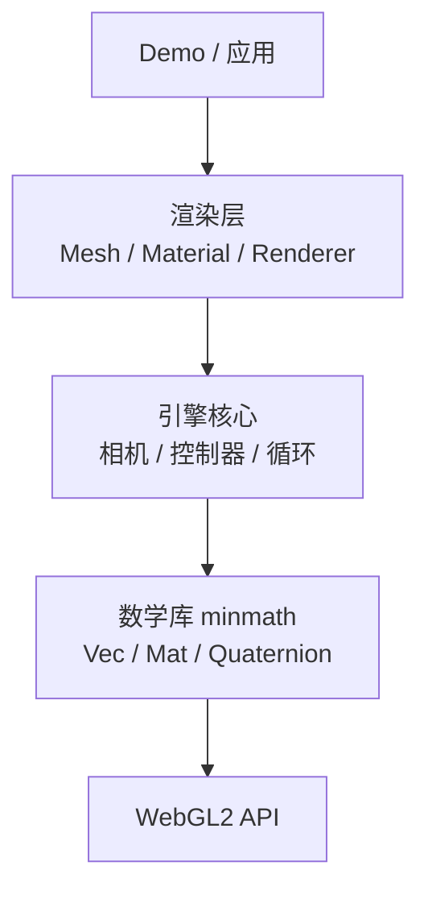

# 数学库 minmath

> [返回：WebGL 与 3D 框架学习大纲](../WebGL与3D框架学习大纲.md)
> 一句话定位：第三阶段第 1 节的完整展开——从 API 设计取舍出发，实现 Vec2/3/4、Mat3/Mat4、Quaternion，推导万向节锁与 slerp，讲透列主序与 uniformMatrix4fv 的对接，最后用 vitest 把矩阵运算全部锁进测试。阶段导览见 [01-导览](01-导览.md)。

## 1.1 类型总览与 API 设计：Vec2/3/4、Mat3/Mat4、Quaternion 的类结构

### 概念讲解：数学库是引擎的地基

所有 3D 框架的最底层都是一个数学库：three.js 有自带的 `Vector3`/`Matrix4`/`Quaternion`，Babylon.js 有 `gl-matrix` 风格的 `Math.Vector3`，Oasis 引擎的 `oasis-engine` 时代直接内置了一个精简数学模块。它在分层里处在最底部：



数学库有三个与上层完全不同的特征，决定了它的设计方式：

1. **零依赖**：它不 import 任何东西，任何层都可以放心依赖它。
2. **纯计算**：没有 WebGL 上下文、没有 DOM、没有副作用，输入决定输出——这让它成为整个引擎里唯一适合大规模单元测试的层（1.4 节的主题）。
3. **热路径**：渲染循环里每帧要执行成千上万次数组运算，这里的 API 风格直接决定 GC 压力与帧率稳定性。

六个类型各自的职责：

| 类型 | 分量 | 在引擎里表示什么 |
|---|---|---|
| Vec2 | x, y | UV 坐标、屏幕坐标、二维缩放 |
| Vec3 | x, y, z | 位置、方向、法线、速度、颜色（rgb） |
| Vec4 | x, y, z, w | 齐次坐标（homogeneous coordinates，w 参与透视除法）、rgba 颜色 |
| Mat3 | 9 | 法线矩阵（normal matrix）、无平移的旋转/缩放 |
| Mat4 | 16 | 模型/视图/投影矩阵（model/view/projection） |
| Quaternion | x, y, z, w | 姿态（orientation），插值与组合都比矩阵便宜 |

### 设计推导：三个必须先回答的问题

**问题一：静态方法还是实例方法？** 业界有三个流派：

| 流派 | 代表 | 调用形态 | 优点 | 代价 |
|---|---|---|---|---|
| 静态方法 + out 参数 | glMatrix | `mat4.multiply(out, a, b)` | 零分配、调用方完全掌控对象生命周期 | 可读性差，公式被 out 参数淹没 |
| 实例方法（就地修改）+ 返回 this | three.js | `a.multiply(b)` 或 `m.multiply(n)` | 链式可读、与数学直觉接近 | 隐式修改语义：`const c = a.add(b)` 里 c 和 a 是同一个对象 |
| 不可变值对象 | 部分函数式风格的库 | `const c = a.add(b)` 返回新对象 | 语义最安全 | 每次运算都分配，热路径 GC 压力大 |

minmath 的取舍：**实例方法为主、返回 this 支持链式，同时为热路径提供少量静态版本（显式 out 参数）**。教学上实例版最好读；性能敏感处（每帧循环里）用静态版复用临时对象，两种风格并存正是 glMatrix 与 three.js 各自的生存空间。

**问题二：对象可变吗？** 选可变。渲染循环按 60fps 算，每帧只要创建 1000 个临时向量，每秒就是 6 万个短命对象——足够触发频繁的 minor GC，表现成"偶尔卡一帧"。可变对象 + 复用是实时渲染的通行做法；代价（忘了 clone 导致的别名 bug）靠文档与习惯规避：**凡是跨帧保留的值，赋值时显式 `clone()`**。

**问题三：底层存储用什么？** 这里有一个刻意的"不对称"：

- 向量用 `number` 字段（`this.x`）：向量主要被人读、被人写（`camera.position.z = 5`），字段访问最快、调试器显示最友好；真正要喂给 WebGL 的场合（uniform）再临时取三个分量。
- 矩阵用 `Float32Array`：矩阵几乎只被 GPU 消费，`uniformMatrix4fv` 与 `bufferData` 吃的就是 `Float32Array`，直接存成目标格式省掉每次上传前的转换；代价是打印调试麻烦（解决：调试时 `Array.from(e).map(v => v.toFixed(3))`）。

一句话：**向量是"读给人看的"，矩阵是"喂给 GPU 的"**。

**文件划分**：库放在 `src/math/`，一个类型一个文件，公共常量独立：

```text
src/math/
  common.ts      # EPSILON、角度弧度换算
  Vec2.ts  Vec3.ts  Vec4.ts
  Mat3.ts  Mat4.ts  Quaternion.ts
  index.ts       # 统一导出
```

### 完整代码：公共常量与 Vec2 / Vec3 / Vec4

```typescript
// src/math/common.ts

/** 浮点比较与除法保护的阈值 */
export const EPSILON = 1e-10;

export const DEG2RAD = Math.PI / 180;

export function degToRad(deg: number): number {
  return deg * DEG2RAD;
}

export function radToDeg(rad: number): number {
  return rad / DEG2RAD;
}
```

Vec3 是全家使用频率最高的类型，完整实现：

```typescript
// src/math/Vec3.ts
import { EPSILON } from './common';
import type { Mat4 } from './Mat4';

export class Vec3 {
  x: number;
  y: number;
  z: number;

  constructor(x = 0, y = 0, z = 0) {
    this.x = x;
    this.y = y;
    this.z = z;
  }

  set(x: number, y: number, z: number): this {
    this.x = x;
    this.y = y;
    this.z = z;
    return this;
  }

  copy(v: Vec3): this {
    this.x = v.x;
    this.y = v.y;
    this.z = v.z;
    return this;
  }

  clone(): Vec3 {
    return new Vec3(this.x, this.y, this.z);
  }

  add(v: Vec3): this {
    this.x += v.x;
    this.y += v.y;
    this.z += v.z;
    return this;
  }

  subtract(v: Vec3): this {
    this.x -= v.x;
    this.y -= v.y;
    this.z -= v.z;
    return this;
  }

  multiplyScalar(s: number): this {
    this.x *= s;
    this.y *= s;
    this.z *= s;
    return this;
  }

  dot(v: Vec3): number {
    return this.x * v.x + this.y * v.y + this.z * v.z;
  }

  // 叉积（cross product）：结果同时垂直于两个输入，方向由右手系决定
  cross(v: Vec3): this {
    const { x, y, z } = this; // 必须先把 this 的分量存下来：下面要逐个覆盖
    this.x = y * v.z - z * v.y;
    this.y = z * v.x - x * v.z;
    this.z = x * v.y - y * v.x;
    return this;
  }

  lengthSq(): number {
    return this.x * this.x + this.y * this.y + this.z * this.z;
  }

  length(): number {
    return Math.sqrt(this.lengthSq());
  }

  // 归一化（normalize）：零向量无法归一化，这里约定返回零向量而不是 NaN
  normalize(): this {
    const len = this.length();
    return len > EPSILON ? this.multiplyScalar(1 / len) : this.set(0, 0, 0);
  }

  distanceToSquared(v: Vec3): number {
    const dx = this.x - v.x;
    const dy = this.y - v.y;
    const dz = this.z - v.z;
    return dx * dx + dy * dy + dz * dz;
  }

  distanceTo(v: Vec3): number {
    return Math.sqrt(this.distanceToSquared(v));
  }

  // 线性插值（linear interpolation，lerp）
  lerp(v: Vec3, t: number): this {
    this.x += (v.x - this.x) * t;
    this.y += (v.y - this.y) * t;
    this.z += (v.z - this.z) * t;
    return this;
  }

  // 点变换：把 this 当作 w = 1 的齐次坐标（位置），受平移影响。
  // 只对仿射矩阵（模型/视图矩阵）成立；投影矩阵请用 Vec4。
  applyMat4(m: Mat4): this {
    const e = m.elements;
    const { x, y, z } = this;
    this.x = e[0] * x + e[4] * y + e[8] * z + e[12];
    this.y = e[1] * x + e[5] * y + e[9] * z + e[13];
    this.z = e[2] * x + e[6] * y + e[10] * z + e[14];
    return this;
  }

  // 方向变换：把 this 当作 w = 0 的方向（朝向、光方向），平移被忽略。
  // 变换后归一化，避免上游带缩放的矩阵弄脏方向长度。
  transformDirection(m: Mat4): this {
    const e = m.elements;
    const { x, y, z } = this;
    this.x = e[0] * x + e[4] * y + e[8] * z;
    this.y = e[1] * x + e[5] * y + e[9] * z;
    this.z = e[2] * x + e[6] * y + e[10] * z;
    return this.normalize();
  }

  toArray(): number[] {
    return [this.x, this.y, this.z];
  }

  // ---- 热路径静态版本：显式 out 参数，避免在渲染循环里分配 ----

  static subtract(a: Vec3, b: Vec3, out: Vec3 = new Vec3()): Vec3 {
    return out.set(a.x - b.x, a.y - b.y, a.z - b.z);
  }

  static cross(a: Vec3, b: Vec3, out: Vec3 = new Vec3()): Vec3 {
    return out.set(
      a.y * b.z - a.z * b.y,
      a.z * b.x - a.x * b.z,
      a.x * b.y - a.y * b.x,
    );
  }

  static lerp(a: Vec3, b: Vec3, t: number, out: Vec3 = new Vec3()): Vec3 {
    return out.set(
      a.x + (b.x - a.x) * t,
      a.y + (b.y - a.y) * t,
      a.z + (b.z - a.z) * t,
    );
  }
}
```

两个实现细节值得停一下：

- `cross` 里先解构存下 `this` 的三个分量。叉积的每个结果分量都要用到输入的两个旧分量，如果边算边覆盖，第二行读到的已经是被第一行污染过的 x。
- `normalize` 对零向量返回 `(0,0,0)` 而不是 `NaN`。glMatrix 的做法是直接除以 0 得到 `NaN/Infinity` 然后向下游扩散；我们选择在源头吞掉它并把这个行为写进文档——1.4 节会专门测它。

Vec2 是 Vec3 的裁剪版，Vec4 多一个 w 分量与透视除法：

```typescript
// src/math/Vec2.ts（节选，其余方法与 Vec3 同构）
import { EPSILON } from './common';

export class Vec2 {
  x: number;
  y: number;

  constructor(x = 0, y = 0) {
    this.x = x;
    this.y = y;
  }

  set(x: number, y: number): this {
    this.x = x;
    this.y = y;
    return this;
  }

  copy(v: Vec2): this {
    this.x = v.x;
    this.y = v.y;
    return this;
  }

  clone(): Vec2 {
    return new Vec2(this.x, this.y);
  }

  add(v: Vec2): this {
    this.x += v.x;
    this.y += v.y;
    return this;
  }

  subtract(v: Vec2): this {
    this.x -= v.x;
    this.y -= v.y;
    return this;
  }

  multiplyScalar(s: number): this {
    this.x *= s;
    this.y *= s;
    return this;
  }

  dot(v: Vec2): number {
    return this.x * v.x + this.y * v.y;
  }

  length(): number {
    return Math.sqrt(this.x * this.x + this.y * this.y);
  }

  normalize(): this {
    const len = this.length();
    return len > EPSILON ? this.multiplyScalar(1 / len) : this.set(0, 0);
  }

  lerp(v: Vec2, t: number): this {
    this.x += (v.x - this.x) * t;
    this.y += (v.y - this.y) * t;
    return this;
  }
}
```

```typescript
// src/math/Vec4.ts
import type { Mat4 } from './Mat4';

export class Vec4 {
  x: number;
  y: number;
  z: number;
  w: number;

  constructor(x = 0, y = 0, z = 0, w = 1) {
    this.x = x;
    this.y = y;
    this.z = z;
    this.w = w;
  }

  set(x: number, y: number, z: number, w: number): this {
    this.x = x;
    this.y = y;
    this.z = z;
    this.w = w;
    return this;
  }

  copy(v: Vec4): this {
    this.x = v.x;
    this.y = v.y;
    this.z = v.z;
    this.w = v.w;
    return this;
  }

  clone(): Vec4 {
    return new Vec4(this.x, this.y, this.z, this.w);
  }

  // 完整的 4x4 变换（含第四列/第四行）：投影矩阵之后必须用它，
  // 因为透视投影的 w 分量不再是 1
  applyMat4(m: Mat4): this {
    const e = m.elements;
    const { x, y, z, w } = this;
    this.x = e[0] * x + e[4] * y + e[8] * z + e[12] * w;
    this.y = e[1] * x + e[5] * y + e[9] * z + e[13] * w;
    this.z = e[2] * x + e[6] * y + e[10] * z + e[14] * w;
    this.w = e[3] * x + e[7] * y + e[11] * z + e[15] * w;
    return this;
  }

  // 透视除法（perspective divide）：裁剪空间 -> NDC（归一化设备坐标）
  perspectiveDivide(): this {
    const inv = 1 / this.w;
    this.x *= inv;
    this.y *= inv;
    this.z *= inv;
    this.w = 1;
    return this;
  }

  toArray(): number[] {
    return [this.x, this.y, this.z, this.w];
  }
}
```

矩阵与四元数的**类骨架**先立在这里，完整实现分别落在 1.3（Mat3/Mat4，因为必须先讲清列主序）与 1.2（Quaternion）：

| 类 | 核心成员 | 关键方法 |
|---|---|---|
| Mat4 | `elements: Float32Array(16)` | identity / copy / multiply（实例 + 静态）/ fromTranslation / fromScaling / fromRotation / fromTRS / transpose / invert / lookAt / perspective / ortho / fromQuat / compose |
| Mat3 | `elements: Float32Array(9)` | identity / copy / setFromMat4 / normalFromMat4 |
| Quaternion | x, y, z, w | set / copy / dot / length / normalize / multiply / setFromAxisAngle / setFromEuler / toEuler / slerp / angleTo |

> 本文以下所有矩阵代码都遵守一个约定并在此声明：**Mat4 按列主序（column-major）存储，第 r 行第 c 列的元素位于 `e[c * 4 + r]`**。为什么如此、以及它与 `uniformMatrix4fv` 的关系，1.3 节完整展开。

## 1.2 欧拉角、四元数与万向节锁；slerp 球面插值

### 概念讲解：欧拉角与它的死穴

**欧拉角（Euler angles）**用三个角度表达姿态：绕 X 轴的 x（pitch，俯仰）、绕 Y 轴的 y（yaw，偏航）、绕 Z 轴的 z（roll，翻滚）。它直观、省内存、是编辑器 UI 的天然格式。但欧拉角有一个绕不开的结构性问题：**三个角度必须搭配一个旋转顺序才有意义**。同样的 (30°, 60°, 45°)，先绕 X 再绕 Y 再绕 Z，与反过来，得到的是两个完全不同的姿态。

本库的约定与 three.js 默认一致，记作 'XYZ'：

- 矩阵形式：`R = Rx(x) · Ry(y) · Rz(z)`（列向量约定下，作用于向量时**右边的先转**）；
- 读法：按内旋（intrinsic，绕自身坐标轴）理解——先绕自身 X 转 x，再绕新的 Y' 转 y，最后绕新的 Z'' 转 z。

**万向节锁（gimbal lock）**由此而生。看 `R = Rx(x) · Ry(y) · Rz(z)` 在 y = 90° 时变成什么。代入并展开（sin/cos 简写 s1/c1 等）：

```text
Rx(x) · Ry(90°) · Rz(z)
= | 1  0    0   |   | 0  0  1 |   | c3 -s3 0 |
  | 0  c1 -s1  | · | 0  1  0 | · | s3  c3 0 |
  | 0  s1  c1  |   |-1  0  0 |   | 0   0   1 |

= |  0          0         1    |
  |  sin(x+z)   cos(x+z)  0    |
  | -cos(x+z)   sin(x+z)  0    |
```

结果只含 `x + z` 一个组合：**x 与 z 变成了同一个自由度，`x - z` 方向的自由度消失了**。几何直觉：pitch 到 90° 时，原本互相垂直的 yaw 轴与 roll 轴被转到同一条直线上，绕它们转是同一个动作。三个参数只剩两个有效自由度，姿态空间是三维的，参数化在这里出现奇异性——这就是万向节锁。

三个必须澄清的点：

1. **它是参数化的奇异性，不是物理或代码的 bug**。任何把三维姿态映射到三个标量的方案都有奇异点，换旋转顺序只是把锁挪到别的角度。
2. **触发条件**是"中间轴转到 ±90°"（对 'XYZ' 顺序是 y）。日常斜视角没事，第一人称飞行游戏俯仰拉满的瞬间、或者 3D 编辑器把模型转到某个正对角度时，就会表现为"两个拖拽轴突然变成一个"或姿态突然打转。
3. **绕开方式**：内部一律用四元数/矩阵存姿态（无奇异），只在人机交互的边界（Inspector 面板、动画关键帧导出）换算成欧拉角，并接受在奇异点附近换算不唯一。

用刚写的库可以直接验证（这也是 1.4 节的测试素材）：

```typescript
import { Quaternion } from './math';

// y = 90° 时，(x, z) 与 (x + k, z - k) 是同一个姿态：x+z 同为 0.8
const q1 = new Quaternion().setFromEuler(0.3, Math.PI / 2, 0.5);
const q2 = new Quaternion().setFromEuler(0.8, Math.PI / 2, 0.0);
console.log(Math.abs(q1.dot(q2))); // ≈ 1：同一个旋转
```

### 概念讲解：四元数

**四元数（quaternion）**是复数的四维推广：`q = w + x·i + y·j + z·k`，其中 `i² = j² = k² = ijk = -1`。图形学只用它的一个子集：**单位四元数**（长度为 1）与三维旋转一一对应（严格说是二对一，见下）。要建立直觉，抓住三条：

**一、轴角到四元数的桥梁是半角。** 绕单位轴 `n` 旋转角度 θ 的四元数是：

```text
q = ( n·sin(θ/2),  cos(θ/2) )
      ↑虚部 x,y,z    ↑实部 w
```

为什么是半角：用四元数旋转向量是 `v' = q ⊗ (v, 0) ⊗ q⁻¹`，q 出现了两次，各贡献一半角度。这个"半角"也解释了四元数的一个怪性质：**θ 增加 360° 时 q 变成 -q（不是回到自身），要到 720° 才回到原点**——单位四元数活在四维球面 S³ 上，绕了两圈。

**二、q 与 -q 表示同一个旋转。** 上面 720° 性质的直接推论。这意味着：两个"看起来差很远"的四元数可能是同一个姿态，比较姿态要比较 `|dot(q1, q2)|` 而不是逐分量相等；插值前要选择走"短弧"（slerp 实现里会用到）。

**三、乘法即组合。** Hamilton 积（`⊗`）展开：

```typescript
// a ⊗ b
x = aw*bx + ax*bw + ay*bz - az*by
y = aw*by - ax*bz + ay*bw + az*bx
z = aw*bz + ax*by - ay*bx + az*bw
w = aw*bw - ax*bx - ay*by - az*bz
```

对列向量约定，`qa ⊗ qb` 与矩阵 `A·B` 语义完全一致：**右边的 qb 先作用于向量**。姿态组合 `q = q1 ⊗ q2` 表示"先转 q2，再转 q1"。

与矩阵对比，决定引擎内部用谁存姿态：

| 维度 | 四元数 | 3x3 旋转矩阵 |
|---|---|---|
| 存储 | 4 个数 | 9 个数 |
| 组合 | 28 次乘法 | 27 次乘法（3x3） |
| 插值 | slerp，匀速走最短大圆 | 无良好定义 |
| 奇异性 | 无 | 无 |
| 直接变换顶点 | 需转矩阵（或 24 次乘法公式） | 9 次乘法 |
| 人类可读性 | 差（角度看不见） | 差 |
| 表达缩放/平移 | 不能 | 旋转可，平移不能 |

结论与 three.js 的选择一致：**姿态存储与插值用四元数，渲染前 compose 成 Mat4**（1.2 末尾的 `Mat4.compose`）。

### 设计推导：slerp 的完整推导

**slerp（spherical linear interpolation，球面线性插值）**要解决的问题：给定两个单位四元数 q0、q1，在两者之间做参数 t 的插值，要求（a）结果始终是单位四元数（在 S³ 球面上滑动，不会像 lerp 那样抄近道穿进球内）；（b）角速度恒定（动画不忽快忽慢）。

推导五步：

**第一步：问题降维。** q0、q1 张成四维空间中一个过原点的二维平面 P（把四元数看成四维向量），插值全程不该离开 P——因为两个姿态的"中间姿态"由且仅由这两个方向决定。

**第二步：在 P 内建立正交基。** 设 `cosθ = q0·q1`（四维点积），θ 是两姿态的夹角。把 q1 做 Gram-Schmidt 正交化，分解出垂直于 q0 的分量：

```text
u = (q1 - cosθ · q0) / sinθ        // 单位向量，垂直于 q0，位于 P 内
```

**第三步：参数化大圆。** P 内的单位圆（S³ 与 P 的交，即大圆 great circle）上任意点可写为：

```text
q(t) = cos(α) · q0 + sin(α) · u
```

α 从 0（q0）走到 θ（到达 q1，因为 cosθ·q0 + sinθ·u = q1）。

**第四步：角速度恒定 ⇔ α = t·θ。** 这是"线性"在球面上的正确翻译：单位时间内走过相等的弧。

**第五步：代回消去 u，得到最终公式。**

```text
slerp(q0, q1, t) = [ sin((1-t)·θ) · q0 + sin(t·θ) · q1 ] / sinθ
```

sinθ 作分母暴露了两个必须处理的边界：

- **θ → 0（两姿态几乎相同）**：sinθ → 0，公式数值爆炸。此时 lerp 与 slerp 本来就没有差别，退化处理：线性插值后归一化（nlerp，normalized lerp）。工程阈值取 dot > 0.9995。
- **dot(q0, q1) < 0**：此时 θ > 90°，公式会沿大圆走**远弧**（绕远路）。由 q ≡ -q，把 q1 取负再插值即走短弧，结果旋转不变。

附带认识 nlerp 的地位：它快（无三角函数）、自动归一化，且在小角度下与 slerp 几乎重合；缺点是角速度不均匀（中间偏快、两端偏慢的程度随 θ 增大）。相机动画、大角度旋转用 slerp；粒子姿态、小抖动用 nlerp 就够。

### 完整代码：Quaternion

```typescript
// src/math/Quaternion.ts
import { EPSILON } from './common';
import type { Vec3 } from './Vec3';
import { Mat4 } from './Mat4';

export class Quaternion {
  x: number;
  y: number;
  z: number;
  w: number;

  constructor(x = 0, y = 0, z = 0, w = 1) {
    this.x = x;
    this.y = y;
    this.z = z;
    this.w = w;
  }

  /** 单位四元数（无旋转） */
  set(x: number, y: number, z: number, w: number): this {
    this.x = x;
    this.y = y;
    this.z = z;
    this.w = w;
    return this;
  }

  copy(q: Quaternion): this {
    this.x = q.x;
    this.y = q.y;
    this.z = q.z;
    this.w = q.w;
    return this;
  }

  clone(): Quaternion {
    return new Quaternion(this.x, this.y, this.z, this.w);
  }

  identity(): this {
    return this.set(0, 0, 0, 1);
  }

  dot(q: Quaternion): number {
    return this.x * q.x + this.y * q.y + this.z * q.z + this.w * q.w;
  }

  lengthSq(): number {
    return this.dot(this);
  }

  length(): number {
    return Math.sqrt(this.lengthSq());
  }

  normalize(): this {
    const len = this.length();
    if (len > EPSILON) {
      const inv = 1 / len;
      this.x *= inv;
      this.y *= inv;
      this.z *= inv;
      this.w *= inv;
    }
    return this;
  }

  /** 两姿态之间的旋转角（弧度） */
  angleTo(q: Quaternion): number {
    return 2 * Math.acos(Math.min(1, Math.abs(this.dot(q))));
  }

  /** 轴角 -> 四元数：q = (axis·sin(θ/2), cos(θ/2)) */
  setFromAxisAngle(axis: Vec3, rad: number): this {
    const half = rad / 2;
    const s = Math.sin(half);
    this.x = axis.x * s;
    this.y = axis.y * s;
    this.z = axis.z * s;
    this.w = Math.cos(half);
    return this;
  }

  /**
   * 欧拉角 -> 四元数。约定 'XYZ'：R = Rx·Ry·Rz（内旋读法，见 1.2 概念讲解），
   * 等价的四元数乘法为 q = qx ⊗ qy ⊗ qz。
   * 闭式展开（sx = sin(x/2)，cx = cos(x/2)，其余同理）。
   */
  setFromEuler(x: number, y: number, z: number): this {
    const hx = x / 2, hy = y / 2, hz = z / 2;
    const sx = Math.sin(hx), cx = Math.cos(hx);
    const sy = Math.sin(hy), cy = Math.cos(hy);
    const sz = Math.sin(hz), cz = Math.cos(hz);
    this.x = sx * cy * cz + cx * sy * sz;
    this.y = cx * sy * cz - sx * cy * sz;
    this.z = cx * cy * sz + sx * sy * cz;
    this.w = cx * cy * cz - sx * sy * sz;
    return this;
  }

  /** this = this ⊗ q：先应用 this，再应用 q（与 Mat4 的 A.multiply(B) = A·B 语义对齐） */
  multiply(q: Quaternion): this {
    const ax = this.x, ay = this.y, az = this.z, aw = this.w;
    const { x: bx, y: by, z: bz, w: bw } = q;
    this.x = aw * bx + ax * bw + ay * bz - az * by;
    this.y = aw * by - ax * bz + ay * bw + az * bx;
    this.z = aw * bz + ax * by - ay * bx + az * bw;
    this.w = aw * bw - ax * bx - ay * by - az * bz;
    return this;
  }

  static multiply(out: Quaternion, a: Quaternion, b: Quaternion): Quaternion {
    return out.copy(a).multiply(b);
  }

  /** 球面线性插值：this = slerp(this, q, t)。推导见上文五步。 */
  slerp(q: Quaternion, t: number): this {
    return Quaternion.slerp(this, this, q, t);
  }

  static slerp(out: Quaternion, a: Quaternion, b: Quaternion, t: number): Quaternion {
    let cosTheta = a.dot(b);
    let bx = b.x, by = b.y, bz = b.z, bw = b.w;

    // 走短弧：q 与 -q 是同一旋转，dot < 0 时把 b 取负，翻转后走的角度 < 90°
    if (cosTheta < 0) {
      cosTheta = -cosTheta;
      bx = -bx; by = -by; bz = -bz; bw = -bw;
    }

    let s0: number;
    let s1: number;
    if (cosTheta > 0.9995) {
      // 夹角极小：slerp 公式分母 sinθ -> 0，退化为 nlerp（误差可忽略）
      s0 = 1 - t;
      s1 = t;
    } else {
      const theta = Math.acos(Math.min(1, Math.max(-1, cosTheta)));
      const sinTheta = Math.sqrt(1 - cosTheta * cosTheta);
      s0 = Math.sin((1 - t) * theta) / sinTheta;
      s1 = Math.sin(t * theta) / sinTheta;
    }

    out.x = s0 * a.x + s1 * bx;
    out.y = s0 * a.y + s1 * by;
    out.z = s0 * a.z + s1 * bz;
    out.w = s0 * a.w + s1 * bw;
    return out.normalize();
  }

  /** 归一化线性插值：小角度下的廉价替代，角速度不均匀 */
  static nlerp(out: Quaternion, a: Quaternion, b: Quaternion, t: number): Quaternion {
    let bx = b.x, by = b.y, bz = b.z, bw = b.w;
    if (a.dot(b) < 0) {
      bx = -bx; by = -by; bz = -bz; bw = -bw;
    }
    out.x = a.x + (bx - a.x) * t;
    out.y = a.y + (by - a.y) * t;
    out.z = a.z + (bz - a.z) * t;
    out.w = a.w + (bw - a.w) * t;
    return out.normalize();
  }

  /**
   * 四元数 -> 欧拉角（'XYZ' 约定），写入 out 的 x/y/z。
   * 奇异姿态（y ≈ ±90°）下只能还原 x±z 之和，约定取 z = 0。
   */
  toEuler(out: Vec3): Vec3 {
    const m = new Mat4();
    Mat4.fromQuat(m, this);
    const e = m.elements;
    const sy = Math.min(1, Math.max(-1, e[8])); // e[8] = R[0][2] = sin(y)
    if (Math.abs(sy) < 0.9999999) {
      out.x = Math.atan2(-e[9], e[10]);  // atan2(-R[1][2], R[2][2]) = x
      out.y = Math.asin(sy);             // asin(R[0][2]) = y
      out.z = Math.atan2(-e[4], e[0]);   // atan2(-R[0][1], R[0][0]) = z
    } else {
      // 万向节锁：只能还原 x+z（y=+90°）或 x-z（y=-90°）
      out.y = sy > 0 ? Math.PI / 2 : -Math.PI / 2;
      out.z = 0;
      out.x = sy > 0 ? Math.atan2(e[1], e[5]) : Math.atan2(-e[1], e[5]);
    }
    return out;
  }
}
```

姿态最终要变成矩阵交给渲染，给 Mat4 追加两个静态方法（放 `Mat4.ts`，与 1.3 的实现同文件）：

```typescript
// src/math/Mat4.ts（类体内追加两个静态方法）
import type { Quaternion } from './Quaternion';

/** 旋转矩阵 <- 四元数（只写左上 3x3，平移归零） */
static fromQuat(out: Mat4, q: Quaternion): Mat4 {
  const { x, y, z, w } = q;
  const x2 = x + x, y2 = y + y, z2 = z + z;
  const xx = x * x2, xy = x * y2, xz = x * z2;
  const yy = y * y2, yz = y * z2, zz = z * z2;
  const wx = w * x2, wy = w * y2, wz = w * z2;
  const e = out.elements;
  e[0] = 1 - (yy + zz); e[1] = xy + wz;      e[2] = xz - wy;      e[3] = 0;
  e[4] = xy - wz;      e[5] = 1 - (xx + zz); e[6] = yz + wx;      e[7] = 0;
  e[8] = xz + wy;      e[9] = yz - wx;       e[10] = 1 - (xx + yy); e[11] = 0;
  e[12] = 0;           e[13] = 0;            e[14] = 0;           e[15] = 1;
  return out;
}

/** modelMatrix = T(position) · R(rotation) · S(scale)，Mesh.updateMatrix 的核心 */
static compose(out: Mat4, position: Vec3, rotation: Quaternion, scale: Vec3): Mat4 {
  Mat4.fromQuat(out, rotation);
  const e = out.elements;
  // 右乘 S：逐列缩放
  e[0] *= scale.x; e[1] *= scale.x; e[2] *= scale.x;
  e[4] *= scale.y; e[5] *= scale.y; e[6] *= scale.y;
  e[8] *= scale.z; e[9] *= scale.z; e[10] *= scale.z;
  // 左乘 T：平移写第四列
  e[12] = position.x;
  e[13] = position.y;
  e[14] = position.z;
  return out;
}
```

（上面为排版将两个方法并列展示，实际代码都是 `Mat4` 类体内的静态方法；`compose` 的乘法顺序 `T·R·S` 意味着缩放最先作用于顶点、平移最后，这是 1.3 节"越右越先作用"的直接应用。）

一个日常会踩的组合问题留作思考并在自测回收：地球"倾斜 23.44 度 + 绕倾斜后的轴自转"，四元数应写成 `qTilt ⊗ qSpin` 还是 `qSpin ⊗ qTilt`？答案在 [04-实践](04-实践-重写地球Demo.md) 步骤三。

## 1.3 列主序与 uniformMatrix4fv 的对接

### 概念讲解：同一个矩阵，两种内存排布

数学上的矩阵没有"顺序"一说，但内存是一维的，16 个数怎么排必须二选一。以 4x4 矩阵 M（第 r 行第 c 列记 `M[r][c]`）为例：

```text
          数学记法              行主序内存（C 惯例）        列主序内存（OpenGL 惯例）
        | M00 M01 M02 M03 |    e[0]  = M[0][0]          e[0]  = M[0][0]
        | M10 M11 M12 M13 |    e[1]  = M[0][1]          e[1]  = M[1][0]
        | M20 M21 M22 M23 |    e[2]  = M[0][2]          e[2]  = M[2][0]
        | M30 M31 M32 M33 |    e[3]  = M[0][3]          e[3]  = M[3][0]
                              e[4]  = M[1][0]          e[4]  = M[0][1]
                              （逐行铺开）              （逐列铺开）
```

- **行主序（row-major）**：先存第 0 行再存第 1 行，`e[r * 4 + c] = M[r][c]`。C/C++ 二维数组天然如此，DirectX 教材、多数线性代数教材的数组字面量都按它写。
- **列主序（column-major）**：先存第 0 列再存第 1 列，`e[c * 4 + r] = M[r][c]`。WebGL/OpenGL 世界用它。

**为什么 WebGL 是列主序？** 两层原因：

1. **GLSL 的矩阵由列向量组成**。GLSL 里 `mat4` 是 4 个 `vec4` 列向量的聚合，`m[0]` 取到的是**第 0 列**。语义上矩阵先有列，存储与语义对齐。
2. **`uniformMatrix4fv(location, transpose, data)` 的契约**：`transpose = false` 时，GL 把 `data[0..3]` 填进矩阵**第 0 列**、`data[4..7]` 填第 1 列，以此类推。也就是说这份 API 天然假定你的数组就是按列排好的。

关于 `transpose` 参数的规则要记准：**WebGL1 规定必须传 false**，传 true 直接产生 `INVALID_VALUE` 错误（OpenGL ES 2.0 不支持 GPU 端转置）；WebGL2（跟随 OpenGL ES 3.0）放开了限制，传 true 时 GL 会替你转置。惯例依然是：**存储就按列主序，上传永远传 false**——省一次转置，也让代码与绝大多数 WebGL 资料一致。

### 设计推导：代码里怎么排，乘法怎么乘

**排布口诀：前 4 个数是第 0 列。** 由此立刻得到几个高频事实：

- 单位矩阵的列主序数组是 `[1,0,0,0, 0,1,0,0, 0,0,1,0, 0,0,0,1]`（两种主序下恰好相同，这是为什么抄单位矩阵永远不穿帮）。
- **平移量在 `e[12], e[13], e[14]`**（平移住在第 0 行的最后三个元素，位于第 3 列）。
- 透视投影的 `-1` 在 `e[11]`（第 3 行第 2 列）。

**乘法顺序与向量约定必须配套。** WebGL/GLSL 用列向量约定：`gl_Position = uProjection * uView * uModel * aPosition`，**越靠右的矩阵越先作用于顶点**，所以完整链路是：

```text
v_clip = P · V · M · v_local     （模型矩阵 M 先把局部坐标搬到世界系，
                                  V 再搬到相机系，P 投影到裁剪空间）
```

行主序教材（DirectX 风格）常用行向量：`v' = v · M · V · P`。两套约定的矩阵互为转置，内存排布也互为转置——**约定与存储必须成套替换**。只把数组抄过来不改乘法顺序（或反之），得到的是转置矩阵，典型症状：平移跑到最后一行、物体不动物或镜像乱转。这是从行主序教程抄代码进 WebGL 的头号事故来源。

由此回到 1.1 遗留的问题：minmath 的 `multiply` 语义。`A.multiply(B)` 得到 `A·B`（B 先作用），与 GLSL 里 `A * B` 完全一致；链式拼 MVP 的写法是 `projection.multiply(view).multiply(model)`，从左往右读正好是从"最终投影"到"最先作用的模型"。

### 完整代码：Mat4 与 Mat3

```typescript
// src/math/Mat4.ts
import { EPSILON } from './common';
import { Vec3 } from './Vec3';
import type { Quaternion } from './Quaternion';

export class Mat4 {
  /** 列主序：e[c * 4 + r] = 第 r 行第 c 列 */
  readonly elements: Float32Array;

  constructor() {
    this.elements = new Float32Array(16);
    this.identity();
  }

  identity(): this {
    const e = this.elements;
    e.set([1, 0, 0, 0, 0, 1, 0, 0, 0, 0, 1, 0, 0, 0, 0, 1]);
    return this;
  }

  copy(m: Mat4): this {
    this.elements.set(m.elements);
    return this;
  }

  clone(): Mat4 {
    return new Mat4().copy(this);
  }

  /** this = this · m（m 先作用于向量）。与 GLSL 的 this * m 语义一致 */
  multiply(m: Mat4): this {
    return Mat4.multiply(this, this, m);
  }

  /** out = a · b。out 允许与 a 或 b 是同一对象（a 已先缓存到局部变量） */
  static multiply(out: Mat4, a: Mat4, b: Mat4): Mat4 {
    const ae = a.elements, be = b.elements, oe = out.elements;
    // 局部变量名 aXY 表示 ae 按数组顺序读出的第 X 组第 Y 个（列主序下即第 Y 行第 X 列）
    const a00 = ae[0],  a01 = ae[1],  a02 = ae[2],  a03 = ae[3];
    const a10 = ae[4],  a11 = ae[5],  a12 = ae[6],  a13 = ae[7];
    const a20 = ae[8],  a21 = ae[9],  a22 = ae[10], a23 = ae[11];
    const a30 = ae[12], a31 = ae[13], a32 = ae[14], a33 = ae[15];

    // 逐列计算：out 的第 i 列 = a 乘以 b 的第 i 列
    for (let i = 0; i < 4; i++) {
      const b0 = be[i * 4], b1 = be[i * 4 + 1], b2 = be[i * 4 + 2], b3 = be[i * 4 + 3];
      oe[i * 4]     = a00 * b0 + a10 * b1 + a20 * b2 + a30 * b3;
      oe[i * 4 + 1] = a01 * b0 + a11 * b1 + a21 * b2 + a31 * b3;
      oe[i * 4 + 2] = a02 * b0 + a12 * b1 + a22 * b2 + a32 * b3;
      oe[i * 4 + 3] = a03 * b0 + a13 * b1 + a23 * b2 + a33 * b3;
    }
    return out;
  }

  /** 平移矩阵：平移量住在第 3 列 */
  fromTranslation(x: number, y: number, z: number): this {
    this.identity();
    const e = this.elements;
    e[12] = x;
    e[13] = y;
    e[14] = z;
    return this;
  }

  /** 缩放矩阵 */
  fromScaling(x: number, y: number, z: number): this {
    this.identity();
    const e = this.elements;
    e[0] = x;
    e[5] = y;
    e[10] = z;
    return this;
  }

  /** 轴角旋转矩阵（Rodrigues 公式的矩阵形式）。正角度 = 从轴正端往原点看逆时针 */
  fromRotation(axis: Vec3, rad: number): this {
    let { x, y, z } = axis;
    const len = Math.sqrt(x * x + y * y + z * z);
    if (len < EPSILON) return this.identity();
    x /= len;
    y /= len;
    z /= len;
    const s = Math.sin(rad);
    const c = Math.cos(rad);
    const t = 1 - c;
    const e = this.elements;
    e[0] = x * x * t + c;     e[1] = y * x * t + z * s;  e[2] = x * z * t - y * s;   e[3] = 0;
    e[4] = x * y * t - z * s; e[5] = y * y * t + c;      e[6] = y * z * t + x * s;   e[7] = 0;
    e[8] = x * z * t + y * s; e[9] = y * z * t - x * s;  e[10] = z * z * t + c;      e[11] = 0;
    e[12] = 0;                e[13] = 0;                 e[14] = 0;                  e[15] = 1;
    return this;
  }

  /** modelMatrix = T · R(轴角) · S：平移住第 3 列、旋转缩放住左上 3x3 */
  fromTRS(position: Vec3, axis: Vec3, angle: number, scale: Vec3): this {
    this.fromRotation(axis, angle);
    const e = this.elements;
    e[0] *= scale.x; e[1] *= scale.x; e[2] *= scale.x;
    e[4] *= scale.y; e[5] *= scale.y; e[6] *= scale.y;
    e[8] *= scale.z; e[9] *= scale.z; e[10] *= scale.z;
    e[12] = position.x;
    e[13] = position.y;
    e[14] = position.z;
    return this;
  }

  transpose(): this {
    const e = this.elements;
    let t: number;
    t = e[1];  e[1]  = e[4];  e[4]  = t;
    t = e[2];  e[2]  = e[8];  e[8]  = t;
    t = e[3];  e[3]  = e[12]; e[12] = t;
    t = e[6];  e[6]  = e[9];  e[9]  = t;
    t = e[7];  e[7]  = e[13]; e[13] = t;
    t = e[11]; e[11] = e[14]; e[14] = t;
    return this;
  }

  /** this = this 的逆；返回 this 方便链式。奇异矩阵返回 null */
  invert(): Mat4 | null {
    return Mat4.invert(this, this);
  }

  /** 通用 4x4 求逆：伴随矩阵法（代数余子式转置 / 行列式）。奇异返回 null */
  static invert(out: Mat4, a: Mat4): Mat4 | null {
    const e = a.elements;
    const o = out.elements;
    // m<行><列> 与数学记号一致：e[列*4 + 行]
    const m00 = e[0],  m01 = e[4],  m02 = e[8],  m03 = e[12];
    const m10 = e[1],  m11 = e[5],  m12 = e[9],  m13 = e[13];
    const m20 = e[2],  m21 = e[6],  m22 = e[10], m23 = e[14];
    const m30 = e[3],  m31 = e[7],  m32 = e[11], m33 = e[15];

    // 16 个代数余子式 C[i][j] = (-1)^(i+j) * 去掉第 i 行第 j 列的 3x3 行列式
    const c00 =  m11 * (m22 * m33 - m23 * m32) - m12 * (m21 * m33 - m23 * m31) + m13 * (m21 * m32 - m22 * m31);
    const c01 = -(m10 * (m22 * m33 - m23 * m32) - m12 * (m20 * m33 - m23 * m30) + m13 * (m20 * m32 - m22 * m30));
    const c02 =  m10 * (m21 * m33 - m23 * m31) - m11 * (m20 * m33 - m23 * m30) + m13 * (m20 * m31 - m21 * m30);
    const c03 = -(m10 * (m21 * m32 - m22 * m31) - m11 * (m20 * m32 - m22 * m30) + m12 * (m20 * m31 - m21 * m30));

    const c10 = -(m01 * (m22 * m33 - m23 * m32) - m02 * (m21 * m33 - m23 * m31) + m03 * (m21 * m32 - m22 * m31));
    const c11 =  m00 * (m22 * m33 - m23 * m32) - m02 * (m20 * m33 - m23 * m30) + m03 * (m20 * m32 - m22 * m30);
    const c12 = -(m00 * (m21 * m33 - m23 * m31) - m01 * (m20 * m33 - m23 * m30) + m03 * (m20 * m31 - m21 * m30));
    const c13 =  m00 * (m21 * m32 - m22 * m31) - m01 * (m20 * m32 - m22 * m30) + m02 * (m20 * m31 - m21 * m30);

    const c20 =  m01 * (m12 * m33 - m13 * m32) - m02 * (m11 * m33 - m13 * m31) + m03 * (m11 * m32 - m12 * m31);
    const c21 = -(m00 * (m12 * m33 - m13 * m32) - m02 * (m10 * m33 - m13 * m30) + m03 * (m10 * m32 - m12 * m30));
    const c22 =  m00 * (m11 * m33 - m13 * m31) - m01 * (m10 * m33 - m13 * m30) + m03 * (m10 * m31 - m11 * m30);
    const c23 = -(m00 * (m11 * m32 - m12 * m31) - m01 * (m10 * m32 - m12 * m30) + m02 * (m10 * m31 - m11 * m30));

    const c30 = -(m01 * (m12 * m23 - m13 * m22) - m02 * (m11 * m23 - m13 * m21) + m03 * (m11 * m22 - m12 * m21));
    const c31 =  m00 * (m12 * m23 - m13 * m22) - m02 * (m10 * m23 - m13 * m20) + m03 * (m10 * m22 - m12 * m20);
    const c32 = -(m00 * (m11 * m23 - m13 * m21) - m01 * (m10 * m23 - m13 * m20) + m03 * (m10 * m21 - m11 * m20));
    const c33 =  m00 * (m11 * m22 - m12 * m21) - m01 * (m10 * m22 - m12 * m20) + m02 * (m10 * m21 - m11 * m20);

    const det = m00 * c00 + m01 * c01 + m02 * c02 + m03 * c03;
    if (Math.abs(det) < 1e-12) return null;
    const inv = 1 / det;

    // 逆 = 代数余子式矩阵的转置（伴随矩阵）/ det
    o[0]  = c00 * inv; o[1]  = c01 * inv; o[2]  = c02 * inv; o[3]  = c03 * inv;
    o[4]  = c10 * inv; o[5]  = c11 * inv; o[6]  = c12 * inv; o[7]  = c13 * inv;
    o[8]  = c20 * inv; o[9]  = c21 * inv; o[10] = c22 * inv; o[11] = c23 * inv;
    o[12] = c30 * inv; o[13] = c31 * inv; o[14] = c32 * inv; o[15] = c33 * inv;
    return out;
  }

  /**
   * 视图矩阵（世界 -> 相机）：eye 处看向 center，up 为"大致向上"的参考。
   * 直接生成 view（相机世界矩阵的逆），推导：view 的旋转部分是相机姿态的转置，
   * 平移部分为 -R^T · eye。
   */
  lookAt(eye: Vec3, center: Vec3, up: Vec3): this {
    // 相机空间的 +Z 指向相机背后（WebGL 惯例相机看 -Z）
    const z = Vec3.subtract(eye, center).normalize();
    let x = Vec3.cross(up, z); // 相机右方向
    if (x.lengthSq() < EPSILON) {
      // up 与视线平行（正上方俯视/仰视）：换一个不平行的参考轴，避免 NaN
      x = Vec3.cross(new Vec3(0, 0, 1), z);
      if (x.lengthSq() < EPSILON) x = Vec3.cross(new Vec3(1, 0, 0), z);
    }
    x.normalize();
    const y = Vec3.cross(z, x); // z、x 已单位正交，y 自动单位

    const e = this.elements;
    e[0] = x.x;  e[4] = x.y;  e[8]  = x.z;
    e[1] = y.x;  e[5] = y.y;  e[9]  = y.z;
    e[2] = z.x;  e[6] = z.y;  e[10] = z.z;
    e[12] = -x.dot(eye);
    e[13] = -y.dot(eye);
    e[14] = -z.dot(eye);
    e[3] = 0;    e[7] = 0;    e[11] = 0;    e[15] = 1;
    return this;
  }

  /**
   * 透视投影矩阵（OpenGL/WebGL 惯例）：
   * fovY 为垂直视场角（弧度），相机看 -Z，NDC 的 z 范围 [-1, +1]。
   */
  perspective(fovY: number, aspect: number, near: number, far: number): this {
    const f = 1 / Math.tan(fovY / 2);
    const nf = 1 / (near - far);
    const e = this.elements;
    e[0] = f / aspect; e[1] = 0;  e[2] = 0;                   e[3] = 0;
    e[4] = 0;          e[5] = f;  e[6] = 0;                   e[7] = 0;
    e[8] = 0;          e[9] = 0;  e[10] = (far + near) * nf;  e[11] = -1;
    e[12] = 0;         e[13] = 0; e[14] = 2 * far * near * nf; e[15] = 0;
    return this;
  }

  /** 正交投影矩阵（备用） */
  ortho(left: number, right: number, bottom: number, top: number, near: number, far: number): this {
    const e = this.elements;
    const lr = 1 / (left - right);
    const bt = 1 / (bottom - top);
    const nf = 1 / (near - far);
    e[0] = -2 * lr;  e[1] = 0;       e[2] = 0;        e[3] = 0;
    e[4] = 0;        e[5] = -2 * bt; e[6] = 0;        e[7] = 0;
    e[8] = 0;        e[9] = 0;       e[10] = 2 * nf;  e[11] = 0;
    e[12] = (left + right) * lr;
    e[13] = (top + bottom) * bt;
    e[14] = (far + near) * nf;
    e[15] = 1;
    return this;
  }

  // fromQuat / compose 见 1.2 节
}
```

Mat3 最主要的用途是法线矩阵（第二阶段讲过：法线不能直接乘 model 矩阵，要乘 `transpose(inverse(M3))`），`normalFromMat4` 用伴随法一步算出：

```typescript
// src/math/Mat3.ts
import type { Mat4 } from './Mat4';

export class Mat3 {
  /** 列主序：e[c * 3 + r] */
  readonly elements: Float32Array;

  constructor() {
    this.elements = new Float32Array(9);
    this.identity();
  }

  identity(): this {
    const e = this.elements;
    e[0] = 1; e[1] = 0; e[2] = 0;
    e[3] = 0; e[4] = 1; e[5] = 0;
    e[6] = 0; e[7] = 0; e[8] = 1;
    return this;
  }

  copy(m: Mat3): this {
    this.elements.set(m.elements);
    return this;
  }

  clone(): Mat3 {
    return new Mat3().copy(this);
  }

  /** 取 Mat4 左上 3x3（旋转 + 缩放部分，丢弃平移） */
  setFromMat4(m: Mat4): this {
    const a = m.elements;
    const e = this.elements;
    e[0] = a[0]; e[1] = a[1]; e[2] = a[2];
    e[3] = a[4]; e[4] = a[5]; e[5] = a[6];
    e[6] = a[8]; e[7] = a[9]; e[8] = a[10];
    return this;
  }

  /**
   * 法线矩阵 = transpose(inverse(mat4 左上 3x3))。
   * 用 3x3 伴随法直接算，免去两次中间矩阵。
   */
  static normalFromMat4(out: Mat3, m: Mat4): Mat3 {
    const a = m.elements;
    // 按数学记号取 3x3：a<行><列>
    const a00 = a[0], a01 = a[1], a02 = a[2];
    const a10 = a[4], a11 = a[5], a12 = a[6];
    const a20 = a[8], a21 = a[9], a22 = a[10];

    const b01 = a22 * a11 - a12 * a21;
    const b11 = -a22 * a10 + a12 * a20;
    const b21 = a21 * a10 - a11 * a20;

    let det = a00 * b01 + a01 * b11 + a02 * b21;
    if (!det) return out.identity(); // 奇异：退回单位阵，法线至少不错位
    det = 1 / det;

    const e = out.elements;
    e[0] = b01 * det;
    e[1] = (-a22 * a01 + a02 * a21) * det;
    e[2] = (a12 * a01 - a02 * a11) * det;
    e[3] = b11 * det;
    e[4] = (a22 * a00 - a02 * a20) * det;
    e[5] = (-a12 * a00 + a02 * a10) * det;
    e[6] = b21 * det;
    e[7] = (-a21 * a00 + a01 * a20) * det;
    e[8] = (a11 * a00 - a01 * a10) * det;
    return out;
  }
}
```

**与 uniformMatrix4fv 的对接**只有一行，但每个字都对得上前面的推导：

```typescript
// m.elements 本身就是列主序 Float32Array，transpose 传 false
gl.uniformMatrix4fv(uModelLocation, false, mesh.modelMatrix.elements);
gl.uniformMatrix3fv(uNormalMatrixLocation, false, normalMatrix.elements);
```

自检一个高频事实来验收这一节：第二阶段你手写 perspective 时，`-1` 写在数组的第 11 个下标（`e[11]`）——现在你能说出为什么了吗？因为 `-1` 位于矩阵第 3 行第 2 列（把裁剪空间的 z 拷进 w），列主序下标 = `2 * 4 + 3 = 11`。

## 1.4 用 vitest 给矩阵运算写单元测试

### 概念讲解：为什么数学库必须先有测试

引擎其他层的 bug 表现离根因很近——shader 写错了是编译错误，事件没绑是交互不动。数学库恰恰相反：**一个错误的矩阵乘法可能只让画面"稍微有点歪"**，你会在光照、贴图、相机参数里排查几个小时，最后发现是 1.3 版的 `multiply` 列序错了。所以第三阶段把"先测数学库"放在"先写引擎"前面：库被测试锁定后，上层出问题时可以直接排除一半嫌疑。

vitest（Vite 生态的测试框架）适合这个场景的原因：原生跑 TypeScript 无需预编译、单文件秒级反馈、API 与 jest 同源（`describe/it/expect`）。

### 设计推导：怎么验证一个矩阵"对"——三种思路

测试矩阵运算的正确性，业界有三种互补手段，对应三类 bug：

| 思路 | 做法 | 能抓住什么 | 抓不住什么 |
|---|---|---|---|
| 黄金值（golden value） | 与手算/解析公式得到的已知数组逐项比对 | 整体实现错误（如列序转置、符号错） | 只测到孤立输入点，参数稍变可能错 |
| 性质测试（property-based） | 对随机输入验证数学不变量：`I·M = M`、`R·R^T = I`、`M·M⁻¹ = I`、旋转保长度 | 局部算错的项、特殊区间 | 不变量覆盖不到的语义（如"绕 Z 转 90° 后 X 轴到 Y 轴"的方向感） |
| 往返测试（round-trip） | 变换过去再变回来应复原：euler → quat → matrix → euler；`lookAt` 后 view 应把 eye 送到原点 | 约定不一致（乘法顺序、主序、角度单位） | 两边对称地错（同一处代码往返两次恰好复原） |

结论：**三种都要**。黄金值给"方向感"，性质测试给"覆盖面"，往返测试给"约定一致性"。随机会用固定种子，保证失败可复现。

### 完整代码：配置、辅助函数与测试

```json
// package.json（节选）
{
  "scripts": {
    "test": "vitest run",
    "test:watch": "vitest"
  },
  "devDependencies": {
    "typescript": "^5.4.0",
    "vitest": "^1.6.0"
  }
}
```

```typescript
// tests/helpers.ts
import { expect } from 'vitest';
import { Mat4 } from '../src/math/Mat4';

/** 按数学记法（row x col）比对列主序矩阵，避免测试里手写下标换算 */
export function expectMat4CloseTo(actual: Mat4, expected: number[][], precision = 5): void {
  for (let r = 0; r < 4; r++) {
    for (let c = 0; c < 4; c++) {
      expect(actual.elements[c * 4 + r]).toBeCloseTo(expected[r][c], precision);
    }
  }
}

// 固定种子的伪随机数：测试失败必须能用同样输入复现
let seed = 42;
export function resetSeed(s = 42): void {
  seed = s;
}
export function rand(min = -1, max = 1): number {
  seed = (seed * 16807) % 2147483647;
  return min + ((seed / 2147483647) * (max - min));
}
export function randomMat4(): Mat4 {
  const m = new Mat4();
  for (let i = 0; i < 16; i++) m.elements[i] = rand(-2, 2);
  return m;
}
```

矩阵乘法、旋转、lookAt、perspective 四组核心测试：

```typescript
// tests/mat4.test.ts
import { describe, it, expect, beforeEach } from 'vitest';
import { Mat4 } from '../src/math/Mat4';
import { Vec3 } from '../src/math/Vec3';
import { Vec4 } from '../src/math/Vec4';
import { expectMat4CloseTo, rand, randomMat4, resetSeed } from './helpers';

describe('Mat4.multiply', () => {
  beforeEach(() => resetSeed());

  it('单位矩阵是乘法单位元：I·M = M·I = M', () => {
    const m = randomMat4();
    const i = new Mat4(); // identity
    const out1 = new Mat4().copy(m).multiply(i);
    const out2 = new Mat4().copy(i).multiply(m);
    expectMat4CloseTo(out1, matToRows(m));
    expectMat4CloseTo(out2, matToRows(m));

    function matToRows(src: Mat4): number[][] {
      const e = src.elements;
      const rows: number[][] = [];
      for (let r = 0; r < 4; r++) rows.push([e[r], e[4 + r], e[8 + r], e[12 + r]]);
      return rows;
    }
  });

  it('与手算黄金值一致：T(1,2,3)·S(2,2,2)', () => {
    const t = new Mat4().fromTranslation(1, 2, 3);
    const s = new Mat4().fromScaling(2, 2, 2);
    const m = new Mat4().copy(t).multiply(s); // 先缩放后平移
    expectMat4CloseTo(m, [
      [2, 0, 0, 1],
      [0, 2, 0, 2],
      [0, 0, 2, 3],
      [0, 0, 0, 1],
    ]);
  });

  it('满足结合律：(A·B)·C = A·(B·C)（随机 100 组）', () => {
    for (let n = 0; n < 100; n++) {
      const a = randomMat4(), b = randomMat4(), c = randomMat4();
      const left = new Mat4().copy(a).multiply(b).multiply(c);
      const right = new Mat4().copy(a).multiply(new Mat4().copy(b).multiply(c));
      expectMat4CloseTo(left, matToRows(right));
    }

    function matToRows(src: Mat4): number[][] {
      const e = src.elements;
      const rows: number[][] = [];
      for (let r = 0; r < 4; r++) rows.push([e[r], e[4 + r], e[8 + r], e[12 + r]]);
      return rows;
    }
  });

  it('不满足交换律（平移与缩放互换结果不同）', () => {
    const t = new Mat4().fromTranslation(1, 0, 0);
    const s = new Mat4().fromScaling(2, 2, 2);
    const ts = new Mat4().copy(t).multiply(s).elements[12]; // 先缩放后平移 -> 平移仍为 1
    const st = new Mat4().copy(s).multiply(t).elements[12]; // 先平移后缩放 -> 平移被放大为 2
    expect(ts).toBeCloseTo(1, 5);
    expect(st).toBeCloseTo(2, 5);
  });
});

describe('旋转矩阵', () => {
  it('绕 Z 轴 90 度：X 轴单位向量被转到 Y 轴（右手系、逆时针）', () => {
    const r = new Mat4().fromRotation(new Vec3(0, 0, 1), Math.PI / 2);
    const v = new Vec3(1, 0, 0).applyMat4(r);
    expect(v.x).toBeCloseTo(0, 5);
    expect(v.y).toBeCloseTo(1, 5);
    expect(v.z).toBeCloseTo(0, 5);
  });

  it('正交性质：R·R^T = I（随机轴、随机角 100 组）', () => {
    resetSeed();
    for (let n = 0; n < 100; n++) {
      const axis = new Vec3(rand(), rand(), rand()).normalize();
      const r = new Mat4().fromRotation(axis, rand(-Math.PI, Math.PI));
      const rt = r.clone().transpose();
      const prod = new Mat4().copy(r).multiply(rt);
      expectMat4CloseTo(prod, [
        [1, 0, 0, 0],
        [0, 1, 0, 0],
        [0, 0, 1, 0],
        [0, 0, 0, 1],
      ]);
    }
  });

  it('旋转保持向量长度与手性（det = +1，不是镜像）', () => {
    const axis = new Vec3(1, 2, -0.5).normalize();
    const r = new Mat4().fromRotation(axis, 1.23);
    const v = new Vec3(0.3, -1.2, 2.5);
    expect(v.clone().applyMat4(r).length()).toBeCloseTo(v.length(), 5);
    // 手性：变换后的基向量叉积点积仍为 +1
    const ex = new Vec3(1, 0, 0).transformDirection(r);
    const ey = new Vec3(0, 1, 0).transformDirection(r);
    const ez = new Vec3(0, 0, 1).transformDirection(r);
    expect(ex.clone().cross(ey).dot(ez)).toBeCloseTo(1, 5);
  });
});

describe('Mat4.lookAt', () => {
  it('eye 在原点、看向 -Z、up = +Y 时，view 矩阵是单位矩阵', () => {
    const view = new Mat4().lookAt(
      new Vec3(0, 0, 0),
      new Vec3(0, 0, -1),
      new Vec3(0, 1, 0),
    );
    expectMat4CloseTo(view, [
      [1, 0, 0, 0],
      [0, 1, 0, 0],
      [0, 0, 1, 0],
      [0, 0, 0, 1],
    ]);
  });

  it('往返：view 把 eye 送到原点，把 target 送到相机前方 -Z 上', () => {
    const eye = new Vec3(3, 4, 5);
    const target = new Vec3(1, 0, -2);
    const view = new Mat4().lookAt(eye, target, new Vec3(0, 1, 0));

    const eyeInCam = eye.clone().applyMat4(view);
    expect(eyeInCam.x).toBeCloseTo(0, 5);
    expect(eyeInCam.y).toBeCloseTo(0, 5);
    expect(eyeInCam.z).toBeCloseTo(0, 5);

    // target 在相机系必然落在 -Z 轴上：x、y 为 0，z 为负
    const tInCam = target.clone().applyMat4(view);
    expect(tInCam.x).toBeCloseTo(0, 5);
    expect(tInCam.y).toBeCloseTo(0, 5);
    expect(tInCam.z).toBeLessThan(0);
  });

  it('视线方向被变换到相机空间的 -Z（性质测试）', () => {
    const eye = new Vec3(1, 2, 3);
    const center = new Vec3(-2, 0, 1);
    const view = new Mat4().lookAt(eye, center, new Vec3(0, 1, 0));
    const dir = center.clone().subtract(eye).normalize();
    dir.transformDirection(view);
    expect(dir.x).toBeCloseTo(0, 5);
    expect(dir.y).toBeCloseTo(0, 5);
    expect(dir.z).toBeCloseTo(-1, 5);
  });
});

describe('Mat4.perspective', () => {
  // fov = 90°、aspect = 1、near = 1、far = 100：可手算的解析值
  const P = new Mat4().perspective(Math.PI / 2, 1, 1, 100);

  it('解析黄金值：f = cot(fov/2) = 1，各元素位置正确', () => {
    const e = P.elements;
    expect(e[0]).toBeCloseTo(1, 5);                    // cot(45°)/aspect
    expect(e[5]).toBeCloseTo(1, 5);                    // cot(45°)
    expect(e[10]).toBeCloseTo((100 + 1) / (1 - 100), 5);
    expect(e[11]).toBeCloseTo(-1, 5);                  // 第 3 行第 2 列
    expect(e[14]).toBeCloseTo((2 * 100 * 1) / (1 - 100), 5);
    expect(e[15]).toBeCloseTo(0, 5);
  });

  it('near 平面映射到 NDC z = -1，far 平面映射到 z = +1（往返于视锥两端）', () => {
    // 相机看 -Z：near=1 处的点 z = -1
    const nearPoint = new Vec4(0, 0, -1, 1).applyMat4(P);
    expect(nearPoint.z / nearPoint.w).toBeCloseTo(-1, 5);
    const farPoint = new Vec4(0, 0, -100, 1).applyMat4(P);
    expect(farPoint.z / farPoint.w).toBeCloseTo(1, 5);
  });

  it('视锥在 near 平面上的四个角点映射到 NDC 的四角（±1, ±1）', () => {
    // fov=90°、aspect=1：near=1 处半宽 = 1 * tan(45°) = 1
    const corner = new Vec4(1, 1, -1, 1).applyMat4(P);
    expect(corner.x / corner.w).toBeCloseTo(1, 5);
    expect(corner.y / corner.w).toBeCloseTo(1, 5);
  });
});

describe('Mat4.invert', () => {
  it('往返：M·M⁻¹ = I（随机 50 组）', () => {
    resetSeed();
    for (let n = 0; n < 50; n++) {
      const m = randomMat4();
      const inv = Mat4.invert(new Mat4(), m);
      expect(inv).not.toBeNull();
      const prod = new Mat4().copy(m).multiply(inv!);
      expectMat4CloseTo(prod, [
        [1, 0, 0, 0],
        [0, 1, 0, 0],
        [0, 0, 1, 0],
        [0, 0, 0, 1],
      ]);
    }
  });

  it('平移的逆是反向平移（黄金值）', () => {
    const inv = Mat4.invert(new Mat4(), new Mat4().fromTranslation(1, 2, 3))!;
    expect(inv.elements[12]).toBeCloseTo(-1, 5);
    expect(inv.elements[13]).toBeCloseTo(-2, 5);
    expect(inv.elements[14]).toBeCloseTo(-3, 5);
  });
});
```

四元数与 slerp 的测试（覆盖端点、匀速、短弧、往返）：

```typescript
// tests/quaternion.test.ts
import { describe, it, expect } from 'vitest';
import { Quaternion } from '../src/math/Quaternion';
import { Vec3 } from '../src/math/Vec3';
import { Mat4 } from '../src/math/Mat4';

describe('Quaternion.slerp', () => {
  const IDENT = new Quaternion(); // (0,0,0,1)
  const QX90 = new Quaternion().setFromAxisAngle(new Vec3(1, 0, 0), Math.PI / 2);

  it('t = 0 与 t = 1 时等于端点', () => {
    const s0 = Quaternion.slerp(new Quaternion(), IDENT, QX90, 0);
    const s1 = Quaternion.slerp(new Quaternion(), IDENT, QX90, 1);
    expect(s0.dot(IDENT)).toBeCloseTo(1, 5);
    expect(s1.dot(QX90)).toBeCloseTo(1, 5);
  });

  it('t = 0.5 时恰好走过一半角度（90 度差 -> 45 度）', () => {
    const mid = Quaternion.slerp(new Quaternion(), IDENT, QX90, 0.5);
    expect(IDENT.angleTo(mid)).toBeCloseTo(Math.PI / 4, 5);
    expect(mid.angleTo(QX90)).toBeCloseTo(Math.PI / 4, 5);
  });

  it('恒定角速度：三等分点之间的夹角相等（各 30 度）', () => {
    const q13 = Quaternion.slerp(new Quaternion(), IDENT, QX90, 1 / 3);
    const q23 = Quaternion.slerp(new Quaternion(), IDENT, QX90, 2 / 3);
    const third = Math.PI / 6;
    expect(IDENT.angleTo(q13)).toBeCloseTo(third, 5);
    expect(q13.angleTo(q23)).toBeCloseTo(third, 5);
    expect(q23.angleTo(QX90)).toBeCloseTo(third, 5);
  });

  it('q 与 -q 是同一旋转：翻转端点后 slerp 结果不变（短弧处理）', () => {
    const negQX90 = new Quaternion(-QX90.x, -QX90.y, -QX90.z, -QX90.w);
    const a = Quaternion.slerp(new Quaternion(), IDENT, QX90, 0.3);
    const b = Quaternion.slerp(new Quaternion(), IDENT, negQX90, 0.3);
    expect(Math.abs(a.dot(b))).toBeCloseTo(1, 5); // 同一旋转，可能差整体负号
  });

  it('端点重合（theta 趋 0）不产生 NaN', () => {
    const out = Quaternion.slerp(new Quaternion(), QX90, QX90.clone(), 0.37);
    expect(Number.isNaN(out.w)).toBe(false);
    expect(Math.abs(out.dot(QX90))).toBeCloseTo(1, 5);
  });
});

describe('Quaternion 与欧拉角/矩阵的往返', () => {
  it('euler -> quat -> matrix -> euler 回到原值（非奇异姿态）', () => {
    const e0 = new Vec3(0.3, -0.7, 1.1);
    const q = new Quaternion().setFromEuler(e0.x, e0.y, e0.z);
    const m = Mat4.fromQuat(new Mat4(), q); // 走一圈矩阵，顺带验证 fromQuat
    expect(m).toBeDefined();
    const e1 = q.toEuler(new Vec3());
    expect(e1.x).toBeCloseTo(e0.x, 4);
    expect(e1.y).toBeCloseTo(e0.y, 4);
    expect(e1.z).toBeCloseTo(e0.z, 4);
  });

  it('万向节锁：y = 90 度时 (x, z) 与 (x+k, z-k) 是同一姿态', () => {
    const q1 = new Quaternion().setFromEuler(0.3, Math.PI / 2, 0.5);
    const q2 = new Quaternion().setFromEuler(0.8, Math.PI / 2, 0.0);
    expect(Math.abs(q1.dot(q2))).toBeCloseTo(1, 5);
  });

  it('非单位四元数归一化后回到单位球', () => {
    const q = new Quaternion(0.8, 0.6, 0, 2); // 长度 sqrt(5)，连乘/缩放都会造成这类漂移
    q.normalize();
    expect(q.length()).toBeCloseTo(1, 10);
    expect(q.x).toBeCloseTo(0.8 / Math.sqrt(5), 10);
    expect(q.w).toBeCloseTo(2 / Math.sqrt(5), 10);
  });
});
```

（`perspective` 测试组里透视除法用手写 `z / w` 是刻意为之——测试不该依赖被测库的 `perspectiveDivide`，避免"用实现验证实现"。）

运行：

```text
$ npx vitest run

 Test Files  3 passed (3)
      Tests  21 passed (21)
```

## 常见坑

**向量与 API（1.1）**

1. **`const c = a.add(b)` 的 c 不是新对象**——实例方法就地修改并返回 this，c 与 a 是同一个。要保留 a 必须 `a.clone().add(b)`；跨帧持有的值一律显式 clone。
2. **归一化零向量**：本库返回 `(0,0,0)`（并写进了文档与测试），glMatrix 会产生 NaN 扩散。混用两种风格的库时尤其要确认约定。
3. **浮点相等**：永远不要 `vecA === vecB` 或 `a.x === b.x`，用 `Math.abs(a.x - b.x) < EPSILON` 或测试里的 `toBeCloseTo`。
4. **叉积顺序**：`cross(a, b) = -cross(b, a)`，法线方向反了整面背对光照。记法：右手系里 x 叉 y 得 z。

**四元数与 slerp（1.2）**

5. **连乘后忘 normalize**：每帧 `rotation.multiply(spin)` 累积浮点误差，几千帧后不再是单位四元数，旋转肉眼可见地变形。要么周期性 normalize，要么每帧从轴角重建（demo 里推荐后者）。
6. **slerp 忘短弧翻转**：`dot < 0` 不取负 b，动画会绕远路 270 度而不是 90 度，表现为"忽然反向绕一大圈"。
7. **欧拉角顺序没约定就交换数据**：'XYZ' 与 'ZYX' 的 (30°, 60°, 45°) 是两个姿态。跨系统传欧拉角必须同时传顺序。
8. **比较两个四元数是否同姿态**要比 `|dot|` 接近 1，不能逐分量相等（q 与 -q 是同一旋转）。

**列主序（1.3）**

9. **抄行主序教材的数组**：得到转置矩阵。快速诊断：平移型矩阵的平移量应该在 `e[12..14]` 而不是 `e[3], e[7], e[11]`。
10. **乘法顺序口诀**：列向量约定下"越右越先作用"。"先自转再公转平移"要写 `T.multiply(R)`，写反成 `R.multiply(T)` 就是绕世界原点甩出去。
11. **WebGL1 里 transpose 传 true 直接报错**；WebGL2 虽允许，惯例仍存列主序、传 false。
12. **invert 返回 null**（scale 为 0 等奇异矩阵）不处理，下一行就是 NaN 雪崩。

**测试（1.4）**

13. **黄金值抄自被测实现的输出**：跑一遍程序把结果粘进测试，等于让实现给自己作证，永远绿灯。黄金值必须手算或来自独立来源（如本节的解析公式）。
14. **随机会不固定种子**：偶发失败无法复现（flaky），CI 上红一次绿一次最消磨信任。
15. **浮点用 toBe**：`expect(0.1 + 0.2).toBe(0.3)` 必挂；`toBeCloseTo(0.3)` 才对。链式运算（四元数往返）精度阈值适当放宽到 4 位。

## 本节自测

1. minmath 里向量存 number 字段、矩阵存 Float32Array，说出这个"不对称"背后的两条理由；如果把向量也改成 Float32Array，哪些场景反而受益？
2. 从"三个角度 + 顺序"出发，解释万向节锁发生的代数条件（哪个轴到什么角度、失去的是哪个自由度），并说明为什么说它是"参数化奇异性"而不是 bug。
3. 默写 slerp 公式 `[sin((1-t)θ)·q0 + sin(tθ)·q1] / sinθ`，说明 sinθ 从哪一步的哪个除法来；θ 趋 0 与 dot < 0 分别怎么处理、为什么处理后的结果仍是正确旋转。
4. 不看 1.3，回答：单位矩阵、纯平移矩阵、透视矩阵的 `-1`，分别落在列主序数组的哪些下标？写出推导用的下标公式。
5. 三个测试思路（黄金值、性质、往返）各自抓什么 bug、漏什么 bug？给"multiply 列序写反（整体转置）"这个 bug 各配一条能抓住它的测试。
